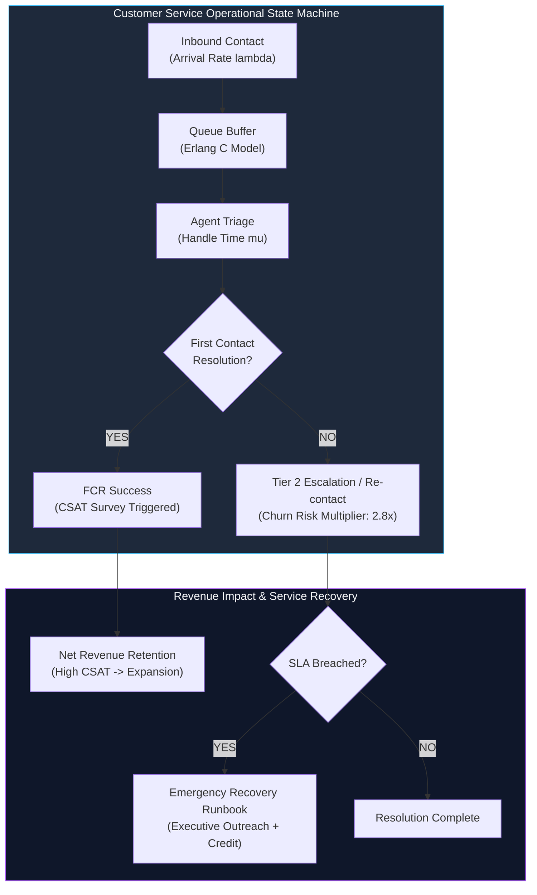
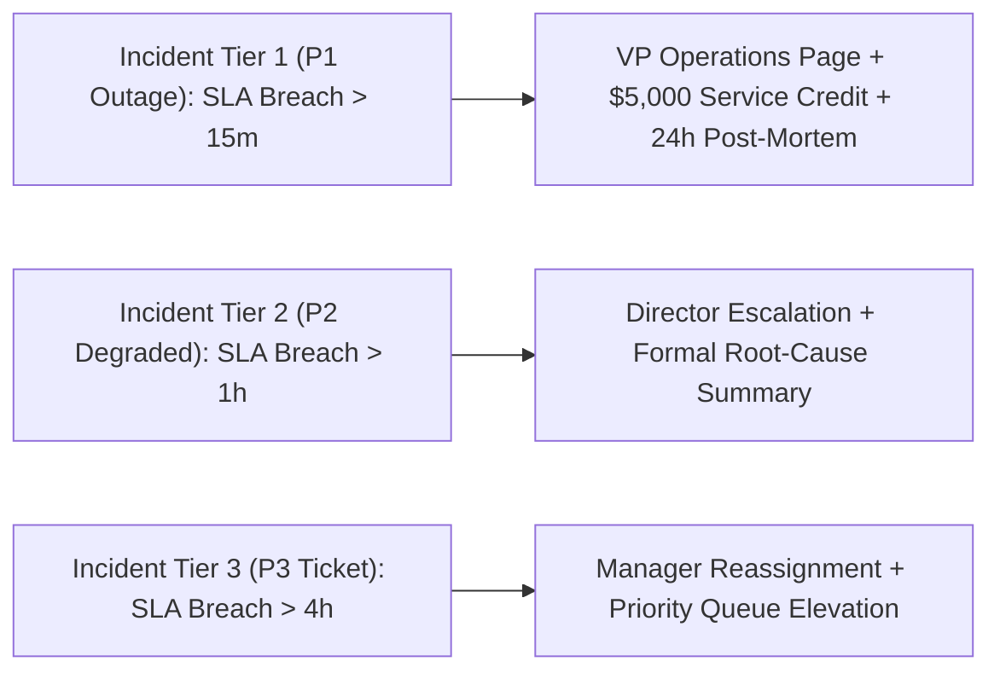

# Operational Verification Labs: Customer Service

## Objective & Operational Lab Setup

This laboratory guide provides systematic operational verification procedures for measuring, modeling, and optimizing enterprise customer service performance. Customer service operations function as a critical revenue-protection and expansion mechanism: customer churn, contract renewal velocity, and Net Revenue Retention (NRR) are direct functions of first-contact resolution fidelity and SLA response velocity.

The verification program validates four foundational operational domains:
1. **First-Contact Resolution (FCR) Cohort Modeling**: Calculating true FCR rates and isolating the churn impact of repeat contacts across ticket cohorts.
2. **Erlang C Queue Capacity & Wait-Time Modeling**: Simulating queue dynamics, agent utilization limits, and abandonment rates under variable contact arrival distributions.
3. **CSAT / NPS Regression & Churn Correlation**: Establishing statistical correlation ($p < 0.05$) between customer satisfaction scores and account expansion / renewal rates.
4. **Service Recovery & SLA Breach Runbooks**: Implementing programmatic compensation matrices and root-cause corrective action (RCCA) pipelines following severe operational escalations.

### Analytical Environment Setup

The verification workbench utilizes standard business data analysis tools (Python with `pandas` / `scipy` or spreadsheet modeling):

```bash
# Verify analytical runtime environment
python3 -c "import pandas, scipy, numpy; print('Analytical Python Stack: OK')"
```

Each ticket record evaluated in these exercises must contain the following schema fields: `ticket_id`, `open_timestamp`, `close_timestamp`, `channel` (phone / email / chat / web), `agent_id`, `contact_reason_tier1`, `contact_reason_tier2`, `resolution_status`, `csat_score` (1–5 integer), `first_contact_resolution` (boolean), `handle_time_seconds`, `customer_segment` (enterprise / mid-market / smb), `customer_tenure_months`, and `annual_recurring_revenue` (ARR).



---

## Exercise 1: FCR Cohort Analysis & Churn Impact Modeling

First-Contact Resolution (FCR) is the single highest-leverage operational efficiency metric. An escalation or customer re-contact within 72 hours increases customer churn probability exponentially.

### Step 1.1: FCR Measurement Methodology

True FCR must not rely on agent self-reporting. It must be computed programmatically by inspecting customer re-contact events within a rolling 72-hour window:

$$\text{FCR}_{\text{true}} = \frac{T_{\text{resolved}} - T_{\text{recontact}_{72\text{h}}}}{T_{\text{total\_inbound}}} \times 100$$

Execute the following Python verification model to compute true cohort FCR across sample support tickets:

```python
import pandas as pd
import numpy as np

# Load support telemetry data
np.random.seed(42)
n_tickets = 1000

data = {
    'ticket_id': range(1001, 1001 + n_tickets),
    'customer_id': np.random.randint(100, 300, n_tickets),
    'created_at': pd.date_range(start='2026-08-01', periods=n_tickets, freq='h'),
    'channel': np.random.choice(['chat', 'email', 'phone'], n_tickets, p=[0.5, 0.3, 0.2]),
    'agent_self_fcr': np.random.choice([True, False], n_tickets, p=[0.82, 0.18]),
    'csat': np.random.choice([1, 2, 3, 4, 5], n_tickets, p=[0.05, 0.08, 0.12, 0.35, 0.40]),
    'churned': np.random.choice([0, 1], n_tickets, p=[0.92, 0.08])
}
df = pd.DataFrame(data).sort_values(['customer_id', 'created_at'])

# Compute time delta to next contact from same customer
df['next_contact_hours'] = df.groupby('customer_id')['created_at'].diff(-1).abs().dt.total_seconds() / 3600.0

# True FCR: agent marked resolved AND customer did not recontact within 72 hours
df['true_fcr'] = df['agent_self_fcr'] & ((df['next_contact_hours'] > 72.0) | df['next_contact_hours'].isna())

self_reported_fcr = df['agent_self_fcr'].mean() * 100
true_fcr = df['true_fcr'].mean() * 100
fcr_reporting_delta = self_reported_fcr - true_fcr

print(f"Self-Reported FCR: {self_reported_fcr:.2f}%")
print(f"Verified True FCR: {true_fcr:.2f}%")
print(f"Reporting Distortion Delta: {fcr_reporting_delta:.2f}%")
```

### Step 1.2: Quantifying Churn Hazard by Contact Count

Calculate the relative churn probability as a function of the number of touchpoints required to achieve ticket resolution:

```python
# Group by customer touchpoint counts and calculate churn rate
churn_by_fcr = df.groupby('true_fcr')['churned'].mean() * 100
print(f"\nChurn Rate for True FCR Cases: {churn_by_fcr[True]:.2f}%")
print(f"Churn Rate for Escalated / Multi-Contact Cases: {churn_by_fcr[False]:.2f}%")
print(f"Churn Multiplier on Failed FCR: {churn_by_fcr[False] / churn_by_fcr[True]:.2f}x")
```

---

## Exercise 2: Erlang C Queue Modeling & Wait-Time Optimization

Contact centers cannot be staffed to average contact arrival rates alone. Random Poisson arrivals cause exponential queue buildup when agent utilization approaches capacity.

### Step 2.1: The Erlang C Mathematical Formulation

The probability that an arriving customer must wait in queue ($P_w$) is given by the Erlang C formula:

$$P_w = \frac{\frac{A^m}{m!} \frac{m}{m - A}}{\sum_{k=0}^{m-1} \frac{A^k}{k!} + \frac{A^m}{m!} \frac{m}{m - A}}$$

Where $A = \frac{\lambda}{\mu}$ is the traffic intensity (Erlangs), $\lambda$ is the arrival rate per unit time, $\mu$ is the service rate per agent, and $m$ is the number of active agents ($m > A$ for queue stability).

Execute queue dimensioning to evaluate wait time and service level compliance ($80\%$ of calls answered within $20$ seconds):

```python
import math

def erlang_c(m, traffic_intensity):
    # Summation term for states 0 to m-1
    sum_terms = sum((traffic_intensity ** k) / math.factorial(k) for k in range(m))
    c_term = (traffic_intensity ** m) / (math.factorial(m) * (1.0 - (traffic_intensity / m)))
    pw = c_term / (sum_terms + c_term)
    return pw

def calculate_service_level(arrival_rate_per_hour, avg_handle_time_sec, num_agents, target_wait_sec=20):
    lambd = arrival_rate_per_hour / 3600.0
    mu = 1.0 / avg_handle_time_sec
    A = lambd / mu
    
    if num_agents <= A:
        return 0.0, float('inf') # Queue unstable
        
    pw = erlang_c(num_agents, A)
    avg_wait = (pw / (num_agents * mu - lambd))
    sl = (1.0 - pw * math.exp(-(num_agents * mu - lambd) * target_wait_sec)) * 100.0
    return sl, avg_wait

# Scenario: 180 calls/hr, 300s avg handle time (Traffic = 15 Erlangs)
print(f"{'Agents':<8} | {'Service Level (<20s)':<22} | {'Avg Wait Time (s)':<18}")
print("-" * 52)
for agents in range(16, 22):
    sl, wait = calculate_service_level(180, 300, agents)
    print(f"{agents:<8} | {sl:>20.1f}% | {wait:>16.1f}s")
```

---

## Exercise 3: Service Recovery Paradox & SLA Escalation Protocol

When an enterprise customer experiences a critical outage or service failure, execution of an immediate, standardized service recovery runbook prevents account cancellation and can yield higher long-term loyalty than an account that never encountered an issue (the Service Recovery Paradox).

### Step 3.1: Tiered Escalation Matrix

Implement an operational escalation rubric based on customer contract tier and incident severity:



```python
def evaluate_sla_breach_recovery(customer_arr, breach_severity_p_tier, duration_minutes):
    compensation = {}
    if breach_severity_p_tier == "P1":
        if duration_minutes > 15:
            compensation["action"] = "Executive Sponsor Outreach"
            compensation["credit_percentage"] = min(25.0, 5.0 + (duration_minutes // 15) * 5.0)
            compensation["rca_required_hours"] = 24
    elif breach_severity_p_tier == "P2":
        if duration_minutes > 60:
            compensation["action"] = "Director Level Incident Briefing"
            compensation["credit_percentage"] = 10.0
            compensation["rca_required_hours"] = 48
            
    compensation["dollar_credit"] = (customer_arr / 12.0) * (compensation.get("credit_percentage", 0.0) / 100.0)
    return compensation

test_recovery = evaluate_sla_breach_recovery(customer_arr=120000, breach_severity_p_tier="P1", duration_minutes=45)
print("\nAutomated Service Recovery Determination:")
for k, v in test_recovery.items():
    print(f"  • {k}: {v}")
```

---

## Summary & Verification Matrix

| Operational Metric | Governing Model | Diagnostic Method | Target Threshold |
|:---|:---|:---|:---|
| **True FCR** | 72-Hour Re-contact Filter | Cohort timestamp delta audit | $\ge 78.0\%$ True Resolution |
| **Queue Service Level** | Erlang C Distribution | Poisson arrival simulation | $\ge 80.0\%$ answered in $< 20\text{s}$ |
| **Agent Occupancy** | $A / m$ Utilization Ratio | Shift scheduling model | $75.0\% \le \text{Occupancy} \le 85.0\%$ |
| **SLA Resolution Rate** | Contractual SLA Clock | Ticket lifecycle timestamp log | $\ge 99.0\%$ inside SLA target |
| **Recovery Paradox** | Post-Incident CSAT Delta | 30-day post-recovery CSAT audit | CSAT $\ge 4.2 / 5.0$ following P1 |
