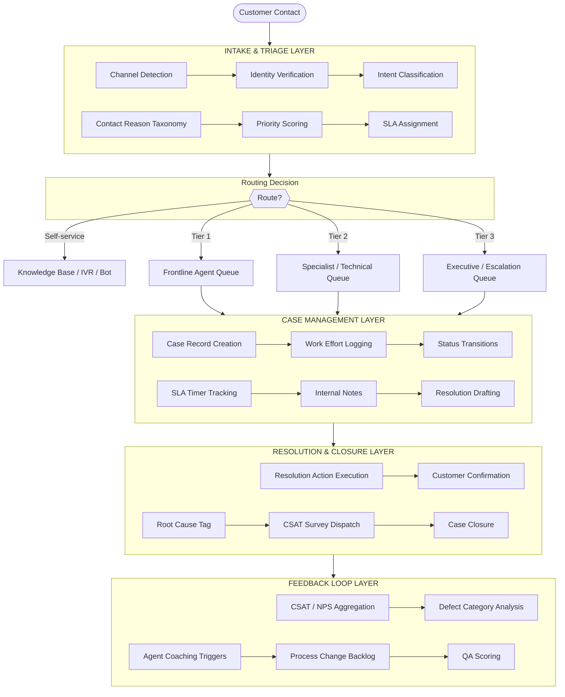

# Lesson 1: Service Fundamentals, Customer Expectations, Resolution Mechanisms

## 1. First-Principles Intuition & Invariants

Customer service, reduced to its mechanical core, is a system for converting a gap between expectation and reality into a closed state of satisfaction or at least acknowledged resolution. Every transaction a customer initiates, whether a complaint about a billing error, a request for product guidance, or an escalation about a failed delivery, represents a delta: the difference between what the customer believed would happen and what actually did. The function of a service organization is not to prevent that delta from forming, because no organization of meaningful scale can achieve zero defects across all touchpoints. The function is to detect the delta rapidly, classify it accurately, and close it in a way that the customer experiences as fair, competent, and human.

This distinction matters enormously in practice. Organizations that build service operations around defect prevention as a primary goal chronically underinvest in resolution infrastructure, because they anchor their operating model to an impossible ideal. Organizations that build around resolution competency tend to outperform, because they treat failure as a statistical certainty and design workflows for it rather than against it. This is the first invariant of service management: **resolution capacity is a core business asset, not a cost of failure**.

The second invariant concerns the anatomy of expectation itself. Customers arrive at a service interaction with expectations operating across three distinct layers, and conflating these layers is the most common diagnostic failure in service design. The first layer is the *explicit expectation*: what the customer was directly promised, usually in a contract, a marketing claim, or a service-level agreement. The second is the *implicit expectation*: what the customer reasonably infers from industry norms, prior experience, and contextual signals, even when nothing was explicitly stated. A customer who purchases business-class airfare has an explicit expectation about seat width and an implicit expectation that the flight attendant will not speak to them dismissively, even though no contract clause governs tone. The third layer is the *latent expectation*: what the customer has not yet articulated even to themselves, but will recognize immediately when it is either delivered or violated. These latent expectations are the substrate of brand loyalty and the origin of viral complaints alike.

The original academic framework that captured this architecture was the SERVQUAL model, developed by Parasuraman, Zeithaml, and Berry in the late 1980s through a multi-industry study of service quality perception. The model identifies five determinants of service quality: reliability, assurance, tangibles, empathy, and responsiveness. Crucially, the model does not measure service quality as an objective output but as a *gap score*: the difference between expected service and perceived service along each dimension. Decades of subsequent practitioner experience have confirmed the model's central insight while also exposing its limitation. SERVQUAL tells you where the gap is; it does not tell you how the gap formed or what operational lever closes it. That second half of the problem is what this lesson addresses.

The third invariant concerns ownership. In any service interaction that requires more than one person or one system to resolve, the customer's experience of quality is determined not by the competence of the best person who touched the ticket, but by the coherence of the handoff between all of them. This is a systems-level insight with direct operational consequences. A customer who speaks to an empathetic frontline agent, then gets transferred to a technical specialist who cannot see the prior conversation, then receives a follow-up email referencing the wrong issue, will not remember the empathetic agent. They will remember the disintegration. Resolution ownership, therefore, is not an attitude, it is a structural property of the case management system: a single thread of accountability that persists across every person and channel that touches a case until it closes.

Understanding these three invariants, resolution capacity as infrastructure, expectations as a three-layer construct, and ownership as a structural rather than behavioral property, establishes the theoretical floor from which all operational decisions in service management must rise.

---

## 2. Core Architecture & Mechanics

A mature service operation is best understood as a pipeline with well-defined stages, each with its own data requirements, decision logic, and exit criteria. The pipeline converts a raw customer contact into a closed resolution record. The integrity of the pipeline depends on the accuracy of two things: the information captured at intake, and the routing decision that sends a contact to the appropriate resolution tier.

The canonical architecture of that pipeline looks like this:

Each layer carries specific operational mechanics that determine whether the pipeline runs efficiently or degrades under volume.

**The Intake and Triage Layer** is where most service organizations incur the highest avoidable cost. The core problem is that agents performing intake often operate on incomplete information, which forces them to ask customers questions that a well-designed intake form or IVR would have captured before human contact was necessary. The operational discipline here is contact reason taxonomy: a structured, hierarchical vocabulary for classifying why a customer has reached out. A well-constructed taxonomy has three levels. The first level is the domain (billing, fulfillment, product, account, compliance). The second level is the action type (dispute, inquiry, change request, escalation, complaint). The third level is the specific sub-reason (duplicate charge, delivery not received, password reset, executive complaint, defective unit). Every contact record must carry all three levels before it leaves intake. This taxonomy serves two simultaneous functions: it drives routing decisions in the present and it feeds defect analysis in the future. A taxonomy that lacks specificity at level three produces routing errors that inflate handle time, and produces defect reports so aggregated they cannot point to a solvable root cause.

Priority scoring at intake follows a matrix that weighs two independent dimensions: *impact* (severity to the customer, expressed as financial value at risk, safety implication, or relationship tier) and *urgency* (time before the customer's situation worsens materially). These dimensions are independent because their combination determines the correct initial response, not just speed. A high-impact, low-urgency issue, say a systematic billing discrepancy discovered during an annual audit, requires thorough investigation rather than rapid reassurance. A low-impact, high-urgency issue, such as a customer locked out of an account thirty minutes before a scheduled presentation, requires immediate access restoration regardless of the account's revenue value.

**The Case Management Layer** is where ownership becomes a structural property. A case record is not simply a log of customer communications. It is a structured object with defined fields that must be completed at each stage transition, mandatory internal notes when any party touches the case, and an SLA timer that cannot be paused without manager authorization and a documented reason. The SLA timer is the single most important accountability mechanism in the pipeline because it makes invisible latency visible. Without timer enforcement, cases age silently. With it, aging becomes an operational alert.

The status taxonomy for cases must follow a small, unambiguous vocabulary. A common working set includes: *New* (received, unassigned), *In Progress* (assigned, being worked), *Pending Customer* (waiting on customer input, timer paused), *Pending Internal* (waiting on internal dependency, timer running), *Resolved* (resolution delivered, awaiting confirmation), and *Closed* (confirmed or auto-closed after 72 hours without customer response). Each transition between statuses must require a note that answers three questions: what was done, what is the next required action, and who owns that action. This note discipline prevents the most common failure mode in multi-party resolution, the implicit handoff where the passing agent assumes the receiving party understands the context because they can read the customer's original message, which they almost never do in sufficient depth.

**Expectation-Setting as a Mechanics Problem.** The gap between what a customer expects to happen next and what actually will happen next is not primarily a communication problem; it is a workflow mechanics problem. The standard mechanism for closing that gap is the *commitment architecture*: at every status transition, the agent communicates to the customer three things with specificity: what has been done, what will happen next, and when. The "when" is the critical variable that most frontline agents under-specify because they lack confidence in their own organization's internal timelines. The correct operational response is not to train agents to feel more confident. It is to provide agents with published, empirically validated SLA commitments for each case type at each tier, so that "when" becomes a lookup rather than a guess. When an agent says "someone will get back to you soon," they have not set an expectation; they have created a slot where frustration will grow.

---

## 3. High-Performance Optimization & Failure Modes

The transition from a functional service operation to a high-performance one is largely a measurement and feedback problem. Most organizations can process contacts. Fewer organizations close the loop from contact data back to process change with enough speed and specificity to continuously improve. The gap between these two states is what this section addresses.

**Throughput and Handle Time.** The primary throughput metric for a service team is average handle time (AHT), which aggregates talk time, hold time, and after-call work into a single duration measurement per contact. AHT is a useful efficiency indicator but a dangerous optimization target if pursued in isolation. Teams that optimize AHT directly tend to push agents toward rapid closures that do not fully resolve the customer's issue, which inflates repeat contact rates. The more precise metric pairing is AHT alongside *First Contact Resolution rate* (FCR), defined as the percentage of cases resolved within the first interaction without requiring a follow-up contact or escalation on the same issue. The FCR formula is:

$$FCR = \frac{\text{Cases Resolved on First Contact}}{\text{Total Cases Opened}} \times 100$$

Industry benchmarks vary by sector, but in B2B service environments, an FCR below 65% signals a structural problem in Tier 1 agent capability or knowledge base coverage. An FCR above 85% in a complex technical environment may paradoxically signal that agents are classifying cases as resolved prematurely. Both ends of the distribution require investigation, not celebration or alarm without data.

**Customer Effort Score as a Diagnostic Instrument.** Customer Satisfaction (CSAT) is a lagging indicator that tells you how customers felt after a resolution. Customer Effort Score (CES) is a leading indicator of churn because it measures how hard customers had to work to get their issue resolved. The CES survey asks a single question on a 7-point scale: "The company made it easy for me to handle my issue." Low CES scores (below 5 on that scale) predict customer attrition more reliably than low CSAT scores do, because effort is a friction tax that compounds across interactions. A customer who feels the resolution was acceptable but required three phone calls, two portal logins, and a document re-upload is calculating whether the relationship is worth maintaining.

The CES score's operational utility comes from correlating it against contact reason taxonomy. When you can identify that customers who contact you for reason "fulfillment/inquiry/delivery tracking" score consistently lower on CES than those who contact for "billing/change request/payment method," you have a prioritized problem statement for process redesign. That correlation requires that the contact reason taxonomy described in the previous section be applied with discipline; without it, CES data is an aggregated dissatisfaction signal with no actionable decomposition.

**The Escalation Failure Mode.** Escalation exists as a pressure relief valve for cases that exceed Tier 1 resolution capability. It fails in two distinct modes. The first is *over-escalation*, where agents escalate to avoid the discomfort of a difficult conversation or because knowledge base coverage at Tier 1 is insufficient. Over-escalation loads specialist queues with cases that could have been resolved at first contact, inflates specialist AHT because they are handling volume work rather than complex cases, and trains customers to bypass Tier 1 entirely by requesting escalation immediately. The fix is dual: improve Tier 1 knowledge base coverage using FCR data to identify the most commonly escalated topics, and audit escalation records weekly to identify agents with escalation rates more than one standard deviation above team average, then diagnose whether the cause is a knowledge gap, a confidence deficit, or a de-facto policy of avoiding difficult interactions.

The second failure mode is *escalation without context transfer*, already touched upon in the case management layer discussion but worth naming precisely as a failure mode: when a Tier 1 agent escalates a case to Tier 2 without transferring a complete internal summary of the customer's history, the actions already taken, and the specific blocker that made Tier 1 resolution impossible, the Tier 2 agent will reconstruct that context from scratch, usually by asking the customer to repeat information they have already provided. This is the single interaction pattern most reliably associated with high customer effort scores and downward CSAT movement. The structural mitigation is to enforce a mandatory escalation note template, requiring the escalating agent to complete fields for customer history summary, actions attempted, reason for escalation, and suggested next action before the status transition to Tier 2 is permitted in the case management system.

**Queue Starvation and SLA Cascades.** When contact volume spikes, queues back up, SLA timers expire, and the team enters a triage mode where each agent is making real-time decisions about which cases to work in what order. Without explicit prioritization logic built into the queue management system, agents default to working the most recent contacts first because they are easier to process (the customer is still engaged, context is fresh), which causes the oldest high-priority cases to age further. This is called queue starvation: the systematic de-prioritization of aged cases by virtue of recency bias in an unmanaged queue.

The mitigation is a priority-weighted queue algorithm that surfaces cases by a composite score rather than by arrival time. A practical composite score weights four variables: initial priority score (from the impact-urgency matrix at intake), SLA time remaining (normalized to a 0–100 scale where 0 means the SLA has already breached and 100 means no urgency exists yet), customer tier (which maps to contracted SLA levels), and repeat contact flag (a binary indicator that this customer has already contacted about this issue, which elevates their case because prior failure to resolve multiplies churn risk). The resulting queue surface means that an agent opening their queue always sees the case with the most acute resolution need, not simply the newest one.

**The Feedback Loop as a Governance Mechanism.** The feedback loop layer is where service operations either improve continuously or plateau. The mechanism that makes it functional is a weekly case audit process with a specific analytical structure. The audit draws a stratified random sample of closed cases, twenty cases from each tier, weighted toward cases that received low CSAT or CES scores. Each sampled case is reviewed against four questions: Was the contact reason classified correctly? Was the routing decision appropriate for the classification? Did the resolution note demonstrate that the agent understood the actual problem? Did the response set accurate expectations at each status transition? The aggregate answers to these questions generate two outputs: a quality score per agent that feeds coaching conversations, and a defect category report that feeds the process change backlog.

The process change backlog is the operational artifact that transforms individual case failures into systemic improvements. It is a living document, governed by the service operations manager, that records the category of defect, the number of cases in the sample and in the full population affected by that defect category, the root cause hypothesis, the proposed process or knowledge base change, the owner, and the target implementation date. Without this document, quality review produces insights that dissipate into coaching conversations and are never institutionalized. With it, service quality improvement becomes a managed project rather than an aspiration.

The final consideration for high-performance service operations is the relationship between resolution speed and resolution completeness. These two variables exist in a natural tension: faster resolutions tend to be less thorough, and thorough resolutions tend to take longer. Organizations that resolve this tension by simply mandating speed are choosing to generate repeat contacts, escalations, and churn. Organizations that resolve it by defining *complete resolution criteria for each contact reason category* eliminate the ambiguity that forces agents into the speed-thoroughness trade-off in the first place. A complete resolution for a billing dispute, for example, is not "the agent explained the charge." It is "the agent explained the charge, confirmed the customer understood, applied any warranted credit to the account, and sent a written confirmation email within four hours." That definition converts a subjective judgment call into a checklist, and checklists are what make service quality consistent at scale.
