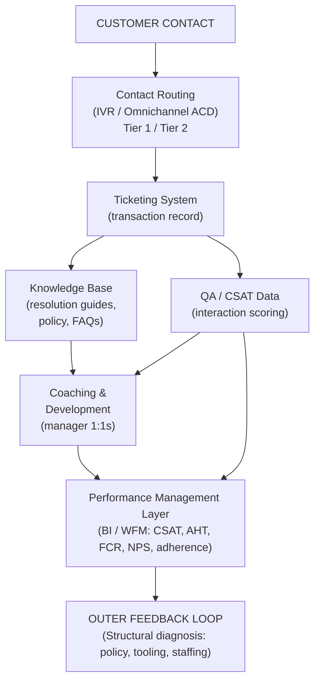

# Lesson 4: Team Dynamics, Coaching Models, Organizational Culture, Retention

## 1. First-Principles Intuition & Invariants

There is a persistent organizational fiction that customer service quality is primarily a function of individual talent — that if you hire enough naturally empathetic, articulate, unflappable people, excellence will emerge on its own. This belief, comfortable as it is for executives who want to externalize accountability, collapses under even modest empirical scrutiny. The service teams that consistently outperform their peers on CSAT, first-contact resolution, and net promoter scores are not staffed with superhuman communicators. They are staffed with ordinary people embedded in systems that make high performance structurally easier than low performance. The first invariant of team dynamics in customer service is therefore architectural: the quality of service delivered to customers is a downstream output of the quality of systems, norms, and relationships that exist inside the team.

This invariant has an uncomfortable corollary for managers who have inherited underperforming teams. If the system is broken, training individuals harder produces diminishing returns. A representative who receives perfect onboarding but then joins a team where escalation paths are ambiguous, coaching is inconsistent, and institutional knowledge lives in one colleague's head rather than in a searchable knowledge base will regress to the mean of her environment within ninety days. Organizational psychologists call this the "person-situation debate," and in customer service operations, the situation wins decisively. Your job as a service manager is not primarily talent curation. It is environment architecture.

The second invariant concerns emotional labor and its thermodynamic logic. The sociologist Arlie Hochschild coined the term "emotional labor" in 1983 to describe the work of managing one's displayed feelings as part of a job requirement. Customer service is among the most emotionally demanding professions in the modern economy: representatives are expected to maintain warmth, patience, and solution-orientation while absorbing frustration, hostility, and sometimes outright abuse from customers in distress. This labor depletes a finite cognitive and emotional resource. The psychologist Roy Baumeister's research on ego depletion (while subject to ongoing replication scrutiny, the core operational insight holds) suggests that self-regulatory effort draws on a limited pool that is restored by rest, autonomy, and positive social reinforcement. When a service team runs consecutive high-volume sprints without recovery structures, when managers communicate exclusively through correction rather than recognition, and when agents have no meaningful autonomy over how they approach their work, the pool drains faster than it refills. The result is burnout — not an attitude problem but a metabolic one.

The third invariant is what systems theorists call the "hierarchy of feedback loops." In a healthy customer service operation, three nested feedback cycles operate simultaneously. The inner loop runs at the interaction level: a representative handles a contact, receives a quality score or customer survey response, and adjusts her approach on the next contact. The middle loop runs at the team level: a manager reviews aggregate performance data weekly, identifies skill gaps or process failures, and intervenes through coaching or workflow changes. The outer loop runs at the organizational level: leadership analyzes trend data quarterly, identifies structural causes of recurring failures, and redesigns policies, tools, or staffing models accordingly. When any of these loops is broken or slow, the system cannot correct itself. Most organizations over-invest in the inner loop (quality monitoring) while systematically neglecting the outer loop (structural diagnosis), which is why the same categories of failure recur quarter after quarter despite abundant coaching.

These three invariants — environment over individual, emotional labor thermodynamics, and nested feedback loops — form the theoretical bedrock for everything that follows. Hold them in mind as we move from principle to mechanism.

---

## 2. Core Architecture & Mechanics

### The Team as a System: Structure, Roles, and Information Flow

A customer service team is not a collection of parallel individuals processing identical tasks. It is a network of interdependent roles connected by information flows, shared knowledge stores, and escalation pathways. Understanding its architecture means tracing exactly how a customer contact enters the system, how decisions about that contact are made, and how the information generated by that contact is captured and routed back into the system for future use.

The fundamental structural unit is the tier, and the tier structure determines not just routing efficiency but the professional development trajectory of everyone in the team. In a well-designed tiered model, Tier 1 handles high-volume, lower-complexity contacts using documented resolution paths. Tier 2 handles escalations requiring product depth, policy exceptions, or cross-functional coordination. Tier 3 (sometimes called Technical Account Management or Specialist Support) handles complex, relationship-sensitive, or high-value accounts. This structure matters for team dynamics because it creates a visible career path: mastery at Tier 1 produces the skills required for Tier 2, and the expectation of progression is a retention mechanism as important as compensation.

The information architecture of the team operates across three overlapping systems. The ticketing system (Zendesk, Freshdesk, Salesforce Service Cloud, or similar) captures the transactional record of every customer contact — what was asked, what was resolved, by whom, and how long it took. The knowledge base (Confluence, Guru, Notion, or a native CMS) captures institutional knowledge in consumable form: resolution guides, policy documents, product FAQs, and decision trees. The performance management system (which may be built in Salesforce, a dedicated WFM tool like Verint or NICE, or in a business intelligence layer like Looker or Tableau) aggregates individual and team metrics for coaching and strategic analysis. The failure mode that most organizations experience is not absence of these systems but disconnection between them: insights generated in the ticketing system never make their way into the knowledge base, and performance data visible in the BI layer never informs the coaching conversations that managers have with their reports.

The following diagram illustrates the core information flow in a mature customer service team architecture:

This architecture has one decisive dependency: the quality of the data entering the ticketing system. If representatives do not tag contacts with accurate disposition codes, if resolution notes are sparse, if escalation reasons are not documented, the entire downstream chain degrades. This is why disposition hygiene — the discipline of accurate, granular contact categorization — is a team norm that must be established during onboarding and reinforced continuously. It is not an administrative formality. It is the instrumentation layer of your service operation.

### Coaching Models: From Corrective to Developmental

Most customer service coaching is remedial: a manager notices a low quality score, pulls the interaction recording, and delivers feedback designed to prevent repetition. This model is necessary but insufficient. Remedial coaching addresses the lower tail of performance; it does not move the median and does nothing for high performers who may be disengaging because they are unchallenged. A complete coaching architecture requires at least three distinct modes, each serving a different function and operating on a different cadence.

**Corrective coaching** addresses specific behavioral deviations from established standards. Its mechanism is straightforward: the manager identifies a concrete example (a recorded call, a ticket thread, a CSAT comment), describes the observed behavior, explains the standard it failed to meet, and collaborates with the representative on an alternative approach. The critical technical discipline here is behavioral specificity. "Your tone was off" is not a coaching statement; it is an impression. "In the third minute of this call, when the customer said they'd been waiting two weeks, you responded with 'I understand' and immediately moved to troubleshooting steps without first acknowledging the impact of the delay on their business — here is what that lands like from the customer's side" is a coaching statement. It names the moment, the behavior, the standard, and the effect.

**Developmental coaching** operates at a longer time horizon and targets the expansion of a representative's skill set rather than the correction of a specific failure. It is organized around a capability gap analysis: what skills would this person need to advance to the next tier or take on a specialist function, and what deliberate practice structure would build those skills over the next quarter? The practical tool is a Development Plan template structured around four columns: the target competency, the current observable gap, the specific practice or exposure required to close the gap, and the success indicator that will confirm the gap is closed. A representative aiming to move from Tier 1 to Tier 2 might have a development plan targeting complex troubleshooting methodology, cross-functional coordination skills, and familiarity with enterprise account context — each with a defined practice path and a 90-day milestone.

**Motivational coaching**, the most neglected of the three, is not about fixing problems at all. It is about understanding what drives a specific individual and ensuring the work structure keeps those drivers engaged. The practitioner tool here is a structured motivation interview — not a performance conversation but a genuine inquiry into what the representative finds energizing and draining about the role. The findings then inform how that person's workload is shaped: a representative who finds deep problem-solving energizing might be assigned the first-pass triage on complex escalations even while remaining technically in a Tier 1 role. This kind of customization is the difference between managing headcount and managing people.

The practical cadence that integrates all three modes looks like this: a 25-minute weekly or biweekly 1:1 organized around a standing agenda that opens with the representative's agenda items (not the manager's), moves through one development plan check-in, and reserves the last five minutes for a corrective or recognition feedback point drawn from the previous week's quality sample. The manager's role in this meeting is primarily to listen, ask, and unblock rather than to report or direct. This is structurally counterintuitive for many managers who were promoted from representative roles precisely because they were excellent at solving problems, but the transition from solver to coach is the fundamental developmental task of frontline management.

### The GROW Model in Operational Practice

Among the available coaching frameworks, GROW (Goal, Reality, Options, Will) earns its widespread adoption in customer service management because it is rigorous enough to produce behavioral change and simple enough to be used conversationally without a template in front of you. Its operational logic is worth unpacking in detail because the framework is frequently cited and rarely applied with precision.

The Goal phase is not "what do you want to achieve this quarter." That is a performance review conversation. In a coaching context, the Goal is the specific, concrete outcome the representative wants from this coaching conversation. The manager's job in this phase is to help the representative articulate a goal that is specific enough to be solvable within the conversation's timeframe. "I want to get better at difficult customers" is not a GROW goal. "I want to understand what I should do differently when a customer starts the conversation by saying they're going to cancel" is a GROW goal.

The Reality phase is a structured inquiry into the current situation as the representative actually experiences it, not as the manager interprets it from performance data. This distinction matters enormously. The manager may have data showing that the representative's AHT on escalation contacts is 40% above team average, and may have a theory about why. But in the Reality phase, the representative's self-assessment may reveal a completely different causal chain: not that she is inefficient but that she is spending additional time because she cannot find policy guidance in the knowledge base and is reconstructing the answer from memory on every contact. This is an infrastructure problem, not a skill problem, and no amount of efficiency coaching will resolve it.

The Options phase generates alternatives without judgment. The manager's temptation here is to skip directly to the solution she already has in mind, but premature convergence on a solution forecloses the representative's ownership of the outcome. Genuine option generation — "what are three different ways you could handle the opening of that conversation?" — produces both better solutions and stronger commitment to execution.

The Will phase converts the most promising option into a concrete commitment: specifically what will the representative do, by when, in which situation, and how will she know it worked. Without this phase, coaching conversations are intellectually satisfying and behaviorally inert.

### Knowledge Transfer Systems: Institutionalizing Expertise

One of the most reliably destructive events in a customer service organization is the departure of a senior representative. When that person leaves, they take with them years of product knowledge, institutional memory about edge-case customer situations, and the unwritten heuristics that made them effective in ways no quality rubric ever fully captured. This knowledge was never extracted from their head and placed in a system accessible to everyone else, because the organization treated knowledge transfer as an event (onboarding documentation) rather than a continuous operational process.

The antidote is a structured knowledge capture protocol embedded into the daily workflow rather than bolted on at departure. The mechanism has three components. First, a resolution contribution norm: every time a representative encounters a contact type for which no knowledge base article exists, or for which the existing article produced an incorrect resolution path, they are responsible for submitting a knowledge base update request. The norm is enforced not by mandate but by making the submission path frictionless — a single-click "flag for KB update" button in the ticketing interface routes the ticket to a designated knowledge curator on the team. Second, a weekly knowledge review: a rotating team member (the knowledge curator role, shared across senior representatives on a monthly basis) reviews flagged tickets, drafts updated or new KB articles, and publishes them after peer review. Third, a KB quality metric tracked at the team level: the percentage of contacts resolved using a KB article without escalation, measured monthly, creates a collective incentive to keep the knowledge base accurate and comprehensive.

This architecture converts knowledge from a private asset into a team infrastructure. It also has an underappreciated cultural effect: it communicates to representatives that their expertise is valued enough to be systematized, which is a retention signal as meaningful as a compensation review.

---

## 3. High-Performance Optimization & Failure Modes

### Building a Culture That Produces Service Excellence

Organizational culture is not a mood. It is not the words on a values poster. It is the aggregate pattern of what actually gets rewarded, what gets tolerated, and what gets corrected in the daily operation of the team. Culture is the residue of repeated decisions, and the most powerful decisions shaping service team culture are made not in strategy sessions but in the minute-by-minute choices managers make about where they direct their attention.

The concept of "psychological safety," developed by Amy Edmondson at Harvard Business School, is particularly operative in customer service teams. Psychological safety is the shared belief that the team is safe for interpersonal risk-taking — that asking for help when stuck on a contact, flagging a process failure without fear of blame, or admitting uncertainty about a policy interpretation will not result in punishment or humiliation. Its operational importance in customer service is not primarily about team cohesion; it is about information flow. A team with low psychological safety is a team where representatives solve ambiguous problems by guessing rather than asking, where process failures stay invisible until they produce customer-visible outcomes, and where the knowledge base stays permanently stale because no one wants to be the person who admits they don't know the answer. High psychological safety produces the opposite: a team that surfaces problems early, escalates intelligently rather than defensively, and treats every unusual contact as an opportunity to improve the system rather than a threat to individual credibility.

The manager's behavioral signature is the primary driver of psychological safety, and the most important element of that signature is how she responds to mistakes. The diagnostic question is straightforward: when a representative makes an error that affects a customer, does the manager's response prioritize understanding the system failure that enabled the error, or does it prioritize attributing blame to the individual? The former builds psychological safety; the latter erodes it. This does not mean consequential errors go unaddressed — it means the investigation precedes the judgment, and the investigation is primarily diagnostic rather than prosecutorial.

Culture also expresses itself in the rituals of team life: how meetings open, how wins are recognized, how onboarding feels, what stories get told about the team's history. Managers who want to reshape culture should identify the existing rituals and modify them deliberately rather than attempting to install new cultural artifacts from scratch. A weekly team meeting that currently opens with the manager reading out performance numbers can be restructured to open with a "contact of the week" — a nominated interaction, positive or instructive, shared by a team member with a brief explanation of what made it notable. This single ritual change shifts the team's shared attention from metric performance to craft, which over time reshapes what representatives pay attention to and talk about between meetings.

### Motivation Architecture and Burnout Prevention

Burnout in customer service is not primarily caused by high contact volume, though volume accelerates it. It is caused by the combination of high emotional demand, low perceived autonomy, and insufficient recovery structures. The psychologist Christina Maslach, whose Maslach Burnout Inventory remains the field's standard assessment instrument, identified six dimensions of job-person mismatch that drive burnout: workload, control, reward, community, fairness, and values alignment. Each is actionable at the team level.

Workload management requires treating adherence schedules as a tool for wellbeing as much as for capacity planning. Representatives who are consistently scheduled at 95% utilization — in queue with minimal off-phone time — have no cognitive recovery space between demanding contacts. The service management research literature suggests that scheduling 10 to 15 percent unstructured time into each representative's daily schedule (time not committed to queue, meetings, or training) produces measurable improvements in CSAT and significant reductions in attrition. This is not slack; it is cognitive maintenance.

Control, in Maslach's framework, refers to the degree to which employees have meaningful input into how they do their work. In highly scripted service environments, this dimension is structurally compressed, and that compression is a burnout accelerant. Practical interventions include allowing representatives to customize the phrasing of scripted interactions while maintaining required disclosures, involving senior representatives in the design and review of knowledge base content, and using team-level retrospectives (borrowed from Agile methodology, but entirely applicable here) to give representatives a formal channel for surfacing process improvements. The retrospective format — what is working, what is not, what should we try next — takes thirty minutes monthly and produces both process improvements and a meaningful sense of collective agency.

Reward mismatch is not exclusively financial. Representatives who handle complex, high-empathy situations effectively and receive no recognition experience reward mismatch even at competitive base pay. The recognition architecture should be multi-channel: manager-to-individual acknowledgment in 1:1s, peer-to-peer recognition in team channels (a Slack "kudos" channel with low friction to post is more valuable than a formal monthly award with high ceremony), and customer-sourced recognition (escalating positive CSAT comments directly to the representative with a personal note from the manager adds material weight to the customer's words).

Fairness deserves particular attention because perceived unfairness spreads through teams rapidly and is extremely difficult to reverse once established. The most common sources of fairness perception problems in service teams are inconsistent enforcement of attendance and schedule adherence policies, and opaque criteria for promotion and development opportunities. Both are solvable with published, explicit standards: a written adherence policy applied uniformly, and a written capability framework that makes the criteria for advancement visible and auditable by anyone on the team.

### Retention: The Economics and the Mechanics

Agent attrition in customer service carries a fully-loaded replacement cost that most organizations significantly underestimate. The commonly cited figure of 1.5 to 2.0 times annual salary reflects recruiting fees, onboarding time, productivity ramp, and quality deficit during the learning curve, but misses the harder-to-quantify costs of institutional knowledge loss and the team morale effect of watching peers leave. For a team of twenty representatives with a median fully-loaded cost of $65,000 per person and a 35% annual attrition rate (not unusual in BPO-adjacent service environments), the annual cost of replacement runs to roughly $1.5 million — before accounting for the impact on CSAT during ramp periods. This arithmetic makes retention investment straightforward to justify even at significant per-person cost.

The practical retention levers available to a frontline manager, as distinct from those requiring HR or executive sponsorship, are more powerful than most managers realize. Career pathing is the most underutilized. Representatives who can articulate a clear answer to "where does this role lead and what specifically do I need to do to get there" are substantially less likely to respond to competitive offers. The manager's job is to make that path concrete and personalized: not "you could become a senior rep" but "based on your development plan, you're on track to be ready for the Tier 2 technical track in Q3, and I will advocate for your inclusion in the next internal cohort." The difference in retention effect between these two statements is the difference between a vague aspiration and a credible commitment.

Onboarding structure also predicts 90-day attrition with surprising reliability. Research by the Corporate Executive Board found that employees who have a structured onboarding experience that includes role clarity, early wins, and social integration are 69% more likely to remain with the organization through year two. For customer service teams, structured onboarding means a written 30-60-90 day plan, a designated peer mentor (not the manager) who provides informal guidance on team norms and unwritten practices, a progressive contact exposure schedule that begins with lower-complexity contact types before moving to full queue, and explicit competency gates at day 30 and day 60 that give the new representative clear feedback on their standing before the first formal performance review.

The exit interview is the most systematically misused retention tool in the manager's arsenal. Conducted by HR after the representative has already committed to leave, the standard exit interview captures impressions that are optimized for social comfort rather than diagnostic accuracy — the departing employee has little incentive to give genuinely critical feedback. A more operationally useful practice is the "stay interview," a structured 1:1 conversation held with every representative at least once per year that asks directly: what would make you consider leaving this role, and what would make you want to stay for the next two years? The answers surface retention risks before they become departure decisions, when they are still actionable.

### Failure Mode Diagnosis: When Teams Degrade

High-performing service teams do not collapse suddenly. They degrade through a characteristic sequence of failure modes that, once recognized, can be interrupted before they become terminal. The sequence typically begins with workload overload, which creates the conditions for quality shortcuts: representatives under sustained contact pressure begin to optimize for speed over resolution quality, their CSAT scores edge downward, and they begin to feel that quality standards are aspirational rather than achievable. This creates cognitive dissonance — the gap between the standards they are held to and the standards they can actually meet under current conditions — and dissonance, over time, resolves not by improving performance but by updating beliefs: "these quality scores don't reflect what it's really like in the queue."

Once this belief becomes socially normalized in the team — once the gap between official standards and actual norms is discussed openly among peers as an acceptable reality rather than a problem to be solved — the team has entered a cultural drift state that is significantly harder to reverse than the original workload problem would have been to address. The manager's signal for this state is a subtle but specific change in how performance feedback is received: instead of genuine engagement with the substance of the feedback, the representative's response is increasingly procedural ("noted, I'll work on it") with no behavioral change between conversations. This is not a coaching problem. It is a belief problem, and it requires a different intervention: acknowledgment of the actual gap between current workload conditions and stated standards, followed by a concrete commitment to address the structural cause rather than the symptomatic behaviors.

The second major failure mode is the "knowledge island" — a state in which critical product or process knowledge becomes concentrated in one or two senior individuals who become indispensable precisely because the knowledge was never systematized. Knowledge islands are recognizable by their observable effects: specific contacts get routed to specific individuals rather than to the team generally, those individuals become overwhelmed and resentful, and their eventual departure creates acute operational crises. The mitigation is the knowledge capture protocol described in the architecture section, but the warning sign worth monitoring in real time is any pattern of contact routing that bypasses the standard queue in favor of specific individuals. When you see that pattern forming, treat it as a knowledge infrastructure gap requiring intervention, not as evidence that those individuals are exceptional and should simply be protected and retained.

The third failure mode is feedback loop latency — a state in which the gap between a customer experience event and the team's internal response to that event has grown so long that the signal-to-noise ratio in performance data collapses. When QA scores from a given week reach the representative three weeks later, embedded in a monthly report rather than in a timely coaching conversation, the behavioral feedback loop is functionally broken. The representative cannot connect the feedback to the specific interaction that generated it, cannot reconstruct the decision context that produced the behavior, and cannot experiment with alternatives on her next relevant contact because three weeks of subsequent contacts have already intervened. Speed of feedback is not a stylistic preference; it is a mechanistic requirement for learning. The operational standard for inner-loop feedback in a mature service operation is 48 to 72 hours between a sampled interaction and a coaching conversation about it. Beyond that window, the corrective value decays sharply.

Taken together, these failure mode patterns illuminate a consistent diagnostic principle: most customer service team degradation is not caused by the front-line behaviors that management tries to address through coaching. It is caused by structural conditions — workload, knowledge infrastructure, feedback latency, career visibility — that make it progressively harder for capable people to do their jobs well and to believe that doing their jobs well is worth the sustained effort. The manager who addresses behaviors without addressing structures will find herself in an endless loop of coaching conversations that produce temporary compliance and no durable change. The manager who addresses structures will find that her coaching conversations become shorter, more energized, and more consequential — because the people she is coaching have the conditions required to actually act on what they learn.
