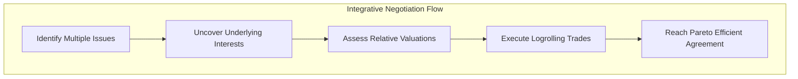

# Lesson 2: Strategic Frameworks: Integrative vs. Distributive Bargaining

## 1. First-Principles Intuition & Invariants

At its core, every negotiation is an exercise in resource allocation under conditions of incomplete information and bounded rationality. The fundamental tension in any bargaining scenario rests on the dichotomy between value claiming and value creation. Distributive bargaining, often referred to as the zero-sum or fixed-pie model, operates under the assumption that the resource in question is finite. Every dollar extracted by one party is a dollar forfeited by the other. Integrative bargaining, conversely, operates on the premise that the "pie" can be expanded through the discovery of mutually beneficial trades, transforming the negotiation from a combative tug-of-war into a collaborative optimization problem. 

To execute either framework effectively, a practitioner must internalize three structural invariants: the Best Alternative to a Negotiated Agreement (BATNA), the Reservation Price (RP), and the Zone of Possible Agreement (ZOPA). The BATNA is not a desired outcome; it is the quantifiable, actionable alternative a party will execute if the current negotiation collapses. If you are negotiating a SaaS vendor contract and your BATNA is switching to an inferior competitor that charges $50,000 per year, that figure anchors your walk-away point. Your Reservation Price is the internal threshold at which you are indifferent between accepting the deal on the table or walking away to your BATNA. For a buyer, the reservation price represents the maximum willingness to pay; for a seller, it represents the minimum acceptable revenue. 

The ZOPA is the mathematical space where the buyer’s maximum reservation price exceeds the seller’s minimum reservation price. If a buyer is willing to pay up to $80,000 ($RP_{buyer}$) and the seller will accept no less than $60,000 ($RP_{seller}$), the ZOPA is the $20,000 spread between these two points. In a purely distributive encounter, the negotiation is simply a battle over who captures that $20,000 surplus. The danger for practitioners lies in treating every negotiation as purely distributive. When parties focus only on claiming value, they often leave joint gains on the table. Value creation occurs when parties have differing relative valuations of the issues on the table. A buyer may care intensely about payment terms (Net 90 vs. Net 30) while the seller cares intensely about contract length (1 year vs. 3 years). By trading concessions on issues valued differently by each side— a process known as logrolling— both parties can achieve outcomes superior to a simple monetary compromise.

## 2. Core Architecture & Mechanics

The transition from distributive to integrative bargaining requires shifting from a single-issue framework to a multi-issue architecture. Single-issue negotiations mathematically force distributive outcomes because there is no variance in preference to exploit. If the only variable is price, any gain by the buyer is an equal loss to the seller. Multi-issue negotiations, however, allow for the mapping of Pareto efficiency. An outcome is Pareto efficient when no alternative arrangement exists that could make one party better off without making the other party worse off. The practitioner’s objective in an integrative negotiation is to push the final agreement to the Pareto frontier, eliminating any wasted joint value.

To achieve this, a negotiator must execute the Principled Negotiation framework, structurally codified by the Harvard Negotiation Project. This framework mandates four operational pillars: separating the people from the problem, focusing on interests rather than positions, inventing options for mutual gain, and insisting on objective criteria. Focusing on interests requires the practitioner to drill past stated positions to uncover the underlying business need. A supplier might take the position that they require a 15% price increase. Their underlying interest, however, might be that their raw material costs have spiked due to supply chain disruptions, and they need to maintain a specific gross margin to satisfy debt covenants. By identifying the interest, the buyer can structure a deal that mitigates the supplier's margin pressure without conceding a flat 15% price increase—perhaps by offering a longer-term contract that stabilizes the supplier's revenue forecast, or by altering payment terms to improve the supplier's working capital cycle.

The mechanical execution of value creation relies heavily on logrolling. Consider an enterprise software negotiation involving two issues: licensing fee and implementation timeline. The buyer (Company A) is facing a hard market launch in four months and places extreme value on a fast implementation timeline, but has budget constraints. The seller (Company B) has surplus engineering capacity this quarter and places high value on securing immediate cash flow to hit quarterly revenue targets, but is willing to discount heavily for upfront payment. 

To map this, we construct a trade-off matrix quantifying the utility of different outcomes for both parties. 

If Company A concedes to a higher licensing fee in exchange for Company B dedicating a massive engineering team to guarantee a two-month implementation, both parties achieve their primary interests. Company A gets to market on time, generating revenue that vastly outweighs the licensing premium. Company B hits their cash flow targets through the higher fee and utilizes their idle engineering capacity productively. The final agreement is Pareto superior to a simple price compromise because both parties have maximized their total utility by trading issues of unequal value.

## 3. High-Performance Optimization & Failure Modes

Even with a robust integrative architecture, negotiations frequently fail due to cognitive biases and structural miscalculations. The most pervasive failure mode is the Fixed-Pie Bias, a cognitive heuristic where negotiators erroneously assume the counterpart’s interests are strictly opposed to their own across all issues. This bias suppresses the information sharing required for logrolling. When a party assumes the counterpart is trying to exploit them on every term, they withhold the very data—interests, constraints, and priorities—that would unlock joint gains. The mitigation strategy requires the deployment of pre-negotiation questionnaires designed to reveal issue priority rankings without exposing reservation prices. By asking a counterpart to rank issues by importance rather than demanding their bottom line, a practitioner can gather the necessary data to construct a logrolling matrix without triggering defensive posturing.

A second critical failure mode occurs in the anchoring phase of distributive bargaining. The conventional wisdom dictates that the first offer sets the anchor, but practitioners often miscalculate the aggression of the anchor. If a seller anchors too aggressively—outside the bounds of the ZOPA and unsupported by objective criteria—the buyer will walk away, viewing the negotiation as a waste of time or an act of bad faith. The optimization of anchoring requires the anchor to be ambitious but defensible via objective market data. An anchor must be paired with a rationale. If a SaaS vendor anchors at $200,000, they must immediately present a market comparables matrix showing that similar deployments at companies of the buyer's scale command $200,000. This prevents reactive devaluation, the psychological phenomenon where a counterpart rejects a proposal simply because it was offered by the opposing side, rather than evaluating it on its merits.

Finally, when forecasting differences create an impasse, high-performance negotiators optimize through the use of contingent contracts. Instead of arguing over an uncertain future event, parties can structure a bet within the contract that aligns their incentives and bridges the valuation gap. If a buyer believes a software platform will drive a 20% increase in operational efficiency, but the seller is only willing to price the contract based on a conservative 10% projection, the parties can agree on a lower base licensing fee paired with a performance kicker. If efficiency surpasses 15%, the buyer pays a premium bonus to the seller. 

The mechanics of this contingent agreement are straightforward. Let $E$ represent operational efficiency, $P$ represent price, and $T$ represent the threshold. The contract stipulates $P = P_{base} + \alpha (E - T)$, where $\alpha$ is the negotiated share of the upside. If $E \le T$, the buyer pays only $P_{base}$, mitigating their risk. If $E > T$, the seller captures the upside. This structure eliminates the need to resolve the forecasting dispute, as the contract pays out based on the actual realized outcome. Contingent contracts transform intractable differences in
