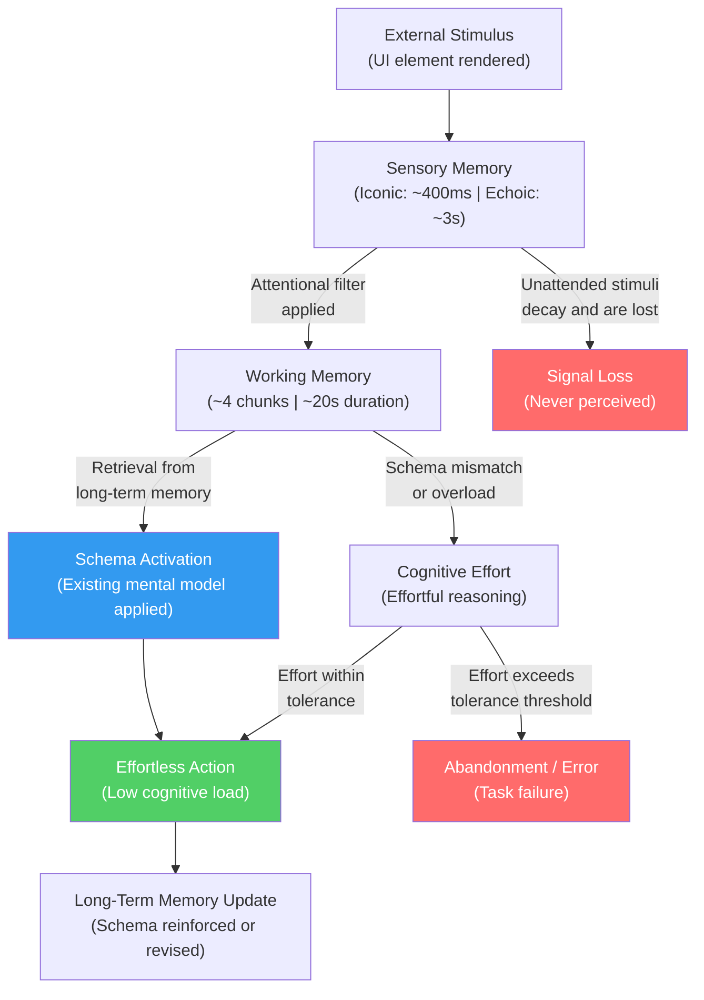

# Lesson 1: Perception, Cognition, Mental Models

## 1. First-Principles Intuition & Invariants

Every product decision is ultimately a bet on how a human mind processes the world. Before a user evaluates a feature, before they form an opinion about your pricing, before they decide whether to return tomorrow, they perceive. Perception precedes cognition, and cognition precedes behavior. If you design products without understanding the mechanics of that chain, you are essentially building bridges without understanding tensile strength: the structure may stand for a while, but failure is load-dependent and inevitable.

The human information processing system evolved under conditions radically different from enterprise software dashboards or mobile checkout flows. The visual cortex, which consumes roughly 30% of the cerebral cortex's surface area, was optimized over millions of years to detect edges, motion, contrast, and faces, not to parse 14-column data tables or interpret icon metaphors invented in 1984. This evolutionary mismatch is the central design problem of every digital product, and understanding it at a mechanistic level is the difference between a product that users adopt intuitively and one that requires a 40-page onboarding guide nobody reads.

**The Atkinson-Shiffrin Pipeline as a Product Invariant.** The foundational model of human memory, introduced by Richard Atkinson and Richard Shiffrin in 1968 and subsequently refined through decades of cognitive science, describes information moving through three stages: sensory memory, working memory, and long-term memory. For a product manager or UX strategist, this is not academic taxonomy. It is the mechanical pipeline through which every interaction you design must successfully pass. Sensory memory is an extremely high-capacity but phenomenally short-lived buffer: visual (iconic) memory holds information for roughly 250–500 milliseconds, while auditory (echoic) memory persists for about 3–4 seconds. If your interface fails to direct attention to the right element within that window, the signal never enters working memory, and the interaction simply does not happen. The notification badge that appears and fades, the status message that disappears before the user's eyes have shifted, the hover tooltip with insufficient display duration — all of these are sensory memory failures that masquerade as UX problems.

Working memory is where cognitive work actually occurs, and it is catastrophically limited relative to what most product teams demand of it. George Miller's 1956 paper established the famous 7 ± 2 chunk capacity estimate, later revised downward by Nelson Cowan in 2001 to approximately 4 chunks for most adults under realistic conditions. More important than the exact number is what "chunk" means: a chunk is a coherent unit of meaning, not a raw data point. A user who already knows the layout of your navigation can perceive "Settings > Privacy > Data Sharing" as a single familiar chunk. A first-time user perceives it as three distinct items plus a navigational schema to interpret, which may already saturate available capacity. This chunking asymmetry between novice and expert users is the mechanical reason that onboarding is hard and that feature familiarity compounds over time.

Working memory is not merely limited in capacity; it is also limited in duration. Without active rehearsal, working memory contents decay in roughly 15–30 seconds. When a user navigates from a product settings page to a help article to find context, then tries to return and apply what they learned, they are racing against this decay clock. Every unnecessary click, every loading state, every modal interruption during a multi-step workflow is not just friction: it is a timer reset that may erase the user's current working state entirely.

Long-term memory, by contrast, is effectively unlimited in capacity, but its relevance to product design lies in its organizational structure rather than its size. Long-term memory is not a filing cabinet; it is a web of associative schemas. A schema is a structured knowledge cluster that allows rapid, low-effort interpretation of familiar patterns. When an experienced user opens a new SaaS product and immediately looks to the top-left corner for a logo or the top-right corner for account settings, they are not reasoning from first principles. They are applying a schema derived from thousands of prior software interactions. The practical implication is profound: schemas are your fastest path to zero-friction onboarding because they allow users to transfer competency from prior experience rather than building it from scratch. Violating a well-established schema — moving the navigation to the right rail, hiding the back button, inverting the primary/secondary button visual hierarchy — imposes a schema-conflict cost that your analytics will show as bounce rate spikes, support tickets, and time-on-task regressions.

**Affordance Theory and Its Commercial Mechanics.** James Gibson introduced the concept of affordances in his 1979 work *The Ecological Approach to Visual Perception*, defining an affordance as the action possibilities an object offers a perceiver. Don Norman adapted this for design in *The Design of Everyday Things*, distinguishing between real affordances and perceived affordances. For product work, the perceived affordance is the only one that matters commercially: if a user cannot perceive that a surface is tappable, it will not be tapped, regardless of whether the engineer correctly wired the gesture recognizer.

Perceived affordances communicate through visual vocabulary: depth and shadow suggest pressability, underlined blue text signals hyperlinks, horizontal motion suggests swiping, icons with outlines and slight 3D treatment read as interactive while flat monochrome icons read as decorative. When you violate these learned affordance signals — which flat design trends have done repeatedly, introducing what researchers call "mystery meat navigation" — you transfer interpretive load to the user. They must now reason about what is interactive rather than perceiving it. That reasoning happens in working memory, consuming capacity that should be available for the actual task. The energy spent decoding the interface is unavailable for the user's real cognitive work, which is why affordance failures correlate directly with task completion rate drops, not just subjective satisfaction scores.

**Gestalt Principles as Perceptual Invariants.** The Gestalt psychologists of the early 20th century documented a set of perceptual organizing principles that the visual system applies automatically and pre-attentively, before conscious cognition begins. These are not design guidelines that can be argued about; they are perceptual invariants, as reliable as the laws of optics. Products that work with these principles route information into perception effortlessly. Products that fight them force users to expend attentional resources interpreting visual ambiguity.

The principle of proximity states that elements positioned close together are perceived as related. When your data table places the row action buttons 400 pixels away from the row they act on, users must consciously trace the relationship. When a form field's error message appears two visual regions away from the field that produced it, error recovery rates drop because the associative link must be constructed cognitively rather than perceived instantly. The principle of similarity states that elements sharing visual properties — color, shape, size, texture — are grouped as belonging to the same category. This is the mechanical basis for visual hierarchies, color coding systems, and the semantic meaning of consistent icon families. The principle of continuity causes the eye to follow lines, curves, and implied paths, which explains why stepped progress indicators effectively communicate sequence and why misaligned grid layouts produce a low-grade visual dissonance that users cannot name but do respond to with reduced perceived quality.

The figure-ground principle describes the perceptual separation of a focal object from its background, and its failure modes are some of the most commercially costly in product design. Modal dialogs that do not sufficiently dim the background fail the figure-ground test: users continue attending to background elements they can still partially perceive, which splits attention and reduces task completion for the modal's intended action. The principle of closure explains why the brain completes incomplete shapes, which is why well-designed iconography at small sizes can omit detail and still be recognized. At the product level, closure also explains why users will infer the existence of content below the fold when above-fold design gives them a visual cue that something continues — and conversely, why a design with excessive whitespace that lacks directional cues creates a cognitive stopping point, lowering scroll depth.

---

## 2. Core Architecture & Mechanics

Understanding the theoretical pipeline is necessary but insufficient for product work. What you need is a mechanical model you can actually apply during a product critique, a usability test debrief, or a prioritization discussion. The following architecture maps the information processing chain onto the specific decision points and failure surfaces in a typical product interaction.

This diagram makes the two critical failure nodes explicit. The first is the sensory-to-working memory gate: if attentional direction fails, the signal is simply lost. The second is the effort tolerance threshold: when cognitive load exceeds the user's available capacity or willingness to invest, the interaction terminates as abandonment or error rather than completing as a successful action. Every optimization in product UX targets one of these two failure surfaces.

**Cognitive Load Theory and Its Three Operative Types.** John Sweller's cognitive load theory, developed through the 1980s and 1990s and now widely validated in applied settings, distinguishes three types of load that compete for the limited capacity of working memory. Intrinsic load is inherent to the task content itself — the domain complexity that cannot be engineered away. If a user is completing a tax calculation or configuring a network security policy, some cognitive burden is simply the nature of the work. Extraneous load is imposed by the design and presentation of the interface, not the task itself — this is the load you are responsible for and that your design decisions directly control. Germane load is the productive cognitive effort spent forming and consolidating new schemas, the kind of effortful learning that actually improves future performance.

The practical engineering target is to minimize extraneous load aggressively, protect enough working memory capacity that germane load can occur during onboarding and feature discovery, and never allow extraneous load to masquerade as intrinsic load in your team's post-launch analysis. When users say a feature is "complicated," your first diagnostic question should be whether that complexity is intrinsic to the domain or whether your design is adding a layer of interpretive work that should not exist. Separating these is the difference between redesigning the UI and rethinking the product's fundamental value proposition.

**Mapping Cognitive Load Types to Interface Mechanics.** Extraneous load accumulates through a set of measurable design patterns. Redundant information — displaying the same data in two places with slightly different formatting — forces users to reconcile discrepancies rather than simply reading. Split attention effects, documented extensively by Sweller and colleagues, occur when related information is spatially separated, requiring users to hold one element in memory while searching for the related element visually. This is precisely why inline validation outperforms end-of-form validation on conversion rate: inline validation collapses the spatial distance between the error source and its correction, eliminating the split-attention load. Irrelevant visual decoration — ornamental backgrounds, non-functional icons, decorative typography variations — consumes pre-attentive processing cycles even when users consciously ignore it, a phenomenon confirmed by eye-tracking studies showing fixation time on elements that users report as invisible during post-session interviews.

Germane load is generated productively when a product reveals its mental model progressively. The best onboarding experiences are not comprehensive tutorials; they are staged exposures that allow users to build accurate schemas incrementally, each session extending the existing schema rather than overwhelming working memory with an exhaustive initial mapping. The progressive disclosure pattern — showing summary-level information with contextual expansion available on demand — is not an aesthetic preference. It is a direct implementation of cognitive load management, deferring the presentation of non-essential information until the user's context creates the capacity and relevance to integrate it.

**Attention as a Finite, Steerable Resource.** The spotlight model of visual attention, developed through the work of Michael Posner and later Anne Treisman's feature integration theory, describes attention as a selective amplification mechanism that boosts processing of attended regions at the cost of suppressing others. Pre-attentive processing happens in parallel across the visual field, detecting basic features — color, orientation, motion, size — without attention. Attentive processing is serial and resource-limited, handling conjunction searches and complex interpretations sequentially.

This distinction has direct product implications. Features that need to be found quickly should be differentiated through pre-attentive properties: a unique color, a salient size difference, motion. When every element on a dashboard competes with equal visual weight, the user must shift from parallel pre-attentive search to serial attentive search, multiplying the time and effort required to locate any single element. This is why alert badges, color-coded status indicators, and typographic hierarchy exist as functional UX mechanisms rather than visual decoration. When teams flatten visual hierarchy in pursuit of minimalist aesthetics, they are, without realizing it, disabling the pre-attentive routing system and forcing every interaction into the more expensive serial processing mode.

Treisman's feature integration theory also explains the pop-out phenomenon: a single red item in a field of blue items is found instantaneously regardless of how many blue items are present, because color is processed pre-attentively in parallel. A single circle in a field of squares produces the same pop-out. But a conjunction target — the red circle among blue circles and red squares — requires attention to serially bind the features, and search time grows linearly with the number of distractors. Product teams designing notification systems, data table filters, and dashboard alert hierarchies should treat this as a hard constraint: each additional visual dimension used to encode categorical information increases the probability of requiring attentive rather than pre-attentive processing, raising the cognitive cost of every lookup.

---

## 3. High-Performance Optimization & Failure Modes

Theory earns its keep only when it translates into decisions you can defend in a roadmap meeting and validate in a usability lab. The following section addresses the highest-leverage optimization points and the failure modes that most consistently escape detection until they appear in retention data.

**The Cognitive Walkthrough as an Operational Technique.** The cognitive walkthrough, developed by Clayton Lewis and John Rieman, is a structured evaluation method in which an evaluator steps through a task sequence and asks, at each step: does the user know what action to take, can they see how to do it, do they have the working memory context required to interpret the system's response, and does the system's feedback confirm that the action succeeded and that progress is being made? Unlike heuristic evaluation, which checks interface properties, the cognitive walkthrough simulates the moment-by-moment information processing state of a user with a specified level of prior experience.

In practice, run a cognitive walkthrough on every new interaction pattern before it enters development, not after. Identify at each step what schema you expect the user to bring, what extraneous load your design is imposing, and what feedback mechanism closes the action loop. When you cannot answer one of those questions confidently, that is a specification gap that will manifest as a support ticket or a usability test failure. The walkthrough takes roughly 90 minutes for a mid-complexity task flow with a team of three and prevents defect categories that cannot be caught by any form of automated testing.

**Mental Model Calibration and the Cost of Mismatch.** A user's mental model of your product is their internal representation of how it works: what causes what, where things are stored, what actions are reversible, what state the system is currently in. Products work smoothly when the user's mental model matches the system's actual behavior closely enough that predictions succeed. Products break down — in ways that generate negative reviews, churn signals, and escalations — when mental model mismatches cause users to take actions with consequences they did not anticipate.

The classic mismatch example is file deletion: users trained on recycle-bin behavior assume deletion is reversible and will delete more aggressively as a result. When an enterprise product uses true deletion without a recovery path, users who bring the recycle-bin schema will inevitably experience permanent data loss. The fix is not purely a backend architecture decision; it is a mental model alignment problem that requires either implementing the behavior users expect or explicitly surfacing the difference in a way that updates the schema before irreversible action occurs. The confirmation modal that says "This cannot be undone" is not UX boilerplate — it is a forced schema correction step, and its presence or absence directly determines your data-loss incident rate.

Mental model mismatches compound across feature interactions. When a user's model of your authorization system is incorrect, every downstream feature that depends on permissions will produce unexpected behavior. Surfacing the system model progressively — through state-revealing UI, meaningful error messages that explain causation rather than just failure, and empty states that describe system context — is how well-designed products keep the user's mental model synchronized with reality over time. This synchronization work is not in most product team's feature prioritization vocabulary, which is precisely why it generates a disproportionate share of tier-1 support load.

**Hick's Law and Decision Complexity as a Conversion Lever.** Hick's Law states that the time to make a decision increases logarithmically with the number of choices available. The practical threshold for conversion impact is not simply the count of options but the discriminability between them: options that feel meaningfully different demand less decision time than options that feel similar, because similar options activate comparison processes that consume working memory across multiple dimensions simultaneously. When a SaaS pricing page presents three plans with 24 feature differences listed between them, users do not evaluate all 24. They sample a few, fail to reach clarity, and either choose arbitrarily (reducing plan-to-use-case fit and increasing churn) or abandon the decision entirely.

The optimization is not to reduce choice but to reduce the effortful discrimination burden. This means leading with the single most discriminating dimension — usually the primary use case or the decisive feature — rather than exhaustive capability lists. It means anchoring one option as contextually recommended to give users a schema-compatible default to either accept or consciously reject. And it means recognizing that decision fatigue is a working memory depletion phenomenon: users who have navigated a complex path before reaching your pricing page have already consumed cognitive resources, and the decision complexity threshold that triggers abandonment is lower for them than for users who arrived directly.

**Failure Mode: The Expertise Reversal Effect.** One of the most practically dangerous failure modes in product UX is designing for the user population you interact with most — your power users, your advocates, your design-review participants — rather than for the full cognitive range of your user base. Cognitive load research documents the expertise reversal effect: instructional techniques and interface designs that reduce load for novices actively increase load for experts, and vice versa. Detailed tooltips, guided workflows, and progressive disclosure reduce extraneous load for new users. For expert users, those same elements become interruptions that require active suppression, consuming working memory to dismiss what is already known.

The commercial implication is that a single fixed interface design cannot be simultaneously optimized for both populations without adaptive mechanisms. Products that serve both novice and expert user segments need explicit experience tiers — not in the marketing sense of feature packaging, but in the cognitive sense of interface complexity levels that suppress assistance for users who have demonstrated schema acquisition and reveal it for users who have not. The most reliable signal of schema acquisition in product analytics is task completion speed combined with help content access rate. Users who complete tasks quickly without accessing help have internalized the product's model and are ready for an expert-mode interface. The expertise reversal effect is why the "simplified" UI that your onboarding team built for new users is simultaneously the UI that your most valuable power users request to disable.

**Failure Mode: Change Blindness and Feature Discoverability.** Change blindness is the perceptual phenomenon in which users fail to notice significant visual changes when their attention is directed elsewhere or when the change occurs across a visual disruption (a scroll, a page transition, a brief animation). In product contexts, change blindness means that UI changes your team shipped — new buttons, relocated navigation, modified filter options — may be genuinely invisible to returning users whose pre-attentive system is suppressing stimuli that match their existing environmental schema. Users who report that a feature "doesn't exist" after you've shipped it are often exhibiting change blindness against their own familiar interface, not failing to look.

The mitigation is to treat significant interface changes as requiring attentional forcing functions: tooltips that appear on first exposure post-change, motion cues that draw the pre-attentive spotlight to the new element, temporary visual differentiation that breaks schema-matching suppression. This is not about condescending to users; it is about compensating for a perceptual invariant that affects every human visual system without exception. Product teams that treat feature discoverability as a documentation problem rather than a perceptual one will consistently find that feature adoption metrics for new capabilities plateau far below their actual utility ceiling.

**Quantifying Cognitive Load in Usability Measurement.** For practitioners who need to defend UX investment decisions in operational reviews, cognitive load must be measurable, not just conceptual. The NASA Task Load Index (NASA-TLX) is a six-dimension self-report instrument covering mental demand, physical demand, temporal demand, performance, effort, and frustration. Administered immediately after task completion, it produces a weighted workload score that correlates reliably with objective error rates and task completion times. In practice, a simplified three-dimension version — mental demand, effort, and frustration — retains approximately 85% of the discriminative power of the full instrument and takes users under two minutes to complete, making it viable for unmoderated remote usability testing.

The Single Ease Question (SEQ), a seven-point scale asking "Overall, how would you rate the difficulty of this task?", provides a lightweight cognitive load proxy that can be embedded after every task in a usability session. An SEQ score below 5 on a seven-point scale is a reliable threshold indicator for redesign priority, with scores correlating to task completion and error rate data consistently enough for comparative analysis across product versions. When you combine SEQ scores across task flows with time-on-task measurements from analytics, you get a spatial map of where in your product users are spending disproportionate cognitive effort, which is the same map that predicts where churn originates before it appears in cohort retention curves.

The discipline of product UX is, at its technical core, the discipline of managing information processing resources that are fixed by human neuroscience and that cannot be expanded by better onboarding documentation or more enthusiastic customer success programs. Every affordance decision, every layout choice, every navigation architecture, and every error message is an intervention in the cognitive pipeline described in this lesson. Teams that understand that pipeline at a mechanistic level make better interventions. Teams that treat it as intuition make interventions they cannot explain, cannot defend, and cannot reliably replicate when the design needs to evolve.
