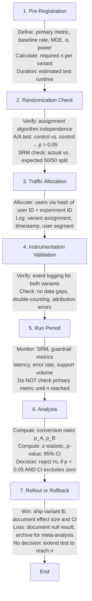

# Lesson 3: Research Methods, Usability Evaluation, Metrics

## 1. First-Principles Intuition & Invariants

Every product decision rests on a claim about human behavior: that users want a particular outcome, that a given interface path will get them there, that removing a friction point will increase conversion. The dangerous thing about these claims is how easy they are to believe without examining. Product teams are staffed with intelligent, empathetic people who have all used software, and that experience creates powerful intuitions that frequently mislead. The founding invariant of UX research is that the user is not you, and the corollary is that the only way to know what a user will do is to watch them do it, or to instrument their behavior at scale and reason from that evidence.

The discipline of UX research exists at the intersection of experimental psychology, cognitive science, and commercial strategy. Its methods borrow the controlled trial from medicine, the ethnographic interview from anthropology, the log analysis from computer science, and the funnel model from sales. What unifies these is a shared epistemological stance: that understanding human interaction with software requires structured inquiry, not intuition alone. Senior practitioners who internalize this stance stop asking "what do our users want?" in a vacuum and instead ask "what protocol will give me reliable evidence about what our users actually do?"

The most important conceptual axis in UX research is the distinction between formative and summative evaluation. Formative research is conducted during design and development, with the explicit purpose of shaping the artifact before it reaches production. It is diagnostic, iterative, and tolerant of small samples because its goal is to surface design problems, not to generalize findings to a population. A formative usability session with five participants can expose the majority of interface failures because the same cognitive friction tends to surface repeatedly once a threshold of observation is reached. Jakob Nielsen's diminishing-returns curve, based on his 1990s research with Rolf Molich, demonstrated that roughly 85% of usability problems in a system are detectable by the fifth unique user, though this figure assumes a relatively homogeneous user population encountering a consistent task set.

Summative evaluation, by contrast, is conducted after a design is stabilized or deployed, with the purpose of measuring whether it achieves defined performance standards. It answers questions like: does this checkout flow meet our conversion target? Does the onboarding sequence achieve a 70% task completion rate among new users? Because summative research makes claims about population-level performance, it requires statistical rigor that formative work does not. Sample sizes must be calculated from effect size estimates and power requirements. Confidence intervals matter. The difference between a 68% and 71% task completion rate is probably noise; the difference between 68% and 55% is probably signal, but only hypothesis testing tells you which.

Practitioners who conflate these two modes consistently make one of two errors. The first is applying summative standards to formative work, which makes early-stage research slow and expensive when it needs to be fast and cheap. A team that insists on running statistically significant usability tests on wireframes will delay discovery of obvious problems by weeks and drown the signal in statistical ceremony. The second error is applying formative reasoning to summative decisions, which produces confident product bets based on a handful of sessions that happened to include articulate, cooperative participants. Both errors carry real commercial cost: the first slows the product, the second ships the wrong one.

Underlying both modes is a more fundamental invariant: the difference between what users say and what users do. This gap is not a quirk of unsophisticated research subjects; it is a structural property of human cognition. People's mental models of their own behavior are reconstructions, not recordings. When asked why they made a choice, they confabulate a coherent narrative that may have little relationship to the actual cognitive process. This is why behavioral data — observed task performance, click logs, session recordings, funnel drop-offs — almost always provides more reliable evidence than self-reported preferences. Attitudinal measures like satisfaction surveys and NPS scores capture a user's emotional representation of their experience, which is genuine and consequential, but they should not be mistaken for behavioral fact. A user can rate an experience highly while repeatedly failing its core task flow, and conversely can complete every task with low satisfaction because the product solves a problem they resent having.

The practitioner's toolkit is therefore bimodal by design. Behavioral instrumentation tells you what users do; qualitative research tells you why they do it. Neither is sufficient alone. Quantitative data can tell you that 32% of users abandon the account creation form on step three, but it cannot tell you whether that abandonment is caused by an unclear field label, a cognitive load problem in the overall sequence, a trust gap around data collection, or a mismatch between the user's mental model of the process and the actual steps required. Qualitative research answers that mechanistic question, which is the question that informs the fix.

The integration of these two streams is where mature UX practice operates, and it is where most organizations fail because they have incentives that favor one type of evidence over the other. Analytics teams tend to trust quantitative data and discount qualitative findings as anecdotal. Design teams tend to trust the vivid detail of observation and distrust aggregate statistics as decontextualized. The resolution is methodological pluralism governed by explicit research questions: quantitative methods answer frequency and magnitude questions, qualitative methods answer mechanism and meaning questions, and the research program sequences them so that each informs the next.

---

## 2. Core Architecture & Mechanics

### Task Analysis: Decomposing the User's Work

Task analysis is the foundational procedure of formative UX research. Before you can evaluate whether an interface supports a task, you must have a precise model of what that task actually is — not at the level of UI interactions, but at the level of human goals, decisions, and information requirements. The two frameworks with the most practitioner traction are Hierarchical Task Analysis (HTA) and Cognitive Task Analysis (CTA), and they operate at different levels of granularity for different purposes.

HTA decomposes a goal into sub-goals and sub-tasks in a tree structure, governed by plans that specify the conditions under which sub-tasks are executed. The formal notation defines a plan as a set of conditions and an ordering rule: "do 1, then 2, then 3" is a sequential plan; "do 1 or 2 depending on condition X" is a conditional plan. For a product team evaluating an enterprise software workflow, HTA produces a structured map of everything a user must accomplish and in what order, which then serves as the scaffolding for scenario construction in usability testing. Any task in the HTA that lacks clear procedural support in the interface is a candidate failure point.

CTA operates at a deeper cognitive level, surfacing the knowledge, judgments, and mental models a user must bring to a task. It is particularly valuable for complex decision-support products — financial dashboards, clinical informatics systems, logistics planning tools — where the interface failure is not in navigation mechanics but in cognitive support. A CTA of a supply chain analyst's work might reveal that the user must simultaneously hold three different time horizons in working memory, reconcile conflicting data signals from two upstream systems, and apply tacit domain knowledge about supplier reliability that the interface does not encode. Each of these findings generates a specific design requirement: progressive disclosure of time horizons, explicit conflict flagging, and decision aids that surface historical supplier performance.

```
HTA: Enterprise Expense Report Submission
─────────────────────────────────────────────────────────────────────────────
Goal: Submit approved expense report for reimbursement
│
├── 1. Compile receipts
│   ├── 1.1 Locate digital receipts (email, cloud storage)
│   ├── 1.2 Photograph physical receipts
│   └── 1.3 Verify amounts match credit card statement
│       Plan 1: Do 1.1, then 1.2, then 1.3 sequentially.
│
├── 2. Create expense line items
│   ├── 2.1 Select expense category
│   ├── 2.2 Enter amount and date
│   ├── 2.3 Attach receipt file
│   ├── 2.4 Add business justification
│   └── Plan 2: Repeat 2.1–2.4 for each receipt from step 1.
│
├── 3. Apply policy rules
│   ├── 3.1 Check per-diem limits by category
│   ├── 3.2 Flag out-of-policy items for manager pre-approval
│   └── Plan 3: Do 3.1; if limit exceeded, do 3.2 before proceeding.
│
├── 4. Submit for approval
│   ├── 4.1 Select approving manager
│   ├── 4.2 Add submission notes
│   └── 4.3 Confirm and submit
│       Plan 4: Do 4.1, then 4.2, then 4.3.
│
└── 5. Track reimbursement status
    ├── 5.1 Monitor approval notification
    └── 5.2 Verify payment in next payroll cycle
        Plan 5: Do 5.1; on approval, do 5.2.
─────────────────────────────────────────────────────────────────────────────
```

The HTA above is not an interface specification; it is an empirical map of the user's work. Every interface decision — where to surface the policy limit, how to structure the category taxonomy, when to trigger the approval workflow — should be justified against this structure rather than against the team's assumptions about what users do.

### Heuristic Evaluation: Mechanics and Scoring

Heuristic evaluation is a systematic inspection method in which evaluators examine an interface against a defined set of usability principles and document violations. Nielsen's ten heuristics remain the most widely deployed framework, though the ISO 9241-110 dialogue principles and Schneiderman's Eight Golden Rules offer useful complements for specific contexts. The critical implementation detail that most teams get wrong is that heuristic evaluation is not a design review meeting. It requires evaluators to work independently before aggregating findings, because the moment multiple evaluators are in a room together, social dynamics compress the finding set toward the most articulate person's observations.

The formal procedure requires each evaluator to traverse the interface twice: once to establish orientation and understand the system's scope, and once to apply the heuristics systematically to each screen and interaction state. Each violation is documented with four attributes — the violated heuristic, the precise location in the interface, a description of the problem, and a severity rating on a 0-to-4 scale. Severity is a composite judgment of three factors: frequency (how often users will encounter the problem), impact (how severely it disrupts task completion when encountered), and persistence (whether the problem occurs once and is resolved or recurs throughout the session). A severity-4 violation is a usability catastrophe: frequent, task-blocking, and persistent. A severity-1 is a cosmetic problem that rarely affects task performance.

| Severity | Label | Criteria | Recommended Action |
|---|---|---|---|
| 0 | Not a problem | Disagreement among evaluators; no usability impact | Log and dismiss |
| 1 | Cosmetic | Infrequent; does not impair task completion | Fix only if spare resources exist |
| 2 | Minor | Occurs occasionally; user recovers with low effort | Low priority; next release cycle |
| 3 | Major | Occurs frequently or recovery is effortful; impairs satisfaction | High priority; fix before release |
| 4 | Catastrophic | Blocks task completion; causes abandonment or critical error | Must fix before release |

After independent evaluation sessions, the team aggregates findings. The aggregation protocol matters: each violation should be evaluated on its own merits rather than discarded because only one evaluator found it. Single-evaluator findings often represent edge cases that become severe at scale. The output of heuristic evaluation is a prioritized problem list, not a design solution. The identification of a severity-4 violation against Nielsen's heuristic four (consistency and standards) tells you there is a problem but not what to build. That is the job of subsequent formative research or design iteration.

### Usability Testing Protocol Design

A usability test is a structured observation session in which a participant attempts realistic tasks on a product while a facilitator observes and a note-taker or recording system captures behavior. The protocol design determines the validity of the findings, and there are several mechanics that separate rigorous sessions from theater.

Task scenarios must be written in the language of user goals, not interface actions. "Find the reporting module and generate a revenue breakdown by region for Q3" is an interface-action scenario; it primes the user to look for something called "reporting" and presupposes they know what a revenue breakdown is. "You need to prepare for a board meeting in which you will present last quarter's regional performance" is a goal scenario; it activates the user's actual mental model and reveals whether the interface supports their natural approach. The distinction matters because interface-action scenarios artificially inflate task success rates by giving participants navigational cues the product itself does not provide.

The think-aloud protocol, in which participants verbalize their reasoning as they work, is the most valuable formative data collection technique available to a UX researcher. Its value lies in making implicit cognitive processes explicit: when a user says "I'm looking for something that says account settings but I can't find it, so I'm trying the gear icon even though I'm not sure that's right," they are describing a mental model mismatch and a navigation ambiguity that no click log could surface. The facilitator's role during think-aloud is to maintain the participant's verbalization without steering their behavior. The intervention vocabulary is narrow: "keep talking," "what are you thinking right now?", "what would you expect to happen if you clicked that?" Facilitators who say "try looking in the top menu" or "you're almost there" have contaminated the session.

Session timing follows a consistent structure. Five minutes of introduction and consent establishes the relationship and relieves the social pressure to perform well, which otherwise inflates task success rates. Twenty to thirty minutes of task scenarios provides the core behavioral data. Five to ten minutes of debrief questions collects attitudinal data about the experience, satisfaction, and mental model. Total session length rarely exceeds sixty minutes; beyond that, participant fatigue degrades both performance and verbalization quality.

### A/B Testing: Validity Conditions and Statistical Mechanics

A/B testing translates the randomized controlled trial into a product instrumentation context. Its core validity requirement is random assignment: users must be allocated to control (A) and treatment (B) variants by a process that is independent of any characteristic of the user. When randomization fails — because the assignment algorithm has a bug, because a marketing campaign attracted different users during different variant windows, because mobile and desktop users end up disproportionately in different buckets — the causal inference breaks and the result is confounded. Most A/B test failures in practice are randomization failures, not measurement failures.

The statistical foundation requires pre-registration of three parameters before any traffic is allocated: the primary metric and its baseline rate, the minimum detectable effect (MDE), and the desired statistical power. The MDE is a business decision, not a statistical one: it represents the smallest effect size that would be commercially meaningful given the cost of the change and the volume of the metric. Setting MDE too small produces tests that require enormous sample sizes and run for months. Setting it too large produces tests that miss real effects of modest but genuine commercial value.

The required sample size per variant is calculated from these parameters using the formula derived from the normal approximation to the binomial distribution. For a two-tailed test of a proportion metric (conversion rate, click-through rate, task completion rate), the formula is:

$$n = \frac{2 \cdot (z_{\alpha/2} + z_{\beta})^2 \cdot p(1-p)}{\delta^2}$$

where $p$ is the baseline conversion rate, $\delta$ is the MDE expressed as an absolute change in the proportion, $z_{\alpha/2}$ is the critical value for significance level $\alpha$ (1.96 for $\alpha = 0.05$), and $z_{\beta}$ is the critical value for desired power $1-\beta$ (0.84 for 80% power, 1.28 for 90% power). For a baseline conversion rate of 0.12 (12%), an MDE of 0.02 (detecting a change to 14%), $\alpha = 0.05$, and 80% power:

$$n = \frac{2 \cdot (1.96 + 0.84)^2 \cdot 0.12 \cdot 0.88}{(0.02)^2} = \frac{2 \cdot 7.84 \cdot 0.1056}{0.0004} = \frac{1.657}{0.0004} = 4{,}142 \text{ users per variant}$$

This means 8,284 users total must be randomized before the test has the statistical power to detect a 2 percentage-point improvement in conversion at conventional significance levels. If the product sees 1,000 users per day and 60% are eligible for the experiment, the test requires approximately 14 days. Any team that calls the test after 3 days because one variant looks better is peeking — a practice that inflates the false positive rate by repeatedly testing the accumulating data against a fixed significance threshold. The correct response to pressure to call tests early is a pre-registered stopping rule, ideally a sequential testing design using methods like the SPRT (Sequential Probability Ratio Test) or Bayesian updating, which are designed to support early stopping without inflating Type I error.

The pipeline for a well-governed A/B test has a specific structural flow:



### Qualitative-Quantitative Integration

The integration architecture most used by mature product teams is a sequential mixed-methods design in which quantitative signals initiate qualitative investigation and qualitative findings generate hypotheses for quantitative confirmation. The workflow is not parallel; it is a loop.

Imagine a product analytics dashboard shows that users of a B2B project management tool have a 40% seven-day retention rate on mobile, compared to 71% on desktop. The quantitative signal is precise and actionable: mobile retention is significantly worse. But it tells you nothing about why. The next step is a formative research sprint: six to eight interviews and think-aloud sessions with users who primarily access the product on mobile, using a task protocol built around the core workflows that show the highest drop-off in mobile funnel analytics. Those sessions reveal that two tasks — file attachment and member assignment — are cognitively supported on desktop by hover states and drag-and-drop affordances that simply do not exist on the mobile interface, and that users hit these friction points within the first three days of use, before the product's value proposition has been fully established.

This qualitative finding generates two specific hypotheses: that redesigning the file attachment flow for mobile will improve seven-day retention, and that redesigning member assignment will as well. Each hypothesis becomes an A/B test with a precisely defined MDE. The integration is complete when the quantitative test either confirms the qualitative mechanism (the fix works, retention improves as predicted) or disconfirms it (the fix improves task completion but retention is unchanged, suggesting the retention driver is elsewhere).

---

## 3. High-Performance Optimization & Failure Modes

### Research Velocity and the Continuous Discovery Model

The most significant operational failure in enterprise UX research programs is the cadence mismatch between research output and product decision-making. Research that takes six weeks to execute and report against a team operating on two-week sprints produces findings that arrive after the decisions they were meant to inform. The result is research as retrospective documentation rather than forward-looking input, which organizational antibodies eventually recognize as waste and defund.

Teresa Torres's continuous discovery framework addresses this directly by embedding lightweight research touchpoints into every sprint cycle rather than treating research as a separate, episodic activity. The practical implementation requires negotiating a standing research allocation: typically two to four participant sessions per week, with a facilitator and note-taker pair who can recruit, session, synthesize, and present findings within a single sprint cycle. The scope is deliberately narrow — one or two focused questions per sprint cycle — which forces the team to triage research questions against the decision calendar rather than accumulating a backlog of interesting but non-urgent inquiries.

The synthesis method that sustains this velocity is affinity diagramming against an opportunity solution tree (OST). The OST maintains a persistent, evolving map of the problem space: at the root, the product outcome the team is pursuing (expressed as a measurable metric change); below that, the user needs and pain points that, if addressed, would produce the outcome; below those, the design solutions being explored; and at the leaf level, the experiments (A/B tests, usability tests, intercept surveys) that validate or invalidate the solution assumptions. Each week's research findings are integrated into the OST by updating the evidence tags on nodes: a usability session that confirms a pain point strengthens the confidence weighting on that opportunity node; a failed A/B test removes a solution leaf and sometimes reveals that the parent opportunity node was misspecified.

### Success Metric Taxonomies: Behavioral, Attitudinal, and Business

The selection and structuring of UX success metrics is one of the highest-leverage decisions a product team makes, because metrics determine what the team optimizes for, which determines what the product becomes. The critical failure mode is metric substitution: optimizing for a measurable proxy because it is easy to instrument, while the actual user outcome you care about is harder to quantify. Click-through rate is easy to measure and easy to inflate by making clickbait UI; whether the user got the value they came for is harder to measure but is the thing that drives retention and lifetime value.

A coherent metric taxonomy for UX operates on three levels simultaneously. At the behavioral level, it captures what users do: task success rate, time-on-task, error rate, feature adoption rate, and funnel conversion by step. At the attitudinal level, it captures how users feel about their experience: CSAT (Customer Satisfaction Score, typically a 1-to-5 scale), NPS (Net Promoter Score, 0-to-10 likelihood to recommend), SUS (System Usability Scale, a standardized 10-item questionnaire that produces a composite 0-to-100 score), and CES (Customer Effort Score, which measures how hard the user had to work to accomplish their goal). At the business level, it captures the commercial consequences of the experience: Net Revenue Retention, feature-driven expansion revenue, support ticket volume per user (a proxy for usability failure), and churn rate attributable to product dissatisfaction as distinguished from churn attributable to competitive loss or pricing.

The SUS deserves particular attention as a practitioner tool because it is standardized, validated, and benchmarked across thousands of products. The ten-item questionnaire alternates positive and negative phrasing to control for acquiescence bias, and each item is scored on a 1-to-5 Likert scale. The composite score is calculated by converting each item to a 0-to-4 scale (subtract 1 from odd-item scores; for even items, subtract the raw score from 5) and multiplying the sum by 2.5. A score above 68 is considered above-average usability; scores above 80 are in the excellent range; scores below 51 indicate products with serious usability problems that are likely to generate churn.

$$\text{SUS} = 2.5 \times \left[\sum_{i \in \text{odd}} (s_i - 1) + \sum_{j \in \text{even}} (5 - s_j)\right]$$

The HEART framework, developed at Google by Kerry Rodden, Hilary Hutchinson, and Xin Fu, provides a systematic taxonomy for selecting behavioral metrics at scale: Happiness (attitudinal), Engagement (depth and frequency of interaction), Adoption (new user activation), Retention (returning user behavior), and Task Success (accuracy and efficiency). Its companion procedure, Goals-Signals-Metrics (GSM), requires the team to articulate the user goal the metric represents, the behavioral signal that indicates progress toward that goal, and the specific measurable metric that operationalizes the signal. This discipline prevents the common failure of instrumenting metrics that are technically measurable but lack a clear line of reasoning from the metric to the user outcome.

The Customer Effort Score deserves special emphasis in enterprise and B2B contexts, where the dominant failure mode is not user dissatisfaction but user exhaustion. CES is typically measured with a single item: "How much effort did you personally have to put in to complete your task?" rated on a 1-to-7 scale from Very Low Effort to Very High Effort. Research by the Corporate Executive Board (now Gartner) found that effort is a stronger predictor of customer loyalty and churn in service and software contexts than satisfaction alone, because users will tolerate modest satisfaction with low effort but will defect from high-satisfaction products that require disproportionate cognitive work. For enterprise software specifically, where switching costs are high but internal champions can lose political will to defend a vendor whose product creates support burden, CES is often the most commercially sensitive attitudinal metric available.

### Failure Modes: Validity Threats and Organizational Dysfunction

The most consequential validity threats in UX research fall into predictable patterns, each with a specific mitigation.

Demand characteristics occur when participants infer the study's purpose and modify their behavior to align with what they believe the researcher wants to see. This inflates task success rates and satisfaction scores and suppresses negative feedback. The mitigation is protocol framing: open every session by explicitly stating that you are evaluating the product, not the participant, and that honest confusion and failure on their part is more valuable than polished performance. The phrasing "if something is confusing, that tells us something important about the design" reliably reduces social performance pressure.

Survivorship bias occurs in retrospective attitudinal research when the sample is drawn from active users. Users who found the product unusable have already left, and their experience is structurally absent from the data. This produces systematically inflated satisfaction and usability scores. The mitigation requires recruiting across the full user lifecycle, including churned users for exit interview protocols and lapsed users for re-engagement research.

The novelty effect in A/B testing occurs when users engage with a changed interface simply because it is different, producing a short-term lift that dissipates once the novelty wears off. The mitigation is running tests to full sample size and monitoring the treatment effect over time by plotting daily conversion rates for each variant rather than relying only on the aggregate. A novelty effect manifests as an early spike in the treatment group that converges toward control as the test progresses.

SUTVA (Stable Unit Treatment Value Assumption) violations, borrowed from causal inference theory, occur when the behavior of users assigned to one variant affects the behavior of users assigned to the other. In social products, this is endemic: a user in the control variant of a collaboration feature will interact with users in the treatment variant, contaminating the independence assumption. The mitigation is cluster-based randomization — assigning entire teams or organizations to a variant rather than individual users — though this substantially increases the required sample size and test duration.

At the organizational level, the most damaging failure mode is HiPPO-driven research: research programs that exist to validate the Highest Paid Person's Opinion rather than to generate independent evidence. The diagnostic signal is a research program whose findings always confirm the existing roadmap and whose contradictory findings are routinely reframed as methodological flaws. The structural mitigation is research reporting that presents findings directly to decision-makers before they are filtered through the product manager or design lead whose work is being evaluated, combined with a written record of research questions, methods, and findings that creates accountability for how evidence was used or discarded. This is not a cultural fix; it is an institutional one, and it requires explicit support from product leadership to function.

The final failure mode is what might be called the measurement treadmill: a research program so consumed with tracking existing metrics that it never invests in discovery. Teams in this mode produce high-quality data about how the current product is performing and have almost no insight into what users need that the product does not yet address. The mitigation is an explicit portfolio allocation: a minimum of 30% of research capacity dedicated to generative, open-ended discovery work — contextual inquiry, diary studies, jobs-to-be-done interviews — that is not tied to any current feature initiative. This allocation is perennially squeezed by delivery pressure, which is why it must be treated as a standing budget commitment rather than an optional activity.
