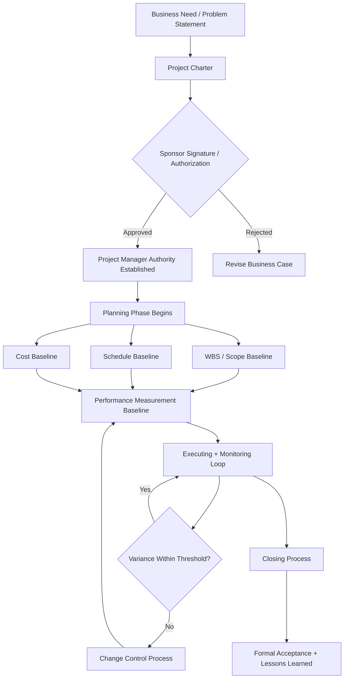

# Lesson 1: Project Fundamentals, Lifecycle Phases, Constraint Triangle

## 1. First-Principles Intuition & Invariants

Every organization lives inside two fundamentally different modes of work, and the failure to distinguish between them is the root cause of a surprising number of management disasters. The first mode is **operations**: repeatable, continuous, process-driven activity designed to sustain an existing outcome. A finance team closing the books each month, a customer support team resolving tickets, a manufacturing line producing 10,000 units per shift — these are operational. They derive their value from consistency, efficiency, and the elimination of variation. The second mode is **projects**: temporary, bounded endeavors undertaken to produce a unique result that did not previously exist. Building the ERP system the finance team will eventually use, designing the customer portal that reduces support volume, retooling the manufacturing line to accommodate a new product — these are projects. They derive their value from delivering change.

The PMI definition in the *PMBOK Guide* captures this succinctly: a project is a temporary endeavor undertaken to create a unique product, service, or result. Each word in that definition carries operational weight. "Temporary" means the project has a defined beginning and a defined end; it is not a permanent organizational structure. "Unique" means the deliverable has never existed in this precise form before, which is precisely why it cannot be managed by an existing operational process. "Endeavor" implies resource consumption, uncertainty, and the need for deliberate management.

The practical test a senior practitioner applies is what might be called the **recurrence and variance test**. If you can answer "yes" to both "Have we done exactly this before?" and "Will we do exactly this again?", you are almost certainly dealing with an operation. If either answer is "no," you are dealing with a project, and operations management tools — standard operating procedures, throughput metrics, shift schedules — will fail you. Projects require a different cognitive frame: one built around uncertainty absorption, stakeholder alignment, and time-boxed delivery rather than steady-state optimization.

Understanding *why* this distinction matters at the level of organizational mechanics requires examining what happens when the two modes collide. Project work is inherently disruptive to operational stability. It draws on the same pools of human capital, infrastructure, and budget that operations depend on. When a company launches a digital transformation initiative, it is not hiring 200 fresh employees to staff it in isolation; it is borrowing senior engineers from product teams, finance directors from business units, and infrastructure capacity from operations. This resource tension is not a failure of planning — it is a structural feature of project work. The project manager's first job is to make this tension visible and negotiable rather than allow it to remain invisible and corrosive.

The **triple constraint**, also known as the iron triangle or constraint triangle, is the most enduring conceptual tool in project management precisely because it formalizes this tension at the level of the work itself. The three vertices of the triangle are **scope** (what the project will produce), **time** (when it will be delivered), and **cost** (the budget of money, people, and resources consumed to do so). The invariant is geometric: if you fix any two vertices, the third is no longer freely movable. Compress time while holding scope constant and cost must rise, because you will need more parallel resources or premium contracts. Expand scope while holding cost constant and time must extend, because there is simply more work to execute. Cut cost while holding time constant and scope must contract, because a smaller budget can accomplish less within the same window.

This seems obvious stated plainly, and yet organizations routinely pretend the triangle does not apply to them. The executive who demands "the same scope, in half the time, for the same budget" is not being ambitious — they are asserting a physical impossibility. The skilled project manager's response is not to agree and then fail quietly; it is to surface the constraint explicitly, model the trade-off numerically, and force a real decision. The triple constraint is not a negotiating posture. It is a load-bearing mechanical reality.

A fourth dimension — **quality** — is sometimes added to the model, either as a central variable that all three sides constrain simultaneously, or as an independent axis. For the purposes of practitioner execution, it is most useful to treat quality as a *consequence* of how scope, time, and cost are balanced rather than as a free variable of its own. Underfunding a project, compressing its schedule, and then expecting premium output is a category error. The constraint triangle captures this: quality is not achieved by aspiration but by the structural adequacy of the triangle's dimensions.

## 2. Core Architecture & Mechanics

### The Five Process Groups as a Control Architecture

The PMI framework organizes project management activity into five process groups: **Initiating, Planning, Executing, Monitoring and Controlling, and Closing**. The common misreading of this framework is to treat the process groups as sequential phases — a waterfall in which you complete one before beginning the next. This is incorrect and leads to brittle project execution. The process groups are better understood as *control loops* that run at varying intensities across the project's natural lifecycle, overlapping and interacting as conditions change.

```
Project Lifecycle: Process Group Intensity Over Time

Effort
 │
 │      Initiating     Planning       Executing     Monitoring    Closing
 │         ▲             ▲▲▲             ▲▲▲▲▲         ▲▲▲▲▲        ▲
 │         │            ╱   ╲           ╱     ╲        ╱     ╲      │
 │        ╱│           ╱     ╲         ╱       ╲      ╱       ╲    ╱│
 │       ╱ │          ╱       ╲       ╱         ╲    ╱         ╲  ╱ │
 │      ╱  │         ╱         ╲     ╱           ╲  ╱           ╲╱  │
 │─────╱───┼────────╱───────────╲───╱─────────────╲╱─────────────────┤
 │                                                                     │
 └─────────────────────────────────────────────────────────────────► Time
        Start       Early         Mid-project         Late          End
```

The **Initiating** process group is not a lengthy bureaucratic gate — it is the moment of organizational authorization. Its primary output is the **project charter**, a document that formally authorizes the project to exist and grants the project manager the authority to apply organizational resources. Without a charter, the project manager is managing informally, which means their authority to commit resources, resolve conflicts, and make scope decisions is entirely dependent on their personal political capital. That is a fragile operating condition. The charter transforms implicit executive backing into documented organizational commitment.

**Planning** is the most intellectually dense process group and the one most often shortchanged under schedule pressure. The core outputs of planning are the project management plan and its subsidiary documents: the scope management plan, the work breakdown structure (WBS), the schedule baseline, the cost baseline, the risk register, and the communications plan. Each of these is not a bureaucratic artifact — each is a decision-making instrument. The WBS, for instance, is not a list of tasks; it is a hierarchical decomposition of the total scope of work into deliverable-focused components small enough to be assigned, estimated, and tracked. A WBS built correctly makes scope creep visible immediately, because any new work either fits within an existing WBS element or requires the creation of a new one, triggering a formal change request.

**Executing** is where the project manager's role shifts from architect to conductor. The primary activity is directing and managing the project work — coordinating people, managing vendor contracts, running team processes, and resolving impediments that the plan did not anticipate. A common misconception is that a well-made plan makes execution passive. In reality, plans are models of a world that has not yet occurred. Execution is the encounter between the model and reality, and the gap between them is where project managers earn their seniority.

**Monitoring and Controlling** runs in parallel with executing throughout the entire project, not just at milestone gates. It is the feedback mechanism that keeps the project's actual performance traceable to its baseline. The key instrument here is **Earned Value Management (EVM)**, which provides a quantitative language for describing schedule and cost performance simultaneously. EVM defines three baseline quantities: Planned Value (PV) — the authorized budget for the work scheduled to be done by a given date; Earned Value (EV) — the authorized budget for the work actually completed by that date; and Actual Cost (AC) — what was actually spent on the work completed. From these three numbers, two performance indices emerge. The **Schedule Performance Index (SPI)** is computed as EV ÷ PV: a value below 1.0 indicates the project is behind schedule relative to its budget plan. The **Cost Performance Index (CPI)** is computed as EV ÷ AC: a value below 1.0 indicates the project is spending more than planned for the work completed. These indices allow a project manager to detect drift early and project it forward. The **Estimate at Completion (EAC)**, defined as BAC ÷ CPI (where BAC is the Budget at Completion), gives the best-available forecast of final cost given current performance. If the project was budgeted at $2,000,000 and CPI is 0.85, the EAC is $2,352,941 — a $352,941 overrun — computable on day 30 of a 180-day project, before the overrun has fully materialized.

**Closing** is not simply declaring victory and archiving files. It involves formal acceptance of deliverables by the sponsor or client, release of project resources back to their operational homes, final financial reconciliation, contract closure with vendors, and — critically — a lessons-learned document that feeds organizational learning. Projects are investments in organizational capability, and the lessons-learned process is the mechanism by which that investment compounds across future projects. Organizations that skip closing are organizations that repeat the same project failures at the same cost.

### The Project Charter: A Working Instrument

The project charter is simultaneously the simplest and most consequential document in project management. Its power is not literary — it is structural. By existing as a formally authorized document signed by a project sponsor at or above the project manager's organizational level, the charter resolves three questions that otherwise consume enormous management bandwidth: What problem are we solving? Who is authorized to make decisions? What does "done" look like?

A charter that answers these three questions completely contains the following elements in operationally useful form. The **business case** articulates the quantified problem or opportunity: not "we need better reporting" but "current manual reporting consumes 1,200 analyst-hours per quarter at a fully-loaded cost of $180,000, and produces outputs with a documented 12% error rate that generates downstream rework." The **project objectives** are SMART-specified: specific, measurable, achievable, relevant, and time-bound. "Reduce quarterly reporting labor by 60% and error rate to below 2% by Q3 of this fiscal year" is an objective. "Improve reporting" is a wish.

The **high-level scope** in the charter is a boundary document, not a specification. It defines what is explicitly included in the project and — this is the element most often omitted — what is explicitly excluded. Scope exclusions are not an admission of inadequacy; they are preemptive defenses against scope creep. When a stakeholder arrives in month four requesting an enhancement that the team "obviously" should have included, the charter's exclusion list resolves the conversation with organizational authority rather than interpersonal negotiation.

The **summary milestone schedule** in the charter establishes the high-level time constraint: when the project is expected to deliver each major outcome. These are not task-level dates — those belong in the detailed schedule developed during planning. They are strategic checkpoints that the sponsoring organization has committed to, and against which the project manager's performance will ultimately be evaluated.

The **budget authority** section states the total approved budget and the threshold at which the project manager must escalate cost decisions to the sponsor. This is a governance mechanism with real cash-flow implications. A project manager authorized to approve expenditures up to $50,000 without escalation can keep a $2,000,000 project moving efficiently through routine procurement decisions. Without this explicit authorization, every contract signature becomes a political transaction.

The **stakeholder register** in the charter is a first-pass inventory, not a final list. It names the sponsor, key stakeholders, and any external parties (regulatory bodies, strategic vendors, partner organizations) whose decisions can materially affect the project. It is populated more completely during planning, but its presence in the charter signals at the initiation stage that stakeholder management is a managed process, not an afterthought.



The charter's real mechanical function becomes clear when change occurs — and change will occur on every non-trivial project. When a stakeholder requests a scope addition, the charter's original objectives and boundary statements provide the reference point for evaluating whether the addition serves the authorized purpose or constitutes a new, separately authorizable initiative. This is the difference between a managed project and a project that grows indefinitely until it collapses under its own weight.

## 3. High-Performance Optimization & Failure Modes

### Front-Loading Intelligence: The Planning Investment Curve

The single highest-leverage intervention available to a senior project manager is the deliberate over-investment in planning relative to what organizational culture typically demands. This is not a recommendation to produce elaborate documentation for its own sake. It is a recognition of a well-documented empirical phenomenon sometimes called the **cost of change curve**: the cost of identifying and correcting a scope, design, or requirements defect rises by roughly an order of magnitude for each lifecycle phase the defect survives. A scope gap discovered during the charter review costs an afternoon of conversation. The same gap discovered during execution costs scope rework, schedule extension, budget overrun, and renegotiation with stakeholders who have already committed downstream plans based on the original delivery date.

The practical implication is that the planning process group deserves a disciplined time and resource allocation, not a rushed sprint toward execution. The WBS deserves multiple review passes with technical leads and delivery team members, not a single top-down decomposition by the project manager alone. The risk register deserves a structured identification workshop using techniques like the pre-mortem — a facilitation method in which the team imagines the project has already failed and works backward to identify the most likely causes. These are not bureaucratic ceremonies; they are defect-detection mechanisms applied at the cheapest possible point in the lifecycle.

### Constraint Triangle Negotiation: The Sponsor Conversation

The most consequential constraint triangle conversation a project manager will have is not with the team — it is with the sponsor or executive client who commissioned the project. Senior executives are frequently uncomfortable with the trade-off language that the triangle demands, because it forces them to make explicit choices about organizational priorities that they would prefer to leave ambiguous. Ambiguity preserves optionality for the executive and transfers risk to the project manager. The project manager's job is to close that transfer.

The practical technique for this conversation is the **constraint matrix**, a simple two-axis instrument that the project manager and sponsor complete together at the outset of planning. For each of the three constraints — scope, time, and cost — the sponsor marks whether it is **fixed** (non-negotiable, an organizational commitment or hard external deadline), **flexible** (can move within a defined range), or **unconstrained** (the least important variable, to be optimized last). The rule enforced by the instrument is that at most one constraint can be fixed; if the sponsor marks two as fixed, the third becomes a consequence rather than a decision, and the sponsor must accept that consequence explicitly.

A manufacturing company launching a regulatory compliance project, for example, may have a fixed time constraint: a government enforcement date that cannot move. The constraint matrix conversation then becomes a disciplined negotiation about whether the fixed compliance date is achievable with the existing budget (cost flexible, scope potentially reduced to minimum viable compliance) or requires incremental budget (cost flexible, scope maintained). What is not available is a fixed time, fixed scope, and fixed cost outcome. Making that unavailability explicit in a signed charter attachment is what separates a professionally managed project from a political promise that the project team will eventually fail to keep.

### Schedule Compression: Crashing vs. Fast-Tracking

When a project's schedule baseline is threatened and the sponsor requires recovery, two structural interventions exist, and they are not equivalent. **Crashing** adds resources to critical path activities to shorten their duration. It directly increases cost and has diminishing returns: adding a third developer to a two-developer task does not reduce duration by 33%, because coordination overhead rises with team size (a phenomenon formalized in Brooks's Law for software projects, but observable across domains). The crash cost calculation is straightforward: for each activity on the critical path, compute the cost-per-day of acceleration (additional resource cost divided by days saved), rank activities by crash cost from lowest to highest, and apply crashing in that order until the target schedule is achieved or the crash cost becomes prohibitive.

**Fast-tracking** resequences activities that were planned sequentially into parallel execution, accepting that the overlapping activities will share dependency risk. Fast-tracking does not increase cost directly but increases risk substantially: when activity B begins before activity A is complete, any late-breaking change to A's outputs creates rework in B. This is not a hypothetical — it is the reason fast-tracking is a recovery tactic, not a planning default. Organizations that routinely fast-track as a planning choice are organizations that have normalized rework as an operating cost.

### Failure Modes: What Actually Kills Projects

The academic taxonomy of project failure lists hundreds of potential causes, but practitioner experience concentrates the fatalities into a small number of recurring patterns. The first is **scope creep by incremental accommodation**: the project team agrees to small, individually reasonable additions without formally processing them through the change control mechanism, and over time the cumulative scope expansion pushes the project past its time and cost constraints without any single decision being identifiable as the cause. The defense is mechanical rather than heroic: every scope change, regardless of size, is documented as a change request, evaluated against the constraint triangle, and requires sponsor authorization before work begins.

The second failure pattern is **planning under political pressure**: the project is authorized with a schedule and budget that all knowledgeable participants privately believe are unachievable, but no one raises the concern formally because the authorization decision has organizational momentum behind it. The project then proceeds through execution with a baseline that is a fiction, monitoring and controlling activity becomes an exercise in producing optimistic status reports rather than detecting real variance, and the eventual overrun arrives as a surprise to executives who could have made different decisions eight months earlier. The countermeasure is the project manager's willingness to document the risk explicitly in the charter and the risk register, in writing, with a named owner, at the moment it is first visible. This is not pessimism; it is professional obligation.

The third pattern is **resource contention without governance**: the project draws on shared organizational resources — particularly technical staff and financial infrastructure — in a way that was modeled during planning but not formally negotiated with the operational managers who control those resources day-to-day. As execution begins, operational priorities compete with project priorities for the same individuals, and project work loses that competition silently, through delayed deliverables and partial availability, rather than loudly through a formal resource reallocation decision. The charter's resource authority provisions and the sponsor's organizational standing are the structural defenses against this pattern. When the project manager escalates a resource conflict to the sponsor, the sponsor's role is to resolve the governance question — which priority wins — at the level of authority where the question actually belongs.

Understanding these failure modes not as exotic edge cases but as the default outcomes of under-managed projects is the cognitive shift that separates reactive project administrators from senior project practitioners. The frameworks covered in this lesson — the project-operations distinction, the five process groups, the constraint triangle, and the project charter mechanics — are not theoretical scaffolding to be discarded in practice. They are the instruments through which the default failures are prevented, and their value is proportional to the discipline with which they are applied before execution begins rather than invoked in retrospect to explain what went wrong.
