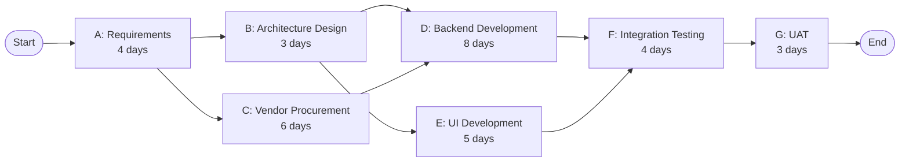

# Lesson 2: Strategic Planning, Work Breakdown Structure, Critical Path Scheduling

## 1. First-Principles Intuition & Invariants

Every project, whether a corporate merger integration, a product launch, or a capital infrastructure build, is fundamentally a problem of coordinated uncertainty reduction. The project manager's core job is not to execute tasks but to transform ambiguity into a deterministic sequence of commitments, then manage the gap between that sequence and reality. Strategic planning is the instrument through which that transformation happens, and the Work Breakdown Structure, network diagram, and Critical Path Method are its three load-bearing mechanisms.

To understand why these tools exist, it helps to understand the failure mode they were invented to prevent. In the late 1950s, the U.S. Navy's Polaris submarine missile program faced a scheduling catastrophe so complex that no single person could hold the full dependency graph in their head. The program involved over 3,000 contractors and subcontractors, each producing components whose completion sequenced into the next. Without a rigorous formal model, the program management office had no mechanism for distinguishing which delays were existential to the launch date and which were irrelevant. The result was a planning paralysis that consumed far more calendar time than the actual fabrication work. The DuPont Corporation faced an analogous problem in plant maintenance scheduling. Both organizations, working independently around 1957–1958, arrived at the same mathematical insight: projects are directed acyclic graphs, and the longest path through that graph is the only path that determines the project's duration. DuPont called their method the Critical Path Method; the Navy called theirs PERT (Program Evaluation and Review Technique). CPM assumed deterministic task durations; PERT introduced probabilistic estimates. Modern project management inherits from both.

The first invariant that every advanced practitioner must internalize is this: *scope drives everything downstream*. Schedule, budget, resource demand, and risk exposure are all derivative quantities. They cannot be intelligently estimated until scope is decomposed to the level at which individual work packages can be assigned an owner, a duration, and a cost. This is not a philosophical principle but a mathematical necessity. You cannot build a network diagram without nodes, and nodes are work packages, and work packages come from the WBS. The dependency chain is irreversible.

The second invariant is that the critical path is a property of the network, not of any single task. Project managers commonly speak of "the critical tasks" as though criticality is an intrinsic attribute of work. It is not. A task becomes critical when its float—the amount of time it can slip without delaying the project end date—equals zero. Float is computed from the full network topology. If you change a dependency, add a resource, or compress a parallel path, the critical path shifts. This dynamic quality of criticality is what makes CPM a live management tool rather than a static planning artifact.

The third invariant is the planning horizon principle: decompose only as far as the planning horizon warrants reliable estimation. Decomposing a task scheduled eighteen months out to the level of eight-hour work packages is a waste of planning effort and produces false precision. Rolling wave planning—a technique in which near-term work is planned at fine granularity while distant work is held at a higher level of decomposition—is not an approximation or a shortcut. It is the structurally correct response to the fact that information density decreases with time horizon. The WBS is a living document, not a one-time output.

The fourth invariant concerns the relationship between resources and schedule. A pure CPM model is *time-network analysis*: it assumes unlimited resources. The moment you apply resource constraints, the schedule transforms. A task with zero float under unlimited-resource assumptions may acquire positive float once a resource-leveling algorithm smooths demand across the planning period, or it may become infeasible within the original end date. This distinction between the resource-unconstrained critical path and the resource-constrained critical chain (a concept introduced by Eliyahu Goldratt in 1997 as an extension of CPM) is a source of substantial forecasting error when practitioners treat the two as equivalent.

Understanding these four invariants—scope primacy, emergent criticality, rolling wave decomposition, and resource-schedule coupling—positions every subsequent technique not as a collection of tools to learn but as a coherent mechanical system with internal logic.

---

## 2. Core Architecture & Mechanics

### The Work Breakdown Structure: Decomposition as a Data Model

The WBS is best understood as a hierarchical tree in which every node represents a deliverable or a discrete, verifiable output of work. The root node is the total project scope. The first level of decomposition typically represents major project phases or functional components. Each subsequent level increases resolution until the terminal nodes—work packages—represent tasks of manageable granularity, typically two to ten days of effort in most project contexts, though the right size is whatever allows reliable estimation and unambiguous accountability.

The critical distinction the PMI's PMBOK makes, and which practitioners routinely ignore, is between *planning packages* and *work packages*. A planning package is a node in the WBS for which scope is known but detailed planning has not yet occurred. A work package is fully defined: it has an assigned responsible party, an estimated duration, an estimated cost, and clear acceptance criteria. Maintaining that distinction explicitly in your WBS—using status tagging in Microsoft Project, Smartsheet, or even a structured spreadsheet—prevents the common pathology in which half-defined tasks get scheduled as though they were fully estimated, inflating confidence in a schedule that hasn't yet earned it.

A well-constructed WBS follows the 100% rule: each level of the hierarchy must capture 100% of the scope of its parent node, with no overlaps and no gaps. Violations of the 100% rule are the root cause of scope gaps that surface mid-execution as unplanned work, and of overlaps that cause duplicate effort and coordination conflict between teams.

The following diagram represents a simplified three-level WBS for a SaaS product launch:

```
Project: SaaS Platform Launch (Level 0)
│
├── 1.0 Product Development (Level 1)
│   ├── 1.1 Backend API (Level 2)
│   │   ├── 1.1.1 Auth Service         [Work Package]
│   │   ├── 1.1.2 Data Ingestion Layer  [Work Package]
│   │   └── 1.1.3 API Gateway Config    [Work Package]
│   └── 1.2 Frontend Application (Level 2)
│       ├── 1.2.1 UI Component Library  [Work Package]
│       └── 1.2.2 Dashboard Module      [Work Package]
│
├── 2.0 Go-To-Market (Level 1)
│   ├── 2.1 Sales Enablement (Level 2)
│   │   ├── 2.1.1 Sales Deck            [Work Package]
│   │   └── 2.1.2 Pricing Sheet         [Work Package]
│   └── 2.2 Launch Campaign (Level 2)
│       ├── 2.2.1 Email Sequence        [Work Package]
│       └── 2.2.2 Webinar Logistics     [Work Package]
│
└── 3.0 Organizational Readiness (Level 1)
    ├── 3.1 Training Program            [Work Package]
    └── 3.2 Support Runbook             [Work Package]
```

Each work package at the terminal level maps to a row in the project schedule, carries a unique WBS code (which becomes the backbone of the cost account structure in earned value management), and owns a single responsible individual under a RACI matrix. The WBS code is not cosmetic—it is the primary key linking scope, schedule, cost, and risk records across the project management information system.

### Network Diagrams: Translating the WBS into a Dependency Graph

Once work packages are defined, the scheduling process begins by modeling precedence relationships. The modern standard is the Precedence Diagramming Method (PDM), in which nodes represent activities and arrows represent dependencies. PDM supports four dependency types: Finish-to-Start (FS), Start-to-Start (SS), Finish-to-Finish (FF), and Start-to-Finish (SF). Of these, FS is by far the most common. SS and FF arise in construction, manufacturing, and software pipeline workflows where parallel streams must be coordinated at their initiation or completion points. SF is rare and typically indicates a modeling error when it appears unexpectedly.

Each dependency can carry a *lag* (a mandatory waiting period between predecessor completion and successor start) or a *lead* (an overlap that allows the successor to begin before the predecessor finishes). Lag and lead are legitimate scheduling mechanics, not approximations. A three-day lag on an FS dependency between "concrete pour complete" and "structural inspection" models the curing time the material requires. A two-day lead on an FS between "requirements finalized" and "engineering kickoff" models the fact that engineers can begin reading and preparing before the requirements document receives final sign-off.

The following Mermaid diagram represents a simplified Activity-on-Node network for a product integration project:



This network encodes the full dependency topology of the project. The longest path through this graph determines the minimum possible project duration, regardless of how many resources are applied. That path is the critical path.

### Critical Path Method: Forward and Backward Pass Calculations

CPM solves for the critical path through two computational passes over the network. The forward pass computes the earliest start (ES) and earliest finish (EF) for each activity. The backward pass computes the latest start (LS) and latest finish (LF). Float (also called total float or slack) for each activity equals LS minus ES (equivalently, LF minus EF). Activities with zero float lie on the critical path.

Using the network above, with all dependencies as Finish-to-Start with no lags, the forward pass proceeds as follows. Activity A starts at Day 0 (ES = 0) and finishes at Day 4 (EF = 4). Activities B and C both have ES = 4 (the EF of their sole predecessor A). B finishes at Day 7 (EF = 7); C finishes at Day 10 (EF = 10). Activity D depends on both B and C, so its ES is max(EF_B, EF_C) = max(7, 10) = 10, and it finishes at Day 18 (EF = 18). Activity E depends only on B, so ES_E = 7 and EF_E = 12. Activity F depends on both D and E: ES_F = max(18, 12) = 18, EF_F = 22. Activity G: ES_G = 22, EF_G = 25. Project duration is 25 days.

The backward pass begins at the project end date (Day 25) and propagates backwards. For G: LF = 25, LS = 22. For F: LF = 22, LS = 18. For D: LF = 18, LS = 10. For E: LF = 18, LS = 13. For C: LF = 10, LS = 4. For B: LF_B = min(LS_D, LS_E) = min(10, 13) = 10, so LS_B = 7. For A: LF_A = min(LS_B, LS_C) = min(7, 4) = 4, LS_A = 0.

Float per activity:

| Activity | ES | EF | LS | LF | Float | Critical? |
|----------|----|----|----|----|-------|-----------|
| A | 0 | 4 | 0 | 4 | 0 | Yes |
| B | 4 | 7 | 7 | 10 | 3 | No |
| C | 4 | 10 | 4 | 10 | 0 | Yes |
| D | 10 | 18 | 10 | 18 | 0 | Yes |
| E | 7 | 12 | 13 | 18 | 6 | No |
| F | 18 | 22 | 18 | 22 | 0 | Yes |
| G | 22 | 25 | 22 | 25 | 0 | Yes |

The critical path is A → C → D → F → G, with a total duration of 25 days. Activity B has 3 days of float; Activity E has 6 days. If B slips by 4 days, it consumes all of its float and becomes critical, extending the project unless a corrective action is taken. This is the mechanical meaning of float management: float is not spare time, it is project-level buffer that the network is sharing across non-critical paths.

### Gantt Charts as Schedule Communication Instruments

The Gantt chart—named for Henry Gantt, who formalized it in the early twentieth century for industrial production scheduling—is a time-scaled bar chart in which each row represents an activity, horizontal bar length represents duration, and bar position represents calendar placement. It is not a planning tool; it is a communication and tracking tool built on top of the CPM network. A Gantt chart without an underlying network model is a visual fiction: it shows bars but encodes no logic about why tasks are placed where they are or what happens if any of them slip.

In Microsoft Project, Primavera P6, or Smartsheet, the Gantt chart is generated automatically from the network once durations, dependencies, and the project start date are entered. The critical path is typically rendered in red. Baseline bars (the original plan) are shown below current-status bars to provide at-a-glance variance visibility. A project manager who maintains their schedule only in a Gantt chart view, without understanding the underlying network, will consistently misdiagnose delays—treating a symptom on a non-critical path as urgent while ignoring a critical path task that is quietly consuming its float.

### Resource Allocation and Leveling

The resource-unconstrained CPM schedule is a theoretical minimum. Real schedules must account for the fact that people, equipment, and budget are finite and shared. Resource allocation is the process of assigning specific resources to work packages; resource leveling is the algorithmic process of resolving over-allocations by shifting non-critical activities within their available float.

The resource leveling problem is, in its general form, NP-hard: finding the globally optimal assignment of tasks to resources to minimize project duration is computationally intractable at large scale. Modern scheduling software therefore uses heuristic algorithms. The most common heuristics are priority-rule methods, in which activities competing for the same resource in the same time period are queued by a priority rule, typically one of three: shortest processing time first (minimizes average task completion time), minimum float first (protects the critical path by prioritizing tasks with the least slack), or earliest deadline first (maximizes schedule adherence for committed milestones). Microsoft Project uses a minimum float heuristic by default, which is the operationally correct choice for most project contexts.

The practical mechanics of resource leveling in Microsoft Project work as follows. After entering resource assignments on each task, you run the Resource Leveling function (Resource → Level All) with the leveling order set to "Standard" (which applies minimum float priority) and the leveling range set to the full project duration. The software will push non-critical tasks to the right within their float windows to eliminate over-allocations. If the over-allocation cannot be resolved within available float, the software will extend the project end date and report the delay. The project manager must then decide whether to accept the extended duration, add resource capacity (crash the schedule), authorize overtime, or decompose the conflicted task into parallel subtasks assignable to different resources.

The distinction between resource leveling and resource smoothing is operationally significant. Leveling allows the project end date to move; smoothing does not. Smoothing adjusts resource demand curves to reduce peaks and valleys while respecting the fixed end date, often by shifting non-critical tasks to earlier in their float windows to absorb otherwise idle capacity. Use smoothing when contractual end dates are fixed and resource cost is the primary optimization target; use leveling when the end date is flexible and resource over-commitment is the primary risk.

---

## 3. High-Performance Optimization & Failure Modes

### Schedule Compression: Crashing vs. Fast-Tracking

When the CPM-computed end date exceeds the contractual or strategic target, two compression strategies are available. Crashing adds resources to critical path activities to reduce their duration, accepting higher cost in exchange for schedule recovery. Fast-tracking overlaps activities that were originally planned in sequence, accepting higher risk in exchange for duration reduction without direct cost increase.

Crashing is a cost-optimization problem. For each critical path activity, you calculate the crash cost per day: (Crash Cost − Normal Cost) / (Normal Duration − Crash Duration). You then crash activities in ascending order of cost per day, starting with the cheapest compression opportunities, until the target duration is achieved or no further compression is feasible. Crashing a non-critical path activity produces no schedule benefit and wastes budget.

Consider a critical path task with a normal duration of 8 days at $4,000 and a crash duration of 5 days at $7,000. The crash cost per day is ($7,000 − $4,000) / (8 − 5) = $1,000 per day. If the project requires 3 days of schedule recovery, crashing this task delivers it at an incremental cost of $3,000. If a parallel non-critical task could also be crashed at $600 per day but has 4 days of float, crashing it would spend $600 per day on zero schedule recovery. This distinction is mechanically obvious once the CPM analysis is in place but is routinely missed by practitioners who manage by intuition rather than by network logic.

Fast-tracking introduces finish-to-start dependencies where a lag or lead relationship allows partial overlap. It trades schedule duration for increased coordination overhead and rework risk. The pathology of excessive fast-tracking is well documented in large IT and construction projects: teams begin downstream work based on preliminary upstream outputs, the upstream work changes, and the downstream team must rework a substantial portion of its completed output. The rework consumes more calendar time than the original parallel work saved. Fast-tracking is appropriate when: the upstream deliverable is high-confidence and unlikely to change substantially, the downstream team can begin with partial information and absorb incremental updates, and the project has the communication bandwidth to manage the increased interface frequency.

### Schedule Risk Analysis: Monte Carlo Simulation

Deterministic CPM produces a single-point duration estimate that is structurally incapable of representing the uncertainty inherent in real projects. A single-point estimate is an expected value, but expected values are poor guides for commitment under uncertainty because they ignore variance. A project path with a mean duration of 25 days and a standard deviation of 8 days has very different risk properties than one with a mean of 25 days and a standard deviation of 2 days, even though both produce the same CPM output.

Monte Carlo simulation resolves this by replacing each activity duration with a probability distribution—typically a triangular distribution defined by optimistic (O), most likely (M), and pessimistic (P) estimates—and running thousands of network passes, sampling durations from those distributions in each pass. The output is a cumulative probability distribution of project completion dates. A project manager who needs to commit to a completion date with 80% confidence reads the P80 value from that distribution. The difference between the P50 (expected value) and the P80 (80th percentile) is the schedule contingency reserve required to achieve that confidence level.

In Microsoft Project with the Risk add-in, or in dedicated tools like Oracle Primavera Risk Analysis or @Risk for Project, the three-point estimates are entered per task and the Monte Carlo engine runs the simulation automatically. The output reports not only the completion date distribution but also the criticality index for each task—the percentage of simulation iterations in which that task lands on the critical path. A task with a criticality index of 85% is far more threatening to the project end date than its deterministic float might suggest. Near-critical paths with significant duration variance routinely produce criticality indices that eclipse nominally critical activities, exposing a systematic blind spot in pure CPM analysis.

### Float Erosion and Schedule Degradation

The most insidious failure mode in CPM execution is silent float erosion. A project may appear on track in weekly status reports—no critical path tasks are reporting delays—while non-critical path float is being consumed by small, unreported slippages. When float finally reaches zero across multiple paths simultaneously, the project manager faces a crunch that appears sudden but has been developing for weeks. The preventive mechanism is float trend reporting: tracking the float of near-critical activities (those with float between zero and a defined threshold, typically five to ten working days) across successive schedule updates and surfacing negative float trends before they reach zero.

A second failure mode is the artificial constraint, in which a task is marked with a "Must Start On" or "Must Finish No Later Than" constraint in the scheduling software. These constraints override the network logic, causing the software to report false float values that do not reflect true network-computed slack. A project schedule containing numerous hard date constraints is a schedule that has been manually forced rather than logically computed. The CPM output is meaningless in such a schedule because the mathematical integrity of the forward and backward pass has been broken. Best practice is to minimize hard constraints to external milestones only—contract deliverable dates, regulatory submission deadlines, board presentations—and allow the network to compute all other dates from logic alone.

A third failure mode is the dangling activity: a task with no predecessor or no successor (other than the project start or end milestones). Dangling activities are invisible to the CPM logic for the path segments they should belong to. A task with no predecessor begins at the project start date regardless of its logical position in the workflow, inflating reported float and producing a false sense of schedule health. Quality-checking a CPM schedule for dangling activities—which Microsoft Project flags in the schedule diagnostics tool and which Primavera P6 surfaces through the Schedule Log—is a fundamental pre-baseline audit step, not an optional refinement.

### Critical Chain and Resource Buffer Management

Goldratt's Critical Chain extension to CPM addresses a systematic behavioral distortion in CPM-based schedules: individual task owners, knowing their estimates will be held against them, pad their duration estimates with individual safety buffers. Goldratt observed that these individual safety margins are systematically wasted through Parkinson's Law (work expands to fill available time) and the student syndrome (procrastination consumes safety buffer before work begins). The result is that projects with heavily padded individual estimates still finish late, because the padding disappears without producing schedule protection.

Critical Chain replaces individual task-level safety buffers with aggregated project buffers and feeding buffers inserted at strategic points in the network. Task durations are set aggressively at the 50th percentile (the estimate at which there is a 50% chance of on-time completion without padding), and the removed safety time is pooled into a project buffer at the network's terminus. Feeding buffers are placed at the merge points where non-critical paths feed into the critical chain, protecting the critical chain from delays originating on those paths. The project manager monitors buffer consumption—the ratio of buffer consumed to work completed—rather than individual task float. A healthy project consumes buffer slowly relative to work progress. A project consuming buffer faster than it completes work is signaling critical chain risk before the schedule visually reflects it.

### Earned Value Management as a CPM Validation Layer

Earned Value Management (EVM) provides the quantitative bridge between the CPM schedule and actual execution performance. The three EVM primitives are the Planned Value (PV: the budgeted cost of work scheduled to date), the Earned Value (EV: the budgeted cost of work actually completed to date), and the Actual Cost (AC: the actual cost incurred to date).

The Schedule Performance Index (SPI = EV / PV) measures schedule efficiency. An SPI of 0.85 means the project is earning 85 cents of planned value for every dollar of work that was scheduled to be complete, indicating the team is running at 85% of planned schedule velocity. The Cost Performance Index (CPI = EV / AC) measures cost efficiency independently. These indices combine to produce the Estimate at Completion (EAC):

**EAC = BAC / CPI**

where BAC is the Budget at Completion. If CPI is 0.90, the project will cost 11% more than the original budget if current performance trends continue: EAC = BAC / 0.90 = 1.11 × BAC.

The Schedule Variance (SV = EV − PV) expressed in currency units is an imprecise schedule metric, because a dollar-denominated schedule variance does not map cleanly to calendar days of delay. This is a known limitation of classical EVM. Earned Schedule (ES) theory, developed by Walt Lipke in the early 2000s, corrects this by expressing earned value in units of time rather than currency. The earned schedule value is the point in time at which the amount of EV actually earned was planned to have been earned. The Schedule Performance Index (Time) = ES / AT, where AT is actual time elapsed, produces a time-dimensioned schedule efficiency metric that translates directly to forecasted project completion date.

Together, CPM scheduling, resource leveling, Monte Carlo risk analysis, float trend monitoring, critical chain buffer management, and earned value tracking constitute a complete, mutually reinforcing project control system. No single technique is sufficient. CPM without resource leveling produces an unachievable schedule. Resource leveling without float monitoring produces a schedule that degrades silently. Monte Carlo without CPM has no network to simulate. EVM without CPM has no logical baseline against which to measure variance. The practitioner who understands how these mechanisms interlock—each one compensating for a blind spot in the others—is equipped to manage projects of substantial complexity with structural rigor rather than intuition and hope.
