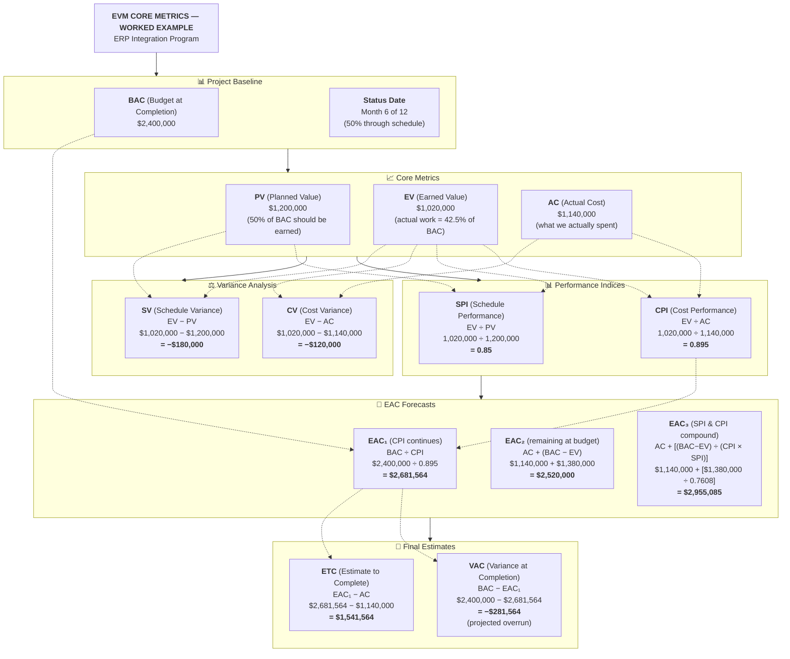
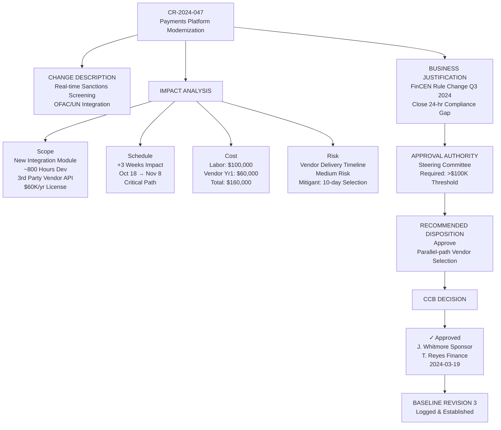

# Lesson 4: Execution Models, Agile Protocols, Change Control

## 1. First-Principles Intuition & Invariants

Every project, regardless of its domain, is fundamentally a system for converting uncertainty into delivered value under constraints of time, cost, and scope. The execution model a team chooses is not a methodology preference or an organizational fashion statement — it is the structural answer to a single foundational question: *how much do you know at the start, and how quickly does that knowledge change?*

This question exposes the core invariant of project execution. When requirements are stable, technology is well-understood, and the customer can fully articulate what they want before work begins, a sequential, plan-driven model exploits that stability efficiently. When requirements are emergent, the solution space is ambiguous, or customer understanding evolves through exposure to working product, a sequential model becomes a liability. The discipline of execution model selection is therefore an act of honest uncertainty quantification — not ideological alignment.

### The Waterfall Paradigm: Exploiting Known Unknowns

Waterfall's formal genesis is often attributed to Winston Royce's 1970 paper, though Royce himself described it as a flawed model requiring iteration. The paradigm's industrial logic is borrowed from manufacturing and civil engineering, where rework after fabrication is catastrophically expensive. Building a bridge's foundation to the wrong specification after concrete is poured is irreversible; the entire project rationale assumes that you can and must resolve all ambiguity upfront.

The Waterfall model divides project execution into discrete, gated phases: Requirements, Design, Implementation, Verification, and Maintenance. Each phase must produce a formally approved artifact — a Business Requirements Document (BRD), a Functional Specification, a System Architecture Design — before the next phase begins. The phase gate is not bureaucratic theater; it represents a contractual lock on the cost and scope surface. Any subsequent change triggers a formal Change Request (CR) that must traverse an approval chain, re-baseline the schedule, and adjust the budget. The governance overhead of this mechanism is expensive by design, because the model's economics assume that the price of a change request will be paid only for changes that are genuinely necessary.

Waterfall works when the project sponsor can write the requirements document with high fidelity before development begins, the technology platform is mature, the regulatory environment demands audit trails (FDA validation protocols, ISO 9001 manufacturing lines, defense procurement under FAR/DFARS), and the contractor-client relationship is adversarial enough that contractual specificity protects both parties. Infrastructure rollouts, ERP implementations following a pre-designed configuration, and hardware-dependent projects where tooling lead times preclude iteration are natural homes for the model.

Its failure mode is not theoretical laziness — it is real and catastrophic. The Software Engineering Institute's research on large government IT projects consistently showed that over 60% of requirements documented at project initiation were either wrong, incomplete, or superseded by the time the software was delivered. Waterfall encodes those errors in concrete and delivers them on time and on budget. The project closes green on its original baseline; the delivered system is useless.

### The Agile Paradigm: Embracing Epistemic Humility

The Agile Manifesto of 2001 was not a technical document. It was a corrective reaction to the specific failure mode described above, written by practitioners who had watched sequential models produce working-but-wrong software at enormous cost. The Manifesto's twelve principles reduce to a single mechanical insight: working software delivered frequently to real users is the only reliable feedback mechanism for validating that you are building the right thing.

Agile's foundational invariant is that requirements are not discovered before work begins — they are discovered *through* work. This is not an admission of poor planning; it is an accurate epistemology for complex adaptive systems. A product manager who claims she can fully specify a customer-facing analytics dashboard before any user has interacted with a prototype is not confident — she is mistaken about the nature of her own knowledge. Agile structures the work to surface that knowledge as cheaply as possible, by constraining work-in-progress into short cycles and demanding working, demonstrable output at the end of each one.

The practical consequence of this shift is that Agile trades predictability of scope for predictability of cadence. In a Waterfall project, the schedule and scope are fixed at the outset and cost is the primary variable under pressure. In a Scrum-based Agile project, the cadence is fixed (the sprint length is inviolable), the team capacity is fixed, and scope is the managed variable. Work items that don't fit in the sprint move to the backlog. This is not a failure — it is the model working correctly.

### The Hybrid Paradigm: Matching the Model to the Work Layer

Most real enterprise projects do not exist entirely in the zone of either complete certainty or complete ambiguity. A digital transformation initiative at a financial services firm might involve a highly constrained regulatory compliance workstream — a set of mandatory controls documented by auditors that cannot change once approved — running in parallel with a customer experience redesign whose requirements will evolve as users engage with prototypes. Forcing both workstreams into the same execution model creates friction: the compliance work is destabilized by Agile's scope flexibility, while the UX work is suffocated by Waterfall's change overhead.

Hybrid execution addresses this by decomposing a program into work layers and assigning the execution model to the layer, not to the program as a whole. The PMI's Disciplined Agile Delivery (DAD) framework formalizes this: a governance layer operates on quarterly planning cycles with fixed budget allocations (Waterfall cadence), while delivery squads operate on two-week sprint cycles with backlog-driven prioritization (Agile cadence). The interface between layers is managed through Program Increment (PI) Planning, borrowed from SAFe, where squad-level sprint commitments are rolled up into quarterly roadmap commitments that the governance layer can hold as a stable planning surface.

Understanding this tripartite landscape — not as a spectrum where you slide a dial between "Waterfall" and "Agile," but as a structural choice made independently for each work layer — is the prerequisite for the mechanical competence that follows.

---

## 2. Core Architecture & Mechanics

### Scrum Sprint Mechanics: The Complete Operating System

Scrum is frequently misunderstood as a set of meetings. It is a feedback control system with four ceremonies, three roles, and two artifacts, each one mechanically necessary to the system's function. Removing any component degrades the feedback loop in a specific, predictable way.

The **Product Owner** holds decision authority over the Product Backlog. This is not a committee — it is a single accountable individual who owns the prioritization function and whose job is to maximize the value of work the team delivers per sprint. The Product Owner writes or approves User Stories, assigns business value, and makes the trade-off call when technical constraints and business priorities conflict. The **Scrum Master** is the team's process guardian and impediment remover. She does not manage the team; she manages the system the team operates in, clearing organizational friction, enforcing Scrum rules, and running retrospective facilitation. The **Development Team** is self-organizing and cross-functional — meaning the team collectively holds all the skills required to deliver a potentially shippable increment without external dependency during the sprint.

A sprint begins with **Sprint Planning**, a time-boxed session (four hours for a two-week sprint) with two output artifacts: the Sprint Goal and the Sprint Backlog. The Sprint Goal is a single sentence describing the business value the sprint will deliver. It is the team's north star when mid-sprint discoveries force scope trade-offs. The Sprint Backlog is the set of Product Backlog Items (PBIs) the team has pulled into the sprint, decomposed into tasks with hour-level estimates, owned by team members.

PBIs are estimated in story points, a unit of relative complexity rather than absolute duration. The team uses a reference story — typically a simple, well-understood piece of work from a prior sprint that everyone agrees represents "one point" — and estimates all new PBIs relative to it using a Planning Poker session. The Fibonacci-adjacent sequence (1, 2, 3, 5, 8, 13, 20) is standard; the gaps between values at the high end enforce honest reckoning with uncertainty. A team that estimates a PBI at 13 points is implicitly acknowledging that the work is not fully understood. The correct response is to decompose it into smaller stories before accepting it into a sprint, not to treat the 13-point estimate as a binding commitment.

**Team velocity** is the sum of story points of PBIs completed (meeting the Definition of Done) over a sprint. It is a planning tool, not a performance metric. Using velocity as a KPI creates perverse incentives: teams inflate estimates to protect velocity figures, the numbers become dishonest, and the planning tool breaks. Velocity is calculated as a rolling average of the last three to five sprints and used to answer one question only: given this team's historical throughput, how many story points can we credibly commit to in the next sprint?

```
Sprint Capacity Calculation:

Team Size:            7 developers
Sprint Length:        2 weeks (10 working days)
Available Hours:      7 × 10 × 6 = 420 productive hours
                      (accounting for ceremonies ~2 hrs/day)
Velocity (rolling 3): (42 + 38 + 44) / 3 = 41.3 pts avg

Sprint Backlog Pull:  Team pulls PBIs summing to ≤ 41 points
                      until capacity or backlog priority exhaustion
```

The **Daily Scrum** (standup) is a 15-minute synchronization ceremony, not a status report to the Scrum Master. Its three questions — what did I complete yesterday that contributes to the Sprint Goal, what will I complete today, and what impediments are blocking me — drive peer coordination and surface blockers early enough to resolve them within the sprint. The Scrum Master's job during this ceremony is to capture impediments and begin resolving them immediately after the meeting ends.

**Sprint Review** is the feedback mechanism at the sprint's conclusion. The team demonstrates the working, potentially shippable increment to the Product Owner and stakeholders. Only completed PBIs (meeting the Definition of Done) are demonstrated. This is not a status update or a slide presentation — it is a live demonstration of working software (or working product, for non-software projects), after which the Product Owner formally accepts or rejects each item, and stakeholder feedback is captured to update the Product Backlog.

**Sprint Retrospective** follows the Review and closes the sprint cycle. It is the team's structured self-improvement mechanism, examining three dimensions: what worked well, what didn't work, and what one or two specific, actionable improvements will the team commit to in the next sprint. The critical discipline here is the commitment to *specific* improvements. "Better communication" is not a retrospective action item. "Create a shared Slack channel for cross-functional dependency alerts and review it at standup" is.

The sprint's mechanical flow looks like this:

```
┌────────────────────────────────────────────────────────────────────┐
│                     SCRUM SPRINT CYCLE (2 weeks)                   │
├────────────┬───────────────────────────────────────┬───────────────┤
│  DAY 1     │  SPRINT PLANNING (4 hrs max)           │               │
│            │  Input:  Prioritized Product Backlog   │               │
│            │  Output: Sprint Goal + Sprint Backlog  │               │
├────────────┼───────────────────────────────────────┤               │
│  DAYS 1-10 │  DAILY SCRUM (15 min each day)         │  PRODUCT     │
│            │  Development Work + Impediment Logs    │  BACKLOG     │
│            │  Burndown chart updated daily          │  REFINEMENT  │
│            │                                        │  (ongoing,   │
├────────────┼───────────────────────────────────────┤  mid-sprint) │
│  DAY 10    │  SPRINT REVIEW (2 hrs max)             │               │
│            │  Live demo of Increment to stakeholders│               │
│            │  PO acceptance / rejection per item    │               │
├────────────┼───────────────────────────────────────┤               │
│  DAY 10    │  SPRINT RETROSPECTIVE (1.5 hrs max)    │               │
│            │  Team process improvement commitments  │               │
└────────────┴───────────────────────────────────────┴───────────────┘
```

### Sprint Burndown Chart: The Real-Time Health Signal

The burndown chart plots remaining story points (Y-axis) against sprint days (X-axis), with an ideal burndown line drawn from the total sprint commitment on Day 1 to zero on the final day. The gap between the actual burndown line and the ideal line is the sprint's primary diagnostic. An actual line that tracks above the ideal indicates the team is behind — work is completing slower than planned, blockers are unresolved, or the sprint was over-committed. An actual line that is flat for two or more consecutive days signals a blocked story that the Scrum Master must investigate immediately, not at the retrospective.

The burndown is updated daily by team members marking tasks complete in the team's project management tool (Jira, Linear, Azure DevOps). The Scrum Master reviews it before each Daily Scrum to identify conversations that need to happen during the standup rather than discovering problems at the Review.

### Kanban Flow Mechanics: Managing the Invisible Assembly Line

Kanban originated in Toyota's Production System as a physical card-based signaling mechanism for triggering upstream production only when downstream capacity existed. Its software adaptation, formalized by David Anderson in his 2010 work, translates the Toyota Production System's constraint management into knowledge work by visualizing workflow states, limiting work-in-progress (WIP), and managing flow rather than scheduling iterations.

A Kanban board models a team's workflow as a series of columns representing work states, with WIP limits assigned to each column. A typical software product team might define states as: Backlog → Ready for Development → In Development → In Code Review → In QA → Done. Each column's WIP limit represents the maximum number of items the team will allow to simultaneously occupy that state. If the In Development column has a WIP limit of 4 and all four slots are occupied, no new work enters Development until a slot opens — which only happens when a work item advances to Code Review.

The WIP limit is the most powerful and most frequently violated mechanism in Kanban. Its purpose is to force the team to finish work before starting new work, which surfaces bottlenecks visually. When work piles up in front of a constrained column — say, QA has a WIP limit of 3 but developers keep completing items — the board shows a bulge at the QA column. The correct response is for available developers to swarm on QA support: writing test scripts, reviewing QA documentation, or pairing with QA engineers. This cross-functional swarming is exactly the behavior WIP limits are designed to produce. Teams that simply raise WIP limits when they feel constrained defeat the mechanism entirely.

The key metrics in Kanban are **cycle time** (elapsed calendar time from when a work item is pulled into active development to when it is Done), **lead time** (elapsed time from when an item enters the backlog to when it is Done), and **throughput** (number of items completed per unit time). These metrics are more operationally honest than story point velocity because they are not subject to estimation inflation. A team whose cycle time is trending upward has a workflow problem, regardless of how many story points they claim to complete per sprint.

```
KANBAN BOARD — WIP LIMITS ENFORCED

┌──────────┬──────────┬──────────┬──────────┬──────────┬──────────┐
│ BACKLOG  │  READY   │  IN DEV  │  REVIEW  │  IN QA   │  DONE    │
│          │  (WIP:3) │  (WIP:4) │  (WIP:3) │  (WIP:3) │          │
├──────────┼──────────┼──────────┼──────────┼──────────┼──────────┤
│ Story A  │ Story D  │ Story G  │ Story J  │ Story L  │ Story N  │
│ Story B  │ Story E  │ Story H  │ Story K  │ Story M  │ Story O  │
│ Story C  │ Story F  │ Story I  │          │ [BLOCKED]│ Story P  │
│ Story …  │          │ Story J* │          │          │          │
│          │       [WIP LIMIT HIT — no pull until slot opens]      │
└──────────┴──────────┴──────────┴──────────┴──────────┴──────────┘

* Story J* attempted to enter Dev; blocked by WIP limit.
  Team swarms on Review/QA to open capacity.
```

### Earned Value Management: The Integrated Cost-Schedule Performance System

Earned Value Management (EVM) is the most rigorous quantitative project control framework in widespread use. Originally developed by the U.S. Department of Defense in the 1960s under the name PERT/COST, EVM integrates scope, schedule, and cost into a single measurement system that produces objective, forward-looking performance indicators. It is mandatory on U.S. federal contracts over $20 million and is specified in ANSI/EIA-748.

EVM defines three baseline quantities from which all performance metrics derive. The **Planned Value (PV)**, also called the Budgeted Cost of Work Scheduled (BCWS), is the authorized budget for the work scheduled to be completed by a given status date. It answers the question: how much work *should* have been done by now, expressed in budget dollars? The **Earned Value (EV)**, or Budgeted Cost of Work Performed (BCWP), is the authorized budget for the work actually completed by the status date. It answers: how much of the budget represents work we have actually finished? The **Actual Cost (AC)**, or Actual Cost of Work Performed (ACWP), is the total cost actually incurred for work performed by the status date.

These three quantities generate two variance measures and two efficiency indices that form the core EVM dashboard:

**Schedule Variance (SV)** = EV − PV. A positive SV means the project is ahead of schedule in budget terms; negative means behind. SV = 0 at project completion regardless of actual schedule performance, which is EVM's well-known limitation for measuring schedule health near project end. The metric is most useful in the first 60% of a project's duration.

**Cost Variance (CV)** = EV − AC. A positive CV means the project is under budget for the work completed; negative means over budget. This is the primary cost health indicator and does not share SV's end-of-project distortion.

**Schedule Performance Index (SPI)** = EV ÷ PV. SPI = 1.0 means the team is earning budget value at exactly the planned rate. SPI = 0.85 means for every dollar of work planned, only $0.85 of work is being completed — the team is 15% behind schedule in throughput terms.

**Cost Performance Index (CPI)** = EV ÷ AC. CPI = 1.0 means budget is being spent at exactly the planned rate per unit of work. CPI = 0.90 means every dollar of earned value is costing $1.11 of actual spend — the project is running 11% over budget per unit of output.

The forward-looking power of EVM lies in its **Estimate at Completion (EAC)** formulas, which project total final cost based on current performance:



The three EAC formulas represent different assumptions about future performance. EAC₁ assumes the CPI experienced to date will persist — this is the statistically most reliable predictor once a project is 20% complete, validated by research showing that CPI rarely improves significantly after that threshold. EAC₂ assumes the overruns to date were anomalous and remaining work will proceed at the original budgeted rate — an optimistic assumption that requires specific justification. EAC₃ is the most conservative and is appropriate for projects with both cost and schedule problems that are structurally related (a resource shortage that simultaneously drives schedule slippage and overtime costs, for example).

Presenting all three EAC variants to the steering committee is the professional discipline: it makes the assumption explicit and forces an honest conversation about which recovery scenario is realistic.

### Change Request Protocol: The Formal Mechanics of Scope Governance

Scope creep is not a failure of willpower. It is the predictable consequence of a project management system that lacks a mechanically enforced change control process. Every project attracts scope additions, because stakeholders learn things about their own needs as the project progresses and because the people closest to the work naturally want to improve it. The change control process does not prevent this learning — it channels it through a governance mechanism that makes the trade-off between the new scope and the existing baseline explicit and authorized.

A Change Request (CR) is a formal document that must specify five elements to be actionable: a precise description of the requested change, the business justification (why this change is necessary or valuable), the impact analysis across scope, schedule, cost, and risk dimensions, the recommended disposition (approve, reject, defer, or approve with modification), and the authority level required for approval. The last element is non-trivial: a CR that adds two weeks to a 12-month schedule and costs $80,000 in additional labor cannot be approved by a project manager. It requires the same governance authority that approved the original project budget — typically the Project Sponsor or Steering Committee.

The Change Control Board (CCB) is the governance body that receives, reviews, and dispositions CRs. Its membership must include the Project Sponsor, the Project Manager, the technical lead, the finance controller, and any external stakeholder (client, regulatory body) whose approval is contractually required. CCB meetings should be scheduled bi-weekly at minimum; ad hoc emergency reviews should be possible within 48 hours for high-severity changes. Every CR reviewed by the CCB, regardless of disposition, must be recorded in the Change Log with its decision rationale, decision date, and approver names.



Once a CR is approved, the Project Manager must perform a **baseline re-baseline** — formally updating the project schedule, budget, and scope documentation to reflect the approved change. This is not optional. A project that carries approved CRs without re-baselining will show false variances in EVM reporting, because the PV curve still reflects the original plan rather than the authorized plan. Every approved CR produces a new baseline revision, logged with its revision number, effective date, and the CR that triggered it.

---

## 3. High-Performance Optimization & Failure Modes

### Sprint Anti-Patterns and Their Structural Causes

The most damaging sprint failure mode is not a missed sprint goal — it is a sprint goal that is never at risk because the team has stopped making real commitments. This failure pattern emerges when retrospective feedback loops are bypassed: the team runs retrospectives, writes action items on sticky notes, and then forgets them before the next sprint begins. The underlying cause is usually that action items are recorded in a retrospective Confluence page that no one reviews again, rather than converted into Sprint Backlog tasks with assigned owners and Definition of Done criteria. The fix is mechanical: every retrospective improvement action becomes a PBI in the Product Backlog, estimated, prioritized by the Product Owner, and tracked like any other work item.

A second high-frequency failure is **sprint scope injection** — mid-sprint insertion of new work by stakeholders who bypass the Product Owner. This typically happens when a senior stakeholder goes directly to a developer, frames the request as "quick" or "just an hour," and the developer, not wanting to disappoint, accepts it. The corrupted sprint begins missing its goal not from poor estimation but from unmeasured scope addition. The structural fix is a standing team agreement (formalized in the Team Working Agreement) that any work not in the Sprint Backlog is declined at the developer level and routed to the Product Owner for backlog entry and prioritization. The Product Owner's authority to protect the sprint is meaningless if it is not operationalized at the developer level.

**Velocity gaming** is a performance measurement failure with organizational roots. When management uses velocity as a productivity metric and rewards high-velocity sprints, teams respond by inflating story point estimates. A story that would have been estimated at 3 points when velocity was a planning tool becomes 5 points when velocity determines quarterly bonuses. The inflation is consistent enough that planning accuracy is preserved, but the numbers lose all meaning as a cross-team comparison or executive reporting metric. The resolution is partly political — velocity must be explicitly excluded from performance evaluation frameworks — and partly mechanical: replace sprint velocity with cycle time and throughput as the primary team health metrics, since those cannot be gamed by estimate inflation.

### Kanban Flow Optimization: Throughput vs. Utilization

A persistent misunderstanding in Kanban adoption is treating high resource utilization as evidence of high performance. If every developer has work in progress at all times, the board looks productive, but throughput — the number of work items completing per unit time — may actually be lower than a system where developers occasionally idle while waiting for downstream capacity to open.

This is the core insight of queuing theory applied to knowledge work: in a system with variable work item arrival rates and variable processing times, increasing utilization beyond approximately 80% causes queue lengths (backlog of items waiting in front of bottlenecked stages) to grow non-linearly. A system running at 95% utilization does not deliver 19% more output than one running at 80% — it delivers less, because work items spend most of their cycle time waiting in queues rather than being actively processed. The 80% utilization ceiling is not a rule of thumb — it derives directly from the M/M/1 queue model, where average queue length equals (utilization²) ÷ (1 − utilization). At 80% utilization, average queue length is 3.2 items. At 95%, it is 18 items.

Kanban's WIP limits enforce this ceiling mechanically. When developers cannot pull new work because their WIP column is full, they swarm on blocked downstream stages — which is precisely what reduces queue length in front of the bottleneck and improves system throughput. The team that looks "busy" with every person always working is frequently less productive than the team that sometimes has slack capacity used to unblock downstream constraints.

The correct optimization target in Kanban is **flow efficiency**: the ratio of active processing time to total cycle time for a work item. A flow efficiency of 15% — meaning a work item spends only 15% of its cycle time being actively worked on and 85% waiting — is typical in unoptimized knowledge work systems. World-class Kanban teams achieve flow efficiencies of 40% or above, not by working faster but by eliminating the queue time between stages through WIP limit enforcement, same-day handoff agreements, and cross-functional swarming on bottlenecks.

### EVM Failure Modes: Gaming, Late Baselining, and the 50/50 Rule

EVM's most common pathology in practice is the **rubber baseline** — a project where the baseline is re-baselined so frequently that variances are perpetually erased rather than analyzed. When a project manager submits a CR to approve a schedule slip and re-baselines every time the schedule slides, the EVM reports always show SV near zero, CPI near 1.0, and the project appears healthy until the final weeks, when the accumulated slippage becomes undeniable. The governance defense against this is a threshold rule: re-baselining requires CCB approval, and the CCB must review the cumulative variance history before approving, so that a pattern of small serial re-baselines is visible as the structural problem it represents.

**Percent complete estimation** is EVM's other chronic weakness. EVM requires a percent complete figure for every Work Breakdown Structure (WBS) element at each reporting period. In practice, teams often estimate percent complete subjectively — a developer says a feature is "80% done" for three consecutive weeks, the phenomenon known in the field as the **90% Complete Trap**. The structural fix is to mandate objective completion criteria at the WBS level. Rather than allowing percent complete estimates, require that tasks use the **0/100 rule** (a task is either not started or complete — no intermediate credit), the **50/50 rule** (a task earns 50% of its budgeted value when started and 50% when completed), or milestone-based earning rules (specific, pre-defined checkpoints earn pre-defined percentages of the task budget). The 50/50 rule is the most common pragmatic compromise, though it introduces a known one-period lag in detecting slippage.

### Project Closure Mechanics: The Discipline of Formal Ending

Project closure is the phase most frequently compressed, deferred, or skipped entirely under schedule pressure, and the consequences are organizational rather than technical. When a project closes without a formal closure process, three failure modes accumulate: organizational learning is not captured, financial commitments remain open and accrue charges against a closed cost center, and stakeholder acceptance is assumed rather than formally obtained.

The formal project closure process has four mandatory activities. **Customer acceptance** requires the Project Sponsor or client to sign a formal acceptance document confirming that all contracted deliverables have been received, tested, and accepted. This document is the contractual evidence that the project delivered what was promised and is essential for release of final payment on contracts and for triggering warranty periods on software. Without it, disputes about scope completeness have no objective resolution mechanism.

**Financial closure** requires the Project Manager to review all open purchase orders, vendor invoices, and labor charges, reconcile actual costs against the final EAC, and formally close the project's cost accounts so no further charges can be posted. This is an accounting function as much as a project management function: in organizations that use project-based costing, an open project code is a continuing drain because overhead allocations may continue accruing automatically.

**Lessons Learned documentation** is the knowledge management output of closure. It is not a list of complaints. The professional format asks: what risks were identified in the Risk Register that did not materialize, and what mitigation actions were effective? What risks were not identified that should have been? What estimation techniques produced the most accurate results? What WBS elements consistently exceeded budget, and what structural change in scoping or execution would address that? The lessons learned document is filed in the organization's project knowledge base and must be surfaced as a mandatory input artifact in the planning phase of future similar projects — otherwise it is organizational theater.

**Team dispersal and performance documentation** closes the human capital dimension: team members receive formal performance feedback documented in their personnel files (or in the resource management system for contract staff), functional managers receive utilization reports, and specialized equipment or licensed software is returned or terminated to avoid holding costs.

The closure report delivered to the Steering Committee should contain the final EVM summary (BAC vs. EAC, SPI and CPI at completion), a deliverable acceptance log, a summary of approved CRs and their cumulative schedule and cost impact, and the top five lessons learned with recommended process changes. This report is the project's permanent record and the evidence base for the organization's estimation capability on future work.

A project that ends without this record has not truly ended — it has simply stopped, leaving its knowledge and its liabilities suspended in organizational memory, waiting to resurface as unexplained variance on the next project that resembles it.
