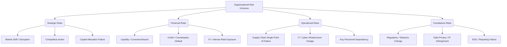

# Lesson 2: Risk Identification, Classification, Taxonomy

## 1. First-Principles Intuition & Invariants

The fundamental challenge of risk management is not measurement, but discovery. Before a risk can be quantified, mitigated, or transferred, it must first be conceptualized as a distinct entity within the organizational ecosystem. Risk identification is the mechanical process of transforming latent, ambient uncertainty into explicit, articulated operational constraints. It is an act of cognitive boundary-drawing. The practitioner must accept a foundational invariant: you cannot defend against a threat you have not explicitly named, and human cognition is inherently ill-equipped to conceptualize threats that exist outside immediate experiential memory. 

When management teams rely on heuristic brainstorming or retrospective incident reviews, they systematically fail to identify latent risks. This failure stems from the availability heuristic, a cognitive bias where the probability of an event is judged by the ease with which examples come to mind. A team that recently suffered a supply chain disruption will over-index on logistics risks while entirely missing an impending regulatory shift in data privacy. To overcome the structural limitations of human intuition, risk identification must be treated as a deterministic, systematized exercise rather than a creative one. 

The core invariant of risk surfacing is the concept of the "risk surface." Every business process, product feature, geographic expansion, or corporate transaction generates a unique risk surface, defined as the total intersection of internal capabilities, external dependencies, and threat vectors. Complete risk surface mapping requires the practitioner to abandon the organization chart and instead analyze the organization as a flow of capital, data, and operational dependencies. By mapping these flows, we can identify the nodes where value is created, transferred, or stored, and examine the specific vulnerabilities at each node. The objective is not to predict the future, which is statistically impossible, but to ensure that the organization possesses a comprehensive catalog of every structural vulnerability that could materially impact value creation. This transforms risk management from a reactive insurance function into a proactive architectural discipline.

## 2. Core Architecture & Mechanics

The transition from abstract uncertainty to a manageable risk catalog requires a robust architectural framework. The primary data structure used to achieve this is the Risk Breakdown Structure (RBS). Modeled after a Work Breakdown Structure in project management, the RBS provides a hierarchical, taxonomic representation of risks, descending from broad categories to granular, actionable risk events. The top level of the RBS categorizes risks by their fundamental nature: Strategic, Financial, Operational, and Compliance.

Within this taxonomy, Strategic Risks represent existential threats to the organization's core business model. These are risks that invalidate the fundamental assumptions of how the company creates value. A shift in consumer preferences, the emergence of a disruptive substitute technology, or a catastrophic failure in M&A integration all fall under this domain. Financial Risks encompass the quantitative vulnerabilities related to capital structure, liquidity, and asset valuation. This includes covenant breaches on revolving credit facilities, counterparty defaults on trade receivables, and macroeconomic exposures such as foreign exchange volatility or interest rate shocks. Operational Risks are the most granular and numerous, covering the internal failures of people, processes, and systems. A single-point-of-failure supplier in the procurement chain, a catastrophic cyber breach in the customer database, or the unexpected departure of a key technical architect are operational risks. Finally, Compliance Risks deal with the organization's adherence to external legal and regulatory statutes, including data privacy mandates like GDPR, environmental regulations, and financial reporting standards.

To populate this taxonomy, practitioners cannot rely on passive observation. They must deploy systematic surfacing mechanisms, primarily through process mapping and decomposition. By creating a granular flowchart of a critical business process—such as the order-to-cash cycle or the new product development pipeline—the analyst forces the organization to articulate every handoff, system integration, and external dependency. At each node in the process map, the practitioner applies a HAZOP (Hazard and Operability Study) methodology, adapted from chemical engineering. The practitioner queries the node using guidewords: What happens if this step experiences a delay? What happens if the throughput is higher than expected? What happens if the input data is corrupted? This mechanical interrogation of process maps surfaces latent risks that would never emerge in a standard brainstorming session.

Once identified, risks must be cataloged in a structured Risk Register. This register acts as the central database for the risk management lifecycle. A properly constructed risk catalog entry contains zero ambiguity.

| Field Name | Description | Sample Entry |
| --- | --- | --- |
| **Risk ID** | Unique alphanumeric identifier | OPS-SUPPLY-014 |
| **Category** | RBS Level 1 & 2 Classification | Operational / Supply Chain |
| **Risk Statement** | Condition + Cause + Consequence | Due to sole-sourcing of microcontrollers (Cause), a supplier factory outage (Condition) occurs, leading to a 30-day production halt (Consequence). |
| **Trigger Event** | The leading indicator of the risk materializing | Supplier announces force majeure on standard shipments. |
| **Inherent Impact** | Financial/Operational severity pre-mitigation | $4.2M EBITDA impact, 15% quarterly revenue delay |
| **Inherent Likelihood** | Probability of occurrence pre-mitigation | Medium (1 in 5 years) |
| **Owner** | Accountable executive for mitigation | VP of Global Procurement |
| **Control Type** | Preventive, Detective, or Corrective | Preventive |
| **Mitigation Status** | Current state of the control | Secondary supplier qualification in progress (40% complete) |

The risk statement itself is a critical mechanical construct. It is not a vague noun phrase like "Supply Chain Risk." It is a structured sentence combining a cause, a condition, and a consequence. This structural mandate forces the analyst to trace the mechanical chain of events from an external trigger to an internal financial impact. If the analyst cannot articulate the consequence in measurable terms, the risk has not been properly identified; it is merely a vague anxiety.

## 3. High-Performance Optimization & Failure Modes

A static risk taxonomy rapidly degrades into a compliance exercise, generating immense documentation that provides zero operational value. High-performance risk management optimizes the identification process by embedding it directly into the Agile product lifecycle and corporate transaction workflows, utilizing pattern recognition and pre-mortem analysis. 

The pre-mortem is a powerful cognitive tool utilized during the initiation phase of any major product launch or strategic initiative. Rather than asking the team to identify risks, the facilitator states that the initiative has failed catastrophically six months into the future. The team is then given thirty minutes to write down exactly why it failed. This temporal shift bypasses the optimism bias that plagues forward-looking risk assessments. By assuming the failure has already occurred, the brain shifts from defending the viability of the project to searching for the causal mechanisms of the disaster. The outputs of the pre-mortem are then mapped directly into the RBS, ensuring that the taxonomy reflects psychological realities rather than sanitized corporate optimism.

Pattern recognition mechanisms elevate the identification process from individual project analysis to systemic enterprise awareness. This is achieved by establishing a continuous feedback loop between the risk register and the incident management system. When an operational incident occurs, it is not simply resolved and forgotten. The incident is mapped backward to the RBS. If the incident represents a novel risk that was not present in the catalog, the taxonomy itself must be updated. Over time, this creates a historical dataset of risk actualizations. Analysts can then apply quantitative pattern matching, looking for correlations between risk categories. For example, they may discover that financial risks related to currency volatility have a high statistical correlation with operational risks in international supply chain logistics. This allows the organization to anticipate second-order risks that are not immediately obvious.

The most insidious failure mode in risk taxonomy is classification drift. Over time, practitioners tend to categorize any risk they do not understand as "Operational." Because operational risks are ubiquitous and often low-severity, classifying a strategic existential threat as an operational risk obscures it from executive oversight. To mitigate this, the risk taxonomy must undergo periodic architectural audits. Every entry classified as an Operational Risk must be tested against the definition of a Strategic Risk. If the risk event were to actualize, would it merely cost money and time (Operational), or would it invalidate the fundamental value proposition of the product (Strategic)?

Another critical failure mode is the "Unknown Unknowns" fallacy, where teams argue that sophisticated taxonomies are useless because they cannot predict black swan events. This fundamentally misunderstands the purpose of the taxonomy. The goal of systematic risk identification is not to predict specific, highly improbable events, but to map the structural vulnerabilities of the system. A pandemic might be an unpredictable black swan, but the structural vulnerability of relying on a single geographic region for 90% of manufacturing capacity is a known, mappable risk. The taxonomy catalogs the vulnerability; it does not attempt to predict the specific trigger. By focusing the identification process strictly on the structural weaknesses of the organizational architecture, the practitioner ensures that when the unpredictable trigger eventually occurs, the organization has already mapped the blast radius and designed the necessary mitigations.
