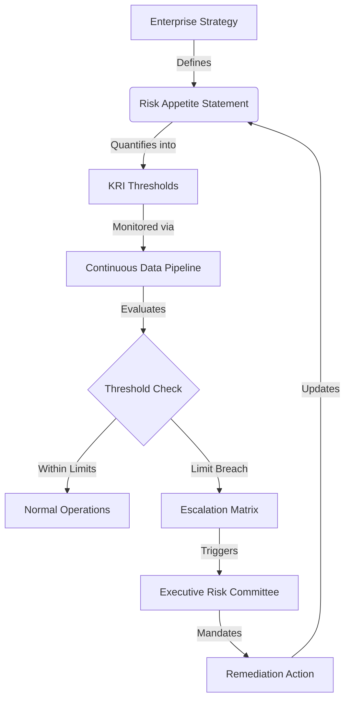

# Lesson 4: Risk Governance, Monitoring, Enterprise Integration

## 1. First-Principles Intuition & Invariants

Risk governance is the architecture of accountability. It dictates who possesses the authority to assume specific risks, under what constraints, and who bears the responsibility for monitoring the outcomes. The fundamental invariant of enterprise risk management is that risk-taking must be explicitly tethered to strategic objectives and capital reserves. Governance is the mechanism that enforces this tether. Without it, risk devolves into uncoordinated speculation, and organizations discover their exposure only when a loss materializes on the income statement.

The traditional view frames governance as a preventative brake on commercial activity. A practitioner view recognizes governance as a steering mechanism. By quantifying risk appetite and distributing decision rights, governance allows an organization to accelerate risk-taking within safe boundaries. It replaces subjective managerial intuition with objective, quantified constraints. The core invariant here is the subordination of revenue maximization to capital preservation when predetermined limits are breached. Governance transforms risk from an abstract threat into a priced constraint.

The foundation of this architecture is the Three Lines of Defense model, which distributes accountability across distinct operational layers. The first line consists of the business operators and front-line managers who generate risk in the pursuit of revenue. Because they own the profit and loss, they must own the risk. Their responsibility is to execute within the boundaries set by the governance framework. The second line is the independent risk management and compliance function. This group designs the measurement architecture, sets the quantitative thresholds, and monitors aggregate exposure. They do not own the commercial outcome, which grants them the objectivity required to challenge the first line. The third line is internal audit, which verifies the integrity of the first and second lines. They audit the auditors, ensuring that the controls are not merely documented but physically enforced within the operational systems.

## 2. Core Architecture & Mechanics

Effective risk governance requires a hierarchical chain of command that bridges operational execution and board oversight. At the apex sits the Board Risk Committee (BRC), typically composed of independent directors with financial, operational, or legal expertise. The BRC is responsible for ratifying the Risk Appetite Statement (RAS) and ensuring it aligns with shareholder expectations. Below the board operates the Executive Risk Committee (ERC), chaired by the Chief Risk Officer (CRO) and populated by business unit leaders. The ERC translates the board’s qualitative appetite into hard operational limits and reviews breaches. The CRO acts as the nexus, possessing a direct reporting line to the board to prevent commercial executives from suppressing adverse risk findings.

To make governance actionable, the ERC must translate the Risk Appetite Statement into Key Risk Indicators (KRIs). A KRI is a leading metric that predicts the likelihood of a risk event before the financial loss materializes. A lagging metric, such as actual credit losses or realized churn, is a Key Performance Indicator (KPI) of past failure, not a KRI of future risk. A functioning KRI must possess a quantifiable threshold, a defined data source, and an automated escalation trigger.

Consider the mechanics of establishing a KRI threshold. The baseline behavior of the metric is modeled over a historical observation window. If the metric follows a normal distribution, standard deviation bands are applied to set the limits. The warning threshold is typically set at one standard deviation above the rolling average, while the breach threshold is set at two standard deviations. For non-normal distributions, such as operational loss frequencies, quantile-based thresholds are used, setting the red line at the 95th or 99th percentile of historical observations.

The table below illustrates a fully specified KRI for monitoring customer concentration risk in a B2B SaaS enterprise:

| Parameter | Specification |
| :--- | :--- |
| **Metric Name** | Top 5 Customer ARR Concentration |
| **Risk Category** | Strategic / Financial |
| **Data Source** | ERP Billing Module (Real-time API) |
| **Calculation Logic** | (Sum of ARR from Top 5 Accounts) / (Total ARR) |
| **Target Threshold (Green)** | < 20% |
| **Warning Threshold (Yellow)**| 20% - 25% |
| **Breach Threshold (Red)** | > 25% |
| **Escalation Owner** | CRO and VP of Sales |

When a KRI breaches its red threshold, the governance system must execute a predetermined feedback loop. This is not a passive notification; it is an automated workflow that strips decision authority from the first line until the exposure is remediated. The escalation matrix dictates the speed and target of the response based on the severity of the breach.

| Breach Severity | KRI Status | Escalation Target | Response SLA | Action Mandated |
| :--- | :--- | :--- | :--- | :--- |
| **Level 1** | Yellow | First-Line Manager | 48 Hours | Document mitigation plan |
| **Level 2** | Red | CRO and ERC | 24 Hours | Freeze new exposure, submit remediation plan |
| **Level 3** | Critical Red | Board Risk Committee | 4 Hours | Emergency liquidity/capital review |

To integrate governance with enterprise strategy, organizations must embed risk constraints into capital allocation and project selection. This is achieved through Risk-Adjusted Return on Capital (RAROC) modeling. RAROC measures the profitability of a project relative to the economic capital required to absorb its potential tail risk. The formula calculates the net income of the initiative, subtracts the expected loss, and divides the result by the economic capital allocated to the venture. Economic capital is the amount of equity required to survive a worst-case loss scenario, typically calculated as the Value at Risk (VaR) at a 99.9% confidence interval over a one-year horizon.

The RAROC formula is expressed as: `RAROC = (Revenue - Funding Costs - Operating Expenses - Expected Loss) / Economic Capital`. If a new product initiative projects $10 million in net income but requires $50 million in economic capital to support the operational risk, the RAROC is 20%. If the enterprise’s hurdle rate—the minimum return required by shareholders—is 15%, the project clears the governance threshold. If the RAROC falls below the hurdle rate, the governance framework mandates rejection, regardless of the accounting profit, because the initiative destroys economic value.

## 3. High-Performance Optimization & Failure Modes

The primary failure mode in risk governance is metric drift. A KRI that accurately predicted risk in a previous fiscal year may lose its predictive power as the business model evolves. For example, a KRI tracking server uptime is irrelevant if the enterprise has migrated its infrastructure to a managed cloud provider. High-performance governance requires a quarterly recalibration of KRIs. This process involves backtesting the KRI against historical loss events to verify a statistical correlation. If the correlation breaks down, the metric is retired and replaced. Governing with stale metrics creates a false sense of security, leading to risk theater where compliance is achieved but actual exposure remains unmonitored.

A second critical failure mode is escalation latency. If the data pipeline feeding the KRI dashboard operates on a batch schedule, the organization may discover a breach days after it occurs. To optimize response times, monitoring infrastructure must be event-driven. When a transaction or operational event alters the risk profile, the system should immediately evaluate the new state against the threshold limits. If a limit is breached, the system should execute a hard stop, automatically disabling the offending operational process until the risk is reviewed. This architecture removes human hesitation from the feedback loop, ensuring that governance is enforced at the speed of execution.

Finally, governance structures frequently fail when they become decoupled from strategic planning. The ERC may diligently monitor risks, but if the strategy team ignores these constraints during the annual capital budgeting cycle, the organization will consistently fund projects that violate its risk appetite. To prevent this, the RAROC hurdle rate and operational risk limits must be hard-coded into the financial planning software used to evaluate new investments. This integration ensures that no capital is allocated without an automated check against the enterprise risk framework, closing the loop between strategy formulation, risk governance, and operational execution.
