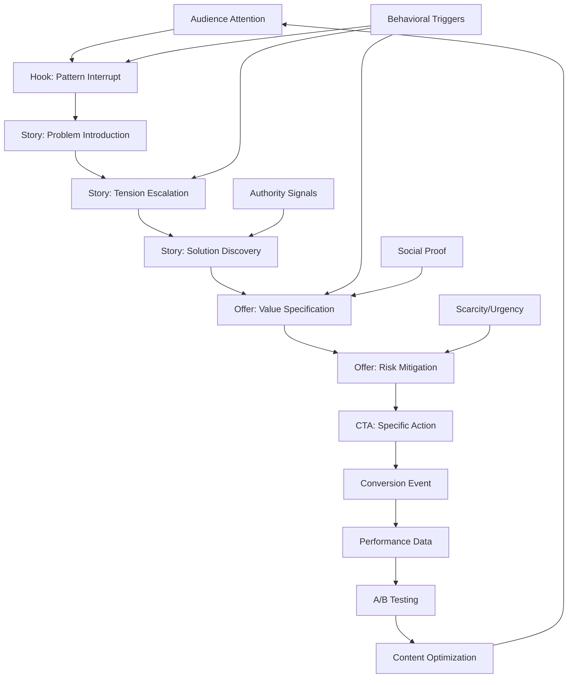

# Lesson 3: Content Strategy, Copywriting Frameworks, Behavioral Triggers

## 1. First-Principles Intuition & Invariants

Content marketing operates at the intersection of human psychology, information architecture, and economic persuasion. Unlike paid advertising, which purchases attention through media spend, content strategy manufactures attention through engineered relevance—creating artifacts that audiences voluntarily consume, share, and act upon. The underlying invariant is simple: human attention flows toward perceived value, and conversion occurs when the cost of action falls below the threshold of accumulated trust. Every piece of content either deposits trust capital or withdraws it, and the account balance determines whether a prospect becomes a customer.

The challenge lies in the asymmetry of information and motivation. A prospect arrives with incomplete knowledge, competing priorities, and innate skepticism toward commercial messaging. Traditional advertising attempts to overcome this resistance through repetition and reach, but content marketing inverts the model by providing utility first—education, entertainment, or emotional resonance—before introducing the commercial proposition. This sequencing matters profoundly. A sales pitch delivered prematurely triggers psychological reactance, the instinctive rejection of perceived manipulation. A pitch delivered after establishing credibility and addressing underlying objections encounters dramatically lower resistance.

The architecture of persuasive content rests on three interlocking systems: narrative structure, psychological triggers, and voice consistency. Narrative structure provides the skeleton—the information sequencing that guides a reader from initial attention through comprehension to action. Psychological triggers supply the neurochemical fuel—dopamine from curiosity, cortisol from urgency, oxytocin from social proof—that sustains engagement through the narrative arc. Voice consistency maintains brand coherence across touchpoints, ensuring that every content artifact reinforces the same strategic positioning rather than fragmenting audience perception across inconsistent messages.

At the atomic level, every successful content piece performs three distinct functions in sequence. First, it must capture attention against a background of infinite alternatives, which requires either novelty, controversy, or the promise of valuable information. Second, it must sustain engagement long enough to deliver the core message, which demands structural coherence and emotional pacing. Third, it must convert engagement into a measurable action—a click, a signup, a purchase, a share—which requires explicit direction combined with motivation. The vast majority of content fails at one of these three gates. It either never captures attention, loses the audience midway through, or fails to provide a clear next step.

The economic model underlying content marketing diverges sharply from direct response advertising. Paid ads operate on a cost-per-acquisition basis where each dollar spent produces a quantifiable conversion event within a short attribution window, typically hours or days. Content marketing invests in audience building and trust accumulation over extended periods, often months or years, with conversion occurring far downstream from initial exposure. This delayed gratification makes content ROI harder to measure but potentially more valuable, as the marginal cost of serving additional content to an existing audience approaches zero while the marginal value compounds through repeated exposure.

Modern content strategy must account for algorithmic distribution alongside human psychology. Search engines rank content based on relevance signals—keyword density, semantic coherence, backlink authority, user engagement metrics—while social platforms prioritize engagement velocity and network effects. A content piece optimized purely for human readers may fail algorithmically, never reaching its intended audience, while content optimized purely for algorithms may achieve distribution but fail to convert because it lacks genuine human appeal. The practitioner must engineer for both systems simultaneously, which introduces fundamental trade-offs between optimization targets.

The most sophisticated content strategies operate as closed-loop systems with continuous feedback and optimization. Content performance data—click-through rates, time on page, scroll depth, conversion rates, share velocity—flows back into the production process, informing iterative improvements in messaging, structure, and distribution tactics. A/B testing provides the experimental apparatus for isolating causal factors, allowing practitioners to quantify the impact of specific copywriting choices, headline variations, or call-to-action placements. Without this empirical discipline, content marketing degrades into subjective opinion and creative intuition, which scale poorly and offer no mechanism for systematic improvement.

The invariants that govern high-performing content transcend industry, format, and channel. Clarity always defeats cleverness when the goal is conversion rather than entertainment. Specificity builds credibility while vagueness signals inexperience or deception. Brevity respects the reader's time and attention budget, but only after the core value proposition has been delivered; premature concision leaves the audience confused about what action to take or why they should care. The strongest content frontloads value, delivering utility or insight in the opening paragraphs before introducing asks or commercial messaging. This sequencing establishes goodwill and demonstrates competence, making subsequent persuasion more effective.

Voice consistency across content assets functions as brand infrastructure, creating a recognizable identity that audiences can pattern-match across touchpoints. A company that publishes formal white papers, casual social media posts, and aggressive sales emails fragments its brand perception, forcing audiences to reconcile contradictory signals about organizational values and competence. The most effective content programs establish clear voice guidelines—tone, diction, sentence structure, humor level, technical depth—and enforce them rigorously across all output. This consistency compounds over time, making each new content piece more valuable because it reinforces accumulated brand associations rather than diluting them.

The psychological foundations of persuasive content derive from decades of empirical research in behavioral economics and social psychology. Humans exhibit predictable cognitive biases—loss aversion, social proof, authority bias, scarcity effects—that skilled practitioners can ethically leverage to increase conversion rates. A prospect facing two identical offers will choose the one framed as preventing a loss over the one framed as securing a gain, even when the economic outcome is identical. A testimonial from a peer influences decisions more powerfully than expert endorsement, because peer similarity reduces the perceived risk of making the same choice. These mechanisms operate largely below conscious awareness, making them robust to audience sophistication.

The transition from content consumption to conversion requires explicit directional guidance combined with motivation sufficient to overcome inertia. Every content piece must conclude with a clear, singular call to action that specifies exactly what step the reader should take next and why that step serves their interests. Multiple competing calls to action diffuse focus and reduce aggregate conversion rates, as choice paralysis increases friction. The most effective CTAs minimize perceived risk—offering free trials, reversible commitments, or social proof of safety—while maximizing perceived urgency through time-limited offers or scarcity signals. The CTA placement matters as much as its content; embedding it naturally within the narrative flow outperforms appending it artificially at the end.

## 2. Core Architecture & Mechanics

The hook-story-offer framework structures persuasive content as a three-act narrative designed to move a reader from initial attention through emotional engagement to commercial conversion. This architecture derives from classical rhetoric and modern neuroscience, mapping content structure onto the brain's information processing sequence. The hook activates the prefrontal cortex's attention systems, the story engages the limbic system's emotional centers, and the offer prompts the motor cortex to execute a decision already prepared by the preceding stages.

The hook serves a singular function: interrupt the audience's current cognitive state and redirect attention to your message. This requires understanding the competitive context in which your content appears. A prospect scrolling through a social feed encounters hundreds of competing stimuli per minute, each demanding attention. A reader searching Google for a solution has already filtered down to high-intent content but still evaluates multiple results simultaneously. The hook must deliver either immediate utility or powerful emotional resonance within the first three seconds of exposure, before the audience's attention shifts elsewhere.

Effective hooks exploit one of five psychological mechanisms. Pattern interruption violates expectations to trigger orienting responses—the neurological reflex that directs attention toward novel or unexpected stimuli. A headline that challenges conventional wisdom or presents a counterintuitive claim activates this mechanism. Self-interest appeals promise specific, tangible benefits that address the audience's existing goals or pain points. A hook that begins with "How to increase email open rates by forty-seven percent" immediately signals relevance to an email marketer struggling with engagement metrics. Social proof leverages conformity bias by highlighting how many others have already adopted the behavior or belief being promoted. Curiosity gaps withhold key information to create cognitive tension that can only be resolved by consuming the content. Time-bound urgency invokes loss aversion by threatening the removal of an opportunity if action is not taken immediately.

The story phase builds emotional investment and establishes credibility through narrative progression. Human brains process information more effectively when packaged as stories rather than abstract propositions because narrative structure mirrors the temporal sequencing of lived experience. A well-constructed story moves the audience through a problem-solution arc that parallels their own situation, creating identification and empathy. The protagonist faces an obstacle similar to the reader's challenge, experiments with solutions, encounters setbacks, and ultimately discovers the approach being promoted. This narrative inoculates the offer against skepticism by preemptively addressing objections within the story's natural flow.

The internal mechanics of story persuasion operate through three distinct pathways. Identification occurs when the audience recognizes themselves in the protagonist's situation, which activates mirror neurons and creates vicarious emotional responses. Transportation describes the phenomenon where engaged readers mentally simulate the narrative events, temporarily suspending critical evaluation. Social learning allows audiences to extract lessons from others' experiences without bearing the costs of direct trial and error. A case study describing how another company implemented a marketing automation platform and achieved specific results allows the reader to evaluate the solution's effectiveness without conducting their own expensive experiment.

The story structure must balance specificity and universality. Excessive specificity makes the narrative feel irrelevant to readers whose situations differ from the protagonist's circumstances. Excessive generality fails to establish credibility because it provides no concrete evidence of the solution's effectiveness. The optimal balance presents a specific case with clearly defined parameters while explicitly connecting those parameters to broader principles that transfer across contexts. A story about a B2B SaaS company reducing churn through customer health scoring becomes universally relevant when it explains the underlying retention mechanics that apply to any subscription business.

Emotional pacing within the story phase determines whether the audience remains engaged through to the offer. The narrative must create tension early—establishing a problem significant enough to justify the reader's continued attention—then escalate that tension through complications or setbacks before resolving it through the proposed solution. This progression mirrors the dopamine dynamics of reward anticipation: uncertainty and challenge create motivational arousal, while resolution delivers satisfaction. Content that front-loads the solution eliminates narrative tension and reduces engagement, while content that delays resolution too long exhausts the reader's patience.

The offer phase converts accumulated attention and trust into a specific, measurable action. This transition from consumption to conversion represents the most fragile moment in the content experience, where misalignment between the story and the ask destroys conversion rates. The offer must feel like the natural culmination of the narrative rather than an abrupt pivot to commercial messaging. A story about overcoming email deliverability challenges naturally leads to an offer for a deliverability audit tool, but would create cognitive dissonance if it pivoted to an offer for social media scheduling software.

The offer itself contains three mandatory components: a clear specification of what the audience will receive, a credible explanation of why they should want it, and explicit instructions for how to claim it. Vague offers—"Learn more about our platform"—produce weak conversion because they fail to specify value. Strong offers quantify the benefit and minimize perceived risk: "Start a fourteen-day free trial with no credit card required and see how our platform can reduce your email bounce rate by at least twenty percent, or cancel with one click." This construction specifies the benefit (reduced bounce rate), quantifies the magnitude (twenty percent), eliminates friction (no credit card), and provides an exit path (one-click cancellation).

The psychology of commitment and consistency suggests that small initial asks convert more effectively than large ones, because humans seek to maintain cognitive alignment between their actions and self-image. A content piece asking for an email address in exchange for a detailed guide converts more successfully than one asking for an immediate purchase, even when the economic value of the purchase justifies the ask. The small commitment establishes a relationship and identifies high-intent prospects who can be nurtured through subsequent content and outreach until they are ready for the larger conversion.

Scarcity and urgency mechanics operate by exploiting loss aversion, the empirically validated principle that humans feel losses approximately twice as intensely as equivalent gains. A prospect offered "twenty percent off if you purchase today" experiences stronger motivation than one offered "standard pricing available indefinitely," even though the economic payoff is identical. Scarcity can be quantity-based—"only fifty spots remaining"—or time-based—"offer expires in seventy-two hours." The mechanism must be genuine rather than fabricated, as sophisticated audiences detect artificial scarcity and interpret it as manipulation, which destroys trust.

Social proof manifests through multiple formats, each exploiting different facets of conformity bias and authority. Testimonials from satisfied customers provide peer validation, reducing perceived risk by demonstrating that others in similar situations achieved positive outcomes. Quantitative metrics—"over ten thousand companies use our platform"—signal market acceptance and reduce the perceived risk of choosing an unpopular solution. Expert endorsements leverage authority bias, where audiences defer to recognized specialists even when they lack the expertise to evaluate the underlying claims independently. User-generated content provides authentic validation that audiences trust more than company-produced marketing materials.

The technical implementation of social proof requires attention to specificity and context. Generic testimonials—"This product is great!"—carry little persuasive weight because they provide no concrete evidence of value. Effective testimonials specify the problem addressed, the solution's mechanism, and the quantified results achieved: "We implemented the email segmentation features and saw our click-through rate increase from two-point-three percent to five-point-one percent within thirty days, which translated to an additional forty-seven thousand dollars in quarterly revenue." This specificity allows the reader to evaluate relevance to their own situation and estimate potential ROI.

Brand voice consistency requires formal documentation and enforcement mechanisms, not merely good intentions. A comprehensive voice guide specifies tone (authoritative vs. conversational, formal vs. casual), diction (technical jargon vs. plain language, industry terminology vs. accessible metaphors), sentence structure (short declarative statements vs. complex subordinate clauses), and perspective (first-person plural vs. second-person direct address). These choices encode strategic positioning: a consultant selling premium advisory services might adopt a formal, authoritative voice to signal expertise, while a consumer app targeting young adults might use casual, conversational language to signal accessibility.

The voice specification must account for contextual variation across channels and content types while maintaining core consistency. A LinkedIn post requires different formality levels than an internal technical white paper, but both should reflect the same underlying brand personality. The voice guide establishes which elements remain constant—core values, key terminology, philosophical stance—and which elements flexibly adapt to context—formality, length, technical depth. Without this explicit specification, content teams produce inconsistent output that confuses audiences about brand identity and dilutes accumulated positioning equity.

Voice enforcement requires editorial review processes and style checking tools that flag deviations from established guidelines. Large content operations implement formal approval workflows where every published piece passes through an editor trained in the brand voice standards. Smaller operations can use style guides combined with peer review and regular voice audits that sample published content and score it against the documented standards. The key metric is consistency variance: the degree to which published content deviates from the defined voice profile across multiple dimensions.

A/B testing provides the experimental methodology for isolating causal factors in content performance and quantifying their impact on conversion rates. The fundamental principle is controlled variation: create two versions of a content piece that differ in exactly one element—headline, opening paragraph, CTA placement, button color—then randomly assign incoming traffic to each version and measure which produces superior outcomes. The statistical infrastructure requires sufficient sample size to detect meaningful differences, typically calculated using power analysis that accounts for baseline conversion rate, minimum detectable effect size, and desired statistical confidence level.

The mechanics of A/B test execution involve several technical components. A randomization algorithm assigns each visitor to a variant with equal probability, preventing selection bias that would confound results. A tracking system records which variant each visitor saw and whether they completed the target conversion action. A statistical analysis engine calculates conversion rates for each variant and determines whether the observed difference exceeds random chance at the specified confidence threshold, typically ninety-five percent. This threshold means that if the test were repeated one hundred times, ninety-five would yield the same directional result.

The most common failure mode in A/B testing is premature termination based on early results that fail to account for statistical noise. A test that shows a fifteen percent lift after two days might show zero lift after two weeks once sufficient data accumulates to overcome random variation. Proper testing requires pre-specifying the sample size needed to detect a meaningful effect, then running the test until that sample size is reached regardless of interim results. Peeking at results mid-test and stopping early when they look favorable introduces bias that invalidates the statistical conclusions.

Test prioritization should follow an expected value framework that accounts for both potential impact and implementation cost. A headline test that might improve conversion by twenty percent across all site traffic generates more expected value than a sidebar element test that might improve conversion by thirty percent but only affects ten percent of visitors. The implementation cost includes both engineering resources to build and deploy the variants and opportunity cost of not testing alternative hypotheses. The optimal testing strategy sequences experiments by expected value per unit cost, addressing high-leverage, low-cost tests first.

The relationship between content strategy and distribution channels creates interdependencies that practitioners must navigate carefully. Search-optimized content requires keyword integration and semantic structure that satisfies ranking algorithms, but excessive optimization degrades human readability and reduces engagement metrics that feed back into ranking signals. Social-optimized content needs strong hooks and emotional resonance to drive sharing behavior, but platforms penalize overtly promotional content in organic reach algorithms. Email content must balance value delivery with commercial messaging, as excessive sales pitches increase unsubscribe rates while pure utility content fails to drive revenue.

The diagram above represents the information flow architecture of persuasive content, from initial attention capture through conversion and back through optimization feedback loops. Each stage gates the next, meaning poor performance at any node reduces aggregate conversion rates regardless of downstream quality. The behavioral triggers—social proof, scarcity, authority—inject psychological leverage at specific stages where their mechanisms align with the audience's decision-making state.

## 3. High-Performance Optimization & Failure Modes

Content optimization begins with instrumentation: deploying tracking systems that capture granular behavioral data across the entire content journey. Google Analytics or equivalent platforms record page views, time on page, scroll depth, and exit points. Heatmapping tools like Hotjar visualize exactly where users click, how far they scroll, and which elements attract or repel attention. Email marketing platforms track open rates, click-through rates, and conversion rates segmented by subject line, send time, and audience cohort. This data infrastructure provides the empirical foundation for systematic improvement, transforming content production from subjective creativity into an engineering discipline.

The headline represents the single highest-leverage optimization opportunity in most content formats, as it determines whether the audience engages with the content at all. A/B testing headlines can produce conversion rate improvements of fifty to three hundred percent, larger than virtually any other isolated change. Effective headlines balance four competing objectives: clarity about topic, promise of specific value, emotional resonance, and brevity that respects attention constraints. A headline like "Email Marketing" satisfies clarity but fails the other three dimensions. "How to Write Email Subject Lines That Increase Open Rates by Thirty-Seven Percent" satisfies all four: topic clarity, quantified value promise, practical utility that triggers interest, and acceptable length.

Headline testing should prioritize variation across different psychological mechanisms rather than minor wording changes. Testing "Increase Email Open Rates" against "Improve Email Open Rates" wastes statistical power on synonyms that produce minimal behavioral differences. Testing "Increase Email Open Rates" against "Stop Losing Revenue to Ignored Emails" compares positive framing against loss aversion framing, which can produce large effect sizes. Testing "Email Marketing Best Practices" against "What I Learned Spending Two Million Dollars on Email Marketing" compares generic authority against specific credibility, another high-variance comparison.

The opening paragraph must deliver on the headline's promise within the first fifty words, or the reader exits before encountering the core content. This front-loading requirement conflicts with traditional narrative structure, which builds context before delivering insights. High-performing content inverts this structure, leading with the most valuable information or surprising claim, then backfilling context and justification afterward. A blog post about conversion rate optimization might traditionally begin with "Conversion rate optimization is important for online businesses because..." but performs better starting with "Changing our checkout button from green to red increased revenue by forty-one thousand dollars per month. Here's the psychological mechanism that explains why."

Content length optimization requires understanding the relationship between comprehensiveness and engagement, which varies by audience intent and competitive context. Informational searches—users seeking to understand a concept or learn a skill—reward long-form content that thoroughly addresses the topic, because users have already committed to learning and prefer a single comprehensive resource over fragmenting their attention across multiple shallow articles. Transactional searches—users ready to purchase but comparing options—reward concise, scannable content that facilitates quick evaluation. Google's search ranking algorithm explicitly factors content comprehensiveness relative to competing pages, making length a ranking signal in competitive verticals.

The practical implication is that content length should calibrate to competitive benchmarks for the target keyword, not arbitrary round numbers. If the top ten search results for "content marketing strategy" average thirty-five hundred words, a one-thousand-word article will struggle to rank regardless of quality, because the algorithm interprets length as a proxy for comprehensiveness. The content must match or exceed competitive length while maintaining information density, or it satisfies neither algorithmic ranking criteria nor human readability standards.

Paragraph structure and sentence rhythm affect reading comprehension and engagement in ways most practitioners underestimate. Dense paragraphs of eight to twelve sentences trigger eye fatigue and reduce scroll depth, particularly on mobile devices where screen constraints amplify the visual weight of text blocks. High-performing content alternates paragraph lengths—short punchy paragraphs for emphasis and pacing, longer analytical paragraphs for complex ideas—to create visual rhythm that sustains engagement. Sentence structure similarly benefits from variation: short declarative statements for key points, longer compound sentences for nuanced analysis, occasional sentence fragments for dramatic impact.

The use of subheadings transforms reading behavior from linear consumption to strategic navigation. Users scanning long-form content jump between subheadings to evaluate whether the article addresses their specific question before committing to full reading. Effective subheadings function as standalone value propositions that entice deeper engagement, not merely organizational labels. "Types of Email Campaigns" provides organization but no motivation to continue reading. "Why Behavior-Triggered Emails Generate Three Times More Revenue Than Newsletter Blasts" promises specific, quantified insight that justifies attention.

Visual content integration—images, charts, diagrams, videos—serves functional purposes beyond aesthetic appeal. Complex concepts that require multiple paragraphs of explanation become immediately comprehensible through well-designed diagrams, reducing cognitive load and improving retention. Data visualization transforms abstract statistics into concrete patterns that human visual processing systems detect effortlessly. Instructional content benefits from annotated screenshots or screen recordings that demonstrate procedures step-by-step, reducing the error rate of readers attempting to replicate the process.

The technical execution of visual integration requires attention to file size and loading performance, as images represent the largest performance bottleneck in most web content. Large unoptimized images delay page rendering, increasing bounce rates before the content even displays. Modern image formats like WebP reduce file sizes by thirty to fifty percent compared to traditional JPEG without quality loss. Lazy loading defers image loading until they enter the viewport, accelerating initial page render while preserving visual richness for engaged readers who scroll.

Call-to-action optimization operates at multiple levels from copy to placement to design. The CTA copy must balance clarity and motivation, specifying exactly what action the user will take and what benefit they will receive. "Submit" provides clarity but no motivation. "Get My Free Guide" provides both action specification and benefit promise. "Start Fourteen-Day Free Trial" beats "Sign Up" in A/B tests because it quantifies the commitment period and emphasizes zero cost. The word choice matters: "Start" frames the action as opportunity initiation rather than obligation acceptance.

CTA placement testing often reveals counterintuitive results that contradict conventional wisdom. Traditional web design places primary CTAs above the fold, assuming users won't scroll. Modern data shows that for long-form content, CTAs embedded at natural story resolution points convert more effectively than those placed artificially early, because the reader hasn't yet accumulated sufficient motivation to act. The optimal strategy places multiple CTAs at strategic points: one early for high-intent visitors already convinced, one mid-content for users who need partial persuasion, and one at conclusion for users who consume the full narrative.

Visual CTA design exploits perceptual psychology principles to maximize attention capture and click-through rates. Color contrast against the surrounding design creates pop-out effects that automatically draw visual attention, leveraging preattentive processing systems that operate before conscious awareness. Button size balances prominence against aesthetic harmony; oversized buttons signal desperation and reduce credibility, while undersized buttons fail to capture attention amid visual competition. Shape conventions matter: rounded rectangles signal clickability more effectively than pure rectangles or circles because they match established web interface patterns.

Scarcity implementation must remain ethically authentic while maximizing motivational impact. Artificial scarcity—countdown timers reset for each visitor, fake inventory limits—erodes trust when discovered and increasingly triggers fraud detection systems that penalize content distribution. Genuine scarcity arises from legitimate business constraints: limited production capacity, seasonal availability, exclusive partnerships, time-bound pricing contracts. The implementation should transparently communicate the source of scarcity and the consequences of delay. "This offer expires Friday because our supplier contract rates change monthly" provides credible context that "Only three spots left!" lacks.

Urgency mechanisms similarly require authentic foundations. Time-limited promotions create genuine urgency when the pricing truly changes at the deadline. Event-based urgency—"Register before the conference sells out"—leverages real capacity constraints. Milestone urgency—"Purchase before we reach one thousand customers to lock in founding member pricing"—creates competitive pressure without artificial manipulation. The key principle is transparency: explain why the urgency exists and what happens when the deadline passes, allowing readers to make informed decisions rather than feeling tricked into hasty action.

Social proof scaling presents technical and ethical challenges as companies grow and content reaches diverse audiences. Early-stage companies struggle to demonstrate social proof when customer numbers remain small, tempting them to inflate metrics or cherry-pick testimonials that misrepresent typical results. The solution lies in specificity over scale: a detailed case study from a single successful customer provides more persuasive power than vague claims about thousands of satisfied users. As the customer base grows, aggregated statistics become viable, but must be contextualized to remain credible: "Over ten thousand marketing teams across seventy-three countries" is more persuasive than just "Ten thousand customers."

Testimonial collection and presentation require systematic processes that balance authenticity and persuasive power. Soliciting testimonials immediately after a positive customer interaction—a successful onboarding, a problem resolution, a milestone achievement—captures enthusiasm and produces more energetic endorsements than delayed requests. Providing light structure—"Could you describe the problem you faced, what our solution did, and what results you achieved?"—helps customers produce testimonials that contain the specificity needed for persuasive impact. Presenting testimonials alongside contextual details—company name, role, industry, photo—increases credibility by reducing anonymity that readers associate with fabricated reviews.

Multi-variant testing extends A/B testing to simultaneously evaluate multiple elements, accelerating optimization velocity when sufficient traffic exists to power the statistical analysis. A multivariate test might simultaneously vary headline, opening paragraph, CTA copy, and button color, measuring the performance of every combination to identify interaction effects where elements perform differently in combination than in isolation. The statistical complexity increases exponentially with the number of variants, requiring significantly larger sample sizes to maintain statistical power. A four-element test with two options per element creates sixteen unique combinations, requiring sixteen times the traffic of a simple A/B test to achieve equivalent confidence.

The practical constraint on multivariate testing is traffic volume. Sites receiving fewer than ten thousand monthly visitors lack sufficient statistical power for multivariate tests and should focus on sequential A/B tests of high-impact elements. Sites exceeding one hundred thousand monthly visitors can efficiently run multivariate tests on key conversion pages, identifying optimal combinations faster than sequential testing. The testing platform's sophistication matters: advanced tools use machine learning algorithms to dynamically allocate traffic toward winning variants during the test, improving aggregate conversion rates even before the test concludes.

Content refresh strategies balance the resource cost of updating existing assets against the performance gains from maintaining relevance and accuracy. Search ranking algorithms explicitly reward freshness for time-sensitive topics, making regular updates valuable for competitive keywords. Evergreen content benefits less from cosmetic updates but gains significant value from expanding comprehensiveness when competing articles have increased their depth. The refresh decision should follow a portfolio management framework: calculate the traffic value of each existing article, estimate the performance gain from refreshing it, divide by the resource cost, and prioritize refreshes by expected value per hour invested.

The technical execution of content refreshes must preserve accumulated SEO equity while improving performance. URL changes destroy backlink value and reset ranking signals, making them prohibitively expensive in most cases. The refresh should maintain the existing URL while updating content, publishing date, and metadata to signal freshness. Adding substantial new sections or updating statistics provides concrete evidence of freshness that both algorithms and readers recognize. After publishing the refresh, resubmitting the URL through Google Search Console prompts immediate recrawling and reindexing rather than waiting for the next scheduled crawl.

Attribution modeling resolves the challenge of crediting conversions when prospects interact with multiple content pieces across extended timeframes before converting. First-touch attribution credits the initial content that introduced the prospect to the brand, emphasizing top-of-funnel awareness content. Last-touch attribution credits the final content consumed before conversion, emphasizing bottom-of-funnel sales enablement. Multi-touch attribution distributes credit across all content interactions, recognizing that conversion results from accumulated persuasion across the journey. The choice of attribution model affects content investment priorities: first-touch prioritizes audience growth, last-touch prioritizes conversion optimization, multi-touch balances both.

The practical implementation of attribution tracking requires technical infrastructure that maintains visitor identity across sessions and devices. First-party cookies track behavior within a single browser but fail when users switch devices or clear cookies. Account-based tracking for logged-in users provides cross-device identity but only after the prospect creates an account. Marketing automation platforms like HubSpot or Marketo implement probabilistic identity resolution that links anonymous sessions through IP address, user agent, and behavioral fingerprinting, though with imperfect accuracy. The tracking infrastructure must comply with privacy regulations like GDPR and CCPA, which restrict identifier tracking without explicit consent.

Content calendar management scales content production from ad-hoc creativity to systematic manufacturing. A formal calendar specifies publication schedule, content types, topic assignments, keyword targets, and distribution channels weeks or months in advance. This systematization enables several optimizations: batching similar content creation tasks to amortize context switching overhead, coordinating content releases with marketing campaigns and product launches, ensuring coverage of strategic keywords and topics rather than following creative impulses, and distributing workload evenly across team members rather than creating boom-bust production cycles.

The content calendar structure should encode dependencies and workflows, not merely publication dates. Each calendar entry specifies topic, target keyword, audience segment, author, reviewer, deadline sequence—first draft due, edits complete, final approval, publication—and distribution channels. Modern calendar tools integrate with project management systems and content management platforms, automatically creating task assignments and triggering notifications when deadlines approach. The calendar becomes the central coordination mechanism for distributed content teams, replacing status meetings with asynchronous visibility into production status.

Competitive content analysis identifies gaps and opportunities in the existing content landscape that strategic investment can exploit. The analysis begins with keyword research to identify high-value search terms where existing content is weak, outdated, or low-quality. Tools like Ahrefs or SEMrush provide competitive metrics: keyword search volume, ranking difficulty, top-ranking URLs and their traffic estimates. Analyzing the top ten ranking articles for a target keyword reveals the content depth, structure, and angle required to compete. If the top results average four thousand words with detailed screenshots and custom diagrams, a one-thousand-word text article will not displace them regardless of quality.

The content gap analysis extends beyond length to identify substantive gaps where existing content fails to address important subtopics or user questions. Analyzing the "People Also Ask" section in Google search results reveals related questions the audience asks but existing content inadequately addresses. Reviewing Reddit threads, Quora questions, and industry forums exposes pain points and information needs that formal content rarely addresses, creating opportunities for highly targeted content that captures engaged niche audiences. Social media discussions reveal emerging trends and controversies before they appear in traditional search data, enabling first-mover advantages in covering new topics.

Content repurposing maximizes ROI by extracting multiple content assets from single research investments. A comprehensive white paper generates blog posts covering individual sections, social media posts highlighting key statistics, infographics visualizing core frameworks, video explainers demonstrating procedures, podcast episodes discussing implications, webinar presentations expanding on complex topics, and email newsletter series delivering insights incrementally. Each format reaches different audience segments with different consumption preferences while reinforcing consistent messaging across channels. The marginal cost of repurposing is dramatically lower than original content creation while the aggregate reach multiplies.

The failure modes of content marketing cluster around several recurring patterns that practitioners must actively guard against. Inconsistent publishing schedules destroy audience habits and reduce long-term traffic growth, as readers stop checking for new content when publication becomes unpredictable. Chasing trends and viral topics sacrifices strategic keyword targeting for ephemeral traffic spikes that produce no lasting value. Excessive self-promotion without balancing utility content exhausts audience goodwill and increases unsubscribe rates. Neglecting content updates allows competitors with fresher content to displace existing rankings, destroying past investment. Poor distribution strategies leave high-quality content invisible because publication alone generates minimal organic reach in modern algorithmic environments.

The ultimate success metric for content strategy is not individual article performance but portfolio-level return on investment: total incremental revenue generated by content efforts divided by total content production costs. This calculation requires attribution infrastructure that tracks content interactions through to revenue events, audience cohort analysis that isolates the revenue impact of content-acquired customers, and time-series analysis that accounts for the delayed conversion characteristic of content marketing. Organizations that cannot measure content ROI rigorously operate on intuition and faith, which scales poorly and fails to allocate resources optimally across competing marketing channels.
