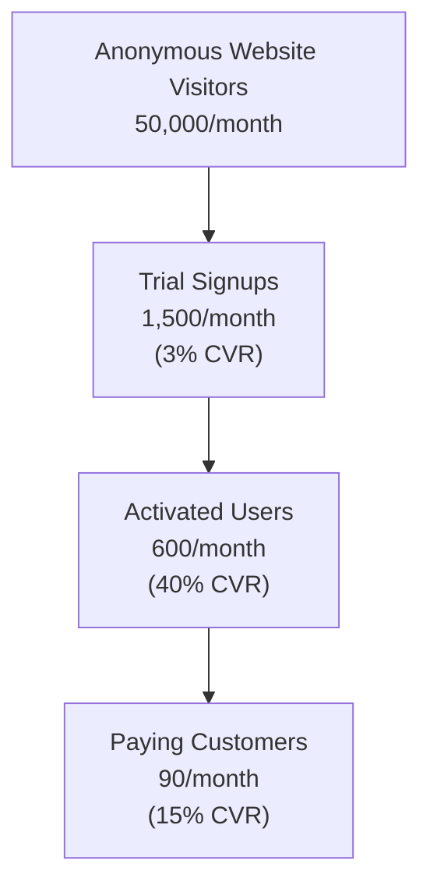
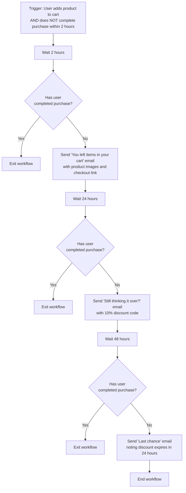

# Lesson 4: Analytics Pipelines, Attribution Models, Marketing Automation

## 1. First-Principles Intuition & Invariants

Digital marketing's operational promise rests on a deceptively simple premise: every dollar invested in customer acquisition should produce measurable, attributable revenue that compounds over the lifetime of that customer relationship. Yet the reality of modern consumer behavior—fragmented across devices, channels, and touchpoints—transforms this simple accounting exercise into a formidable instrumentation and inference problem. A prospective customer might encounter your brand through an Instagram ad on their mobile device during a morning commute, research your product on a desktop browser at work via organic search, abandon a cart after clicking a retargeting email that evening, and finally convert three days later through a direct website visit triggered by a brand recall formed across those prior exposures. Which channel deserves credit for the conversion? Which marketing dollar drove the outcome? And perhaps more critically, which future dollar should you deploy to replicate that success at scale?

The analytics pipeline represents the foundational infrastructure that captures, normalizes, and surfaces this fragmented user behavior into coherent conversion pathways. Unlike traditional media measurement—where Nielsen ratings or circulation audits provided clean, centralized metrics—digital marketing operates in an environment of radical decentralization. Every ad network, social platform, email service provider, and web analytics tool maintains its own event taxonomy, cookie domain, attribution window, and reporting interface. The first invariant of digital marketing analytics is that truth exists not in any single vendor dashboard but in the painstaking reconciliation of disparate event streams into a unified customer journey ledger. This reconciliation is not a cosmetic reporting exercise but a foundational data engineering discipline that determines whether your organization optimizes toward genuine business outcomes or vendor-favorable vanity metrics.

Attribution modeling emerged as the conceptual framework for distributing conversion credit across the multi-touch customer journey. The underlying mathematics borrows from causal inference, cooperative game theory, and survival analysis, but the practical application demands that practitioners navigate a minefield of philosophical and operational trade-offs. First-touch attribution grants all credit to the initial awareness driver, rewarding top-of-funnel brand building but ignoring the nurturing and conversion mechanics that close deals. Last-touch attribution assigns credit exclusively to the final interaction before conversion, favoring direct response tactics while systematically undervaluing the accumulated brand equity and consideration-stage content that made that final click meaningful. Linear and time-decay models distribute credit across all touchpoints, either uniformly or weighted by recency, but these heuristics impose arbitrary assumptions about influence that rarely match the true causal structure of your customer's decision-making process. Algorithmic or data-driven attribution attempts to learn conversion influence from historical patterns using logistic regression or machine learning classifiers, but these models inherit all the biases embedded in your training data and attribution window definitions.

The second invariant is that attribution is not objective truth but rather a management accounting convention—a decision rule for how your organization allocates shared revenue across competing channels and campaigns. The choice of attribution model directly determines budget allocation, campaign optimization signals, and ultimately which marketing strategies receive continued investment versus which get starved of resources. A brand that shifts from last-touch to linear attribution will immediately see dramatic performance changes not because customer behavior changed but because the accounting ledger redistributed credit from lower-funnel direct response toward upper-funnel awareness channels. This redistribution then cascades through automated bidding algorithms, budget planning processes, and performance reviews, reshaping your entire marketing mix based on what is fundamentally an arbitrary modeling choice. The practitioner's responsibility is not to find the "true" attribution model—no such thing exists—but to select a model whose implicit assumptions align with your organization's strategic priorities and then maintain consistency long enough to generate actionable learning.

The funnel metrics that govern digital marketing operations—click-through rate, customer acquisition cost, lifetime value, return on ad spend—form a tightly coupled system where improvements in one dimension often degrade another. Click-through rate measures the percentage of ad impressions that generate clicks, serving as the primary signal for ad relevance and creative effectiveness. But CTR optimization divorced from downstream conversion quality leads to clickbait creative and low-intent traffic that inflates costs without generating revenue. Customer acquisition cost divides total marketing spend by new customer count, providing the unit economic foundation for growth modeling, but CAC calculation demands precise decisions about cost inclusion (do you count agency fees, creative production, attribution platform licensing?), customer definition (first purchase, second purchase, annual contract signature?), and time window attribution (same-day, 7-day, 30-day, view-through?). Each definitional choice shifts the calculated CAC by 20-50%, and organizations frequently discover that different teams use incompatible CAC definitions, rendering cross-functional conversations about payback periods and growth targets meaningless.

Lifetime value represents the discounted present value of all future gross profit a customer will generate over their relationship with your brand, but LTV calculation requires forecasting retention curves, expansion revenue, referral effects, and discount rates across a future horizon measured in months or years. Early-stage companies lack sufficient customer tenure data to fit reliable survival curves, forcing them to make LTV projections based on cohorts with only weeks or months of observed behavior. The third invariant is that LTV is always a forecast, never a measurement, and the confidence intervals around that forecast explode as you project further into the future. A subscription business with 5% monthly churn has an expected customer lifetime of 20 months, but the distribution around that mean spans from immediate cancellation to multi-year tenure, and your LTV calculation is only as reliable as your churn model's ability to predict individual customer trajectories. Return on ad spend measures revenue generated per dollar spent, providing an intuitive efficiency metric, but ROAS suffers from the same attribution ambiguities that plague all conversion metrics and introduces an additional hazard: organizations that optimize for ROAS alone systematically underinvest in growth because high-efficiency channels saturate quickly while incremental scale requires accepting lower returns.

Marketing automation emerged not as a luxury but as an operational necessity once digital channels made personalized, event-triggered communication economically viable at scale. Where traditional direct mail required weeks of production lead time and dollars per contact in printing and postage costs, email and push notifications enable millisecond response times and marginal costs approaching zero. This economic shift transformed customer communication from periodic broadcast campaigns into continuous, stateful dialogues where your brand responds dynamically to behavioral signals—cart abandonment, content consumption, feature adoption, renewal risk—with tailored messaging designed to nudge the customer toward the next value-creating action. The automation logic combines event-stream processing, customer segmentation, message templating, and send-time optimization into integrated workflows that operate 24/7 without human intervention. But this operational leverage introduces a new class of risks: automation failures silently compound, inadvertently spamming high-value customers with irrelevant messages or, worse, omitting critical transactional communications because of misconfigured triggers or suppression rules.

The feedback loop that connects analytics measurement to campaign optimization represents the true engine of digital marketing performance improvement. Every ad auction, email send, and landing page visit generates signals—clicks, conversions, unsubscribes, bounce rates—that inform subsequent decisions about budget allocation, creative variation selection, audience targeting, and bid adjustments. High-performance marketing organizations operate this feedback loop at multiple time scales simultaneously: real-time algorithmic bidding adjusts bids every few seconds based on predicted conversion probability, daily budget pacing algorithms redistribute spend toward outperforming channels, weekly optimization reviews refine audience definitions and creative tests, and monthly planning cycles reallocate resources across campaigns based on attributed revenue performance. The challenge is that these nested feedback loops interact in ways that create instability if not carefully governed. Aggressive real-time bidding that chases immediate ROAS can starve upper-funnel awareness campaigns of budget, degrading your future pipeline even as it appears to maximize short-term efficiency. The fourth invariant is that marketing optimization is a control theory problem where the objective is not maximum aggression but rather stable, sustainable growth trajectories that balance exploration of new strategies with exploitation of proven winners.

## 2. Core Architecture & Mechanics

The analytics pipeline architecture begins with client-side event instrumentation, typically implemented through JavaScript tracking pixels embedded in your website and mobile SDK integrations in native applications. When a user lands on your site, the tracking pixel executes in their browser, collecting a rich payload of contextual data: timestamp, page URL, referrer URL, user agent string, screen resolution, and most critically, any marketing campaign parameters appended to the inbound URL. The standard taxonomy for campaign tagging follows the UTM parameter convention: utm_source identifies the traffic source (google, facebook, newsletter), utm_medium specifies the channel type (cpc, social, email), utm_campaign names the specific campaign initiative, and utm_content and utm_term provide additional granularity for creative variations and paid search keywords. These parameters travel with the user through their session, typically persisted in first-party cookies or local storage, creating the connective tissue that links downstream conversions back to their originating marketing touchpoints.

The pixel then transmits this event payload to your analytics collection endpoint, where the data enters the server-side processing pipeline. Google Analytics, Adobe Analytics, Segment, and similar platforms operate massive distributed systems that ingest billions of events per day, performing real-time aggregation and sessionization before writing the processed data to columnar storage optimized for analytical queries. Sessionization logic groups individual page views into coherent user sessions based on temporal proximity, typically defining a session boundary at 30 minutes of inactivity. The session construct proves essential for calculating engagement metrics—pages per session, session duration, bounce rate—but introduces ambiguity when users abandon a site mid-session and return hours later via a different marketing channel. Does the return visit continue the prior session or initiate a new one? Does the new channel receive attribution credit or does the original channel retain ownership? These edge cases, multiplied across millions of daily sessions, create systematic measurement discrepancies between analytics platforms that implement different sessionization and attribution rules.

Cross-device tracking represents one of the most technically challenging aspects of modern analytics pipelines because cookie-based identifiers remain scoped to a single browser on a single device. When your customer researches products on their iPhone during lunch and completes the purchase on their laptop that evening, standard cookie tracking sees two distinct anonymous users rather than a single individual progressing through your funnel. Probabilistic device graphing attempts to link these fragmented identities by identifying behavioral and contextual patterns—shared IP addresses, similar browsing patterns, synchronized timestamps—that suggest common ownership. Deterministic device graphing relies on authenticated identity signals, typically email addresses or login credentials, to definitively connect devices under a common user profile. The implementation requires that your analytics platform capture hashed email addresses or user IDs at every authenticated touchpoint and then retroactively stitch historical anonymous sessions into unified user timelines. Privacy regulations including GDPR and CCPA impose strict constraints on this identity resolution process, requiring explicit user consent and providing deletion rights that propagate through your entire historical data warehouse.

The conversion tracking pixel architecture operates as a specialized variant of the standard page view tracking, firing when a user completes a designated high-value action: purchase confirmation, lead form submission, account creation, or content download. The conversion pixel captures the same contextual metadata as page view events but appends critical transaction data: order ID, revenue amount, product SKUs, quantity, and any applicable discount codes. This transactional payload enables revenue attribution, allowing your analytics system to credit marketing channels not just with conversion counts but with actual dollar outcomes. The technical implementation demands careful attention to firing order and deduplication logic. Conversion pixels that fire on the client side, triggered by landing on a thank-you page, risk undercounting if users close their browser before the pixel completes transmission or if server-side redirects interrupt JavaScript execution. Server-side conversion tracking, where your application backend directly posts conversion events to the analytics API after processing the transaction, eliminates these data loss vectors but requires custom integration work and introduces latency between user action and analytics visibility.

Enhanced e-commerce tracking extends basic conversion pixels with granular product interaction data: product impressions, product detail views, add-to-cart events, checkout step progression, and refund transactions. This event granularity enables funnel analysis that identifies where users abandon the purchase journey, informing optimization priorities for product merchandising, pricing display, and checkout user experience. The implementation requires instrumenting event tracking at each stage of the product discovery and purchase flow, passing structured product data—name, ID, category, brand, price, variant—with each event. Shopping cart abandonment tracking specifically monitors add-to-cart events that fail to convert within a defined time window, triggering automated email or retargeting campaigns designed to recover the lost sale. The abandonment detection logic typically runs as a batch job every few hours, querying your analytics data warehouse for users who added products to cart but never completed a purchase, then uploading those user segments to your email service provider and programmatic advertising platforms for targeted messaging.

Attribution modeling implementation transforms the raw event stream into a structured journey dataset where each conversion links to its complete sequence of preceding marketing touchpoints. The data structure typically materializes as a conversion-level table where each row represents a single conversion event with array-valued columns containing the ordered sequence of touchpoint sources, mediums, campaigns, and timestamps that preceded it. A sample journey might encode as:

```text
conversion_id: ORD-29384
conversion_timestamp: 2024-01-15 14:32:18
conversion_revenue: $127.50
touchpoint_sources: ['google', 'facebook', 'newsletter', 'direct']
touchpoint_mediums: ['cpc', 'social', 'email', 'none']
touchpoint_campaigns: ['brand-search-q1', 'awareness-retarget', 'weekly-digest', null]
touchpoint_timestamps: ['2024-01-08 09:15:42', '2024-01-10 19:23:11', '2024-01-14 08:47:33', '2024-01-15 14:32:18']
```

First-touch attribution scans each journey and assigns 100% of the conversion revenue to the first touchpoint in the sequence. Last-touch attribution credits the final touchpoint. Linear attribution distributes the $127.50 equally across all four touchpoints, allocating $31.88 to each. Time-decay attribution applies an exponential decay function that increasingly weights recent touchpoints, perhaps assigning 10% to the first touch eight days prior, 20% to the Facebook retarget five days prior, 30% to the email three days prior, and 40% to the final direct visit. Position-based attribution allocates fixed percentages to first and last touch (e.g., 40% each) and distributes the remainder equally across middle touchpoints (20% split between Facebook and email in this case).

Algorithmic attribution models train machine learning classifiers to predict conversion probability as a function of touchpoint presence, sequencing, and recency. The training dataset consists of both converted and non-converted user journeys, with features engineered from the touchpoint sequences: binary indicators for channel presence, count variables for touches per channel, recency measurements, and interaction terms capturing channel co-occurrence patterns. A logistic regression or gradient-boosted tree model learns weights that estimate each channel's incremental contribution to conversion probability, and these learned weights then distribute conversion credit across the actual customer journeys. The key insight is that algorithmic attribution attempts to infer causality from observational data, estimating what would have happened had certain touchpoints been absent from the journey. This counterfactual reasoning proves fragile because the model cannot distinguish correlation from causation—if high-intent customers systematically interact with certain channels just before converting, those channels receive disproportionate credit even if they provided no true incremental influence.

Marketing mix modeling offers an alternative attribution approach that operates at aggregated time-series level rather than individual journey level. MMM regresses weekly or monthly revenue against lagged marketing spend across all channels, controlling for seasonality, promotions, pricing changes, and external factors like weather or economic indicators. The regression coefficients estimate each channel's elasticity—the percentage revenue lift per percentage increase in spend—which translates into marginal efficiency and saturation curves. MMM shines when tracking individual user journeys proves impossible (TV, radio, out-of-home advertising) or when privacy restrictions limit cookie-based measurement, but the approach requires years of historical data across wide spend ranges to reliably identify effects and provides no guidance for individual campaign optimization, only channel-level budget allocation.

Funnel conversion rate calculation proceeds by defining sequential stages—awareness, consideration, preference, purchase—and measuring the percentage of users who advance from each stage to the next. A typical B2B SaaS funnel might decompose as:



The overall conversion rate from visitor to customer is 0.18%, but the stage-level decomposition reveals that activation (getting trial users to experience the product's core value) represents the critical bottleneck, with 900 users (60% of trials) abandoning before activation. Customer acquisition cost calculation divides total marketing spend by new customer count, but the numerator definition varies dramatically by organizational convention. A narrow CAC includes only media spend—the dollars paid to Google, Facebook, and other advertising platforms. A broader CAC adds agency fees, attribution software licensing, creative production costs, and potentially even a fully-loaded headcount allocation for the marketing team. The denominator definition demands equal precision: does a "customer" mean any first-time purchaser, or only those exceeding a minimum order value threshold? For subscription businesses, does a free trial count as a customer or only paid conversions? A rigorous CAC definition documents these inclusion rules explicitly and calculates variants—media CAC, fully-loaded CAC, paid CAC excluding organic—to support different analytical contexts.

Lifetime value modeling for subscription businesses typically employs a cohort retention approach where customers are grouped by acquisition month and their survival curve tracked forward. The retention formula calculates the percentage of the original cohort still subscribing in each subsequent month:

```text
Month 0 (Acquisition): 1,000 customers, 100% retained, $50 MRR = $50,000
Month 1: 920 customers, 92% retained, $50 MRR = $46,000
Month 2: 857 customers, 85.7% retained, $50 MRR = $42,850
Month 3: 803 customers, 80.3% retained, $50 MRR = $40,150
...
```

The cumulative revenue curve is the sum of monthly revenue across the customer lifetime, discounted to present value using your weighted average cost of capital. A monthly discount rate of 1% (roughly 12% annual) adjusts future cash flows: Month 1 revenue is worth $46,000 / 1.01 = $45,545 in present terms, Month 2 is $42,850 / (1.01^2) = $42,011, and so forth. The LTV is the sum of this discounted revenue stream minus the variable costs of servicing the customer (hosting, support, payment processing). If customers exhibit negative churn—where expansion revenue from upgrades exceeds losses from cancellations—the LTV curve slopes upward over time, and the present value calculation becomes especially sensitive to the discount rate assumption. A 5% monthly churn rate yields an expected 20-month customer lifetime, but a cohort with -2% net churn (3% gross churn offset by 5% expansion) has infinite expected lifetime and unbounded LTV, making early investment in acquisition dramatically more valuable.

CAC payback period measures how many months of gross profit are required to recover the upfront acquisition cost. For a SaaS business with $300 CAC, $50 monthly subscription revenue, and 70% gross margin, the monthly gross profit per customer is $35, yielding a payback period of 8.6 months. Organizations typically target payback periods under 12 months to maintain healthy cash flow dynamics and reduce exposure to churn risk during the payback window. The LTV:CAC ratio provides a complementary metric, where a ratio of 3:1 is often cited as a healthy benchmark—each dollar invested in acquisition returns three dollars of lifetime profit. Ratios below 1:1 indicate unsustainable unit economics where you lose money on every customer, while ratios exceeding 5:1 suggest underinvestment in growth, leaving market share available for competitors to capture.

Email marketing automation architecture centers on event-triggered workflows that subscribe users to message sequences based on behavioral signals. The technical implementation relies on an event bus that streams user actions—signup, purchase, feature adoption, inactivity—into a workflow engine that evaluates trigger conditions and enqueues scheduled messages. A cart abandonment workflow illustrates the core mechanics:



The workflow combines temporal delays with conditional branching that checks whether the triggering condition still applies before sending each message, preventing the common failure mode of messaging users about abandoned carts they have already purchased. Suppression logic adds additional safety checks: users who have unsubscribed from marketing emails, users who have received more than N messages in the past 7 days (frequency capping), and users who have explicitly opted out of cart abandonment reminders specifically. The implementation typically relies on a workflow engine like Iterable, Braze, Customer.io, or Klaviyo that provides a visual workflow builder, connects to your event stream via API or SDK, and manages the state tracking for millions of in-flight workflows across your user base.

Send-time optimization enhances email automation by predicting the optimal delivery time for each individual recipient based on their historical engagement patterns. The algorithm maintains a profile for each user documenting when they typically open emails—morning commuters check at 7-9am, office workers engage at 11am-1pm, evening readers prefer 8-10pm—and schedules message delivery to coincide with these high-engagement windows. The implementation requires that your email service provider store opened_at timestamps for historical emails, aggregate these into hourly engagement rates per user, and then delay message transmission until the user's peak window arrives. A user whose historical data shows 60% open rate for emails delivered at 8pm versus 15% open rate for 8am delivery receives all marketing messages queued for evening delivery, even if the workflow trigger fired in the morning. The practice proves especially valuable for global audiences spanning multiple time zones, ensuring that a "morning" message arrives in local morning regardless of when the workflow executes in your application's home time zone.

Dynamic content personalization extends email automation beyond simple trigger-based sequences into truly individualized messaging where the email content itself varies by recipient. Product recommendation engines analyze purchase history and browsing behavior to populate email templates with personalized product grids. Abandoned cart emails render the specific products the user left behind, fetching current prices and availability from your inventory API at send time to ensure accuracy. Behavioral segmentation inserts different promotional offers or value propositions based on customer lifetime value tier, engagement recency, or predicted churn risk. The implementation separates content from logic: email templates define placeholder regions using a templating language (Liquid, Jinja, Handlebars), the workflow engine passes recipient-specific data objects at send time, and the rendering engine merges data with template to produce the final HTML for each individual recipient.

## 3. High-Performance Optimization & Failure Modes

Analytics pipeline optimization begins with instrumentation coverage audits that identify blind spots in your event tracking. The systematic approach involves mapping all customer touchpoints—paid ads, organic search, social media, email, SMS, direct mail, in-person events—and verifying that each generates properly tagged traffic with campaign parameters that flow through to conversion attribution. The failure mode is that marketing teams launch campaigns through channels that lack UTM tagging discipline or that strip parameters before redirecting to the website, creating "dark traffic" that appears as direct visitors in analytics reports but actually originated from paid campaigns. A monthly audit extracts all conversions attributed to direct traffic, examines the user journeys preceding those conversions via session recording tools or raw clickstream data, and identifies the true source channels. If 30% of conversions labeled "direct" actually clicked email links that stripped UTM parameters during a redirect, your last-touch attribution systematically undervalues email's contribution by that same percentage, leading to budget misallocation away from a genuinely productive channel.

Cross-domain tracking configuration proves essential for organizations whose customer journey spans multiple domains—for example, a marketing site at example.com, a separate application at app.example.com, and a payment processor hosted at checkout.stripe.com. Without explicit cross-domain linking, the transition between domains creates a referral event that breaks the session continuity and attributes the conversion to the intermediate domain rather than the true originating campaign. The technical fix involves configuring your analytics platform to recognize related domains as part of a single property and automatically appending a client ID parameter to cross-domain links. When a user clicks from example.com to app.example.com, the outbound link rewrites to app.example.com?_ga=2.1234567890.abcdef, preserving the session context and campaign attribution across the domain boundary. The failure to implement this configuration creates dramatic last-touch attribution bias toward whatever domain hosts the conversion page, obscuring the true marketing touchpoints that drove consideration.

Server-side event tracking migration offers a fundamental architecture upgrade that addresses the growing unreliability of client-side JavaScript pixels in an era of aggressive browser privacy protections and ad blocker adoption. Safari's Intelligent Tracking Prevention caps cookie lifespans at seven days for cross-site tracking contexts and deletes cookies entirely in some scenarios, systematically undercounting conversions with attribution windows exceeding the enforced limits. Firefox blocks third-party cookies by default, preventing many analytics and advertising pixels from functioning at all. Ad blockers, deployed by 25-40% of desktop users depending on demographics, explicitly prevent client-side tracking scripts from executing. Server-side tracking relocates event collection from the user's browser to your application backend, where conversion events are posted directly to analytics platforms via server-to-server API calls that bypass browser restrictions entirely. The implementation demands that your application code explicitly instrument conversion events—typically using an event tracking library that buffers events in a message queue for reliable delivery—but eliminates the data loss from client-side blocking while simultaneously improving page load performance by removing synchronous tracking script execution from the critical rendering path.

Attribution window configuration represents one of the highest-leverage optimization decisions because it directly determines which conversions get credited to which campaigns, yet many organizations never examine the default settings inherited from their analytics platform. Google Ads uses a 30-day click attribution window and 1-day view-through window by default, meaning that any conversion occurring within 30 days of clicking a Google ad or within 24 hours of viewing a Google ad credits to Google Ads in last-touch attribution. Facebook Ads defaults to 7-day click and 1-day view windows. These asymmetric windows create systematic bias: Google receives credit for conversions up to 30 days after interaction while Facebook is limited to 7 days, even if the true customer decision cycle consistently spans 14 days and Facebook played an essential role in that middle period. High-performance organizations standardize attribution windows across all channels to ensure fair comparison—typically 7-day click and 1-day view for direct response campaigns, sometimes extended to 30-day or 90-day windows for longer consideration purchases like B2B software or high-ticket consumer durables. The choice should align with your actual sales cycle length, determined empirically by analyzing the distribution of time-to-conversion from first touch.

Incrementality testing provides the gold-standard methodology for measuring true causal impact of marketing campaigns by randomly withholding spend from control groups and comparing conversion outcomes against exposed groups. A geo-holdout test divides your market geography into matched pairs—cities or regions with similar demographics and historical performance—then randomly assigns one member of each pair to receive campaign exposure while the other serves as control with suppressed marketing. After 4-8 weeks, the incremental conversions are calculated as the difference in conversion rates between test and control groups, multiplied by the control group size to estimate how many conversions would have been lost had the campaign not run. The calculated incremental CAC divides campaign spend by incremental conversions rather than all conversions, providing a vastly more accurate view of true acquisition efficiency. The failure mode is that most marketing measurement attributes all conversions in the exposed group to the campaign, even though some percentage of those users would have converted organically without any marketing exposure. Brand search campaigns suffer especially acute over-attribution: users who search your brand name already know about your company and likely intend to visit regardless of whether a paid search ad appears, yet last-touch attribution credits the ad with the conversion. Incrementality testing consistently reveals that 40-70% of brand search conversions are non-incremental, meaning the true CAC is 2-3x the naively calculated value.

Multi-touch attribution model validation requires comparing attributed performance against holdout test results to assess which model provides the most accurate predictions of true incrementality. The validation methodology trains each candidate attribution model—first-touch, last-touch, linear, time-decay, algorithmic—on historical data, then uses the model's channel contribution estimates to predict which channels should show the largest incremental lift in a prospective geo-holdout test. If your algorithmic model assigns 40% of conversion credit to Facebook and only 10% to Google, but a controlled Facebook holdout reveals only 15% incremental contribution, your model is systematically over-valuing Facebook and should be recalibrated. The organizations with the most sophisticated attribution capabilities run continuous low-intensity holdout tests across rotating channel subsets, generating a steady stream of ground-truth incrementality measurements that feed back into model validation and calibration. This closed-loop approach acknowledges that no attribution model perfectly captures causality, but systematic empirical validation can identify and correct for the largest sources of bias.

Conversion rate optimization operates through structured experimentation programs that test hypotheses about user experience improvements using A/B testing methodology. The operational discipline requires generating a prioritized backlog of test ideas—headline variations, call-to-action button placement, page layout redesigns, form field reduction—estimated using the RICE framework where each test receives a score based on Reach (percentage of users affected), Impact (expected conversion lift), Confidence (certainty in impact estimate), and Effort (engineering hours required). Tests at the top of the backlog maximize expected value per unit effort, ensuring the optimization roadmap delivers maximum return on the finite experimentation capacity. Each test requires a statistical power calculation that determines the required sample size to detect a meaningful effect. A test comparing two variants with a baseline conversion rate of 2% and a minimum detectable effect of 10% relative lift (2.0% → 2.2%) requires approximately 38,000 visitors per variant to achieve 80% statistical power at 95% confidence, meaning the test runs until 76,000 total visitors have been randomly assigned to the two experiences. Running tests with insufficient sample size leads to false negatives where real improvements go undetected because random noise dominates the signal.

Email deliverability optimization proves essential because even sophisticated automation workflows and personalization fail to drive results if messages land in spam folders or get blocked entirely by recipient mail servers. Sender reputation, maintained by internet service providers and anti-spam organizations, determines whether your emails reach the inbox, and reputation degrades rapidly with poor engagement signals—high spam complaint rates, low open rates, sending to invalid addresses. The technical foundation starts with authentication protocols: SPF records authorize which mail servers can send on behalf of your domain, DKIM cryptographically signs outbound messages to prove they originated from your systems and were not tampered with in transit, and DMARC policies instruct receiving servers how to handle messages that fail authentication checks. Beyond authentication, maintaining clean lists through regular suppression of unengaged users—those who have not opened any email in 90+ days—prevents your messages from training ISP spam filters that your mail is unwanted. Engagement-based sending gradually increases volume to new IP addresses or domains, allowing receiving servers to observe positive engagement signals before scaling to full volume, avoiding the reputation damage that occurs when a brand suddenly sends millions of messages from a previously dormant IP address.

Marketing automation workflow failure modes cluster around three categories: logic errors that send messages inappropriately, suppression failures that bombard users with excessive messages, and timing errors that deliver messages too early or late to be relevant. Logic errors typically involve misconfigured trigger conditions—a win-back campaign that targets "users who have not logged in for 30 days" but fails to exclude users who recently unsubscribed or churned, resulting in win-back emails sent to customers who explicitly canceled their subscription. The mitigation is exhaustive pre-deployment testing using small test segments and comprehensive exit condition checks that verify users still meet eligibility criteria before each message in a multi-step sequence. Suppression failures occur when frequency capping logic proves insufficient or when multiple workflows independently qualify the same user, leading to days where a single user receives five or more emails from different automation flows. Global frequency caps enforce maximum message limits per user per day or per week across all workflows, with priority rankings that determine which messages send when multiple workflows compete for the same user's attention. Timing errors manifest when real-time trigger conditions evaluate against stale data—a purchase confirmation workflow that fires based on an order record that has not yet replicated to the workflow engine's database, causing the message to send before the order actually completes, or worse, to send multiple times as the order record updates asynchronously.

Budget pacing algorithms prevent campaigns from exhausting their daily or monthly spend limits prematurely, ensuring advertising budget distributes evenly across the target time period rather than concentrating in high-traffic morning hours. The standard implementation monitors spend velocity in real time, comparing actual cumulative spend against an ideal linear pacing curve, then adjusts bid modifiers or impression throttling to stay on target. If a campaign is pacing 20% ahead of schedule by noon—having spent $120 of its $500 daily budget when the ideal pace is $100—the pacing algorithm reduces bids by 15-20% to slow spend velocity until actual pace converges with ideal pace. The failure mode is that overly aggressive pacing creates volatile campaign performance, oscillating between periods of full-speed bidding and periods of severe throttling, which prevents algorithmic bidding systems from maintaining stable auction participation needed to optimize performance. High-performance pacing allows controlled under-delivery tolerance—pacing at 90-95% of budget—to maintain stable bidding while minimizing waste from inefficient forced spending at the end of pacing periods.

Creative testing discipline separates winning marketing organizations from those that plateau at local performance maxima. The systematic approach maintains a continuous pipeline of new creative concepts—ad copy variations, image and video assets, landing page layouts—launched into structured A/B tests against current champions. The statistical framework employs sequential testing with early stopping rules: new challenger variants that underperform the champion by more than 10% after reaching minimum sample size are killed immediately to preserve budget, while variants that outperform by 10%+ are graduated to champion status and become the new baseline to beat. The testing cadence aims for 2-4 new creative tests per campaign per month, recognizing that creative fatigue—declining performance as audiences see the same message repeatedly—necessitates continuous refresh. High-frequency campaigns like Facebook prospecting ads require even more aggressive refresh cycles, with creative rotation every 7-14 days to maintain engagement before fatigue sets in. The data architecture logs full test history including killed variants, creating an organizational knowledge base of what messaging angles, value propositions, and visual styles have been tested and how they performed, preventing redundant testing and accelerating learning accumulation across the marketing team.
