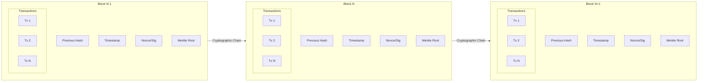

# Lesson 1: Blockchain Fundamentals, Consensus Mechanisms, Digital Asset Properties

## 1. First-Principles Intuition & Invariants

The advent of distributed ledger technology represents a fundamental shift in how market participants coordinate state transitions without centralized clearing authorities. To understand blockchain's disruptive potential in capital markets, we must first abandon the intuition built on traditional settlement infrastructure—where trusted intermediaries like the Depository Trust & Clearing Corporation (DTCC) or Euroclear maintain canonical records of asset ownership. Instead, blockchain architectures replace singular authoritative databases with replicated state machines, where thousands of independent nodes reach probabilistic consensus on transaction finality through cryptoeconomic incentive alignment.

The core innovation lies in solving the Byzantine Generals Problem, a theoretical computer science challenge articulated by Leslie Lamport in 1982. In distributed systems without central coordination, how do mutually distrusting parties agree on a single version of truth when some participants may be adversarial or fail arbitrarily? Traditional financial systems solve this through legal recourse and regulatory oversight—if a bank misrepresents your account balance, you can sue. Blockchain networks solve this through mathematics and game theory, making dishonesty computationally or economically infeasible rather than legally prohibited.

This mathematical enforcement creates three foundational invariants that distinguish blockchain architectures from conventional databases. First, immutability emerges not from access control but from thermodynamic cost—rewriting historical transactions requires re-performing computational work or re-staking economic capital proportional to network size. Second, censorship resistance arises from redundancy—no single gatekeeper can prevent valid transactions from eventual inclusion when thousands of nodes process requests independently. Third, verifiability without trust becomes possible through cryptographic proofs—any participant can independently validate the entire ledger history without relying on attestations from authorities.

These properties create unique value propositions in financial markets. Settlement finality no longer requires multi-day clearing cycles through correspondent banking networks. Cross-border payments bypass SWIFT messaging rails and their associated foreign exchange spreads. Securities ownership can be proven cryptographically rather than through custody chain documentation. However, these benefits come with engineering tradeoffs that practitioners must understand quantitatively. A blockchain's security budget, measured in dollars per hour spent on consensus computation or staking collateral, directly determines its resistance to double-spend attacks. Its transaction throughput, constrained by network propagation latency and state storage requirements, limits scalability relative to centralized databases that process millions of operations per second.

The distinction between distributed and decentralized architecture is critical for valuation analysis. A distributed system merely replicates data across multiple nodes—Visa's payment network is distributed but centralized, with Visa controlling validator selection. A decentralized system distributes control itself, allowing open participation in consensus formation. The degree of decentralization exists on a spectrum, measured by the Nakamoto Coefficient—the minimum number of entities required to collude for a 51% attack. Bitcoin's Nakamoto Coefficient of approximately 4 (based on mining pool concentration) indicates moderate decentralization, while proof-of-stake networks often exhibit lower coefficients due to stake concentration among early investors and exchanges.

Market participants must recognize that blockchain networks are not merely technological infrastructure but economic systems with endogenous money supplies and complex incentive dynamics. The native cryptoasset (coin) that powers consensus—bitcoin on Bitcoin, ether on Ethereum—simultaneously functions as (1) a medium of exchange for paying transaction fees, (2) a unit of account for denominating smart contract operations, (3) a store of value reflecting confidence in the network's future utility, and (4) a governance token influencing protocol development. This quadruple mandate creates valuation complexity absent in traditional equity analysis. A blockchain's monetary policy—its token issuance schedule, inflation rate, and fee burn mechanisms—directly impacts holder returns analogous to dividend policy in corporate finance, yet with additional dimensions from network effects and platform risk.

The cryptographic primitives underlying blockchain security—hash functions, digital signatures, and Merkle trees—are not merely implementation details but economic parameters that determine attack costs and verification overhead. When Bitcoin miners search for nonces that produce SHA-256 hashes below a target difficulty threshold, they perform a verifiable proof-of-work that cannot be counterfeited without expending equivalent energy. When Ethereum validators post 32 ETH collateral to participate in proof-of-stake consensus, they create an economic bond whose slashing penalties deter Byzantine behavior. Understanding these mechanisms at a mechanical level enables rigorous analysis of a blockchain's security budget relative to the value it secures—a critical ratio for assessing economic sustainability.

## 2. Core Architecture & Mechanics

The canonical blockchain data structure consists of a cryptographically linked sequence of blocks, each containing a batch of transactions, a timestamp, and a reference to the previous block's hash. This chaining creates an append-only ledger where altering historical records requires recomputing all subsequent blocks—an operation whose cost grows linearly with chain length. The Genesis block, hardcoded into client software, anchors the chain and establishes initial token distribution.

Each block header contains a Merkle root, the top hash of a binary tree summarizing all transactions in the block. This construction allows light clients to verify transaction inclusion without downloading the entire block—a critical efficiency for mobile wallets and IoT devices. A Merkle proof requires only log₂(N) hashes to prove membership in a set of N transactions, enabling fraud proofs and stateless verification schemes.

Proof-of-work consensus, pioneered by Bitcoin, transforms block production into a computational lottery. Miners iterate through nonce values searching for a hash satisfying the difficulty target, a threshold adjusted every 2016 blocks to maintain a 10-minute average block time despite fluctuating hash rate. The difficulty adjustment algorithm implements a proportional-integral controller, responding to recent block timing variance by raising or lowering the target exponentially. This adaptive difficulty ensures predictable issuance regardless of mining hardware improvements—when hash rate increases, difficulty rises to maintain the schedule, preventing inflation acceleration.

The economic security of proof-of-work derives from the one-way nature of hash functions. Finding a valid nonce requires exhaustive search proportional to difficulty, consuming electricity priced in fiat currency. However, verifying a solution requires only a single hash operation, enabling cheap validation by full nodes. This asymmetry creates an unforgeable proof of computational expenditure—an attacker wishing to rewrite history must re-mine all blocks since the targeted transaction, expending energy costs exceeding the block rewards earned during that period. The security parameter is the depth of confirmation: a transaction buried under six blocks requires an attacker to produce seven consecutive blocks faster than the honest network, a probabilistically vanishing event for minority hash rate.

Proof-of-stake consensus eliminates computational waste by substituting capital lockup for energy expenditure. Validators stake native tokens as collateral, earning block rewards proportional to their stake weight while facing slashing penalties for protocol violations. Ethereum's Gasper consensus combines Casper FFG finality gadget with LMD-GHOST fork choice rule, achieving probabilistic finality after two epochs (approximately 13 minutes) under honest majority assumptions. Validators participate in a voting protocol, attesting to valid blocks and checkpoints. Supermajority agreement (two-thirds of staked capital) on two consecutive checkpoints triggers finality, making reversion economically irrational.

The slashing mechanism enforces correct behavior through economic punishment. Validators caught double-signing conflicting blocks lose their entire 32 ETH stake, burned from supply permanently. Validators remaining offline during supermajority finality face inactivity leaks, a quadratic penalty that bleeds stake from non-participants until the active set regains a two-thirds supermajority. This mechanism ensures liveness even during network partitions or mass validator outages. The economic finality threshold requires an attacker to control over one-third of staked capital and sacrifice that collateral through slashing—a cost-of-attack that scales linearly with the value staked.

Cryptographic signatures provide transaction authorization without revealing private keys. Bitcoin uses ECDSA over the secp256k1 curve, generating public-private key pairs where the public key derives from scalar multiplication of the generator point by the private key scalar. Signing a transaction involves computing a signature (r, s) from the message hash and private key, verifiable by anyone holding the public key but computationally infeasible to forge without the private key. This enables self-custody—users control assets by controlling private keys, eliminating counterparty risk from custodians at the cost of key management responsibility.

Address derivation from public keys introduces an additional hashing step for collision resistance. Bitcoin addresses are RIPEMD160(SHA256(public_key)) encoded in Base58Check with version bytes and checksums. Ethereum addresses are the last 20 bytes of Keccak256(public_key). This hashing provides quantum resistance through preimage protection—even if quantum computers break ECDSA, attackers cannot derive private keys from addresses unless the corresponding public key has been revealed through a prior transaction.

Transaction structure encodes value transfers as a directed acyclic graph. Bitcoin's UTXO (Unspent Transaction Output) model treats coins as discrete objects consumed and created by transactions. Each transaction input references a prior output by transaction ID and index, proving ownership through a scriptSig signature. Outputs specify spending conditions through scriptPubKey locking scripts, typically requiring a signature matching a public key hash. This model enables parallel validation and simplifies light client protocols but complicates smart contract state management.

Ethereum's account model instead maintains balances in a global state trie, a Merkle Patricia tree mapping addresses to account objects containing nonce, balance, storage root, and code hash. Transactions modify account state through EVM (Ethereum Virtual Machine) execution, with gas fees metering computational resources. Each operation consumes gas proportional to its resource cost—addition costs 3 gas, while storage writes cost 20,000 gas. This gas mechanism prevents denial-of-service attacks by forcing transaction sponsors to pay for execution, with unused gas refunded post-execution.

Smart contracts are programs stored on-chain that execute deterministically given inputs and current state. Ethereum smart contracts compile Solidity or Vyper code to EVM bytecode, a stack-based instruction set with 256-bit word size. Contracts interact through message calls, either delegating execution to external contracts while maintaining the caller's context or creating new contract instances through CREATE opcodes. The deterministic execution environment ensures all nodes reach identical post-state, but introduces constraints—contracts cannot access external APIs, time beyond block timestamps, or sources of randomness not derivable from chain history.

Token standards codify fungible and non-fungible asset interfaces. ERC-20 defines a minimal fungible token API with transfer, approve, and balanceOf methods, enabling interoperability across wallets and decentralized exchanges. ERC-721 extends this to non-fungible tokens (NFTs) where each token ID represents a unique asset with distinct metadata. These standards illustrate the distinction between coins and tokens—coins are native blockchain assets (BTC, ETH) integral to consensus, while tokens are user-defined assets implemented through smart contracts atop base-layer chains.

Tokenomics refers to the economic design of a cryptoasset's supply schedule, distribution, and utility. Bitcoin's monetary policy halves block rewards every 210,000 blocks, asymptotically approaching a 21 million coin supply cap. This deflationary model contrasts with Ethereum's post-EIP-1559 policy combining base fee burning with staking rewards, targeting approximately 1-2% annual inflation that adjusts dynamically with network usage. Supply mechanics directly impact valuation multiples—fixed-supply assets trade on stock-to-flow scarcity models, while inflationary assets require growth in fee revenue to offset dilution.

Network effects determine a blockchain's competitive moat and long-term sustainability. Direct network effects arise from user count—more users increase liquidity and reduce trading spreads, attracting further users. Indirect network effects emerge from developer activity—more developers build applications atop a platform, increasing utility for users, which attracts more developers. Ethereum exhibits strong two-sided network effects between users and smart contract developers, while Bitcoin's network effects center on monetary premium and security budget. Quantifying network effects requires metrics like active addresses, transaction volume, total value locked in DeFi protocols, and developer commit activity.

The metcalfe valuation framework, borrowed from telecommunications network analysis, posits that network value scales with the square of active users. Empirically, this relationship explains Bitcoin's price trajectory with R² > 0.9 over multi-year periods. However, Metcalfe's law breaks down during speculative bubbles when price growth exceeds network growth, signaling overvaluation. Practitioners must distinguish organic network expansion from speculative mania by tracking on-chain metrics like transaction count, unique addresses, and hash rate growth alongside price.

Asset classification between payment coins, platform tokens, governance tokens, and security tokens requires understanding both technical functionality and regulatory treatment. Payment coins (BTC, LTC, XMR) optimize for medium-of-exchange properties through fast settlement and low fees. Platform tokens (ETH, ADA, SOL) prioritize smart contract execution and developer tooling. Governance tokens (UNI, AAVE, MKR) grant voting rights over protocol parameters but often lack intrinsic cash flows, complicating equity valuation analogies. Security tokens represent traditional assets on-chain, inheriting their regulatory treatment under Howey test analysis.

The Howey test, established by SEC v. W.J. Howey Co., classifies an asset as a security if it involves (1) an investment of money, (2) in a common enterprise, (3) with an expectation of profits, (4) derived from the efforts of others. Most ICO tokens satisfy these criteria, subjecting them to securities regulation. Bitcoin and Ethereum have received informal guidance as non-securities due to sufficient decentralization, while newer tokens face ambiguous classification. This regulatory uncertainty creates valuation discounts and limits institutional adoption—security tokens must comply with KYC/AML requirements and trading restrictions, reducing liquidity premium.

## 3. High-Performance Optimization & Failure Modes

Blockchain scalability confronts the trilemma of decentralization, security, and throughput—optimizing for any two dimensions constrains the third. Bitcoin's 7 transactions per second limit stems from deliberate parameter choices: 1 MB block size and 10-minute block time ensure nodes worldwide can validate blocks on commodity hardware, maintaining decentralization. Increasing block size to 32 MB would enable 224 TPS but require enterprise-grade servers for full validation, concentrating control among large operators. Reducing block time below 10 minutes increases orphan rate due to network latency, weakening security by fragmenting hash power across competing forks.

Layer-2 scaling solutions circumvent this trilemma by moving transaction execution off-chain while anchoring security to the base layer. Bitcoin's Lightning Network employs bidirectional payment channels, allowing unlimited transactions between counterparties settled by broadcasting only opening and closing states on-chain. Channel liquidity constraints require careful routing through network graphs, with fees paid to intermediate hops. Lightning's routing problem resembles max-flow optimization in weighted directed graphs, where channel capacities represent edge weights. Practical implementations use source-based routing with onion encryption, where senders compute paths using local channel state information, accepting potential failures from stale data.

Ethereum's rollup-centric roadmap prioritizes optimistic rollups and zero-knowledge rollups as primary scaling vectors. Optimistic rollups (Optimism, Arbitrum) execute transactions off-chain and post compressed calldata to Layer 1, assuming validity unless challenged during a dispute period. Fraud proofs allow any party to prove invalid state transitions, triggering rollback and slashing of sequencer bonds. This optimistic approach minimizes on-chain computation but introduces withdrawal delays—users must wait 7 days for fraud proof windows before finalizing withdrawals, creating liquidity costs.

Zero-knowledge rollups (zkSync, StarkNet) generate cryptographic validity proofs for batched transactions, enabling instant finality without fraud proof delays. ZK-SNARKs or ZK-STARKs compress execution verification into constant-size proofs verifiable in logarithmic time, regardless of computation complexity. The prover generates a witness attesting correct state transition, which validators check without re-executing transactions. This trustless compression achieves 100-1000x throughput improvements while inheriting base-layer security. However, proof generation remains computationally expensive, requiring specialized hardware and introducing centralization risks at sequencer level.

State growth poses long-term sustainability challenges. Ethereum's state size exceeded 100 GB by 2024, growing linearly with account creation and contract deployment. Full nodes must maintain this entire state for transaction validation, increasing hardware requirements and reducing validator participation over time. Statelessness proposals address this through witness-based validation, where transaction broadcasters include Merkle proofs of accessed state, allowing validators to verify execution without storing global state. This transforms storage requirements from linear to logarithmic in state size but increases bandwidth costs proportional to witness sizes.

Maximal extractable value (MEV) represents profits extractable by block producers through transaction ordering, inclusion, and censorship. Validators observe pending transactions in the mempool and can front-run profitable DeFi trades, sandwich victim transactions between buys and sells, or back-run liquidations. On Ethereum, MEV extraction reaches $600M+ annually, creating perverse incentives for consensus manipulation. Flashbots pioneered sealed-bid auctions where searchers bid for transaction inclusion, redistributing MEV from validators to protocol and users. However, MEV remains economically rational and resistant to elimination—attempts to suppress MEV through encryption or commit-reveal schemes merely shift extraction to different parties.

Consensus failure modes include 51% attacks, long-range attacks, and selfish mining strategies. A 51% attacker controlling majority hash rate or stake can rewrite recent history, double-spending coins by invalidating confirmed transactions. The cost of attack equals the opportunity cost of honest mining plus acquired hash rate capital expenditures. Bitcoin's $20B annual security budget (block rewards plus fees) implies an attacker must sacrifice comparable revenue to sustain a multi-hour attack. Proof-of-stake networks face lower attack costs when native tokens can be borrowed or when stake concentration enables collusion among top validators.

Long-range attacks exploit weak subjectivity in proof-of-stake chains. An attacker acquiring historical validator keys can construct an alternate chain fork from genesis, presenting it to new nodes lacking recent checkpoints. Unlike proof-of-work where rewriting history requires re-performing computational work, proof-of-stake allows costless simulation of alternate histories using expired keys. Defenses include social consensus on canonical checkpoints, weak subjectivity periods beyond which nodes reject chains not descending from recent finalized blocks, and forward-secure cryptography preventing key reuse.

Selfish mining strategies exploit network latency to gain disproportionate block rewards. A selfish miner discovering a block withholds it temporarily, building a secret chain while the honest network continues on the public chain. If the honest network finds the next block, the selfish miner reveals their secret chain, forcing a fork race. If the selfish miner finds two blocks in succession, they reveal the chain, invalidating honest work. This strategy becomes profitable above ~33% hash rate, breaking the security assumption that honest majority suffices. Defenses include preferential tie-breaking towards first-seen blocks and network timestamp verification.

Protocol ossification versus governance agility presents a fundamental tradeoff. Bitcoin prioritizes immutability and predictability, making consensus changes exceedingly rare and contentious. The block size wars of 2017 illustrated Bitcoin's resistance to change, resulting in community splits and contentious hard forks (Bitcoin Cash, Bitcoin SV). This ossification strengthens Bitcoin's monetary credibility but limits adaptability to scaling demands. Ethereum adopts a progressive stance, implementing regular hard forks through EIP (Ethereum Improvement Proposal) processes coordinated by core developers. This agility enables rapid innovation but introduces governance risks and coordination overhead.

On-chain governance mechanisms automate protocol upgrades through tokenized voting. Tezos implements formal on-chain governance where stakeholders vote on proposed amendments, automatically activating approved changes after testing periods. Polkadot employs council-based governance with token-weighted referenda and time-locked voting to prevent plutocracy. However, on-chain governance faces voter apathy—typical participation rates remain below 5%, enabling governance attacks by concentrated stakeholders. Delegated voting through liquid democracy attempts to address participation by allowing token holders to delegate votes to representatives, but introduces political capture risks.

Key management failures represent the primary user security risk. Unlike traditional finance where lost passwords can be reset through identity verification, blockchain private keys cannot be recovered if lost. An estimated 3-4 million BTC, roughly 20% of supply, resides in wallets whose keys are permanently lost. Hardware wallets (Ledger, Trezor) isolate private keys in secure enclaves, requiring physical confirmation for transaction signing. Multi-signature schemes distribute key custody across multiple parties, requiring M-of-N signatures to authorize transactions. Social recovery wallets (Argent, Loopring) designate trusted guardians who can collectively recover accounts, trading off decentralization for usability.

Smart contract vulnerabilities introduce systemic risks when bugs enable theft or fund lockup. The DAO hack of 2016 exploited a reentrancy vulnerability, draining $60M ETH through recursive withdrawal calls before balance updates. This event forced a controversial hard fork to revert the theft, undermining immutability principles. Parity's multi-sig wallet bug in 2017 permanently locked $150M ETH through a library self-destruct exploit. Modern practices mandate formal verification, extensive audits by specialized firms (Trail of Bits, OpenZeppelin), and bug bounty programs. However, code complexity and composability risks ensure contracts remain perpetually exploitable by sophisticated attackers.

Oracle problems arise from smart contracts' inability to access off-chain data. DeFi protocols requiring price feeds, weather data, or sports outcomes must trust external data sources, introducing centralization risks. Chainlink pioneered decentralized oracle networks where multiple nodes independently fetch data, with reputation systems and staking collateral incentivizing honest reporting. However, oracles cannot eliminate trust—they merely distribute it across node operators. Flash loan attacks exploit oracle price manipulation, borrowing millions in capital to distort AMM prices, triggering cascading liquidations in lending protocols. TWAP (time-weighted average price) oracles smooth short-term manipulation but introduce staleness, creating arbitrage opportunities.

Regulatory arbitrage drives protocol design choices and domicile selection. Projects incorporate in crypto-friendly jurisdictions like Switzerland, Singapore, or Cayman Islands to avoid onerous registration requirements. Decentralized autonomous organizations (DAOs) attempt to eliminate legal entities entirely, relying on smart contract governance and pseudonymous contributors. However, regulatory agencies increasingly assert jurisdiction over DeFi protocols despite decentralization claims, pursuing enforcement actions against protocol developers and token issuers. The SEC's Howey test application to tokens creates legal ambiguity, with enforcement through litigation rather than clear rulemaking.

Systemic liquidity risks emerge from interconnected DeFi protocols. Lending markets (Aave, Compound) enable leveraged positions through recursive borrowing—users deposit ETH as collateral, borrow stablecoins, purchase more ETH, and repeat. This amplifies returns during bull markets but creates liquidation cascades during volatility. When ETH price drops rapidly, undercollateralized positions face liquidation, triggering sell pressure that further depresses prices in a reflexive loop. The Terra/Luna collapse of 2022 illustrated death spiral dynamics where algorithmic stablecoin de-pegging triggered $40B in value destruction within 72 hours, propagating through interconnected protocols.

Network partition risks threaten liveness during internet outages or geopolitical censorship. Bitcoin's global node distribution provides resilience against single-jurisdiction bans, but sustained partitions between continental regions could fragment the chain into incompatible forks. Proof-of-stake chains face inactivity penalties that bleed stake from offline validators during partitions, eventually allowing the connected partition to finalize blocks. However, this mechanism cannot automatically resolve partitions—manual intervention through social consensus becomes necessary to designate the canonical chain, reintroducing human coordination failures that cryptographic consensus aimed to eliminate.
