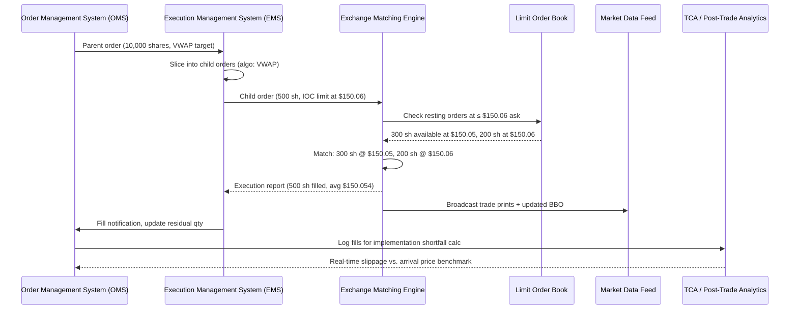

# Lesson 3: Market Microstructure, Order Types, Execution Dynamics

## 1. First-Principles Intuition & Invariants

Every trade in an equity market is, at its core, the resolution of a bilateral disagreement about value. A buyer believes the asset is worth more than the current ask; a seller believes it is worth less than the current bid. The machinery that converts this disagreement into a legally binding transaction, that sets the price at which those two opposing beliefs collide, is what microstructure theory studies. For practitioners, understanding this machinery is not academic decoration. It determines whether a $50 million block order moves the market by eight basis points or eighty, whether an algorithmic signal survives implementation cost, and whether a market maker's book is profitable or toxic.

The discipline of market microstructure was formalized in the 1980s through the work of economists like Thomas Ho, Hans Stoll, and later Lawrence Glosten and Paul Milgrom, whose 1985 adverse selection model remains the theoretical backbone of modern spread decomposition. The central insight of that literature is that the bid-ask spread is not simply friction or monopoly rent extracted by dealers. It is an information-processing mechanism. Dealers and limit-order traders face a fundamental uncertainty: they do not know whether the counterparty demanding liquidity is trading for idiosyncratic reasons (a pension fund rebalancing, an individual portfolio adjustment) or whether that counterparty possesses private information that makes the current price stale. The spread is the premium charged for bearing this adverse selection risk.

This creates the first invariant of market microstructure: **the spread is always a function of three components**. The order-processing component covers the operational costs of market making. The inventory-holding component compensates the market maker for the risk of holding an unbalanced position in a volatile security. The adverse selection component compensates for the probability that the incoming order is information-motivated. These three components are not equal across securities. In a heavily traded, information-transparent mega-cap like Apple or Microsoft, the order-processing component dominates, spreads are sub-penny in decimal markets, and adverse selection is relatively low because public information is so rapidly incorporated that private edges are fleeting. In a thinly traded small-cap, inventory risk and adverse selection dominate, spreads widen, and market depth collapses.

The second invariant concerns price formation. Prices in continuous double-auction markets do not emerge from the top down through any central authority. They emerge from the bottom up through the sequential matching of orders submitted by thousands of independent agents. At any moment, the best available bid and ask prices represent the current market consensus about where a willing buyer and a willing seller will meet. But this consensus is fragile and dynamic. It updates the moment new information arrives, whether through a news announcement, a large order that reveals institutional intent, or an algorithmic inference from the order flow itself. The process by which private information becomes impounded into public prices is called price discovery, and its speed and efficiency are the primary metrics by which academics and regulators evaluate market quality.

The third invariant is the inescapable trade-off between immediacy and price. A market order buys certainty of execution at the cost of accepting the current spread. A limit order buys potential price improvement at the cost of execution risk: the order may never fill, or may fill only after the market has moved adversely. This trade-off is not a nuisance to be engineered away; it is the organizing principle of the entire order book. Every participant's choice of order type is a vote about where they sit on the immediacy-price curve, and the aggregate of those votes determines the liquidity structure of the market.

Understanding these three invariants before touching any execution system prevents the most common practitioner errors: treating slippage as random noise rather than a predictable function of order size and market depth, treating the spread as a fixed cost rather than a signal about information asymmetry, and treating execution quality as a post-trade compliance exercise rather than a pre-trade strategy decision.

---

## 2. Core Architecture & Mechanics

### The Limit Order Book: Structure and State

The limit order book (LOB) is the central data structure of a continuous double-auction market. At the NYSE, Nasdaq, CBOE, and virtually every other major equities venue, the LOB holds all resting limit orders, organized by price level on each side of the market. The book has two sides: the bid side, which aggregates all buy orders sorted from highest price to lowest, and the ask (or offer) side, which aggregates all sell orders sorted from lowest price to highest. The highest bid is called the best bid, the lowest ask is called the best ask, and the gap between them is the inside spread.

Each price level on the book is itself a queue. Within a given price level, orders are typically ordered first by time of arrival under price-time priority, though some venues also implement pro-rata matching or size-pro-rata hybrid schemes, as described below. A simplified representation of the LOB for a hypothetical equity mid-session might look like this:

```
ASK SIDE
Price     Qty (shares)   # Orders
$150.08   2,400          6
$150.07   1,800          4
$150.06   3,100          8
$150.05   900            3   <-- Best Ask
-------- SPREAD ----------
$150.04   1,200          5   <-- Best Bid
$150.03   4,500          11
$150.02   2,900          7
$150.01   600            2

BID SIDE
```

The inside spread here is $0.01, a single tick, which is the minimum price increment enforced by Rule 612 of Reg NMS for stocks priced above $1.00. The depth at each level tells a practitioner how much volume can be absorbed before the price moves. A market buy order for 1,200 shares would fully consume the best ask at $150.05 (900 shares) and then fill 300 additional shares at $150.06, achieving an average execution price of approximately $150.0533. The resulting price impact of $0.0133 per share above the touch is the execution shortfall attributable to the order's market impact.

The book's state changes continuously. Each new limit order submission adds depth, each cancellation removes depth, and each trade (triggered by a marketable order) simultaneously removes the resting liquidity on the passive side and generates a time-stamped trade print. On active large-cap names, this state can update tens of thousands of times per second during peak trading, which is why institutional trading systems receive Level 2 (depth-of-book) data feeds — typically the NYSE OpenBook Ultra, Nasdaq TotalView, or consolidated feeds from the SIP — rather than relying solely on the last-sale feed.

### Order Types: Taxonomy and Mechanics

The choice of order type is the first and most consequential execution decision a trader makes. The vocabulary is extensive, but the mechanical differences between types are precise and consequential enough to warrant careful treatment.

A **market order** is an instruction to buy or sell a specified quantity at the best available price immediately. It is the simplest expression of the immediacy preference. Because it is not price-constrained, it will walk up (for a buy) or walk down (for a sell) the LOB until the full quantity is filled, consuming whatever resting liquidity exists at successive price levels. The risk is that in thin markets or during volatile conditions, a large market order can produce severe adverse fills. The 2010 Flash Crash provided a vivid demonstration: a single $4.1 billion sell order executed as a market order using a volume-participation algorithm sold into a rapidly evaporating bid stack, triggering a cascade that temporarily erased nearly $1 trillion in market capitalization. Market orders thus carry execution certainty but zero price guarantee.

A **limit order** specifies both a direction and a maximum (for buys) or minimum (for sells) acceptable price. A buy limit order at $150.03 says: fill me at $150.03 or better, and do not pay more than that. If the current best ask is above $150.03, the order rests in the book and waits. This creates the fundamental option-like character of limit orders: a resting buy limit grants its poster the right to buy at a fixed price, while a marketable counterparty acts as the option buyer who takes that price. This is why market makers and passive liquidity providers are described as option writers: each of their resting quotes is a free option to the market. The market maker earns the spread as premium for writing that option, but the option can be exercised against them precisely when they would least prefer it, when the price has moved.

**Marketable limit orders** are limit orders priced at or through the current best price on the opposite side. A buy limit at $150.06 when the best ask is $150.05 will execute immediately as an aggressor, taking resting liquidity. This design gives the submitter execution certainty while capping their worst-case price, unlike a pure market order. For algorithmic execution, marketable limits are the dominant order form because they prevent runaway fills in fast markets while still achieving immediate execution.

An **Immediate-or-Cancel (IOC)** order executes against available resting liquidity upon arrival and cancels any unfilled remainder rather than posting to the book. Its complement, a **Fill-or-Kill (FOK)** order, requires complete execution at arrival; if the full quantity cannot be filled immediately, the entire order is cancelled. Both types are foundational in algorithmic and high-frequency strategies that want to probe available liquidity without leaving a visible footprint in the book.

A **stop order** is a dormant order that becomes active only when the price crosses a specified trigger level. A stop-sell order at $148.00 on a position currently trading at $150.04 is an instruction that becomes a market sell order if and when the price trades at or below $148.00. The critical pitfall: once triggered, a stop order becomes a market order, which in a rapidly declining market can execute far below the trigger level. A **stop-limit order** addresses this by converting to a limit rather than a market order at trigger, but introduces the complementary risk of non-execution during a gap.

**Pegged orders** are limit orders whose price is dynamically linked to a reference price, most commonly the national best bid or offer (NBBO). A midpoint peg order rests at the midpoint between the NBBO bid and ask, automatically updating as the NBBO moves, allowing passive traders to earn half the spread instead of losing a full spread as an aggressor. Many dark pools and broker crossing systems rely on midpoint pegged orders as their primary execution mechanism.

### Trade Matching Algorithms

The matching algorithm governs which resting orders execute when an incoming order arrives. The choice of matching algorithm profoundly affects participant behavior and market liquidity.

**Price-Time Priority (FIFO)** is the dominant model at U.S. equity exchanges. When an incoming aggressive order arrives, the exchange first matches it against the resting orders at the best available price, filling them in strict time-of-arrival order within that price level before moving to the next. This creates a powerful incentive to be first in queue at a given price level, which is the central driver of the latency arms race in high-frequency market making. If you are second in a queue of ten limit orders at the best bid and a sell order arrives for only 500 shares when the queue holds 2,000 shares total, you may receive no fill at all. The priority goes to whoever arrived first, often measured in microseconds.

**Pro-Rata matching** allocates fills at a given price level proportionally to each order's size, rather than by arrival time. It is used on some options exchanges and futures markets (notably the CME's Eurodollar contract) but is rare in equities. Pro-rata eliminates the pure speed advantage and replaces it with a quote-size advantage: displaying a larger order earns a proportionally larger fill. The behavioral consequence is that market makers display thicker but potentially less committed quotes.

**Price-Broker-Time Priority** is a hybrid model used at certain exchanges like NYSE in its designated market maker (DMM) model, where the exchange's floor-based DMM receives a small queue priority advantage under specified conditions. The rationale is that the DMM provides affirmative obligations (they are required to maintain a quote within a specified range even during volatile conditions) and receives modest priority in return.

The matching process itself happens in an exchange's matching engine — a specialized, deterministic piece of software running on bare-metal hardware in a co-location facility. At Nasdaq's Carteret, New Jersey data center and NYSE's Mahwah facility, the matching engine processes incoming order messages, updates the book state, generates execution reports, and broadcasts market data, all within single-digit microseconds of message receipt. The state machine is strictly deterministic: for a given sequence of order messages, the same sequence of trades and book updates will always result.

### Price Discovery and Information Dynamics

Price discovery is the process by which private information becomes public information through the mechanism of trading. The timeline is worth tracing precisely. A portfolio manager at a large asset manager receives analysis suggesting that a mid-cap biotech's upcoming trial readout will be significantly better than consensus expects. She begins buying. Her first few orders, cautiously sized, absorb resting asks at the prevailing price. As she continues buying, she depletes the ask stack, pushing prices higher. Market makers, observing a consistent pattern of buy-side aggression, infer that an informed trader may be active. They widen their spreads and reduce their quoted depth to limit their adverse selection exposure. Other algorithmic participants, running order-flow detection models, begin front-running the anticipated continued buying. By the time the trial result is announced publicly, the stock has already moved significantly, reflecting the informed buying that preceded the announcement. This is not coincidence; it is the price discovery mechanism working as intended, impounding private information into prices through the trading process.

The speed at which prices incorporate new information varies by market structure. The empirical literature, beginning with Hasbrouck's vector autoregression (VAR) framework in his 1991 paper on the information content of trades, quantifies price discovery as the permanent component of a trade's price impact. A trade with high permanent impact is information-motivated; a trade with purely temporary impact is liquidity-motivated (a large but information-free institutional rebalance, for example). This decomposition is now operationalized in the trading cost analysis (TCA) frameworks used by institutional asset managers to evaluate their execution quality.

The diagram below traces the information and execution flow from order submission through trade reporting:



This flow illustrates a key operational distinction that many junior practitioners conflate: the OMS manages the lifecycle of a parent order (compliance pre-checks, position limits, allocation to accounts), while the EMS manages the real-time routing and execution of child orders against live market data. The TCA system closes the loop, comparing actual execution prices against benchmarks (VWAP, TWAP, arrival price, implementation shortfall) to evaluate execution quality and feed back into algo parameter tuning.

### Liquidity Provision and Market Maker Economics

A market maker's business model is structurally analogous to an insurance company's: they write many small policies (resting quotes on both sides of the market), collect steady premium income (the bid-ask spread), and suffer occasional large losses when catastrophic events cause correlated adverse moves. The economics work only if the spread collected across many small transactions is sufficient to absorb the inventory losses from large directional moves and the adverse selection losses from informed trades.

Consider a simplified market maker operating in a stock with a $0.02 spread (bidding $100.00, offering $100.02). On each round-trip where they buy at the bid and sell at the ask, they earn $0.02 per share. On a day with 50,000 share round-trips, gross spread revenue is $1,000. Against that, they might lose $0.10 per share on 2,000 shares traded against an informed flow just before an adverse announcement, a $200 loss. The net P&L is $800 for the day. Scale this to a firm with positions across 500 names, and the economics become significant. But scale the informed flow or the volatility, and the economics can reverse catastrophically.

Modern electronic market makers manage this by continuously adjusting their quotes in response to real-time signals about information asymmetry. The key inputs are: the current order flow imbalance (the ratio of buy-initiated to sell-initiated trades), the volatility forecast (implied by options prices or realized intraday vol), and the inventory position (a large long inventory means the market maker should skew their bid lower and ask lower to attract sell orders and rebalance). The market maker's pricing function is essentially a dynamic control model that updates quotes at microsecond intervals based on these inputs.

The Avellaneda-Stoikov model (2008) provides a rigorous formalization of this intuition. The optimal bid and ask quotes for a market maker with current inventory $q$, mid-price $s$, risk aversion $\gamma$, and volatility $\sigma$ are:

$$s^{\text{bid}} = s - \frac{\gamma \sigma^2 (q_{\max} - q)}{2} - \frac{1}{2\gamma} \ln\!\left(1 + \frac{\gamma}{\kappa}\right)$$

$$s^{\text{ask}} = s + \frac{\gamma \sigma^2 (q_{\max} - q)}{2} + \frac{1}{2\gamma} \ln\!\left(1 + \frac{\gamma}{\kappa}\right)$$

where $\kappa$ is the market order arrival intensity parameter calibrated from historical fill rates. The first term adjusts the reservation price for inventory risk — when the market maker holds a large long inventory ($q$ approaching $q_{\max}$), they lower both their bid and their ask to attract sell orders. The second term sets the spread around the reservation price to balance fill frequency against per-trade profit. This model is not merely academic; variants of it underlie the quoting engines at Jane Street, Virtu, Citadel Securities, and virtually every other major electronic market maker.

---

## 3. High-Performance Optimization & Failure Modes

### Best Execution: Obligation, Measurement, and Practice

The obligation to achieve best execution is simultaneously a legal requirement and a commercial imperative. Under SEC Rule 605 (formerly Rule 11Ac1-5) and Rule 606, broker-dealers must report execution quality statistics and payment-for-order-flow arrangements. Under MiFID II in Europe, the obligation is more prescriptive: firms must maintain an execution policy, demonstrate that it achieves the best possible result for clients on a consistent basis, and review that policy at least annually with a formal board sign-off.

In practice, best execution is not simply about achieving the best price on a single order. It encompasses the full set of factors relevant to the client: price, costs, speed, likelihood of execution, likelihood of settlement, size, nature, and any other consideration. A large block order sent as a single market order might achieve the best price at the moment of sending but create market impact that makes the net outcome worse than a more patient algorithmic execution over 20 minutes. The practitioner's job is to optimize total execution cost, not headline price.

Implementation shortfall (IS), introduced by André Perold in 1988, is the gold-standard benchmark for measuring total execution cost. It decomposes the total cost of trading into its components and is defined as the difference between the theoretical performance of a "paper portfolio" that transacts instantly at the decision price and the actual performance of the real portfolio subject to market impact, timing, and opportunity costs.

The full IS decomposition is:

$$IS = \underbrace{(P_{\text{exec}} - P_{\text{decision}}) \times Q_{\text{filled}}}_{\text{Market Impact}} + \underbrace{(P_{\text{close}} - P_{\text{decision}}) \times Q_{\text{unfilled}}}_{\text{Timing Cost}} + \underbrace{\text{Commissions} + \text{Fees}}_{\text{Explicit Costs}}$$

where $P_{\text{decision}}$ is the mid-price at the moment the trading decision was made, $P_{\text{exec}}$ is the average execution price, $P_{\text{close}}$ is the closing price (used to value any unexecuted portion), $Q_{\text{filled}}$ is the number of shares actually executed, and $Q_{\text{unfilled}}$ is the residual quantity. The timing cost term is the core insight: when a manager decides to buy but executes too slowly, the market moves away, and the unexecuted shares must be valued at the closing price to quantify the opportunity cost of the incomplete execution.

For a concrete example: a portfolio manager decides to buy 100,000 shares of a stock trading at a decision-time mid of $50.00. By the time execution is complete, 90,000 shares have been filled at an average price of $50.12, and the remaining 10,000 shares are unexecuted while the stock closes at $50.30.

$$IS = (50.12 - 50.00) \times 90{,}000 + (50.30 - 50.00) \times 10{,}000 = \$10{,}800 + \$3{,}000 = \$13{,}800$$

This $13,800 cost on a $5 million notional trade represents 27.6 basis points of IS. Industry benchmarks for mid-cap equities suggest IS in the range of 20–60 bps depending on order difficulty, so this result is within normal bounds, but a TCA review would compare it against peer manager benchmarks to assess whether the algo selection and routing decisions were appropriate.

### Algorithmic Execution: VWAP, TWAP, and Participation Strategies

Execution algorithms are systematic strategies that break large parent orders into smaller child orders and route them according to predefined rules, with the goal of minimizing implementation shortfall or tracking a specific benchmark. The three foundational strategies are VWAP, TWAP, and participation rate algos.

A **VWAP algorithm** slices a parent order into child orders scheduled proportionally to the expected intraday volume profile of the target security. If a stock typically transacts 15% of its daily volume in the first hour, a VWAP algo targeting a 10% participation rate will attempt to fill 1.5% of the parent order in the first hour. VWAP is appropriate when the goal is to minimize tracking error against the volume-weighted average price benchmark, often relevant when the mandate is to minimize transaction costs relative to what other market participants paid throughout the day. Its weakness is that it does not adapt to new price information: if the stock rallies sharply at 10:30am, a pure VWAP algo will continue buying at the higher price as scheduled rather than pausing.

A **TWAP algorithm** distributes the order uniformly across a specified time window, independent of volume patterns. It is simpler and more transparent than VWAP and is preferred when the client wants predictability (they know exactly when execution will complete) or when the security has an unusual or unpredictable intraday volume profile. TWAP is more susceptible to gaming: a counterparty who knows a TWAP order is in the market can predict exactly when the algo will be active and position accordingly.

**Implementation shortfall algos** (also called arrival-price or adaptive algos) are more sophisticated: they attempt to minimize the IS metric directly, trading more aggressively when the price is favorable relative to the arrival price and slowing down when the market is moving adversely. These algos use real-time liquidity signals, volatility estimates, and market impact models to dynamically recalibrate participation rate. They are the preferred choice for alpha-sensitive orders where execution speed matters but market impact must be controlled.

The fundamental market impact model underlying these algos is the square-root law of market impact, an empirical regularity discovered independently by multiple practitioners and confirmed in the academic literature by Almgren et al. (2005):

$$\Delta P \approx \sigma \cdot \sqrt{\frac{Q}{V}}$$

where $\Delta P$ is the price impact in units of volatility $\sigma$, $Q$ is the order size in shares, and $V$ is the average daily volume. The square-root relationship implies strongly diminishing marginal impact: doubling your order size increases impact by only $\sqrt{2} \approx 1.41$, not by 2. But it also implies that large orders in illiquid names face disproportionate costs. A 100,000-share order in a stock with 500,000 ADV has the same relative impact $\sqrt{100/500} = \sqrt{0.2}$ as a 2,000-share order in a 10,000-share ADV stock. This model is the starting point for all serious pre-trade cost estimation.

### Smart Order Routing: Fragmentation and Venue Selection

U.S. equity markets are radically fragmented. There are currently more than a dozen registered national securities exchanges (NYSE, Nasdaq, NYSE Arca, CBOE BZX, IEX, and others) plus dozens of alternative trading systems (ATSs), dark pools operated by broker-dealers, and retail internalization flows. This fragmentation is both a product of Regulation NMS (which mandated price protection, requiring orders to route to whichever venue is displaying the best price) and a cause of ongoing complexity.

A Smart Order Router (SOR) is the system that solves the multi-venue allocation problem in real time: given a parent order, how should child orders be distributed across venues to maximize fill quality and minimize total cost? The SOR must simultaneously consider the NBBO (which venue is at the best price), available depth beyond the best quote (a venue might have the best price but only 100 shares available), venue fees and rebates (the maker-taker fee model means that posting at certain venues earns a rebate while taking liquidity incurs a fee), and the probability of fill at dark pools (which may offer midpoint price improvement but have no guaranteed liquidity).

The maker-taker fee model deserves specific attention because it creates a systematic distortion between the spread observed on the screen and the actual net transaction cost. Under the standard model, a maker (a resting limit order that provides liquidity) earns a rebate of approximately $0.0020–0.0030 per share from the exchange, while a taker (an aggressive order that removes liquidity) pays a fee of approximately $0.0025–0.0030 per share. The exchange's economics come from the difference between these rates. The practical implication is that a broker routing an order aggressively to a high-fee exchange is incurring a net cost that includes both the spread and the access fee, while one routing passively at a rebate-paying venue earns back a small portion of the spread. For high-frequency market makers trading millions of shares daily, this rebate revenue is a significant portion of gross revenue.

IEX, which launched in 2016 partly as a response to the latency arms race described in Michael Lewis's *Flash Boys*, introduced the concept of a **speed bump** (formally, its intentional 350-microsecond delay applied to incoming orders via a 38-mile coil of fiber optic cable) to neutralize the advantage of co-located HFT strategies that can detect a stale quote and pick it off before the market maker has time to cancel. The speed bump specifically targets a practice called **latency arbitrage**: because market data is not perfectly synchronous across venues, a fast trader can observe a price move on one venue, infer that quotes on other venues are stale, and trade against them before they update. IEX's delay makes this strategy unprofitable by ensuring that the market maker has sufficient time to cancel a stale quote before an arbitrageur can hit it.

### Failure Modes: Order Book Instabilities and Execution Risks

The most dangerous failure modes in market microstructure arise from the interaction between illiquid order books, automated feedback loops, and the absence of human judgment. The 2010 Flash Crash remains the canonical case study. The precipitating trigger, the large algorithmic sell order in E-Mini S&P 500 futures, would not in isolation have caused a market-wide crash. What turned a large sell order into a catastrophic event was the feedback dynamic: as prices fell, the LOBs on individual equity names began to thin (market makers stepped back or were tripped by circuit breakers), which caused subsequent market orders to find almost no depth and generate enormous artificial price moves. Some stocks briefly traded at $0.01 or $100,000 per share before executions were busted.

The lesson for execution desks is that the visible depth of the order book is not a reliable estimate of actual available liquidity under stress. The book shows resting orders, but it does not reveal the intentions of market makers who can cancel within microseconds, nor the auto-quoting systems that will instantly pull quotes when volatility exceeds their risk parameters. Practitioners must assume that in a rapidly moving market, the LOB will be thinner than it appears on screen.

**Quote stuffing** is a related failure mode relevant to practitioners monitoring for unusual market behavior. It involves submitting large volumes of order messages (submissions and cancellations) in rapid succession to a venue's matching engine, with the intent of saturating the message processing capacity and creating artificial latency for other participants. While regulatory action by FINRA and the SEC has reduced blatant instances, the monitoring challenge remains: distinguishing legitimate high-frequency quoting from abusive message traffic requires statistical analysis of message-to-trade ratios and latency distributions, work typically done by exchange surveillance teams using tools like Nasdaq's SMARTS or similar market surveillance platforms.

**Adverse fill selection** in dark pools is a subtler but commercially significant failure mode. When a buyside firm routes orders to a broker's internal dark pool, the pool may contain a mix of genuine institutional liquidity and proprietary trading flow. If the proprietary flow systematically trades against the buyside at midpoint when it has an informational advantage (knowing the direction of the institutional order), the buyside is suffering adverse selection inside the dark pool without the spread widening signal they would observe in a lit market. The 2015 SEC enforcement actions against Credit Suisse's CrossFinder and Barclays LX dark pools formalized the regulatory risk: operators of dark pools have disclosure obligations about participant types and cannot preference proprietary flow over customer flow.

The practitioner mitigation is to actively monitor dark pool fill quality through TCA: compare the implementation shortfall on fills routed to dark pools against fills routed to lit venues on a matched-pair basis, controlling for order size, time of day, and prevailing spread. If dark pool fills are consistently underperforming against the arrival price benchmark by more than the spread savings would justify, the dark pool is likely toxic and should be excluded from the SOR's routing table.

Finally, **wash trading** and **spoofing** are order-based manipulation strategies that distort price discovery directly. Spoofing involves submitting large visible limit orders to create a false impression of supply or demand, then cancelling them before they can be executed, using the artificial price movement to profit on a smaller position established beforehand. The defining legal case is U.S. v. Coscia (2015), in which a high-frequency trader was convicted under the Dodd-Frank anti-spoofing provisions. For practitioners building order-flow analysis models, spoofing is a significant source of noise: a sudden large order on the bid that disappears within 50 milliseconds may be a spoofing attempt rather than genuine demand, and a model that treats it as genuine demand will generate false signals. Filtering order book signals by order lifetime (excluding orders that cancel within a threshold like 100ms) is a standard data hygiene step in building microstructure features for execution models.

The practitioner's synthesis across all of these failure modes is a single operating principle: treat the visible market as a noisy, adversarially constructed signal, not a transparent representation of genuine supply and demand. The bid-ask spread, the depth stack, the trade prints — all of these contain information, but all of them are also subject to manipulation, liquidity withdrawal, and feedback-driven instability. Building robust execution workflows means stress-testing them against these failure modes, not just against the calm, efficient-market assumptions that dominate theoretical models.
