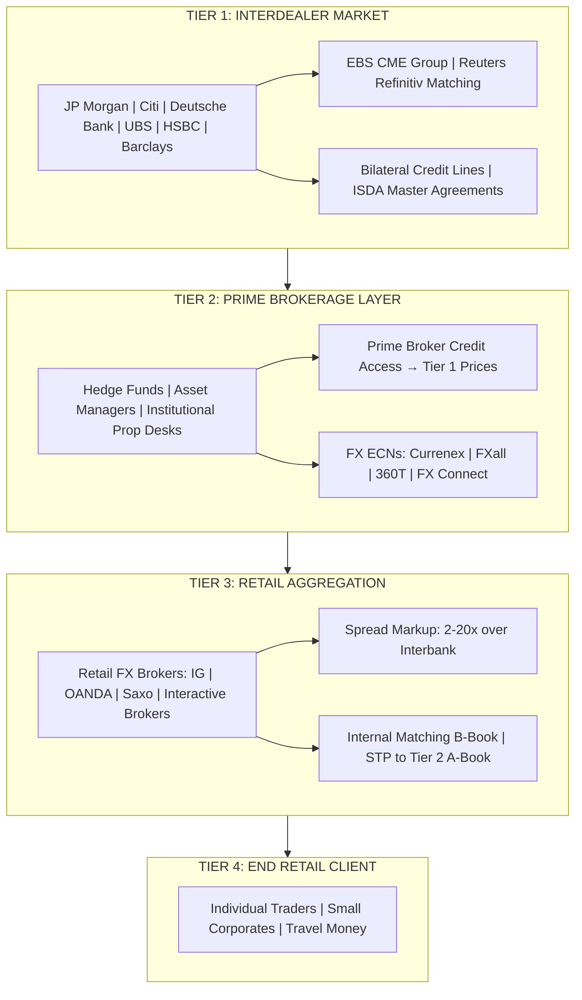
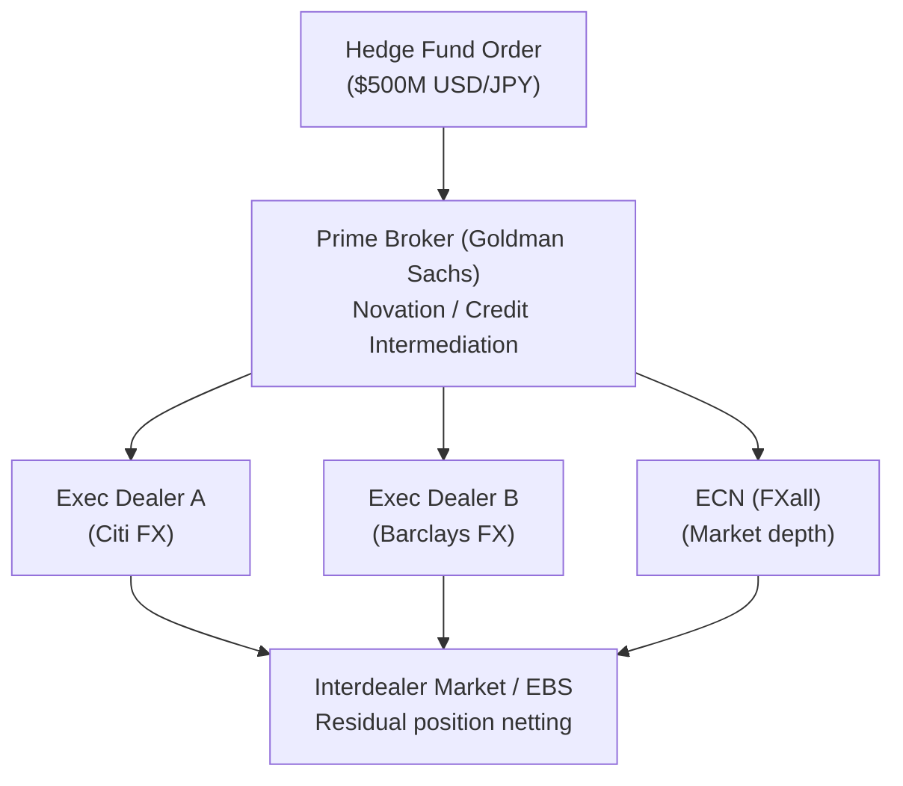
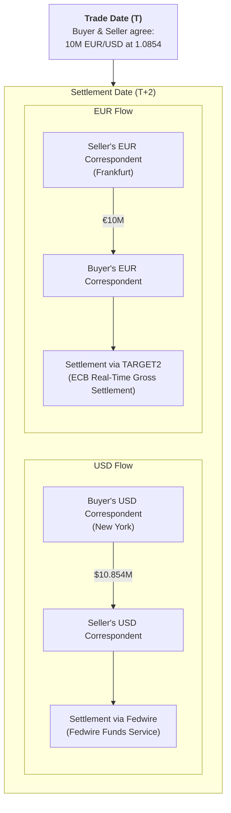

# Lesson 1: Forex Market Structure, Participants, and Execution

## 1. First-Principles Intuition & Invariants

Foreign exchange is not a market in the conventional sense. There is no central exchange, no single order book, no clearing house that every transaction passes through, and no opening bell. What practitioners call "the forex market" is better understood as a layered network of bilateral credit relationships, each governed by privately negotiated dealing agreements and underpinned by the correspondent banking infrastructure that has connected sovereign financial systems since the nineteenth century. At its peak, this network processes north of $7.5 trillion in notional daily volume—a figure that dwarfs the combined turnover of every major equity exchange on earth—yet it remains, structurally, an over-the-counter market governed by relationship, credit, and convention rather than rulebook.

Understanding why forex evolved this way requires a first-principles look at what currency exchange actually represents. When a German automotive exporter invoices a Japanese buyer in euros, some institution must ultimately convert the yen cash flow into euros that can sit on a German balance sheet. That conversion isn't a speculative act—it is a commercial necessity embedded in the fabric of international trade and capital flows. The scale and geographic dispersion of that necessity made centralization impractical long before electronic trading existed. Banks in London, New York, Tokyo, Frankfurt, Singapore, and Sydney each built dealing desks to service their own corporate clients, and the relationships between those desks became the market. The result is a topology sometimes called the interdealer market, sitting atop which are prime brokers, beneath which are institutional clients, and further downstream retail aggregators.

The key invariant every practitioner must internalize from the outset is this: **liquidity in forex is not a public good; it is a private service priced according to your credit relationship with the liquidity provider.** A major sovereign wealth fund trading EUR/USD through a Tier-1 bank receives a spread measured in fractional pips. A retail trader accessing the same currency pair through a retail FX broker receives a spread that is often five to twenty times wider, because the broker is itself buying liquidity from a prime broker or ECN and marking it up. The price you see is always a function of where you sit in the credit hierarchy.

The forex market operates across four major sessions that overlap in ways that concentrate liquidity at specific windows. The Asian session centers on Tokyo and Sydney, with thin liquidity and tighter ranges in most majors. The London session opens at approximately 08:00 GMT and immediately becomes the most liquid window in the global day, accounting historically for around 38 percent of total daily turnover. The New York session opens at 13:00 GMT and overlaps with London until 17:00 GMT—this two-hour overlap around the London afternoon fix is the single most liquid window in the entire trading day, and it is the reference window used by custodians, benchmark funds, and corporate treasuries executing fixing-linked orders. When London closes, volume drops sharply, spreads widen, and market depth thins considerably until Asian participants come back online.

The instruments traded within this ecosystem fall into three primary categories: spot, forwards, and swaps. Spot transactions represent the straightforward exchange of one currency for another at a price agreed today, with delivery of the underlying currencies typically two business days forward under the T+2 settlement convention. Forwards are contractual agreements to exchange currencies at a rate locked today for a specified future date—these are the instruments corporate treasurers use to hedge receivables and payables six to twelve months out, locking in a known exchange rate against the risk of adverse moves. FX swaps, the single largest product by volume in the BIS triennial survey, are simultaneous spot and forward transactions in opposite directions: a party sells dollars spot and buys them back forward, effectively using the swap to roll a funding position or manage short-term balance sheet needs across currencies. Cross-currency basis swaps, a longer-dated variant, underpin the hedging programs of insurance companies and pension funds that issue or hold foreign-currency debt.

The fundamental pricing relationship that ties all these instruments together is covered interest rate parity. For any currency pair, the forward rate must equal the spot rate adjusted for the interest rate differential between the two currencies over the forward period, otherwise an arbitrage would exist that dealers would immediately exploit. If the euro overnight rate is 3.5 percent and the dollar rate is 5.25 percent, then the one-year EUR/USD forward must trade at a dollar premium over the spot rate by approximately 1.75 percent. When this relationship breaks down—as it did dramatically during the 2008 and 2020 dollar funding crises—the cross-currency basis widens, and market participants interpret the dislocation as a signal of severe stress in the dollar funding system. Practitioners who understand covered interest parity not as a textbook formula but as a live arbitrage constraint are equipped to read funding stress in real time.

---

## 2. Core Architecture & Mechanics

### The Tiered Liquidity Hierarchy

The structural anatomy of the forex market is best visualized as a tiered hierarchy where credit quality and transaction size determine at which layer a participant can access liquidity.

Tier-1 banks are both liquidity providers and consumers. Deutsche Bank's FX desk might simultaneously be quoting EUR/USD to a hedge fund while itself trading through EBS to cover its resulting position. This dual role is fundamental to understanding how market makers actually operate: they are not passive order-takers but active position managers who internalize flow, net offsetting client orders against each other, and only externalize residual risk to the broader interdealer market.

The electronic broking systems at Tier 1—primarily EBS (now owned by CME Group) for EUR/USD, USD/JPY, and EUR/JPY, and Reuters Matching for cable (GBP/USD) and commodity currency pairs—function as anonymous central limit order books where Tier-1 dealers stream firm prices. The critical operational nuance is that access to EBS and Reuters Matching requires bilateral credit lines with other participants. You cannot connect to EBS as an anonymous entity; your credit lines determine which counterparties' orders you can hit and which can hit yours. This credit-based architecture is the reason the forex market did not collapse into a single centralized exchange—the credit relationships themselves are part of the product.

### Order Routing in the Prime Brokerage Model

A large macro hedge fund executing a $500 million USD/JPY order operates through a prime broker—say, Goldman Sachs Prime Services. Goldman extends the fund a credit line and effectively stands between the fund and the market. When the fund wants to execute, it sends orders to executing dealers (which may include non-Goldman banks), but those orders are novated through Goldman. The executing dealer sees Goldman as the counterparty—not the hedge fund—so the fund's ability to access deep interbank liquidity depends entirely on the reputation and balance sheet of its prime broker.

The hedge fund's trading desk sees a consolidated position and a single margin account with Goldman. The executing dealers see Goldman as the credit principal. The interdealer market sees order flow from Goldman. This layering simultaneously enables access and obscures ultimate beneficial ownership, which is why regulators developed the reporting regimes under MiFIR and Dodd-Frank Title VII requiring trade reporting to swap data repositories.

### Bid-Ask Spread Mechanics and Price Formation

The bid-ask spread in forex is the visible manifestation of two things simultaneously: the market maker's cost of providing immediacy, and the information asymmetry they face. When a dealer quotes EUR/USD at 1.08542 / 1.08544, the two-pip spread represents the minimum they will accept to take the other side of a trade whose size, direction, and informational content they cannot know in advance.

Dealers manage this uncertainty through three mechanisms. First, they internalize flow—if one client is buying EUR/USD while another is selling, the dealer crosses them internally, earning the spread twice while taking no market risk. Second, they skew their quotes directionally when they accumulate a position. A dealer who is long EUR/USD from customer flow will shade their bid down slightly to discourage further buying and shade the offer down to attract sellers. This quote adjustment is invisible to any single client but is immediately apparent to a practitioner watching a dealer's streaming quotes against the EBS midpoint over time. Third, they dynamically widen spreads when market conditions deteriorate—during news events, thin liquidity windows, or periods of elevated volatility, the spread is not a fixed cost but a live reflection of risk.

For practitioners trading in size, the concept of **market impact** matters far more than the quoted spread. A $10 million EUR/USD order can typically be filled at or very near the quoted price in London hours. A $500 million order in the same pair will move the market against the buyer as it consumes successive layers of the order book and signals directional intent to other participants. Execution desks at large asset managers therefore use algorithmic execution strategies—TWAP (time-weighted average price), VWAP (volume-weighted average price), and implementation shortfall algorithms—to minimize this information leakage. The choice between them is a function of urgency: a manager who needs to be fully invested by the end of the day may accept higher market impact in exchange for certainty of execution, while a manager with a week-long horizon will distribute the order across sessions to minimize footprint.

### Settlement Mechanics: The T+2 Cycle and Correspondent Banking

The T+2 settlement convention—delivery of the purchased currency two business days after trade date—is not an arbitrary convention but a reflection of the operational reality of correspondent banking. When a US counterparty buys euros from a French bank, the settlement requires the US party's dollar correspondent bank to send dollars to the French bank's dollar correspondent, while simultaneously the French bank's euro correspondent sends euros to the US party's euro correspondent. This four-cornered flow must be coordinated across time zones, payment systems (Fedwire in the US, TARGET2 in the eurozone, CHAPS in the UK), and clearing networks.

The systemic risk embedded in this arrangement—that one leg of the exchange might fail even after the other has settled—is called Herstatt risk, named after the 1974 failure of Bankhaus Herstatt, a German bank that received Deutsche Marks from its counterparties but was closed by regulators before it could deliver the corresponding dollars. CLS Bank International (Continuous Linked Settlement) was created specifically to eliminate this risk through payment-versus-payment settlement, where both legs of a trade settle simultaneously across CLS's books. CLS now settles over $6 trillion daily across eighteen currencies, and participation in CLS is a prerequisite for any institution that wants to manage settlement risk at scale.

Spot trades in exotic or emerging market currencies that do not participate in CLS—such as USD/BRL or USD/INR—retain Herstatt risk and are therefore subject to tighter credit oversight and position limits from a risk management perspective. When practitioners build internal credit frameworks for FX trading, they must distinguish between CLS-eligible and non-CLS-eligible currency pairs, because the settlement risk capital treatment under Basel III differs materially between them.

---

## 3. High-Performance Optimization & Failure Modes

### Execution Quality and Transaction Cost Analysis

The single most important optimization discipline for any institutional FX practitioner is transaction cost analysis (TCA). TCA is the post-trade measurement framework that tells you how much you paid to move your position, decomposing total cost into explicit costs (the spread and any broker commission), market impact (the adverse price movement caused by your own order), and timing cost (the drift in the benchmark price between when you decided to trade and when you finished executing). Without TCA, an institution has no feedback loop on execution quality, and its trading desk has no accountability.

The standard benchmark for evaluating institutional FX execution is the arrival price: the mid-market price at the moment the order was released to the market. If you bought 100 million EUR/USD and the arrival mid was 1.08540, and your average fill was 1.08572, your implementation shortfall is 2.95 pips—roughly $29,500 on the notional. Whether that is acceptable depends entirely on context: 2.95 pips for a 100M trade executed in thin Asian hours is excellent; 2.95 pips for a 50M trade executed in London peak hours is poor. TCA systems like BestX, Tradar, and FlexTrade's analytics suite normalize for time of day, liquidity regime, volatility, and trade size to give practitioners a benchmark-adjusted score that enables genuine performance comparison across desks, algorithms, and execution venues.

Sophisticated buy-side desks now use pre-trade TCA to decide not just how to execute but when and in what size increments. By inputting order size, desired currency pair, and urgency into a pre-trade model calibrated on historical spread and depth data, the desk can estimate expected shortfall before committing to execution. If the model shows that executing the full order in one session will cost an estimated 4.2 pips in impact, the desk might spread execution across two sessions to target 1.8 pips per session, accepting timing risk in exchange for lower impact cost.

### Market Microstructure Failure Modes

The most consequential failure mode in forex execution is **last-look rejection**—a practice unique to OTC markets where a liquidity provider accepts an incoming order request, holds it for a brief period (typically 50 to 300 milliseconds), and then either rejects it or fills it at a different price. The economic logic from the dealer's perspective is straightforward: if the market has moved adversely against the quote in the milliseconds since it was sent, last look allows the dealer to avoid being picked off by latency-arbitrage flows. The practical consequence for the buy-side is that aggressive orders in fast markets face systematic rejection precisely when they most need to be filled. Practitioners managing this failure mode do so by maintaining relationships with multiple liquidity providers, monitoring reject rates in their TCA systems, and negotiating last-look hold times and rejection behavior explicitly in their liquidity provider agreements.

A second structural failure mode is **thin liquidity gap risk** around scheduled economic releases. The 08:30 EST US nonfarm payrolls release, the ECB rate decision, and the FOMC statement consistently produce what practitioners call "flash gaps"—instantaneous price dislocations of 50 to 150 pips in major pairs during the few seconds of extreme order imbalance after a release. During these windows, bid-ask spreads widen by an order of magnitude and market depth collapses. Any stop-loss or limit order resting in the market at the moment of release faces significant slippage risk: the order will be filled at whatever price the market reaches before depth recovers. Institutions managing this risk set pre-release order windows (canceling or pausing all resting orders 30 seconds before a known high-impact release), use guaranteed stop-loss orders where their prime broker absorbs the slippage risk in exchange for a wider spread, or simply hedge residual overnight exposure before the event rather than relying on stop-loss execution through it.

The third failure mode is **correlated liquidity withdrawal** during systemic stress. The 2015 Swiss National Bank de-pegging of EUR/CHF is the defining case study. When the SNB removed the 1.20 floor on January 15, 2015, EUR/CHF fell from 1.20 to below 0.86 in minutes. Every liquidity provider withdrew quotes simultaneously because the direction of the move was certain and the magnitude was unknowable. Retail FX brokers whose clients were short CHF found that their hedging counterparties had pulled prices entirely, meaning they could not execute offsetting positions. The resulting gaps in client positions produced losses that exceeded margin balances across the entire retail industry—FXCM required a $300 million rescue facility from Leucadia National. The lesson is structural: in a market without a circuit breaker, without a central clearing mandate on spot, and without a lender of last resort for dealer intermediaries, correlated exits can produce price discovery failure that no individual risk management system can protect against. The only practical mitigation is position sizing and leverage discipline that survives a worst-case gap scenario, not merely the historically observed range.

### Workflow Optimization: Corporate Treasury Execution

A practitioner running FX execution for a corporate treasury has a structurally different optimization problem than a fund manager. The corporate treasury's primary mandate is not alpha generation but exposure elimination—converting forecast foreign currency revenues and payables into domestic currency at known rates to support financial planning. The workflow begins with the exposure report, a forward calendar of expected currency cash flows by settlement date, generated by consolidating accounts receivable, accounts payable, and committed contractual obligations across all subsidiaries.

Once exposures are quantified, the treasury must decide the hedging tenor and instrument mix. A six-month receivable in euros can be hedged with a plain vanilla forward, a vanilla option (buying a EUR put / USD call to preserve upside if EUR strengthens), a range forward that eliminates cost by capping the upside, or a cross-currency swap if the exposure has an underlying debt component. The forward is the cheapest instrument in terms of explicit cost (zero premium, spread only) but forfeits all favorable currency movement. The option preserves upside but requires paying a premium that must be justified against the probability distribution of outcomes—a calculation that requires a view on implied versus realized volatility. Most corporate treasuries that operate under strict hedge accounting rules under IFRS 9 or ASC 815 default to plain forwards precisely because the documentation, effectiveness testing, and fair value measurement requirements for options add operational complexity that many treasury teams lack the capacity to manage.

Execution timing for corporate forwards is itself a source of meaningful value leakage or savings. A treasury that executes all forward contracts at month-end creates a predictable pattern that sophisticated dealers will anticipate and position ahead of—buying the currency the corporate will need before the corporate calls, then selling it back at the peak demand moment. Randomizing execution timing, splitting larger hedges across multiple banks competing in a request-for-quote process, and using an FX management platform (Bloomberg FXGO, 360T, or FXall) to run competitive auctions are all techniques that reduce the information rent paid to dealers. For a multinational with $2 billion in annual FX hedge volume, reducing average slippage by 1.5 pips across a typical forward tenor translates to approximately $300,000 in annual cost savings—a figure that justifies the technology investment and the internal process discipline required to achieve it.

The final optimization in this workflow is netting. Subsidiaries in different countries frequently have offsetting exposures—the German subsidiary is long USD from an export contract while the US subsidiary is short EUR from a payables obligation. A treasury center that nets these exposures before going to market eliminates both trades entirely, paying no spread and taking no residual currency risk. Achieving this in practice requires a centralized treasury management system (TMS) with real-time exposure aggregation across entities, internal FX dealing between subsidiaries through the treasury center (which requires transfer pricing documentation in most tax jurisdictions), and clear governance policies on which subsidiaries can hedge independently versus which must route through center. Corporations that build this infrastructure typically find that 20 to 40 percent of their gross FX exposure nets to zero internally—a silent saving that never appears in any P&L line but represents direct bottom-line value.
