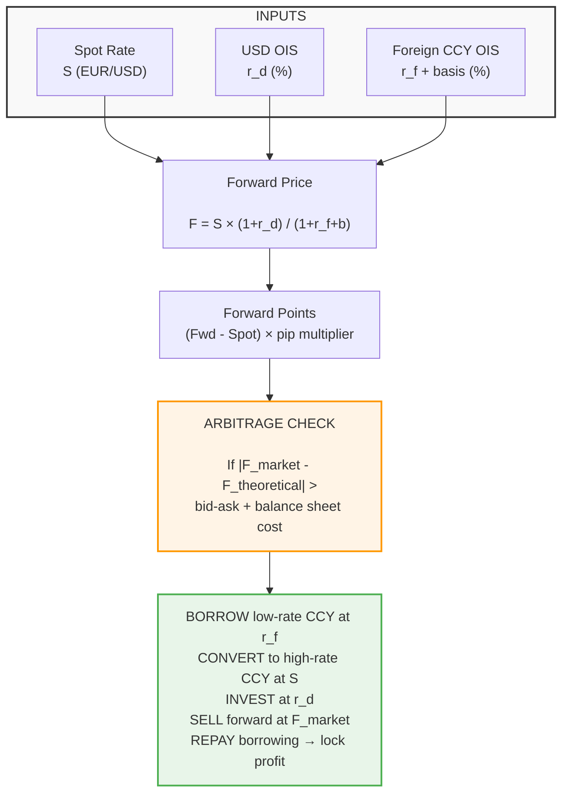

# Lesson 2: Currency Valuation, Interest Rate Parity, and Spot-Forward Relationships

## 1. First-Principles Intuition & Invariants

Currency valuation is not, at its core, a problem of prediction. It is a problem of *equilibrium arbitrage*: the foreign exchange market is a continuous auction in which every participant implicitly bets that the current price violates some underlying parity condition, and the collective pressure of those bets drives rates back toward the theoretical anchor. Understanding Forex at a practitioner level means internalizing those anchor conditions so precisely that you can identify when a quoted rate is rich, cheap, or fairly priced before the market does.

The first anchor is Purchasing Power Parity, or PPP. The raw intuition is disarmingly simple: a unit of currency should purchase the same real basket of goods anywhere on earth, once transaction costs are stripped away. The *Economist*'s Big Mac Index is a popularized version, but the institutional formulation is the absolute PPP condition, which states that the equilibrium exchange rate between two currencies equals the ratio of their domestic price levels. If a representative basket costs $P$ dollars in the United States and $P^*$ euros in the Eurozone, the spot rate $S$ expressed as USD per EUR should satisfy:

$$S = \frac{P}{P^*}$$

In practice, absolute PPP fails constantly. Non-tradable goods (haircuts, rent, medical services) have no cross-border arbitrage mechanism, so price levels can diverge permanently without triggering corrective flows. What survives empirically is the *relative* PPP condition, which makes the weaker claim that *changes* in the exchange rate should track *differences* in inflation rates over time. If US inflation runs at $\pi_{USD}$ and Eurozone inflation runs at $\pi_{EUR}$, the expected percentage change in the USD/EUR spot rate over a horizon $T$ is:

$$\frac{S_{t+T} - S_t}{S_t} \approx \pi_{USD} - \pi_{EUR}$$

This relationship holds reasonably well over long horizons of five years or more, which is why central bank economists use PPP-adjusted exchange rates for cross-country growth comparisons and why long-dated currency option desks embed inflation differentials into their fair-value models. Over the one-to-twelve-month horizons that most institutional traders operate in, however, relative PPP is a poor timing signal. The rate can deviate from PPP fair value for years before mean-reverting, making it a useful compass but a dangerous clock.

The second anchor, and by far the more operationally powerful one for short-to-medium term practitioners, is Interest Rate Parity, or IRP. Its logic is built on a no-arbitrage argument that is worth working through carefully because every practitioner tool in this lesson descends from it. Suppose you have one dollar today. You face two investment paths over a one-year horizon. Path A: invest at the domestic rate $r_{d}$, earning $1 + r_d$ dollars at year-end. Path B: convert to foreign currency at today's spot rate $S$ (expressed as domestic per unit of foreign), invest at the foreign rate $r_f$ earning $1 + r_f$ foreign currency units, then convert back to domestic currency. If you lock in the terminal conversion rate today using a forward contract at rate $F$, Path B delivers:

$$\frac{1}{S} \cdot (1 + r_f) \cdot F \quad \text{domestic currency units}$$

No-arbitrage requires that both paths yield the same terminal value. Setting them equal and solving for $F$:

$$F = S \cdot \frac{1 + r_d}{1 + r_f}$$

This is the **Covered Interest Rate Parity (CIP)** equation, and it is not a forecast — it is a *constraint*. Any deviation from this relationship, net of bid-ask spreads, is a riskless profit opportunity, and in liquid G10 currency pairs pre-2008, deviations rarely exceeded a fraction of a basis point before arbitrageurs closed them. The forward rate is therefore not the market's prediction of where spot will be in the future; it is the mechanical output of two interest rates and a spot price, enforced by the threat of basis trade arbitrage.

For small interest rate differentials, the CIP formula simplifies to the linear approximation:

$$F \approx S \cdot \left(1 + r_d - r_f\right)$$

or equivalently, the *forward premium or discount* expressed as an annualized percentage of spot:

$$\frac{F - S}{S} \approx r_d - r_f$$

When the domestic rate exceeds the foreign rate, $F > S$: the foreign currency trades at a *forward premium* (it costs more to buy forward than spot). When the domestic rate is lower, the foreign currency trades at a *forward discount*. This sign convention trips up analysts constantly, so it is worth anchoring with a concrete example. If USD overnight index swap (OIS) rates sit at 5.25% and EUR OIS rates sit at 4.00%, then one-year EUR/USD forward points will be negative — meaning EUR trades at a forward discount to USD — by approximately 125 basis points annualized. The dollar is dearer forward because dollar cash earns more.

The transition from covered to uncovered parity introduces the concept most central to speculative positioning. **Uncovered Interest Rate Parity (UIP)** makes the same algebraic claim as CIP but removes the forward contract hedge, replacing the locked-in forward rate with the *expected* future spot rate $E[S_{t+T}]$:

$$E[S_{t+T}] = S_t \cdot \frac{1 + r_d}{1 + r_f}$$

UIP says that the high-yielding currency should depreciate by exactly the amount of its interest rate advantage, leaving an unhedged investor indifferent between investing domestically or abroad. If this held, carry trades — borrowing in low-rate currencies and investing in high-rate ones — would generate zero excess return on average. The empirical reality is that UIP fails dramatically at short and medium horizons: high-yield currencies tend to *appreciate* or at minimum *not depreciate enough* relative to the UIP prediction, generating positive carry returns. This failure, known as the **forward premium puzzle**, is one of the most robust anomalies in financial economics, documented across G10 and emerging market currency pairs over decades.

The practical consequence is the carry trade, an institutional strategy that exploits persistent UIP violations by going long a basket of high-yielding currencies (historically AUD, NZD, MXN) funded by short positions in low-yielding ones (JPY, CHF). The long-run Sharpe ratio of carry across G10 pairs has historically hovered around 0.6–0.8, comparable to equity risk premium returns, but the distribution has severe left-tail skew: carry unwinds are fast, brutal, and correlated with global risk-off episodes. The unwinding mechanism matters mechanically — when volatility spikes, levered carry positions are liquidated simultaneously, amplifying the very spot moves that make them loss-generating.

Connecting these parity conditions to real versus nominal rates requires one more decomposition. The interest rate that enters CIP is a *nominal* rate. But the exchange rate, as a relative price between two monetary units, is ultimately governed by *real* economic fundamentals. The Fisher equation links nominal rates to their real and inflationary components: a nominal rate $r$ equals the real rate $\rho$ plus expected inflation $\pi^e$. Substituting into the forward premium formula:

$$\frac{F - S}{S} \approx (r_d - r_f) = (\rho_d - \rho_f) + (\pi^e_d - \pi^e_f)$$

This decomposition separates two distinct drivers. If the forward premium widens because real rates rise (say, the Fed tightens policy faster than anticipated), that signals genuine capital account inflows attracted by higher real returns, which is fundamentally USD-bullish on the spot rate as well. If the forward premium widens purely because inflation expectations rise in the US relative to Europe, PPP would predict a spot depreciation of comparable magnitude, leaving the real exchange rate unchanged. Practitioners tracking currency valuations for strategic hedging decisions or cross-border M&A pricing must decompose observed forward premiums into these two components — real rate differentials extracted from inflation-linked bond markets (TIPS spreads in the US, Bunds in Germany) and inflation expectations derived from inflation swap markets or breakeven rates — because the two carry opposite implications for real purchasing power.

---

## 2. Core Architecture & Mechanics

The abstract parity conditions described above become executable once you understand how they are operationalized in the interbank market's actual pricing and settlement infrastructure. A Forex forward is not a futures contract; it is a bilateral OTC agreement to exchange a notional amount at a specified rate on a specified value date, and its pricing flows directly from the deposit market rates available to the quoting bank.

The critical instrument is the **Foreign Exchange Swap (FX Swap)**, which must be distinguished sharply from a cross-currency basis swap. An FX swap is a simultaneous spot purchase and forward sale (or vice versa) of a currency pair. The two legs of the transaction are economically equivalent to a collateralized borrowing of one currency against lending of another, with the forward points representing the net financing cost differential. FX swaps are among the most liquid instruments on earth — the BIS triennial survey consistently puts daily FX swap turnover above $3.8 trillion — and they serve as the primary mechanism by which banks and corporates manage their short-term cross-currency funding needs.

The forward rate quoted by an interbank desk is built from three market observables: the spot mid-rate, the domestic currency deposit (or OIS) rate for the relevant tenor, and the foreign currency deposit rate for the same tenor. In practice, desks work with Overnight Index Swap (OIS) rates as the risk-free rate baseline and the cross-currency basis as an additive correction. The full CIP condition post-2008 is better written as:

$$F = S \cdot \frac{1 + r_d}{1 + r_f + \text{basis}}$$

where "basis" is the cross-currency basis spread — a persistent non-zero term that reflects USD funding scarcity in the global banking system. After the Global Financial Crisis, the EUR/USD cross-currency basis turned persistently negative (meaning dollar borrowers via EUR/USD swaps had to pay above LIBOR or above OIS for dollars), a signal that CIP arbitrage was not fully riskless because of balance-sheet constraints at the banks that would otherwise close it. This phenomenon — the **CIP deviation** or **FX basis** — is now a standard risk factor in institutional Forex research, and practitioners monitoring dollar funding stress watch EUR/USD basis levels as a leading indicator of financial conditions tightening.

The following diagram illustrates the full mechanical signal path from deposit market inputs to a quoted forward rate and the arbitrage circuit that enforces CIP:

The forward points themselves — the difference between the outright forward rate and the spot rate, quoted in pips — are what traders and corporate treasurers actually see on their trading platforms (Bloomberg FXFA screen, Refinitiv FXall, or direct bank portal) rather than the outright forward rate. For EUR/USD with spot at 1.0850 and 12-month forward points of −130 pips, the outright one-year forward is 1.0720. A corporate treasurer locking in a forward sale of EUR receivables is effectively selling EUR forward at 1.0720, which guarantees a USD receipt at a rate below today's spot, reflecting the dollar's higher carry cost over the year.

To price a forward for any tenor, the desk interpolates along the OIS curve (or swap curve, depending on the currency's convention) for both currencies and derives the forward points for the exact number of calendar days. The day-count convention matters: USD uses ACT/360, GBP uses ACT/365, EUR uses ACT/360, and crossing conventions introduce small corrections that back-office systems handle via standard market conventions encoded in systems like Murex, Calypso, or Bloomberg's BVAL.

The **carry-to-risk ratio** is the practitioner's core operating metric for evaluating whether the interest rate differential justifies taking an open (unhedged) forward position. It is defined as:

$$\text{Carry-to-Risk} = \frac{r_d - r_f - \text{basis}}{\sigma_{S}}$$

where $\sigma_S$ is the annualized implied volatility of the spot rate drawn from the at-the-money (ATM) options market for the relevant tenor. A EUR/USD one-year carry-to-risk of 0.4 means you earn 40 basis points of carry per unit of annualized volatility — a mediocre risk-adjusted profile. A USD/MXN carry-to-risk of 1.2 reflects a highly favorable differential, though the distribution's left tail (MXN collapse episodes) makes the sample Sharpe misleadingly high. Sophisticated desks decompose this ratio further by stripping out political risk premiums priced into the volatility surface (the 25-delta risk reversal skew) to arrive at a "clean" carry-to-vol measure.

The relationship between spot, forwards, and expected future rates is best visualized through the **FX term structure**, which plots forward points across the standard benchmark tenors: Overnight (O/N), Tom-Next (T/N), 1 week, 1 month, 3 months, 6 months, 9 months, 12 months, 2 years, and beyond. Each node in this curve is priced off a distinct pair of OIS or swap rates, and the curve's shape encodes the market's view on future interest rate differentials. A steeply negative forward point curve in EUR/USD — where the dollar trades at an increasingly large forward premium at longer tenors — reflects expectations that the Fed will maintain higher rates relative to the ECB over the horizon.

Practitioners use the forward curve in two distinct operational modes. The first is **hedging mode**, in which a corporate or institutional investor with a known future currency cash flow (a dividend repatriation, an acquisition payment, a bond coupon) locks in the forward rate to eliminate FX risk. The hedge is marked-to-market daily against the prevailing forward rate, and the P&L impact flows through OCI (Other Comprehensive Income) under IFRS 9 or ASC 815 for corporates that apply hedge accounting. The second is **speculative mode**, in which a macro fund or prop desk takes a view that spot will deviate from the forward in a profitable direction — a bet that UIP will fail in a specific direction over a specific horizon. The critical difference is that the hedger does not need to predict the spot rate; the speculator does.

The real exchange rate framework adds the final layer of analytical architecture. The **real effective exchange rate (REER)** is a trade-weighted index that adjusts the nominal exchange rate by the relative price levels of trading partners. It is the most comprehensive measure of competitive valuation because it captures both the exchange rate and inflation differentials simultaneously. When the REER is elevated relative to its long-run average, the currency is "overvalued" in PPP terms — exports become less competitive, the current account deteriorates, and eventual spot depreciation is implied by external balance dynamics.

Central banks and sovereign wealth funds monitor the REER closely because it is the most reliable forward indicator of balance-of-payments adjustment. A sustained REER overvaluation—particularly when accompanied by a widening current account deficit and rising external debt—creates the conditions for a sharp nominal depreciation, as capital inflows slow and the currency must adjust to restore external equilibrium. The REER thus links the three pillars of currency valuation: purchasing power parity determines the long-run equilibrium, interest rate parity governs the forward curve and short-term carry dynamics, and the real effective exchange rate integrates both into a competitiveness metric that anticipates medium-term spot movements. Practitioners who understand these relationships can distinguish between temporary mispricings (UIP deviations that generate alpha in the short run) and fundamental disequilibria (REER extremes that signal structural adjustment ahead). The forward curve, in this framework, is not merely a hedging instrument—it is a real-time consensus forecast of interest rate differentials, a no-arbitrage benchmark for spot prediction, and a window into the market's assessment of central bank credibility and sovereign risk.

The operational implication is that currency valuation is never a single-variable problem. A trader who buys high-yield currency exposure without checking the REER is betting on carry without accounting for terminal depreciation risk. A corporate treasurer who hedges a receivable at the forward rate without understanding the interest differential is locking in a rate that may be far from the expected spot outcome. The rigorous approach integrates spot-forward arbitrage, forward-forward extrapolation, real exchange rate positioning, and central bank reaction functions into a unified view. In practice, the most successful currency strategies are those that identify **divergences across these frameworks**—moments when CIP holds but UIP is failing, when the forward curve is steep but the REER is at multi-year lows, or when interest differentials are wide but inflation convergence is imminent. These divergences are where mispricing concentrates, and where the principles of this lesson deliver the highest informational edge.

---

## Summary & Verification Matrix

| **Framework** | **Governing Invariant** | **Core Mechanism** | **Diagnostic Criterion** | **Failure Mode** |
|---------------|------------------------|-------------------|-------------------------|-----------------|
| **Covered Interest Parity (CIP)** | \( F/S = (1 + i_d)/(1 + i_f) \) | Arbitrage via cash-forward-borrow-invest loop enforces no-arbitrage pricing in spot-forward space | CIP deviation < 5 bps in G10; wider in EM or stress → arbitrage cost or counterparty risk | Post-2008 basis persists due to balance sheet constraints, regulatory capital, and cross-currency funding premia |
| **Uncovered Interest Parity (UIP)** | \( E[S_{t+1}] = F_t \) or \( E[\Delta s] \approx i_d - i_f \) | High-yield currencies should depreciate by interest differential; forward is unbiased predictor of future spot | UIP holds on average over long horizons (5–10 years); fails systematically in short run (< 2 years) | Forward premium puzzle: high-yield currencies appreciate, not depreciate → carry trade profitability and predictable UIP violations |
| **Purchasing Power Parity (PPP)** | \( S = P_d / P_f \) (absolute); \( \Delta s \approx \pi_d - \pi_f \) (relative) | Arbitrage in goods markets (Law of One Price) links exchange rates to relative price levels and inflation | Long-run mean reversion to PPP over 3–7 years; deviations >20% signal misalignment | Short-run failures due to trade barriers, non-tradables, nominal rigidities, and productivity (Balassa-Samuelson) effects |
| **Real Effective Exchange Rate (REER)** | \( \text{REER} = \text{NEER} \times (P_{\text{domestic}} / P_{\text{foreign}}) \) | Trade-weighted nominal rate adjusted for relative price levels; competitiveness and external balance indicator | REER >10% above long-run average → overvaluation; widening current account deficit confirms adjustment pressure | REER extremes precede sharp nominal adjustments, but timing is uncertain; carry can persist during overvaluation if capital inflows continue |
| **Forward Curve & Tenor Structure** | \( F_T = S \times \prod_{i=1}^{T} (1 + i_{d,i})/(1 + i_{f,i}) \) | Multi-period CIP applied recursively; forward curve embeds path of future interest differentials | Steep curve → wide rate differential; curve inversion → expected rate convergence or reversal | Forward curve shape reflects rate expectations but not risk premium; UIP failure means forwards are biased predictors of realized spot path |
| **Spot-Forward Arbitrage & Hedge Accounting** | Hedge P&L flows through OCI (IFRS 9/ASC 815); speculator marks-to-market in P&L | Hedgers lock forward rate to eliminate FX risk; speculators bet on spot deviation from forward (UIP failure) | Hedger success = eliminated uncertainty; speculator success = spot moves more favorably than forward implied | Hedger faces basis risk if cash flow timing shifts; speculator loses if UIP holds or if carry is offset by depreciation |
