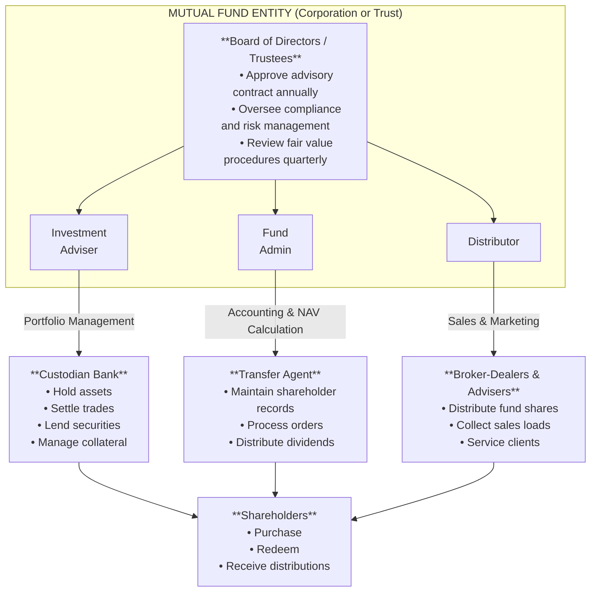

# Lesson 1: Structure, Legal Framework, Net Asset Value Mechanics

## 1. First-Principles Intuition & Invariants

The mutual fund emerged in the twentieth century as a solution to a fundamental coordination problem in capital markets: individual investors lacked both the expertise and the capital scale to construct diversified portfolios efficiently, while professional asset managers possessed neither the distribution infrastructure nor the legal framework to aggregate capital from millions of households. The mutual fund structure resolved this bilateral friction by introducing a pooled investment vehicle governed by explicit fiduciary duties, continuous liquidity guarantees, and transparent pricing mechanisms.

At its essence, a mutual fund operates as a registered investment company under the Investment Company Act of 1940, a Depression-era statute enacted after widespread abuses in the 1920s trust and holding company markets. The Act imposed three foundational invariants that define every mutual fund to this day. First, the fund must register with the Securities and Exchange Commission and submit to ongoing regulatory disclosure, ensuring that portfolio holdings, fee structures, and investment policies remain visible to investors and regulators alike. Second, the fund must maintain separation between the investment adviser who manages the portfolio, the custodian bank that holds the securities, and the transfer agent that processes shareholder transactions—a deliberate fragmentation of operational control intended to prevent self-dealing and asset commingling. Third, the fund must price its shares at net asset value per share, calculated at least once per business day, and stand ready to redeem those shares at NAV upon investor request, thereby guaranteeing liquidity even when the underlying securities trade in less liquid markets.

This liquidity guarantee distinguishes mutual funds from closed-end funds, which trade on exchanges at prices that can deviate significantly from NAV, and from private funds such as hedge funds or private equity vehicles, which impose lock-up periods and redemption gates. The open-end structure—the technical term for a mutual fund's continuous offer to issue and redeem shares—creates a direct mechanical linkage between investor cash flows and portfolio composition. When investors purchase fund shares, the fund receives cash and must deploy it into securities consistent with its investment mandate. When investors redeem shares, the fund must liquidate portfolio positions to meet the redemption request, potentially realizing capital gains and incurring transaction costs that are borne by the remaining shareholders. This asymmetry between the investor's ability to exit instantly and the fund's obligation to transact in the underlying securities introduces a structural tension that fund managers must navigate through careful liquidity management and cash buffer maintenance.

The legal architecture of a mutual fund typically follows one of two organizational forms: a business trust or a corporation. The trust structure, more common among older fund families, organizes the fund as a Massachusetts business trust or Delaware statutory trust, where investors hold beneficial interests rather than shares of stock. The corporate structure, increasingly prevalent due to its operational simplicity and familiarity to retail investors, establishes the fund as a Maryland or Delaware corporation with shareholders electing a board of directors. Regardless of form, the fund itself is merely a legal shell—an empty vessel that contracts with external service providers for every operational function. The investment adviser provides portfolio management services under an advisory agreement approved annually by the fund's board. The custodian, typically a large bank such as State Street, BNY Mellon, or JPMorgan, holds legal title to the fund's securities and executes trades on the fund's behalf. The transfer agent maintains shareholder records, processes purchase and redemption orders, and calculates daily net asset value. The fund administrator handles accounting, regulatory compliance, and board reporting. The distributor markets the fund's shares, often through broker-dealer networks or financial advisory platforms.

This service provider ecosystem introduces multiple agency relationships, each governed by contractual terms and regulatory oversight. The advisory agreement specifies the management fee as a percentage of average daily net assets, typically structured as a tiered schedule where the marginal fee rate declines as assets grow—a practice known as breakpoints designed to pass economies of scale to investors. The custodian agreement defines safekeeping obligations, collateral management protocols for derivatives positions, and liability limits for operational errors. The distribution agreement governs sales compensation, including front-end loads charged at purchase, back-end loads imposed upon redemption within a specified holding period, and ongoing 12b-1 fees named after the SEC rule authorizing their use to finance distribution expenses.

The board of directors, or trustees in the trust structure, serves as the fund's ultimate governance authority, charged with overseeing the adviser's performance, approving fee arrangements, and protecting shareholder interests. SEC regulations mandate that at least 40 percent of board members qualify as independent directors—individuals without material business relationships to the adviser or its affiliates. In practice, most fund boards maintain an independent majority, recognizing that the board's legitimacy depends on credible arm's-length oversight. The board meets quarterly to review portfolio performance, compliance reports, expense ratios, and comparative fee analyses prepared by independent consultants. Once annually, the board conducts a rigorous evaluation of the advisory contract under the framework established by the Supreme Court's *Gartenberg v. Merrill Lynch* decision, scrutinizing whether the adviser's fees bear a reasonable relationship to the services provided and the returns generated.

This governance structure reflects a fundamental insight about mutual fund economics: the adviser captures most of the economic surplus from managing other people's money, while the fund itself operates as a pass-through entity distributing substantially all of its income and capital gains to shareholders to avoid entity-level taxation under Subchapter M of the Internal Revenue Code. The asymmetry between the adviser's profit margins—often exceeding 30 percent for large asset managers—and the fund's deliberate structural marginality creates a permanent tension that regulatory oversight and board scrutiny attempt to equilibrate. The fund pays the adviser a management fee calculated daily and accrued monthly, but the adviser bears the cost of investment research, trading infrastructure, compliance systems, and portfolio manager compensation. The fund pays its own operational expenses—custody fees, audit fees, legal fees, registration costs—but these typically amount to a small fraction of the total expense ratio, with the management fee dominating.

Understanding net asset value calculation requires recognizing that a mutual fund's shares represent fractional ownership of a diversified portfolio revalued continuously. Unlike a stock, which trades at prices determined by supply and demand in secondary markets, a mutual fund share's price is defined mechanically by dividing total net assets by total shares outstanding. Total net assets equal the market value of all portfolio securities, plus cash and receivables, minus liabilities such as payables for securities purchased, distributions declared but not yet paid, and accrued expenses. The calculation occurs as of a specified valuation time, typically 4:00 PM Eastern Time when U.S. equity markets close, though international funds must value foreign securities based on closing prices in their local time zones, introducing complexities around stale pricing when overseas markets have closed hours before the U.S. calculation time.

The pricing of individual portfolio securities follows a hierarchy of valuation sources designed to ensure accuracy and consistency. Exchange-traded equities and bonds utilize the last sale price on the security's primary exchange, or if no trades occurred that day, the mean between the closing bid and ask quotes. Government and investment-grade corporate bonds rely on pricing services such as Interactive Data Corporation or Bloomberg Valuation Service, which employ matrix pricing models incorporating recent trades, dealer quotes, and spread relationships across comparable securities. Below-investment-grade bonds, particularly those trading infrequently, require broker dealer quotes gathered through a waterfall process: the fund's pricing vendor solicits quotes from multiple dealers, discards outliers, and averages the remaining bids. Derivatives such as futures and exchange-traded options use settlement prices published by the relevant clearinghouse, while over-the-counter derivatives demand valuation models, often requiring the fund to engage third-party valuation specialists to provide independent price verification.

Illiquid securities—typically defined under SEC rules as positions that cannot be sold within seven days without significantly moving the market price—present the most difficult valuation challenges. Private placements, restricted stock, and thinly traded small-cap equities may lack observable market prices for extended periods. In these cases, the fund's board adopts fair value procedures delegating day-to-day pricing authority to a valuation committee, often comprising senior officers from the adviser and administrator. The committee applies valuation methodologies appropriate to the security type: discounted cash flow models for private debt, recent transaction multiples for venture-stage equity, or comparable company analyses for restricted public equity. The board receives quarterly reports detailing all fair-valued positions, the methodologies applied, and any significant changes in valuation assumptions.

This fair value process introduces subjectivity into what is otherwise a mechanical calculation, creating opportunities for manipulation that regulators monitor closely. A fund facing large redemptions might be tempted to overvalue illiquid positions, thereby inflating NAV and forcing redeeming shareholders to receive fewer shares for their dollar redemption amount, effectively diluting the redeeming investors to benefit remaining shareholders. Conversely, a fund seeking to attract new capital might undervalue illiquid positions to artificially depress NAV, allowing new investors to purchase shares at a discount to intrinsic value. The SEC's fair value rules attempt to constrain these abuses by requiring documented methodologies, independent price verification, and board-level oversight, but the inherent judgment involved in valuing illiquid securities ensures that NAV calculations for funds holding significant private assets remain approximate rather than precise.

The creation and redemption mechanism distinguishes mutual funds from exchange-traded funds, though both structures offer daily liquidity. A mutual fund investor submits a purchase or redemption order to the transfer agent, typically through a broker-dealer or financial adviser, before the fund's daily pricing time—usually 4:00 PM Eastern. The order specifies a dollar amount or share quantity, but the price remains unknown until NAV is calculated after market close. This forward pricing rule prevents investors from exploiting intraday market movements or late-breaking news, ensuring that all orders submitted before the pricing deadline receive the same end-of-day NAV. Orders received after the deadline receive the next business day's NAV, a cutoff enforced rigorously after the SEC uncovered widespread late trading scandals in the early 2000s, where favored investors were allowed to submit orders after 4:00 PM but receive that day's NAV, effectively engaging in risk-free arbitrage at the expense of other shareholders.

When an investor purchases fund shares, the transfer agent receives the cash (typically settling T+1 or T+2 depending on payment method), credits the investor's account with new shares calculated by dividing the cash amount by that day's NAV, and transmits the cash to the fund's custodian. The fund manager must then deploy the cash into portfolio securities, a process that may take several days depending on the fund's size, strategy, and the liquidity of its target securities. Large funds receiving substantial daily cash flows often maintain a cash buffer—typically 2 to 5 percent of assets—to smooth the deployment process and avoid forced buying into illiquid markets. Conversely, when an investor redeems shares, the transfer agent debits the shareholder's account, calculates the dollar amount by multiplying shares redeemed by that day's NAV, instructs the custodian to transfer cash to the investor's designated account, and alerts the portfolio manager that cash must be raised. The manager can meet redemptions from existing cash balances, by selling securities, or through a combination of both.

The decision of which securities to sell to meet redemptions introduces meaningful economic consequences for remaining shareholders. If the fund sells appreciated securities, it realizes capital gains that must be distributed to all shareholders by year-end to maintain the fund's tax-favored status under Subchapter M, triggering taxable events for investors who may not have redeemed. If the fund sells depreciated securities to avoid realizing gains, it may be forced to deviate from its optimal portfolio composition, potentially degrading future returns. High-turnover redemption environments, particularly during market stress periods when investors flee en masse, can force fund managers into a destructive cycle: redemptions compel asset sales at depressed prices, generating realized losses that depress NAV further, triggering additional redemptions. This dynamic played out dramatically during the March 2020 COVID crisis, when investment-grade corporate bond funds experienced unprecedented redemptions, forcing managers to sell their most liquid holdings—Treasury securities and agency mortgage-backed securities—rather than the less liquid corporate bonds they actually wanted to trim, thereby increasing portfolio concentration in precisely the securities facing the greatest market stress.

Share classes represent a structural innovation allowing a single mutual fund portfolio to serve multiple distribution channels and investor segments through differentiated fee structures. The underlying portfolio remains identical across all share classes—every share class owns the same pro-rata slice of the fund's securities—but each class assesses different distribution expenses and imposes different sales charges, resulting in distinct NAVs despite identical investment returns. Class A shares typically carry a front-end sales load, a percentage deducted from the investor's initial purchase and paid to the broker or adviser who sold the fund, reducing the amount actually invested. A 5.75 percent load, common among actively managed equity funds, means a $10,000 investment results in only $9,425 entering the fund, with $575 going to the distributor. In exchange for this upfront charge, Class A shares assess relatively low ongoing 12b-1 fees, often 0.25 percent annually, recognizing that the distribution cost has been paid upfront.

Class B shares invert this structure, eliminating the front-end load but imposing higher ongoing 12b-1 fees—typically 1.00 percent annually—and a contingent deferred sales charge (CDSC) if shares are redeemed within a specified period, often six to eight years. The CDSC declines annually, starting at perhaps 5 percent if redeemed in the first year and dropping to zero after the full period elapses. This structure allows the distributor to pay the selling broker an upfront commission—economically equivalent to a front-end load—while recovering that cost through higher ongoing fees and redemption charges. Class B shares typically convert automatically to Class A shares after the CDSC period expires, reducing ongoing expenses for long-term holders. However, Class B shares have fallen out of favor as regulatory scrutiny intensified around conflicts of interest inherent in recommending higher-cost share classes when lower-cost alternatives existed.

Class C shares assess no front-end load, impose a modest CDSC (often 1 percent if redeemed within one year), and charge ongoing 12b-1 fees similar to Class B shares (often 1.00 percent) but without automatic conversion to lower-cost share classes. Class C shares appeal to investors with shorter time horizons or those uncertain about their holding period, but their higher ongoing costs make them expensive for long-term investors. Institutional share classes—often designated Class I or Class Y—eliminate sales loads and 12b-1 fees entirely, imposing only the base management fee and operational expenses. These classes require high minimum investments, often $1 million or more, recognizing that institutional investors and high-net-worth individuals negotiate distribution separately and should not subsidize retail distribution costs.

The expense ratio reported in a fund's prospectus aggregates all ongoing costs borne by shareholders, expressed as an annual percentage of average net assets. The components include the management fee paid to the adviser, 12b-1 distribution fees, administrative service fees paid to the transfer agent and administrator, custodian fees, legal and audit fees, and registration and filing costs. A typical actively managed U.S. equity fund might show an expense ratio of 0.75 percent, composed of a 0.50 percent management fee, 0.25 percent in 12b-1 and shareholder servicing fees, and 0.00 percent in other expenses covered by the adviser through an expense cap. Passively managed index funds drive expense ratios far lower—often below 0.10 percent for large-cap equity index funds—by minimizing trading costs, eliminating active research expenses, and leveraging massive scale to reduce per-share operational costs.

Expense ratios matter profoundly because they compound over time, eroding wealth accumulation through a mechanism invisible to most investors. A $100,000 investment compounding at 7 percent annually for thirty years with a 0.10 percent expense ratio grows to $738,000, while the same investment bearing a 1.00 percent expense ratio grows to only $574,000—a $164,000 difference attributable solely to fees. This arithmetic reality has fueled the decades-long shift toward lower-cost index funds and the regulatory pressure on active managers to justify their higher fees through superior after-fee returns. The SEC requires funds to report both gross and net expense ratios when the adviser subsidizes expenses through fee waivers or expense reimbursements, disclosing what investors actually pay today versus what they would pay if the subsidy were removed—a critical distinction for newly launched funds that attract assets by temporarily capping expenses below the level sustainable at current asset levels.

## 2. Core Architecture & Mechanics

The operational architecture of a mutual fund resembles a hub-and-spoke topology, with the fund's board and legal entity at the center and specialized service providers connected through contractual relationships and data exchange protocols. Understanding this architecture requires mapping the daily operational cycle through which investor orders transform into portfolio transactions and ultimately resolve into updated shareholder account balances.

The daily operational cycle begins when investors submit purchase or redemption orders through their brokers or directly to the transfer agent before the fund's order cutoff time. Each order includes the investor's account identification, the transaction type (purchase or redemption), the dollar amount or share quantity, and settlement instructions. The transfer agent aggregates all orders received before the cutoff, distinguishing between purchase orders that will bring cash into the fund and redemption orders that will require cash disbursement. This net order flow—total purchases minus total redemptions—determines whether the fund will experience net inflows or outflows for the day.

Simultaneously, the custodian bank collects end-of-day pricing data for every security in the fund's portfolio. Exchange-traded securities receive last-sale prices from consolidated tape feeds provided by securities exchanges. Fixed-income securities receive evaluated prices from independent pricing vendors who have contracted with the fund to provide daily valuations across thousands of bond CUSIPs. The custodian's accounting system multiplies each position quantity by its price, sums the resulting market values across all positions, adds cash balances and any receivables (such as pending security sales or accrued interest), and subtracts liabilities (pending security purchases, distributions payable, and accrued expenses). The resulting figure represents total net assets as of that day's valuation time.

The transfer agent receives total net assets from the custodian, retrieves total shares outstanding from its shareholder recordkeeping system, and calculates NAV per share by dividing the former by the latter. For funds with multiple share classes, the calculation must allocate class-specific expenses appropriately: class-level 12b-1 fees and shareholder servicing fees are charged only to the respective class, while portfolio-level expenses such as management fees and custodian charges are allocated pro-rata based on each class's relative net assets. This produces distinct NAVs for each share class despite identical portfolio holdings.

Once NAV is finalized—typically by 6:00 PM Eastern for U.S. equity funds, later for international funds—the transfer agent processes all pending orders at that day's NAV. Purchase orders are converted to shares by dividing the dollar amount by NAV, with fractional shares allocated to three or four decimal places to ensure precise accounting. Redemption orders specified in shares are converted to dollar amounts by multiplying shares by NAV. The transfer agent updates its shareholder database, debiting or crediting individual accounts, and generates transaction confirmations sent to investors electronically or by mail. Simultaneously, the transfer agent informs the custodian of the net cash flow required: if purchases exceeded redemptions, the fund expects to receive cash and must prepare to invest it; if redemptions exceeded purchases, the fund must transfer cash from the custodian account to redeeming shareholders' designated bank accounts or brokerage accounts.

The portfolio manager, informed by the transfer agent of the day's net flows, decides how to deploy incoming cash or which securities to sell to raise cash for redemptions. For equity funds, the manager typically executes trades the next morning, taking advantage of opening liquidity and avoiding the need to trade at the prior day's 4:00 PM market close. Fixed-income managers face different dynamics: bond markets operate over-the-counter with liquidity concentrated in dealer inventories, so the manager may need to contact multiple dealers to source bonds for purchase or find buyers for positions being sold. The custodian receives trade instructions from the manager, executes the trades through its trading desk or transmits orders to designated broker-dealers, and updates the portfolio accounting system as trades settle.

Trade settlement introduces timing complexity that affects NAV calculations. U.S. equities settle T+1, meaning a trade executed on Monday settles on Tuesday, with cash and securities exchanging hands on settlement date. Corporate bonds settle T+2. International equities may settle T+2 or T+3 depending on the market. During the period between trade date and settlement date, the fund's accounting system reflects the trade on a trade-date basis—the portfolio shows ownership of securities purchased and cessation of ownership of securities sold, even though cash and securities have not yet moved. This trade-date accounting ensures that NAV reflects the economic reality of the portfolio's composition rather than the operational timing of settlement, but it creates temporary mismatches between the custodian's cash ledger and the portfolio's cash position as reflected in the accounting system.

Securities lending represents a secondary revenue stream for many mutual funds, particularly those holding large positions in high-demand securities that short sellers need to borrow. The fund lends securities from its portfolio to a borrower, typically a broker-dealer or hedge fund, receiving cash or securities as collateral equal to at least 100 percent of the lent securities' market value. The collateral is marked to market daily to ensure it remains sufficient as the lent securities' value fluctuates. The borrower pays a lending fee, typically a percentage of the lent securities' value, which the fund and its lending agent split according to a negotiated arrangement. The fund invests the cash collateral in short-term instruments such as Treasury bills or repurchase agreements, earning an additional return while exposed to the risk that the collateral investment could lose value if interest rates rise sharply or credit concerns emerge.

Securities lending introduces operational complexity into NAV calculations because the lent securities remain on the fund's books—the fund still owns them economically despite having transferred legal title to the borrower—while the collateral received also appears as an asset. The accounting entries show the lent securities at their market value in the securities portfolio, the collateral investment as a separate asset, and a corresponding liability representing the obligation to return the collateral when the loan terminates. If the borrower defaults and fails to return the lent securities, the fund liquidates the collateral to purchase replacement securities in the market, bearing any shortfall if the collateral proves insufficient. This risk has materialized periodically during market crises, most notably during the 2008 financial crisis when some funds held collateral invested in structured investment vehicles that collapsed in value, leaving funds unable to fully replace lent securities.

Distribution calculations require the fund to track realized and unrealized gains separately, a distinction critical for tax reporting and distribution planning. When the fund sells a security for more than its tax basis (typically the purchase price adjusted for corporate actions), it realizes a capital gain. Short-term gains on securities held one year or less are categorized separately from long-term gains on securities held more than one year, as each category receives different tax treatment when distributed to shareholders. The fund also earns dividend income from equity holdings and interest income from fixed-income securities, both of which must be tracked separately from capital gains.

Under Subchapter M of the Internal Revenue Code, the fund must distribute at least 90 percent of its net investment income (dividends and interest, less expenses) and may distribute realized capital gains to shareholders, passing through the tax character of these items so that shareholders pay tax as if they had earned the income and gains directly. Most funds distribute net investment income quarterly or monthly and distribute realized capital gains annually, typically in December. The distribution amount per share is calculated by dividing total distributions by shares outstanding on the record date, reducing NAV by the per-share distribution amount on the ex-dividend date. Shareholders receive distributions in cash or, more commonly, elect to reinvest distributions by purchasing additional shares at the post-distribution NAV.

This distribution mechanism introduces tax inefficiency for taxable investors because distributions trigger taxable events regardless of whether the investor receives cash or reinvests. An investor purchasing fund shares shortly before a large capital gain distribution receives that distribution immediately and owes tax on gains realized by the fund before the investor even owned shares—a phenomenon known as buying a dividend that creates particularly acute tax inefficiency in December when funds typically make their annual capital gain distributions. Tax-aware fund managers attempt to minimize distributions by offsetting realized gains against realized losses through tax-loss harvesting, selling depreciated positions to generate losses that shelter gains, but this strategy conflicts with portfolio optimization when the manager must choose between maintaining the optimal portfolio and minimizing tax distributions.

Index funds achieve superior tax efficiency relative to actively managed funds because their low turnover generates fewer realized gains, allowing most appreciation to remain unrealized and thus untaxed until the investor sells shares. Even better, exchange-traded funds (ETFs) exploit a structural advantage: because ETFs transact with authorized participants through in-kind creation and redemption of baskets of securities rather than cash transactions, the ETF can deliver out appreciated low-basis shares to satisfy redemptions, effectively purging low-basis shares from the fund without triggering taxable gains. Mutual funds lack this mechanism, forced instead to sell securities for cash to meet redemptions, realizing gains that must be distributed across all shareholders.

## 3. High-Performance Optimization & Failure Modes

Operating a mutual fund at institutional scale while maintaining tight NAV accuracy, regulatory compliance, and operational resilience requires sophisticated systems, rigorous controls, and systematic risk management across multiple failure domains. The pursuit of operational excellence in fund operations revolves around three optimization objectives: minimizing NAV calculation errors, reducing transaction costs that erode investor returns, and managing liquidity to meet redemptions without forced selling into illiqid markets.

NAV calculation errors pose existential risks to mutual funds because they create winners and losers among shareholders, with early discovery allowing restitution but late discovery potentially requiring material financial restatements and regulatory enforcement actions. The most common error sources include stale pricing of international securities, misclassification of fair-valued securities, incorrect accrual of dividend or interest income, and reconciliation breaks between the custodian's security positions and the transfer agent's share counts. Operational controls to prevent these errors include automated price validation routines that flag securities with prices unchanged for multiple consecutive days, independent price verification for fair-valued securities performed by third-party specialists, daily reconciliation between custodian and accounting records with automated variance reporting, and segregation of duties ensuring that individuals who input pricing data differ from those who review and approve NAV.

Despite these controls, pricing errors occur regularly, requiring established reprocessing procedures. When an error is discovered, the fund administrator recalculates the correct NAV for the affected period and compares it to the published NAV to determine the magnitude of deviation. SEC rules establish de minimis thresholds: if the error caused NAV to deviate by less than one cent per share or less than 0.5 percent of NAV, the fund may elect not to reprocess, recognizing that the cost of reprocessing—including communicating with affected shareholders, repapering transactions, and adjusting account balances—exceeds the benefit of correcting small errors. Errors exceeding these thresholds require full reprocessing: the fund publishes corrected NAVs, adjusts shareholder accounts to reflect correct share balances, and compensates shareholders who were harmed by the error. Shareholders who purchased at an understated NAV or redeemed at an overstated NAV owe money to the fund; those who purchased at an overstated NAV or redeemed at an understated NAV receive compensation. The fund's errors and omissions insurance policy typically covers large reprocessing costs, but repeated errors trigger increased premiums and regulatory scrutiny.

Transaction cost management represents a continuous optimization challenge because every trade imposes explicit costs (brokerage commissions) and implicit costs (market impact and opportunity cost) that diminish returns. For equity funds, transaction costs arise primarily from market impact: large orders move prices adversely as the fund's buying lifts offers or the fund's selling hits bids. Skilled traders mitigate market impact through algorithmic execution strategies that slice large orders into smaller child orders released over time, disguising the fund's full intent and reducing information leakage to predatory high-frequency traders. Volume-weighted average price (VWAP) algorithms aim to match the market's natural trading pattern throughout the day, while implementation shortfall algorithms trade more aggressively early and ease off if the market moves favorably, balancing urgency against patience.

Fixed-income transaction costs manifest differently because bond markets remain largely over-the-counter, with dealers quoting bid-ask spreads that vary with trade size, credit quality, and market volatility. Investment-grade corporate bonds might trade with three to five basis point spreads in normal markets but see spreads widen to twenty or thirty basis points during stress periods when dealer balance sheets contract and liquidity provision becomes expensive. High-yield bonds trade with wider spreads still—often fifty to one hundred basis points—reflecting the limited dealer capital allocated to speculative-grade inventory. Fund managers reduce fixed-income transaction costs by trading in larger block sizes to negotiate tighter spreads, maintaining relationships with multiple dealers to ensure competitive bidding, and timing trades to avoid month-end and quarter-end periods when dealers tighten inventory ahead of reporting dates.

Portfolio rebalancing decisions require weighing the benefit of aligning the portfolio with target weights against the transaction costs of executing rebalancing trades. Strict rebalancing to precise targets generates excessive trading, while loose rebalancing allows the portfolio to drift away from optimal allocations. Optimal rebalancing policies establish tolerance bands around target weights—typically allowing positions to drift plus or minus 50 to 200 basis points depending on the security's liquidity and the cost of trading—and trigger rebalancing only when positions exceed these bands. Index funds face particularly acute rebalancing challenges surrounding index reconstitutions, when securities are added to or removed from the tracked index on predetermined dates. Because all index funds tracking the same index must execute the same trades simultaneously, these events create massive liquidity demands and significant transaction costs as index funds compete for liquidity against one another and are front-run by arbitrageurs who anticipate the index trades.

Liquidity management has evolved from a back-office concern to a front-office strategic priority following several high-profile liquidity crises, most recently during the March 2020 COVID-driven market disruption when fixed-income mutual funds experienced record redemptions while bond market liquidity evaporated. The SEC's 2016 liquidity risk management rules formalized liquidity management by requiring funds to classify each portfolio position into one of four liquidity categories: highly liquid investments convertible to cash within three business days, moderately liquid investments convertible within seven days, less liquid investments requiring between eight and fourteen days, and illiquid investments requiring more than fourteen days or tradeable only at significantly discounted prices. The fund must establish a minimum percentage of net assets to be maintained in highly liquid investments, effectively a regulatory floor beneath which the fund cannot allow its liquid asset buffer to fall.

Operationalizing this framework requires the fund to model liquidity under normal and stressed conditions, estimating how long it would take to liquidate each position under various market scenarios. Large-cap U.S. equities typically classify as highly liquid because they trade with tight spreads and deep order books, allowing multi-million-dollar positions to be liquidated with minimal market impact. Small-cap equities, particularly microcaps with low daily trading volumes, may classify as moderately or less liquid because liquidating a position representing five or ten percent of a stock's average daily volume would require multiple days and impose significant market impact. Corporate bonds' liquidity classification depends on credit rating, issue size, and time since issuance: recently issued investment-grade bonds from large issuers trade actively and classify as highly liquid, while older bonds trade infrequently and classify as moderately or less liquid. High-yield bonds, municipal bonds, and bank loans generally classify as less liquid, reflecting the limited dealer intermediation and long settlement times characteristic of these markets.

Funds managing less liquid portfolios face difficult tradeoffs during redemption waves. Selling the most liquid positions first preserves the option to wait for better pricing on less liquid positions but increases the remaining portfolio's liquidity risk and concentrates holdings in the least liquid names. Selling positions proportionally across the portfolio maintains the intended investment mix but forces the fund to accept poor pricing on illiquid positions that might recover value if held longer. Some funds have implemented swing pricing or redemption fees to discourage short-term trading and ensure that redeeming shareholders bear the transaction costs their redemptions impose. Swing pricing adjusts NAV downward on days of net redemptions and upward on days of net subscriptions, with the adjustment magnitude scaled to the estimated transaction costs of meeting that day's net flows. Redemption fees impose a flat charge, typically one or two percent, on shares redeemed within a specified short-term holding period, often thirty or ninety days, with the fee retained by the fund to offset transaction costs rather than paid to the adviser.

Gate provisions and side pockets represent more extreme liquidity management tools reserved for extraordinary circumstances. A gate allows the fund to limit redemptions to a specified percentage of net assets per period—for example, five percent per quarter—when orderly liquidation of portfolio positions becomes impossible. Gating protects remaining shareholders from bearing the transaction costs that would be incurred by fully liquidating the portfolio into an illiquid market, but it eliminates the open-end fund's defining feature: daily liquidity at NAV. Investors trapped behind a gate cannot access their capital and must wait until the gate is lifted or the fund is liquidated, potentially suffering significant opportunity costs. Side pockets segregate illiquid positions into a separate share class that does not accept new investments and from which redemptions are suspended, allowing the remainder of the portfolio to continue operating with normal liquidity. Investors who redeem from the main portfolio retain their pro-rata interest in the side pocket, receiving distributions as the side-pocketed positions are eventually liquidated. Side pockets work well for funds holding a small number of truly illiquid positions—perhaps distressed debt or equity in bankrupt companies—but they introduce complex accounting and tax reporting as investors now hold two distinct share classes with different characteristics.

Operational resilience against cybersecurity threats, fraud, and business continuity disruptions has become a primary regulatory focus. Mutual fund transfer agents maintain personally identifiable information on millions of shareholders, creating attractive targets for cybercriminals seeking to steal identities or divert redemption proceeds. Defense mechanisms include multi-factor authentication for shareholder account access, transaction velocity limits that flag unusual patterns such as address changes followed immediately by large redemptions, and segregation of duties ensuring that individuals processing redemptions cannot modify shareholder bank account information. Business continuity plans establish backup operational sites, typically located in different geographic regions to mitigate regional disaster risks, with regular testing to verify that critical functions—NAV calculation, order processing, and portfolio accounting—can continue operating if the primary site becomes unavailable.

Regulatory compliance infrastructure extends beyond operational controls to encompass ongoing monitoring of portfolio restrictions, investment policy adherence, and disclosure accuracy. The fund's compliance officer, reporting directly to the board rather than to the investment adviser to preserve independence, conducts daily pre-trade compliance checks verifying that proposed trades do not violate portfolio concentration limits, prohibited investment restrictions, or derivatives exposure limits. Post-trade compliance monitoring confirms that the day's executed trades, combined with market price movements in existing positions, have not caused the fund to drift out of compliance with its stated investment policies. Quarterly compliance reporting to the board summarizes policy exceptions, remediation actions, and trends in compliance metrics, while annual compliance program reviews conducted by external law firms provide independent verification that the fund's compliance infrastructure remains adequate.

The fund's annual audit by an independent public accounting firm represents the most comprehensive external validation of operational accuracy and control effectiveness. The auditor performs substantive testing of NAV calculations throughout the year, recalculating NAV for selected dates and comparing their result to the fund's published NAV to verify accuracy. The auditor confirms securities holdings directly with the custodian, tests the valuation methodologies applied to fair-valued securities, recalculates expense accruals, and verifies that distributions to shareholders reconcile to the fund's books and records. The auditor issues an opinion on the fund's financial statements, providing reasonable assurance that the statements are free from material misstatement, and evaluates the design and operating effectiveness of internal controls over financial reporting. A qualified audit opinion or identified material weakness in internal controls triggers regulatory scrutiny and board-level remediation plans, while a clean opinion provides public assurance that the fund's operations meet professional standards.
