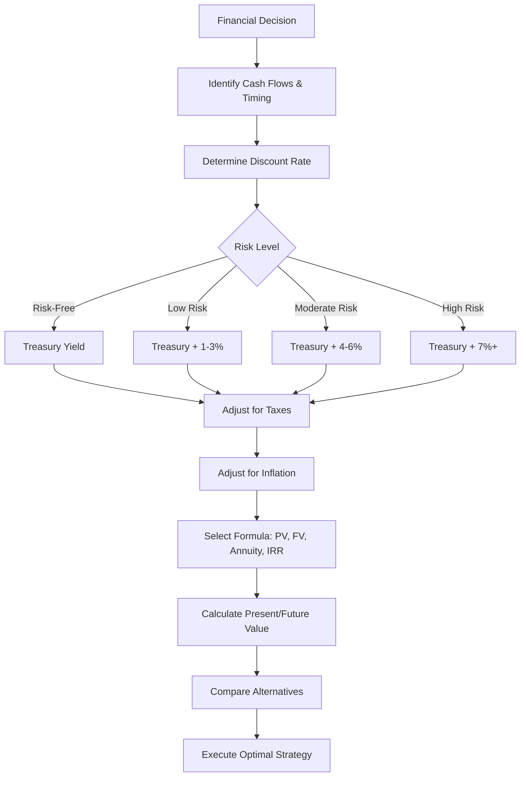

# Lesson 1: Money, Time, Risk

## 1. First-Principles Intuition & Invariants

Money possesses a peculiar property that distinguishes it from nearly every other resource humanity trades: its value changes across time in predictable, mathematically tractable ways. A dollar received today carries fundamentally different economic weight than a dollar promised five years hence, not because of sentiment or psychology, but because of three irreducible mechanical forces that operate continuously in every economy: opportunity cost, inflation, and uncertainty.

The opportunity cost mechanism emerges from scarcity. Capital deployed in one direction cannot simultaneously be deployed elsewhere. When you hold cash, you forfeit the return that capital could generate in alternative investments. When you accept a promise of future payment, you surrender the compounding returns you could earn by investing that principal immediately. This trade creates a natural discount rate—a mathematical penalty applied to future cash flows that reflects the alternative returns available in the present moment.

Consider the mechanical reality of compounding. A single dollar invested at a 7% annual return does not grow linearly. After one year, you hold $1.07. After two years, you hold not $1.14 but $1.1449, because the seven cents earned in year one itself earns seven percent in year two. After ten years, the dollar becomes $1.9672. After thirty years, it becomes $7.6123. After fifty years, it becomes $29.4570. The growth curve bends upward exponentially because each period's returns build on the accumulated base of all prior returns. This is not a financial abstraction—it is a physical law of recursive multiplication applied to economic value.

The compounding formula captures this recursion precisely. Future value equals present value multiplied by one plus the rate of return, raised to the power of the number of compounding periods: $FV = PV \times (1 + r)^n$. The exponential term $(1 + r)^n$ encodes the recursive multiplication. When you invert this relationship to calculate present value, you divide by that same exponential factor: $PV = \frac{FV}{(1 + r)^n}$. This inversion reveals the discount rate—the mathematical penalty that shrinks future dollars back to their present-day equivalent value.

Inflation compounds in parallel, eroding purchasing power through the same exponential mechanics. If inflation runs at 3% annually, a basket of goods costing $100 today will cost $103 next year, $106.09 in two years, and $180.61 in twenty years. Inflation does not merely add three dollars per year—it multiplies the prior year's price by 1.03, creating the same exponential curve observed in investment returns. The real rate of return, the value that matters for wealth accumulation, equals the nominal return minus the inflation rate. A 7% nominal return in a 3% inflation environment delivers only 4% real purchasing power growth. The formula $r_{real} = \frac{1 + r_{nominal}}{1 + r_{inflation}} - 1$ captures this adjustment precisely, accounting for the compounding interaction between returns and inflation.

Risk introduces the third dimension. Future cash flows carry uncertainty—the promised payment may arrive late, in reduced amount, or not at all. The probability distribution of outcomes creates variance around the expected value. A bond promising 5% annual interest carries low variance if issued by a creditworthy government, because the likelihood of default remains negligible. A startup equity stake promising 50% annual returns carries extreme variance, because most startups fail completely while a small fraction generate extraordinary returns. Rational investors demand higher expected returns to compensate for higher variance, creating the risk-return tradeoff that structures all capital markets.

The risk-free rate anchors this relationship. U.S. Treasury securities, backed by the taxing authority of the federal government and denominated in the currency the government can print, represent the closest approximation to risk-free cash flows available in practice. The yield on short-term Treasury bills defines the time value of money in its purest form—the return demanded for deferring consumption without bearing meaningful default risk. All other assets must offer returns above this baseline to compensate for additional risks: credit risk for corporate bonds, equity risk for stocks, liquidity risk for private investments, and operational risk for real assets.

The equity risk premium quantifies the additional return investors demand for bearing the variance of stock market outcomes. Historical data reveals that U.S. equities have delivered approximately 9-10% annualized returns over the past century, while Treasury bills have delivered roughly 3-4%. The 6% spread represents the equity risk premium—the compensation for accepting the possibility that stock portfolios can lose 20%, 40%, or even 60% of their value in severe downturns, even though over multi-decade horizons they reliably compound at high rates.

Understanding these three forces—opportunity cost, inflation, and risk—transforms financial decision-making from intuitive guesswork into quantitative engineering. Every financial choice reduces to a present value calculation weighted by probability distributions. Should you prepay a 4% mortgage or invest the capital in equities? Calculate the after-tax cost of mortgage interest, compare it to the expected after-tax equity return, adjust for risk tolerance, and execute the strategy with higher expected value. Should you accept a job offering $150,000 annually or one offering $130,000 plus equity worth $50,000 at current valuation? Discount the equity by the probability of successful exit and the time horizon to liquidity, then compare the risk-adjusted present values.

The mathematics provides clarity, but the discipline requires acknowledging uncertainty. Financial projections are not prophecies. Interest rates shift, inflation accelerates or decelerates, companies fail, markets crash, regulations change, and black swan events disrupt carefully constructed plans. The goal is not to predict the future with certainty but to make decisions that maximize expected value while respecting risk constraints and maintaining flexibility to adapt as conditions evolve.

## 2. Core Architecture & Mechanics

The time value of money operates through a small set of fundamental formulas that compose into every financial instrument and decision framework used in personal wealth management. These formulas are not arbitrary conventions—they emerge directly from the compounding mechanics discussed earlier and form the mathematical foundation for valuing cash flows across time.

The present value formula for a single future cash flow represents the most atomic unit of financial calculation. If you will receive $C$ dollars at time $n$ in the future, and the appropriate discount rate is $r$ per period, the value of that cash flow in today's dollars equals:

$$PV = \frac{C}{(1 + r)^n}$$

The discount factor $(1 + r)^{-n}$ shrinks the future cash flow by the compounding returns you forfeit by waiting to receive it. If you expect to receive $10,000 in five years and your opportunity cost of capital is 6% annually, the present value equals $10,000 / (1.06)^5 = $7,472.58$. This is the maximum amount you should rationally pay today for a claim on that future $10,000.

When multiple cash flows arrive across different periods, you sum the individually discounted flows. Consider a bond paying $50 annually for five years, then returning $1,000 principal at maturity. The present value equals:

$$PV = \frac{50}{(1 + r)^1} + \frac{50}{(1 + r)^2} + \frac{50}{(1 + r)^3} + \frac{50}{(1 + r)^4} + \frac{50}{(1 + r)^5} + \frac{1,000}{(1 + r)^5}$$

This summation structure applies universally—mortgages, annuities, pension payments, stock dividends, and rental income streams all reduce to sequences of cash flows discounted to present value.

The perpetuity formula provides an elegant closed-form solution for infinite cash flow streams. If a cash flow $C$ arrives every period forever, and the discount rate $r$ remains constant, the present value collapses to:

$$PV = \frac{C}{r}$$

This formula derives from summing the infinite geometric series of discounted cash flows. A perpetual bond paying $100 annually at a 5% discount rate is worth $100 / 0.05 = $2,000$. The perpetuity formula appears frequently in real estate valuation (capitalizing net operating income), dividend discount models for mature companies, and trust fund planning.

The growing perpetuity extends this concept to cash flows that increase at a constant rate $g$ per period. The present value becomes:

$$PV = \frac{C}{r - g}$$

This formula only holds when $r > g$—if cash flows grow faster than the discount rate, present value diverges to infinity, which signals either mispriced expectations or an unsustainable growth assumption. The growing perpetuity underpins the Gordon Growth Model used to value stocks with stable dividend growth and appears in retirement planning when modeling inflation-adjusted withdrawals.

The annuity formula addresses finite cash flow streams. An annuity delivers $C$ dollars per period for $n$ periods. The present value equals:

$$PV = C \times \frac{1 - (1 + r)^{-n}}{r}$$

The term $\frac{1 - (1 + r)^{-n}}{r}$ is the annuity factor, which represents the sum of the discount factors for all $n$ periods. A 30-year mortgage with $2,000 monthly payments at 4% annual interest (0.333% monthly rate) has present value $2,000 \times \frac{1 - (1.00333)^{-360}}{0.00333} = $419,459$. This is the loan principal—the amount borrowed equals the present value of all future payments.

The future value formulas run the compounding mechanics forward instead of backward. A single investment $PV$ growing at rate $r$ for $n$ periods reaches:

$$FV = PV \times (1 + r)^n$$

For a series of regular contributions $C$ made at the end of each period, the future value equals:

$$FV = C \times \frac{(1 + r)^n - 1}{r}$$

This formula captures the power of disciplined periodic investing. Contributing $500 monthly to a retirement account earning 7% annually for 30 years accumulates to $500 \times \frac{(1.00583)^{360} - 1}{0.00583} = $566,764$. The total contributions equal only $180,000—the remaining $386,764 represents compounded investment returns.

The internal rate of return (IRR) inverts these formulas to solve for the discount rate that sets net present value to zero. Given a sequence of cash flows $C_0, C_1, C_2, \ldots, C_n$ occurring at times $0, 1, 2, \ldots, n$, the IRR satisfies:

$$0 = C_0 + \frac{C_1}{(1 + IRR)^1} + \frac{C_2}{(1 + IRR)^2} + \cdots + \frac{C_n}{(1 + IRR)^n}$$

This equation has no closed-form algebraic solution—it requires iterative numerical methods like Newton-Raphson to solve. The IRR represents the effective compound annual return on an investment with irregular cash flows. If you invest $10,000 today, contribute $2,000 annually for five years, and liquidate for $30,000 at the end, the IRR quantifies your actual return, accounting for both the timing and magnitude of all contributions and withdrawals.

Compounding frequency introduces a subtle but meaningful complexity. Interest quoted as an annual percentage rate (APR) may compound annually, semi-annually, quarterly, monthly, daily, or continuously. The effective annual rate (EAR) adjusts for compounding frequency to enable accurate comparisons. If a credit card charges 18% APR compounded monthly, the effective rate equals:

$$EAR = \left(1 + \frac{0.18}{12}\right)^{12} - 1 = 19.56\%$$

Continuous compounding reaches the mathematical limit as compounding frequency approaches infinity. The formula becomes $EAR = e^r - 1$, where $e \approx 2.71828$ is Euler's number. For an 18% APR compounded continuously, $EAR = e^{0.18} - 1 = 19.72\%$. Continuous compounding appears in option pricing models and theoretical finance but rarely in retail financial products.

Real versus nominal calculations require parallel arithmetic. Every cash flow and return calculation can be executed in either nominal dollars (the raw currency amounts transacted) or real dollars (adjusted for inflation to constant purchasing power). The real discount rate equals:

$$r_{real} = \frac{1 + r_{nominal}}{1 + \pi} - 1 \approx r_{nominal} - \pi$$

where $\pi$ represents the inflation rate. The approximation holds when both rates are small. For precise calculations, use the full formula. When projecting retirement cash flows 30 years forward, inflation adjustments compound dramatically—ignoring real-versus-nominal distinctions leads to overestimating purchasing power by factors of two or more.

Tax adjustments layer over all these calculations. Interest income, dividends, capital gains, and retirement withdrawals face different tax treatments. The after-tax return equals the pre-tax return multiplied by $(1 - \text{tax rate})$ for ordinary income, or adjusted by the long-term capital gains rate for qualified gains. A taxable bond yielding 5% in a 35% marginal tax bracket delivers 3.25% after-tax. A Roth IRA growing at 7% delivers 7% after-tax because withdrawals are tax-free. Tax-equivalent yield formulas enable comparing taxable and tax-advantaged investments:

$$\text{Tax-equivalent yield} = \frac{\text{Tax-free yield}}{1 - \text{Tax rate}}$$

A municipal bond yielding 3.5% tax-free is equivalent to a taxable bond yielding $3.5\% / (1 - 0.35) = 5.38\%$ for an investor in the 35% bracket.

The decision tree for applying these formulas follows a consistent pattern. First, identify all cash flows and their timing. Second, select the appropriate discount rate reflecting opportunity cost and risk. Third, adjust for taxes, inflation, and compounding frequency as needed. Fourth, compute present or future value using the relevant formula. Fifth, compare alternatives by ranking present values, IRRs, or other metrics. This sequence applies whether evaluating mortgages, retirement savings strategies, insurance policies, or investment opportunities.

The mathematics provides precision, but judgment determines inputs. Selecting the discount rate requires assessing both opportunity cost and risk. A conservative retiree might discount equity-like risks at 8-10%, reflecting stock market return expectations. An aggressive entrepreneur might discount at 15-20%, reflecting the returns available in their business ventures. The choice encodes risk tolerance, alternative opportunities, and time horizon into a single parameter that drives all downstream calculations.

## 3. High-Performance Optimization & Failure Modes

The theoretical elegance of time value calculations meets harsh reality when applied to personal wealth decisions. Optimization requires not merely computing present values but structuring decisions to maximize after-tax, risk-adjusted returns while preserving optionality and avoiding catastrophic errors. The difference between competent and exceptional financial execution lies in recognizing second-order effects, exploiting tax arbitrage opportunities, and designing systems resilient to uncertainty.

The tax arbitrage hierarchy governs optimal capital deployment. Tax-advantaged accounts—401(k), 403(b), Traditional IRA, Roth IRA, HSA, 529 plans—offer either tax-deferred growth or tax-free withdrawals. The optimal contribution sequence follows strict priority based on marginal tax rates and employer matches. First, contribute to employer-sponsored retirement plans up to the full match—this represents a guaranteed 50% or 100% immediate return, unmatched by any market investment. Second, maximize Health Savings Account contributions if eligible, as HSAs offer triple tax advantages: deductible contributions, tax-free growth, and tax-free withdrawals for medical expenses. Third, fill Roth IRA contributions up to the annual limit if income permits, locking in current tax rates and securing tax-free growth. Fourth, return to max out employer-sponsored plan contributions to the annual limit. Fifth, utilize taxable brokerage accounts only after exhausting all tax-advantaged capacity.

This sequencing assumes standard marginal tax rates and moderate time horizons. High earners in states with steep income taxes may face combined marginal rates exceeding 50%, magnifying the value of deductions. Young professionals expecting income growth may prefer Roth contributions to lock in lower current rates. Individuals planning early retirement may deliberately limit Traditional IRA contributions to avoid large required minimum distributions in retirement. The framework bends to individual circumstances, but the core principle remains: extract maximum value from tax-advantaged space before exposing capital to annual taxation.

Asset location overlays the tax structure with differential treatment of asset classes. Interest income faces ordinary income tax rates. Qualified dividends and long-term capital gains face preferential rates, typically 15% or 20% depending on income. Tax-exempt municipal bonds generate federally tax-free income. The optimal location strategy places tax-inefficient assets (bonds, REITs, actively traded funds) in tax-advantaged accounts and tax-efficient assets (index equity funds, growth stocks with deferred gains) in taxable accounts. This arrangement minimizes lifetime tax drag.

The quantitative impact compounds significantly over decades. Consider two portfolios, each holding 60% stocks and 40% bonds, both earning identical pre-tax returns. Portfolio A places all bonds in a taxable account and all stocks in an IRA. Portfolio B inverts this, placing bonds in the IRA and stocks taxable. Over 30 years, Portfolio B accumulates 15-25% more after-tax wealth, depending on tax rates and return assumptions. This difference arises purely from location arbitrage—no additional contributions, no superior investment selection, just strategic placement.

Rebalancing mechanics introduce subtle optimization opportunities. As asset prices fluctuate, portfolio allocation drifts from target weights. Mechanical rebalancing trims outperforming assets and buys underperforming ones, maintaining risk exposure. Executing rebalancing trades in taxable accounts triggers capital gains taxes. Executing in tax-advantaged accounts avoids this friction. The optimal rebalancing protocol concentrates trades in IRAs and 401(k)s, uses new contributions to steer allocation, and harvests tax losses in taxable accounts during market downturns.

Tax-loss harvesting accelerates this process. When a security in a taxable account declines below purchase price, selling realizes a capital loss that offsets capital gains or up to $3,000 of ordinary income annually. Excess losses carry forward indefinitely. The sold security is immediately replaced with a highly correlated alternative to maintain market exposure. The IRS wash sale rule prohibits repurchasing the identical security within 30 days, but substituting similar funds—swapping one S&P 500 index fund for another—avoids violation while preserving allocation.

The value of tax-loss harvesting scales with portfolio size, tax rates, and volatility. A $1 million taxable portfolio in the 37% federal and 10% state bracket could generate $5,000-$20,000 in annual tax savings through systematic loss harvesting during normal market volatility. Over decades, reinvesting these savings amplifies wealth accumulation by 10-20%. Automated platforms now execute this strategy algorithmically, monitoring daily price movements and harvesting losses whenever thresholds trigger.

Sequence-of-returns risk dominates retirement planning and represents the most dangerous failure mode in personal finance. Two portfolios with identical average returns can produce radically different outcomes depending on the order in which returns arrive. A retiree withdrawing 4% annually from a portfolio that suffers a 30% decline in year one faces permanent portfolio depletion, even if subsequent years recover. The same retiree experiencing the crash in year ten preserves capital. Early losses force liquidations at depressed prices, permanently shrinking the principal base. This asymmetry breaks the ergodic assumption underlying most financial models.

The mitigation strategies involve buffer assets and dynamic withdrawal rules. Maintaining two years of spending in cash or short-term bonds allows riding out market downturns without forced liquidations. Variable withdrawal rules adjust distributions based on portfolio performance—raising withdrawals in strong years, cutting in weak years. Guardrails establish ceilings and floors, constraining adjustments to tolerable ranges. The combination smooths consumption volatility while extending portfolio longevity.

Longevity risk compounds sequence-of-returns risk. Retirees face uncertain lifespans, creating a tension between spending too aggressively and dying with excess wealth or spending too conservatively and outliving savings. The probabilistic nature of lifespan demands probabilistic financial planning. Monte Carlo simulations model thousands of return sequences and consumption paths, quantifying the distribution of outcomes. A 90% success rate in simulations implies a 10% chance of portfolio depletion—acceptable for some, unacceptable for others.

Annuities provide a partial hedge against longevity risk by converting capital into guaranteed lifetime income. Single premium immediate annuities (SPIAs) and deferred income annuities (DIAs) pool mortality risk across participants, allowing payouts that exceed what individuals could safely withdraw from invested capital. The trade-off involves sacrificing liquidity, inflation protection, and estate value. Optimal annuitization typically dedicates 20-40% of retirement assets to guaranteed income, covering essential expenses, while maintaining flexibility with remaining capital.

Leverage magnifies both returns and risks through the application of borrowed capital. Low-interest debt used to invest in higher-return assets can accelerate wealth accumulation. A mortgage at 3.5% allows keeping capital invested at 7% equity returns, generating a positive spread. Margin loans enable tax-efficient leverage without liquidating appreciated positions. The danger lies in forced liquidations during market drawdowns when lenders issue margin calls. Sustainable leverage maintains loan-to-value ratios below 30%, ensuring survival through severe downturns.

Behavioral failure modes cause more wealth destruction than analytical errors. Panic selling during crashes, chasing performance into overvalued assets, neglecting rebalancing, under-contributing to retirement accounts, and market timing attempts all impose measurable costs. The discipline of systematic execution—automating contributions, maintaining allocation targets, ignoring short-term volatility, and avoiding behavioral biases—adds 1-3% annually to realized returns compared to reactive decision-making.

The inflation hedge portfolio addresses the risk of sustained purchasing power erosion. While stocks provide long-term inflation protection, short-term inflation shocks can devastate fixed-income portfolios. Treasury Inflation-Protected Securities (TIPS) offer explicit inflation adjustment of principal. Commodities and real estate provide indirect hedges through pricing power. International diversification spreads currency risk. An allocation of 5-15% to explicit inflation hedges stabilizes real purchasing power across varying inflation regimes.

Estate planning integrates with lifetime wealth optimization through basis step-up exploitation. Assets held until death receive a cost basis adjustment to fair market value, erasing capital gains. Gifting appreciated assets during life transfers unrealized gains to recipients. The optimal strategy depends on estate size relative to exemption thresholds, expected appreciation rates, and intended legacy objectives. High-net-worth individuals utilize trusts, family limited partnerships, and charitable remainder structures to minimize estate taxes while preserving wealth transfer flexibility.

The failure taxonomy includes errors of commission and omission. Errors of commission involve active mistakes: overleveraging, concentrated positions, speculation, market timing. Errors of omission involve missed opportunities: failing to max retirement contributions, ignoring tax-loss harvesting, neglecting rebalancing, maintaining excess cash. Omission errors compound over decades into six-figure wealth losses despite causing no immediate pain.

The ultimate optimization framework synthesizes these elements into a cohesive execution system. Automate maximum contributions to tax-advantaged accounts. Systematically rebalance across all accounts quarterly, concentrating trades in IRAs. Harvest tax losses opportunistically in taxable accounts. Maintain asset location discipline. Hedge longevity risk with partial annuitization. Preserve buffer assets against sequence-of-returns risk. Minimize behavioral errors through systematic rules. This architecture transforms time value of money principles into durable wealth accumulation machinery, resilient to market turbulence and robust across multi-decade horizons.
