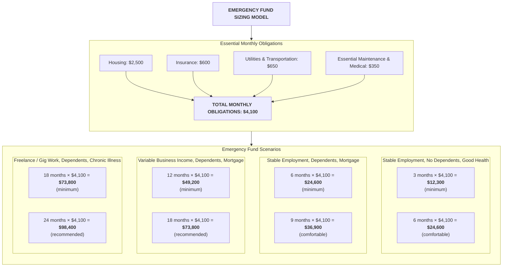

# Lesson 2: Cash Flow Architecture

## 1. First-Principles Intuition & Invariants

Cash flow is the circulatory system of personal wealth. While net worth—the static snapshot of assets minus liabilities—tells you what you own, cash flow tells you whether you can sustain, grow, or destroy that wealth over time. A person with a $2 million net worth and negative monthly cash flow is in structural decline; a person with a $200,000 net worth and positive monthly cash flow is building momentum. This distinction is not merely academic. It determines whether you can weather job loss, market downturns, or unexpected expenses. It shapes whether you accumulate capital for future investments or perpetually chase income to cover obligations. It defines whether you have optionality—the freedom to make choices—or constraint.

The fundamental invariant of cash flow is deceptively simple: inflows minus outflows equals the monthly surplus or deficit. Yet within that arithmetic lies the architecture of financial decision-making. Every dollar that flows into your accounts arrives through one of several income structures: employment compensation, investment returns, business revenue, or passive income streams. Every dollar that flows out does so through one of several expense categories: obligations (housing, insurance, debt service), essential consumption (food, transportation, utilities), discretionary spending (dining, entertainment, subscriptions), and capital allocation (investments, tax payments, charitable giving). The ratio between inflows and outflows, and the composition of each, determines not only whether you break even but whether you build wealth systematically or episodically.

Personal wealth architecture differs fundamentally from corporate finance precisely because personal cash flow lacks the institutional complexity of balance sheet management, working capital cycles, and multi-leg funding strategies. Yet it shares the same underlying principle: cash flow discipline is the prerequisite for all other financial decisions. You cannot invest systematically if you do not know your true surplus. You cannot plan for retirement if you do not understand the seasonal and structural patterns of your spending. You cannot build an emergency fund if you cannot distinguish between discretionary and essential expenses. Most practitioners—even high-income earners—lack this clarity. They operate on intuition, guesswork, and post-hoc expense justification rather than systematic measurement and intentional allocation.

The core invariant that governs effective cash flow architecture is this: **measurement precedes optimization, and optimization precedes growth.** You cannot optimize what you do not measure. You cannot grow sustainably without optimization. This lesson provides the frameworks, data structures, and decision trees to move from intuition to systematic architecture.

## 2. Core Architecture & Mechanics

### Income Structures: Classification and Stability

Income arrives through distinct channels, each with different tax treatment, stability characteristics, and timing patterns. Understanding these distinctions is foundational to cash flow forecasting and financial planning.

**Employment income** is the dominant inflow for most practitioners and consists of salary, bonus, and benefits. Salary is typically stable and predictable, arriving in regular pay periods (biweekly, semi-monthly, or monthly depending on employer convention). This stability is both a strength and a weakness. Strength: you can reliably forecast employment income and build spending plans around it. Weakness: employment income is illiquid (you cannot accelerate it without switching jobs), subject to employer discretion (bonuses are contingent), and vulnerable to job loss or role change. The after-tax reality of employment income is often misunderstood. Gross compensation is not the cash available to you. Payroll taxes (Social Security, Medicare, federal and state income tax withholding), benefits contributions (health insurance premiums, retirement plan deferrals), and other deductions reduce take-home pay to typically 65–75% of gross compensation for middle-to-upper-income earners. This discrepancy compounds the cash flow surprise for practitioners who budget on gross rather than net income.

**Investment income** includes dividends, interest, capital gains, and rental income. This income stream is qualitatively different from employment income in several ways. First, it is not reliably predictable. Dividend yields fluctuate with company profitability and market conditions. Capital gains are entirely discretionary (you choose when to realize them). Rental income depends on tenant occupancy, maintenance requirements, and local market conditions. Second, investment income has asymmetric tax treatment. Qualified dividends and long-term capital gains are taxed at preferential rates (0%, 15%, or 20% depending on income level), while short-term gains and interest income are taxed as ordinary income. Rental income may have substantial deductible expenses (mortgage interest, property tax, maintenance, depreciation) that reduce taxable net income. Understanding these distinctions is essential to forecasting after-tax cash flow and avoiding the common mistake of treating all investment income as equivalent.

**Business and self-employment income** represents revenue minus direct costs of goods sold (COGS). This income is highly variable and entirely dependent on business performance, market conditions, and personal effort. Unlike employment income, which arrives in regular installments, business income often arrives in irregular lumps (customer payments, project completions, seasonal cycles). The tax obligation is also more complex: self-employment tax (15.3% combined Social Security and Medicare), quarterly estimated income tax payments, and deductible business expenses all affect the true cash available. Most entrepreneurs underestimate their true tax liability by conflating revenue with profit and failing to reserve sufficient capital for quarterly tax payments and year-end settlement.

**Passive income streams** (dividend growth portfolios, royalties, affiliate programs, online courses, rental properties, peer-to-peer lending) represent income that flows with minimal ongoing effort once the underlying asset or system is established. These streams are often oversold in popular finance content, but they serve an important function in advanced personal wealth architecture: they provide income that is not dependent on your time or employment status. The challenge is that generating meaningful passive income requires significant upfront capital investment, time investment, or both. A dividend portfolio yielding $1,000 per month requires approximately $600,000–$800,000 in invested capital (depending on yield and market conditions). A rental property generating $1,500 per month in net cash flow typically requires $100,000–$200,000 down payment plus years of property management. These are not shortcuts; they are complementary income structures that mature over time.

The architecture of income stability can be visualized through a matrix that considers both predictability and accessibility:

```text
INCOME STABILITY MATRIX

                          HIGH PREDICTABILITY          LOW PREDICTABILITY
HIGH ACCESSIBILITY        Employment Salary            Bonus, Commission
                          Interest (Fixed Rate)        Dividend Income

LOW ACCESSIBILITY         Rental Income (Net)         Capital Gains
                          (Semi-predictable)          Business Revenue
```

The practitioner's objective is to intentionally diversify across these quadrants while maintaining adequate coverage of essential expenses (housing, food, insurance, debt service) through high-predictability sources. A person whose essential expenses are entirely dependent on bonus income or business revenue is exposed to catastrophic cash flow shock if those sources disappear. Conversely, a person whose essential expenses are covered by stable employment income and whose discretionary spending and capital allocation are funded by investment and business income has built structural resilience into their cash flow architecture.

### Expense Taxonomy: Categories and Behavioral Patterns

Expenses are not monolithic. The structure of spending—not just the total amount—determines whether you can maintain financial discipline, identify savings opportunities, and forecast future obligations accurately. A comprehensive expense taxonomy organizes spending into distinct categories, each with different behavioral characteristics, timing patterns, and optimization levers.

**Essential fixed obligations** include housing (mortgage or rent), insurance (health, auto, home, life), debt service (loan payments), utilities (electricity, water, gas), and transportation (car payment, fuel, or public transit). These expenses are called "fixed" because they do not fluctuate significantly month-to-month and are contractual or unavoidable. They represent your financial bedrock—the minimum cash outflow required to maintain your current lifestyle and financial commitments. For most practitioners, these obligations consume 40–60% of gross income. The first rule of cash flow discipline is ensuring that your income comfortably covers these obligations. If your essential fixed obligations exceed 70% of net income, you have a structural problem: you do not have sufficient margin for savings, unexpected costs, or capital allocation.

**Essential variable expenses** include groceries, transportation fuel, routine medical care, and household maintenance. These expenses are "essential" because you cannot eliminate them without materially degrading your quality of life or facing future consequences (deferred maintenance leads to emergency repairs; skipped medical care leads to acute health problems). They are "variable" because the monthly amount fluctuates based on consumption patterns, seasonal factors, and life circumstances. A person with a long commute has higher fuel costs. A family with young children has higher grocery and medical costs. A homeowner in a harsh climate has higher heating/cooling bills. These expenses typically consume 10–20% of net income for disciplined practitioners and 20–35% for those with less structured spending.

**Discretionary spending** includes dining out, entertainment, subscriptions, apparel, hobbies, travel, and gifts. This category represents the most psychologically fraught aspect of cash flow management because it sits at the intersection of genuine enjoyment, social participation, and financial discipline. The critical distinction is that discretionary spending is *optional* in the accounting sense but often feels *mandatory* in the behavioral sense. People justify discretionary spending through narratives of self-care, stress relief, reward, or social obligation. These narratives are not illegitimate—quality of life matters—but they must be held in tension with financial objectives. The practitioner must make conscious choices about discretionary spending rather than allowing it to consume whatever remains after other expenses are paid. For practitioners building wealth intentionally, discretionary spending typically represents 5–15% of net income, with the remainder channeled to savings and capital allocation.

**Taxes and capital allocation** are often conflated with "spending," but they are qualitatively different. Taxes (income tax, payroll tax, property tax, sales tax, capital gains tax) represent mandatory transfers to governments and are determined by law and income level, not by personal choice. Capital allocation includes retirement contributions (401(k), IRA), investment purchases, debt paydown, and charitable giving. These are discretionary in the narrow sense—you can technically choose not to do them—but they are essential to long-term wealth building and should be treated as non-negotiable commitments rather than residual choices. The interplay between taxes and capital allocation is critical: contributions to traditional retirement accounts (401(k), traditional IRA) reduce taxable income, thereby reducing income tax liability. This tax shield effect means that a $10,000 contribution to a traditional 401(k) for a practitioner in the 24% marginal tax bracket actually reduces after-tax cash flow by only $7,600 rather than $10,000, because income taxes are reduced by $2,400. Understanding this interplay is essential to optimizing after-tax cash flow.

A comprehensive expense taxonomy for a household might look like this:

```mermaid
flowchart TD
    ROOT["💰 Expense Taxonomy & Allocation Model\nNet Income Baseline: ~$7,000/mo"]

    ROOT --> EF
    ROOT --> EV
    ROOT --> DI
    ROOT --> TA

    subgraph EF ["📌 Essential Fixed — $3,750 / 53%"]
        EF1["Mortgage / Rent\n$2,500 · 35% · Contractual"]
        EF2["Insurance (All)\n$600 · 8% · Regulatory/Risk"]
        EF3["Utilities\n$250 · 4% · Usage-based"]
        EF4["Debt Service\n$400 · 6% · Contractual"]
        EF_SUB["Subtotal Fixed\n$3,750 · 53%"]
        EF1 --> EF_SUB
        EF2 --> EF_SUB
        EF3 --> EF_SUB
        EF4 --> EF_SUB
    end

    subgraph EV ["🛒 Essential Variable — $1,450 / 21%"]
        EV1["Groceries\n$700 · 10% · Consumption"]
        EV2["Transportation (Fuel/Transit)\n$400 · 6% · Usage-based"]
        EV3["Medical / Healthcare\n$200 · 3% · Need-based"]
        EV4["Home Maintenance\n$150 · 2% · Preventive"]
        EV_SUB["Subtotal Variable\n$1,450 · 21%"]
        EV1 --> EV_SUB
        EV2 --> EV_SUB
        EV3 --> EV_SUB
        EV4 --> EV_SUB
    end

    subgraph DI ["🎭 Discretionary — $1,050 / 15%"]
        DI1["Dining Out\n$400 · 6% · Behavioral"]
        DI2["Entertainment / Subscriptions\n$200 · 3% · Behavioral"]
        DI3["Apparel\n$150 · 2% · Behavioral"]
        DI4["Travel / Leisure\n$300 · 4% · Behavioral"]
        DI_SUB["Subtotal Discretionary\n$1,050 · 15%"]
        DI1 --> DI_SUB
        DI2 --> DI_SUB
        DI3 --> DI_SUB
        DI4 --> DI_SUB
    end

    subgraph TA ["📈 Taxes & Capital Allocation — $1,600 / 23%"]
        TA1["Income Tax (After-tax Planning)\n$800 · 11% · Legal Obligation"]
        TA2["Retirement Contributions\n$500 · 7% · Wealth-building"]
        TA3["Investment Purchases\n$300 · 4% · Wealth-building"]
        TA_SUB["Subtotal Allocation\n$1,600 · 23%"]
        TA1 --> TA_SUB
        TA2 --> TA_SUB
        TA3 --> TA_SUB
    end

    EF_SUB --> TOTAL
    EV_SUB --> TOTAL
    DI_SUB --> TOTAL
    TA_SUB --> TOTAL

    TOTAL["📊 Total Monthly Outflow\n$7,850 · 112% of Net Income"]
    TOTAL --> DEFICIT["⚠️ Surplus / (Deficit)\n($150) · (2%) — Overspend"]

    style ROOT fill:#1e3a5f,color:#ffffff,stroke:#0d2137
    style EF_SUB fill:#2c5f8a,color:#ffffff,stroke:#1a3f5f
    style EV_SUB fill:#2c7a4b,color:#ffffff,stroke:#1a4f30
    style DI_SUB fill:#7a4f2c,color:#ffffff,stroke:#4f3018
    style TA_SUB fill:#5a2c7a,color:#ffffff,stroke:#3a1a50
    style TOTAL fill:#1e3a5f,color:#ffffff,stroke:#0d2137
    style DEFICIT fill:#8b1a1a,color:#ffffff,stroke:#5f0d0d
    style EF1 fill:#d6e8f7,stroke:#2c5f8a
    style EF2 fill:#d6e8f7,stroke:#2c5f8a
    style EF3 fill:#d6e8f7,stroke:#2c5f8a
    style EF4 fill:#d6e8f7,stroke:#2c5f8a
    style EV1 fill:#d6f0e0,stroke:#2c7a4b
    style EV2 fill:#d6f0e0,stroke:#2c7a4b
    style EV3 fill:#d6f0e0,stroke:#2c7a4b
    style EV4 fill:#d6f0e0,stroke:#2c7a4b
    style DI1 fill:#f7e8d6,stroke:#7a4f2c
    style DI2 fill:#f7e8d6,stroke:#7a4f2c
    style DI3 fill:#f7e8d6,stroke:#7a4f2c
    style DI4 fill:#f7e8d6,stroke:#7a4f2c
    style TA1 fill:#ead6f7,stroke:#5a2c7a
    style TA2 fill:#ead6f7,stroke:#5a2c7a
    style TA3 fill:#ead6f7,stroke:#5a2c7a
```



This example reveals a critical insight: even a household with $7,000 in gross monthly income ($84,000 annualized) that allocates 35% to housing, 8% to insurance, and reasonable amounts to other categories can easily slip into deficit. The practitioner in this scenario has minimal margin for error, no buffer for unexpected expenses, and insufficient capital allocation to build wealth systematically. The architecture is brittle. This is the cash flow reality for a substantial portion of the employed population in developed economies.

### Budgeting Frameworks: From Measurement to Optimization

Budgeting is often presented as a restrictive exercise—deprivation by spreadsheet. This framing is counterproductive. A budget is not a ceiling imposed by external authority; it is a decision framework that translates values into action. When you construct a budget, you are answering the question: given my income and obligations, how do I allocate resources to maximize both current well-being and future optionality? This framing shifts budgeting from denial to intentionality.

The most common budgeting approach is the **percentage-of-income model**, where expense categories are allocated as fixed percentages of gross or net income. The commonly cited "50/30/20 rule" allocates 50% of after-tax income to needs (essential fixed and variable expenses), 30% to wants (discretionary spending), and 20% to savings and debt repayment. This rule is useful as a rough benchmark, but it obscures critical nuance. A person in a high-cost-of-living city may find that housing alone consumes 45% of net income, leaving insufficient margin for the prescribed 20% savings rate. A person with high student loan debt or credit card obligations may need to allocate 40%+ to debt service before considering other categories. The percentage-of-income model is a starting point, not a prescription.

A more mechanically useful approach is the **zero-based budget**, where every dollar of income is assigned to a specific category before the month begins. The practitioner forecasts income, lists all committed expenses and allocations, and ensures that inflows equal outflows plus intended savings/investment. This approach forces explicit choice: if you have $5,000 in monthly net income and you allocate $3,500 to fixed obligations, $800 to essential variable expenses, $500 to capital allocation, you have $200 remaining. That $200 can be allocated to discretionary spending, additional savings, or debt paydown. Nothing is left to chance or vague intention.

The mechanics of zero-based budgeting require actual tooling: a spreadsheet, a dedicated budgeting application, or a financial management platform. The tool matters less than the discipline of execution. Many practitioners use simple spreadsheets (Excel, Google Sheets) that update monthly. Others use dedicated software like YNAB (You Need A Budget), Mint, or their bank's native budgeting tools. The critical requirement is that the budget is *dynamic*—it reflects actual income and spending as the month unfolds and incorporates lessons learned in subsequent months. A budget constructed in January and never revisited is theater, not architecture.

The execution flow for zero-based budgeting operates as follows:

1. **Forecast net income**: Sum all expected inflows (employment income after taxes, investment income, business income) for the upcoming month. Be conservative; use after-tax figures and exclude bonuses or variable income unless you have reliable historical data.

2. **Allocate essential fixed obligations**: List all contractual monthly payments (mortgage/rent, insurance premiums, loan payments, utilities). Sum these to determine the floor of necessary cash outflow.

3. **Allocate essential variable expenses**: Estimate groceries, fuel, medical, and maintenance based on historical spending and current circumstances. Review the prior three months to calibrate these estimates.

4. **Allocate taxes and capital allocation**: Calculate income tax liability based on year-to-date earnings (to account for payroll withholding and quarterly estimated taxes if self-employed). Allocate intended retirement contributions, investment purchases, and debt paydown.

5. **Allocate discretionary spending**: Determine the remaining margin and consciously allocate it to dining, entertainment, travel, and gifts. This allocation reflects intentional choice about quality of life and social participation, not residual spending.

6. **Monitor variance**: Track actual spending throughout the month. At month-end, compare actual to budget and analyze variances. Why did groceries exceed forecast? Why was discretionary spending lower? This analysis informs next month's budget.

7. **Iterate and refine**: After three to six months of zero-based budgeting, patterns emerge. Some categories will be consistently under or over budget. Seasonal effects become visible (higher utilities in winter, higher travel in summer). Use these patterns to construct a more accurate rolling budget.

### Emergency Fund Mechanics: Architecture and Sufficiency

An emergency fund is not savings; it is insurance. It is capital set aside specifically to buffer against unexpected expenses or income disruption without forcing you into debt or liquidating long-term investments. The emergency fund is the foundation of financial stability because without it, any unexpected expense (car repair, medical bill, job loss) creates immediate financial stress and often forces suboptimal decisions (high-interest credit card debt, forced investment liquidation, missed retirement contributions).

The appropriate size of an emergency fund depends on several factors: income stability, expense volatility, family structure, and the availability of alternative credit sources. A practitioner with stable employment income, minimal family obligations, and access to credit lines might maintain an emergency fund equal to three months of essential fixed obligations. A practitioner with variable business income, dependents, and chronic health issues might maintain six to twelve months of total expenses. The conventional wisdom—"six months of expenses"—is a reasonable middle ground for most practitioners but should be customized to individual circumstances.

The mechanics of emergency fund sizing can be calculated as follows:



The emergency fund must be stored in a location that is *accessible* (can be withdrawn within one to three business days) but *separated* from your primary checking account (to reduce the behavioral temptation to spend it on non-emergencies). The optimal vehicle is a high-yield savings account (currently offering 4–5% annual yield as of 2024) at a different bank than your primary checking account, giving you physical and psychological separation. You access the account infrequently enough that you are unlikely to impulsively withdraw from it, but easily enough to address genuine emergencies without selling long-term investments or paying credit card interest.

The most common failure mode in emergency fund management is conflating the emergency fund with a sinking fund. A sinking fund is capital set aside for known future expenses (car maintenance, home repairs, insurance premiums due once annually, vacation). An emergency fund is for true emergencies—unexpected expenses or temporary income loss.

Separating these two categories is critical: sinking funds are predictable, scheduled allocations that should be incorporated into your monthly cash flow planning, while the emergency fund is a true reserve that should only be touched when income is disrupted or an unforeseeable expense occurs. Mixing the two creates a dangerous illusion of preparedness—you may believe you have $25,000 in emergency reserves, but if $10,000 of that is earmarked for a roof replacement you've been planning for months, your actual emergency capacity is only $15,000. The discipline required here is treating the emergency fund as untouchable infrastructure, not as a general-purpose savings account. Once the target threshold is reached, monthly contributions to the emergency fund should cease, and those cash flows should be redirected to debt elimination, investment accounts, or sinking funds for known future obligations. The emergency fund is not designed to grow indefinitely—it is designed to exist at a stable equilibrium that matches your risk profile, providing a financial airbag that allows you to navigate temporary disruptions without structural damage to your long-term financial position.

The behavioral architecture of emergency fund management is as important as the numerical target. Automatic monthly transfers from checking to a high-yield savings account eliminate willpower as a dependency and ensure consistent fund growth during the accumulation phase. After a withdrawal due to genuine emergency, the priority hierarchy must temporarily shift: replenishing the emergency fund takes precedence over discretionary spending, accelerated debt repayment, or new investment contributions until the fund is restored to its target level. This ensures that you are never operating without a safety margin for an extended period. The psychological benefit of a fully funded emergency reserve cannot be overstated—it transforms financial decision-making from reactive scrambling to proactive optimization, because you are no longer forced to accept suboptimal outcomes (high-interest debt, liquidating investments at a loss, skipping necessary medical care) when temporary cash flow disruptions occur.

## Summary & Verification Matrix

| **Invariant / Mechanism** | **Governing Principle** | **Diagnostic Criteria** | **Failure Mode** |
|---------------------------|-------------------------|-------------------------|------------------|
| **Emergency Fund Target** | 3–24 months of non-discretionary expenses, scaled to income volatility and dependent obligations | Fund size ≥ (monthly obligations × stability multiplier); separate account with < 3-day access | Fund conflated with sinking funds; stored in illiquid investments; undersized relative to risk profile |
| **Cash Flow Equation** | Net Cash Flow = Income - (Fixed + Variable + Discretionary) | Positive net flow sustained >3 consecutive months; surplus allocated to priority hierarchy | Chronic negative flow; discretionary spending exceeds available surplus; no systematic surplus allocation |
| **Expense Classification** | Fixed: immutable short-term; Variable: usage-dependent; Discretionary: eliminable without consequence | Each expense categorized into exactly one bucket; fixed + variable < 70% of after-tax income | Variable expenses misclassified as fixed; discretionary spending treated as non-negotiable; lifestyle inflation untracked |
| **Savings Rate Benchmark** | Minimum 15–20% of gross income allocated to non-discretionary savings/investment | (Emergency fund contributions + retirement + debt principal) / gross income ≥ 0.15 | Savings treated as residual after spending; periodic windfalls fully consumed; net worth stagnant despite income growth |
| **Fund Replenishment Protocol** | After emergency withdrawal, fund restoration takes priority over discretionary and accelerated debt payoff | Time to restore fund to target ≤ 6 months; automated replenishment transfers active during restoration | Extended operation below target threshold; new discretionary spending initiated before fund restoration complete |
| **Account Separation Architecture** | Emergency fund physically isolated from checking; high-yield vehicle; intentional friction to access | Fund held at different institution than primary checking; yields ≥ 4%; requires 1–3 day transfer to access | Fund in checking account; stored in volatile investments; no yield optimization; impulsive non-emergency withdrawals common |
