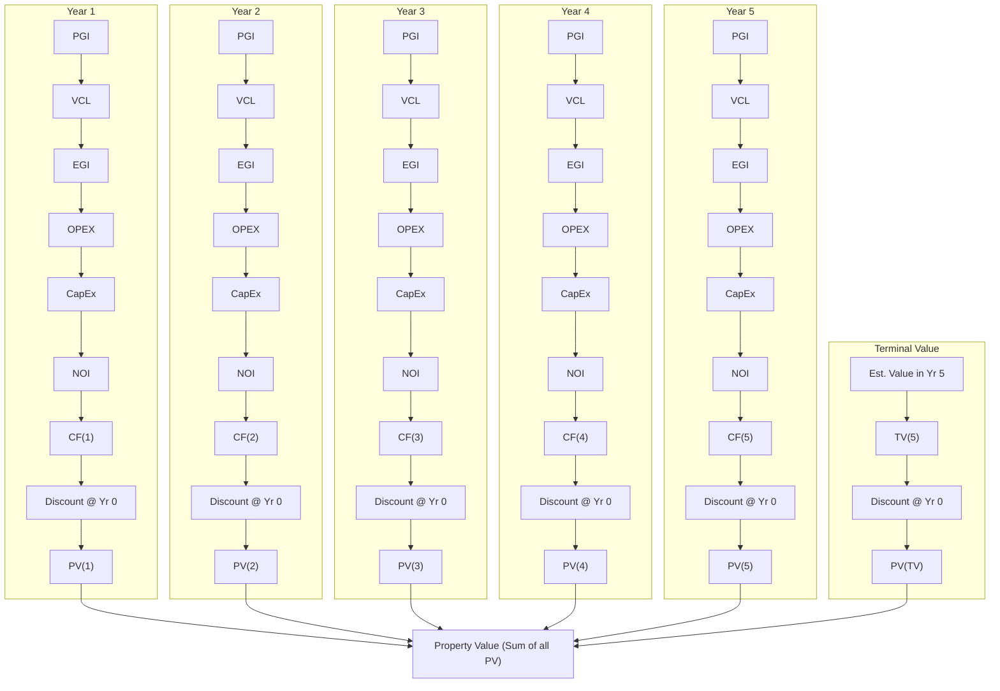

# Lesson 2: Valuation Methods, Cash Flow Analysis, Return Metrics

## 1. First-Principles Intuition & Invariants

Real estate valuation exists at the intersection of three fundamental forces: the physical asset (the building itself), the income it generates, and the capital market's willingness to pay for that income stream. Unlike public equities, where price discovery happens through continuous trading, real estate requires disciplined analysis because transactions are infrequent, heterogeneous, and illiquid. A personal wealth practitioner must internalize that valuation is not academic exercise—it is the bridge between what you pay today and what you extract over time.

The core intuition rests on a deceptively simple principle: **a property is worth the present value of all cash flows it will generate, adjusted for risk and opportunity cost**. This statement contains three loaded concepts that warrant unpacking. First, "cash flows" means actual dollars flowing to the property owner after all expenses are paid—not accounting profit, not appreciation, but real money. Second, "present value" acknowledges that a dollar received five years from now is worth less than a dollar received today, requiring a discount rate that reflects both time value and specific real estate risk. Third, "adjusted for risk" means the discount rate must account for leverage, tenant credit quality, market cyclicality, and the specific vintage and location of the asset.

Most beginning practitioners make a fatal error: they conflate price with value. A property may trade at $2 million because of recent comparable sales, but that price may or may not reflect rational cash flow economics. Market prices can overshoot or undershoot intrinsic value. Your job as a personal wealth manager is to calculate intrinsic value independently, then decide whether market prices offer margin of safety—a principle Warren Buffett applies to stocks but is equally valid in real estate.

The personal wealth investor faces a specific constraint that institutional operators do not: scale. A pension fund buying a 500-unit apartment complex can spread acquisition and management costs across dozens of transactions annually. A personal wealth investor typically holds five to twenty properties. This scale constraint means two things. First, every property must clear a sufficiently high return threshold to justify the effort and illiquidity. Second, transaction costs—broker commissions, closing costs, inspection and appraisal fees—represent a larger percentage of deal economics and must be factored into return expectations from day one.

Real estate valuation methods split into three major schools, each with distinct mechanics and use cases. The **comparable sales approach** (also called "market approach") anchors valuation to recent transaction prices for similar properties, adjusted for differences in size, condition, and location. This method is rapid and market-grounded but becomes unreliable in illiquid submarkets or when comparable transactions are sparse. The **income capitalization approach** (also called "direct capitalization") divides net operating income by a market-derived capitalization rate to estimate property value. This method is elegant and theoretically sound but requires accurate market cap rate data and assumes stable, perpetual income—assumptions that often break down. The **discounted cash flow (DCF) method** explicitly models year-by-year income, expense, and value dynamics, then discounts back to present value using a required return rate. DCF is the most theoretically rigorous but also the most assumption-heavy and sensitive to small changes in input parameters.

A practitioner must master all three because they serve different purposes. Comparable sales ground you in market reality. Cap rates give you a quick sanity check on whether a deal is competitive. DCF forces you to think hard about specific cash flow dynamics and risk. The real skill is knowing when each method applies and how to reconcile contradictions when they arise.

The invariant that ties these methods together is the **income approach**: real estate value is fundamentally derived from the income it produces. Appreciation, while real and sometimes substantial, is secondary. A property that generates negative cash flow decade after decade but appreciates 3% annually may look good on a spreadsheet until a recession hits and liquidity evaporates. Conversely, a property generating 8% annual cash yield will support itself through downturns and compound wealth regardless of market cycles. This tension between current income and future appreciation is the central strategic choice in personal real estate investing.

---

## 2. Core Architecture & Mechanics

### The Comparable Sales Approach: Market Signal Extraction

The comparable sales method begins with a simple premise: if similar properties recently sold for $X per square foot or at $Y price per unit, and your subject property is broadly similar, then a reasonable valuation range is close to that market clearing price, adjusted for meaningful differences.

The mechanical process unfolds as follows. First, identify a set of comparable transactions from the past six to twelve months in the same submarket. "Submarket" is crucial—a duplex in downtown Portland trades at a fundamentally different multiple than an identical duplex in rural Oregon, ninety miles away. Real estate is hyperlocal. For residential properties, comparables typically include three to five recent arm's-length sales. For commercial properties (apartments, retail, industrial), you may find only one or two truly comparable recent trades.

Second, extract the **price per unit** metric. For single-family homes or small multifamily, this is often price per square foot of living area (excluding garage and some non-rentable space). For apartments, it is price per unit or sometimes price per rentable square foot. For office or retail, price per rentable square foot is standard. For land, price per acre or per buildable square foot.

Third, **adjust for material differences**. If your subject property is a 2,500-square-foot ranch built in 2010, and comparable A is an identical 2,500-square-foot ranch built in 2010 that sold three months ago for $450,000, the adjustment is zero and your subject is worth approximately $450,000. But if comparable A sold in a neighborhood one mile away with different school districts, adjust downward by 5–8%. If comparable B is 20% larger, adjust its price downward by 15–20% (larger properties typically sell at a per-unit discount). If comparable C has been recently renovated and your subject needs a new roof, adjust C downward by the roof replacement cost plus a markup for inconvenience.

The adjustment table below shows how a seasoned appraiser structures this analysis:

| Comparable Property | Sale Price | Price/SF | Size Adjustment | Location Adjustment | Condition Adjustment | Market Time Adjustment | **Adjusted Value** |
|---|---|---|---|---|---|---|---|
| Comp A (3 mo ago) | $450,000 | $180/sf | $0 (equal) | +2% (better location) | −3% (older roof) | +1% (hot market) | $468,630 |
| Comp B (6 mo ago) | $520,000 | $208/sf | −15% (25% larger, price/sf discount) | −5% (worse schools) | $0 (comparable condition) | +3% (market appreciation) | $436,788 |
| Comp C (2 mo ago) | $380,000 | $152/sf | +8% (smaller, price/sf premium) | +3% (excellent area) | −8% (needs updates) | +0.5% (recent) | $409,698 |

The median adjusted value is approximately $437,000. A professional appraiser would reconcile these values and select a final estimate (often the median or a weighted average favoring the most recent, most similar comp). A personal wealth investor would target a purchase price well below this market value if seeking margin of safety—ideally 10–20% below—to account for transaction costs, unexpected repairs, and holding period uncertainty.

The **edge case that breaks comparable sales** arises in illiquid markets. If comparable transactions are two to three years old, or if the submarket has undergone structural change (local employer left, new transit hub opened), the comp-based value becomes increasingly unreliable. In such cases, pivot to income capitalization.

### Income Capitalization: The Direct Capitalization Model

Income capitalization rests on a single formula that, once understood, unlocks the entire market-based valuation approach:

**Property Value = Net Operating Income (NOI) ÷ Cap Rate**

This formula is deceptively simple and requires unpacking each component with surgical precision.

**Net Operating Income (NOI)** is the annual cash generated by the property after paying all operating expenses but before debt service and income taxes. It is calculated as:

```
Potential Gross Rental Income (PGRI)
− Vacancy & Collection Loss (VCL)
= Effective Gross Income (EGI)
− Operating Expenses (OPEX)
= Net Operating Income (NOI)
```

Let us build this with a concrete example. Suppose you own a 12-unit apartment building in which each unit rents for $1,200 per month. Your annual potential gross rental income is 12 units × $1,200/month × 12 months = $172,800. However, real-world properties experience vacancy. Market analysis suggests this building experiences 5% vacancy and 2% collection loss (tenants who stop paying). Total loss is 7%, so vacancy and collection loss = $172,800 × 0.07 = $12,096. This yields effective gross income of $172,800 − $12,096 = $160,704.

Operating expenses include property taxes, insurance, maintenance and repairs, utilities, property management fees, HOA dues (if applicable), and reserves for capital expenditures. Do **not** include debt service (mortgage payments)—NOI is computed before financing. For a typical apartment building, operating expenses run 30–40% of EGI. In this example, assume 35%: OPEX = $160,704 × 0.35 = $56,246. Therefore, NOI = $160,704 − $56,246 = $104,458.

The **cap rate** is the market-derived discount rate that buyers apply to property NOI. It reflects the risk and return expectations for that asset class and market. Cap rates are extracted from recent market transactions using the formula:

**Cap Rate = NOI ÷ Purchase Price**

If a comparable apartment building recently sold for $1,350,000 with documented NOI of $108,000, the implied cap rate is $108,000 ÷ $1,350,000 = 0.08, or **8%**. This is a critical market signal: the market is willing to pay $1 in price for every $0.08 in annual NOI. Equivalently, the buyer expects an 8% cash-on-cash return assuming no leverage and immediate stabilization.

To value your 12-unit property using direct capitalization, apply the prevailing market cap rate. If market analysis shows apartment buildings in your submarket trade at 6.5% cap rates (meaning buyers will pay approximately $15.38 for every $1 of NOI), then your property value is:

**Value = $104,458 ÷ 0.065 = $1,607,200**

The logic is economically sound: your building generates $104,458 in annual NOI, and the market values apartment buildings at a 6.5% cap rate, so it should be worth roughly $1.6 million.

**The cap rate paradox** deserves emphasis. When cap rates fall (say, from 6.5% to 5.5%), property values rise. When cap rates rise, property values fall. This inverse relationship confuses many practitioners. The economic interpretation is clear: if investment demand increases (more buyers competing for limited supply of properties), cap rates compress downward as buyers accept lower yields. This often happens during periods of low interest rates and abundant capital. The inverse is true during recessions when capital dries up and buyers demand higher yields to compensate for increased risk.

**Limitations of direct capitalization** are significant. The method assumes perpetual, stable NOI extending indefinitely. In reality, properties experience cycles. A 10-year-old roof will need replacement within five to ten years, causing a spike in capital expenditures. Tenant bases turn over, creating vacancy spikes. The model also assumes the subject property is already at "stabilized" occupancy and expense levels—a problematic assumption for newly acquired, under-managed, or repositioning properties.

### Discounted Cash Flow (DCF): Multi-Year Projection and Residual Value

The DCF method eliminates the "perpetual income" assumption by explicitly modeling cash flows year by year, incorporating capital expenditures, rent growth, expense inflation, and changing occupancy. It is the most theoretically rigorous method but requires more assumptions and is sensitive to input errors.

The DCF framework unfolds across five explicit forecast years, plus a terminal value calculation representing all cash flows beyond year five. Here is the structural model:



Let us build a complete DCF model for a residential rental property. Assume initial purchase price of $500,000, financed with a $400,000 first mortgage at 5% interest over 30 years, and $100,000 in equity. The property generates $4,500 monthly rent ($54,000 annually), with 5% vacancy, 2% collection loss, and 35% operating expense ratio. We project 2% annual rent growth and 2.5% expense inflation. Required equity return (discount rate) is 12%. Holding period is five years, after which the property is sold.

**Year 1 Detailed Projection:**

Potential Gross Rental Income: $54,000 (12 units × $4,500/month)
Vacancy & Collection Loss (7%): −$3,780
Effective Gross Income: $50,220
Operating Expenses (35% of EGI): −$17,577
NOI (before capex): $32,643

Capital Expenditures: Now assume an immediate $8,000 roof inspection and repairs. This is common in acquisition phase.
Property-Level Net Operating Income: $32,643 − $8,000 = $24,643

Debt Service on $400,000 mortgage at 5% over 30 years:
Annual debt service = $400,000 × [0.05(1.05)^30 / ((1.05)^30 − 1)] ≈ $24,079
(Use a mortgage calculator or amortization table for precision.)

**Equity Cash Flow (after debt service):** $24,643 − $24,079 = $565

This is razor-thin in year one due to high capex burden and near-breakeven debt service.

**Year 2 Projection:**

Apply rent growth: PGI = $54,000 × 1.02 = $55,080
VCL (7%): −$3,856
EGI: $51,224
Apply expense inflation: OPEX = $17,577 × 1.025 = $18,018
NOI (before capex): $51,224 − $18,018 = $33,206

Assume normalized capex (capital reserves) of 5% of EGI: $51,224 × 0.05 = $2,561
Property-Level NOI: $33,206 − $2,561 = $30,645

Debt Service (year 2, slightly lower principal, slightly higher interest on smaller balance): approximately $24,079 (fixed payment, mortgage amortization means principal portion rises, interest portion falls, but total payment is constant).

Equity Cash Flow (Yr 2): $30,645 − $24,079 = $6,566

**Years 3–5 (Abbreviated Presentation):**

Applying the same logic, the equity cash flows are:

- Year 3: $7,200 (rent/expense dynamics favor equity as debt service becomes more favorable)
- Year 4: $8,100
- Year 5: $8,800

**Terminal Value Calculation (Exit in Year 5):**

Assume the property sells at the end of year five. Use direct capitalization to estimate terminal value. Assume a 6.5% cap rate at exit (may differ from current market rates). Year 5 NOI (normalized, excluding capex) ≈ $35,500 (projecting forward from year 2 trajectory). Terminal property value ≈ $35,500 ÷ 0.065 ≈ $546,154.

Remaining mortgage balance at end of year 5: The loan started at $400,000. After five years of payments, the remaining principal balance is approximately $368,000 (calculated using an amortization schedule). Proceeds from sale (equity cash flow) = $546,154 − $368,000 − selling costs (assume 6% transaction fee = $32,769) = $145,385.

This is the terminal year cash flow returned to the equity investor.

**Present Value Calculation:**

Discount all cash flows using a 12% required equity return:

PV(Year 1) = $565 ÷ (1.12)^1 = $504
PV(Year 2) = $6,566 ÷ (1.12)^2 = $5,233
PV(Year 3) = $7,200 ÷ (1.12)^3 = $5,127
PV(Year 4) = $8,100 ÷ (1.12)^4 = $5,146
PV(Year 5) = $8,800 ÷ (1.12)^5 = $4,991
PV(Terminal Value) = $145,385 ÷ (1.12)^5 = $82,526

**Total Present Value to Equity = $504 + $5,233 + $5,127 + $5,146 + $4,991 + $82,526 = $103,527**

Interpretation: Your $100,000 equity investment, when discounted at 12% required return, is worth $103,527 in present value terms. This represents a marginal positive arbitrage. A rigorous investor would expect at least 15–20% margin of safety, which would imply selling at a $80,000–$85,000 discount to this calculated value.

**Why DCF Requires Discipline:** The model is deeply sensitive to assumptions. If rent growth is 3% instead of 2%, or if exit cap rate is 7% instead of 6.5%, terminal value changes by 10–15%, dramatically altering the investment decision. Professional practitioners build sensitivity tables exploring how present value changes across ranges of key inputs—particularly rent growth, expense growth, terminal cap rate, and discount rate.

---

## 3. High-Performance Optimization & Failure Modes

### Return Metrics: Beyond Cash Flow

Personal wealth practitioners must master a suite of return metrics, each illuminating a different facet of investment performance. No single metric is complete; they must be triangulated.

**Cash-on-Cash Return** measures the ratio of annual equity cash flow to initial equity invested. In our DCF example, year one cash flow was $565 on a $100,000 equity investment, yielding a cash-on-cash return of 0.565%, an alarmingly low figure. Year two: $6,566 ÷ $100,000 = 6.57%. This metric is intuitive but volatile in early years due to capital expenditures and mortgage amortization dynamics. It is best evaluated as a multi-year average.

**Internal Rate of Return (IRR)** is the discount rate at which the present value of all future cash flows equals the initial investment. In the DCF model above, the IRR is the discount rate that makes this equation true:

```
$100,000 = $565 ÷ (1+IRR)^1 + $6,566 ÷ (1+IRR)^2 + ... + $145,385 ÷ (1+IRR)^5
```

Solving iteratively (or using Excel's IRR function), the IRR is approximately **10.2%**. This represents the blended annual return over the five-year hold period, accounting for both interim cash flows and terminal value appreciation. IRR is powerful because it bridges cash yield and price appreciation into a single return figure. However, IRR is sensitive to timing: if large cash flows arrive in later years, IRR becomes more dependent on exit assumptions.

**Equity Multiple (Money Multiple)** represents the ratio of total cash returned to initial equity invested. If you invest $100,000 and receive $15,000 in annual cash flows over five years plus $145,385 at exit, total cash returned is $15,000 × 5 = $75,000 + $145,385 = $220,385. Equity multiple = $220,385 ÷ $100,000 = 2.20x. This metric is simple and aids fundraising communications ("investors will see 2.2x their money over five years"), but it obscures the time value of money that IRR captures.

**Capitalization Rate (Cap Rate)** is arguably the most market-critical metric. We discussed it above in the context of direct capitalization, but it deserves emphasis as an optimization target. In a low cap rate environment (say, 5%), properties trade at high absolute prices relative to current income, implying either aggressive rent growth expectations or acceptance of low current yields in exchange for stability. A personal wealth investor with a long holding period might accept 5% cap rate properties if tenant quality is exceptional and rent growth is projected at 3%+ annually. Conversely, in high cap rate environments (8%+), acquired properties are cheaper on an income basis and offer higher current cash yield, but often signal market distress or higher risk (see the 2008 real estate crash, when many properties yielded 10%+ cap rates in distressed markets).

**The Loan-to-Value (LTV) Ratio and its Performance Implications:**

Leverage is a double-edged sword in real estate. Borrowing at 5% to acquire property yielding 8% cap rate creates a 3% "positive carry." But leverage amplifies equity returns in rising markets and amplifies losses in falling markets.

Equity return = (Property Return − Loan Cost) ÷ Equity %

Suppose a property yields 8% NOI return on a $1M purchase price (NOI = $80,000). If financed 75% LTV with a $750,000 loan at 5% cost ($37,500 annual interest, ignoring principal amortization for simplicity), the equation becomes:

Levered Equity Return = ($80,000 − $37,500) ÷ $250,000 = 17%

Without leverage, the return would be 8%. Leverage transformed an 8% return into a 17% equity return. This is accretive as long as property yield exceeds loan cost. The opposite happens in downturns: if property NOI falls to $60,000 (due to recession-driven vacancy and rent pressure), levered equity return becomes ($60,000 − $37,500) ÷ $250,000 = 9%, a decline of 47% in equity return despite only a 25% decline in property NOI.

Professional personal wealth practitioners typically target 60–75% LTV on stabilized income-producing properties, reserving 25–40% equity. This balance maximizes returns in normal scenarios while maintaining sufficient equity cushion for downturns, capex surprises, and refinancing risk.

### Failure Modes: Where Valuation Models Break

**Over-Reliance on Historical Cap Rates:**

A common pitfall is extracting cap rates from transactions that occurred in fundamentally different market conditions. If comparable sales occurred during a 2021 peak when capital was abundant and rates were near zero, the resulting 4.5% cap rate is not a reliable basis for 2024 valuation if rates have risen and capital has tightened. Market cap rates can shift 100–200 basis points in two to three years. Always time-stamp your cap rate data and explicitly account for market drift.

**Underestimating Vacancy and Expense Inflation:**

Personal wealth investors, particularly first-time buyers, chronically underestimate vacancy rates and operating expense growth. The temptation to model a property at its peak occupancy (97–98%) and current expense levels (ignoring that property taxes and insurance have risen 5%+ annually for a decade) leads to overstated NOI and undervalued risk. Build models assuming normalized market vacancy (5–7% for multifamily, 8–10% for commercial in downturns) and apply long-term inflation rates (2–3% annually for expenses) rather than assuming stasis.

**Ignoring Capex Volatility:**

The DCF model assumes predictable 5% annual reserves for capital expenditures. Reality is lumpy. A property purchased in year of roof failure, HVAC replacement, and electrical panel upgrade might incur $35,000 in year one capex, then $3,000 annually thereafter. Stress-test models by including a major capex event in years three to five and verify that equity still achieves target returns.

**Terminal Value Cliff Risk:**

DCF models are extremely sensitive to terminal (exit) assumptions. A 50-basis-point change in terminal cap rate can swing terminal value by 5–8%, dramatically impacting overall IRR.

A robust valuation discipline requires treating each model as a *stress test*, not a prediction. The most defensible underwriting practice is to build three scenarios—base, downside, and upside—where the downside case assumes compressed exit cap rates (+50–100 bps), extended lease-up timelines (12–18 months vs. 6), and simultaneous adverse expense shocks (insurance +20%, property tax reassessment, deferred capex surfacing). If the downside scenario still produces acceptable levered returns (12–15% IRR for value-add, 8–10% for core), the investment has genuine margin of safety. Conversely, if base-case assumptions are required to hit minimum return thresholds, the deal has no buffer against reality's inevitable deviations. The cardinal rule: *models that require perfection to work will fail in practice*. Disciplined investors anchor on conservative NOI, apply market-appropriate cap rates refreshed within 90 days, and never let terminal value assumptions dictate whether a deal pencils. The cash flows in years one through five must justify the investment on their own; terminal value is optionality, not necessity.

Beyond individual deal analysis, portfolio-level return attribution reveals where value actually originates. Decompose realized IRR into its components: NOI growth (operational alpha), cap rate compression (market beta), and leverage amplification (financial engineering). Institutional investors who consistently generate 18–20% IRRs typically derive 6–8% from operational improvements, 3–5% from market appreciation, and 5–7% from prudent leverage—not from heroic terminal cap rate assumptions. Personal wealth investors should track the same decomposition across their portfolio to diagnose whether returns stem from sustainable operational skill or from riding a market wave that will eventually reverse. The investors who survive full market cycles are those who can generate mid-teens unlevered returns through operations alone, treating market tailwinds and financing gains as margin, not foundation.

## Summary & Verification Matrix

| **Invariant / Mechanism** | **Governing Equation / Rule** | **Diagnostic Criterion** | **Failure Mode** |
|---------------------------|-------------------------------|-------------------------|------------------|
| **Cap Rate Primacy** | Cap Rate = NOI / Value; inverse relationship to value | Stabilized NOI compressed by market cap rate produces defensible valuation ceiling | Using stale comps (12+ months old) or peak-market cap rates in tightening cycle yields 15–25% overvaluation |
| **DCF Terminal Sensitivity** | 50-bps terminal cap rate shift = 5–8% terminal value swing; IRR moves 200–400 bps | Stress terminal cap rate ±100 bps; if downside still meets hurdle, model is robust | Over-reliance on aggressive terminal assumptions (exit cap < entry cap in rising rate environment) manufactures false returns |
| **Expense & Vacancy Realism** | Normalize vacancy to 5–10% (asset-dependent); inflate expenses 2–3% annually | Pro forma expenses match or exceed market comps; vacancy assumption reflects 3-year average, not peak occupancy | Underwriting 2–3% vacancy and static expenses overstates NOI 8–15%, masking true cash flow volatility |
| **Capex Lumpiness** | Reserve 5–8% of EGI; model discrete major capex events (roof, HVAC, systems) in years 3–5 | Cash flow remains positive through $30K–$50K capex shock; equity IRR > hurdle even with lumpy spend | Smooth-line capex reserves ignore roof/HVAC replacement clustering, causing liquidity crises and forced capital calls |
| **Return Decomposition** | Realized IRR = Operational NOI Growth + Market Cap Rate Change + Leverage Effect | Track each component; operational alpha should deliver 6–8% unlevered; market beta and leverage are amplifiers, not foundations | Attributing 12%+ IRR entirely to market appreciation or cap rate compression = unsustainable strategy that fails in downturns |
| **Downside Scenario Discipline** | Build base/downside/upside; downside = +75 bps exit cap, +18 months stabilization, +20% expense shock | Downside case still produces acceptable levered returns (≥12% IRR value-add, ≥8% core) | Deal only works in base case = zero margin of safety; any deviation from perfection causes equity impairment or loss |
