# Lesson 3: Capital Taxation Framework

## 1. First-Principles Intuition & Invariants

The United States federal tax code treats capital gains—profits derived from the appreciation of property held for investment—as a distinct category of income subject to preferential rates compared to ordinary wage and salary compensation. This bifurcation traces its origins to the Revenue Act of 1921, when Congress sought to encourage long-term capital formation by creating a lower rate structure for gains held beyond a minimum threshold period. The fundamental economic intuition underpinning preferential capital gains treatment rests on three pillars: mitigation of lock-in effects that would otherwise discourage portfolio rebalancing, compensation for inflation's erosion of purchasing power over multi-year holding periods, and alignment of tax incentives with productive capital allocation rather than speculative short-term trading.

At the heart of the capital taxation framework lies the realization principle: appreciation in asset value generates no tax liability until the taxpayer executes a disposition event that crystallizes the gain into cash or equivalent consideration. This realization requirement creates profound asymmetries in wealth accumulation strategies. An investor holding appreciated stock for decades defers taxation on paper gains indefinitely, compounding returns on pre-tax principal while a wage earner pays marginal rates on each paycheck. The power of this deferral mechanism compounds exponentially over time horizons measured in decades rather than years, transforming the nominal rate differential between ordinary income and long-term capital gains into a structural advantage that dwarfs the statutory percentage point spread.

The Internal Revenue Code establishes a binary holding period rule that governs rate classification: assets held for one year or less generate short-term capital gains taxed at ordinary income rates, while assets held for more than one year produce long-term capital gains eligible for reduced rates. The precise temporal boundary operates on a day-count basis, meaning an asset purchased on March 15th of one year must be held until at least March 16th of the following year to qualify for long-term treatment. This seemingly mechanical rule creates sharp discontinuities in after-tax returns around the twelve-month threshold, particularly for volatile securities where a few days' delay in selling can swing hundreds of basis points in effective tax rate.

The qualified dividend regime, introduced through the Jobs and Growth Tax Relief Reconciliation Act of 2003 and made permanent by subsequent legislation, extends long-term capital gains rates to certain corporate dividend distributions. This policy intervention eliminated the historic double taxation of corporate earnings—once at the entity level through corporate income tax and again at the shareholder level through ordinary income rates on dividends—by granting preferential treatment to dividends paid by domestic corporations and qualified foreign entities. The holding period requirement for qualified dividend status imposes a more nuanced test than the straightforward capital gains threshold: shareholders must hold the underlying stock for more than 60 days during the 121-day period beginning 60 days before the ex-dividend date. This anti-abuse rule prevents dividend capture strategies where traders purchase shares immediately before dividend payment, collect the distribution, and sell the next day while claiming preferential rates.

Basis calculation—the determination of cost basis used to compute realized gains or losses—represents the most technically intricate dimension of capital taxation. The tax code provides multiple methods for calculating basis depending on asset type, acquisition mechanism, and taxpayer election. For securities purchased in ordinary market transactions, the default basis equals the total purchase price including brokerage commissions and transfer fees. This straightforward computation grows complex when taxpayers acquire identical securities over multiple transactions at varying prices, triggering basis identification rules that determine which lot's cost basis applies when selling a subset of holdings. The specific identification method allows taxpayers to designate which shares they are selling, enabling surgical precision in harvesting high-basis lots to minimize current-year gains or low-basis lots to accelerate losses. The average cost method, permitted only for mutual funds and dividend reinvestment plans, calculates a blended cost per share across all purchases and adjusts this figure continuously as new shares arrive.

Inherited assets receive a step-up in basis to fair market value as of the decedent's date of death, effectively erasing all unrealized gains accrued during the decedent's lifetime. This basis reset—codified in Internal Revenue Code Section 1014—represents the most powerful wealth transfer mechanism in the federal tax system, allowing multi-generational dynasties to compound capital appreciation across decades while resetting the tax meter to zero at each generational transition. The step-up rule creates powerful incentives for elderly investors to hold appreciated positions until death rather than realizing gains and paying tax during their lifetimes, even when portfolio rebalancing or risk management would otherwise dictate selling. The magnitude of this benefit scales with holding period duration and asset appreciation: a stock purchased for $10,000 in 1980 and worth $5,000,000 at the owner's death in 2025 passes to heirs with a stepped-up basis of $5,000,000, permanently exempting $4,990,000 of gain from federal capital gains taxation.

Gifted assets present the mirror image scenario, with the donee receiving carryover basis equal to the donor's adjusted cost basis at the time of transfer. This carryover rule preserves the unrealized gain embedded in the asset, ensuring that eventual taxation occurs when the recipient sells rather than when the gift transfers. The gift tax system operates independently from income taxation, with donors entitled to annual exclusion amounts ($18,000 per recipient in 2024, adjusted for inflation) and lifetime unified credit amounts ($13.61 million in 2024) before triggering gift tax liability. Sophisticated wealth transfer strategies exploit the interaction between gift tax exemptions and carryover basis rules by gifting appreciated assets whose future appreciation will occur in the recipient's lower tax bracket while preserving the donor's lifetime exemption for transfers of higher-basis assets.

## 2. Core Architecture & Mechanics

The realization event taxonomy defines the complete universe of transactions that crystallize latent gains into taxable income. The most common realization event—an arm's length sale of securities through a brokerage account—triggers immediate recognition of gain or loss equal to the difference between amount realized (sale proceeds net of commissions) and adjusted basis (original cost basis adjusted for stock splits, return of capital distributions, and previous loss disallowances). The timing of recognition follows trade date rather than settlement date for tax purposes, meaning the transaction date when the sale order executes determines the tax year of inclusion regardless of when cash settlement occurs T+2 days later.

Exchanges of property, despite involving no cash consideration, generally constitute realization events under the tax code's broad definition of disposition. A taxpayer who trades 100 shares of Stock A worth $10,000 for 100 shares of Stock B worth $10,000 has engaged in a taxable exchange triggering recognition of any gain or loss embedded in the Stock A position. The basis in the newly acquired Stock B equals its fair market value at the exchange date, resetting the measurement baseline for future gain or loss calculation. This general rule admits several statutory exceptions, most notably the Section 1031 like-kind exchange deferral for qualifying real property swaps and the Section 1036 stock-for-stock exchange in corporate reorganizations meeting specific requirements.

Corporate actions—mergers, acquisitions, spin-offs, stock dividends, and rights offerings—create a labyrinth of basis allocation and holding period tacking rules. A taxable merger where shareholders receive cash for their stock constitutes a full realization event, triggering immediate gain or loss recognition based on the difference between cash received and pre-merger basis. A tax-free reorganization meeting the requirements of Internal Revenue Code Section 368 allows shareholders to defer recognition by treating the exchange as a substitution of the acquiring company's stock for the target company's stock, with carryover basis and tacked holding periods preserving the tax attributes of the original investment. Stock splits and stock dividends on common stock do not trigger recognition events but require mechanical reallocation of aggregate basis across the expanded share count, with each post-split share carrying a proportionally reduced per-share basis.

The wash sale rule—codified in Section 1091—operates as an anti-abuse mechanism preventing taxpayers from harvesting artificial losses while maintaining economic exposure to the same investment. When a taxpayer sells securities at a loss and purchases substantially identical securities within the 61-day window spanning 30 days before through 30 days after the sale date, the realized loss becomes disallowed for current-year deduction purposes. The disallowed loss does not vanish but instead adds to the basis of the replacement shares, effectively deferring the loss recognition until final disposition of the position. The substantially identical standard applies strictly to fungible securities: selling 100 shares of Apple common stock and repurchasing 100 shares of Apple common stock triggers the wash sale rule, while selling Apple stock and purchasing Apple call options or a technology sector ETF generally avoids the rule due to sufficient economic differentiation.

The Internal Revenue Service provides taxpayers with four permitted methods for identifying which shares they are selling when disposing of a partial position in securities acquired over multiple purchase dates. The specific identification method grants maximum control by allowing the taxpayer to designate the precise lot being sold, provided they issue contemporaneous instructions to their broker and receive written confirmation of the designated shares. The first-in-first-out (FIFO) method, applied as the default when no election is made, treats the earliest purchased shares as sold first, often resulting in higher gains for positions held in rising markets. The average cost method, available exclusively for mutual fund shares and dividend reinvestment plan positions, calculates a running weighted average cost per share that adjusts with each new purchase, simplifying record-keeping at the cost of reduced optimization flexibility. The highest-cost method, rarely elected due to its tendency to maximize current-year gains, identifies the shares with the highest per-unit basis as sold first.

The qualified dividend holding period test imposes temporal requirements designed to ensure shareholders bear meaningful economic risk rather than executing mechanical dividend capture trades. For common stock dividends to qualify for preferential rates, the taxpayer must hold the underlying shares for more than 60 days during the 121-day period beginning 60 days before the ex-dividend date. For preferred stock dividends, the threshold extends to more than 90 days during the 181-day period beginning 90 days before the ex-dividend date, reflecting the lower volatility profile and reduced risk of preferred securities. The holding period test counts only days when the taxpayer held unhedged positions, meaning days when the taxpayer eliminated market risk through offsetting short sales, put options, or other derivative positions do not count toward the minimum threshold.

The mechanics of basis adjustment for corporate distributions and non-dividend distributions illustrate the tax code's insistence on tracking economic substance rather than transactional form. When a corporation makes a distribution to shareholders, the first layer of cash distributed receives characterization as a dividend (taxable as ordinary income or qualified dividend income) to the extent of current and accumulated earnings and profits. Distributions exceeding earnings and profits receive treatment as a return of capital, reducing the shareholder's basis in the stock by the distribution amount. Only after basis reaches zero do additional distributions trigger capital gain recognition. This waterfall structure ensures that economic profits face taxation before shareholders recover their initial investment tax-free.

Loss harvesting protocols exploit the asymmetry between realized losses, which offset realized gains dollar-for-dollar plus an additional $3,000 against ordinary income annually, and unrealized gains, which compound tax-deferred indefinitely. The optimal harvesting cadence balances transaction costs, wash sale risk, and tax alpha generation by systematically identifying losing positions during periods of market volatility and executing sales to crystallize losses while maintaining target asset allocation through substitute securities that avoid substantial identity with the sold positions. The technique scales most powerfully in separately managed accounts holding individual securities rather than mutual funds, as the granular position-level visibility enables surgical lot-specific harvesting targeting shares with the highest embedded losses.

```mermaid
flowchart TD
    A["🔔 Realization Event Occurs"]
    A --> A1["Sale, exchange, or disposition"]
    A --> A2["Trade date determines tax year"]
    A --> A3["Proceeds = Cash + FMV of property received"]

    A1 & A2 & A3 --> B["📋 Identify Shares Sold\n(Basis Identification)"]

    subgraph basis ["Basis Identification Methods"]
        B1["Specific ID\n(if designated to broker)"]
        B2["Average Cost\n(mutual funds only)"]
        B3["FIFO\n(default method)"]
        B4["Holding period from\nidentified lot"]
    end

    B --> B1 & B2 & B3
    B1 & B2 & B3 --> B4

    B4 --> C["🧮 Calculate Realized Gain / Loss"]

    subgraph calc ["Gain / Loss Calculation"]
        C1["Amount Realized =\nProceeds − Selling Costs"]
        C2["Adjusted Basis =\nOriginal Cost + Commissions\n+/− Adjustments"]
        C3["Realized Gain/Loss =\nAmount Realized − Adjusted Basis"]
        C1 --> C3
        C2 --> C3
    end

    C --> C1
    C --> C2

    C3 --> D["📅 Holding Period Classification"]

    D --> D1["≤ 1 Year\n→ Short-Term\n(ordinary income rates)"]
    D --> D2["> 1 Year\n→ Long-Term\n(preferential rates)"]

    D1 & D2 --> E["🔍 Wash Sale Check\n(61-day window)"]

    E --> E1{"Substantially identical\npurchase within\n30 days before/after sale?"}
    E1 -->|Yes| E2["Disallow loss\nAdd disallowed amount\nto replacement shares' basis"]
    E1 -->|No| E3["Loss allowed"]
    E2 --> E4["Holding period tacks\nto replacement shares"]
    E3 --> F
    E4 --> F

    F["📊 Netting Process\n(Form 8949 → Schedule D)"]

    subgraph netting ["Netting Sequence"]
        F1["Net all short-term\ngains and losses"]
        F2["Net all long-term\ngains and losses"]
        F3["Net short-term result\nvs long-term result"]
        F4["Apply capital loss limitation\n($3,000 / year offset\nagainst ordinary income)"]
        F1 --> F3
        F2 --> F3
        F3 --> F4
    end

    F --> F1
    F --> F2

    F4 --> G{"Excess losses\nremaining?"}
    G -->|Yes| H["📦 Carryforward\nExcess losses carry forward\nindefinitely, retaining\nshort-term vs long-term character"]
    G -->|No| I["✅ Calculation Complete\nNo carryforward"]

    style A fill:#1e3a5f,color:#fff,stroke:#1e3a5f
    style C fill:#1e3a5f,color:#fff,stroke:#1e3a5f
    style D fill:#1e3a5f,color:#fff,stroke:#1e3a5f
    style E fill:#1e3a5f,color:#fff,stroke:#1e3a5f
    style F fill:#1e3a5f,color:#fff,stroke:#1e3a5f
    style E1 fill:#5a3e00,color:#fff,stroke:#a07000
    style G fill:#5a3e00,color:#fff,stroke:#a07000
    style E2 fill:#5a1a1a,color:#fff,stroke:#a03030
    style E3 fill:#1a4a1a,color:#fff,stroke:#2e8b2e
    style H fill:#2a4a2a,color:#fff,stroke:#2e8b2e
    style I fill:#1a3a1a,color:#fff,stroke:#2e8b2e
    style basis fill:#0d1f35,color:#ccc,stroke:#2a5a8a
    style calc fill:#0d1f35,color:#ccc,stroke:#2a5a8a
    style netting fill:#0d1f35,color:#ccc,stroke:#2a5a8a
```

The constructive sale rule under Section 1259 prevents taxpayers from locking in gains through derivative positions while deferring tax recognition by maintaining nominal ownership. When a taxpayer enters into a short sale of the same or substantially identical property they own, purchases an offsetting put option, or enters into certain futures or forward contracts, the tax code treats these economically equivalent positions as deemed sales triggering immediate gain recognition. This anti-abuse provision prevents the separation of economic benefit from legal title, ensuring that taxpayers who eliminate downside risk and cap upside potential through derivatives face the same tax consequences as if they had executed an outright sale.

## 3. High-Performance Optimization & Failure Modes

The tax alpha generation framework for portfolio management integrates capital gains realization timing, loss harvesting cadence, and asset location strategy into a unified optimization function maximizing after-tax compound returns. The core insight driving modern tax-aware portfolio construction recognizes that nominal pre-tax returns serve as misleading performance metrics for taxable investors, with after-tax returns—incorporating the drag of annual realization events and the benefit of tax-deferred compounding—representing the authentic measure of wealth accumulation velocity. Academic research demonstrates that tax-aware strategies can add 50 to 200 basis points of annual alpha relative to tax-agnostic benchmarks, with the magnitude of benefit scaling directly with the investor's marginal tax rate and inversely with portfolio turnover.

The holding period optimization calculus weighs the opportunity cost of price appreciation foregone while waiting for long-term qualification against the present value of tax saved through preferential rate treatment. For a position purchased eleven months ago showing substantial gains, the decision to hold an additional month to cross the long-term threshold depends on the expected price trajectory over that marginal period, the differential between ordinary and capital gains rates, and the time value of money reflecting alternative investment opportunities. The mathematical boundary condition occurs when expected return over the waiting period equals the rate differential divided by the quantity one plus the expected return, adjusting for the investor's discount rate and risk tolerance. Behavioral biases systematically underweight this calculation, with taxpayers exhibiting disposition effects—premature selling of winners and prolonged holding of losers—that directly contradict optimal tax-aware trading rules.

Loss harvesting strategies in volatile markets can generate tax alpha approaching 1-2% of portfolio value annually through systematic realization of temporary declines while maintaining strategic asset allocation. The operational protocol establishes loss thresholds (typically $1,000 minimum to justify transaction costs) and scanning frequency (daily monitoring during elevated volatility periods, weekly or monthly during stable markets) to identify positions whose temporary decline creates harvesting opportunities. The replacement security selection process balances wash sale avoidance with tracking error minimization, often utilizing ETFs tracking adjacent indices or individual stocks within the same sector to maintain economic exposure while satisfying the substantially identical differentiation requirement. The cumulative tax loss carryforward balance becomes a valuable asset in its own right, functioning as a tax shield that offsets future gains indefinitely while retaining short-term or long-term character for optimal matching against realized gains.

The interaction between capital loss limitations and ordinary income creates asymmetric risk-return profiles favoring loss realization even when portfolio rebalancing considerations would not otherwise justify selling. The $3,000 annual deduction limit against ordinary income creates a de facto exchange rate where capital losses offset high-rate W-2 income at the investor's marginal rate (potentially 37% federally plus state tax), while long-term capital gains face taxation at preferential rates (maximum 20% federally). This rate arbitrage opportunity encourages aggressive loss harvesting to accumulate tax loss carryforwards that convert into ordinary income deductions, effectively exchanging long-term gain capacity for ordinary income deductions at a favorable ratio. Investors with substantial ordinary income and low expected capital gains can monetize this arbitrage over multi-year periods by harvesting losses in down markets and gradually consuming the carryforward balance against earned income.

The qualified dividend optimization strategy selects dividend-paying securities based on the after-tax yield differential between qualified and non-qualified distributions rather than nominal yield. Real estate investment trusts (REITs), master limited partnerships (MLPs), and business development companies (BDCs) distribute income classified as non-qualified dividends or return of capital due to their pass-through tax structures, creating tax-rate headwinds relative to qualified dividend stocks in taxable accounts. The asset location decision rules systematically place non-qualified dividend payers and high-turnover strategies in tax-deferred accounts (401(k), traditional IRA) where distributions and gains compound free from annual taxation, while reserving taxable account space for qualified dividend stocks and appreciated positions benefiting from step-up basis at death. The magnitude of asset location benefit can exceed 100 basis points annually for investors holding both taxable and tax-deferred accounts, with the advantage scaling with the differential between ordinary rates and long-term capital gains rates.

The net investment income tax (NIIT) imposes an additional 3.8% surtax on investment income—including capital gains, dividends, and interest—for taxpayers exceeding modified adjusted gross income thresholds ($250,000 for married filing jointly, $200,000 for single filers in 2024). This surtax creates marginal rate discontinuities at the threshold boundaries, with effective capital gains rates jumping from 15% to 18.8% (or 20% to 23.8% for highest earners) when income crosses into NIIT territory. Strategic gain realization scheduling spreads large dispositions across multiple tax years to remain below NIIT thresholds, particularly relevant for concentrated stock positions from employment equity compensation or entrepreneurial exits. The interaction between NIIT and alternative minimum tax (AMT) creates additional complexity layers, as certain preference items add back into AMT income calculation while NIIT applies to regular tax calculation, requiring dual-track modeling to optimize realization timing.

Failure modes in capital taxation strategy typically emerge from mechanical errors in basis tracking, inadvertent wash sale violations, or misapplication of holding period rules rather than from sophisticated optimization miscalculations. The cost basis reporting requirements imposed on brokers through the 2008 Emergency Economic Stabilization Act mandate Form 1099-B reporting of adjusted basis for covered securities acquired after implementation dates, yet taxpayers remain ultimately responsible for accuracy and must reconcile broker-reported figures against their own records. Discrepancies arise from corporate actions not captured in broker systems, non-covered securities acquired before reporting mandates, transfers between brokerage firms losing basis history, or manual adjustments for gift and inheritance transactions. The IRS matching algorithm flags returns where Form 8949 reported basis differs from Form 1099-B aggregates, generating automatic correspondence audits unless taxpayers attach explanatory statements documenting adjustments.

The wash sale trap ensnares taxpayers through multiple pathways: purchasing the same security in a spouse's account within the wash sale window, inadvertent acquisitions through dividend reinvestment plans or automatic investment programs, or failing to track the 30-day pre-sale window when calculating safe harbor dates. The substantially identical determination extends beyond exact ticker matching to include call options (substantially identical to underlying stock), convertible bonds (potentially substantially identical depending on conversion terms), and exchange-traded funds tracking nearly identical indices. The wash sale disallowance applies per-lot rather than in aggregate, creating record-keeping complexity when multiple purchases occur within the window—each replacement share acquisition creates a separate disallowance calculation with adjusted basis and tacked holding period requiring individual tracking through eventual disposition.

The state tax dimensionality adds computational complexity requiring position-level tracking of state source income and resident/non-resident status across ownership periods. California's Franchise Tax Board and New York's Department of Taxation and Finance aggressively audit capital gains reported by former residents, asserting continued taxation rights over gains accrued while domiciled in-state even after the taxpayer establishes residence elsewhere. The allocation formula typically bifurcates gain based on time-weighted ownership periods, with the percentage of gain accrued during in-state residency subject to state taxation regardless of where the taxpayer resides at sale date. Documentation requirements for domicile changes demand meticulous record-keeping including lease agreements, utility bills, voter registration, driver's license updates, and professional license modifications to substantiate the residency shift and allocation calculation. High-tax states like California (13.3% top rate) impose tax costs approaching federal amounts, making state residency optimization a first-order variable in exit planning for appreciated positions.

The portfolio transition problem—inherited portfolios with concentrated positions showing massive embedded gains—requires multi-year disposition strategies balancing diversification risk against tax realization cost. The immediate liquidation approach pays the full tax toll upfront, freeing the portfolio for optimal allocation but sacrificing the time value of deferred taxation. The hold-until-death strategy preserves step-up basis for heirs but exposes the portfolio to concentration risk potentially exceeding tax savings if the concentrated position declines. The graduated realization approach spreads sales across multiple years to utilize lower tax brackets, optimize against NIIT thresholds, and match losses from other portfolio segments against harvested gains. Sophisticated techniques including exchange funds (pooling concentrated positions with other investors to achieve diversification without triggering recognition), charitable remainder trusts (transferring appreciated securities to a trust that sells tax-free and pays the donor an income stream), and opportunity zone investments (deferring and reducing gains through qualified investments in designated census tracts) create additional optimization levers beyond simple hold-or-sell binaries.

The alternative minimum tax parallel universe operates as a shadow tax system calculating liability under different rules, with taxpayers owing the higher of regular tax or AMT. Capital gains receive identical rate treatment under both systems, but basis adjustments and income classification can differ—incentive stock option exercises create AMT preference items, percentage depletion allowances adjust differently, and net operating loss limitations vary between systems. Taxpayers operating near AMT crossover points face complex optimization where realizing additional capital gains might paradoxically reduce total tax liability by pushing income above AMT thresholds where regular tax becomes the binding constraint. The AMT exemption phaseout creates marginal rate spikes approaching 35% in the transition zone, requiring scenario analysis modeling the total tax function across income ranges rather than relying on published bracket tables.

The international dimension introduces foreign tax credit complications when realizing gains on foreign securities or receiving dividends from international corporations. The foreign tax credit mechanism prevents double taxation by allowing dollar-for-dollar credits (subject to limitation formulas) for foreign taxes paid, but the credit calculation requires separate limitation baskets for passive income, general income, and specific foreign branches. Unrecaptured foreign losses from prior years reduce the current-year foreign source income available for credit computation, creating carryover tracking requirements spanning multiple tax years. The sourcing rules classify gains on stock sales based on the taxpayer's residence rather than the issuing corporation's domicile, generally treating all stock sales by U.S. residents as U.S.-source income regardless of whether the underlying shares represent foreign corporations—a rule that limits foreign tax credit utilization for U.S. taxpayers holding international equity portfolios.
