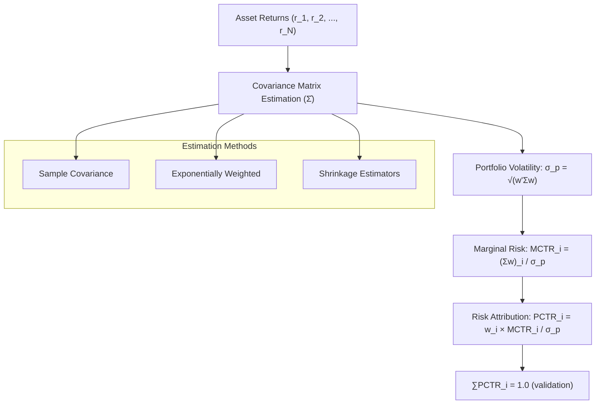

# Lesson 3: Risk Management Protocols

## 1. First-Principles Intuition & Invariants

Risk management in personal wealth stands as the discipline that separates sustainable compounding from catastrophic capital erosion. While popular finance culture fixates on return maximization, professional wealth management recognizes that preservation forms the foundation upon which all growth rests. The mathematics are unforgiving: a fifty percent drawdown requires a one hundred percent return merely to restore capital to its original state, while a thirty percent loss demands a forty-three percent recovery. This asymmetry between loss and recovery creates the central tension in portfolio construction.

The fundamental physics of financial risk derive from the statistical properties of return distributions. Classical finance theory, rooted in the work of Harry Markowitz in the early 1950s, models asset returns as random variables drawn from probability distributions. Under the idealized assumption of normality, these distributions exhibit the familiar bell curve shape, characterized entirely by two parameters: mean return and standard deviation. Standard deviation, colloquially termed volatility, quantifies the dispersion of returns around their average value. A portfolio exhibiting annual volatility of fifteen percent will see its returns scatter within a thirty percent range approximately two-thirds of the time, assuming Gaussian behavior.

However, the Gaussian assumption crumbles under empirical scrutiny. Real-world return distributions exhibit fat tails, meaning extreme events occur with far greater frequency than normal distributions predict. The 1987 crash, the 2008 financial crisis, and the March 2020 pandemic selloff all represent events that standard models classified as statistically impossible, yet they materialized nonetheless. This model risk, the divergence between theoretical assumptions and market reality, forms the first invariant of risk management: all models are wrong, but some are useful. Practitioners must therefore layer multiple risk frameworks, each capturing different failure modes, rather than relying on any single statistical paradigm.

The second invariant concerns the non-stationarity of financial markets. Unlike physical systems governed by time-invariant natural laws, market dynamics shift continuously as participants adapt, regulations evolve, and monetary regimes change. Volatility itself clusters temporally, exhibiting periods of calm punctuated by violent spikes. Correlations between assets, the degree to which their returns move together, prove unstable across market regimes. During crises, diversification often fails precisely when needed most, as previously uncorrelated assets synchronize in their decline. This regime-dependent behavior necessitates adaptive risk management frameworks that continuously recalibrate rather than static allocation rules.

The third invariant addresses the behavioral dimension. Rational optimization models assume investors possess stable utility functions and execute mechanical rebalancing without emotional interference. Reality diverges sharply from this ideal. Loss aversion, the psychological phenomenon where losses inflict roughly twice the pain of equivalent gains, drives investors to crystallize losses at market bottoms and chase performance at peaks. Recency bias causes recent volatility to dominate risk perception, leading to procyclical behavior that amplifies drawdowns. Professional risk management must therefore construct guardrails that constrain behavioral errors while preserving flexibility for opportunistic adjustments.

The final foundational principle concerns the multi-dimensional nature of risk itself. Volatility, while tractable mathematically, captures only dispersion without distinguishing upside from downside. An asset that exhibits large positive surprises alongside negative shocks receives the same volatility classification as one with symmetric deviations, yet the investor experience differs profoundly. Drawdown risk, the peak-to-trough decline in portfolio value, more accurately reflects the wealth destruction investors actually experience. Liquidity risk, the capacity to exit positions without material price impact, can transform paper losses into realized catastrophe when forced selling coincides with market dysfunction. Counterparty risk, the possibility that financial intermediaries fail to honor obligations, emerged as a central concern during 2008 when major institutions teetered on collapse. Tax risk, the erosion of returns through inefficient realization of capital gains, compounds over decades to materially impact terminal wealth. Effective risk management must simultaneously address this constellation of threats rather than optimizing against any single metric.

## 2. Core Architecture & Mechanics

Portfolio risk architecture begins with the covariance matrix, the mathematical object that encodes both individual asset volatilities and their pairwise correlations. For a portfolio containing N assets, this symmetric matrix contains N variance terms along the diagonal and N(N-1)/2 unique correlation terms in the off-diagonal positions. The portfolio variance σ²_p emerges from the quadratic form σ²_p = w'Σw, where w represents the N×1 vector of portfolio weights and Σ denotes the N×N covariance matrix. This formulation reveals that portfolio risk depends not merely on summing individual asset risks but on the interaction terms between them.

Consider a simplified two-asset portfolio consisting of domestic equities and international bonds. Let the domestic equity position constitute sixty percent of capital with annual volatility of eighteen percent, while international bonds comprise the remaining forty percent with volatility of seven percent. If these assets exhibit a correlation coefficient of 0.3, the portfolio variance computes as:

σ²_p = (0.6)²(0.18)² + (0.4)²(0.07)² + 2(0.6)(0.4)(0.18)(0.07)(0.3)

Evaluating each term yields 0.011664 + 0.000784 + 0.001814 = 0.014262, producing a portfolio standard deviation of 11.94 percent. This outcome falls substantially below the weighted average volatility of 12.6 percent, demonstrating the diversification benefit. The correlation coefficient governs the magnitude of this benefit: at perfect positive correlation of 1.0, no diversification occurs and portfolio volatility equals the weighted average. At zero correlation, maximum diversification manifests given the asset set. At negative correlation, the portfolio exhibits even lower volatility as assets offset one another's movements.

The efficient frontier, the geometric locus of portfolios that maximize expected return for each volatility level, emerges from solving constrained optimization problems across the weight space. For each target volatility σ_target, the optimization seeks weights w that maximize expected return μ_p = w'μ subject to the constraint w'Σw = σ²_target and Σw_i = 1. This produces a parabolic curve in return-volatility space, with the minimum variance portfolio occupying the leftmost point. The tangency portfolio, where a ray from the risk-free rate touches the efficient frontier, represents the optimal risky allocation under mean-variance theory. In practice, corner solutions dominate where maximum diversification benefits exhaust before reaching theoretical tangency, as transaction costs and position limits constrain implementation.

Volatility decomposition techniques provide insight into risk concentration within complex portfolios. Marginal contribution to risk (MCTR) for asset i quantifies how portfolio volatility changes with an infinitesimal increase in that position:

MCTR_i = (∂σ_p/∂w_i) = (Σw)_i / σ_p

This derivative represents the i-th element of the covariance matrix multiplied by the weight vector, normalized by portfolio volatility. Multiplying MCTR by the asset's weight yields the percentage contribution to risk (PCTR):

PCTR_i = w_i × MCTR_i / σ_p

Summing all PCTR values must equal unity, providing a complete risk decomposition. A portfolio may appear diversified by position count yet concentrate risk in a few volatile names. Risk parity strategies explicitly target equal PCTR across assets or asset classes, mechanically rebalancing to maintain this equilibrium as volatilities and correlations shift.

Drawdown dynamics demand distinct analytical machinery beyond volatility metrics. Maximum drawdown (MDD), the largest peak-to-trough decline over a measurement period, captures the worst wealth destruction an investor endured. For a return series r_t spanning T periods, the cumulative wealth path W_t = W_0 × Π(1 + r_i) for i from 1 to t defines the running peak P_t = max(W_1, W_2, ..., W_t). The drawdown at time t equals:

DD_t = (W_t - P_t) / P_t

Maximum drawdown selects the most negative value across all t. The drawdown duration measures the number of periods elapsed before wealth recovers to the prior peak, providing insight into the temporal character of risk. A strategy may exhibit tolerable average volatility yet suffer prolonged underwater periods that test investor resolve. The Calmar ratio, defined as annualized return divided by maximum drawdown, offers a risk-adjusted performance metric that explicitly penalizes deep losses.

Value at Risk (VaR) and Conditional Value at Risk (CVaR) provide probabilistic characterizations of tail risk. VaR at confidence level α answers the question: what is the maximum loss expected at the α percentile of the return distribution? Formally, VaR_α satisfies P(L ≤ VaR_α) = α, where L represents portfolio loss. A one-day VaR of $100,000 at 95% confidence indicates that losses should not exceed this threshold on nineteen out of twenty trading days. However, VaR reveals nothing about the magnitude of losses beyond the threshold. CVaR, also termed Expected Shortfall, computes the average loss conditional on exceeding VaR, providing a coherent risk measure that accounts for tail severity.

Parametric VaR assumes normally distributed returns, enabling closed-form calculation as VaR_α = μ - z_α × σ, where z_α denotes the standard normal quantile at confidence level α. For a portfolio with daily expected return of 0.05% and volatility of 1.2%, the one-day 95% VaR equals 0.05% - 1.645 × 1.2% = -1.92%. Historical VaR abandons distributional assumptions, instead directly sampling the return history and selecting the appropriate percentile. Monte Carlo VaR simulates thousands of return paths using either parametric distributions or bootstrapped historical data, then empirically estimates the percentile. Each approach embodies distinct trade-offs between model risk, computational cost, and responsiveness to regime changes.

Hedging strategies leverage derivatives to insulate portfolios from specific risk factors. Equity put options provide the most direct downside protection: purchasing puts with strike prices below current market levels establishes a floor on portfolio value, albeit at the cost of premium paid. A collar strategy sells out-of-the-money calls to finance put purchases, capping both upside and downside. The protective put's payoff at expiration equals max(S_T - K, 0) - premium, where S_T represents the terminal stock price and K the strike price. For a portfolio valued at $1,000,000, buying three-month puts with a 95% strike ($950,000) costing 2% ($20,000) guarantees that losses cannot exceed $70,000 over the hedge horizon.

Dynamic hedging protocols adjust protection levels based on market conditions and portfolio drawdowns. Constant proportion portfolio insurance (CPPI) allocates between risky assets and cash according to the rule: risky exposure = m × (portfolio value - floor), where m denotes the multiplier and floor represents the minimum acceptable wealth. As portfolio value rises, risky exposure increases proportionally, while drawdowns trigger automatic deleveraging. The multiplier m controls leverage magnitude: higher values amplify both gains and protection adjustments. CPPI exhibits path-dependent behavior where volatile markets cause whipsaw losses through frequent rebalancing, yet it guarantees floor preservation absent gap risk.

Cross-asset hedging exploits correlation relationships to reduce net exposure. A U.S. equity portfolio faces implicit dollar exposure; purchasing foreign currency bonds or currency forwards introduces a hedge against dollar weakness that typically coincides with risk-off environments. Treasury bonds provide diversification against equity drawdowns through their negative correlation during flight-to-quality episodes, though this relationship proves unstable across regimes. Gold serves as a monetary hedge against fiat currency debasement and geopolitical tail risk, yet it generates no cash flows and exhibits its own volatility. Commodities offer inflation protection but introduce substantial short-term noise. Effective hedging requires mapping portfolio exposures to underlying risk factors, then constructing offsetting positions sized to neutralize specific sensitivities rather than blunt application of generic hedges.

Factor models decompose portfolio returns into systematic and idiosyncratic components, enabling targeted risk management. The Fama-French three-factor model attributes returns to market exposure (beta), size effects (small-cap premium), and value effects (book-to-market premium). Adding momentum and quality factors produces five-factor specifications that explain a larger fraction of cross-sectional return variation. Factor loadings β_i quantify a portfolio's sensitivity to each factor f_k:

r_p = α + Σ β_k f_k + ε

where α represents alpha (idiosyncratic return) and ε denotes residual noise. Factor risk budgeting ensures that no single systematic exposure dominates. A portfolio with beta of 1.3, size loading of 0.4, and value loading of -0.2 concentrates risk in broad market exposure, while tilting toward large-cap growth. Neutralizing unwanted factor exposures through derivatives or offsetting positions isolates pure alpha bets from systematic risk.

Stress testing subjects portfolios to hypothetical scenarios that lie outside historical experience, probing resilience under extreme conditions. Historical stress tests replay specific crises: the October 1987 crash, the August 1998 LTCM collapse, the September 2008 Lehman bankruptcy, or the March 2020 pandemic shock. Each scenario applies the actual factor movements observed during those episodes to current portfolio positions. Hypothetical stress tests construct synthetic scenarios: simultaneous equity decline of 40%, credit spreads widening by 300 basis points, interest rates spiking by 200 basis points, and implied volatility doubling. Reverse stress tests identify scenarios that would cause unacceptable portfolio losses, then assess their plausibility. This approach surfaces hidden vulnerabilities that standard statistical models miss, particularly clustered exposures that only manifest under joint stress.

## 3. High-Performance Optimization & Failure Modes

Dynamic rebalancing protocols govern the frequency and magnitude of portfolio adjustments, balancing tracking error against transaction costs. Calendar-based rebalancing executes at fixed intervals—quarterly, semi-annually, or annually—regardless of market movements. This approach provides operational simplicity and enforces discipline, yet it may rebalance when unnecessary or delay action when urgency demands. Threshold-based rebalancing triggers adjustments when asset allocations drift beyond specified tolerances, typically five to ten percentage points from target weights. This method concentrates trading around meaningful deviations while avoiding hyperactive rebalancing during range-bound periods.

Optimal rebalancing thresholds depend on the joint distribution of transaction costs, volatility regimes, and expected returns. Higher volatility increases drift velocity, necessitating tighter bands. Rising transaction costs justify wider tolerances, as the benefit from restoring target weights must exceed implementation friction. Tax considerations dominate in taxable accounts: rebalancing through new contributions avoids capital gains realization, while harvesting losses during drawdowns provides tax alpha. The after-tax rebalancing policy solves:

max E[utility(W_T)] subject to drift constraints and tax drag

where utility(W_T) represents terminal wealth utility and tax drag includes both realized gains and opportunity cost of deferral. This optimization frequently produces asymmetric bands, allowing growth assets to run while trimming losers aggressively to harvest losses.

Volatility targeting dynamically scales portfolio risk exposure to maintain constant expected volatility over time. As realized volatility rises, the strategy mechanically reduces risky asset allocation, while falling volatility triggers increased exposure. The target volatility σ_target determines the scaling factor:

leverage_t = σ_target / σ_realized,t

Applied to risky asset weight w_risky, this produces adjusted weight w_adjusted = leverage_t × w_risky, with the residual allocated to cash or short-term bonds. Volatility targeting exhibits automatic crisis response: it deleverages into market dislocations, preserving capital when tail risk materializes. However, this mechanical behavior can amplify selling pressure during panics and forgo participation in sharp recoveries. The realized volatility measurement window critically affects responsiveness: shorter windows react quickly but introduce noise, while longer windows smooth behavior at the cost of delayed adjustment.

Risk parity extends volatility targeting to multi-asset portfolios by equalizing risk contributions across components rather than dollar allocations. The risk parity weight for asset i satisfies:

w_i ∝ 1 / (MCTR_i)

Implemented through leverage, risk parity typically concentrates capital in low-volatility bonds while maintaining smaller equity positions, then applies leverage to achieve target overall portfolio risk. This construction achieved prominence after the 2008 crisis for its superior diversification properties compared to traditional 60/40 portfolios. However, risk parity assumes stable correlations and depends critically on cheap leverage availability. During correlation spikes, diversification benefits evaporate precisely when protection matters most. The 2020 deleveraging event exposed this vulnerability as bonds failed to offset equity losses while leverage amplified total drawdown.

Behavioral risk manifests through systematic deviations from optimal decision-making that erode long-term returns. Disposition effect, the tendency to sell winners too early while holding losers too long, creates tax inefficiency in taxable accounts and prevents compounding of strong positions. Home bias, the overweight allocation to domestic assets relative to global market capitalization, forgoes international diversification benefits. Recency bias causes investors to extrapolate recent returns into perpetuity, driving capital allocation toward recent winners at valuation peaks. Overconfidence leads to excessive trading, concentrated positions, and underestimation of downside risk. These patterns persist despite awareness because they originate in deep evolutionary psychology rather than conscious deliberation.

Commitment devices provide structural guardrails against behavioral errors. Automated rebalancing removes discretion from timing decisions, enforcing mechanical restoration of target weights. Investment policy statements formalize risk tolerance, return objectives, liquidity requirements, and rebalancing protocols in advance, creating a reference point against which to evaluate emotionally driven deviations. Separate accounts for different goals—retirement, education, liquidity—establish mental accounting barriers that prevent raiding long-term capital for short-term consumption. Hiring an advisor introduces agency separation, though it substitutes advisor behavioral biases for client biases unless the advisor maintains rigorous process discipline.

Tax optimization mechanics transform after-tax returns through strategic realization of gains and losses, asset location across account types, and withdrawal sequencing. Tax-loss harvesting systematically sells positions trading below cost basis to realize capital losses that offset gains elsewhere in the portfolio or reduce ordinary income up to $3,000 annually, with unlimited loss carryforwards. The wash-sale rule prohibits repurchasing substantially identical securities within thirty days, but purchasing correlated substitutes maintains market exposure while preserving the tax benefit. Direct indexing, owning individual stocks rather than funds, unlocks position-level loss harvesting that generates substantial tax alpha, often exceeding one hundred basis points annually for high earners.

Asset location allocates tax-inefficient investments—bonds generating ordinary income, REITs with non-qualified dividends, actively managed funds with high turnover—to tax-deferred accounts like 401(k)s and IRAs. Tax-efficient equity index funds concentrating in qualified dividends and long-term capital gains reside in taxable accounts. This geographic separation exploits tax arbitrage between account types. The magnitude of benefit depends on the spread between ordinary income rates (up to 37% federally plus state taxes) and long-term capital gains rates (0%, 15%, or 20% depending on income). For high-income individuals in states with aggressive taxation, asset location benefits can exceed fifty basis points annually.

Withdrawal sequencing during retirement dramatically impacts longevity of capital through differential tax treatment and required minimum distribution (RMD) mechanics. The conventional wisdom of depleting taxable accounts first, then tax-deferred, and finally tax-free Roth accounts maximizes deferral of tax obligations. However, this heuristic often proves suboptimal. Roth conversions during low-income years transfer tax-deferred capital to tax-free growth at advantageous rates, reducing future RMDs that might push retirees into higher brackets or trigger Medicare surcharges. Partial Roth conversions filling up the current tax bracket, combined with qualified charitable distributions and careful management of adjusted gross income, can save hundreds of thousands in lifetime taxes.

The safe withdrawal rate (SWR), the maximum inflation-adjusted spending percentage that survives historical market sequences, forms the bedrock of retirement planning. The seminal Bengen study analyzing rolling historical periods determined that a 4% initial withdrawal rate adjusted for inflation survived all thirty-year retirement periods in U.S. data from 1926 forward, assuming a 50/50 stock/bond allocation. However, this analysis embodies significant survivor bias from U.S. equity outperformance and ignores sequence-of-returns risk: poor early returns devastate portfolio longevity even if long-run averages prove favorable.

Modern retirement research incorporates dynamic spending rules that adjust for realized portfolio performance rather than rigid inflation indexing. The guyton-klinger guardrails increase withdrawals by inflation when portfolio performance exceeds thresholds, while cutting spending when drawdowns breach lower bounds. This approach trades spending volatility for improved portfolio survival and higher median terminal wealth. Monte Carlo retirement projections simulate thousands of return sequences drawn from calibrated distributions, reporting success rates across spending levels. A 90% success probability indicates that ten out of one hundred simulated futures exhaust capital before death—a sobering failure rate for an irreversible decision.

Longevity risk, the possibility of outliving savings, intensifies as life expectancies extend. A sixty-five-year-old couple has a fifty percent probability that at least one spouse survives to age ninety-two, and a twenty-five percent chance of survival beyond age ninety-seven. Self-insuring this tail risk requires substantial capital or draconian spending restrictions. Annuitization transfers longevity risk to insurance companies in exchange for guaranteed lifetime income, though at the cost of illiquidity and loss of residual estate value. Partial annuitization covering baseline expenses while retaining portfolio capital for discretionary spending and bequests represents a balanced approach, though low interest rates have compressed annuity payout rates to historically unattractive levels.

Healthcare expense risk constitutes the dominant spending uncertainty in retirement. Fidelity estimates that a sixty-five-year-old couple retiring in 2025 will require $315,000 in after-tax savings to cover Medicare premiums, copays, and deductibles over a twenty-year retirement, excluding long-term care. Long-term care expenses average $105,000 annually for nursing home residence, with durations extending multiple years for conditions like Alzheimer's. Medicaid covers long-term care only after asset depletion to poverty levels, creating a cliff where middle-class retirees lose autonomy. Long-term care insurance provides coverage but features complex underwriting, significant premium inflation, and carrier risk from numerous insurers exiting the market after mispricing longevity and interest rate exposure.

Estate planning mechanics integrate tax efficiency, creditor protection, and intergenerational wealth transfer objectives. The federal estate tax exemption of $13.61 million per individual in 2024, indexed for inflation, shields most estates from transfer taxes. However, this exemption sunsets to approximately $7 million in 2026 absent legislative extension, creating urgency for large estates to accelerate gifting. The annual gift tax exclusion of $18,000 per recipient allows tax-free transfers that remove appreciation from the estate. Grantor retained annuity trusts (GRATs) transfer asset appreciation to beneficiaries while returning principal plus IRS-assumed growth rate to the grantor, zeroing out gift tax while capturing excess returns. This technique works particularly well for concentrated stock positions expected to appreciate rapidly.

Dynasty trusts domiciled in jurisdictions without rule-against-perpetuities statutes enable multi-generational wealth transfer outside estate taxation. Assets compound free of transfer taxes indefinitely, though generation-skipping transfer tax applies to direct transfers beyond one generation. Intentionally defective grantor trusts (IDGTs) create income tax separation where the grantor pays income taxes on trust earnings without those payments constituting taxable gifts, effectively making tax-free transfers to beneficiaries. Life insurance owned by irrevocable life insurance trusts (ILITs) provides estate tax-free death benefits while removing the policy value from the insured's taxable estate.

Charitable giving strategies unlock income tax deductions while accomplishing philanthropic objectives. Direct donations of appreciated securities to qualified charities allow deduction of fair market value while avoiding capital gains realization, effectively receiving a tax subsidy for the donation. Donor-advised funds (DAFs) provide immediate tax deductions while deferring grant-making decisions, enabling front-loading of multiple years' charitable contributions in high-income years. Qualified charitable distributions from IRAs after age seventy-and-a-half satisfy RMD requirements without increasing adjusted gross income, providing tax-efficient philanthropy for retirees who do not itemize deductions.

Concentrated stock positions create acute risk management challenges due to both volatility and tax lock-in. Executives and entrepreneurs frequently hold enormous wealth in single stocks with cost bases near zero, creating multi-million dollar tax liabilities upon sale. Exchange funds pool concentrated positions from multiple shareholders, diversifying holdings while deferring recognition until redemption after seven-year minimum holding periods. However, exchange funds charge significant fees and impose liquidity restrictions. Equity collars, combining put purchases below current prices with call sales above, synthetically lock in value ranges while preserving qualified dividend treatment, though they restrict participation in appreciation beyond the call strike.

Variable prepaid forwards enable monetization of concentrated positions while deferring tax through borrowing rather than selling. The holder enters a contract to deliver shares at maturity while receiving upfront cash equal to a percentage of current value. This cash represents a loan collateralized by the shares rather than sale proceeds, avoiding immediate taxation. At maturity, the holder delivers shares based on terminal stock price relative to predetermined thresholds, settling the forward contract and triggering tax recognition. This structure provides liquidity while deferring tax realization until a subsequent year when income might fall or tax rates decrease.

Failure mode mitigation requires continuous monitoring of risk metrics, exposure concentrations, and behavioral adherence. Daily portfolio VaR tracking provides early warning of tail risk accumulation, triggering pre-defined hedging responses when thresholds breach. Weekly drawdown monitoring against historical percentiles contextualizes current losses, preventing panic during ordinary volatility while escalating scrutiny during unusual declines. Monthly factor exposure analysis surfaces unintended concentrations that emerge through market movements rather than active allocation decisions.

Scenario analysis pressure-tests portfolios against hypothetical catastrophes: simultaneous equity crashes, credit market freezes, inflation spikes, and geopolitical disruptions. These exercises identify correlated failure modes where multiple positions deteriorate simultaneously, violating diversification assumptions. Liquidity stress testing examines ability to meet cash needs during market dislocations when selling may require material discounts. Portfolios requiring systematic withdrawals must maintain sufficient liquidity buffers to avoid forced selling at disadvantageous times, typically holding one to two years of spending in short-term bonds or cash equivalents.

The integration of quantitative risk metrics with behavioral discipline and tax optimization creates a robust framework for wealth preservation across market cycles. Professional implementation recognizes that theoretical optimality must yield to realistic constraints around client risk tolerance, behavioral consistency, and tax circumstances. The goal extends beyond maximizing risk-adjusted returns to ensuring that clients maintain sufficient wealth to achieve life objectives while sleeping soundly through inevitable volatility. This human-centered risk management separates durable wealth accumulation from speculative gambles that offer theoretical upside at the cost of ruin risk that could permanently alter life trajectories.
