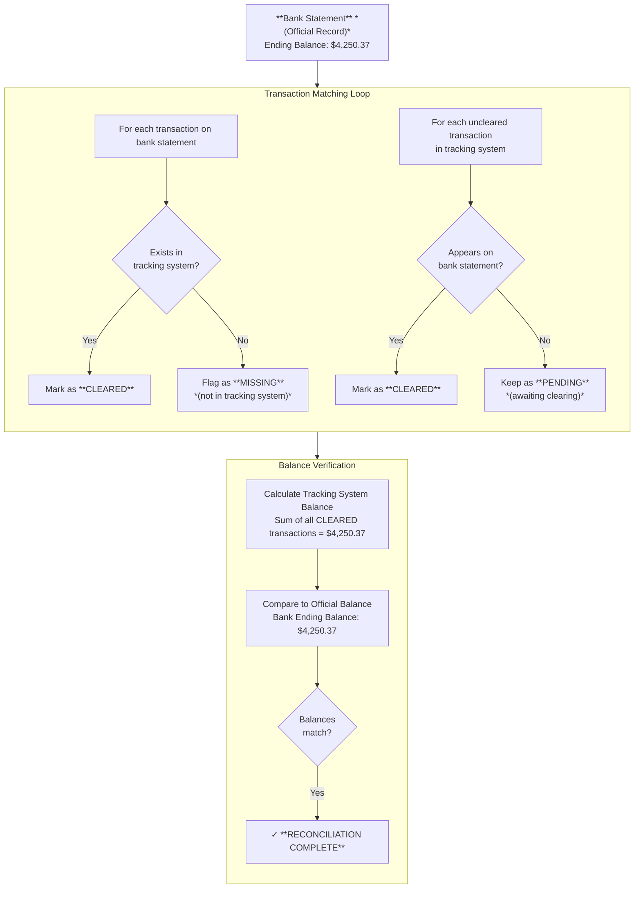

# Lesson 2: Tracking Mechanisms for Cash Flow Visibility

## 1. First-Principles Intuition & Invariants

The moment you spend money, the information asymmetry between your actual financial state and your perceived financial state begins to widen. This gap—the delta between what you think you have and what you actually have—is not merely an accounting inconvenience; it is the primary failure mode that causes personal budgets to collapse under their own assumptions. Tracking mechanisms exist to collapse this gap, to make the invisible visible, and to establish a durable feedback loop between intention and reality.

At the deepest level, cash flow visibility rests on a deceptively simple mechanical principle: every transaction is a signal. That signal contains information about timing (when money moved), magnitude (how much), direction (inbound or outbound), category (what you spent it on), and counterparty (who received or sent the money). The more fidelity you capture about these signals, the more accurately you can reconstruct your actual financial behavior and predict your future cash position. Conversely, when signal fidelity degrades—when transactions go unrecorded, miscategorized, or reconciled weeks after the fact—your budget becomes a work of fiction, a elaborate story you tell yourself about money you may or may not actually have.

The fundamental invariant underpinning all tracking systems is this: **a transaction exists in three states of information completeness, and each state requires different handling**. First, the transaction is initiated (you swipe a card, you authorize a bank transfer, you write a check). Second, the transaction is captured by the financial institution (your bank records it in their ledger, often with a lag of hours to days). Third, the transaction must be matched against your personal record, categorized, and reconciled against your budget assumptions. Most personal budgeting failures occur not because people fail to spend reasonably, but because they lose track of transactions between these three states, or they fail to establish a systematic protocol for moving transactions from one state to the next.

Consider the operational reality of someone who checks their bank balance once per month. They see their account balance as of that moment and assume it is accurate. But between now and tomorrow, four transactions might clear that they initiated three days ago. Their mental model of their cash position is therefore consistently wrong by a predictable but unmonitored amount. This is not a failure of discipline; it is a failure of tracking architecture. The person has no mechanism to account for transactions in flight.

Similarly, consider the person who carefully enters every transaction into a spreadsheet but reconciles it only quarterly. Over three months, dozens of transactions may be miscategorized, or duplicate entries may accumulate, or a single large transaction might be recorded twice. When reconciliation finally occurs, the effort required to untangle the mess is so substantial that it discourages future reconciliation. The tracking system, which was meant to clarify financial reality, instead becomes a source of anxiety and administrative burden.

The invariants that must hold for effective cash flow tracking are these:

**Timeliness Invariant:** Transaction information must be captured close enough to real time that you retain the contextual knowledge to categorize it accurately. A purchase made today is categorized correctly; the same purchase, if you encounter it in your records three weeks later, may be categorized incorrectly because you have forgotten the context. The longer the lag between transaction initiation and reconciliation, the higher the error rate.

**Completeness Invariant:** Every transaction that moves money must be represented in your tracking system. If you use cash and fail to record it, that cash is a blind spot in your budget. If you use a credit card but only record it when the statement arrives, transactions in flight are invisible. If you have multiple accounts and only track some of them, your total cash position remains unknown. Tracking must be comprehensive.

**Consistency Invariant:** Categories and classification rules must be applied uniformly across all transactions over time. If you classify a coffee purchase as "Dining Out" one week and "Entertainment" the next, your spending trends become impossible to interpret. The tracking system must enforce consistency, either through automation or through strict personal discipline.

**Reconciliation Invariant:** The transactions recorded in your personal tracking system must be matched, at regular intervals, against the official records maintained by your financial institutions. Unreconciled transactions are transactions you cannot trust. Reconciliation closes the loop between your perception and reality, and it is the only reliable way to detect errors, fraud, or missing transactions.

These four invariants form the structural foundation of any effective tracking mechanism. No matter what tools or methods you employ, if your tracking system violates any of these invariants, you will eventually lose confidence in your data and abandon the system.

## 2. Core Architecture & Mechanics

The architecture of a personal cash flow tracking system can be understood as a five-stage data pipeline, each stage receiving the output of the previous stage and producing inputs for the next. Understanding each stage, and the specific work required at each stage, is essential to building a system that actually functions rather than one that collapses under its own complexity.

**Stage 1: Capture**

The capture stage is where transactions first enter your tracking system. This stage has no value judgments or categorizations; its sole purpose is to record that a transaction occurred, along with basic facts: the date, the amount, and ideally the merchant or counterparty name. Capture can occur through several distinct mechanisms, each with different characteristics.

Manual capture is the process of manually entering each transaction into your tracking system. This occurs when you write a check, withdraw cash, or manually log a transaction into a spreadsheet or application. The advantages of manual capture are precision and intentionality; because you are typing the transaction yourself, you are forced to confront it, and you have the opportunity to add contextual notes or observations. The disadvantages are time consumption and error susceptibility. Manual entry is tedious, and tired humans make typing mistakes. Manual capture also scales poorly; if you have fifty transactions per month, manual entry might take an hour. If you have two hundred transactions per month, the time burden becomes prohibitive.

Automated capture eliminates the manual entry step by connecting directly to your financial institutions' data feeds. Most banks and credit card companies now offer API integrations that allow third-party applications to automatically import transaction records. This integration typically occurs on a daily or near-real-time basis. The captured data includes the transaction date, merchant name, amount, and a merchant category code (MCC) assigned by the financial institution. The primary advantage of automated capture is accuracy and speed; the transaction record is created by the same system that processed the transaction, so there is no transcription error. The data arrives in your tracking system with minimal lag. The disadvantages are loss of intentionality and integration complexity. When transactions arrive automatically, you may not actually confront them; it becomes possible to spend money and never consciously acknowledge the purchase. Additionally, setting up automated capture requires dealing with banking APIs, which often require authentication credentials and are subject to regulatory and security constraints.

Hybrid capture combines both methods. Automated capture handles the majority of transactions (credit cards, debit cards, electronic transfers), while manual capture handles the residual cases (cash purchases, checks, peer-to-peer transfers). This hybrid approach captures the scalability benefits of automation while preserving the intentionality benefits of manual entry for the transactions where cash is directly handed over.

Regardless of the capture method, the output of the capture stage is an unprocessed transaction record with minimal metadata. This record contains only facts; it contains no categorization, no judgment about whether the spending is good or bad, and no relationship to your budget.

**Stage 2: Categorization**

The categorization stage is where the transaction record is assigned to a spending category. This is the first point at which the transaction is connected to your budget framework. The category assignment determines how the transaction will be aggregated when you generate spending reports and trend analyses.

Category schemes vary, but most personal budgeting systems use a two-tier hierarchy: major categories and subcategories. A major category might be "Food," with subcategories for "Groceries," "Dining Out," and "Coffee Shops." Another major category might be "Transportation," with subcategories for "Gas," "Public Transit," and "Ride Sharing." The hierarchy allows you to generate reports at both the aggregate level (total food spending) and the granular level (dining out versus groceries).

For transactions captured through automated means, many systems apply a preliminary categorization based on the merchant category code (MCC) assigned by the financial institution. These MCCs are standardized codes that classify merchants by industry. A restaurant is typically assigned code 5812, a gas station is 5541, a grocery store is 5411, and so forth. Your tracking system can map these codes to your personal category scheme automatically. This automation dramatically reduces the manual categorization burden, but it is imperfect. The MCC system is coarse-grained and does not account for edge cases. A large retail store like Target or Walmart may be categorized as a general retailer (MCC 5399) rather than specifically as a grocery store, even though part of your purchase was groceries.

For this reason, effective categorization typically requires a two-pass process. The first pass applies automated categorization based on merchant MCCs or merchant names. The second pass applies human judgment, reviewing transactions that were autocategorized and correcting obvious misclassifications. Over time, as the system learns your merchant preferences and spending patterns, the second pass becomes faster because fewer transactions require manual review.

The output of the categorization stage is a transaction record that includes not only the raw facts (date, amount, merchant) but also a category assignment. This categorization is the first point at which the transaction becomes comparable to your budget assumptions.

**Stage 3: Clearing and Reconciliation**

The clearing and reconciliation stage is where transactions are matched against official records maintained by your financial institutions, and where the timing differences between when you initiated a transaction and when it actually cleared are resolved.

When you swipe a debit card at a grocery store, the transaction is immediately captured in your tracking system (assuming you are using automated capture). However, the transaction may not clear your bank account until hours or days later. During the in-between period, that transaction exists in an "uncleared" state. Uncleared transactions create a persistent reconciliation problem: your bank balance, as reported by your bank, does not match the balance you see if you calculate it by summing all transactions in your tracking system. This mismatch is not an error; it is a natural consequence of the time lag between transaction initiation and clearing.

The reconciliation process addresses this by identifying which transactions have cleared and which remain pending. Most tracking systems display transactions in two states: cleared and uncleared. Cleared transactions have been matched against the official bank or credit card statement and are confirmed to have actually moved money. Uncleared transactions have been initiated but not yet processed by the financial institution.

The reconciliation workflow operates as follows. You obtain your official bank or credit card statement from the financial institution, typically on a monthly basis (though some systems allow more frequent statements). You then compare the transactions listed in that statement against the transactions in your tracking system. Each transaction on the official statement is matched to a transaction in your tracking system. If a transaction on the statement cannot be matched to your tracking system, it represents a transaction you either forgot to record or that was captured by the bank but not by you. Conversely, if a transaction in your tracking system cannot be matched to the official statement, it represents a pending transaction that has not yet cleared.

The reconciliation process closes with a specific mechanical act: you verify that the ending balance on the official statement exactly matches the net position of all cleared transactions in your tracking system. If these balances match, reconciliation is complete, and you have achieved a state of certainty about your cash position. If these balances do not match, you have discovered a discrepancy, and you must investigate further.

The following diagram represents the reconciliation process as a data flow:

In practice, most reconciliation discrepancies are minor and stem from a handful of predictable sources. A transaction may have been recorded in your tracking system but not yet appeared on the official statement (a timing lag). A transaction may have been recorded twice (a duplicate entry error). A transaction may have been miscategorized by amount (you entered $50 when the actual charge was $50.47). Most of these discrepancies are caught during the matching process, and the tracking system is updated to reflect the correction. Once corrections are made, the balances match, and reconciliation is complete.

**Stage 4: Trend Analysis and Variance Detection**

Once transactions have been captured, categorized, and reconciled, the tracking system contains a complete record of your historical cash flows. The trend analysis stage processes this historical record to identify patterns, generate spending reports, and compare actual spending against budgeted amounts.

At the simplest level, trend analysis answers the question: how much did I spend in each category this month? The tracking system aggregates all transactions in a category for a given time period and produces a summary. For example, in March, total groceries spending was $320, total dining out was $180, total gas was $95, and so forth. These summaries are compared against the budget assumptions for March, revealing whether spending fell within the budgeted amount or exceeded it.

More sophisticated trend analysis looks across multiple periods to identify seasonal patterns and longer-term trends. Did grocery spending increase by 8% compared to last month? Did that increase correlate with a larger household purchase, or does it represent a sustained behavioral change? These questions require data aggregated over multiple months or quarters, revealing patterns that would not be obvious from a single month in isolation.

Variance detection is the process of flagging transactions or spending categories that deviate meaningfully from historical patterns or budgeted expectations. A variance might be detected at the transaction level (a single charge of $500 to a restaurant when your typical restaurant spending is $20-50 per transaction) or at the aggregate level (total utilities spending this month is 40% higher than your three-month average).

Variance detection serves two purposes. First, it can identify errors: a large unexpected variance might indicate a miscategorized transaction or a duplicate entry. Second, it can identify behavioral anomalies: a sudden spike in spending in a particular category might reflect a one-time planned purchase, or it might reflect a subtle shift in your financial behavior that warrants investigation. By flagging these variances automatically, your tracking system prompts deliberate review, rather than allowing anomalies to pass unnoticed.

**Stage 5: Forecasting and Cash Position Projection**

The final stage of the tracking pipeline uses historical transaction data to project future cash position. This stage answers the question: given my current cash balance and my historical spending patterns, what is my projected cash position at a future date?

At its simplest, forecasting applies your historical average spending to generate a projection. If your average monthly spending in the "Dining Out" category is $180 based on data from the past six months, you can project that next month's dining out spending will be approximately $180 (plus or minus a margin of error). By projecting spending across all categories, you generate a total projected spending for the month. You then subtract this projected spending from your current cash position to arrive at a projected ending cash position.

More sophisticated forecasting accounts for known future transactions that have not yet occurred. If you know you have a quarterly insurance premium due next month that costs $300, you can include this in your projection even though the transaction has not yet occurred. Similarly, if you know you have a paycheck scheduled to arrive on the 15th of next month, you can include this expected inflow in your projection.

These five stages—capture, categorization, reconciliation, trend analysis, and forecasting—form a complete data pipeline. Data flows from the raw transaction facts, through processing stages, to final outputs that support budgeting decisions. Each stage adds value; each stage also introduces the possibility of error or information loss if not executed carefully.

## 3. High-Performance Optimization & Failure Modes

In practice, the mechanics of cash flow tracking encounter numerous operational challenges that can degrade the quality of the tracking system or cause it to fail entirely. Understanding these failure modes and the specific optimizations that mitigate them is essential to building a tracking system that actually functions over months and years, rather than one that degrades over time.

**The Categorization Burden Problem and Automation Limits**

The categorization stage is the most labor-intensive point in the tracking pipeline when executed manually. Faced with fifty to two hundred transactions per month, each requiring a category assignment, many practitioners attempt to automate this work through rules-based systems. A common approach is to create conditional rules: "any transaction from Amazon categorize as Shopping," "any transaction from Whole Foods categorize as Groceries," and so forth.

These rule-based systems work well initially, but they encounter problems as transaction history accumulates and exceptions emerge. You may have purchased office supplies from Amazon (Shopping) and also groceries from Amazon Fresh (Groceries). You may have purchased a birthday gift for a friend from a restaurant (Gifts) rather than dining out.

The fundamental issue is that merchant identifiers are ambiguous signals: they correlate with category but do not determine it. Automated categorization systems built on merchant-matching rules will therefore always produce classification errors proportional to the diversity of purchase types from each merchant. The optimization response is not to abandon automation but to implement a hybrid system: apply rules to bulk-categorize obvious cases (utility bills, recurring subscriptions, salary deposits), then surface only the ambiguous subset for manual review. This reduces the manual burden by 60-80% while preserving classification accuracy where it matters. The second critical optimization is to implement learning from corrections: when you manually override an automatic categorization, the system should flag similar future transactions for review rather than blindly applying the same incorrect rule. Modern tracking software implements this through probabilistic models or simple "exception lists," but even a spreadsheet implementation can achieve this by maintaining a separate "review queue" worksheet for flagged merchants.

Beyond categorization, the most severe failure mode is reconciliation drift—when the tracking system's recorded balance diverges from actual account balances without detection. This occurs when transactions are missed (failing to import a cash purchase), duplicated (importing the same credit card statement twice), or when timing mismatches create temporary discrepancies that are never resolved. The diagnostic protocol is mandatory periodic reconciliation: at minimum monthly, compare each tracked account's ending balance in your system against the actual statement balance. Any discrepancy larger than a de minimis threshold (typically $5-10 to account for rounding and pending transactions) must be investigated and resolved before proceeding. Failure to enforce this discipline compounds errors exponentially—a $20 discrepancy in January becomes impossible to diagnose by June when hundreds of subsequent transactions have been recorded. The operational rule is that reconciliation is not optional maintenance but a hard gate: you do not proceed to the next month's data entry until the previous month reconciles to within tolerance.

## Summary & Verification Matrix

| **Invariant / Principle** | **Mechanism** | **Failure Mode** | **Diagnostic Criterion** |
|---------------------------|---------------|------------------|--------------------------|
| **Complete Capture** | All cash flows (inflows and outflows) across all accounts must enter the tracking system | Silent omissions—cash transactions, peer-to-peer payments, or secondary accounts are never recorded | Monthly reconciliation: tracked ending balance equals actual statement balance within $5-10 tolerance for each account |
| **Unambiguous Categorization** | Each transaction receives exactly one category assignment; categories are mutually exclusive and collectively exhaustive | Merchant-based automation produces misclassification when merchants sell diverse product types; manual burden causes under-categorization | Spot audit: randomly sample 20 transactions per month and verify category assignments match actual purchase purpose; error rate < 5% |
| **Enforced Reconciliation Gate** | Before processing new period data, prior period balances must match actual account statements within tolerance | Reconciliation drift—cumulative errors compound as discrepancies are ignored or postponed, making root cause analysis impossible | Hard blocking rule: system flags any account with >$10 discrepancy and prevents new transaction entry until resolved |
| **Trend Stability Under Aggregation** | Category spending patterns converge to stable averages as observation window increases (3+ months) | High-variance categories (gifts, medical, travel) produce misleading single-month snapshots; users overreact to noise | Calculate rolling 3-month average for each category; flag any single month deviating >40% from rolling average for review before conclusions |
| **Forecast Incorporates Known Future Events** | Projections must include scheduled future inflows/outflows with known dates and amounts | Naive trend extrapolation ignores annual insurance premiums, quarterly tax payments, or irregular bonus income, causing false surplus/deficit signals | Forecast accuracy test: compare projected vs. actual balance at month-end; systematic errors >15% indicate missing scheduled events in projection model |
| **Hybrid Automation Architecture** | Use rules to bulk-process obvious transactions; surface ambiguous cases for manual review | Full automation produces silent classification errors; full manual processing creates unsustainable cognitive load and abandonment | Measure manual review burden: target 20-40 transactions per month requiring human judgment (< 20% of total volume for typical user); automation handles the remaining 60-80% |
