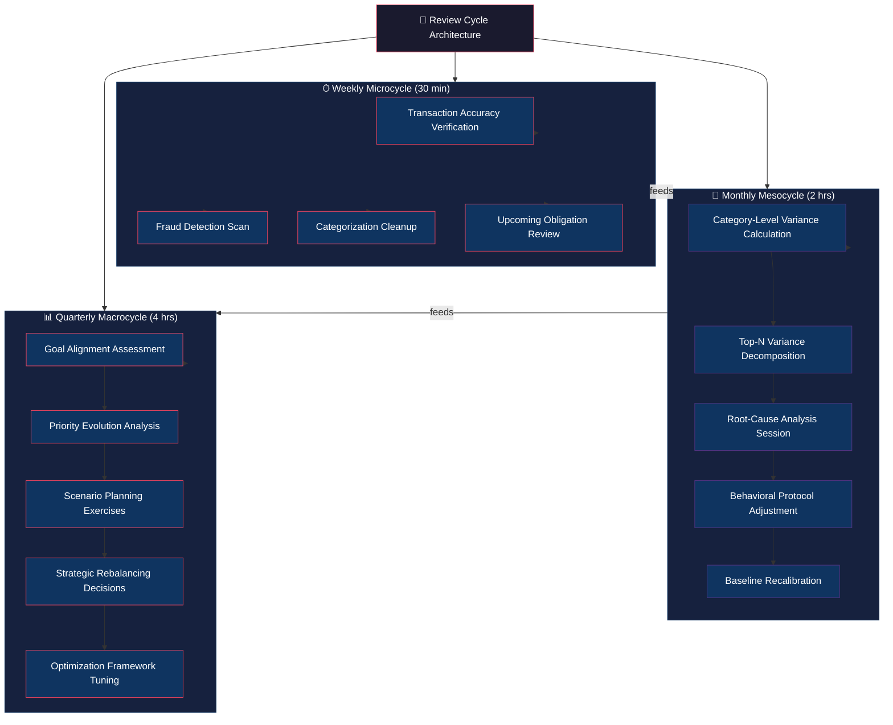

# Lesson 4: Optimization Frameworks for Long-Term Sustainability

## 1. First-Principles Intuition & Invariants

Personal budgeting systems that survive contact with reality share a common characteristic: they treat budget optimization not as a one-time design exercise but as a continuous feedback process anchored in measurable variance, behavioral adaptation, and scenario resilience. The fundamental error most practitioners make lies in treating their budget as a static artifact—a spreadsheet constructed in January and abandoned by March—rather than recognizing it as a dynamic control system requiring regular variance analysis, behavioral correction loops, and forward-looking scenario planning to maintain goal alignment over multi-year horizons.

The engineering intuition behind sustainable budget optimization mirrors the principles of control theory in mechanical systems. A thermostat does not simply set a target temperature and hope for the best; it continuously samples ambient conditions, calculates variance from the setpoint, and adjusts heating or cooling output through proportional-integral-derivative feedback. Personal budgeting operates under identical mechanics. Your budget establishes financial setpoints across spending categories, income projections, and savings targets. The optimization framework measures actual performance against these setpoints through variance analysis, identifies systematic deviations caused by behavioral drift or environmental changes, and implements corrective rebalancing protocols to restore alignment with long-term goals.

The first-principles foundation rests on three invariants that govern all sustainable budget optimization systems. The first invariant establishes that variance itself is not pathological but informational. Every deviation between budgeted and actual spending encodes a signal about behavioral patterns, environmental volatility, or estimation accuracy. A grocery budget consistently overrun by twelve percent does not indicate moral failure but rather an under-calibrated baseline that fails to account for household consumption patterns or local price inflation. The optimization framework treats variance as measurement data requiring root-cause analysis rather than judgment.

The second invariant recognizes that human behavior operates through reinforcement loops rather than rational planning. Classical economic theory assumes individuals make optimal decisions by calculating expected utility across all future states, but behavioral economics demonstrates that humans respond primarily to immediate feedback, emotional salience, and habit formation. A budget that provides no behavioral feedback until an annual review will fail because the reinforcement loop operates on too long a delay. Effective optimization frameworks insert behavioral checkpoints at intervals short enough to influence habit formation—typically weekly or biweekly reviews—while maintaining monthly and quarterly aggregation for strategic assessment.

The third invariant acknowledges that financial life unfolds under Knightian uncertainty rather than calculable risk. You cannot assign meaningful probability distributions to events like career transitions, health emergencies, or housing market dislocations because these phenomena lack sufficient historical frequency for statistical estimation. Sustainable budget optimization therefore requires scenario planning frameworks that construct plausible future states without pretending to forecast probabilities. Instead of asking "what will happen," the practitioner asks "how would my financial position evolve under this coherent set of assumptions, and what corrective capacity do I retain under each scenario."

Together, these invariants define the optimization problem: construct a measurement and adjustment framework that converts variance into behavioral feedback at intervals short enough to influence habit formation, while maintaining strategic flexibility across scenarios that cannot be probabilistically forecast. The solution architecture requires four integrated subsystems: variance decomposition analytics that separate signal from noise in spending deviations, behavioral feedback protocols that translate variance into actionable corrections, scenario planning models that stress-test budget resilience against plausible futures, and goal-aligned rebalancing mechanisms that adjust resource allocation as priorities evolve.

The conceptual lineage traces back to Toyota's kaizen philosophy and Deming's Plan-Do-Check-Act cycle, both of which treat optimization as an iterative process of measurement, analysis, and incremental adjustment rather than a search for optimal solutions. In manufacturing, kaizen recognizes that production systems drift over time due to tool wear, material variation, and operator fatigue. Continuous improvement protocols measure deviation from quality standards, identify root causes through structured problem-solving, and implement countermeasures that return the system to specification. Personal budget optimization applies identical mechanics to financial systems, recognizing that spending behavior drifts over time due to lifestyle changes, social comparison, and hedonic adaptation. The optimization framework measures deviation from financial standards, identifies root causes through variance analysis, and implements behavioral countermeasures that restore goal alignment.

The transition from theory to practice hinges on recognizing that budgets exist within larger productivity systems governing time allocation, energy management, and attention deployment. A budget cannot be optimized in isolation because financial decisions couple tightly to time-resource tradeoffs. The decision to prepare meals at home rather than order delivery represents a financial optimization that imposes time costs and energy demands. The optimization framework must therefore account for cross-system constraints: optimizing the food budget by eliminating all restaurant spending may create time scarcity that degrades performance in career domains, ultimately reducing income and worsening overall financial position. Sustainable optimization recognizes these interdependencies and treats budget adjustments as interventions in a coupled system where financial, temporal, and energetic resources interact through complex feedback dynamics.

## 2. Core Architecture & Mechanics

The variance analysis subsystem forms the measurement foundation upon which all optimization protocols depend. Variance decomposes into three components: volume variance, rate variance, and mix variance. Volume variance measures the difference between planned and actual transaction frequency within a category. If your transportation budget assumes sixteen Uber trips per month but you actually took twenty-four, the volume variance quantifies the impact of those eight additional transactions. Rate variance measures the difference between expected and actual unit costs. If you budgeted twenty dollars per Uber trip but the actual average was twenty-seven dollars, the rate variance captures that seven-dollar premium. Mix variance measures shifts in the composition of spending within heterogeneous categories. If your dining budget encompasses both fast-casual lunches and upscale dinners, mix variance quantifies the financial impact when you shift consumption toward the higher-cost option while holding total transaction volume constant.

The mechanical implementation requires transaction-level data capture rather than aggregate monthly totals. Most banking interfaces provide month-end balances and category summaries, but these aggregates destroy the granular information necessary for variance decomposition. The practitioner must instead export complete transaction histories from all financial accounts—checking, credit cards, digital wallets—and consolidate them into a unified ledger that preserves timestamp, merchant, amount, and category for each transaction. This consolidated ledger becomes the empirical foundation for variance analysis.

The calculation proceeds through a systematic decomposition protocol. For each budget category, extract all transactions that occurred during the measurement period and calculate the actual mean transaction value and actual transaction count. Compare these empirical statistics against the budgeted assumptions that generated your spending target. The volume variance equals the budgeted unit cost multiplied by the difference between actual and planned transaction counts. The rate variance equals the actual transaction count multiplied by the difference between actual and budgeted unit costs. The mix variance, when present, requires weighting calculations across subcategories and emerges as the residual after volume and rate effects are isolated.

```
Variance Decomposition for Category C:

Budgeted Spend = Planned_Count × Planned_Unit_Cost
Actual Spend = Actual_Count × Actual_Unit_Cost

Total Variance = Actual Spend - Budgeted Spend

Volume Variance = (Actual_Count - Planned_Count) × Planned_Unit_Cost
Rate Variance = (Actual_Unit_Cost - Planned_Unit_Cost) × Actual_Count
Mix Variance = Total Variance - Volume Variance - Rate Variance
```

The interpretive framework recognizes that different variance sources demand different corrective interventions. Volume variance signals behavioral frequency changes that may be volitional or environmentally driven. If your coffee shop transaction count doubled, the root cause might be a new morning routine, increased workplace stress driving caffeine dependence, or the opening of a new café on your commute route that reduced friction. The optimization response depends critically on the causal mechanism: behavioral habits require friction insertion or replacement routines, while environmental factors may warrant budget recalibration rather than behavior modification.

Rate variance typically indicates either estimation errors in the budget construction phase or genuine price inflation in the category. Grocery rate variance that persists across multiple months likely reflects either systematic underestimation of preferred product costs or broad inflationary pressure in food prices. The optimization response bifurcates: estimation errors require baseline recalibration, while genuine inflation may trigger substitution strategies or compensatory reductions in other discretionary categories to maintain overall savings targets.

Mix variance reveals preference drift within heterogeneous categories. A clothing budget that shows neutral volume variance, neutral rate variance, but large positive mix variance indicates that you maintained transaction frequency and average price point but shifted spending composition toward higher-value items within the category. This pattern often emerges from lifestyle inflation or social comparison effects that drive upgrading behavior without conscious recognition. The optimization intervention requires examining whether the preference shift aligns with explicit values or represents hedonic adaptation that should be actively resisted.

The behavioral feedback loop subsystem translates variance analysis into habit-formation protocols through structured review cycles operating at multiple timescales. The weekly microcycle review occurs every Sunday evening and focuses exclusively on transaction-level anomalies and upcoming spending obligations. The practitioner reviews all transactions from the past seven days, flags any that appear erroneous or fraudulent, and confirms categorization accuracy. This micro-review serves primarily as a friction point that maintains transaction awareness rather than driving strategic adjustment. The psychological mechanism operates through the mere-measurement effect: individuals who regularly review their transactions without explicit judgment or intervention nonetheless spend less than control groups, apparently because measurement salience alone influences subsequent behavior through heightened awareness.

The monthly mesocycle review conducts full variance decomposition across all categories and identifies systematic deviations requiring behavioral or budgetary response. This review occurs on the first weekend after month-end close and follows a structured protocol. First, calculate total variance for the month and decompose it across categories to identify which domains generated the largest deviations. Second, perform variance decomposition within the top three variance-contributing categories to separate volume, rate, and mix effects. Third, conduct root-cause analysis for each material variance by reviewing the specific transactions that drove the deviation and identifying behavioral, environmental, or estimation factors. Fourth, implement corrective protocols: behavioral variances trigger friction interventions or replacement habits, environmental variances may warrant budget recalibration, and estimation variances update baseline assumptions for future periods.

The quarterly macrocycle review assesses strategic goal alignment and conducts comprehensive scenario planning exercises. This review occurs on a dedicated day at the end of each quarter and examines whether resource allocation across budget categories remains aligned with evolving life priorities. The practitioner re-evaluates major financial goals—emergency fund targets, retirement savings rates, discretionary spending allocations—and determines whether current budget parameters still serve those objectives or whether rebalancing is warranted. The macrocycle also incorporates scenario planning by constructing plausible future states and stress-testing budget resilience.



The scenario planning subsystem constructs coherent future states that stress-test budget resilience without requiring probability estimation. The framework employs a two-dimensional scenario matrix that crosses income trajectory with expense regime to generate four archetypal futures: sustained growth, constrained growth, plateau, and contraction. Sustained growth scenarios assume continued income increases matching or exceeding historical rates while expenses grow at baseline inflation. Constrained growth scenarios model income increases that lag inflation while expenses accelerate due to lifestyle factors like family expansion or housing upgrades. Plateau scenarios hold real income constant while expenses fluctuate within the historical range. Contraction scenarios model income reductions from career disruption, health issues, or economic recession while expenses remain sticky or increase due to emergency needs.

For each scenario, the practitioner projects forward the three-statement financial model—income statement, balance sheet, and cash flow statement—over a sixty-month horizon using the scenario-specific assumptions. The income statement forecasts revenue streams from salary, investment returns, and side income under the scenario assumptions while projecting expense categories at scenario-specific growth rates. The balance sheet tracks asset accumulation in savings, retirement, and taxable investment accounts while modeling liability evolution for mortgages, student loans, and revolving credit. The cash flow statement reconciles income statement flows with balance sheet changes and reveals the timing of liquidity crunches that might force corrective action.

The analytical focus examines three resilience metrics across scenarios: runway duration, corrective capacity, and goal attainment probability. Runway duration measures how long existing liquid assets would sustain baseline expenses in the absence of income, providing the time buffer available to execute career transitions or weather unemployment. Corrective capacity quantifies the percentage reduction in discretionary spending that could be implemented without altering fixed obligations, revealing the flexibility available for adaptive response. Goal attainment probability assesses whether major financial objectives—retirement savings milestones, home down payment accumulation, debt elimination—remain achievable under the scenario constraints or require timeline extension and priority revision.

The rebalancing subsystem implements goal-aligned resource reallocation when quarterly macrocycle reviews reveal misalignment between current budget parameters and evolving priorities. Rebalancing operates through a constraint satisfaction framework that respects both floor constraints preventing category elimination and ceiling constraints limiting reallocation magnitude. Floor constraints ensure that essential categories like housing, utilities, insurance, and minimum food budgets retain sufficient allocation to meet basic needs. Ceiling constraints prevent dramatic reallocation that would create behavioral whiplash and trigger budget abandonment. The standard ceiling constraint limits month-over-month category changes to twenty percent, forcing large reallocations to phase in gradually over multiple quarters.

The rebalancing optimization problem seeks to minimize deviation from target allocation weights while satisfying floor and ceiling constraints. Target allocation weights emerge from goal-aligned priority analysis: if retirement security becomes a dominant priority, the target allocation increases savings categories while reducing discretionary spending. If career development emerges as critical, the target allocation might increase professional development and networking budgets while constraining entertainment. The optimization solver adjusts actual category allocations iteratively toward targets while checking constraint violations at each step, producing a feasible rebalancing plan that respects practical limitations.

```
Rebalancing Optimization Framework:

Input Parameters:
- Current category allocations: A_current[i] for i = 1..N categories
- Target category weights: W_target[i] (sum to 1.0)
- Total monthly budget: B_total
- Floor constraints: F[i] = minimum allocation for category i
- Ceiling rate: C = maximum month-over-month change (default 0.20)

Optimization Objective:
Minimize: Σ(A_proposed[i] - W_target[i] × B_total)²

Subject to constraints:
1. Σ A_proposed[i] = B_total (budget exhaustion)
2. A_proposed[i] ≥ F[i] for all i (floor constraints)
3. |A_proposed[i] - A_current[i]| / A_current[i] ≤ C (ceiling constraints)

Output:
- Rebalanced category allocations: A_proposed[i]
- Multi-quarter phase-in schedule if single-step rebalancing violates ceilings
```

## 3. High-Performance Optimization & Failure Modes

The transition from functional optimization frameworks to high-performance implementation requires attention to execution efficiency, automation leverage, and failure mode mitigation. Practitioners who successfully sustain budget optimization over multi-year horizons share common characteristics: they ruthlessly minimize manual toil through automation, they design failure-tolerant protocols that gracefully degrade rather than collapse, and they continuously tune their feedback parameters based on empirical behavioral response data.

Execution efficiency begins with transaction data consolidation. Manual export and aggregation of transaction histories from multiple financial institutions represents pure toil that provides no analytical value and creates abandonment risk. High-performance implementations employ automated data aggregation services that maintain continuous synchronization with financial accounts and present unified transaction ledgers without manual intervention. Plaid and Yodlee provide institutional-grade data aggregation APIs that securely authenticate with thousands of financial institutions and pull transaction data through standardized interfaces. Personal Capital and Monarch Money offer consumer-facing applications built atop these aggregation layers, providing pre-built variance dashboards and category mapping interfaces.

The architectural decision between building custom analysis workflows atop API primitives versus consuming pre-built applications trades control for convenience. Custom workflows constructed in Python using Plaid's API provide maximum flexibility for variance decomposition protocols and scenario modeling but require significant upfront engineering investment. Pre-built applications offer immediate deployment and maintained infrastructure but constrain analytical customization to the feature set provided by the vendor. The optimal choice depends on analytical sophistication and technical capability: practitioners comfortable with programmatic data manipulation gain significant analytical power from custom workflows, while those preferring turnkey solutions achieve faster time-to-value with managed applications.

Regardless of implementation choice, the critical efficiency gain comes from eliminating manual data entry and consolidation. A budget optimization framework that requires manual transaction logging or monthly CSV exports from each financial account will fail because the toil burden creates abandonment risk that compounds over time. The first missed week cascades into a backlog that triggers guilt and avoidance, ultimately leading to complete system abandonment. Automated synchronization eliminates this failure mode by ensuring transaction data remains current without practitioner intervention, reducing the behavioral activation energy required for variance analysis to nearly zero.

The behavioral feedback loop requires careful parameter tuning to avoid two opposing failure modes: excessive frequency that triggers alert fatigue and insufficient frequency that permits drift. Alert fatigue emerges when variance notifications fire so frequently that practitioners begin ignoring them, much as repeated fire alarms that prove false eventually train occupants to disregard warnings. Insufficient frequency permits behavioral drift to compound undetected until variance reaches magnitudes that require dramatic corrective interventions rather than gentle adjustments. The optimal notification threshold depends on individual variance tolerance and category volatility.

For stable essential categories like housing and insurance, variance thresholds should be set conservatively high—typically twenty-five to thirty percent deviation—because variance in these domains usually indicates genuine environmental changes like rent increases or premium adjustments rather than behavioral drift. Frequent notifications for essential category variance create alert fatigue without providing actionable behavioral feedback. Conversely, volatile discretionary categories like dining and entertainment warrant aggressive thresholds—ten to fifteen percent deviation—because variance in these domains primarily reflects behavioral choices that benefit from rapid feedback.

The notification protocol should distinguish between variance magnitude and variance persistence. A single month of high dining variance might reflect a birthday celebration or visiting guests rather than systematic drift. High-performance implementations employ persistence filters that suppress notifications until a category shows elevated variance for two consecutive measurement periods, reducing false positives from one-time events while reliably detecting sustained drift. The persistence filter operates as a digital low-pass filter analogous to electrical engineering noise reduction: rapid transient spikes pass through undetected while sustained signals trigger notification.

```
Behavioral Notification Logic:

For each category C with budgeted allocation B[C]:

1. Calculate monthly variance V[C] = (Actual[C] - B[C]) / B[C]

2. Determine category-specific threshold T[C]:
   - Essential categories: T[C] = 0.25
   - Semi-discretionary: T[C] = 0.18
   - Discretionary: T[C] = 0.12

3. Check variance magnitude: |V[C]| > T[C]

4. Apply persistence filter:
   - If variance_count[C] >= 2 consecutive periods: NOTIFY
   - Else: increment variance_count[C], suppress notification

5. On notification, recommend corrective protocol:
   - Volume variance → friction insertion
   - Rate variance → baseline recalibration
   - Mix variance → preference audit
```

Scenario planning execution encounters the failure mode of analysis paralysis when practitioners construct excessively granular scenario matrices that multiply degrees of freedom until the planning space becomes unmanageably large. A scenario matrix that crosses five income trajectories with six expense regimes and four investment return environments generates one hundred twenty distinct scenarios, far exceeding the cognitive budget available for meaningful analysis. The planning exercise collapses into spreadsheet theater that consumes time without generating actionable insight.

High-performance scenario planning employs dimensionality reduction through principal component analysis that identifies the dominant axes of uncertainty driving financial outcomes. For most personal budgets, two factors—income trajectory and expense regime—explain the vast majority of outcome variance, rendering additional dimensions like investment returns and tax policy changes second-order effects that can be safely ignored without materially degrading scenario utility. The reduced two-dimensional matrix yields four archetypal scenarios that remain cognitively manageable while capturing the dominant uncertainty drivers.

The scenario construction protocol emphasizes coherence over probability. Each scenario must present a internally consistent narrative explaining why income and expense parameters evolve along the specified trajectories. The sustained growth scenario might assume continued employment in a expanding industry with regular merit increases while lifestyle remains stable and expenses track baseline inflation. The contraction scenario might assume industry disruption leading to extended unemployment followed by re-employment at reduced compensation while emergency expenses drive spending above baseline. The narrative coherence ensures that parameter assumptions remain logically connected rather than arbitrarily selected, improving the scenario's utility as a stress test even in the absence of probabilistic forecasting.

The rebalancing subsystem confronts the failure mode of perpetual adjustment when practitioners treat every minor priority shift as justification for comprehensive budget restructuring. Excessive rebalancing frequency imposes transaction costs through behavioral adjustment overhead and prevents habits from stabilizing sufficiently to generate compounding benefits. A dining budget reduced by thirty percent requires sustained behavioral adaptation—identifying lower-cost alternatives, developing meal preparation routines, resisting social pressure—that takes multiple months to consolidate into automatic habits. If the budget rebalances again before habits stabilize, the practitioner perpetually operates in high-friction adaptation mode without reaching the low-friction steady state where optimized behaviors become automatic.

High-performance implementations impose rebalancing rate limits that prevent adjustments more frequent than quarterly intervals. The quarterly minimum ensures sufficient time for behavioral adaptation to complete before introducing new changes. Within each quarter, the rebalancing magnitude ceiling of twenty percent prevents dramatic shifts that would require wholesale habit reconstruction. Together, these rate limits and magnitude ceilings create a stable optimization trajectory where changes occur gradually enough for behavioral systems to adapt without overwhelming cognitive load.

The failure mode of goal drift emerges when practitioners lose connection between budget parameters and underlying life objectives, causing optimization to devolve into meaningless number manipulation divorced from purpose. A budget optimized purely for maximum savings rate may inadvertently starve investments in relationships, health, and professional development that generate long-term life satisfaction and earning capacity. The corrective protocol requires explicit goal documentation that articulates the values and objectives the budget serves, creating an audit trail that connects each major category allocation to specific life priorities.

The goal alignment audit occurs during quarterly macrocycle reviews and follows a structured protocol. For each major budget category, the practitioner articulates which life goals that category serves and evaluates whether the current allocation level adequately supports those goals. A professional development budget supports career advancement goals; does the current allocation provide sufficient resources for relevant courses, conferences, and certifications? A travel budget supports relationship maintenance and experience accumulation goals; does the current allocation enable the desired trip frequency and destination ambition? The audit reveals misalignments where categories receive insufficient resources relative to their goal importance or excessive resources relative to saturation points beyond which additional spending generates negligible value.

The efficiency metrics subsystem provides longitudinal tracking of optimization framework performance through three primary indicators: variance trend trajectory, behavioral friction index, and goal attainment velocity. Variance trend trajectory measures whether the absolute magnitude of monthly budget variance decreases over time as behavioral habits stabilize and estimation accuracy improves. The expectation holds that a well-functioning optimization framework drives variance down from initial levels around twenty to thirty percent toward steady-state levels below ten percent as the system matures. Persistent high variance after twelve months of operation indicates fundamental problems with either budget calibration or behavioral feedback effectiveness.

Behavioral friction index quantifies the subjective difficulty of maintaining budget compliance across categories. During monthly mesocycle reviews, practitioners rate each category's friction level on a five-point scale from effortless to exhausting. Categories with persistently high friction scores indicate misalignment between budgeted allocations and natural spending preferences, suggesting either that the budget constraint is unrealistically tight or that the behavioral protocols for managing that category need refinement. The friction index provides early warning of abandonment risk: categories that remain high-friction after three months warrant immediate attention because sustained high friction eventually triggers compliance collapse.

Goal attainment velocity measures the rate of progress toward major financial objectives relative to planned timelines. An emergency fund target of six months' expenses reached in fourteen months when the plan projected eighteen months indicates positive velocity, suggesting the optimization framework effectively channels resources toward priorities. Systematic negative velocity across multiple goals indicates either overly ambitious targets that should be recalibrated or structural problems with the budget's savings capacity that require comprehensive rebalancing.

```
Efficiency Metric Dashboard:

Variance Trend Trajectory:
- Calculate rolling 3-month average absolute variance: VAR_avg[t]
- Expected trajectory: VAR_avg[0] ≈ 25%, declining to VAR_avg[12] < 10%
- Warning threshold: VAR_avg[t] > VAR_avg[t-3] for two consecutive quarters

Behavioral Friction Index:
- Monthly rating for each category: F[C] ∈ {1=effortless, 2=easy, 3=moderate, 4=difficult, 5=exhausting}
- Category health: F[C] ≤ 3 after 90 days
- System health: Average F across all categories < 2.5

Goal Attainment Velocity:
- For each goal G with target value T[G] and timeline D[G]:
- Measure actual progress P[G] at checkpoint intervals
- Velocity ratio: V[G] = (P[G] / elapsed_time) / (T[G] / D[G])
- Target velocity: V[G] ≥ 1.0
- Warning: V[G] < 0.75 for two consecutive quarters
```

The iteration cycle completes when quarterly macrocycle reviews incorporate efficiency metric analysis to tune optimization framework parameters. If variance trend trajectory shows persistent elevation, the review examines whether variance stems from behavioral factors requiring stronger feedback protocols or environmental factors requiring budget recalibration. If behavioral friction index remains high in specific categories, the review investigates whether friction originates from unrealistic constraints that should be relaxed or insufficient behavioral scaffolding that should be reinforced. If goal attainment velocity lags targets, the review determines whether goals need timeline extension, whether budget savings capacity requires enhancement through rebalancing, or whether goal prioritization needs revision.

This continuous tuning process transforms the optimization framework from a static procedure into an adaptive control system that evolves in response to changing circumstances and accumulated empirical data about individual behavioral patterns. The practitioner who maintains this optimization discipline over multi-year horizons achieves budget sustainability not through superhuman willpower or deprivation but through systematic measurement, feedback, and adjustment protocols that align financial behavior with conscious values and long-term objectives. The framework succeeds precisely because it accommodates human behavioral realities—drift, adaptation, priority evolution—rather than demanding robotic adherence to arbitrary constraints, creating a financial control system that remains viable across the decades required for major life goals to manifest.
