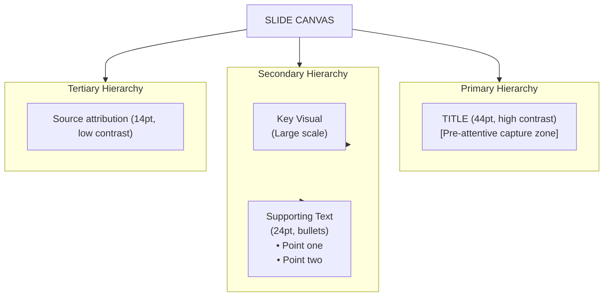

# Lesson 1: Slide Architecture, Information Design Principles

## 1. First-Principles Intuition & Invariants

The PowerPoint slide represents a bounded cognitive canvas with hard constraints that mirror the neurological architecture of human working memory. When George Miller published his seminal 1956 paper identifying the "magical number seven, plus or minus two" as the limit of concurrent information chunks humans can process, he unknowingly defined the fundamental invariant that governs all effective presentation design. A slide is not merely a digital canvas for arranging text and graphics—it is a constrained information transfer mechanism operating within the biological bandwidth limitations of the human visual cortex and prefrontal cortex.

The central design tension in slide architecture emerges from competing forces: the presenter's impulse to maximize information density versus the audience's fixed cognitive processing capacity. Unlike written documents where readers control pacing and can re-read passages, presentations occur in linear time with no rewind mechanism. The audience member's working memory operates as a volatile buffer with immediate decay characteristics. Information not successfully encoded into short-term memory within the presentation moment is irretrievably lost. This fundamental asymmetry between transmission and reception creates the first invariant of slide design: **effective slides optimize for comprehension bandwidth rather than information volume**.

The architecture of a presentation slide operates through a three-layer information hierarchy that maps directly to visual perception pathways in the human brain. The pre-attentive processing layer activates within the first 200-500 milliseconds of visual exposure, during which the audience unconsciously registers color contrasts, size differences, spatial positioning, and motion. This primitive visual system evolved to detect environmental threats and opportunities before conscious awareness engages. The second layer involves focal attention allocation, where the audience consciously directs their gaze toward specific elements based on salience cues established in the pre-attentive phase. The third layer requires sustained cognitive processing to extract semantic meaning from text, interpret data visualizations, or synthesize complex relationships between slide elements.

Most presentation failures occur because designers optimize for the wrong layer. Dense bullet-point slides with uniform formatting collapse all information into the third layer, forcing audiences to engage in sustained cognitive processing for every element. This violates the information density constraint—the human brain cannot simultaneously parse sixteen bullet points, maintain attention on the speaker's verbal narrative, and integrate both information streams into coherent understanding. The result manifests as the familiar conference room phenomenon where audiences mentally abandon slide content and focus exclusively on speaker audio, or conversely, ignore the speaker while reading slides in their entirety.

The gestalt principles of visual perception provide the foundational grammar for slide composition precisely because they exploit pre-attentive processing mechanisms. When elements share proximity, the visual cortex automatically groups them into a single perceptual unit before conscious awareness. When elements align along common edges or axes, the brain perceives implicit structure even in the absence of explicit containers like borders or boxes. When elements exhibit similarity in color, size, or shape, the perceptual system infers categorical relationships without requiring textual labels. These principles are not aesthetic preferences—they are neurological invariants that operate universally across human populations regardless of cultural background or professional domain.

The fundamental unit of presentation architecture is the **slide-object composite**, consisting of the slide canvas as the bounded container and the discrete objects placed within it. PowerPoint implements objects as distinct entities with independent properties: text boxes, shapes, images, charts, tables, SmartArt graphics, and embedded media. Each object occupies a z-order position in the rendering stack, possesses formatting attributes controlling its visual appearance, and can contain animation behaviors governing its temporal reveal sequence. Understanding slides as object containers rather than static images fundamentally changes the design approach—composition becomes an exercise in deliberate object placement and relationship choreography rather than aesthetic decoration.

The cognitive load theory framework developed by John Sweller distinguishes between three types of mental effort: intrinsic load inherent to the subject matter complexity, extraneous load imposed by poor presentation design, and germane load representing productive cognitive work building understanding. Effective slide architecture minimizes extraneous load through visual clarity while managing intrinsic load through progressive disclosure and strategic simplification. The germane load remains the only productive component—this is where audiences build mental models, make connections, and integrate new knowledge with existing schemas. Every design decision must be evaluated against this tripartite framework: does this element reduce extraneous noise, appropriately scaffold intrinsic complexity, or actively support germane processing?

The information density constraint operates as a hard boundary that cannot be circumvented through clever formatting or visual tricks. Research in multimedia learning consistently demonstrates that cognitive overload occurs when simultaneous information channels exceed working memory capacity. The specific threshold varies by audience expertise—domain experts possess chunked knowledge structures that allow higher compression ratios—but the fundamental limit persists. A slide attempting to communicate twelve independent concepts simultaneously will fail regardless of color scheme or font selection. The mathematics are unforgiving: if working memory capacity supports processing four to seven chunks concurrently, and the speaker's verbal narrative occupies two to three chunks, the slide canvas has budget for only two to four visual elements before overload occurs.

This constraint creates the primary strategic choice in presentation design: depth versus breadth. A depth-optimized approach uses multiple slides to progressively elaborate a single concept, allowing each slide to remain within cognitive capacity while building cumulative understanding through sequence. A breadth-optimized approach attempts to survey multiple concepts on individual slides, inevitably compressing each to superficial treatment. The correct choice depends on audience objectives and time constraints, but the trade-off itself is non-negotiable. There exists no design technique that allows comprehensive deep treatment of multiple complex concepts on a single slide while maintaining cognitive accessibility.

The visual perception principles that govern slide effectiveness operate at timescales measured in milliseconds, yet most presenters design as if audiences have unlimited processing time. The fixation duration for reading text averages 200-250 milliseconds per word, meaning a slide containing one hundred words requires minimum twenty to twenty-five seconds of reading time before any comprehension can occur. During this processing interval, the audience cannot simultaneously listen to the speaker, evaluate diagrams, or consider implications. The temporal dimension of presentation delivery imposes hard constraints that static slide design must accommodate through deliberate pacing choreography and progressive revelation.

## 2. Core Architecture & Mechanics

PowerPoint's internal object model implements a hierarchical structure where presentations contain slides, slides contain shapes, and shapes contain text, formatting, and behavioral properties. The fundamental container is the Presentation object, which maintains global theme definitions, master slide templates, and slide sequence ordering. Each Slide object exists as an independent canvas with fixed dimensions—typically 10 inches wide by 7.5 inches tall in 4:3 aspect ratio or 10 inches by 5.625 inches in 16:9 widescreen format. These dimensions establish the bounded compositional space within which all design decisions operate.

The Shapes collection within each slide implements a z-order rendering stack, where shapes added first occupy lower z-index positions and render beneath subsequently added shapes. This layering system allows complex compositions where background elements, midground content, and foreground annotations coexist on the same canvas. Manipulating z-order through "Send to Back" and "Bring to Front" commands reorganizes the rendering sequence without changing object positions. Understanding z-order as an independent dimension from xy-plane positioning is essential for managing visual hierarchy—critical elements must occupy appropriate z-positions to ensure visibility and proper layering.

Each shape object possesses a comprehensive property set governing visual appearance: fill color, line weight, shadow effects, transparency, rotation angle, and geometric dimensions. Text-containing shapes additionally support character-level and paragraph-level formatting including font family, size, weight, color, alignment, indentation, and line spacing. The formatting model distinguishes between direct formatting applied to specific objects and theme-based formatting inherited from master slides. Direct formatting overrides theme defaults, creating permanent customization that persists even when themes change. This inheritance hierarchy enables consistent visual language across presentations while allowing selective customization where necessary.

The master slide architecture implements a template inheritance system governing default formatting across all slides. The Slide Master defines top-level theme properties including color palette, font scheme, background styling, and placeholder positioning. Layout masters beneath the Slide Master define structural templates for specific slide types: title slides, content slides, section headers, and blank layouts. When creating a new slide, the presenter selects a layout master that determines initial placeholder arrangement. Content entered into these placeholders automatically inherits formatting from the master hierarchy, ensuring visual consistency without manual formatting repetition.

The placeholder system represents PowerPoint's primary mechanism for structured content entry. Placeholders are special shape objects that display prompt text when empty and convert to standard shapes when populated. The five standard placeholder types—title, body text, content, picture, and chart—support different input modes and impose different formatting constraints. Title placeholders typically restrict content to single-line or short multi-line headings with large font sizes. Body text placeholders implement automatic bullet-point formatting with progressive indentation levels. Content placeholders provide a multi-format interface accepting text, tables, charts, SmartArt, pictures, or video through icon-based selection.

The information hierarchy on a slide manifests through three visual encoding channels: spatial position, typographic scale, and chromatic emphasis. Spatial position leverages the universal reading gravity that draws attention to upper-left quadrants in Western cultures, with importance diminishing toward lower-right regions. Placing critical information in prime visual real estate—the top third of the slide centered horizontally—ensures immediate attention capture during the pre-attentive processing phase. Typographic scale establishes hierarchy through size differentiation, where headings at 32-44 point sizes dominate perception while body text at 18-24 points recedes into secondary importance. Chromatic emphasis uses color contrast to create salience, with high-chroma accent colors directing focal attention against neutral background tones.



The gestalt principle of proximity governs spatial grouping on slides. Elements positioned close together—typically within 0.25 inches—are perceived as related units even without explicit containers. This perceptual grouping operates automatically during pre-attentive processing, allowing the designer to create implicit structure through spacing alone. Conversely, elements separated by whitespace greater than 0.5 inches are perceived as distinct units. The strategic manipulation of proximity allows complex slides to communicate categorical relationships without visual clutter from borders, boxes, or connecting lines.

The principle of similarity operates through shared visual attributes that signal categorical membership. When three shapes share identical fill colors while two others use a contrasting color, audiences automatically infer a three-versus-two categorization before reading any labels. When chart elements employ consistent color encoding across multiple slides—blue for actual values, orange for projected values—audiences learn the encoding scheme and apply it unconsciously to subsequent slides. Similarity encoding must remain consistent throughout presentations to build reliable perceptual patterns that reduce cognitive load through automatic categorization.

The principle of continuity exploits the visual system's tendency to perceive smooth, continuous paths rather than abrupt changes in direction. When elements align along common edges or axes, the eye naturally traces these alignment paths, creating implicit structure. Grid-based slide composition leveraging alignment to invisible column and row guides produces clean, professional layouts where relationships emerge from spatial organization. Breaking alignment should be a deliberate design choice to emphasize exceptions or create deliberate visual disruption, not an accidental consequence of careless positioning.

The principle of closure describes how audiences mentally complete incomplete shapes or patterns. A circle composed of dashed segments is perceived as a complete circle despite the gaps. This principle allows minimalist slide design where implied boundaries and containers reduce visual noise while maintaining structural clarity. Instead of drawing explicit boxes around related elements, designers can use subtle corner brackets or partial borders that trigger closure perception while consuming minimal visual real estate.

The figure-ground relationship governs how audiences parse slides into foreground content and background context. Strong figure-ground contrast—dark text on light backgrounds or light text on dark backgrounds—ensures content legibility. Weak contrast creates ambiguous figure-ground relationships where audiences struggle to distinguish content from decoration. The 4.5:1 contrast ratio recommended by WCAG accessibility guidelines provides a quantitative threshold ensuring adequate figure-ground separation. Background elements that compete with foreground content violate this principle, creating visual confusion that elevates extraneous cognitive load.

Animation and transition mechanics in PowerPoint implement temporal control over information reveal sequence. Animations apply to individual shape objects and control how they enter, emphasize, or exit the slide canvas. Entrance animations reveal elements progressively rather than displaying all content simultaneously, allowing the presenter to synchronize visual information with verbal narrative. Emphasis animations direct focal attention to specific elements through motion, color change, or scaling effects. Exit animations remove elements from view, clearing cognitive space for subsequent content.

The animation pane interface manages temporal choreography through a timeline-based sequencing system. Animations can be configured to trigger automatically after previous animations complete, trigger on click events providing presenter control, or trigger simultaneously with other animations. The duration property controls animation speed—faster animations (0.25-0.5 seconds) create snappy reveals, while slower animations (1-2 seconds) build dramatic emphasis. The delay property introduces pause intervals between animations, controlling pacing rhythm.

```text
Animation Sequence Architecture
┌────────────────────────────────────────────────┐
│ Slide Timeline                                 │
├────────────────────────────────────────────────┤
│ 0.0s  │ Title appears (Fade, 0.5s)            │
│ 0.5s  │ ▶ Pause (1.0s) — audience processes   │
│ 1.5s  │ Bullet 1 appears (Wipe, 0.3s)         │
│ 1.8s  │ Bullet 2 appears (Wipe, 0.3s)         │
│ 2.1s  │ ▶ Click-triggered: Chart enters        │
│       │   (Fly In from Left, 0.75s)           │
│ 2.85s │ ▶ Click-triggered: Annotation callout  │
│       │   (Fade + Grow, 0.5s)                 │
└────────────────────────────────────────────────┘
```

The transition system controls slide-level animations that execute when advancing between slides. Transition effects—fade, push, wipe, or morph—provide visual continuity while signaling topic boundaries. The morph transition deserves special attention as PowerPoint's most sophisticated animation capability. Morph analyzes object properties across consecutive slides and automatically generates smooth interpolation animations for position, size, rotation, and color changes. Objects with identical names on consecutive slides are treated as the same entity undergoing transformation, enabling sophisticated object-level animations without manual keyframe animation.

## 3. High-Performance Optimization & Failure Modes

The optimization of presentation slides begins with ruthless content prioritization through a forced-ranking exercise that exposes the inevitable trade-offs between comprehensiveness and comprehensibility. For any given slide, enumerate all candidate information elements—data points, supporting details, qualifications, caveats, and contextual background. Then apply the brutal filter: if the audience can remember only three items from this slide, which three create maximum impact toward the presentation objective? Everything failing this threshold must be either eliminated, relocated to appendix slides, or consolidated into higher-level abstractions. This triage process feels uncomfortable because it requires abandoning information that seems important, but cognitive load constraints make it mandatory rather than optional.

The visual hierarchy must be engineered to support instantaneous comprehension within the first 2-3 seconds of slide exposure. Audiences should be able to extract the slide's primary message without reading body text, using only the title and dominant visual element. This requires titles that function as complete sentences or assertions rather than generic topic labels. Instead of "Q4 Revenue Results," the optimized title reads "Q4 Revenue Exceeded Plan by 18% Driven by Enterprise Segment Growth." The title now carries semantic content that communicates the message even if the audience ignores all subsequent detail. The visual element—likely a bar chart showing quarterly comparison—reinforces rather than introduces the message.

The failure mode of visual homogeneity occurs when all slide elements receive equal formatting emphasis, creating a flat visual field with no entry point for focal attention. When every bullet point uses the same font size, color, and icon treatment, audiences must engage in sustained reading to differentiate importance. The optimization technique involves deliberate visual differentiation through size scaling, weight variation, and chromatic contrast. The most critical element should be 30-50% larger than secondary elements. Key terms should use bold weight or contrasting color against neutral body text. This visual encoding allows audiences to grasp information hierarchy through pre-attentive processing before conscious reading begins.

The white space management discipline treats empty space as an active design element rather than wasted canvas area. Dense slides packed with edge-to-edge content create visual claustrophobia that elevates stress and impairs comprehension. The optimization rule suggests that 40-50% of slide area should remain empty, providing breathing room that allows individual elements to command attention without competition. White space between grouped elements should be smaller than white space between distinct groups, implementing the proximity principle. White space around the slide perimeter—margins of approximately 0.5 inches on all edges—prevents content from bleeding to canvas boundaries where it becomes harder to perceive.

The color palette constraint limits designs to three to four colors maximum: a dominant neutral color for backgrounds and body text, a primary accent color for emphasis and key elements, and one to two secondary colors for categorical distinctions. This constraint prevents the rainbow slide syndrome where excessive color variation creates visual chaos without semantic value. Color selection should account for colorblind accessibility—approximately 8% of males have some form of color vision deficiency. Relying solely on red-green contrast to encode critical distinctions excludes this population. The optimization uses combined encoding where color reinforces but does not solely carry meaning, supplemented by shape, position, or texture patterns.

The font selection and sizing decisions directly impact processing speed and cognitive load. Sans-serif fonts—Calibri, Arial, Helvetica, Segoe UI—provide superior legibility for on-screen presentation compared to serif fonts designed for print media. Body text should never fall below 18-point size, with 20-24 points providing comfortable reading from typical conference room distances. Titles should range from 32-44 points depending on text length. The common error involves shrinking font sizes to accommodate excess content rather than eliminating the excess content itself. If text doesn't fit at readable sizes, the solution is content reduction, not font miniaturization.

The bullet point failure mode represents the most pervasive mistake in presentation design. Audiences read bullet lists faster than speakers can verbalize them, creating an attention split where people mentally race ahead while the speaker lags behind on earlier points. The optimization eliminates bullets entirely in favor of assertion-based statements, visual diagrams, or progressive builds that reveal one item at a time synchronized with verbal narration. When bullets remain necessary, each point should be a complete sentence that can stand independently, not fragmented phrases requiring verbal elaboration to convey meaning.

The chart and data visualization integration requires matching visualization type to data structure and analytical message. Time series data naturally maps to line charts that emphasize trends and inflection points. Categorical comparisons favor bar charts that facilitate magnitude comparison across groups. Part-to-whole relationships demand pie charts or stacked bars that communicate composition. The failure mode occurs when presenters default to generic chart types regardless of data characteristics, forcing audiences to mentally translate inappropriate visualizations into meaningful insights. The optimization principle holds that the chart type should make the analytical conclusion visually obvious without requiring legend consultation or mental arithmetic.

The chart design itself must be optimized for presentation context versus analytical document context. Presentation charts should eliminate chartjunk—grid lines, tick marks, data labels on every point, and decorative effects—that add visual noise without semantic value. Axis labels should use large fonts readable from distance. Legends should be eliminated in favor of direct labeling where series labels appear adjacent to the data they describe. Color encoding should be minimized to two to three series maximum. The goal produces a chart that communicates its message in a single glance rather than requiring careful study.

The animation strategy serves one legitimate purpose: controlling information reveal sequence to match verbal narrative pacing. The failure mode involves gratuitous animations—spinning transitions, elaborate swoops, sound effects—that add temporal overhead and distract from content. The optimization uses simple, fast animations exclusively for progressive disclosure. Entrance animations should complete within 0.3-0.5 seconds to minimize dead time. Click-triggered reveals allow the presenter to synchronize visual information with verbal explanation, preventing the audience from reading ahead. The test for animation legitimacy asks: does this animation enable better comprehension, or does it merely add visual entertainment?

The build complexity management recognizes that animation-heavy slides create cognitive load for the presenter who must remember complex reveal sequences while speaking. The optimization limits animations to essential progressive disclosure, typically three to five reveal steps maximum per slide. Beyond this threshold, the presenter's mental overhead managing click timing degrades verbal delivery quality. Complex sequences should be choreographed using automatic timing where possible, reducing click-management burden.

The accessibility optimization ensures presentations remain effective for audiences with visual, auditory, or cognitive impairments. High-contrast color schemes with 4.5:1 or greater contrast ratios support low-vision accessibility. Alternative text descriptions attached to images allow screen readers to describe visual content. Avoiding reliance on color alone to convey meaning supports colorblind accessibility. Simple, uncluttered layouts reduce cognitive load for audiences with attention or processing challenges. These optimizations benefit all audiences by improving clarity and reducing unnecessary complexity.

The appendix slide strategy manages the tension between comprehensive information provision and in-presentation cognitive load. Main presentation slides operate within strict information density constraints, while backup appendix slides contain supporting detail, methodology explanations, and answers to anticipated questions. The presenter advances through main slides during the core presentation, then navigates to specific appendix slides during Q&A as needed. This architecture allows thorough preparation without forcing all prepared content into the live presentation flow where it would create overload.

The presentation file optimization addresses technical performance and compatibility issues. Large presentations containing high-resolution images, embedded videos, or complex animations can exceed 100 MB, creating slow loading, sluggish rendering, and potential crash risks. The optimization compresses images to 150-200 DPI resolution appropriate for screen display rather than print reproduction. Videos should be compressed to 720p or 1080p maximum resolution with efficient codecs. Unused master slides and hidden slides should be deleted to reduce file size. The final presentation file should be tested on the actual presentation hardware to verify performance and compatibility before the live delivery.

The version control and iteration discipline treats presentation development as an evolutionary process requiring multiple draft cycles. The initial draft focuses on content structure and message architecture without visual refinement. The second iteration optimizes visual hierarchy and chart design. The third iteration prunes excess content and tightens messaging. The fourth iteration rehearses animation timing and transitions. This staged approach prevents premature optimization where designers invest time perfecting slides that ultimately get eliminated during content rationalization. The professional presenter maintains version archives with date-stamped filenames, enabling rollback to previous drafts if revision paths prove unproductive.
