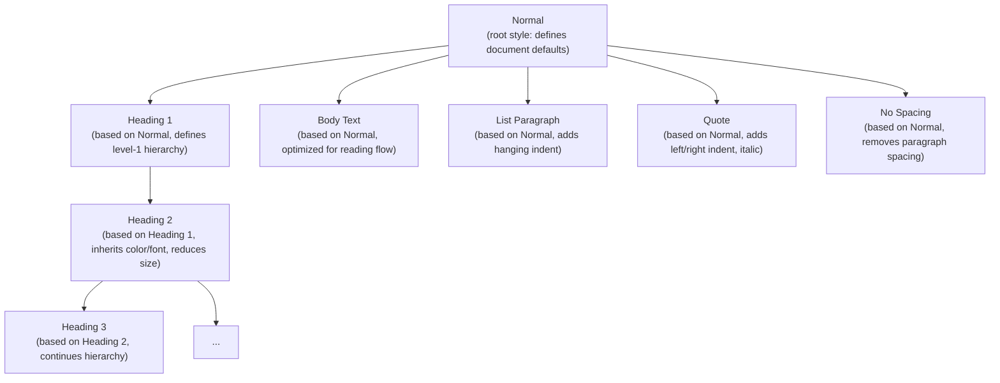

# Lesson 2: Formatting Engines, Typography, Visual Systems

## 1. First-Principles Intuition & Invariants

Professional documentation is not merely the conveyance of textual information but the orchestration of visual hierarchy, cognitive load management, and brand consistency across dozens or hundreds of pages that may be authored by multiple contributors over months or years. The formatting engine—whether it be Microsoft Word's OpenXML renderer, LibreOffice's ODF processor, Google Docs' collaborative real-time compositor, or LaTeX's typesetting compiler—serves as the contract between authorial intent and visual realization. Understanding this contract at the structural level transforms document creation from an exercise in cosmetic button-clicking into a deterministic, scalable production system.

At its foundation, every modern word processing engine maintains a strict separation between content and presentation through a hierarchical style inheritance model. This architectural decision emerged from decades of hard-won lessons in the publishing industry, where manual formatting created unmaintainable documents that collapsed under the weight of revision cycles. The invariant that governs all professional documentation workflows is this: **direct formatting is technical debt, while style-based formatting is programmatic infrastructure**. Every character run, every paragraph block, every section boundary must resolve its visual properties through a deterministic cascade from document defaults, through theme definitions, through inherited style specifications, finally to any local overrides. This resolution pipeline ensures that a single theme modification—changing the corporate sans-serif from Calibri to Aptos, for instance—propagates deterministically across ten thousand paragraph instances without manual intervention.

The typography principles embedded in these engines trace their lineage to five centuries of print craft, codified into digital heuristics. Typeface selection operates along two orthogonal axes: serif versus sans-serif for readability context, and proportional versus monospace for semantic signaling. Body text in long-form business documents defaults to serif faces (Cambria, Georgia, Times New Roman) because the horizontal serifs create implicit baseline guides that reduce saccadic eye movement cost during extended reading sessions. Headings and user interface elements favor sans-serif faces (Calibri, Arial, Helvetica) because their geometric clarity survives low-resolution projection environments and provides unambiguous hierarchical differentiation. Monospace faces (Consolas, Courier New) signal code listings, tabular data alignment, or literal technical strings where character-width predictability matters.

Line spacing, or leading in traditional typography, governs the vertical rhythm that determines whether a page feels cramped or breathable. The golden ratio for body text hovers between 120% and 145% of the point size: a 12-point body face should carry 14.4 to 17.4 points of line height. Tighter leading conserves vertical space but increases line-skip errors where the reader's eye jumps to the wrong subsequent line; looser leading reduces error rate but decreases information density. Business documents targeting analytical audiences—financial models, legal briefs, regulatory filings—trend toward the conservative end of this range to maximize error-free comprehension. Marketing collateral and executive summaries push toward the generous end to project confidence and reduce cognitive intimidation.

Paragraph spacing operates as the visual delimiter that chunks information into digestible cognitive units. The critical invariant here is that **paragraph spacing must exceed line spacing** to provide unambiguous block boundaries. A common professional specification sets line spacing at 1.15 (138% leading) and paragraph spacing at 6 points before, 0 points after, creating a 1.5:1 ratio between inter-paragraph and intra-paragraph whitespace. This ratio ensures that even rapid skimming unambiguously parses paragraph boundaries without requiring indentation, which reclaims horizontal space on narrow page layouts.

The page layout engine itself operates as a constraint satisfaction system, balancing competing imperatives: widow and orphan prevention (never strand a single line of a paragraph at a page or column break), image anchoring stability (graphics must remain semantically bound to their reference paragraphs despite reflow), section break behavior (continuous, next page, even page, odd page), and header-footer inheritance across section boundaries. Each of these constraints introduces potential failure modes that manifest only under specific combinations of content length, embedded object count, and style specifications.

Themes represent the highest level of abstraction in the formatting hierarchy, encoding corporate brand systems into reusable packages. A theme bundles typeface families, color palettes (typically twelve semantic colors: four text/background pairs, six accent colors, two hyperlink colors), and effect presets (shadow algorithms, glow parameters, reflection transforms). The critical architectural insight is that themes operate through indirection: styles reference theme colors by semantic token ("Accent 1") rather than literal hex codes, enabling global rebranding through a single theme swap. This indirection layer mirrors the dependency inversion principle in software architecture, allowing presentation concerns to vary independently from content structure.

## 2. Core Architecture & Mechanics

Modern word processing documents exist as ZIP archives containing XML manifests, binary media assets, and relationship maps. Microsoft Word's .docx format exemplifies this architecture: unzip any .docx file and you will find a directory structure with `word/document.xml` encoding the content tree, `word/styles.xml` defining the style cascade, `word/theme/theme1.xml` specifying the theme parameters, and `word/_rels/` containing relationship manifests that bind media objects to content anchors. This separation-of-concerns architecture enables granular version control, programmatic document generation, and multi-author merge conflict resolution.

The content tree in `document.xml` represents the document as a hierarchy of nested elements: body contains sections, sections contain paragraphs and tables, paragraphs contain runs (character sequences sharing identical formatting), runs contain text nodes. Every element carries zero or more properties that specify direct formatting overrides, style references, or both. The rendering engine walks this tree in document order, resolving the effective formatting for each run through a cascading merge:

```
Document Defaults (docDefaults)
    ↓ overridden by
Theme Definitions (theme1.xml)
    ↓ overridden by
Style Definition (styles.xml: baseStyle → parentStyle → currentStyle)
    ↓ overridden by
Direct Formatting (local <rPr>, <pPr> properties)
```

At each cascade level, properties merge atomically: a style that specifies bold and 14-point size does not erase italic or underline properties inherited from its parent; only properties explicitly redefined at a level replace their ancestors. This partial override semantic distinguishes professional formatting engines from naive CSS-like systems where specificity wars create unpredictable outcomes.

Character formatting properties encode typeface (major theme font, minor theme font, or explicit family name), size (in half-points, allowing 10.5pt precision), weight (normal, bold, or numeric weights 100-900), posture (roman, italic, oblique), decoration (underline with seventeen style variants including single, double, dotted, dashed, wavy), color (by theme token or explicit RGB), and effects (small caps, all caps, strikethrough, superscript, subscript, shadow, emboss, engrave). Advanced properties include character spacing (expanded or condensed by point increments), kerning thresholds (automatic ligature substitution above a point size), and position offsets (baseline shift for custom superscript positioning).

Paragraph formatting properties govern alignment (left, right, center, justified, distributed), indentation (left, right, first-line, hanging), spacing (before, after, line spacing rule), pagination control (widow/orphan control, keep-with-next, keep-lines-together, page-break-before), borders (top, bottom, left, right with independent line styles and colors), shading (background fill), tab stops (left, right, center, decimal, bar with explicit positions and leader characters), and list membership (numbered or bulleted with nesting level). The interaction between first-line indentation and paragraph spacing creates four standard business paragraph styles:

**Block Style** employs zero first-line indentation with non-zero paragraph spacing (typically 6-12pt before). Each paragraph appears as a discrete block separated by whitespace, optimizing for skimmability and compatibility with narrow columns or slides. This style dominates executive summaries, email correspondence, and web-native content.

**Indented Style** employs positive first-line indentation (typically 0.5 inches) with zero paragraph spacing. Paragraphs flow continuously down the page with only the first-line indent signaling boundaries, maximizing information density for print-optimized long-form documents like legal briefs, academic papers, and novel manuscripts.

**Hanging Indent Style** employs negative first-line indentation combined with equal positive left indentation, creating an outdented first line. This pattern serves bulleted lists, numbered lists, bibliography entries, and any content where a visual anchor (bullet, number, citation key) must remain left-aligned while subsequent lines indent for hierarchical clarity.

**Justified Alignment with Hyphenation** distributes word spacing (and optionally character spacing) to achieve flush left and right margins, then applies hyphenation algorithms to minimize "rivers" of whitespace. Professional justified text requires automated hyphenation; without it, narrow columns or long words create grotesque word spacing artifacts. The hyphenation engine applies linguistic rules encoded in dictionary files (en-US.dic, en-GB.dic) that encode syllable boundaries and discretionary hyphen insertion points.

The style inheritance tree in `styles.xml` defines named styles with explicit parent references. The default template ships with approximately fifty built-in styles organized in a three-tier hierarchy:



This inheritance graph means that modifying the Normal style's typeface instantly propagates to every descendant unless a child explicitly overrides the font property. The professional documentation workflow invests heavily in style definition upfront, treating the style library as infrastructure that amortizes its configuration cost across thousands of content edits.

Themes introduce parametric design through twelve semantic color slots and two font slots (major for headings, minor for body text). The theme engine substitutes these tokens at render time:

```
<w:color w:val="accent1" w:themeColor="accent1"/>
```

This XML fragment binds the text color to the theme's Accent 1 slot. Swapping themes—loading a different `theme1.xml`—remaps every accent1 reference to a new RGB value without touching content or styles. The color palette typically follows a 60-30-10 rule borrowed from interior design: 60% neutral backgrounds (Light 1, Dark 1), 30% primary brand color (Accent 1), 10% distributed across supporting accents. This ratio ensures sufficient contrast for accessibility (WCAG 2.1 requires 4.5:1 luminance contrast for body text, 3:1 for large text or UI components) while maintaining brand coherence.

Graphics embedding follows one of two models: inline or anchored. Inline images sit within the text run sequence, flowing with paragraph reflow exactly as if they were oversized characters. This model suits small icons, inline equations, or decorative elements that should never separate from their textual context. Anchored images bind to a paragraph anchor but float independently, positioned by absolute coordinates, margin offsets, or relative alignment (top-left of page, centered in column, bottom-right of margin). The relationship manifest in `word/_rels/document.xml.rels` maps anchor IDs to media files in `word/media/`, typically storing JPEG for photographs (lossy compression, high quality/size ratio), PNG for diagrams (lossless compression, alpha channel support), or WMF/EMF for vector graphics (infinite scaling, minimal file size).

The rendering pipeline for a typical page operates in five passes:

**Pass 1: Style Resolution.** Walk the content tree, merging cascaded properties for each paragraph and run, producing a flat resolved-property tree where every element carries its complete effective formatting independent of inheritance.

**Pass 2: Glyph Shaping.** For each run, query the operating system's font rasterizer (DirectWrite on Windows, Core Text on macOS, FreeType on Linux) to convert Unicode code points into glyph IDs, apply kerning adjustments, substitute ligatures (fi, fl, ffi, ffl), and compute glyph advance widths. This pass produces a glyph buffer with precise horizontal metrics.

**Pass 3: Line Breaking.** Apply the Knuth-Plass line-breaking algorithm (or a greedy approximation) to partition each paragraph's glyph buffer into lines that fit the column width, inserting hyphenation breaks where necessary, and adjusting word spacing for justified alignment. Compute the vertical extent of each line (maximum ascender + maximum descender across all runs on the line) plus the paragraph's leading.

**Pass 4: Pagination.** Accumulate line heights down the column, inserting page breaks when the accumulated height exceeds the page's text body height (page height minus top margin, bottom margin, header space, footer space). Apply widow/orphan rules by shifting up to two lines across page boundaries. Process section breaks that force pagination or switch columns. Position anchored graphics according to their anchor paragraph's final page assignment and their positioning rules.

**Pass 5: Rasterization.** For on-screen rendering, rasterize each glyph at the target resolution with subpixel antialiasing (ClearType on Windows, using RGB subpixel geometry for horizontal edge smoothing). For print rendering, rasterize at 600 DPI or higher, or emit vector PostScript/PDF commands for infinite-resolution output. Composite anchored graphics using their embedded bitmaps or vector definitions.

This five-pass architecture explains why real-time collaborative editing in Google Docs or Office 365 operates with perceptible latency when documents exceed a few hundred pages: each keystroke potentially invalidates line breaks downstream, forcing re-pagination across dozens of pages. The optimization strategy partitions the document into pagination-independent sections, deferring re-rendering of sections not visible in the current viewport.

## 3. High-Performance Optimization & Failure Modes

The productivity delta between novice and expert document authors hinges almost entirely on workflow automation through styles, templates, and keyboard-driven editing. Direct formatting—clicking Bold, selecting a color from the palette, manually adjusting indentation with the ruler—scales linearly with document size and contributor count, devolving into a maintenance nightmare on any document exceeding fifty pages or involving more than two authors. Style-driven workflows scale logarithmically: the upfront investment in defining ten styles pays dividends across ten thousand content edits.

The optimal workflow for a new document class (quarterly business review, product requirements document, financial model narrative) begins with template construction. Create a blank document, delete all content, and invest thirty minutes defining styles:

Define **Normal** with the body typeface (11pt Calibri or 12pt Times New Roman), line spacing (1.15 or 1.5), paragraph spacing (6pt before, 0pt after), and alignment (left or justified). This style serves as the root from which all others inherit.

Define **Heading 1** based on Normal, overriding to 16pt bold sans-serif (Calibri Bold), changing color to Accent 1, adding 12pt space before, 3pt space after, and enabling keep-with-next to prevent headings from orphaning at page bottoms.

Define **Heading 2** through **Heading 4** in a geometric progression, each based on its parent, reducing size by 2pt per level, maintaining bold weight, preserving color inheritance. This hierarchy creates a scannable visual outline when readers skim the document.

Define **Body Text** based on Normal, adding a 0.5-inch left indent to create visual subordination for extended discussion under headings. Define **Body Text First Para** based on Body Text, removing the first-line indent for the opening paragraph under each heading, signaling a new section without redundant indentation.

Define **List Paragraph** based on Normal, adding a 0.5-inch left indent and -0.25-inch first-line indent (hanging), then bind this style to the bulleted and numbered list controls so that pressing the bullet button applies a style rather than injecting direct formatting.

Define **Caption** based on Normal, reducing to 10pt, switching to italic, adding 3pt space before for separation from the figure above. Captions should always use a dedicated style to enable automated table-of-figures generation.

Define **Code** based on Normal, switching to a monospace font (Consolas 10pt), adding a light gray background shading, and removing paragraph spacing for multi-line code blocks that should appear as a single visual unit.

Save this configured document as a template file (.dotx in Word, .ott in LibreOffice), storing it in the organization's shared template repository. Every new document of this class starts from this template, inheriting the entire style library and ensuring zero-configuration formatting consistency.

The keyboard-driven editing workflow eliminates mouse friction by binding style application to keyboard shortcuts. Microsoft Word defaults `Ctrl+Alt+1` through `Ctrl+Alt+3` to Heading 1-3; extend this pattern by customizing `Ctrl+Alt+N` for Normal, `Ctrl+Alt+B` for Body Text, `Ctrl+Alt+Q` for Quote. The ergonomic pattern here is that the left hand holds the modifier chord while the right hand taps the mnemonic key, allowing style changes without lifting hands from the home row. A practiced author can apply fifty style changes per minute using this method, an order of magnitude faster than mouse-driven style selection from dropdowns.

Multi-level list configuration represents one of the most powerful and most misconfigured features in word processing. A properly configured list binds each nesting level to a style (List Paragraph Level 1, List Paragraph Level 2, etc.), defines the numbering format (1., a., i., or custom patterns like 1.1, 1.1.1), and sets the indent progression (typically 0.5 inches per level). The critical invariant is that **tab key demotes list level, Shift+Tab promotes**, enabling rapid outline construction:

```
1. Executive Summary [type, Enter]
2. [Tab] converts to 1.1.
   Background [type, Enter]
   1.2. [type content, Enter]
   1.3. [type content, Shift+Tab, Enter]
2. Market Analysis [continues at top level]
```

This outline-driven authoring workflow mirrors the cognitive process of hierarchical decomposition, allowing authors to sketch structure first, then fill in details at each level without ever touching the mouse.

Graphics optimization for large documents requires aggressive compression and resolution targeting. A 4000×3000 pixel photograph embedded at 300 DPI renders at 13×10 inches, far exceeding typical document widths of 6-7 inches. Embedding at native resolution bloats file size and slows rendering. The optimization protocol:

For photographs, resize to target display dimensions multiplied by 1.5× (a 4-inch wide image becomes 600 pixels), then compress as JPEG at 85% quality. This yields a perceptually lossless image at 10-15% of the original file size.

For diagrams and charts, export as vector formats (SVG, EMF, PDF) whenever possible, allowing infinite zoom without pixelation. If raster formats are required, export at 150 DPI for screen-targeted documents (PDFs viewed on tablets), 300 DPI for print-targeted documents.

For screenshots, capture at native screen resolution but crop aggressively to the relevant UI region. A full-screen 4K screenshot (3840×2160) showing one dialog box wastes 95% of its pixels on irrelevant chrome. Crop to the dialog, add a 10-pixel border, and compress as PNG.

Link external images rather than embedding when documents will be version-controlled or collaboratively edited. External linking stores only the file path in the document, reducing file size and enabling image updates without reopening the document. The trade-off is portability: linked images break when the document moves to a different filesystem context. The professional pattern here is to embed images in final deliverables but link them in working drafts.

Table formatting represents a specialized pagination challenge because tables should not split across pages in ways that separate headers from data. The optimization heuristics:

Enable "Repeat header rows" for multi-page tables, ensuring column labels appear at the top of each page fragment.

Disable "Allow row to break across pages" for tables containing multi-line cells, preventing a single row from splitting mid-content.

Set "Text wrapping: None" for tables that should occupy the full column width without text flow around them, simplifying pagination logic.

Use "Table: Grid" style as a base, customizing border weights (hairline for internal cells, 1.5pt for header bottom and table perimeter) and shading (10% gray for alternating rows to create scannable row stripes).

Failure modes in formatting engines typically manifest as pagination instabilities where minor content edits trigger cascading reflows across dozens of pages. The root causes:

**Circular style inheritance** occurs when Style A is based on Style B, which is based on Style A, creating an infinite resolution loop. Prevention requires auditing the style hierarchy in the styles pane, ensuring all inheritance chains terminate at Normal or another root style.

**Ambiguous anchoring** occurs when an image is anchored to a paragraph that moves across pages, but the image's positioning rule specifies "Top of page," causing a mismatch between anchor page and display page. Resolution requires switching to "Move with text" positioning or anchoring to a fixed paragraph (section title) that won't reflow.

**Runaway keeps** occur when keep-with-next is applied to a sequence of paragraphs spanning more than a page height, forcing the engine to push the entire sequence to the next page, leaving a large whitespace gap. Prevention requires applying keep-with-next only to heading-plus-first-paragraph pairs, never to long content runs.

**Theme color corruption** occurs when a style references a theme color that doesn't exist in the current theme (Accent 7 in a six-accent theme), typically after importing content from a document with a different theme. The renderer falls back to black, creating jarring inconsistency. Resolution requires re-mapping affected styles to valid theme colors or embedding a custom theme with sufficient accent slots.

**Font substitution cascades** occur when a document specifies a font not installed on the rendering system, triggering the operating system's font fallback chain (Calibri → Arial → Helvetica → Sans-Serif), which may differ across platforms. Professional workflows embed font subsets in PDF exports or standardize on cross-platform web fonts (Arial, Times New Roman, Courier New, Georgia) that exist identically on Windows, macOS, and Linux.

The ultimate optimization for complex documents is structured authoring using semantic XML vocabularies (DocBook, DITA) or lightweight markup (Markdown, AsciiDoc) that separates content from presentation entirely, then compiles to PDF, HTML, or Word via transformation pipelines (Pandoc, LaTeX, XSL-FO). This workflow trades WYSIWYG interactivity for deterministic version control and single-source multi-channel publishing, but remains the gold standard for technical documentation, regulatory filings, and any content requiring decade-scale maintenance.
