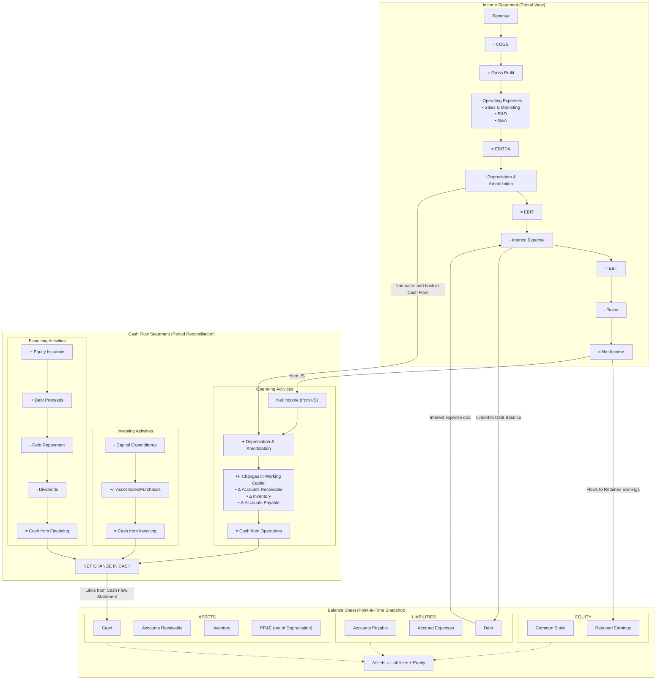

# Lesson 3: Financial Projections, Unit Economics

## 1. First-Principles Intuition & Invariants

Financial projections represent the quantitative translation of strategic hypotheses into testable cash flow outcomes. Where a business plan articulates market opportunity and competitive positioning in narrative form, the financial model serves as the computational engine that stress-tests those assertions against capital constraints, operational realities, and time-value mathematics. A rigorous financial projection framework transforms qualitative strategic intent into falsifiable predictions about revenue generation, cost structure dynamics, and capital consumption patterns over a defined planning horizon.

The fundamental invariant governing all financial projections is the cash flow identity: a business survives if and only if cumulative cash inflows exceed cumulative cash outflows before the entity exhausts its accessible capital reserves. This deceptively simple constraint drives every modeling decision. Revenue projections must account for payment terms and collection lag. Cost structures must distinguish between variable costs that scale with volume and fixed costs that persist regardless of throughput. Capital expenditures consume cash today to generate capacity for tomorrow's revenue. The Three-Statement model—Income Statement, Balance Sheet, and Cash Flow Statement—exists precisely to enforce mathematical consistency across these interdependent dimensions.

Unit economics provide the atomic foundation beneath aggregate financial projections. Every business ultimately decomposes into repeatable transactions between the firm and its customers. The unit economic profile measures profitability at this granular transaction level, answering the question: does the revenue generated from serving one additional customer exceed the fully-loaded cost of acquiring and serving that customer? The Customer Lifetime Value to Customer Acquisition Cost ratio (LTV:CAC) encodes this relationship. A sustainable business model requires LTV:CAC ratios exceeding 3:1, ensuring that the present value of future margin contribution from a customer cohort exceeds the upfront sales and marketing investment required to acquire that cohort by a sufficient margin to cover corporate overhead, product development, and return requirements.

The discount rate embedded within present value calculations reflects opportunity cost and risk-adjusted return expectations. Capital providers—whether equity investors or debt lenders—demand compensation commensurate with the risk profile of the enterprise. Early-stage ventures with unproven product-market fit command discount rates approaching 40-60% as venture investors price in failure probability and illiquidity premiums. Mature, cash-generative businesses with predictable revenue streams trade at Weighted Average Cost of Capital (WACC) rates closer to 8-12%, reflecting lower execution risk and the diversification benefits of public equity markets. The discount rate functions as the gravitational constant in financial modeling: higher rates compress future cash flows more aggressively, penalizing business models that defer profitability in pursuit of market share.

Break-even analysis identifies the minimum operational scale at which total revenue equals total costs, generating neither profit nor loss. The break-even volume threshold emerges directly from the cost structure decomposition. Fixed costs—rent, salaries, software subscriptions, insurance—persist regardless of transaction volume. Variable costs—raw materials, transaction fees, sales commissions, packaging—scale linearly with unit volume. The contribution margin, defined as revenue per unit minus variable cost per unit, represents the incremental profit available to cover fixed costs after each transaction. Break-even volume equals fixed costs divided by contribution margin per unit. This calculation reveals operational leverage: businesses with high fixed costs and high contribution margins exhibit dramatic profit swings around the break-even threshold, while low-fixed-cost structures sacrifice upside leverage in exchange for downside protection.

Cash flow projections extend beyond accounting profitability to model actual cash movements through the business. Revenue recognition under accrual accounting occurs at the moment of contractual delivery, but cash collection lags by 30, 60, or 90 days depending on payment terms. A rapidly growing business can appear profitable on the Income Statement while simultaneously exhausting cash reserves to finance accounts receivable growth and inventory buildup. The Cash Conversion Cycle quantifies this timing mismatch by measuring the average number of days between cash outflow for inventory purchases and cash inflow from customer payments. Negative cash conversion cycles—where customer payments arrive before supplier invoices come due—create self-financing growth dynamics, as exemplified by Dell's direct-to-consumer model in the 1990s. Most businesses, however, face positive cash conversion cycles requiring external capital to bridge the gap between expenditure and collection.

Funding requirements emerge from the cumulative cash flow waterfall over the planning horizon. The financial model must identify the maximum negative cash position—the point of deepest capital consumption before the business achieves self-sustaining cash flow. This nadir determines the minimum financing quantum required to reach operational viability. Sophisticated investors scrutinize not just the total capital requirement but also the capital efficiency implied by the model: how much revenue growth and margin expansion does each incremental dollar of invested capital produce? Capital-efficient business models achieve unit economics and scale thresholds that enable profitable growth before exhausting initial funding tranches, creating optionality to raise subsequent capital at higher valuations rather than from a position of distress.

The construction of defensible financial projections demands explicit articulation of the causal mechanism linking strategic actions to financial outcomes. Revenue growth does not manifest through optimistic hockey-stick curves but through quantifiable acquisition funnels, conversion rates, pricing strategies, and cohort expansion patterns. Cost structures do not scale with abstract "economies of scale" but through specific operational improvements: reduced customer support tickets per user through product refinement, negotiated volume discounts with suppliers as procurement scales, or marketing efficiency gains as brand recognition obviates paid acquisition channels. Every line item in the financial model should trace back to a falsifiable operational hypothesis that management can measure, monitor, and modify based on empirical feedback.

## 2. Core Architecture & Mechanics

The Three-Statement financial model forms the architectural backbone of comprehensive financial projections. These three statements—the Income Statement, Balance Sheet, and Cash Flow Statement—maintain mathematical interdependence through a series of linking formulas that enforce accounting identities. The Income Statement measures profitability over a period, the Balance Sheet captures the financial position at a point in time, and the Cash Flow Statement reconciles the two by tracking actual cash movements that may differ from accrual accounting revenue and expense recognition.

The Income Statement begins with revenue and subtracts costs in descending order of variability. Revenue equals unit volume multiplied by average selling price, potentially segmented across multiple product lines, customer segments, or geographic regions. Cost of Goods Sold (COGS) represents the direct variable costs attributable to production or delivery: raw materials, manufacturing labor, hosting infrastructure for software-as-a-service businesses, or payment processing fees for transaction platforms. Gross Profit equals Revenue minus COGS, and Gross Margin expressed as a percentage (Gross Profit divided by Revenue) reveals the fundamental unit economics before overhead allocation.

Operating expenses separate into Sales & Marketing, Research & Development, and General & Administrative categories. Sales & Marketing expenses include customer acquisition costs: advertising spend, sales team compensation, marketing technology subscriptions, and event sponsorships. R&D captures product development costs: engineering salaries, software tooling, prototype materials, and quality assurance infrastructure. G&A encompasses corporate overhead: executive compensation, legal fees, accounting services, office rent, and insurance premiums. The distinction between COGS and operating expenses reflects controllability and scalability: COGS scales automatically with volume, while operating expenses require deliberate management decisions to scale up or down.

Earnings Before Interest, Taxes, Depreciation, and Amortization (EBITDA) equals Gross Profit minus Operating Expenses. EBITDA serves as a proxy for cash generation capacity before financing costs and non-cash accounting adjustments. Depreciation and Amortization represent non-cash expenses that allocate the cost of long-lived assets over their useful lives. A $100,000 server purchase does not expense entirely in Year 1 but depreciates over a five-year period at $20,000 per year. Interest expense reflects the cost of debt financing, calculated as the average debt balance multiplied by the contractual interest rate. Taxes apply to Earnings Before Tax at the statutory corporate tax rate, typically 21% in the United States federal regime plus state and local levies.

Net Income flows from the bottom of the Income Statement to the Retained Earnings section of the Balance Sheet, linking the two statements. The Balance Sheet divides into Assets, Liabilities, and Equity, maintaining the fundamental accounting equation: Assets = Liabilities + Equity. Assets include Cash, Accounts Receivable (revenue recognized but not yet collected), Inventory, Prepaid Expenses, Property Plant & Equipment (PP&E), and Intangible Assets. Liabilities encompass Accounts Payable (expenses incurred but not yet paid), Accrued Expenses, Deferred Revenue (cash collected but not yet earned), Short-Term Debt, and Long-Term Debt. Equity consists of Common Stock (initial investment at par value), Additional Paid-In Capital (investment premium above par), and Retained Earnings (cumulative net income minus dividends).

The Cash Flow Statement reconciles Net Income to the actual change in the Cash balance on the Balance Sheet. The statement separates into three sections: Operating Activities, Investing Activities, and Financing Activities. Operating cash flow begins with Net Income and adjusts for non-cash items. Depreciation and Amortization are added back because they reduced Net Income without consuming cash. Changes in working capital accounts adjust for timing differences: an increase in Accounts Receivable subtracts from cash flow because revenue was recognized but cash not collected; an increase in Accounts Payable adds to cash flow because expenses were recognized but cash not disbursed.

Investing cash flow captures capital expenditures and asset acquisitions. PP&E purchases appear as negative cash flow, representing outflows to build operational capacity. Asset sales generate positive cash flow. For financial modeling purposes, capital expenditure projections must align with capacity requirements to support projected revenue growth. A manufacturing business cannot double production without corresponding investment in equipment. A software business cannot scale user base without proportional infrastructure investment.

Financing cash flow tracks capital raising and distribution activities. Equity issuance generates positive cash flow as investors inject capital. Debt proceeds provide cash inflow, while principal repayments create cash outflow. Dividend payments and share buybacks represent cash distributions to equity holders. The net of these three sections equals the period change in Cash, which must match the difference between the ending Cash balance and beginning Cash balance on the Balance Sheet. This circular linkage enforces internal consistency: if the model balances, the mathematics correctly represent the flow of value through the business.

Revenue modeling for a subscription business decomposes into cohort-based expansion mathematics. Define cohorts by acquisition period (monthly or quarterly) and track each cohort's lifecycle independently. The cohort revenue formula equals Beginning Subscribers multiplied by Monthly Recurring Revenue (MRR) per subscriber, adjusted for churn and expansion. Churn represents the percentage of subscribers who cancel each period, typically expressed as monthly or annual rates. Expansion captures increases in MRR from existing customers through upsells, cross-sells, or usage-based billing growth.

The cohort revenue projection for Month N equals: (Beginning Subscribers) × (1 - Churn Rate)^N × (Initial MRR) × (1 + Expansion Rate)^N. This formula compounds both attrition and expansion effects over time. A business with 5% monthly churn loses half its initial cohort within 14 months unless expansion offsets attrition. Net Revenue Retention (NRR) combines churn and expansion into a single metric: if a $100,000 cohort loses $5,000 to churn but gains $15,000 from expansion, NRR equals 110%. Sustainable SaaS businesses target NRR above 100%, ensuring existing customer base grows revenue even without new customer acquisition.

For transaction-based businesses, revenue modeling centers on conversion funnel mathematics. Define the stages: top-of-funnel traffic, qualified leads, sales opportunities, closed deals. Assign conversion rates between each stage based on historical data or industry benchmarks. Projected revenue equals (Top-of-Funnel Volume) × (Stage 1 Conversion) × (Stage 2 Conversion) × (Close Rate) × (Average Deal Size). This multiplicative structure reveals leverage points: a 10% improvement in close rate from 20% to 22% increases revenue by 10%, but a 10% improvement in lead qualification from 30% to 33% increases revenue by 10% only if all downstream rates hold constant.

Customer Acquisition Cost (CAC) calculation requires full-cycle attribution from initial marketing touch through closed sale. Total CAC equals the sum of all sales and marketing expenses divided by the number of new customers acquired in the period. Accurate CAC measurement must account for timing lags: marketing spend in Quarter 1 may generate leads that convert in Quarter 2, requiring cohort-based expense allocation. Blended CAC averages across all acquisition channels, while segmented CAC isolates efficiency by channel (paid search, content marketing, field sales, partner referrals). High-performing growth organizations optimize CAC at the channel level, reallocating budget from high-CAC to low-CAC channels while maintaining volume throughput.

Customer Lifetime Value (LTV) projects the present value of future profit contribution from a customer cohort. The formula depends on revenue model structure. For subscription businesses: LTV = (Monthly Recurring Revenue per Customer × Gross Margin %) / (Monthly Churn Rate + Monthly Discount Rate). The discount rate converts future cash flows to present value; a typical rate equals the monthly equivalent of the firm's cost of capital, approximately 1% per month for a 12% annual rate. A customer paying $100/month with 70% gross margin, 5% monthly churn, and 1% monthly discount rate generates LTV of ($100 × 0.70) / (0.05 + 0.01) = $1,167.

The LTV:CAC ratio determines whether the unit economics support scalable growth. Ratios below 1:1 indicate value destruction: the business pays more to acquire customers than they generate in lifetime value. Ratios between 1:1 and 3:1 suggest marginal viability but insufficient return to justify aggressive growth investment. Ratios above 3:1 signal efficient unit economics that merit increased customer acquisition spending. The payback period—the number of months required for cumulative gross profit to recover CAC—provides a complementary metric. Investors prefer payback periods under 12 months, ensuring capital deployed in customer acquisition returns quickly enough to self-fund continued growth.

Break-even analysis identifies the minimum revenue threshold at which the business achieves profitability. Express total costs as the sum of fixed costs (F) and variable costs (V × Q), where V represents variable cost per unit and Q represents unit volume. Revenue equals price per unit (P) multiplied by quantity (P × Q). At break-even, revenue equals total costs: P × Q = F + (V × Q). Solving for Q yields the break-even volume: Q_breakeven = F / (P - V). The numerator (fixed costs) represents the overhead burden the business must cover. The denominator (P - V) equals the contribution margin per unit, the incremental profit available after each sale.

Consider a software business with $500,000 monthly fixed costs (salaries, rent, SaaS subscriptions), $20 variable cost per user (hosting, support, payment processing), and $100 monthly subscription price. Break-even volume equals $500,000 / ($100 - $20) = 6,250 subscribers. Below 6,250 subscribers, the business operates at a loss; above 6,250, the business generates profit. Every subscriber beyond break-even contributes the full $80 contribution margin to profit. A business at 8,000 subscribers generates monthly profit of (8,000 - 6,250) × $80 = $140,000, despite having fixed costs of $500,000.

Cash flow projections require explicit modeling of working capital movements. Accounts Receivable equals revenue multiplied by Days Sales Outstanding (DSO) divided by days in the period. If monthly revenue equals $1,000,000 and DSO equals 45 days, Accounts Receivable stabilizes at $1,500,000 ($1,000,000 × 45 / 30). Growing revenue creates cash consumption as Accounts Receivable increases: growing from $1,000,000 to $1,500,000 monthly revenue increases Accounts Receivable by $750,000, consuming $750,000 of cash to finance the expansion.

Inventory modeling depends on inventory turnover velocity. Inventory equals COGS divided by Inventory Turns. A manufacturing business with $10,000,000 annual COGS and 4 inventory turns maintains $2,500,000 average inventory. Increasing turns to 6 through supply chain optimization reduces inventory to $1,667,000, releasing $833,000 of cash from working capital. Accounts Payable modeling follows parallel logic: Accounts Payable equals COGS multiplied by Days Payable Outstanding (DPO) divided by days in the period. Extending payment terms from 30 to 45 days increases Accounts Payable by 50%, freeing cash for operational use.

Funding requirement projections emerge from the cumulative cash flow waterfall. Construct a monthly cash flow schedule across the planning horizon, typically three to five years. Each month shows beginning cash, cash inflows (revenue collections, equity investments, debt proceeds), cash outflows (operating expenses, capital expenditures, debt service), and ending cash. The minimum cash balance across all periods defines the maximum capital consumption point. Add a safety buffer—typically 20-30% of the minimum balance—to account for projection uncertainty and execution delays.

The funding quantum must support the business through to a sustainable cash flow milestone: either profitability (where operating cash flow turns positive) or sufficient scale to raise subsequent capital at favorable terms. Undercapitalizing forces premature cost-cutting that impairs growth trajectory, while overcapitalizing dilutes founder equity and creates pressure to deploy capital inefficiently. The optimal funding structure balances these tensions by projecting conservative (downside case) and aggressive (upside case) scenarios, then sizing capital raises to survive the downside while positioning for the upside.

## 3. High-Performance Optimization & Failure Modes

Financial projection accuracy degrades rapidly under several systematic failure modes that plague both novice and experienced operators. The first and most pervasive error manifests as top-down revenue sandbagging followed by bottom-up cost minimization, creating the infamous hockey-stick projection where flat performance suddenly inflects into exponential growth. This pattern reflects wishful thinking rather than operational reality. High-integrity projections build revenue from granular driver mathematics—cohort curves, funnel conversion rates, sales capacity models—and stress-test assumptions against historical performance and competitive benchmarks.

Revenue model validation requires ruthless interrogation of the causal chain linking strategic actions to customer acquisition. A B2B SaaS business projecting 200% year-over-year growth must demonstrate how sales team expansion, marketing spend increases, or product velocity improvements translate into pipeline generation. If the current sales team of five account executives generates $5,000,000 annual recurring revenue, scaling to $15,000,000 requires either tripling the team to fifteen or doubling quota attainment through improved lead quality, product fit, or pricing. The model must explicitly specify which mechanism drives growth and quantify the corresponding investment requirement.

Cohort-based revenue models expose unit economic deterioration before aggregate metrics signal distress. Plotting retention curves by acquisition cohort reveals whether recent customers exhibit weaker engagement than early adopters, suggesting product-market fit erosion or adverse selection in the customer mix. Comparing CAC efficiency across cohorts identifies whether customer acquisition costs inflate as the business exhausts low-hanging fruit and must reach less accessible market segments. Sophisticated investors scrutinize cohort economics more heavily than aggregate growth rates precisely because cohort data reveals sustainability of the growth engine.

Cost structure modeling fails when fixed and variable cost classifications lack operational grounding. Cloud infrastructure costs appear variable—scaling with user volume—but exhibit step-function behavior due to reserved instance commitments and instance size granularity. Customer support costs scale with user base but exhibit delayed response: support capacity must scale in advance of user growth to maintain service levels, creating temporary cost spikes ahead of corresponding revenue. Sales team expansion creates fixed cost commitments that materialize immediately while revenue impact lags by six to twelve months as new representatives ramp productivity.

Gross margin calculation errors compound when businesses misallocate costs between COGS and operating expenses. Hosting infrastructure clearly belongs in COGS for a SaaS business, but customer success teams occupy gray area: are they direct service delivery costs (COGS) or revenue expansion functions (Sales & Marketing)? The classification determines gross margin presentation and comparability to peers. Best practice allocates reactive customer support to COGS while proactive account expansion activities flow to Sales & Marketing. Consistent classification matters more than the specific boundary as long as the methodology remains stable over time.

Working capital projections commonly underestimate cash consumption during growth acceleration. Revenue growth from $10,000,000 to $15,000,000 represents $5,000,000 incremental revenue, but if DSO equals 60 days, Accounts Receivable increases by $833,000 ($5,000,000 × 60 / 360), consuming nearly $1,000,000 in cash to finance the growth. Rapid scaling businesses burn cash faster than the Income Statement suggests because they must fund growing Accounts Receivable and Inventory balances before customers pay. The cash conversion cycle—the time between paying suppliers and collecting from customers—determines the working capital financing requirement per dollar of revenue growth.

Scenario planning mitigates projection uncertainty through structured sensitivity analysis. Construct three cases—downside, base, and upside—varying key assumptions along realistic ranges. Revenue growth rates might vary from 20% (downside) to 50% (base) to 100% (upside). Gross margins might range from 60% to 70% to 75%. Churn rates from 7% to 5% to 3%. The downside case should reflect plausible disappointing outcomes, not catastrophic failure, ensuring the business survives even if growth disappoints. The base case represents the expected trajectory assuming competent execution without exceptional luck. The upside case captures realistic best-case outcomes, not fantasy hockey-stick scenarios.

Funding strategy optimization balances dilution minimization against operational flexibility. Raising too little capital forces premature revenue pressure and reactive cost-cutting that impairs product development and market position. Raising excessive capital dilutes founder equity and creates deployment pressure that encourages wasteful spending on low-return initiatives. The optimal raise quantum targets 18-24 months of runway under the base case scenario, with sufficient buffer to survive downside outcomes. This timeframe provides enough runway to hit meaningful milestones—product launches, customer adoption inflections, unit economic improvements—that derisk subsequent financing rounds while limiting founder dilution.

Capital efficiency metrics inform resource allocation decisions and competitive positioning. Magic Number measures sales efficiency by dividing net new Annual Recurring Revenue by prior quarter Sales & Marketing spend: a Magic Number above 1.0 indicates each dollar of sales spend generates more than one dollar of annual recurring revenue, suggesting aggressive growth investment makes economic sense. Rule of 40 combines revenue growth rate and EBITDA margin: sustainable SaaS businesses should deliver combined growth and profitability exceeding 40% (e.g., 30% growth with 15% EBITDA margin, or 50% growth with -10% EBITDA margin).

Break-even sensitivity analysis identifies operational leverage in the business model. Calculate break-even volume under the base case, then recalculate under stressed pricing (20% lower) and elevated fixed costs (30% higher). The delta reveals fragility: businesses that barely break even under optimistic assumptions and require 3x volume under stressed conditions face existential risk from competitive pricing pressure or cost overruns. Conversely, businesses that break even at 50% of base case volume with 20% pricing haircuts possess robust unit economics that tolerate execution challenges.

Cash flow stress testing simulates liquidity crises before they materialize. Model a scenario where revenue growth stalls for two quarters while fixed costs persist. Calculate the resulting cash burn and compare to available cash reserves. If the business exhausts cash within four months under a revenue stall scenario, liquidity risk is unacceptably high. Mitigation strategies include raising additional capital, negotiating a revolver credit facility for working capital financing, or restructuring the cost base to reduce fixed overhead and increase variable cost proportion.

Debt capacity analysis determines the maximum sustainable leverage based on cash flow generation. Lenders evaluate debt service coverage ratio (DSCR): the ratio of operating cash flow to required debt service (principal plus interest). DSCR below 1.25× suggests inadequate cushion to service debt through business cycles. Maximum debt capacity equals sustainable EBITDA multiplied by acceptable leverage multiples, typically 2-4× for operating businesses, higher for asset-backed lending. A business generating $10,000,000 EBITDA with 3× leverage capacity can support $30,000,000 debt, implying annual debt service of approximately $3,750,000 (principal) plus interest depending on loan structure and rates.

Unit economic optimization focuses on controllable drivers within the LTV and CAC equation. CAC reduction pathways include organic channel development (content marketing, SEO, community building), conversion rate optimization through product-led growth mechanics, or sales process refinement to compress cycle times. LTV expansion strategies encompass churn reduction through improved onboarding and customer success, expansion revenue growth through usage-based pricing or upsell motion development, or pricing optimization to capture more value from existing usage patterns.

Financial model validation protocols guard against formula errors and assumption inconsistencies. The Balance Sheet must balance every period: Assets must equal Liabilities plus Equity within rounding tolerance. The Cash Flow Statement must reconcile Net Income to the change in Cash. Depreciation must match the amortization schedule for PP&E. Debt balances must tie to the debt rollforward schedule showing beginning balance, new issuance, and repayments. Revenue growth rates should match the underlying driver mathematics: subscriber counts times pricing times retention curves. Building a separate assumptions dashboard that feeds into the model creates a single source of truth for key drivers and enables rapid scenario testing.

Real-world financial projections operate under uncertainty that defies precise quantification. Rather than pursuing false precision through elaborate Monte Carlo simulations, effective practitioners focus on identifying the two or three assumptions that dominate outcome variance. For a SaaS business, customer churn rate and sales capacity ramp productivity typically drive 80% of outcome uncertainty. For a marketplace business, supply-side liquidity and take-rate sustainability determine viability. Concentrating analytical effort on validating and derisking these critical assumptions delivers more insight than comprehensive but shallow sensitivity analysis across dozens of variables.

The ultimate test of financial projection quality emerges through iterative comparison of projected versus actual results. Establish a monthly variance analysis discipline: compare actual revenue, expenses, and cash flow against the model, calculate percentage deviations, and diagnose root causes. Revenue shortfalls may reflect slower ramp times, lower conversion rates, or pricing resistance. Expense overruns may stem from unplanned hiring, vendor price increases, or operational inefficiencies. Treat significant variances as signals to update the model's assumptions rather than defending the original projection. Financial models serve as decision-making tools, not static commitments; their value lies in being updated frequently based on empirical feedback rather than remaining frozen in time as artifacts of past beliefs.
