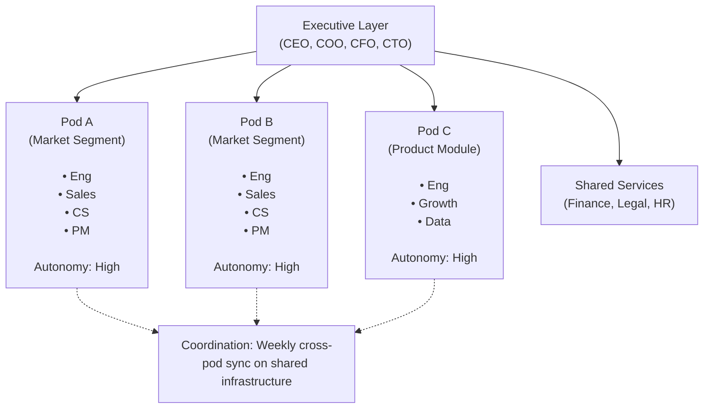
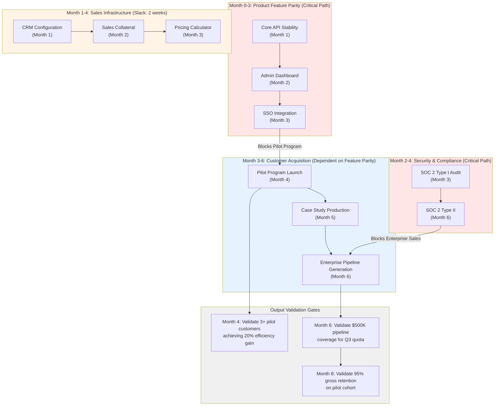

# Lesson 4: Operations, Execution Roadmap

## 1. First-Principles Intuition & Invariants

The operations section of a business plan represents the most critical translation layer between strategic vision and realized value. While executives often fixate on market sizing and financial projections, sophisticated investors and board members scrutinize the operations roadmap with forensic intensity because it reveals whether the leadership team possesses genuine execution literacy or merely aspirational slides. The operational blueprint must demonstrate not only what the organization will build and sell, but precisely how resources convert into outputs, how authority flows through decision nodes, and how feedback loops detect and correct course deviations before they compound into existential threats.

At its foundation, operational planning obeys three invariant principles that transcend industry and business model. First, organizational structure must achieve information density at decision points—the individuals making resource allocation choices require unfiltered access to ground truth about customer behavior, production constraints, and competitive movements. Second, operational processes must encode reversibility into high-uncertainty activities while locking in efficiency gains on proven workflows. Early-stage ventures require experimentation frameworks that permit rapid pivots without catastrophic sunk costs, whereas mature operations demand process standardization that eliminates variation and waste. Third, success metrics must create tight causal linkage between operator actions and business outcomes, ensuring that teams optimize for value creation rather than vanity indicators or local maxima that harm global performance.

The execution roadmap itself functions as a forcing mechanism that transforms vague strategic intent into falsifiable hypotheses with clear temporal boundaries. When a founder declares an intention to "dominate the mid-market segment," the operational plan must decompose that aspiration into a dependency graph of prerequisite capabilities: customer acquisition engine calibration, product feature parity with incumbents, support infrastructure scaling, and revenue operations maturity. Each capability node carries a resource envelope, a completion criterion, and an integration test that validates readiness for the subsequent phase. This decomposition discipline prevents the common failure mode where teams celebrate superficial milestones—launching a website, closing a pilot customer, raising a funding round—while neglecting the unglamorous operational foundations that determine terminal viability.

The most sophisticated business plans recognize that operational design inherently encodes strategic choices that constrain future option space. Selecting a direct sales model over channel partnerships preordains a cost structure, customer relationship intensity, and organizational skill profile fundamentally incompatible with later pivot attempts. Choosing to build proprietary manufacturing capacity versus contract manufacturing establishes capital intensity, gross margin structure, and supply chain risk exposure that becomes nearly impossible to reverse without destroying shareholder value. These operational architecture decisions carry consequences that persist for years and compound through path dependency, making the initial design phase the highest-leverage intervention point for founders and executives.

## 2. Core Architecture & Mechanics

The organizational structure articulated in a business plan must solve the fundamental tension between specialization efficiency and cross-functional coordination overhead. Functional hierarchies—where engineering, sales, marketing, finance, and operations report through separate vertical chains to the executive layer—maximize domain expertise depth and create clear career progression ladders, but they introduce coordination latency and tribal knowledge silos that strangle horizontal workflows. Matrix structures attempt to resolve this tension by overlaying product or regional dimensions onto functional reporting lines, granting individual contributors dual allegiance to both a functional manager and a cross-functional product owner. However, matrix organizations introduce role ambiguity and political complexity that scales poorly beyond approximately two hundred employees.

For early-stage ventures in the business plan phase, the optimal structure typically resembles a flat, mission-oriented pod architecture. Each pod comprises a cross-functional team of four to eight individuals with complete ownership of a customer segment, product module, or geographic market. The pod includes engineering capacity, go-to-market execution, customer success accountability, and analytical instrumentation, granting autonomy to hypothesize, experiment, and iterate without dependency bottlenecks on centralized shared services. This structure maximizes learning velocity during the product-market fit search phase, when the organization must run dozens of falsifiable experiments per quarter to discover viable commercial models. As the venture scales past fifty employees and discovers repeatable revenue motions, selective centralization of specialized functions—financial planning, legal infrastructure, core platform engineering—reduces duplication waste while preserving pod autonomy for customer-facing innovation.

Operational processes transform organizational capacity into customer value through repeatable workflows that reduce execution variance and compress cycle time. The business plan must specify process design for three critical value streams: product development cycles, customer acquisition motions, and customer success operations. For product development, the choice between waterfall planning, Scrum sprints, Kanban flow, or Shape Up cycles encodes assumptions about requirement stability, technical uncertainty, and stakeholder coordination needs. Waterfall methodologies impose detailed upfront specification and sequential phase gates, trading flexibility for predictability in domains where requirements are well understood and change costs are high—medical device firmware, aerospace systems, financial clearing infrastructure. Scrum frameworks introduce two-week iteration boundaries with sprint planning ceremonies, daily standups, retrospectives, and demo reviews that create frequent inspection points and adaptation opportunities suitable for domains with emergent requirements and rapid competitive evolution.

The go-to-market process architecture determines how the organization identifies prospects, qualifies opportunities, advances deals through pipeline stages, negotiates commercial terms, and consummates revenue recognition. For enterprise software selling into regulated industries with multi-stakeholder buying committees, the MEDDPICC qualification framework imposes operational discipline that prevents sales teams from wasting cycles on unwinnable deals or opportunities with hidden landmines. Each qualification criterion functions as a gate condition that must achieve green status before progressing to the next pipeline stage. Metrics establishes quantifiable economic impact that the solution delivers, providing ammunition for the champion to build internal business cases. Economic Buyer identification confirms direct access to the individual with discretionary budget authority rather than chasing influencers who lack signature power. Decision Criteria maps the formal evaluation scorecard and weighting factors that the buying committee will apply, enabling proactive positioning against competitor weaknesses. Decision Process delineates the sequence of approval gates, committee reviews, legal reviews, and executive signoffs with calendar estimates for each phase. Paper Process traces the procurement workflow from purchase order generation through accounts payable execution, surfacing bureaucratic obstacles that create closing delays. Identify Pain validates that the prospect suffers acute, quantified business pain that creates urgency rather than pursuing nice-to-have features that perpetually defer. Champion confirms an internal advocate with political capital and vested interest in the vendor's success who will navigate internal obstacles. Competition illuminates which alternatives the prospect is evaluating and their relative strengths, enabling differentiated positioning.

The milestone planning framework embedded in the business plan must balance inspirational ambition with statistical realism grounded in capacity constraints and historical cycle time data. Sophisticated milestone roadmaps distinguish between input milestones under team control—ship product release, launch advertising campaign, hire sales team—and output milestones dependent on market response—achieve ten enterprise customers, reach one million revenue run rate, attain forty percent gross margin. Input milestones serve as commitment devices that hold teams accountable for execution within their control, whereas output milestones function as hypothesis validation gates that trigger strategic reassessment when reality deviates from projection.

A rigorous milestone architecture employs dependency mapping to sequence initiatives according to technical prerequisites and resource availability. The critical path method borrowed from construction project management identifies the longest chain of dependent tasks that determines minimum time to objective completion. Slack analysis highlights activities with scheduling flexibility that can absorb delays without impacting downstream milestones, versus zero-slack critical path tasks where any slippage immediately cascades into project-level delays. For a SaaS venture targeting mid-market financial institutions, the milestone dependency graph might reveal that achieving SOC 2 Type II compliance certification sits on the critical path blocking enterprise sales motion launch, whereas content marketing and brand awareness activities carry substantial slack that permits schedule flexibility.

Risk analysis within the operational plan must transcend generic SWOT matrix exercises and instead enumerate specific failure modes with quantified probability estimates and mitigation playbooks. Execution risks stem from internal capacity constraints: key personnel departure, technical debt accumulation, cash runway exhaustion before achieving revenue milestones. Market risks originate from external environmental shifts: competitive product launches that commoditize differentiation, regulatory changes that impose new compliance burdens, macroeconomic contractions that freeze enterprise buying cycles. Strategic risks emerge from misalignment between operational investments and market reality: building features customers do not value, targeting segments with insufficient willingness to pay, selecting distribution channels with prohibitive customer acquisition costs.

Each identified risk requires a pre-mortem analysis that assumes failure has occurred and reverse-engineers the causal chain that produced the adverse outcome. If the venture fails to achieve ten enterprise customers by month twelve as projected, what sequence of events most likely produced that shortfall? Perhaps initial pricing positioned the product as a departmental tool rather than enterprise platform, causing deals to route through low-budget approval paths. Perhaps the sales cycle duration assumption of ninety days proved optimistic, with actual cycles extending to six months due to security review and legal negotiation overhead. Perhaps the product roadmap prioritized engineering elegance over customer-requested integrations, causing pilots to stall at proof-of-concept rather than converting to paid contracts. The pre-mortem discipline forces concrete identification of vulnerable assumptions that warrant early instrumentation and adaptive triggers.

## 3. High-Performance Optimization & Failure Modes

Optimizing operational execution velocity requires instrumentation that creates tight feedback loops between action and outcome measurement. The success metrics framework specified in the business plan must obey the hierarchy of leading indicators that predict future performance and lagging indicators that confirm historical results. For a B2B SaaS business, monthly recurring revenue (MRR) functions as a lagging indicator that reports cumulative results of prior activities, whereas sales pipeline coverage ratio, average deal size, and win rate operate as leading indicators that forecast future MRR trajectory. A mature metrics architecture instruments the complete conversion funnel from initial awareness through closed revenue, enabling diagnostic decomposition when aggregate performance deviates from target.

The operational dashboard must surface unit economics at the customer cohort level rather than blended averages that obscure segment-specific profitability dynamics. Customer acquisition cost (CAC) measures the fully loaded sales and marketing expense required to generate one new customer, calculated by dividing total go-to-market spend by new customer count within the measurement period. Lifetime value (LTV) projects the gross profit contribution from a customer over the expected retention tenure, calculated as average revenue per account multiplied by gross margin percentage multiplied by the reciprocal of monthly churn rate. The LTV to CAC ratio determines commercial viability: ratios below 3x indicate unsustainable economics where customer acquisition costs exceed the profit extracted over the relationship lifetime, whereas ratios above 5x suggest underinvestment in growth that leaves market share vulnerable to better-capitalized competitors.

Sophisticated practitioners decompose blended metrics into cohort-specific measurements that reveal which customer segments, acquisition channels, and product packages generate profitable unit economics versus which destroy shareholder value. A marketing qualified lead (MQL) sourced from paid search advertising targeting small businesses might convert at twelve percent and generate $15,000 in lifetime value against $8,000 in acquisition cost, producing marginal profitability. An MQL sourced from industry conference sponsorship targeting enterprise accounts might convert at three percent but generate $400,000 in lifetime value against $50,000 in acquisition cost, yielding an 8x return. Blending these channels into aggregate CAC and LTV metrics obscures the strategic imperative to reallocate budget from marginal small business channels into highly profitable enterprise channels.

Iteration mechanisms embedded in the operational plan transform the execution roadmap from a brittle commitment device into an adaptive learning system. The planning cadence establishes temporal boundaries for hypothesis validation and resource reallocation decisions. Annual planning cycles set strategic direction, budget envelopes, and hiring targets based on board-level financial commitments and multi-year market positioning objectives. Quarterly business reviews decompose annual targets into concrete ninety-day objectives with assigned ownership, success criteria, and dependency management across functions. Monthly operating reviews inspect leading indicator trajectories and compare actual performance against quarterly targets, triggering tactical adjustments to campaign spend, pipeline generation tactics, and product prioritization.

The iteration protocol must specify decision rights and trigger conditions that authorize deviation from the original plan without devolving into chaotic thrash. A well-designed operating cadence distinguishes between noise—random variation within expected statistical bounds that warrants patience rather than reaction—and signal—systematic deviations that indicate broken assumptions requiring strategic pivot. If monthly sales attainment fluctuates between eighty-five and one hundred fifteen percent of quota for three consecutive months, that variation likely represents normal pipeline timing noise rather than structural breakdown. If three consecutive months deliver sixty percent attainment despite healthy pipeline coverage, that pattern signals fundamental problems with product-market fit, competitive positioning, or sales execution capability that demands root cause diagnosis and corrective intervention.

Failure mode mitigation requires pre-planned playbooks that compress response latency when adverse conditions materialize. Cash runway exhaustion represents the terminal failure mode for venture-stage companies, demanding continuous monitoring of monthly burn rate against available liquidity. The operational plan must specify trigger points at which the executive team initiates contingency actions: at eighteen months of runway, freeze non-critical hiring and marketing spend; at twelve months of runway, initiate structured fundraising process; at nine months of runway, evaluate strategic acquisition discussions; at six months of runway, execute workforce reduction and pivot to immediate revenue generation. These trigger-based protocols prevent the common failure pattern where leadership teams maintain optimistic inertia until cash depletion forces hasty, value-destructive fire sales.

Operational scaling inflection points introduce structural stress that breaks processes designed for smaller scale. The transition from ten to fifty employees strains informal communication norms and necessitates introduction of written documentation, asynchronous status updates, and formal project management discipline. The expansion from fifty to two hundred employees exhausts founder bandwidth for direct oversight and demands delegation to middle management with clear swim lanes, decision authority, and accountability frameworks. The growth from single product to multi-product portfolio creates cross-selling complexity, support specialization requirements, and engineering resource contention that demands product leadership capable of ruthless prioritization and roadmap sequencing.

The business plan must anticipate these scaling transitions and pre-position organizational capabilities before stress fractures emerge. Hiring a vice president of sales when the team reaches five account executives rather than waiting until the founder CEO becomes the closing bottleneck enables proactive process development and team coaching before pipeline coverage collapses. Implementing a customer data platform and analytics infrastructure when the user base reaches ten thousand rather than one hundred thousand permits sophisticated cohort analysis and retention optimization before churn patterns calcify into structural attrition. Establishing formal product management discipline and cross-functional roadmap planning when engineering headcount reaches fifteen rather than fifty prevents feature fragmentation and technical debt accumulation that later require expensive re-platforming initiatives.

The operations section ultimately reveals whether the business plan represents executable reality or aspirational fiction. Investors and board members scrutinize organizational design choices, process specifications, milestone dependencies, risk mitigation playbooks, and success metric frameworks as diagnostic signals of leadership team competence and self-awareness. A rigorous operational blueprint demonstrates that the executive team has confronted the mechanical realities of converting capital and labor into customer value, understands the critical path constraints and resource bottlenecks that govern execution velocity, and possesses the discipline to instrument performance, detect deviation, and adapt strategy in response to market feedback. This operational literacy separates ventures that scale efficiently from those that consume capital in directionless thrash before inevitable collapse.
