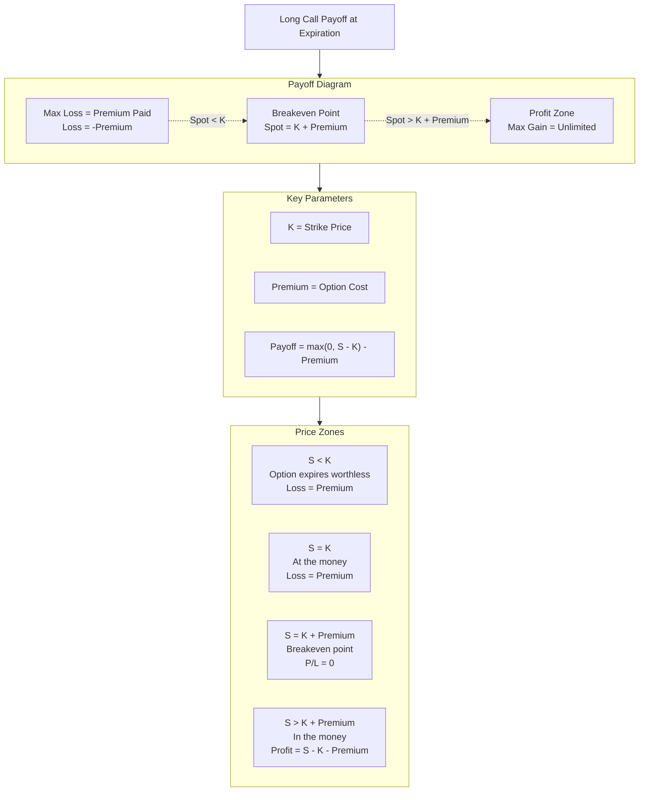
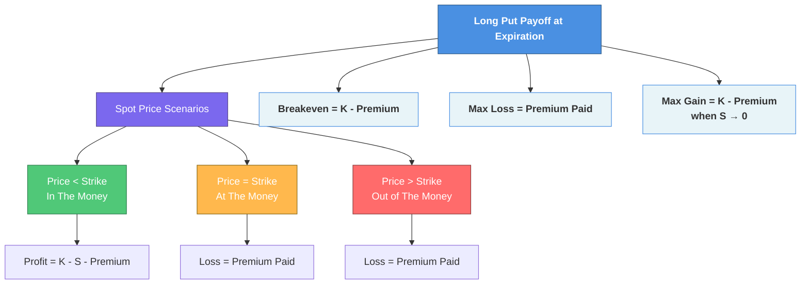

# Lesson 1: Foundational Mechanics of Options Contracts

## 1. First-Principles Intuition & Invariants

An option contract represents a conditional claim on future cash flows, structured as a bilateral agreement that grants one party the right—but crucially, not the obligation—to execute a specific transaction at a predetermined price within a defined time window. This asymmetric contractual structure distinguishes options from linear instruments such as futures or forwards, where both counterparties bear symmetric obligations. The party purchasing the option acquires optionality, paying an upfront premium to secure flexibility in uncertain future states. The seller, conversely, assumes a contingent liability in exchange for immediate premium income, effectively underwriting the buyer's uncertainty.

The economic intuition underlying options pricing emerges from the collision of two opposing forces: intrinsic value, which measures immediate profit available from exercise, and time value, which captures the market's assessment of future volatility and the probability that market conditions will evolve favorably before expiration. Consider a call option granting the right to purchase crude oil at seventy dollars per barrel. If spot crude trades at eighty-five dollars, the contract carries fifteen dollars of intrinsic value—the holder could immediately exercise, acquire crude at seventy, and liquidate at eighty-five, pocketing the differential. Yet if the option trades at eighteen dollars, the additional three dollars reflects time value: the market's probabilistic forecast that crude might surge further, expanding intrinsic value before the contract expires.

This decomposition holds profound operational significance. Intrinsic value evolves mechanically with the underlying asset's spot price, exhibiting deterministic, linear sensitivity. Time value, however, behaves as a decaying function, eroding continuously as expiration approaches—a phenomenon traders term theta decay. On the final trading day, time value collapses to zero, leaving only intrinsic value. An option expiring out-of-the-money holds neither intrinsic nor time value, rendering it economically worthless. This binary outcome—either positive intrinsic value or total loss of premium—creates the convex payoff profile that defines options as nonlinear instruments.

The concept of moneyness formalizes the relationship between strike price and spot price, establishing a taxonomy that governs exercise decisions and risk exposure. A call option is in-the-money when the spot price exceeds the strike, at-the-money when they converge, and out-of-the-money when the strike exceeds spot. Put options exhibit inverted moneyness: in-the-money when strike exceeds spot, enabling the holder to sell the underlying asset above market rates. Moneyness states are not static labels but dynamic classifications that shift continuously as the underlying asset fluctuates, triggering delta hedging adjustments in institutional portfolios and altering the probability distribution of terminal payoffs.

The premium paid for an option embeds several distinct risk components beyond simple directional exposure. Volatility—both realized historical volatility and forward-looking implied volatility derived from market prices—dominates time value. A stock trading at fifty dollars with annualized volatility of fifteen percent will command lower option premiums than an identical stock exhibiting sixty percent volatility, because higher volatility increases the probability of extreme moves that generate intrinsic value. Interest rates influence option pricing through the cost-of-carry framework: holding a call option on a stock defers the capital outlay required to own the stock outright, creating a financing benefit captured in the premium. Dividend expectations exert downward pressure on call premiums and upward pressure on put premiums, as the holder of a call forgoes dividend income while the holder of a put benefits from stock price reductions caused by dividend distributions.

Put-call parity establishes a no-arbitrage constraint linking the prices of European calls and puts with identical strikes and expirations. The relationship, expressed as $C - P = S - K e^{-rT}$, states that a portfolio combining a long call and short put replicates a leveraged position in the underlying asset, offset by the present value of the strike price. Here, $C$ represents the call premium, $P$ the put premium, $S$ the current spot price, $K$ the strike price, $r$ the risk-free rate, and $T$ the time to expiration. Violations of this equilibrium create arbitrage opportunities: if the left side exceeds the right, a trader can sell the call, buy the put, and purchase the underlying asset, locking in riskless profit. Market makers enforce put-call parity through continuous arbitrage activity, ensuring that European option prices remain internally consistent across strikes and maturities.

The distinction between American and European exercise rights introduces path-dependency into valuation. European options permit exercise only at expiration, simplifying pricing through closed-form solutions such as the Black-Scholes model. American options, however, grant exercise rights at any point prior to expiration, creating early exercise optionality that complicates valuation. For call options on non-dividend-paying stocks, early exercise is economically irrational under most conditions—selling the option in the open market recovers both intrinsic and time value, whereas exercise captures only intrinsic value, destroying remaining time premium. Dividends disrupt this logic: a large impending dividend may justify early exercise if the dividend capture exceeds forgone time value. American put options face different calculus. Deep in-the-money puts carry high intrinsic value that accrues interest if realized immediately through exercise, potentially outweighing the time value of continued exposure. This asymmetry means American puts nearly always command higher premiums than European equivalents, while American calls show meaningful premium differentiation only in dividend-bearing underlyings.

## 2. Core Architecture & Mechanics

The standardized option contract serves as the atomic unit of exchange-traded derivatives, with specifications governed by the derivatives exchange and enforced through the clearing corporation. Each contract defines six immutable parameters: the underlying asset identifier, option type (call or put), strike price, expiration date, contract multiplier, and exercise style. The contract multiplier standardizes notional exposure—equity options in U.S. markets typically control one hundred shares per contract, converting per-share premiums into total capital outlay. A call option quoted at three dollars with a one-hundred-share multiplier requires a three-hundred-dollar premium payment, excluding transaction costs.

Strike price intervals and expiration cycles follow exchange-mandated conventions that balance liquidity concentration with granular hedging precision. Liquid large-cap equities often feature strikes in one-dollar or two-fifty increments near the current spot price, widening to five-dollar intervals for distant strikes. Monthly expirations anchor the maturity structure, occurring on the third Friday of each month, supplemented by weekly expirations for high-volume names that cater to short-dated speculation and gamma scalping strategies. Index options introduce cash settlement and non-standard expiration mechanics—S&P 500 options expiring on the third Friday settle against the opening price calculated from constituent stocks' first trades, a mechanism vulnerable to manipulation during low-liquidity opening auctions.

Intrinsic value calculation for calls follows the straightforward formula $\max(S - K, 0)$, capturing the positive differential between spot price $S$ and strike price $K$, floored at zero since options cannot force negative payoffs onto the holder. For a seventy-strike call on a stock trading at eighty-two dollars, intrinsic value equals twelve dollars. Puts reverse the relationship: $\max(K - S, 0)$. A ninety-strike put on the same eighty-two-dollar stock holds eight dollars of intrinsic value. Time value emerges as the residual: option premium minus intrinsic value. A seventy-strike call trading at fifteen dollars with twelve dollars intrinsic carries three dollars of time value, reflecting volatility expectations and theta decay through expiration.

The payoff profile at expiration provides the terminal boundary condition for all options pricing. A long call payoff diagram exhibits a horizontal segment at zero premium loss for all spot prices below the strike, then transitions to a diagonal ray with unit slope as spot exceeds strike, offsetting the premium paid. Breakeven occurs at strike plus premium. For a seventy-strike call purchased at five dollars, breakeven lands at seventy-five dollars; the holder profits only if the stock exceeds this threshold at expiration. The maximum loss equals the premium paid, achieved whenever the option expires out-of-the-money. Maximum gain is theoretically unbounded, as the underlying asset can appreciate indefinitely.

Long put payoffs invert this structure. The diagram shows a diagonal descent from maximum value when spot equals zero, transitioning to a horizontal zero-profit segment when spot exceeds strike plus premium paid. A ninety-strike put purchased at four dollars achieves maximum profit of eighty-six dollars if the stock collapses to zero, while breakeven sits at eighty-six dollars. Maximum loss remains confined to the four-dollar premium if the stock closes above ninety at expiration.

Short positions reverse these payoffs, introducing defined maximum gain against theoretically unlimited loss for short calls or substantial loss for short puts. A trader selling a seventy-strike call at five dollars collects the premium immediately but faces unbounded liability if the stock surges. Selling a ninety-strike put at four dollars generates immediate income but exposes the seller to eighty-six dollars of loss per contract if the stock craters. These asymmetric risk profiles underpin the options market's leverage characteristics—small premium outlays control large notional exposures, magnifying both gains and losses relative to outright stock positions.

Put-call parity operationalizes through synthetic replication strategies that decompose positions into economically equivalent portfolios. A long call combined with a short put at identical strikes and expirations synthesizes a long forward contract. If the stock finishes above strike, the call captures upside while the short put expires worthless; if the stock finishes below strike, the call expires worthless while the short put forces purchase at strike, replicating the forward's obligation to buy at a predetermined price. Rearranging put-call parity yields arbitrage mechanics:

$$C + K e^{-rT} = P + S$$

A trader observing $C + K e^{-rT} > P + S$ can execute a conversion: sell the call, buy the put, purchase the stock, and invest $K e^{-rT}$ at the risk-free rate. At expiration, if spot exceeds strike, the short call assigns stock away at strike while the long put expires worthless, yielding strike proceeds that match the original investment plus interest. If spot finishes below strike, the trader exercises the long put to deliver stock at strike, again recovering the investment plus interest. This riskless arbitrage locks in the pricing discrepancy, corrected within milliseconds in liquid electronic markets through high-frequency market-making algorithms.

American exercise rights introduce recursive valuation complexity absent in European contracts. The Binomial Tree model discretizes time into small intervals, constructing a lattice of possible spot price outcomes where each node represents a potential exercise decision. At each node prior to expiration, the holder compares immediate exercise value against the expected continuation value from holding the option through the next period. The algorithm propagates backward from terminal nodes—where payoffs equal intrinsic value—discounting continuation values by the risk-neutral probability measure and single-period discount factor. Early exercise occurs when intrinsic value exceeds the continuation value, typically manifesting in deep in-the-money American puts where interest earnings on realized strike proceeds dominate forgone time value.

Settlement mechanics bifurcate into physical delivery and cash settlement paradigms. Equity options settle through physical delivery: exercising a call obligates the writer to deliver one hundred shares per contract at the strike price, with the clearing corporation acting as intermediary to eliminate counterparty risk. The Options Clearing Corporation maintains a pool of short positions, randomly assigning exercise notices to writers when holders exercise. This process creates operational friction—shares transfer between accounts, requiring margin and liquidity to fund the strike payment. Index options and many commodity options instead employ cash settlement, transferring the intrinsic value differential without underlying asset movement. An S&P 500 index option holder exercising in-the-money receives cash equal to the strike differential multiplied by the contract multiplier, typically one hundred dollars per index point, posted to their brokerage account by the next business day.

The expiration cycle governs temporal structure across the options chain. Exchanges list multiple maturities simultaneously, creating a term structure of implied volatilities—the volatility smile—that reflects market expectations at different horizons. Near-dated options exhibit higher gamma and theta, appealing to traders seeking convexity in short-term events such as earnings announcements or Federal Reserve policy decisions. Long-dated options, spanning six months to three years for LEAPS (Long-term Equity Anticipation Securities), trade with lower vega sensitivity but accumulate substantial theta decay in absolute dollar terms, suiting structured hedging strategies or synthetic leverage positions where directional conviction extends across quarters.

## 3. High-Performance Optimization & Failure Modes

Practical options trading demands rigorous attention to bid-ask spreads, liquidity fragmentation, and execution slippage that erode theoretical edge. Market makers quote options in two-sided markets, profiting from the spread between bid and offer while hedging delta exposure in the underlying. Wide spreads in illiquid strikes or distant expirations impose implicit transaction costs—entering and exiting a position consumes edge through adverse selection and inventory risk premiums. A ten-cent wide market on a one-dollar option represents a ten percent frictional cost, devastating for high-frequency strategies targeting small mispricings. Traders optimize execution by concentrating liquidity in at-the-money and near-month contracts, accepting tighter spreads and superior price discovery. Distant strikes require limit orders and patience, as aggressive market orders surrender the entire spread to the dealer.

Pin risk emerges at expiration when the underlying asset trades near the strike price, creating ambiguity around automatic exercise thresholds. Options finishing just $0.01$ in-the-money trigger automatic exercise by most brokers, yet late trading or settlement price revisions can push contracts across the strike boundary unexpectedly. A trader holding a short call struck at fifty dollars on stock closing at $50.02$ faces assignment, obligating delivery of one hundred shares. If the trader lacks shares, the broker executes an overnight short sale, exposing the trader to gap risk when the stock opens Monday morning. Institutional traders manage pin risk by closing positions ahead of expiration or employing box spreads to lock in intrinsic value without exercise mechanics.

Early assignment on American options disrupts hedging positions and capital planning. While economically irrational under standard conditions, dividend capture strategies by option holders or liquidity-driven forced exercises by retail investors create sporadic assignment events. A short call writer on a dividend-paying stock faces heightened assignment risk the day before ex-dividend, as holders exercise to capture the dividend payment. The writer must deliver shares, potentially forcing an unexpected stock purchase to cover the assignment. Professional traders monitor open interest and historical assignment probabilities, reducing short call exposure ahead of known dividend dates or accepting assignment as a cost of premium collection.

Corporate actions such as stock splits, spin-offs, and special dividends trigger contract adjustments designed to preserve economic equivalence before and after the event. A two-for-one stock split on a stock trading at eighty dollars converts a forty-strike call into two contracts with twenty-dollar strikes, doubling the contract count while halving the strike to maintain identical intrinsic value. Spin-offs introduce complexity: a parent company distributing a subsidiary creates adjusted contracts delivering both parent and subsidiary shares upon exercise, with revised multipliers and strike allocations. These adjustments are published by the Options Clearing Corporation but may lag real-time pricing, creating fleeting arbitrage windows exploited by specialized trading desks.

Implied volatility surface management becomes critical when trading options across multiple strikes and expirations simultaneously. The volatility smile—higher implied volatility for out-of-the-money puts and calls relative to at-the-money—reflects non-lognormal return distributions and crash risk premia. Traders constructing multi-leg strategies must account for differential vegas across strikes, as volatility shifts rotate the smile rather than shifting it uniformly. A vertical spread buying a ninety-five-strike put and selling a ninety-strike put profits from both directional decline and volatility skew dynamics, with the long leg exhibiting higher vega than the short leg. Skew flattening erodes this position even if spot price remains constant, requiring continuous monitoring of implied volatility term structures and comparative analysis against historical realized volatility distributions.

Margin requirements for naked short options impose substantial capital efficiency constraints. The Federal Reserve's Regulation T and broker-specific house margin rules calculate naked short call margin as the greater of twenty percent of the underlying value plus the premium, or ten percent of the underlying value plus the option's out-of-the-money amount. A naked short call on a one-hundred-dollar stock might require twenty-five dollars of margin per contract, consuming capital that could otherwise generate returns in alternative positions. Traders mitigate margin through defined-risk spreads—selling a call while buying a higher-strike call caps maximum loss, reducing margin to the maximum spread width. Portfolio margin regimes available to sophisticated traders apply risk-based methodologies that recognize offsetting exposures, drastically reducing capital requirements for hedged option portfolios but requiring substantial net liquidation value and algorithmic risk calculations.

Tax treatment of options varies by strategy structure and holding period, creating optimization opportunities for tax-aware investors. Equity options held longer than one year and exercised into stock can qualify for long-term capital gains treatment on subsequent stock appreciation, while options sold prior to exercise realize short-term gains taxed at ordinary income rates regardless of holding period. Section 1256 contracts—including broad-based index options—receive preferential 60/40 treatment, allocating sixty percent of gains to long-term rates and forty percent to short-term rates regardless of holding period. Traders constructing complex strategies must model after-tax returns, particularly in high-frequency strategies where short-term gains compound to significant tax liabilities offsetting pre-tax alpha.

Operational risk in options trading extends beyond market risk to encompass exercise notice management, corporate action tracking, and settlement logistics. Failures in any dimension create unintended exposures or missed profit opportunities. A trader neglecting to monitor expiration calendars might inadvertently hold worthless options through expiration, foregoing salvage value from closing in the final trading hours. Conversely, failing to exercise deeply in-the-money options ahead of automatic exercise thresholds surrenders intrinsic value if the underlying asset gaps unfavorably overnight. Institutional trading desks implement automated expiration management systems that flag positions approaching expiration, calculate exercise decisions based on intrinsic value less transaction costs, and route exercise instructions to the clearing corporation before cutoff times.

The interplay between American and European exercise styles introduces subtle pricing dynamics exploited by sophisticated market participants. American call options on non-dividend stocks trade at negligible premium to European equivalents—early exercise remains suboptimal absent dividends, rendering the early exercise right economically worthless. Yet market makers widen spreads on American options to compensate for gamma risk near dividends and the computational expense of Binomial or Finite Difference pricing models. Arbitrageurs compare American option premiums against synthetic European positions constructed via put-call parity, executing conversions or reversals when dislocations exceed transaction costs. These arbitrage activities enforce pricing discipline, ensuring that American option premiums embed fair value for early exercise optionality under dividend scenarios without overcharging for irrelevant exercise rights in non-dividend names.
