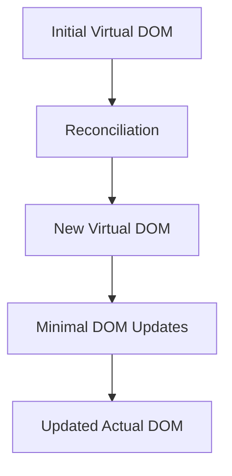

# Lesson 1: Introduction to React Framework

## 1. First-Principles Intuition & Invariants

In the vast landscape of web development, the React framework has emerged as a cornerstone of modern front-end engineering. Its design philosophy is rooted in the principles of declarative programming, component-based architecture, and efficient state management. React's primary invariant is that the user interface should be a pure function of its state and props. This invariant ensures predictability and consistency, allowing developers to reason about the application's behavior with mathematical rigor.

To understand React's foundational principles, we must delve into the problem space it addresses. Traditional web applications often suffer from performance issues due to inefficient DOM manipulations and complex state management. React tackles these challenges by introducing a virtual DOM, which is a lightweight in-memory representation of the actual DOM. This abstraction allows React to optimize updates by batching and minimizing direct DOM manipulations, leading to significant performance improvements.

The core invariant of React is the reconciliation process, which is a sophisticated algorithm that determines the minimal set of changes required to update the DOM. This process is grounded in the concept of a tree structure, where each node represents a component. React's reconciliation algorithm performs a diff operation between the current and previous virtual DOM trees, identifying the differences and applying only the necessary updates to the actual DOM. This mechanism ensures that the UI remains responsive and efficient, even as the application state evolves.

Another critical invariant in React is the component-based architecture. Components are the building blocks of a React application, encapsulating reusable UI elements and their associated logic. This modular design promotes code reusability, maintainability, and scalability. Each component can manage its own state and respond to user interactions, creating a self-contained and isolated unit of functionality. The component-based architecture also enables developers to reason about the application's structure and behavior in a hierarchical manner, facilitating the development of complex and dynamic user interfaces.

## 2. Core Architecture & Mechanics

At the heart of React's architecture lies the virtual DOM, which is a key enabler of its performance optimizations. The virtual DOM is a lightweight representation of the actual DOM, constructed using JavaScript objects. When a component's state or props change, React creates a new virtual DOM tree and performs a diff operation with the previous tree. This diff operation identifies the minimal set of changes required to update the actual DOM, ensuring that only the necessary updates are applied.

To illustrate the virtual DOM and reconciliation process, let us consider a simple example. Suppose we have a React component that displays a list of items. When a new item is added to the list, React creates a new virtual DOM tree with the updated list. The reconciliation algorithm then performs a diff operation between the new and previous virtual DOM trees, identifying the addition of the new item. React then updates the actual DOM by adding the new item, rather than re-rendering the entire list. This targeted update minimizes the performance overhead and ensures that the UI remains responsive.



In this diagram, we can see the flow of the reconciliation process. The initial virtual DOM is compared with the new virtual DOM, and the minimal set of changes is applied to the actual DOM. This process ensures that the UI remains efficient and responsive.

React's component-based architecture is another critical aspect of its core mechanics. Components are the building blocks of a React application, encapsulating reusable UI elements and their associated logic. Each component can manage its own state and respond to user interactions, creating a self-contained and isolated unit of functionality. The component-based architecture also enables developers to reason about the application's structure and behavior in a hierarchical manner, facilitating the development of complex and dynamic user interfaces.

To illustrate the component-based architecture, let us consider a simple example. Suppose we have a React application that displays a list of items. We can create a `ListItem` component to represent each item in the list, and a `List` component to manage the list of items. The `List` component can maintain the list's state and pass the necessary props to the `ListItem` components. This modular design promotes code reusability, maintainability, and scalability.

```jsx
// ListItem component
function ListItem(props) {
    return <li>{props.item}</li>;
}

// List component
function List(props) {
    const items = props.items.map((item) => <ListItem key={item.id} item={item.text} />);
    return <ul>{items}</ul>;
}
```

In this example, we can see the component-based architecture in action. The `ListItem` component encapsulates the UI for a single item, and the `List` component manages the list of items and passes the necessary props to the `ListItem` components. This modular design promotes code reusability, maintainability, and scalability.

## 3. High-Performance Optimization & Failure Modes

React's performance optimizations are a direct result of its virtual DOM and reconciliation algorithm. The virtual DOM allows React to minimize direct DOM manipulations, leading to significant performance improvements. The reconciliation algorithm ensures that only the minimal set of changes is applied to the actual DOM, further optimizing performance.

One of the key performance optimizations in React is the use of batching. React batches multiple state updates into a single update cycle, reducing the number of re-renders and improving performance. This batching mechanism is particularly effective in scenarios where multiple state updates occur in quick succession, such as in response to user interactions.

Another performance optimization in React is the use of memoization. React memoizes the results of expensive computations, allowing it to reuse the results without recalculating them. This memoization mechanism is particularly effective in scenarios where components perform expensive computations, such as filtering or sorting large datasets.

To illustrate the performance optimizations in React, let us consider a simple example. Suppose we have a React component that displays a list of items. When a new item is added to the list, React creates a new virtual DOM tree with the updated list. The reconciliation algorithm then performs a diff operation between the new and previous virtual DOM trees, identifying the addition of the new item. React then updates the actual DOM by adding the new item, rather than re-rendering the entire list. This targeted update minimizes the performance overhead and ensures that the UI remains responsive.

```jsx
// List component with memoization
const List = React.memo(function List(props) {
    const items = props.items.map((item) => <ListItem key={item.id} item={item.text} />);
    return <ul>{items}</ul>;
});
```

In this example, we can see the use of memoization in action. The `List` component is wrapped with `React.memo`, which memoizes the results of the component's render function. This memoization mechanism ensures that the `List` component is only re-rendered when its props change, reducing the number of re-renders and improving performance.

React's performance optimizations also include several failure modes that developers must be aware of. One common failure mode is excessive re-renders, which can occur when components are not properly optimized. For example, if a component performs expensive computations or updates its state unnecessarily, it can lead to excessive re-renders and degrade performance. To mitigate this failure mode, developers should use memoization and batching to optimize component performance.

Another common failure mode is memory leaks, which can occur when components are not properly cleaned up. For example, if a component subscribes to an event or sets up a timer, it should properly unsubscribe or clear the timer when it is unmounted. To mitigate this failure mode, developers should use the `useEffect` hook to manage side effects and ensure that components are properly cleaned up.

To illustrate the failure modes in React, let us consider a simple example. Suppose we have a React component that subscribes to an event when it is mounted and unsubscribes when it is unmounted. If the component is not properly cleaned up, it can lead to a memory leak. To mitigate this failure mode, we should use the `useEffect` hook to manage the subscription and ensure that the component is properly cleaned up.

```jsx
// Component with proper cleanup
function MyComponent() {
    useEffect(() => {
        const subscription = someEvent.subscribe(handleEvent);
        return () => {
            subscription.unsubscribe();
        };
    }, []);

    function handleEvent(event) {
        // Handle the event
    }

    return <div>My Component</div>;
}
```

In this example, we can see the use of the `useEffect` hook to manage the subscription and ensure that the component is properly cleaned up. The `useEffect` hook takes a function that sets up the subscription and returns a cleanup function that unsubscribes when the component is unmounted. This ensures that the component is properly cleaned up and mitigates the risk of memory leaks.

In conclusion, React is a powerful and efficient framework for building modern front-end applications. Its core principles of declarative programming, component-based architecture, and efficient state management enable developers to build responsive and scalable user interfaces. React's virtual DOM and reconciliation algorithm ensure that the UI remains efficient and responsive, even as the application state evolves. React's performance optimizations, such as batching and memoization, further enhance performance and reduce the risk of failure modes. By understanding React's core concepts, components, and state management, developers can build high-performance and scalable front-end applications.
