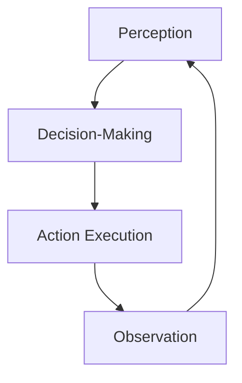

# Lesson 2: Reasoning Loops in React

## 1. First-Principles Intuition & Invariants

In the realm of artificial intelligence and autonomous agents, the concept of a reasoning loop is fundamental. A reasoning loop encapsulates the continuous cycle of perception, decision-making, and action that an AI agent undertakes to interact with its environment. This loop is not merely a sequence of operations but a dynamic, adaptive system that evolves based on feedback and learning. In the context of React, a popular JavaScript library for building user interfaces, implementing reasoning loops requires a deep understanding of React's state management, component lifecycle, and performance optimization techniques.

To ground our discussion, let us consider the theoretical framework of a reasoning loop. At its core, a reasoning loop involves three primary components: perception, decision-making, and action. Perception involves gathering information from the environment, decision-making involves processing this information to determine the best course of action, and action involves executing the chosen action and observing the outcome. This cycle is iterative, with each iteration refining the agent's understanding and decision-making capabilities.

In the context of AI agents, the reasoning loop is often modeled as a state machine, where the state of the agent is updated based on the outcomes of its actions. The state machine can be formalized using mathematical constructs such as Markov Decision Processes (MDPs) or Partially Observable Markov Decision Processes (POMDPs). These models provide a rigorous framework for understanding the decision-making process of an agent, allowing us to reason about the optimal policies that the agent should follow.

When implementing reasoning loops in React, we must consider the invariants that govern the behavior of the system. These invariants include the consistency of the agent's state, the correctness of the decision-making process, and the efficiency of the action execution. Consistency ensures that the agent's state is accurately updated based on the outcomes of its actions, correctness ensures that the decision-making process is based on accurate and up-to-date information, and efficiency ensures that the action execution is performed in a timely and resource-efficient manner.

## 2. Core Architecture & Mechanics

To implement a reasoning loop in React, we must dissect the internal data structures, algorithms, and execution models that underpin the framework. React's component-based architecture provides a natural fit for implementing reasoning loops, as each component can encapsulate a specific aspect of the agent's behavior. The component lifecycle, in particular, plays a crucial role in the reasoning loop, as it allows us to define the sequence of operations that the agent should perform at each iteration of the loop.

Let us consider a simple example of a reasoning loop in React. Suppose we are building an AI agent that navigates a grid-based environment. The agent's state includes its current position in the grid, the positions of obstacles, and the positions of goals. The agent's perception involves gathering information about the environment, such as the positions of obstacles and goals. The decision-making process involves determining the best path to a goal, taking into account the positions of obstacles. The action execution involves moving the agent to the next position in the path.

In React, we can implement this reasoning loop using a combination of state management and component lifecycle methods. The agent's state can be managed using React's `useState` hook, which allows us to define and update the state of the component. The component lifecycle methods, such as `useEffect`, can be used to define the sequence of operations that the agent should perform at each iteration of the loop. For example, we can use `useEffect` to define the perception and decision-making processes, and to schedule the action execution.

To illustrate this, let us consider the following code snippet:

```jsx
import React, { useState, useEffect } from 'react';

const Agent = ({ environment }) => {
  const [state, setState] = useState({
    position: { x: 0, y: 0 },
    path: [],
    goal: { x: 5, y: 5 },
  });

  useEffect(() => {
    // Perception: Gather information about the environment
    const obstacles = environment.getObstacles();
    const goals = environment.getGoals();

    // Decision-making: Determine the best path to the goal
    const path = findPath(state.position, state.goal, obstacles);

    // Update the state with the new path
    setState((prevState) => ({
      ...prevState,
      path,
    }));
  }, [environment, state.position, state.goal]);

  useEffect(() => {
    // Action execution: Move the agent to the next position in the path
    if (state.path.length > 0) {
      const nextPosition = state.path[0];
      setState((prevState) => ({
        ...prevState,
        position: nextPosition,
        path: prevState.path.slice(1),
      }));
    }
  }, [state.path]);

  return (
    <div>
      <p>Position: {state.position.x}, {state.position.y}</p>
      <p>Goal: {state.goal.x}, {state.goal.y}</p>
      <p>Path: {state.path.map((p) => `(${p.x}, ${p.y})`).join(' -> ')}</p>
    </div>
  );
};

const findPath = (start, goal, obstacles) => {
  // Implement a pathfinding algorithm, such as A* or Dijkstra's algorithm
  // Return the path from start to goal, avoiding obstacles
  return [];
};

export default Agent;
```

In this example, the `Agent` component encapsulates the reasoning loop of the AI agent. The `useState` hook is used to manage the agent's state, including its position, path, and goal. The `useEffect` hook is used to define the perception and decision-making processes, and to schedule the action execution. The `findPath` function is a placeholder for a pathfinding algorithm, which determines the best path to the goal based on the agent's current position and the positions of obstacles.

To visualize the internal data structures and algorithms of the reasoning loop, we can use a Mermaid diagram:



In this diagram, the perception process gathers information about the environment, the decision-making process determines the best course of action, the action execution process performs the chosen action, and the observation process updates the agent's state based on the outcome of the action. This cycle is iterative, with each iteration refining the agent's understanding and decision-making capabilities.

## 3. High-Performance Optimization & Failure Modes

Implementing reasoning loops in React requires careful consideration of high-performance optimization and failure modes. The performance of the reasoning loop is critical, as it determines the responsiveness and efficiency of the AI agent. The failure modes of the reasoning loop are also critical, as they can lead to incorrect or suboptimal behavior of the agent.

To optimize the performance of the reasoning loop, we must consider several factors. First, we must ensure that the state management is efficient, as the state of the agent is updated at each iteration of the loop. React's `useState` hook provides a simple and efficient way to manage state, but we must also consider the performance implications of frequent state updates. To minimize the performance impact of state updates, we can use techniques such as memoization and lazy evaluation.

Second, we must ensure that the decision-making process is efficient, as it determines the best course of action based on the agent's perception of the environment. The decision-making process can be computationally intensive, especially if it involves complex algorithms such as pathfinding or machine learning. To optimize the performance of the decision-making process, we can use techniques such as parallel processing and caching.

Third, we must ensure that the action execution process is efficient, as it performs the chosen action and updates the agent's state based on the outcome. The action execution process can involve complex operations such as network requests or device interactions. To optimize the performance of the action execution process, we can use techniques such as asynchronous programming and batching.

To mitigate the failure modes of the reasoning loop, we must consider several factors. First, we must ensure that the perception process is accurate, as the agent's decision-making process is based on the accuracy of its perception of the environment. The perception process can be affected by noise or errors in the environment, such as sensor malfunctions or network delays. To mitigate the failure modes of the perception process, we can use techniques such as error correction and data validation.

Second, we must ensure that the decision-making process is robust, as it determines the best course of action based on the agent's perception of the environment. The decision-making process can be affected by errors or inconsistencies in the agent's perception of the environment, such as incorrect pathfinding or suboptimal policies. To mitigate the failure modes of the decision-making process, we can use techniques such as error handling and policy validation.

Third, we must ensure that the action execution process is reliable, as it performs the chosen action and updates the agent's state based on the outcome. The action execution process can be affected by errors or failures in the environment, such as network failures or device malfunctions. To mitigate the failure modes of the action execution process, we can use techniques such as error handling and retry mechanisms.

In summary, implementing reasoning loops in React requires a deep understanding of React's state management, component lifecycle, and performance optimization techniques. The reasoning loop is a dynamic, adaptive system that evolves based on feedback and learning, and it can be modeled using mathematical constructs such as Markov Decision Processes and Partially Observable Markov Decision Processes. By carefully considering the invariants that govern the behavior of the system, we can implement reasoning loops that are efficient, robust, and reliable.
