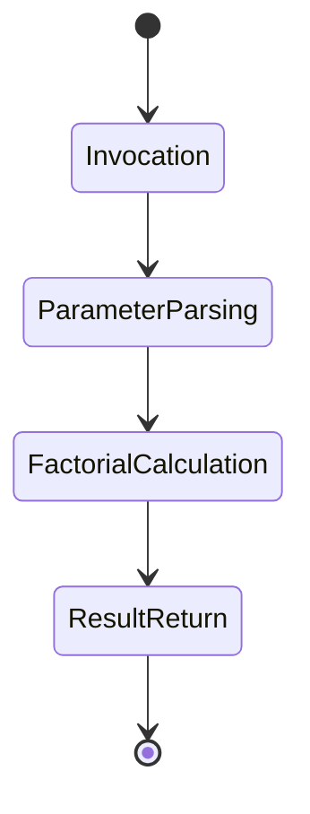

# Lesson 1: Understanding Tool Calling Mechanisms

## 1. First-Principles Intuition & Invariants

In the realm of computing, the invocation of tools and the mechanisms by which they communicate with their environment are foundational to the operation of any system. At its core, a tool is a software utility designed to perform a specific task, often as part of a larger workflow or process. The act of calling a tool involves initiating its execution and managing the exchange of data between the caller and the tool itself. This exchange is governed by a set of conventions and protocols that ensure predictability, reliability, and efficiency.

To understand tool calling mechanisms, we must delve into the underlying principles of process management and inter-process communication (IPC). At the heart of these principles lies the concept of a process, which is an instance of a program in execution. A process is characterized by its own memory space, execution context, and system resources. When a tool is called, a new process is typically spawned, and the calling process (often referred to as the parent) waits for the tool process (the child) to complete its execution. The communication between the parent and child processes can occur through various means, including command-line arguments, environment variables, standard input/output streams, and more sophisticated IPC mechanisms.

The invocation of a tool is not merely about starting a process; it involves a well-defined protocol for passing parameters and receiving return values. Parameters are the inputs provided to the tool, which it uses to perform its task. These parameters can be passed in various ways, such as command-line arguments, environment variables, or configuration files. The return value, on the other hand, is the output produced by the tool, which can be a status code, a result set, or a modified state of the system. The protocol for passing parameters and receiving return values is critical for ensuring that the tool behaves as expected and that the calling process can interpret the results correctly.

From a theoretical standpoint, the problem space of tool calling mechanisms can be framed in terms of system invariants and mathematical models. An invariant is a condition that remains true throughout the execution of a system. In the context of tool calling, one invariant is that the tool must always receive the correct parameters and return the expected results. Another invariant is that the tool must not interfere with the state of the system in unintended ways. These invariants are enforced through a combination of design principles, programming practices, and system architecture.

## 2. Core Architecture & Mechanics

To dissect the internal data structures, algorithms, and execution models of tool calling mechanisms, we must examine the process of invoking a tool and the protocols used for parameter passing and return value handling. Let us consider a simple example of a tool being called from a command-line interface (CLI). When a user types a command in the CLI, the shell (the command-line interpreter) parses the command and spawns a new process to execute the tool. The shell passes the command-line arguments to the tool as an array of strings, and the tool processes these arguments to perform its task.

The execution of a tool can be modeled using a state machine, where each state represents a phase of the tool's operation. The initial state is the invocation of the tool, where the parent process spawns the child process and passes the parameters. The subsequent states involve the tool processing the parameters, performing its task, and returning the results. The final state is the termination of the tool process, where the parent process receives the return value and continues its execution.

To illustrate the internal data structures and algorithms involved in tool calling, we can use a simple example of a tool that calculates the factorial of a number. The tool can be invoked from the CLI with a command such as `factorial 5`, where `5` is the parameter passed to the tool. The shell parses the command and spawns a new process to execute the tool, passing the parameter as an argument. The tool processes the argument, calculates the factorial, and returns the result to the parent process.

The following Mermaid diagram illustrates the state machine for the factorial tool:



In this diagram, the initial state is `Invocation`, where the parent process spawns the child process to execute the tool. The `ParameterParsing` state involves the tool parsing the command-line argument and preparing to perform the calculation. The `FactorialCalculation` state represents the tool performing the factorial calculation. The `ResultReturn` state involves the tool returning the result to the parent process, which then terminates the child process.

The internal data structures and algorithms involved in tool calling can be further illustrated through a simple C program that implements the factorial tool. The program uses the `main` function to parse the command-line arguments, perform the factorial calculation, and return the result.

```c
#include <stdio.h>
#include <stdlib.h>

// Function to calculate factorial
unsigned long long factorial(int n) {
    if (n == 0) return 1;
    unsigned long long result = 1;
    for (int i = 1; i <= n; i++) {
        result *= i;
    }
    return result;
}

int main(int argc, char *argv[]) {
    if (argc != 2) {
        fprintf(stderr, "Usage: %s <number>\n", argv[0]);
        return 1;
    }

    int number = atoi(argv[1]);
    if (number < 0) {
        fprintf(stderr, "Error: Number must be non-negative\n");
        return 1;
    }

    unsigned long long result = factorial(number);
    printf("Factorial of %d is %llu\n", number, result);
    return 0;
}
```

In this program, the `main` function is the entry point for the tool. It parses the command-line arguments using `argc` and `argv`, performs the factorial calculation using the `factorial` function, and prints the result to the standard output. The return value of the `main` function is used to indicate the success or failure of the tool execution.

## 3. High-Performance Optimization & Failure Modes

The performance and reliability of tool calling mechanisms are critical factors in the design and implementation of software systems. High-performance optimization involves techniques for improving the efficiency and speed of tool execution, while failure modes involve the identification and mitigation of potential issues that can arise during tool invocation and execution.

One key aspect of high-performance optimization is the efficient passing of parameters and return values between the parent and child processes. In many cases, the size and complexity of the parameters and return values can have a significant impact on the performance of the tool. For example, passing large data structures as command-line arguments can be inefficient and may result in performance degradation. To address this issue, alternative mechanisms such as environment variables, configuration files, or shared memory can be used to pass large data structures more efficiently.

Another important aspect of high-performance optimization is the efficient management of system resources. When a tool is called, it may require access to various system resources such as CPU, memory, and I/O devices. The efficient allocation and deallocation of these resources can have a significant impact on the performance of the tool. To optimize resource management, techniques such as process scheduling, memory allocation, and I/O buffering can be used.

Failure modes in tool calling mechanisms can arise due to a variety of factors, including incorrect parameter passing, unexpected return values, and resource contention. One common failure mode is the incorrect parsing of command-line arguments, which can result in the tool receiving invalid or incomplete parameters. To mitigate this issue, robust error handling and validation mechanisms can be implemented to ensure that the tool receives valid parameters.

Another failure mode is the unexpected return values, which can occur due to errors or exceptions during tool execution. To handle unexpected return values, the tool should be designed to handle errors gracefully and provide meaningful error messages to the caller. Additionally, the caller should be designed to handle errors and exceptions in a way that ensures the system remains stable and reliable.

Resource contention is another potential failure mode that can arise during tool execution. When multiple tools are called simultaneously, they may compete for access to shared system resources, which can result in performance degradation or resource exhaustion. To mitigate resource contention, techniques such as process scheduling, resource allocation, and I/O buffering can be used to ensure that resources are allocated efficiently and fairly.

In conclusion, understanding tool calling mechanisms is critical for the design and implementation of efficient and reliable software systems. By examining the underlying principles of process management and inter-process communication, we can gain a deeper understanding of the mechanisms involved in tool invocation and execution. Through high-performance optimization and failure mode mitigation, we can ensure that tools are executed efficiently and reliably, providing the desired results to the caller.
