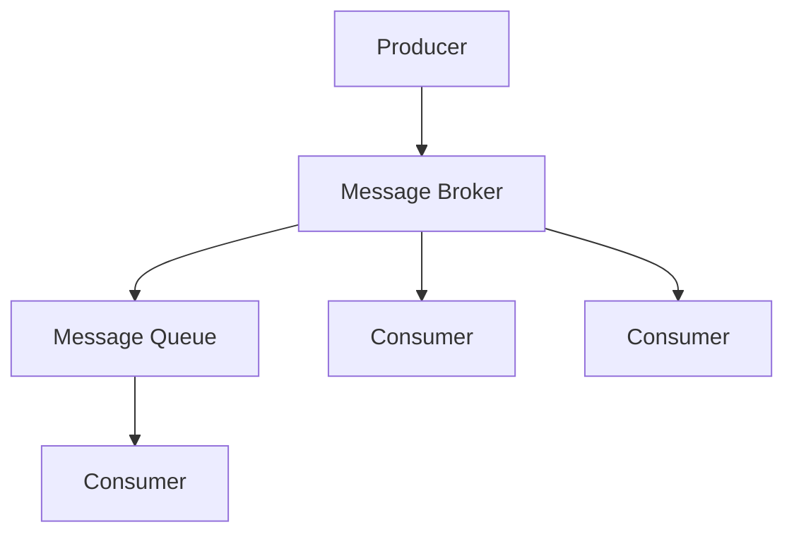

# Lesson 2: Overview of MCP Protocols

## 1. First-Principles Intuition & Invariants

In the realm of artificial intelligence and autonomous agent systems, the need for efficient and reliable communication and coordination is paramount. Multi-Component Protocol (MCP) systems serve as the backbone for enabling diverse components to interact seamlessly, ensuring that complex AI/Agent architectures can function cohesively. At its core, MCP protocols are designed to provide a standardized framework for communication, allowing different subsystems to exchange data, synchronize operations, and manage resources efficiently. This foundational layer is crucial for the scalability, reliability, and performance of AI/Agent systems.

To understand MCP protocols, we must first delve into the theoretical underpinnings that govern their design and operation. At the heart of MCP protocols lies the principle of modularity, which emphasizes the separation of concerns among different components. By breaking down a system into smaller, manageable parts, each with a well-defined interface, MCP protocols enable components to be developed, tested, and deployed independently. This modularity not only simplifies the design process but also enhances the system's flexibility and adaptability to changing requirements.

Another critical invariant in MCP protocols is the concept of state consistency. In distributed systems, maintaining a consistent state across multiple components is essential to ensure that all parts of the system operate in harmony. MCP protocols achieve this through a combination of message passing and state synchronization mechanisms. By carefully managing the flow of information and ensuring that all components have access to the most up-to-date state, MCP protocols prevent inconsistencies and ensure that the system remains stable and reliable.

Furthermore, MCP protocols are grounded in the principles of fault tolerance and resilience. In the context of AI/Agent systems, where components may be subject to failures or unexpected behavior, the ability to recover from errors and continue operating is crucial. MCP protocols incorporate mechanisms for error detection, recovery, and redundancy to ensure that the system can withstand faults and continue to function effectively. This resilience is achieved through a combination of robust error-handling strategies and redundancy techniques, such as replication and failover.

## 2. Core Architecture & Mechanics

The architecture of MCP protocols is designed to facilitate efficient communication and coordination among different components of an AI/Agent system. At a high level, MCP protocols consist of several key components, including message brokers, message queues, and communication channels. These components work together to enable components to exchange data, synchronize operations, and manage resources.

### Message Brokers

Message brokers are central to the MCP protocol architecture, serving as intermediaries for communication between different components. They are responsible for receiving messages from producers, routing them to the appropriate consumers, and ensuring that messages are delivered reliably. Message brokers play a critical role in enabling decoupling between producers and consumers, allowing components to operate independently without being tightly coupled to each other.

### Message Queues

Message queues are used to store messages temporarily until they can be processed by the appropriate consumers. They provide a buffer that helps to decouple the timing of message production and consumption, allowing producers to send messages at a different rate than consumers can process them. Message queues also provide mechanisms for message persistence, ensuring that messages are not lost in the event of a failure.

### Communication Channels

Communication channels are used to establish a connection between producers and consumers, enabling them to exchange messages. MCP protocols support a variety of communication channels, including point-to-point channels, publish-subscribe channels, and request-reply channels. Each type of channel is designed to support different communication patterns, allowing components to choose the most appropriate channel for their needs.

To illustrate the architecture of MCP protocols, we can use a simple Mermaid diagram:

In this diagram, a producer sends a message to the message broker, which routes the message to the appropriate message queue. The message queue stores the message temporarily until it can be processed by one or more consumers. The message broker is responsible for routing messages to the appropriate consumers based on their subscriptions.

## 3. High-Performance Optimization & Failure Modes

To ensure that MCP protocols can support the high-performance requirements of AI/Agent systems, several optimization techniques are employed. One key optimization is the use of asynchronous communication, which allows components to send and receive messages without blocking. Asynchronous communication enables components to operate concurrently, improving the overall performance of the system.

Another important optimization is the use of load balancing, which helps to distribute messages evenly across multiple consumers. Load balancing ensures that no single consumer becomes a bottleneck, allowing the system to scale efficiently as the number of components and messages increases.

In addition to these optimizations, MCP protocols must also be designed to handle failure modes gracefully. One common failure mode is message loss, which can occur if a message is not delivered to the appropriate consumer. To mitigate this risk, MCP protocols incorporate mechanisms for message persistence and retry, ensuring that messages are delivered reliably even in the event of a failure.

Another failure mode is message duplication, which can occur if a message is delivered to a consumer more than once. To prevent message duplication, MCP protocols use unique message identifiers and deduplication mechanisms to ensure that each message is processed only once.

In conclusion, MCP protocols play a critical role in enabling efficient and reliable communication and coordination in AI/Agent systems. By providing a standardized framework for communication, MCP protocols enable components to operate independently while maintaining state consistency and resilience. Through the use of message brokers, message queues, and communication channels, MCP protocols facilitate the exchange of data and synchronization of operations among different components. Finally, through the use of optimization techniques and failure mitigation strategies, MCP protocols ensure that AI/Agent systems can operate efficiently and reliably, even in the face of high-performance requirements and failure modes.
