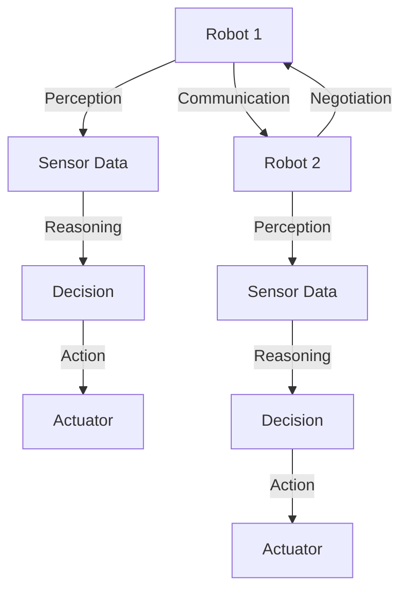

# Lesson 1: Multi-Agent Systems Overview

## 1. First-Principles Intuition & Invariants

Multi-agent systems (MAS) represent a paradigm in distributed computing where multiple autonomous agents interact to achieve a common goal. The concept of agents, as independent entities capable of perception, reasoning, and action, has roots in artificial intelligence and cognitive science. These agents operate within an environment, which can be physical, virtual, or a combination of both, and they interact with each other and their environment to accomplish tasks that are often beyond the capabilities of a single agent.

The theoretical grounding of multi-agent systems is deeply intertwined with game theory, economics, and control theory. In game theory, agents are seen as players in a strategic game, where the outcome depends on the actions of all players. This perspective is crucial for understanding how agents make decisions in environments where the actions of others can influence the outcome. In economics, the concept of rational agents is central, where agents are assumed to act in their own best interest, leading to complex emergent behaviors. Control theory provides the framework for understanding how agents can be designed to achieve specific objectives through feedback loops and adaptive mechanisms.

A fundamental invariant in multi-agent systems is the principle of autonomy. Each agent must be capable of making decisions and taking actions independently, yet these actions must be coordinated to achieve a collective goal. This coordination is often achieved through communication and negotiation among agents. Another invariant is the principle of scalability. As the number of agents increases, the system must remain efficient and effective, which requires sophisticated mechanisms for task delegation and resource allocation.

The problem space of multi-agent systems is vast and diverse, ranging from robotic swarms to economic simulations. In robotic swarms, a group of robots must coordinate their actions to perform tasks such as search and rescue or environmental monitoring. In economic simulations, agents represent market participants, and the system models the dynamics of supply and demand. The common thread in these applications is the need for agents to interact and adapt to their environment, often in real-time.

## 2. Core Architecture & Mechanics

The architecture of a multi-agent system is designed to support the autonomy and coordination of agents. At the heart of this architecture is the agent model, which defines the capabilities and behavior of individual agents. An agent model typically includes components for perception, reasoning, and action. Perception involves gathering information from the environment, reasoning involves processing this information to make decisions, and action involves executing these decisions.

A key aspect of the agent model is the communication mechanism. Agents must be able to exchange information and coordinate their actions. This communication can be direct, where agents send messages to each other, or indirect, where agents modify the environment in a way that affects other agents. The communication protocol must be designed to ensure reliability and efficiency, even in the presence of network delays and failures.

The coordination of agents is achieved through a variety of mechanisms, including negotiation, auction, and voting. Negotiation involves agents exchanging proposals and counterproposals to reach an agreement. Auction involves agents bidding for resources or tasks, with the highest bidder winning. Voting involves agents casting votes to decide on a course of action.

To illustrate the architecture of a multi-agent system, consider a simple example of a robotic swarm. Each robot is an agent with the following components:

- **Perception:** Sensors that gather information about the environment, such as distance to obstacles and the location of other robots.
- **Reasoning:** A decision-making process that uses the information from the sensors to determine the next action. This could involve path planning, obstacle avoidance, or task assignment.
- **Action:** Actuators that execute the actions determined by the reasoning process, such as moving forward, turning, or picking up an object.

The communication mechanism in this example is direct, where robots send messages to each other using wireless communication. The coordination mechanism is negotiation, where robots exchange proposals for task assignments. For example, if two robots detect an object that needs to be picked up, they might negotiate who will pick it up based on their current tasks and proximity to the object.

In this diagram, each robot has a perception component that gathers sensor data, a reasoning component that makes decisions, and an action component that executes those decisions. The robots also have a communication component that allows them to exchange messages and negotiate task assignments.

## 3. High-Performance Optimization & Failure Modes

High-performance optimization in multi-agent systems is critical for ensuring that the system can operate efficiently and effectively, even as the number of agents and the complexity of the environment increase. One key aspect of optimization is concurrency. Agents must be able to operate concurrently, which requires efficient mechanisms for task scheduling and resource allocation. In a robotic swarm, for example, multiple robots might be performing different tasks simultaneously, and the system must ensure that these tasks are scheduled in a way that maximizes efficiency and minimizes conflicts.

Another aspect of optimization is resource scaling. As the number of agents increases, the system must be able to scale its resources, such as memory and processing power, to accommodate the increased load. This requires sophisticated mechanisms for resource allocation and load balancing. In a robotic swarm, for example, the system might use a load balancer to distribute tasks among the robots in a way that ensures that no single robot is overloaded.

Boundary edge cases and failure modes are also critical considerations in multi-agent systems. These cases arise when the system is pushed to its limits, such as when the number of agents is very large or when the environment is highly dynamic. In these cases, the system must be able to handle failures gracefully, such as when a robot fails or when a communication link is lost. One common approach to handling failures is to use redundancy, where multiple agents perform the same task to ensure that the task is completed even if one agent fails. Another approach is to use fault-tolerant algorithms, which are designed to continue operating correctly even in the presence of failures.

In the context of a robotic swarm, boundary edge cases might include scenarios where the number of robots is very large, leading to increased communication overhead, or where the environment is highly dynamic, leading to frequent changes in the tasks and locations of the robots. Failure modes might include scenarios where a robot fails, leading to a loss of task capacity, or where a communication link is lost, leading to a loss of coordination.

To illustrate high-performance optimization and failure modes, consider the following example. In a robotic swarm, the system uses a load balancer to distribute tasks among the robots. The load balancer uses a round-robin algorithm to assign tasks to the robots, ensuring that no single robot is overloaded. The system also uses redundancy, where multiple robots perform the same task to ensure that the task is completed even if one robot fails. In the event of a failure, the system uses a fault-tolerant algorithm to reassign the task to another robot, ensuring that the task is completed without delay.

In summary, multi-agent systems are a powerful paradigm for distributed computing, where multiple autonomous agents interact to achieve a common goal. The architecture of a multi-agent system is designed to support the autonomy and coordination of agents, while high-performance optimization and failure modes are critical considerations for ensuring that the system can operate efficiently and effectively. By understanding the theoretical grounding, core architecture, and optimization techniques of multi-agent systems, we can design and implement systems that are robust, scalable, and effective.
