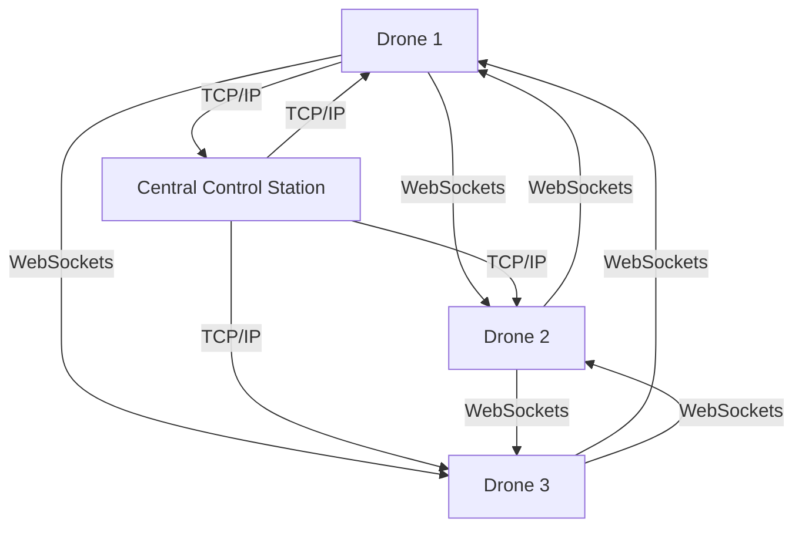

# Lesson 2: Communication Protocols

## 1. First-Principles Intuition & Invariants

In the realm of multi-agent systems (MAS), communication protocols serve as the backbone of effective interaction and coordination among autonomous entities. These protocols are not merely conduits for data exchange but are integral to the system's ability to achieve its objectives through distributed intelligence. To understand the critical role of communication protocols in MAS, we must delve into the theoretical underpinnings that govern their design and operation.

At the heart of any communication protocol lies the concept of message passing. Messages are the fundamental units of information that agents use to convey their states, intentions, and actions to one another. The design of a communication protocol must ensure that messages are delivered reliably, efficiently, and in a manner that respects the temporal and spatial constraints of the system. This necessitates a deep understanding of the underlying network topology, the computational resources available to each agent, and the temporal dynamics of the environment in which the agents operate.

From a first-principles perspective, communication protocols in MAS must adhere to several invariants:
1. **Reliability**: Messages must be delivered to their intended recipients without loss or corruption. This requires mechanisms for error detection and correction, as well as retransmission strategies to handle transient network failures.
2. **Timeliness**: Messages must be delivered within a specified timeframe to ensure that agents can make timely decisions. This places constraints on the latency and bandwidth of the communication channels.
3. **Security**: Messages must be protected from unauthorized access and tampering. This requires encryption, authentication, and integrity checks to ensure that only legitimate agents can send and receive messages.
4. **Scalability**: The communication protocol must be able to handle an increasing number of agents and messages without degradation in performance. This requires efficient routing algorithms and load balancing strategies.

These invariants are not independent but are interrelated and must be balanced to achieve an optimal communication protocol. For instance, increasing reliability may introduce additional latency, while enhancing security can increase computational overhead. Therefore, the design of a communication protocol involves a careful trade-off between these competing factors.

## 2. Core Architecture & Mechanics

The architecture of a communication protocol in a multi-agent system is intricately tied to the system's overall design and the specific requirements of the application domain. A typical communication protocol in MAS consists of several key components, including message formats, routing algorithms, and transport mechanisms.

### Message Formats

Message formats define the structure and semantics of the messages exchanged between agents. A well-designed message format should be flexible enough to accommodate a wide range of message types while being efficient in terms of size and processing time. In many cases, message formats are defined using standardized protocols such as JSON, XML, or Protocol Buffers. These protocols provide a common language for agents to communicate, ensuring interoperability and reducing the overhead of message parsing.

### Routing Algorithms

Routing algorithms determine the path that messages take through the network. In a multi-agent system, the network topology can be complex, with agents located in different geographical locations and connected through various communication channels. Efficient routing is crucial for minimizing latency and maximizing throughput. Common routing algorithms used in MAS include shortest path algorithms (e.g., Dijkstra's algorithm), link-state routing, and distance-vector routing. These algorithms take into account the network topology, link capacities, and current network conditions to determine the optimal path for each message.

### Transport Mechanisms

Transport mechanisms are responsible for the actual transmission of messages over the network. The choice of transport mechanism depends on the specific requirements of the application domain, such as the need for reliability, timeliness, and security. Common transport mechanisms used in MAS include TCP/IP, UDP, and WebSockets. TCP/IP provides reliable, ordered, and error-checked delivery of a stream of bytes between applications running on hosts communicating over an IP network. UDP, on the other hand, provides a connectionless datagram service that is faster but less reliable than TCP. WebSockets enable full-duplex communication channels over a single, long-lived connection, making them suitable for real-time applications.

To illustrate the architecture of a communication protocol in a multi-agent system, consider the following example. Suppose we have a MAS consisting of several autonomous drones that are tasked with monitoring a large industrial site. The drones need to communicate with each other and with a central control station to coordinate their movements and share sensor data. In this scenario, the communication protocol might be designed as follows:

- **Message Formats**: The drones use JSON to encode messages containing sensor data, status updates, and control commands. JSON is chosen for its simplicity and human readability, making it easy to debug and maintain.
- **Routing Algorithms**: The drones use a shortest path algorithm to determine the optimal path for each message. The algorithm takes into account the current network topology and link capacities to minimize latency and maximize throughput.
- **Transport Mechanisms**: The drones use TCP/IP to transmit messages to the central control station, ensuring reliable and ordered delivery. For real-time communication with other drones, the drones use WebSockets, which provide a full-duplex communication channel that is faster and more efficient than TCP/IP.

The following diagram illustrates the architecture of the communication protocol in this example:

In this diagram, each drone is represented as a node, and the communication channels are represented as directed edges. The edges labeled with TCP/IP represent the communication between the drones and the central control station, while the edges labeled with WebSockets represent the real-time communication between the drones.

## 3. High-Performance Optimization & Failure Modes

To ensure that the communication protocol in a multi-agent system performs optimally under a wide range of conditions, several high-performance optimizations and failure modes must be considered.

### Concurrency

Concurrency is a critical factor in the performance of a communication protocol, especially in systems with a large number of agents. To handle concurrent message transmission and reception, the protocol must be designed to avoid race conditions and ensure thread safety. This can be achieved through the use of locks, semaphores, and other synchronization primitives. In addition, the protocol should be designed to minimize contention and maximize throughput by using non-blocking I/O and asynchronous message processing.

### Resource Scaling

Resource scaling is another critical factor in the performance of a communication protocol. As the number of agents and messages increases, the protocol must be able to scale efficiently to handle the increased load. This can be achieved through the use of load balancing strategies, such as round-robin scheduling and hash-based partitioning. In addition, the protocol should be designed to minimize resource consumption by using efficient data structures and algorithms.

### Boundary Edge Cases

Boundary edge cases are situations that occur at the limits of the system's capabilities, such as when the network is congested or when the agents are operating under extreme conditions. To handle these cases, the communication protocol must be designed to be robust and resilient. This can be achieved through the use of redundancy, failover mechanisms, and adaptive routing algorithms. In addition, the protocol should be designed to handle partial failures gracefully, such as by retrying failed messages or switching to alternative communication channels.

### Failure Mitigations

Failure mitigations are strategies for handling failures in the communication protocol. Failures can occur at various levels, such as at the network layer, the transport layer, or the application layer. To handle these failures, the protocol must be designed to detect and recover from them as quickly as possible. This can be achieved through the use of error detection and correction mechanisms, such as checksums and cyclic redundancy checks. In addition, the protocol should be designed to handle transient failures, such as network partitions and link failures, by using retransmission strategies and adaptive routing algorithms.

In summary, communication protocols are a critical component of multi-agent systems, enabling effective interaction and coordination among autonomous entities. To design an optimal communication protocol, it is essential to understand the theoretical underpinnings that govern its operation, to dissect its internal data structures and algorithms, and to consider high-performance optimizations and failure modes. By adhering to these principles, we can build communication protocols that are reliable, efficient, and resilient, enabling multi-agent systems to achieve their objectives in a wide range of application domains.
