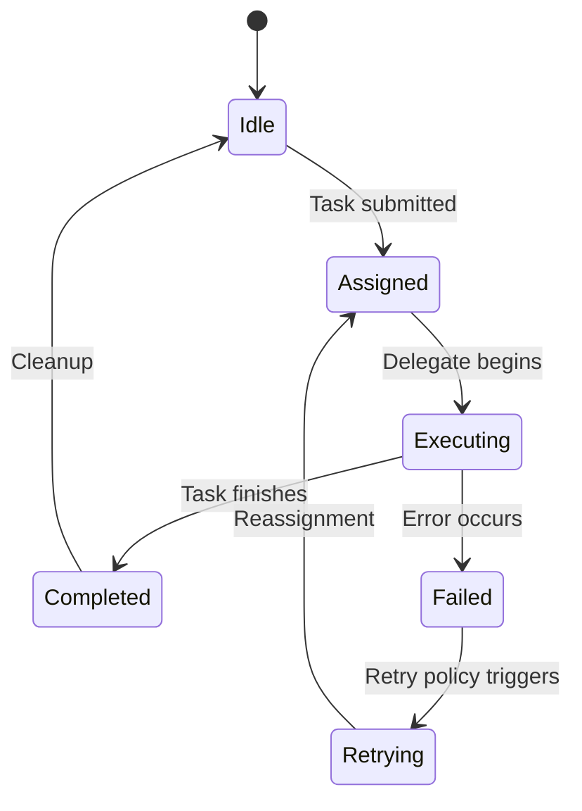

# Lesson 3: Delegation Mechanisms

## 1. First-Principles Intuition & Invariants

In the architecture of multi-agent systems, delegation is not merely a functional abstraction—it is a foundational mechanism that enables scalability, modularity, and resilience in distributed task execution. At its core, delegation embodies the principle of *responsibility transfer* within a system where one entity (the delegator) assigns a subset of its operational responsibilities to another (the delegatee), under conditions of trust, accountability, and resource alignment. This process must be grounded in a set of invariants that ensure correctness, performance, and security across heterogeneous agents operating in dynamic environments.

The first invariant of delegation lies in **responsibility encapsulation**: the delegatee must be capable of executing the assigned task without requiring the delegator to maintain state or context for that task. This implies that the delegation protocol must encode sufficient information for the delegatee to act autonomously, including parameters, constraints, and expected outcomes. In systems programming terms, this corresponds to a well-defined interface contract—whether expressed through function signatures, message schemas, or protocol buffers.

The second invariant is **trust boundary enforcement**, which arises from the fact that delegation inherently introduces a risk of misbehavior or subversion. A delegation mechanism must therefore establish a secure channel for communication, define clear accountability models, and provide mechanisms for auditing or revocation. In kernel-level systems, this might manifest as capability-based access control or cryptographic signatures; in distributed systems, it may involve token-based authorization or blockchain-anchored attestations.

The third invariant concerns **resource alignment and fairness**. When agents delegate tasks, they must ensure that the workload is distributed equitably, that resources are not overcommitted, and that the system remains responsive under load. This requires a dynamic understanding of agent capabilities, resource availability, and task characteristics. The mathematical model for such distribution often maps to queuing theory, load balancing algorithms, or game-theoretic equilibria.

Finally, the fourth invariant is **failure resilience and recovery**. Delegation introduces a dependency chain that can break at any point—either due to agent failure, communication loss, or policy violation. A robust delegation mechanism must therefore include mechanisms for fault detection, rollback, and graceful degradation. In systems programming, this is often implemented through state machines, timeouts, and retry logic; in AI agent systems, it may involve reinforcement learning-based adaptive delegation policies.

These invariants form the bedrock upon which all delegation mechanisms must be built. They are not merely design principles but are deeply embedded in the execution semantics of the system, influencing everything from memory layout to network packet flow, from scheduling decisions to cryptographic key management.

## 2. Core Architecture & Mechanics

At the heart of a delegation system lies a **delegation state machine** that governs the lifecycle of a task from assignment to completion. This state machine operates in a continuous loop of transitions, driven by events such as task submission, execution, acknowledgment, and finalization. Each transition is governed by a set of rules that ensure consistency and prevent invalid states.

Consider a simplified delegation protocol modeled as a finite state automaton:

In this model, each state transition is associated with a **delegation context**, a structured data object that encapsulates all relevant metadata for the delegation. The context typically includes:

- **Task descriptor**: A unique identifier, task type, and parameters.
- **Agent identity**: The delegator and delegatee identifiers.
- **Resource constraints**: Memory, CPU, and I/O limits.
- **Timeout policies**: Timeouts for execution, acknowledgment, and retries.
- **Security tokens**: Cryptographic credentials for authentication and integrity.

The delegation context is stored in a **delegation registry**, which is a concurrent hash map or B-tree indexed by task ID. This registry is accessed by both the delegator and delegatee, and must support atomic updates to ensure consistency. In systems programming terms, this is often implemented using lock-free data structures such as `std::atomic` in C++ or `Rc<RefCell<T>>` in Rust, or more sophisticated primitives like `crossbeam::epoch` for high-performance concurrent access.

When a delegator initiates a delegation, it performs the following steps:

1. **Task serialization**: The task is serialized into a message format (e.g., JSON, Protocol Buffers, or CBOR) and signed with a cryptographic key to ensure integrity.
2. **Context registration**: The delegation context is registered in the registry with a unique task ID.
3. **Message dispatch**: The serialized task is dispatched to the delegatee via a message broker (e.g., Kafka, RabbitMQ, or gRPC).
4. **Acknowledgment handling**: The delegatee acknowledges receipt and begins execution.

The delegatee, upon receiving the task, performs:

1. **Context validation**: Verifies the delegation context against the registry and checks for valid credentials.
2. **Resource allocation**: Allocates necessary resources (e.g., memory, threads, or GPU compute) based on the task descriptor.
3. **Execution**: Executes the task using the provided parameters.
4. **Result reporting**: Upon completion, reports the result back to the delegator via a response channel.

This architecture is supported by a **delegation engine**, a core component that orchestrates the lifecycle of tasks and manages the registry. The engine is typically implemented as a background thread or a set of cooperative goroutines in Go, or as an async task scheduler in Rust. It polls the registry for new tasks, handles timeouts, and triggers retries or escalations when necessary.

In systems programming, the delegation engine is often built on top of a **reactive event loop** or a **task scheduler**. For example, in Rust, one might use `tokio::spawn` to schedule tasks and `tokio::sync::mpsc` for inter-task communication. The engine itself is often a `Future`-based state machine that processes events asynchronously, ensuring that the system remains responsive even under high load.

## 3. High-Performance Optimization & Failure Modes

High-performance delegation systems must be designed to minimize latency, maximize throughput, and ensure fault tolerance. This requires a deep understanding of concurrency models, resource management, and failure recovery strategies.

### Concurrency and Scheduling

In a multi-agent environment, delegation is inherently concurrent. Tasks are submitted by multiple delegators and executed by multiple delegatees, all operating in parallel. To manage this concurrency efficiently, delegation systems often employ **work-stealing schedulers** or **task queues**. These mechanisms ensure that tasks are distributed evenly across agents, and that idle agents can steal work from busy ones, thereby maximizing resource utilization.

In systems programming, this is often implemented using **lock-free queues** such as the **Michael-Scott queue** or **Treiber stack**, which allow multiple threads to enqueue and dequeue tasks without blocking. In Rust, the `crossbeam-queue` crate provides such primitives, enabling efficient task distribution without the overhead of mutexes.

### Resource Scaling

As the number of agents and tasks increases, the delegation system must scale horizontally. This is achieved through **sharding** of the delegation registry and **load balancing** of tasks across agents. Sharding ensures that the registry does not become a bottleneck, while load balancing ensures that agents are not overloaded.

In a distributed system, this might involve partitioning the registry by task type or agent ID, and using a consistent hashing algorithm to distribute tasks. For example, a system might use **Kubernetes** to manage agent pods, with each pod responsible for a subset of tasks. The delegation engine then uses a **service mesh** (e.g., Istio or Linkerd) to route tasks to the appropriate agent.

### Failure Modes and Mitigation

Delegation systems are vulnerable to several failure modes, including:

- **Agent failure**: An agent may crash or become unresponsive, leading to task loss or indefinite blocking.
- **Network failure**: Communication between delegator and delegatee may be lost, causing tasks to stall.
- **Resource exhaustion**: Agents may run out of memory or CPU, leading to task failure or system instability.
- **Security breaches**: Malicious agents may attempt to subvert the delegation process or steal resources.

To mitigate these failures, delegation systems implement several strategies:

1. **Timeouts and retries**: Tasks are assigned a timeout, and if they do not complete within that time, they are retried or escalated to a higher-level agent.
2. **Health checks**: Agents periodically report their status to a central monitor, which can detect failures and initiate recovery procedures.
3. **Resource monitoring**: The system tracks resource usage and can dynamically adjust task allocation to prevent overcommitment.
4. **Circuit breakers**: When a delegatee is failing repeatedly, the system can temporarily stop sending tasks to it, allowing it to recover.

In systems programming, these mechanisms are often implemented using **state machines** and **error handling** patterns. For example, a delegation task might be modeled as a `Result<TaskResult, TaskError>` in Rust, where `TaskError` includes variants for timeouts, network failures, and resource exhaustion. The delegation engine then uses pattern matching to handle each error case appropriately.

In conclusion, delegation mechanisms in multi-agent systems are not just about task distribution—they are about building resilient, scalable, and secure systems that can adapt to changing conditions. By grounding these mechanisms in first-principles invariants and implementing them with high-performance concurrency models, we can create systems that are both robust and efficient.
