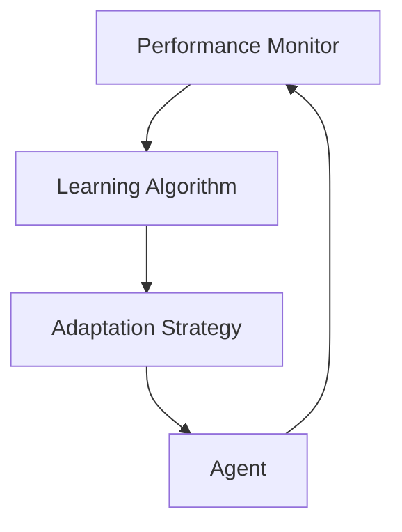

# Lesson 2: Reflection Mechanisms

## 1. First-Principles Intuition & Invariants

In the realm of autonomous systems, the ability to reflect upon one's actions and learn from them is paramount. Reflection mechanisms enable AI agents to not only perform tasks but also to evaluate their performance, adapt to new environments, and improve over time. This capability is foundational to the development of robust, intelligent systems that can operate autonomously in dynamic and uncertain settings.

At its core, reflection in autonomous systems involves self-assessment, learning from experience, and adaptation strategies. Self-assessment is the process by which an agent evaluates its own performance and behavior. This evaluation can be based on predefined metrics, such as task completion time, accuracy, or resource utilization. Learning from experience, on the other hand, involves using the insights gained from self-assessment to improve future performance. Adaptation strategies are the mechanisms by which an agent modifies its behavior in response to new information or changes in the environment.

To understand the theoretical grounding of reflection mechanisms, we must delve into the problem space and the mathematical and system invariants that govern them. Reflection in autonomous systems can be viewed as a feedback loop, where the agent's actions are continuously monitored, evaluated, and adjusted based on the feedback received. This feedback loop is essential for the agent to learn and adapt, as it provides a mechanism for the agent to compare its current performance with its desired performance and make necessary adjustments.

One of the key invariants in reflection mechanisms is the concept of a performance metric. A performance metric is a quantitative measure of the agent's performance, which can be used to evaluate the effectiveness of its actions. The choice of performance metric is critical, as it determines the criteria by which the agent's performance is evaluated. For example, if the performance metric is task completion time, the agent will focus on minimizing the time it takes to complete tasks. If the performance metric is accuracy, the agent will focus on minimizing errors.

Another invariant in reflection mechanisms is the concept of a learning algorithm. A learning algorithm is a method by which the agent updates its behavior based on the feedback received from the performance metric. The learning algorithm must be designed to ensure that the agent's behavior converges to an optimal solution over time. One common learning algorithm used in autonomous systems is reinforcement learning, which involves rewarding the agent for good behavior and penalizing it for bad behavior.

Theoretical models of reflection mechanisms can be grounded in control theory, which provides a framework for designing feedback loops that can stabilize and optimize the behavior of dynamic systems. In control theory, a feedback loop is used to compare the actual output of a system with the desired output and adjust the system's behavior to minimize the difference between the two. Similarly, in autonomous systems, a reflection mechanism can be used to compare the actual performance of the agent with the desired performance and adjust the agent's behavior to minimize the difference between the two.

## 2. Core Architecture & Mechanics

The core architecture of a reflection mechanism involves several key components: a performance monitor, a learning algorithm, and an adaptation strategy. The performance monitor is responsible for evaluating the agent's performance based on a predefined performance metric. The learning algorithm is responsible for updating the agent's behavior based on the feedback received from the performance monitor. The adaptation strategy is responsible for modifying the agent's behavior in response to new information or changes in the environment.

To illustrate the core architecture of a reflection mechanism, we can use a simple example of an autonomous robot navigating a maze. The performance monitor in this example could be a sensor that measures the time it takes for the robot to reach the end of the maze. The learning algorithm could be a reinforcement learning algorithm that rewards the robot for finding a shorter path to the end of the maze and penalizes it for taking a longer path. The adaptation strategy could be a rule that modifies the robot's behavior if it encounters a new obstacle in the maze.

The performance monitor in this example could be implemented using a simple timer that measures the time it takes for the robot to reach the end of the maze. The learning algorithm could be implemented using a Q-learning algorithm, which is a type of reinforcement learning algorithm that uses a Q-table to store the expected rewards for each action in each state. The Q-table is updated based on the feedback received from the performance monitor, and the robot's behavior is adjusted based on the Q-table.

The adaptation strategy in this example could be implemented using a rule that modifies the robot's behavior if it encounters a new obstacle in the maze. For example, if the robot encounters a new obstacle, it could use the Q-table to find a new path around the obstacle and update its behavior accordingly.

To visualize the core architecture of a reflection mechanism, we can use a Mermaid diagram:

In this diagram, the performance monitor evaluates the agent's performance based on a predefined performance metric. The learning algorithm updates the agent's behavior based on the feedback received from the performance monitor. The adaptation strategy modifies the agent's behavior in response to new information or changes in the environment. The agent then uses its updated behavior to perform tasks, and the cycle repeats.

## 3. High-Performance Optimization & Failure Modes

High-performance optimization and failure modes are critical considerations in the design and implementation of reflection mechanisms. High-performance optimization involves ensuring that the reflection mechanism can operate efficiently and effectively, even in complex and dynamic environments. Failure modes involve identifying and mitigating potential issues that can arise during the operation of the reflection mechanism.

One of the key challenges in high-performance optimization is ensuring that the reflection mechanism can operate efficiently in real-time. In many autonomous systems, the reflection mechanism must operate in real-time, as the agent must be able to evaluate its performance and update its behavior in response to changes in the environment. To ensure real-time performance, the reflection mechanism must be designed to minimize the computational overhead associated with self-assessment, learning from experience, and adaptation.

One approach to high-performance optimization is to use parallel processing techniques to distribute the computational workload associated with the reflection mechanism across multiple processors or cores. For example, the performance monitor could be implemented on one processor, the learning algorithm could be implemented on another processor, and the adaptation strategy could be implemented on a third processor. This parallel processing approach can significantly reduce the computational overhead associated with the reflection mechanism and improve its real-time performance.

Another approach to high-performance optimization is to use efficient data structures and algorithms to minimize the computational overhead associated with self-assessment, learning from experience, and adaptation. For example, the Q-table used in the Q-learning algorithm could be implemented using a hash table, which provides efficient access to the expected rewards for each action in each state. Similarly, the performance monitor could be implemented using a timer that provides efficient access to the time it takes for the agent to reach the end of the maze.

One of the key failure modes in reflection mechanisms is the potential for the learning algorithm to converge to a suboptimal solution. This can occur if the learning algorithm is not designed to explore the state space sufficiently or if the performance metric is not well-defined. To mitigate this failure mode, the learning algorithm must be designed to explore the state space sufficiently and the performance metric must be well-defined.

Another key failure mode in reflection mechanisms is the potential for the adaptation strategy to modify the agent's behavior inappropriately. This can occur if the adaptation strategy is not designed to handle new information or changes in the environment appropriately. To mitigate this failure mode, the adaptation strategy must be designed to handle new information or changes in the environment appropriately.

In conclusion, reflection mechanisms are a critical component of autonomous systems, enabling agents to evaluate their performance, learn from experience, and adapt to new environments. The core architecture of a reflection mechanism involves a performance monitor, a learning algorithm, and an adaptation strategy, and these components must be designed to operate efficiently and effectively in real-time. High-performance optimization and failure modes are critical considerations in the design and implementation of reflection mechanisms, and these considerations must be addressed to ensure the robustness and reliability of autonomous systems.
