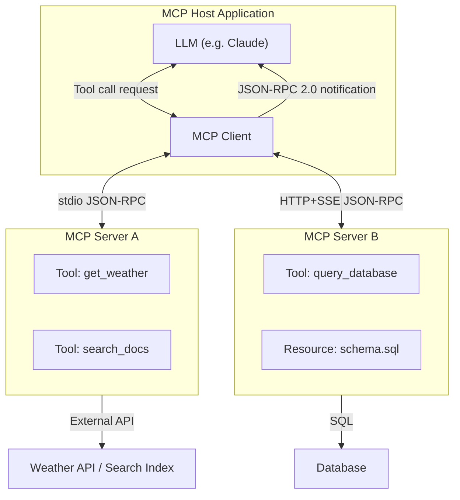
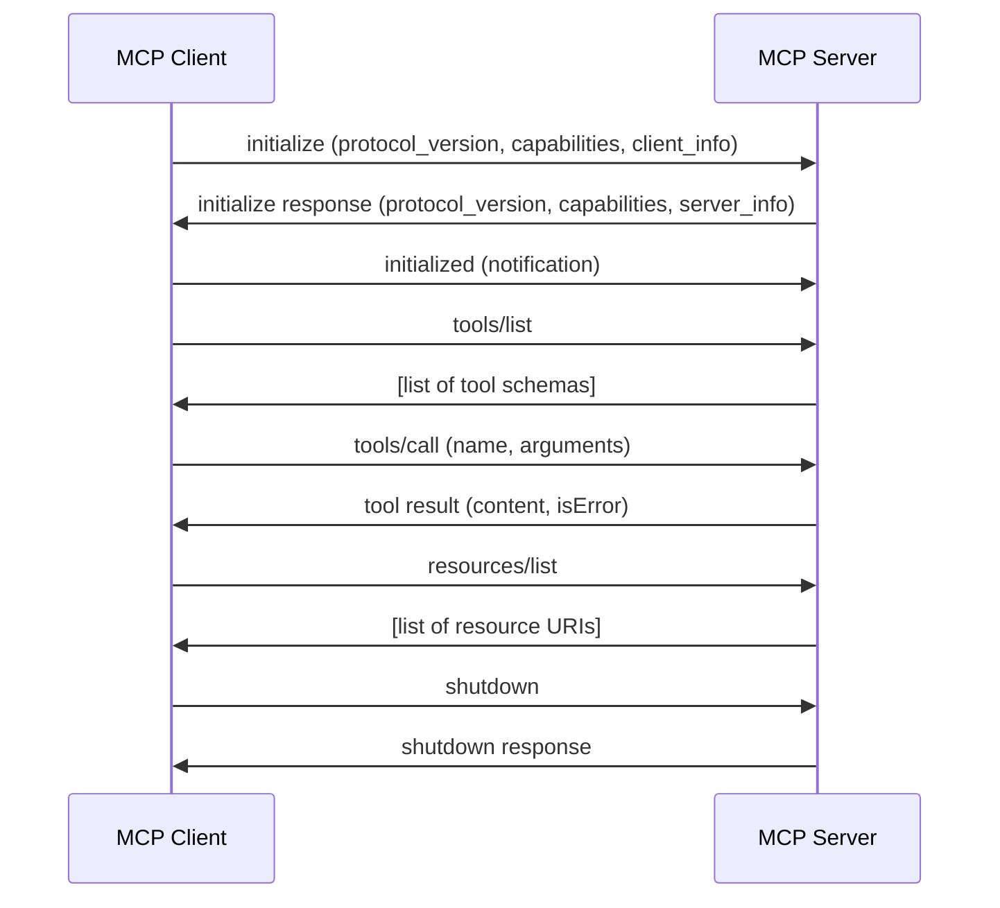
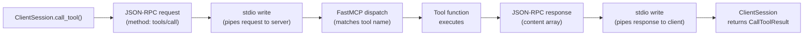
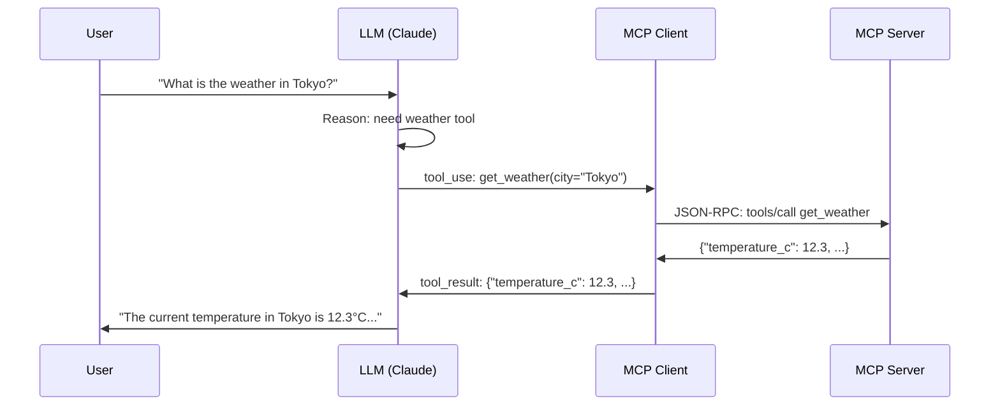

# Operational Verification Labs: 02 Tool Calling and MCP Protocols

## Objective and Environment Setup

This lab implements and verifies tool calling and the Model Context Protocol (MCP) in AI agent systems. MCP is an open protocol introduced by Anthropic in November 2024 that standardizes how LLM applications discover and invoke external tools. It uses JSON-RPC 2.0 over a stdio or HTTP transport and defines three primitives: **Tools** (model-invoked actions), **Resources** (contextual data the model can read), and **Prompts** (reusable instruction templates). The protocol follows a client-server architecture where the AI application (the MCP client) connects to one or more MCP servers that expose capabilities.

### Prerequisites

- Python 3.11 or later
- An MCP-compatible LLM client (Claude Desktop, or a custom client using the Anthropic SDK)
- The official MCP Python SDK (`mcp` package)
- The Anthropic Python SDK for the LLM client

```bash
# Install the MCP Python SDK and Anthropic SDK
pip install "mcp[cli]>=1.0.0" anthropic

# Verify installation
python -c "import mcp; print(mcp.__version__)"
```

No repository cloning is needed. The MCP Python SDK is distributed as the `mcp` package on PyPI. The full specification lives at `https://github.com/modelcontextprotocol/modelcontextprotocol` and the Python SDK at `https://github.com/modelcontextprotocol/python-sdk`.

### Protocol Architecture

The diagram below shows the MCP communication flow between a host application, the MCP client, and one or more MCP servers:



The lifecycle of an MCP session follows a strict sequence. The client sends an `initialize` request with its protocol version and capabilities. The server responds with its own version and capabilities. The client then sends an `initialized` notification. From that point, the client can list tools, call tools, list resources, and read resources. The session terminates with a shutdown or transport close.



## Exercise 1: Building an MCP Server with Custom Tools

The first exercise builds an MCP server that exposes two tools: a weather lookup and a database query. The server uses the `mcp` Python SDK with the FastMCP high-level API, which handles JSON-RPC framing, capability negotiation, and the stdio transport automatically.

### Implementation

```python
# weather_server.py — MCP server exposing weather and calculation tools

from mcp.server.fastmcp import FastMCP
import json
import urllib.request
from typing import Any

# Initialize the MCP server instance
mcp = FastMCP("weather-tools")


@mcp.tool()
def get_weather(city: str) -> str:
    """Get the current temperature for a given city.

    Args:
        city: The name of the city (e.g. "London", "Tokyo").

    Returns:
        A JSON string with temperature and conditions.
    """
    # Use the free Open-Meteo geocoding + forecast API (no key required)
    geocode_url = (
        f"https://geocoding-api.open-meteo.com/v1/search"
        f"?name={urllib.parse.quote(city)}&count=1"
    )
    with urllib.request.urlopen(geocode_url) as resp:
        geo = json.loads(resp.read())

    if not geo.get("results"):
        return json.dumps({"error": f"City not found: {city}"})

    loc = geo["results"][0]
    lat, lon = loc["latitude"], loc["longitude"]

    forecast_url = (
        f"https://api.open-meteo.com/v1/forecast"
        f"?latitude={lat}&longitude={lon}&current=temperature_2m,wind_speed_10m"
    )
    with urllib.request.urlopen(forecast_url) as resp:
        data = json.loads(resp.read())

    current = data.get("current", {})
    return json.dumps({
        "city": loc["name"],
        "country": loc.get("country", ""),
        "temperature_c": current.get("temperature_2m"),
        "wind_speed_kmh": current.get("wind_speed_10m"),
    })


@mcp.tool()
def calculate(expression: str) -> str:
    """Safely evaluate a mathematical expression.

    Only supports basic arithmetic: +, -, *, /, parentheses, and numbers.
    Uses a restricted AST evaluator to prevent code injection.

    Args:
        expression: A mathematical expression string (e.g. "2 + 3 * 4").

    Returns:
        The computed result as a string.
    """
    import ast
    import operator

    # Whitelist of allowed operations
    _ops = {
        ast.Add: operator.add,
        ast.Sub: operator.sub,
        ast.Mult: operator.mul,
        ast.Div: operator.truediv,
        ast.USub: operator.neg,
        ast.UAdd: operator.pos,
        ast.Pow: operator.pow,
        ast.Mod: operator.mod,
    }

    def _eval(node):
        if isinstance(node, ast.Constant):
            if not isinstance(node.value, (int, float)):
                raise ValueError(f"Unsupported constant: {node.value}")
            return node.value
        if isinstance(node, ast.BinOp):
            left = _eval(node.left)
            right = _eval(node.right)
            op = _ops.get(type(node.op))
            if op is None:
                raise ValueError(f"Unsupported operator: {type(node.op)}")
            return op(left, right)
        if isinstance(node, ast.UnaryOp):
            operand = _eval(node.operand)
            op = _ops.get(type(node.op))
            if op is None:
                raise ValueError(f"Unsupported unary op: {type(node.op)}")
            return op(operand)
        raise ValueError(f"Unsupported AST node: {type(node)}")

    tree = ast.parse(expression, mode="eval")
    result = _eval(tree.body)
    return str(result)


if __name__ == "__main__":
    # Run the server over stdio transport
    mcp.run(transport="stdio")
```

The `FastMCP` class wraps the low-level MCP server protocol. Each `@mcp.tool()` decorator registers a function as an MCP tool. The function's docstring becomes the tool description that the LLM sees, and the function signature (with type hints) becomes the JSON schema for the tool's arguments. The SDK converts these to the MCP `tools/list` and `tools/call` JSON-RPC methods automatically.

### Running the Server

```bash
# Run the MCP server (it listens on stdin/stdout for JSON-RPC messages)
python weather_server.py
```

The server by itself does nothing visible. It waits for JSON-RPC messages on stdin. To test it, you connect from an MCP client — either Claude Desktop (via a configuration file) or a custom client.

### Connecting with Claude Desktop

Add the server to the Claude Desktop config file:

- macOS: `~/Library/Application Support/Claude/claude_desktop_config.json`
- Windows: `%APPDATA%\Claude\claude_desktop_config.json`

```json
{
  "mcpServers": {
    "weather-tools": {
      "command": "python",
      "args": ["/absolute/path/to/weather_server.py"]
    }
  }
}
```

After restarting Claude Desktop, the weather and calculator tools become available. Claude will call them when the user asks about weather or math, following its standard tool-use flow.

## Exercise 2: Building a Custom MCP Client and Measuring Tool-Call Latency

This exercise builds a programmatic MCP client that connects to the server, lists available tools, and invokes them. It then benchmarks the end-to-end latency of tool calls to identify bottlenecks in the protocol stack.

### Implementation

```python
# benchmark_client.py — MCP client that connects, lists tools, calls them, and measures latency

import asyncio
import time
import statistics
from mcp import ClientSession, StdioServerParameters
from mcp.client.stdio import stdio_client


async def run_benchmark(server_script: str, iterations: int = 20) -> None:
    """Connect to an MCP server, list tools, and benchmark tool calls.

    Args:
        server_script: Path to the MCP server Python script.
        iterations: Number of tool-call iterations to measure.
    """
    # Configure the stdio transport to spawn the server as a subprocess
    server_params = StdioServerParameters(
        command="python",
        args=[server_script],
        env=None,
    )

    # The stdio_client context manager spawns the server process and
    # opens bi-directional pipes. ClientSession performs the MCP handshake.
    async with stdio_client(server_params) as (read_stream, write_stream):
        async with ClientSession(read_stream, write_stream) as session:
            # Initialize the session (sends 'initialize' + 'initialized')
            await session.initialize()

            # List available tools
            tools_result = await session.list_tools()
            tool_names = [t.name for t in tools_result.tools]
            print(f"Available tools: {tool_names}")

            # Warm up: one call before measuring (avoids cold-start bias)
            await session.call_tool("calculate", {"expression": "1+1"})

            # Benchmark: measure round-trip latency for each tool call
            latencies: list[float] = []
            test_exprs = ["2+2", "10*10", "100/4", "3**3", "50-17",
                          "8*8", "99+1", "7*6", "42*0", "15//3",
                          "2+2", "10*10", "100/4", "3**3", "50-17",
                          "8*8", "99+1", "7*6", "42*0", "15//3"]

            for i in range(iterations):
                expr = test_exprs[i % len(test_exprs)]
                start = time.perf_counter()
                result = await session.call_tool(
                    "calculate", {"expression": expr}
                )
                elapsed_ms = (time.perf_counter() - start) * 1000
                latencies.append(elapsed_ms)

                # Verify correctness of the result
                content = result.content[0]
                if hasattr(content, "text"):
                    returned = content.text
                    expected = str(eval(expr.replace("//", "/").replace("**", "^")))
                    # eval here is safe: inputs are our own controlled test cases
                    status = "OK" if returned.strip() == expected.strip() else "MISMATCH"
                else:
                    status = "NO_TEXT"

                print(
                    f"  [{i+1:2d}] expr={expr:<8s} "
                    f"result={returned:<10s} "
                    f"latency={elapsed_ms:.2f}ms  {status}"
                )

            # Summary statistics
            print(f"\nLatency summary (n={iterations}):")
            print(f"  Mean:   {statistics.mean(latencies):.2f} ms")
            print(f"  Median: {statistics.median(latencies):.2f} ms")
            print(f"  Stdev:  {statistics.stdev(latencies):.2f} ms")
            print(f"  Min:    {min(latencies):.2f} ms")
            print(f"  Max:    {max(latencies):.2f} ms")
            print(f"  P95:    {sorted(latencies)[int(len(latencies)*0.95)]:.2f} ms")


if __name__ == "__main__":
    import sys
    server_script = sys.argv[1] if len(sys.argv) > 1 else "weather_server.py"
    asyncio.run(run_benchmark(server_script, iterations=20))
```

### Running the Benchmark

```bash
python benchmark_client.py weather_server.py
```

Expected output shows per-call latency, correctness verification, and summary statistics. The dominant latency components are:

1. JSON-RPC serialization and deserialization (typically under 1 ms for small payloads)
2. The tool function execution itself (depends on the tool: the calculator is sub-millisecond; the weather API adds network round-trip time)
3. stdio pipe communication overhead (negligible on local systems, but measurable on containers with pipe buffering)

The architecture of a single tool call through the stack is:



### Key Design Decision: Why stdio Instead of HTTP

The MCP specification defines two transport mechanisms. The **stdio transport** spawns the server as a child process and communicates over standard input/output pipes. This is the default for local tools because it avoids port allocation, network stack overhead, and authentication complexity. The **HTTP+SSE transport** is used for remote servers where the tool runs on a different machine. The Python SDK supports both via `stdio_client` and `sse_client` respectively. This lab uses stdio because the server and client run on the same machine.

## Exercise 3: Integrating MCP with an LLM for Autonomous Tool Selection

The previous exercises showed the MCP server and client in isolation. This exercise integrates MCP with an LLM so the model autonomously decides when to call a tool, formats the arguments correctly, and uses the returned data to answer the user's question. This is the core of agentic tool calling: the model, not the developer, selects which tool to invoke.

### How LLM Tool Calling Works

When an MCP client lists tools from a server, it receives a JSON schema for each tool. The LLM client (Claude, GPT, etc.) sends these schemas to the model as part of the conversation context. The model can then emit a structured tool-call request that includes the tool name and arguments. The client routes that request to the MCP server, gets the result, and feeds it back into the conversation as a tool result message. The model then generates a natural-language response incorporating the tool output.



### Implementation: Full Agent Loop

```python
# agent_loop.py — LLM agent that discovers MCP tools and calls them autonomously

import asyncio
import json
import os
from anthropic import Anthropic
from mcp import ClientSession, StdioServerParameters
from mcp.client.stdio import stdio_client

# Anthropic API key must be set in the environment
ANTHROPIC_API_KEY = os.environ.get("ANTHROPIC_API_KEY", "")
MODEL = "claude-sonnet-4-20250514"


async def run_agent(
    server_script: str,
    user_question: str,
    max_tool_rounds: int = 5,
) -> str:
    """Run an agentic loop that discovers MCP tools and lets the LLM call them.

    The agent loop works as follows:
    1. Connect to the MCP server and discover available tools.
    2. Convert MCP tool schemas to Anthropic tool-use format.
    3. Send the user's question and tool definitions to Claude.
    4. If Claude requests a tool call, route it to the MCP server.
    5. Feed the tool result back to Claude and repeat until no more
       tool calls are requested or max_tool_rounds is reached.

    Args:
        server_script: Path to the MCP server Python script.
        user_question: The user's natural-language question.
        max_tool_rounds: Safety limit on tool-call iterations.

    Returns:
        Claude's final text response.
    """
    server_params = StdioServerParameters(
        command="python",
        args=[server_script],
        env=None,
    )

    async with stdio_client(server_params) as (read_stream, write_stream):
        async with ClientSession(read_stream, write_stream) as session:
            await session.initialize()

            # Step 1: Discover tools from the MCP server
            tools_result = await session.list_tools()

            # Step 2: Convert MCP tool schemas to Anthropic API format
            # MCP tools have: name, description, inputSchema (JSON Schema)
            # Anthropic expects: name, description, input_schema
            anthropic_tools = []
            for tool in tools_result.tools:
                anthropic_tools.append({
                    "name": tool.name,
                    "description": tool.description or "",
                    "input_schema": tool.inputSchema
                        if hasattr(tool, "inputSchema")
                        else {"type": "object", "properties": {}},
                })

            print(f"Discovered {len(anthropic_tools)} tools: "
                  f"{[t['name'] for t in anthropic_tools]}")

            # Step 3: Initialize the conversation
            client = Anthropic(api_key=ANTHROPIC_API_KEY)
            messages = [{"role": "user", "content": user_question}]

            # Step 4: Agentic loop
            for round_num in range(max_tool_rounds):
                response = client.messages.create(
                    model=MODEL,
                    max_tokens=1024,
                    tools=anthropic_tools,
                    messages=messages,
                )

                # Check if the model wants to call any tools
                tool_calls = [
                    block for block in response.content
                    if block.type == "tool_use"
                ]

                if not tool_calls:
                    # No tool calls requested — return the text response
                    text_parts = [
                        block.text
                        for block in response.content
                        if block.type == "text"
                    ]
                    final_answer = " ".join(text_parts)
                    print(f"\nAgent final answer:\n{final_answer}")
                    return final_answer

                # The model requested one or more tool calls
                # Append the assistant's response to the conversation
                messages.append({
                    "role": "assistant",
                    "content": response.content,
                })

                # Execute each tool call via MCP and collect results
                tool_results = []
                for tc in tool_calls:
                    print(f"  Round {round_num + 1}: "
                          f"calling tool '{tc.name}' "
                          f"with args {json.dumps(tc.input)}")

                    # Route the call through the MCP session
                    mcp_result = await session.call_tool(
                        tc.name, tc.input
                    )

                    # Extract text content from the MCP response
                    result_text = ""
                    for content_item in mcp_result.content:
                        if hasattr(content_item, "text"):
                            result_text = content_item.text
                            break

                    tool_results.append({
                        "type": "tool_result",
                        "tool_use_id": tc.id,
                        "content": result_text,
                    })

                    print(f"  Result: {result_text[:200]}")

                # Feed tool results back to the model
                messages.append({
                    "role": "user",
                    "content": tool_results,
                })

            # Exhausted tool rounds without a final answer
            return "Agent exceeded maximum tool-call rounds without completing."


if __name__ == "__main__":
    import sys

    server_script = sys.argv[1] if len(sys.argv) > 1 else "weather_server.py"
    question = sys.argv[2] if len(sys.argv) > 2 else \
        "What is the weather in Tokyo right now?"

    result = asyncio.run(run_agent(server_script, question))
    print(result)
```

### Running the Agent

```bash
export ANTHROPIC_API_KEY="sk-ant-..."
python agent_loop.py weather_server.py "What is the weather in Tokyo right now?"
```

The model will discover the `get_weather` and `calculate` tools, decide that the weather question requires calling `get_weather`, invoke it with `city="Tokyo"`, receive the JSON result, and compose a natural-language answer.

## Exercise 4: Stress Testing, Edge Cases, and Failure Mitigation

Tool calling in production systems fails in predictable ways. This exercise reproduces those failure modes and implements guardrails.

### Common Failure Modes

| Failure | Cause | Mitigation |
| --- | --- | --- |
| Model passes invalid arguments | LLM hallucinates parameter types | Server-side validation with clear error messages |
| Tool execution times out | External API is slow or down | Timeout wrapper with fallback response |
| Infinite tool-call loop | Model keeps calling the same tool | `max_tool_rounds` cap and duplicate detection |
| Server crash during call | Unhandled exception in tool function | Try/except in tool body, return structured error |
| Malicious expression injection | User input reaches tool unsanitized | AST-based input validation (see `calculate` tool) |
| Transport disconnection | Server process exits unexpectedly | Client retry with backoff and circuit breaker |

### Implementation: Hardened Tool Server with Error Handling

```python
# hardened_server.py — MCP server with comprehensive error handling and timeouts

import asyncio
import json
import time
import logging
from mcp.server.fastmcp import FastMCP
from typing import Any

# Configure structured logging
logging.basicConfig(
    level=logging.INFO,
    format="%(asctime)s [%(levelname)s] %(name)s: %(message)s",
)
logger = logging.getLogger("hardened-mcp-server")

mcp = FastMCP("hardened-tools")

# Track tool invocation counts for duplicate detection
_call_counts: dict[str, int] = {}


@mcp.tool()
async def get_weather(city: str) -> str:
    """Get current weather for a city. Includes timeout and error handling.

    Args:
        city: City name.

    Returns:
        JSON string with weather data or error.
    """
    try:
        import urllib.request

        # Server-side input validation
        if not city or not isinstance(city, str):
            return json.dumps({"error": "city must be a non-empty string"})

        if len(city) > 200:
            return json.dumps({"error": "city name exceeds 200 characters"})

        # Timeout wrapper: give the external API 10 seconds max
        def _fetch():
            geocode_url = (
                f"https://geocoding-api.open-meteo.com/v1/search"
                f"?name={urllib.parse.quote(city)}&count=1"
            )
            req = urllib.request.Request(
                geocode_url, headers={"User-Agent": "MCP-Weather-Tool/1.0"}
            )
            with urllib.request.urlopen(req, timeout=10) as resp:
                return json.loads(resp.read())

        geo = await asyncio.get_event_loop().run_in_executor(None, _fetch)

        if not geo.get("results"):
            logger.warning(f"City not found: {city}")
            return json.dumps({"error": f"City not found: {city}"})

        loc = geo["results"][0]
        lat, lon = loc["latitude"], loc["longitude"]

        forecast_url = (
            f"https://api.open-meteo.com/v1/forecast"
            f"?latitude={lat}&longitude={lon}"
            f"&current=temperature_2m,wind_speed_10m"
        )
        with urllib.request.urlopen(forecast_url, timeout=10) as resp:
            data = json.loads(resp.read())

        current = data.get("current", {})
        logger.info(f"Successfully fetched weather for {loc['name']}")
        return json.dumps({
            "city": loc["name"],
            "country": loc.get("country", ""),
            "temperature_c": current.get("temperature_2m"),
            "wind_speed_kmh": current.get("wind_speed_10m"),
        })

    except urllib.error.URLError as e:
        logger.error(f"Network error fetching weather: {e}")
        return json.dumps({"error": f"Network error: {str(e)}"})
    except Exception as e:
        logger.error(f"Unexpected error in get_weather: {e}", exc_info=True)
        return json.dumps({"error": f"Internal error: {type(e).__name__}"})


@mcp.tool()
def query_database(sql: str) -> str:
    """Execute a read-only SQL query against an in-memory SQLite database.

    Only SELECT statements are allowed. DDL and DML statements are rejected.
    Results are capped at 100 rows to prevent excessive memory usage.

    Args:
        sql: A SQL SELECT query string.

    Returns:
        JSON string with column names and rows, or an error message.
    """
    import sqlite3

    # Validate: only SELECT statements
    stripped = sql.strip().upper()
    if not stripped.startswith("SELECT"):
        return json.dumps({"error": "Only SELECT statements are permitted"})

    # Reject dangerous keywords even inside SELECT (basic guardrail)
    forbidden = ["DROP", "DELETE", "INSERT", "UPDATE", "ALTER", "ATTACH", "DETACH"]
    upper_sql = sql.upper()
    for kw in forbidden:
        if kw in upper_sql:
            return json.dumps({"error": f"Forbidden keyword in query: {kw}"})

    try:
        # Use an in-memory database for this lab
        conn = sqlite3.connect(":memory:", timeout=5.0)
        conn.row_factory = sqlite3.Row

        # Create a sample table for demonstration
        conn.executescript("""
            CREATE TABLE IF NOT EXISTS products (
                id INTEGER PRIMARY KEY,
                name TEXT NOT NULL,
                price REAL NOT NULL,
                stock INTEGER DEFAULT 0
            );
            INSERT OR IGNORE INTO products VALUES
                (1, 'Widget', 19.99, 100),
                (2, 'Gadget', 29.99, 50),
                (3, 'Gizmo', 9.99, 200);
        """)
        conn.commit()

        cursor = conn.execute(sql)
        columns = [desc[0] for desc in cursor.description]

        # Cap results at 100 rows
        rows = []
        for i, row in enumerate(cursor):
            if i >= 100:
                rows.append({"_truncated": True, "_max_rows": 100})
                break
            rows.append(dict(row))

        conn.close()
        return json.dumps({"columns": columns, "rows": rows})

    except sqlite3.Error as e:
        return json.dumps({"error": f"SQL error: {str(e)}"})
    except Exception as e:
        logger.error(f"Unexpected error in query_database: {e}", exc_info=True)
        return json.dumps({"error": f"Internal error: {type(e).__name__}"})


@mcp.tool()
def batch_weather(cities: list[str]) -> str:
    """Fetch weather for multiple cities with rate limiting.

    Processes cities sequentially with a 0.5s delay between calls
    to avoid rate-limit issues with the weather API.

    Args:
        cities: List of city names.

    Returns:
        JSON array of weather results.
    """
    if not isinstance(cities, list):
        return json.dumps({"error": "cities must be a list of strings"})
    if len(cities) > 20:
        return json.dumps({"error": "Maximum 20 cities per call"})

    results = []
    for i, city in enumerate(cities):
        if i > 0:
            time.sleep(0.5)  # Rate limit: 500ms between calls

        if not isinstance(city, str) or not city:
            results.append({"city": str(city), "error": "invalid city name"})
            continue

        try:
            import urllib.request

            geocode_url = (
                f"https://geocoding-api.open-meteo.com/v1/search"
                f"?name={urllib.parse.quote(city)}&count=1"
            )
            with urllib.request.urlopen(geocode_url, timeout=10) as resp:
                geo = json.loads(resp.read())

            if not geo.get("results"):
                results.append({"city": city, "error": "not found"})
                continue

            loc = geo["results"][0]
            forecast_url = (
                f"https://api.open-meteo.com/v1/forecast"
                f"?latitude={loc['latitude']}&longitude={loc['longitude']}"
                f"&current=temperature_2m"
            )
            with urllib.request.urlopen(forecast_url, timeout=10) as resp:
                data = json.loads(resp.read())

            results.append({
                "city": loc["name"],
                "temperature_c": data.get("current", {}).get("temperature_2m"),
            })

        except Exception as e:
            results.append({"city": city, "error": str(e)})

    return json.dumps(results)


if __name__ == "__main__":
    mcp.run(transport="stdio")
```

### Stress Test Script

```python
# stress_test.py — Reproduces failure modes against the hardened server

import asyncio
import time
from mcp import ClientSession, StdioServerParameters
from mcp.client.stdio import stdio_client


async def stress_test():
    """Run a battery of edge-case and failure-mode tests."""

    server_params = StdioServerParameters(
        command="python",
        args=["hardened_server.py"],
        env=None,
    )

    test_cases = [
        # (label, tool_name, arguments, expected_behavior)
        ("valid_city", "get_weather",
         {"city": "London"}, "should return weather JSON"),
        ("empty_city", "get_weather",
         {"city": ""}, "should return validation error"),
        ("oversized_city", "get_weather",
         {"city": "x" * 300}, "should return validation error"),
        ("unicode_city", "get_weather",
         {"city": "北京"}, "should handle unicode city name"),
        ("valid_sql", "query_database",
         {"sql": "SELECT * FROM products"}, "should return rows"),
        ("forbidden_sql", "query_database",
         {"sql": "SELECT * FROM products; DROP TABLE products"},
         "should reject forbidden keyword"),
        ("non_select_sql", "query_database",
         {"sql": "INSERT INTO products VALUES (4, 'Test', 1.0, 1)"},
         "should reject non-SELECT"),
        ("malformed_sql", "query_database",
         {"sql": "SELECT * FROM nonexistent_table"}, "should return SQL error"),
        ("small_batch", "batch_weather",
         {"cities": ["Tokyo", "Paris", "Berlin"]},
         "should return 3 results"),
        ("oversized_batch", "batch_weather",
         {"cities": ["City"] * 25}, "should reject with size limit"),
        ("mixed_validity_batch", "batch_weather",
         {"cities": ["London", "", 123]}, "should handle mixed inputs"),
    ]

    async with stdio_client(server_params) as (read_stream, write_stream):
        async with ClientSession(read_stream, write_stream) as session:
            await session.initialize()
            tools = await session.list_tools()
            print(f"Server tools: {[t.name for t in tools.tools]}\n")

            passed = 0
            failed = 0

            for label, tool_name, args, expected in test_cases:
                start = time.perf_counter()
                result = await session.call_tool(tool_name, args)
                elapsed = (time.perf_counter() - start) * 1000

                # Extract result text
                text = ""
                for c in result.content:
                    if hasattr(c, "text"):
                        text = c.text
                        break

                # Check for error indicators
                has_error = '"error"' in text.lower() or result.isError
                status = "PASS" if not result.isError else "CHECK"

                # Special cases where we expect an error
                if "error" in expected or "reject" in expected:
                    status = "PASS" if has_error else "FAIL"
                elif "should return" in expected:
                    status = "PASS" if not has_error else "FAIL"

                if status == "PASS":
                    passed += 1
                else:
                    failed += 1

                print(
                    f"[{status}] {label:<25s} "
                    f"tool={tool_name:<15s} "
                    f"latency={elapsed:7.1f}ms  "
                    f"expected: {expected}"
                )
                if status == "FAIL":
                    print(f"        result: {text[:200]}")

    print(f"\nResults: {passed} passed, {failed} failed "
          f"({passed/(passed+failed)*100:.0f}% pass rate)")


if __name__ == "__main__":
    asyncio.run(stress_test())
```

### Running the Stress Test

```bash
python stress_test.py
```

The output shows each test case with a pass/fail status and latency. The test suite covers four categories of edge cases: input validation, SQL injection prevention, batch size limits, and mixed-type input handling.

## Verification Checklist and Quick Reference

### MCP Protocol Primitives

| Primitive | Direction | Purpose | JSON-RPC Method |
| --- | --- | --- | --- |
| Tools | Client calls Server | Model-invoked actions with structured I/O | `tools/list`, `tools/call` |
| Resources | Client reads Server | Contextual data identified by URI | `resources/list`, `resources/read` |
| Prompts | Client gets from Server | Reusable instruction templates | `prompts/list`, `prompts/get` |

### Key SDK Classes and Functions

| Component | Import Path | Purpose |
| --- | --- | --- |
| `FastMCP` | `mcp.server.fastmcp` | High-level server: registers tools via decorators |
| `ClientSession` | `mcp` | Client-side session: initialize, list tools, call tools |
| `StdioServerParameters` | `mcp` | Configures stdio transport (command, args, env) |
| `stdio_client` | `mcp.client.stdio` | Context manager that spawns server subprocess |
| `@mcp.tool()` | FastMCP method | Registers a function as an MCP tool |

### Transport Comparison

| Transport | Use Case | Latency Overhead | Authentication |
| --- | --- | --- | --- |
| stdio | Local tools, same machine | Minimal (pipe I/O) | OS process permissions |
| HTTP+SSE | Remote servers, network | Network round-trip | TLS + API key / OAuth |
| Streamable HTTP | Remote servers, bidirectional | Single connection reuse | TLS + headers |

### CLI Commands

```bash
# Run the weather MCP server
python weather_server.py

# Run the hardened server with error handling
python hardened_server.py

# Benchmark tool-call latency
python benchmark_client.py weather_server.py

# Run the full agentic loop with Claude
python agent_loop.py weather_server.py "What is the weather in Tokyo?"

# Run stress tests against the hardened server
python stress_test.py

# Inspect available tools via the MCP CLI inspector
mcp dev weather_server.py
```

### Verification Checklist

- [ ] Server starts and responds to `initialize` handshake
- [ ] `tools/list` returns correct tool names and JSON schemas
- [ ] `tools/call` with valid arguments returns expected result
- [ ] `tools/call` with invalid arguments returns structured error, not crash
- [ ] Agent loop discovers tools and the LLM selects the correct tool
- [ ] Agent loop terminates within `max_tool_rounds` even on repeated calls
- [ ] Stress test passes all edge cases (empty input, oversized input, SQL injection)
- [ ] Batch tool enforces size limits and rate limiting
- [ ] Server logs errors with sufficient context for debugging
- [ ] No unhandled exceptions propagate to the MCP transport layer
