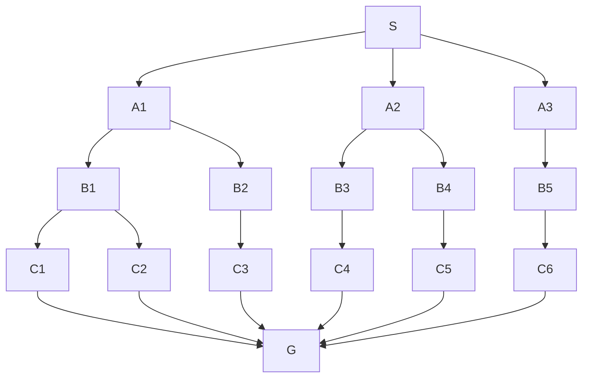

# Lesson 1: Autonomous Planning Basics

## 1. First-Principles Intuition & Invariants

Autonomous planning is a cornerstone of artificial intelligence, enabling agents to achieve complex goals through a series of actions. At its core, planning involves the systematic exploration of possible sequences of actions to transform an initial state into a desired goal state. This process is deeply rooted in the principles of logic, graph theory, and computational complexity.

To understand autonomous planning, we must first delve into the problem space and the mathematical invariants that govern it. The problem space can be represented as a state space, where each state is a configuration of the environment, and actions are transitions between states. The goal of planning is to find a sequence of actions that leads from the initial state to a goal state, where the goal state satisfies certain criteria defined by the agent's objectives.

Formally, the planning problem can be defined as a tuple \((S, A, s_0, G, T)\), where:
- \(S\) is a set of states.
- \(A\) is a set of actions.
- \(s_0 \in S\) is the initial state.
- \(G \subseteq S\) is the set of goal states.
- \(T: S \times A \rightarrow S\) is a transition function that defines the effect of actions on states.

The transition function \(T\) is crucial as it encapsulates the dynamics of the environment. Given a state \(s\) and an action \(a\), \(T(s, a)\) returns the resulting state after applying action \(a\) to state \(s\). The goal of the planner is to find a sequence of actions \(\pi = a_1, a_2, \ldots, a_n\) such that starting from \(s_0\), applying the sequence \(\pi\) results in a state \(s_n \in G\).

The complexity of the planning problem arises from the vastness of the state space and the combinatorial nature of action sequences. In the worst case, the planner must explore all possible state-action paths, leading to exponential time complexity. This necessitates the development of efficient algorithms that can prune the search space and find optimal or near-optimal solutions within reasonable time frames.

One of the fundamental invariants in planning is the notion of admissibility. An admissible planner is one that guarantees finding an optimal solution if one exists. Admissibility is a critical property for ensuring that the planner does not overlook the best possible sequence of actions. Another important invariant is completeness, which ensures that the planner will eventually find a solution if one exists.

## 2. Core Architecture & Mechanics

The architecture of an autonomous planner is built around the exploration of the state space. At the heart of the planner is the search algorithm, which systematically explores possible action sequences to find a path to the goal state. The choice of search algorithm is crucial, as it directly impacts the efficiency and effectiveness of the planner.

One of the most widely used search algorithms in planning is the A* algorithm. A* is a heuristic-based search algorithm that combines the cost of reaching a state with an estimate of the cost to reach the goal from that state. The A* algorithm maintains a priority queue of open states, where each state is associated with a cost function \(f(n) = g(n) + h(n)\). Here, \(g(n)\) is the cost of reaching state \(n\) from the initial state, and \(h(n)\) is the heuristic estimate of the cost to reach the goal from state \(n\).

The A* algorithm operates by iteratively expanding the state with the lowest \(f(n)\) value. When a state is expanded, its successor states are generated using the transition function \(T\). The cost \(g(n)\) of each successor state is updated, and the heuristic \(h(n)\) is estimated. The successor states are then added to the open queue, and the process repeats until the goal state is reached.

To illustrate the mechanics of the A* algorithm, consider the following example. Suppose we have a grid-based environment where the agent can move up, down, left, or right. The initial state is the agent's starting position, and the goal state is the agent's target position. The cost of each move is 1, and the heuristic is the Manhattan distance between the current state and the goal state.

```
+---+---+---+---+---+
|   |   |   |   | G |
+---+---+---+---+---+
|   |   |   |   |   |
+---+---+---+---+---+
|   |   |   |   |   |
+---+---+---+---+---+
|   |   |   |   |   |
+---+---+---+---+---+
| S |   |   |   |   |
+---+---+---+---+---+
```

In this example, the initial state \(s_0\) is the position of the agent (S), and the goal state \(G\) is the target position. The A* algorithm starts by adding the initial state to the open queue with \(g(s_0) = 0\) and \(h(s_0) = 4\) (Manhattan distance to the goal). The algorithm then expands the initial state, generating its successor states and updating their costs and heuristics. The process continues until the goal state is reached.

To visualize the search process, we can use a Mermaid diagram to represent the state space and the expansion of states.



In this diagram, the nodes represent states, and the edges represent actions. The initial state \(S\) is connected to its successor states \(A1\), \(A2\), and \(A3\). Each successor state is further expanded, generating its own successor states, until the goal state \(G\) is reached.

## 3. High-Performance Optimization & Failure Modes

The performance of an autonomous planner is critical for real-world applications, where time and resource constraints are often stringent. To optimize the performance of the planner, several strategies can be employed.

One effective strategy is to use domain-specific heuristics that provide more accurate estimates of the cost to reach the goal. Domain-specific heuristics leverage problem-specific knowledge to guide the search process, reducing the number of states that need to be explored. For example, in a grid-based environment, the Manhattan distance can be used as a heuristic, as it provides a lower bound on the actual cost to reach the goal.

Another strategy is to parallelize the search process, allowing multiple states to be expanded simultaneously. Parallelization can significantly reduce the search time, especially in large state spaces. However, parallelization introduces additional complexity, as it requires careful management of shared resources and synchronization between threads.

Concurrency is a critical aspect of high-performance planning, as it enables the planner to explore multiple paths in parallel. To ensure efficient concurrency, the planner must be designed to minimize contention and maximize resource utilization. This can be achieved through the use of lock-free data structures and efficient synchronization mechanisms.

Resource scaling is another important consideration in high-performance planning. As the size of the state space grows, the memory and computational resources required by the planner also increase. To address this challenge, the planner must be designed to scale efficiently, using techniques such as memory pooling and lazy evaluation.

Boundary edge cases and failure modes are also critical considerations in autonomous planning. Edge cases arise when the planner encounters unusual or unexpected situations, such as dead ends or loops. To handle edge cases, the planner must be designed to detect and recover from these situations, ensuring that it can continue to find a solution even in challenging environments.

Failure modes occur when the planner fails to find a solution, either due to incorrect heuristics or insufficient resources. To mitigate failure modes, the planner must be designed to adapt to changing conditions and to explore alternative paths when necessary. This can be achieved through the use of robust heuristics and adaptive search strategies.

In conclusion, autonomous planning is a fundamental aspect of artificial intelligence, enabling agents to achieve complex goals through a series of actions. The planning problem is governed by mathematical invariants such as admissibility and completeness, and the architecture of the planner is built around the exploration of the state space using search algorithms such as A*. High-performance optimization and failure mitigation are critical for ensuring that the planner can operate efficiently and effectively in real-world applications.
