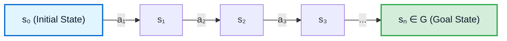
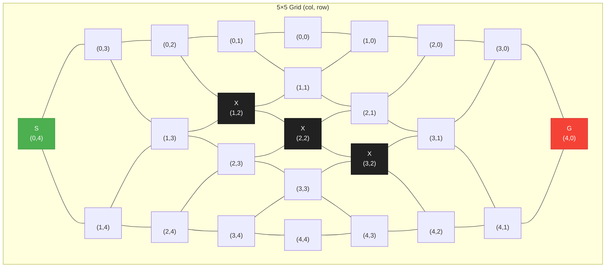
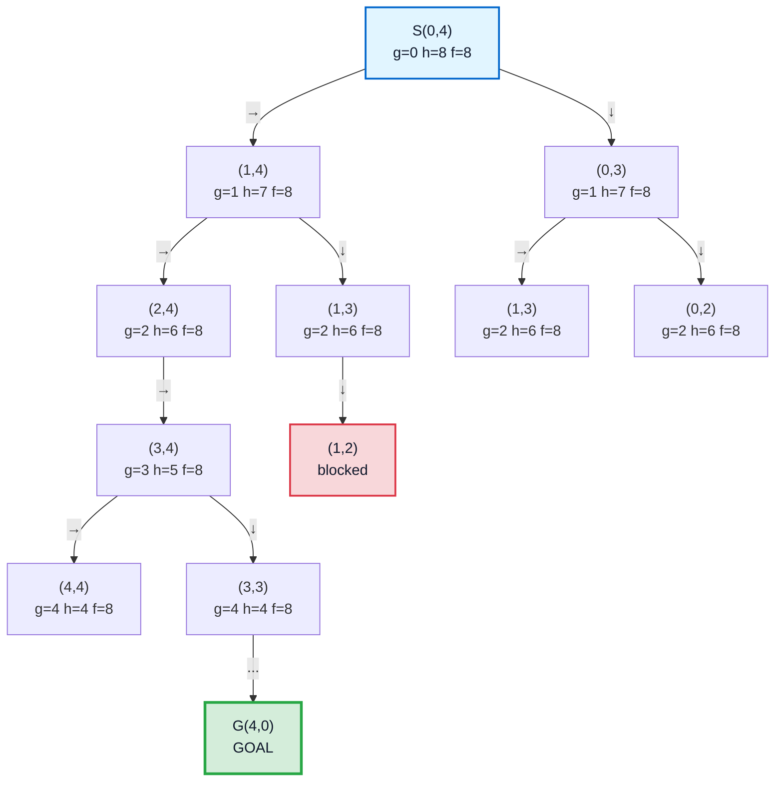
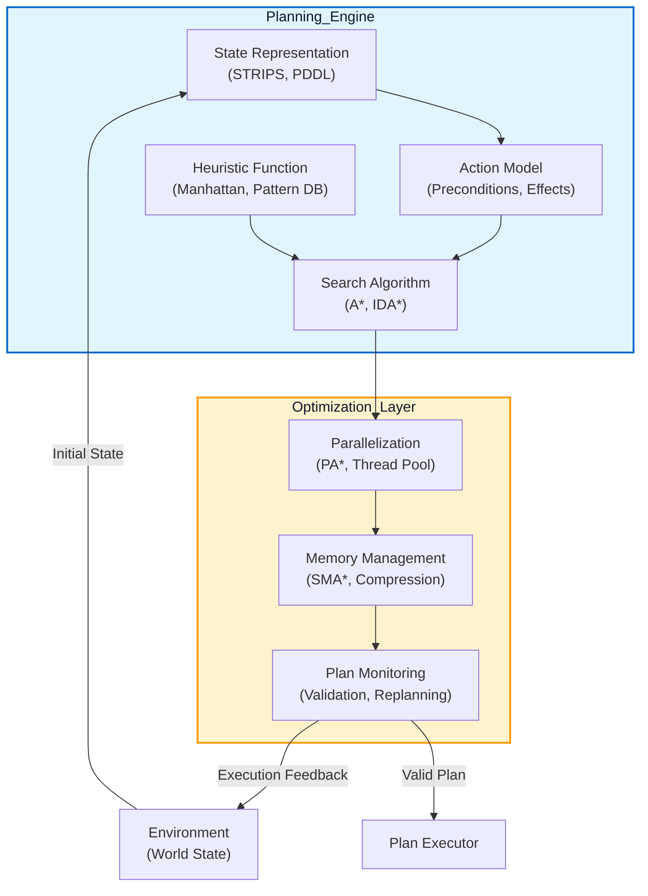

# Lesson 1: Autonomous Planning Basics

## 1. First-Principles Intuition & Invariants

Autonomous planning is the computational process by which an agent synthesizes a sequence of actions to transform an initial world state into a goal state. This capability underpins robotics, scheduling systems, game AI, and automated decision-making. At its foundation, planning is an instance of **state-space search** over a graph where nodes represent world configurations and edges represent state transitions induced by actions.

The classical planning problem is formalized as a tuple \((S, A, s_0, G, T, C)\):

- **\(S\)**: The state space—a set of all possible world configurations. In deterministic domains, \(|S|\) may be exponential in the number of domain variables.
- **\(A\)**: The action space—a finite set of primitive operations executable by the agent.
- **\(s_0 \in S\)**: The initial state from which planning begins.
- **\(G \subseteq S\)**: The goal specification. In propositional planning, \(G\) is often a conjunction of literals. In temporal planning, \(G\) may include temporal constraints.
- **\(T: S \times A \rightarrow S\)**: The deterministic transition function. Given state \(s\) and action \(a\), \(T(s, a)\) yields the successor state. In stochastic domains, \(T\) becomes a probability distribution \(T: S \times A \rightarrow \Delta(S)\).
- **\(C: S \times A \rightarrow \mathbb{R}^+\)**: The cost function assigning a non-negative cost to each state-action pair. Uniform cost simplifies to \(C(s, a) = 1\).

A **plan** \(\pi = \langle a_1, a_2, \ldots, a_n \rangle\) is a finite action sequence. A plan is **valid** if applying it from \(s_0\) via the transition function yields a trajectory \(s_0 \xrightarrow{a_1} s_1 \xrightarrow{a_2} \cdots \xrightarrow{a_n} s_n\) where \(s_n \in G\). The plan's cost is \(\sum_{i=1}^{n} C(s_{i-1}, a_i)\).

### Computational Complexity and Invariants

The planning problem is **PSPACE-complete** in the general case, meaning the decision problem ("Does a plan exist?") requires space polynomial in the encoding size but may require exponential time. For propositional STRIPS planning (actions defined by preconditions and effects), the problem remains PSPACE-complete. Optimal planning (finding minimum-cost plans) is NP-hard even for polynomially bounded plan lengths.

Key invariants and properties:

- **Admissibility**: A planning algorithm is admissible if it guarantees finding an optimal (minimum-cost) plan when one exists. Admissibility requires that heuristic estimates never overestimate true cost.
- **Completeness**: A planner is complete if it finds a solution whenever one exists, regardless of the state space structure.
- **Optimality**: An optimal planner returns a minimum-cost plan. Optimality requires both admissibility and systematic exploration.
- **Reachability**: A state \(s\) is reachable from \(s_0\) if there exists a sequence of actions that produces \(s\). The reachable state space \(S_{\text{reach}} \subseteq S\) is often much smaller than \(S\), and efficient planners exploit this.

The **state-space explosion** is the central challenge: with \(n\) Boolean state variables, \(|S| = 2^n\). For example, a Rubik's Cube has approximately \(4.3 \times 10^{19}\) states. Practical planning demands pruning strategies, abstraction, and heuristic guidance to avoid exhaustive enumeration.

### Mermaid Diagram: Planning Problem Structure



This diagram illustrates a valid plan as a path through the state space from \(s_0\) to a goal state.

## 2. Core Architecture & Mechanics

Autonomous planners employ search algorithms to explore the state space. The architecture consists of:

1. **State Representation**: Encodes world configurations efficiently. Propositional representations use Boolean variables; first-order representations use predicates and objects.
2. **Action Model**: Defines preconditions (conditions under which an action is applicable) and effects (changes the action induces). STRIPS and PDDL (Planning Domain Definition Language) are standard formalisms.
3. **Search Strategy**: Determines the order in which states are explored. Common strategies include uninformed search (BFS, DFS), informed search (A*, IDA*), and domain-independent heuristics.
4. **Heuristic Function**: Estimates the cost-to-go \(h(s)\) from state \(s\) to the nearest goal. Effective heuristics guide search toward promising regions.

### The A* Algorithm

A* is a best-first search algorithm that expands states in order of their estimated total cost \(f(n) = g(n) + h(n)\):

- **\(g(n)\)**: The **path cost** from \(s_0\) to state \(n\)—the cumulative cost of actions taken.
- **\(h(n)\)**: The **heuristic estimate** of the cost from \(n\) to the nearest goal state.

A* maintains two data structures:

- **Open List** (priority queue): States awaiting expansion, prioritized by \(f(n)\).
- **Closed List** (hash set): States already expanded, preventing redundant work.

**Algorithm:**

```text
function A_STAR(s₀, G, h):
    open ← priority_queue()
    open.insert(s₀, f = h(s₀))
    g[s₀] ← 0
    closed ← set()
    
    while open is not empty:
        n ← open.extract_min()
        
        if n ∈ G:
            return RECONSTRUCT_PATH(n)
        
        closed.add(n)
        
        for each action a applicable in n:
            n' ← T(n, a)
            tentative_g ← g[n] + C(n, a)
            
            if n' ∈ closed and tentative_g ≥ g[n']:
                continue
            
            if n' ∉ open or tentative_g < g[n']:
                parent[n'] ← n
                g[n'] ← tentative_g
                f[n'] ← g[n'] + h(n')
                
                if n' ∉ open:
                    open.insert(n', f[n'])
                else:
                    open.decrease_key(n', f[n'])
    
    return NO_SOLUTION
```

**Optimality Guarantee**: If \(h(n)\) is **admissible** (never overestimates true cost), A* returns an optimal plan. If \(h(n)\) is also **consistent** (\(h(n) \leq C(n, a) + h(n')\) for all successors \(n'\)), A* expands each state at most once.

### Concrete Example: Grid Navigation

Consider a 5×5 grid where an agent can move in four cardinal directions (cost 1 per move) from \(S = (0, 4)\) to \(G = (4, 0)\). Obstacles occupy cells \((1, 2)\), \((2, 2)\), and \((3, 2)\), a wall across the middle row.

**Heuristic**: Manhattan distance to the goal, \(h(x, y) = |x - 4| + |y|\).

**State Space Visualization**:



A* begins at \(S = (0, 4)\) with \(g = 0\), \(h = 8\), \(f = 8\). The algorithm expands states with the lowest \(f\)-value, systematically exploring paths around the obstacle wall. The wall leaves two gaps, at \(x = 0\) and \(x = 4\); an optimal plan moves down column 0 to \((0, 0)\) and then right to \((4, 0)\) (going right along the top row and then down column 4 costs the same)—a total cost of 8, equal to \(h(S)\), because neither route needs a detour.

### Mermaid Diagram: A* Search Tree



This diagram shows how A* expands states in order of increasing \(f\)-value, pruning paths blocked by obstacles.

### Implementation: A* in Rust

```rust
use std::cmp::Ordering;
use std::collections::{BinaryHeap, HashMap, HashSet};

#[derive(Copy, Clone, Eq, PartialEq, Hash, Debug)]
struct State {
    x: i32,
    y: i32,
}

#[derive(Copy, Clone, Eq, PartialEq)]
struct Node {
    state: State,
    f_score: i32,
}

impl Ord for Node {
    fn cmp(&self, other: &Self) -> Ordering {
        other.f_score.cmp(&self.f_score) // Min-heap
    }
}

impl PartialOrd for Node {
    fn partial_cmp(&self, other: &Self) -> Option<Ordering> {
        Some(self.cmp(other))
    }
}

fn manhattan_distance(s: State, goal: State) -> i32 {
    (s.x - goal.x).abs() + (s.y - goal.y).abs()
}

fn a_star(start: State, goal: State, obstacles: &HashSet<State>) -> Option<Vec<State>> {
    let mut open = BinaryHeap::new();
    let mut g_score: HashMap<State, i32> = HashMap::new();
    let mut parent: HashMap<State, State> = HashMap::new();
    let mut closed: HashSet<State> = HashSet::new();
    
    g_score.insert(start, 0);
    open.push(Node {
        state: start,
        f_score: manhattan_distance(start, goal),
    });
    
    while let Some(Node { state: current, .. }) = open.pop() {
        if current == goal {
            // Reconstruct path
            let mut path = vec![current];
            let mut node = current;
            while let Some(&prev) = parent.get(&node) {
                path.push(prev);
                node = prev;
            }
            path.reverse();
            return Some(path);
        }
        
        closed.insert(current);
        
        let successors = [
            State { x: current.x + 1, y: current.y },
            State { x: current.x - 1, y: current.y },
            State { x: current.x, y: current.y + 1 },
            State { x: current.x, y: current.y - 1 },
        ];
        
        for &successor in &successors {
            if obstacles.contains(&successor) || closed.contains(&successor) {
                continue;
            }
            
            let tentative_g = g_score[&current] + 1;
            
            if !g_score.contains_key(&successor) || tentative_g < g_score[&successor] {
                parent.insert(successor, current);
                g_score.insert(successor, tentative_g);
                let f = tentative_g + manhattan_distance(successor, goal);
                open.push(Node {
                    state: successor,
                    f_score: f,
                });
            }
        }
    }
    
    None
}

fn main() {
    let start = State { x: 0, y: 4 };
    let goal = State { x: 4, y: 0 };
    let obstacles: HashSet<State> = [
        State { x: 1, y: 2 },
        State { x: 2, y: 2 },
        State { x: 3, y: 2 },
    ].iter().cloned().collect();
    
    if let Some(path) = a_star(start, goal, &obstacles) {
        println!("Path found: {:?}", path);
        println!("Cost: {}", path.len() - 1);
    } else {
        println!("No path exists.");
    }
}
```

This implementation uses Rust's `BinaryHeap` for the priority queue and `HashMap` for efficient \(g\)-score lookups. The algorithm is type-safe, memory-efficient, and avoids redundant allocations.

## 3. High-Performance Optimization & Failure Modes

Real-world planning demands performance optimization to handle large state spaces within time and memory constraints. Key strategies include heuristic refinement, parallelization, memory management, and robust failure handling.

### Domain-Specific Heuristics

The quality of the heuristic \(h(n)\) determines search efficiency. A stronger heuristic reduces the number of expanded states, accelerating planning. Heuristics are typically derived via **relaxation**—simplifying the problem by removing constraints.

**Pattern Databases**: Precompute exact costs for subproblems and use them as heuristics. For example, in the 15-puzzle, store costs for moving specific tiles to their goal positions. Pattern databases are admissible and often highly accurate.

**Landmark Heuristics**: Identify intermediate states (landmarks) that must be visited en route to the goal. The cost to reach landmarks provides lower bounds on total cost.

**Abstraction**: Map the original problem to a simpler abstract space, solve the abstract problem, and use its solution cost as a heuristic. For example, ignore certain state variables or merge similar states.

### Parallelization

A* can be parallelized by distributing state expansions across threads or processors. Challenges include:

- **Open list contention**: Multiple threads compete to access the priority queue. Lock-free or partitioned queues mitigate contention.
- **Duplicate detection**: Threads must coordinate to avoid expanding the same state multiple times. Distributed hash tables or shared closed lists are solutions.
- **Work balancing**: Ensure threads have comparable workloads to prevent idle time.

**Parallel A* (PA*)** partitions the open list among threads, with each thread managing a local priority queue. Periodically, threads exchange information about newly discovered states to maintain optimality guarantees.

### Memory Management

A* stores all generated states in memory, which can become prohibitive. Techniques to reduce memory usage:

- **Iterative Deepening A* (IDA*)**: Depth-first search with an \(f\)-limit that increases iteratively. IDA* uses linear memory but may re-expand states.
- **Memory-Bounded A***: Algorithms like SMA* (Simplified Memory-Bounded A*) discard less promising states when memory is exhausted, retaining the best candidates.
- **State compression**: Encode states compactly using bit-packing or hash-based representations.

### Concurrency Considerations

In concurrent planning systems, multiple agents or planning threads may interact. Critical issues include:

- **Data races**: Shared state must be protected via locks, atomic operations, or lock-free data structures.
- **Deadlock avoidance**: Ensure threads acquire resources in a consistent order.
- **Progress guarantees**: Use algorithms that guarantee progress (e.g., wait-free or lock-free structures) to prevent starvation.

Rust's ownership model and type system provide compile-time guarantees against data races. Using `Arc<Mutex<T>>` or `Arc<RwLock<T>>` for shared state ensures safe concurrent access.

### Boundary Conditions and Edge Cases

Robust planners handle exceptional scenarios:

- **Unreachable goals**: If no path exists from \(s_0\) to \(G\), the planner must detect this and report failure. A* naturally detects unreachability when the open list is exhausted.
- **Cyclic state spaces**: Actions may form loops. Closed lists prevent infinite loops by tracking visited states.
- **Zero-cost actions**: Can cause A* to loop infinitely if not handled. Ensuring all actions have positive cost eliminates this issue.
- **Non-admissible heuristics**: Overestimating heuristics sacrifice optimality for speed. Weighted A* uses \(f(n) = g(n) + w \cdot h(n)\) with \(w > 1\) to trade optimality for faster search.

### Failure Modes and Mitigation

Planning systems face several failure modes:

1. **Heuristic inadmissibility**: An overestimating heuristic causes A* to miss optimal plans. **Mitigation**: Verify heuristic admissibility analytically or empirically. Use relaxation-based heuristics guaranteed to be admissible.

2. **State-space explosion**: Exponential growth of reachable states exhausts memory or time. **Mitigation**: Use abstraction, hierarchical planning, or anytime algorithms that return suboptimal plans quickly and refine them over time.

3. **Action model errors**: Incorrect preconditions or effects cause the planner to produce invalid plans. **Mitigation**: Validate action models through simulation or formal verification. Use runtime plan monitoring to detect execution failures.

4. **Dynamic environments**: The world changes during planning, invalidating the plan. **Mitigation**: Employ replanning (recompute plans when changes occur) or reactive planning (interleave planning and execution). Algorithms like D* (Dynamic A*) efficiently update plans as the environment changes.

5. **Resource exhaustion**: Limited CPU time or memory forces premature termination. **Mitigation**: Use anytime algorithms (e.g., ARA*, Anytime Repairing A*) that produce progressively better plans and can be interrupted at any time.

### Mermaid Diagram: Planning System Architecture



This architecture illustrates how planning components interact, from state representation through optimization layers to execution and feedback.

### Performance Benchmarking

Evaluating planner performance requires standard metrics:

- **Plan cost**: Total action cost. Lower is better for optimal planners.
- **Planning time**: Wall-clock time to compute the plan. Critical for real-time systems.
- **Memory usage**: Peak memory consumption. Constrains scalability.
- **Expanded states**: Number of states removed from the open list. Indicates search efficiency.
- **Generated states**: Total states created. Reflects branching factor and exploration breadth.

Benchmarking suites like the International Planning Competition (IPC) provide standardized domains (e.g., Blocksworld, Logistics, Rovers) for comparing planners.

Autonomous planning remains an active research area, with ongoing work on learning heuristics via machine learning, integrating planning with reinforcement learning, and scaling to massive state spaces in robotics and autonomous systems. Understanding the foundational principles and architectures presented here equips practitioners to design, implement, and optimize planning systems for diverse applications.
