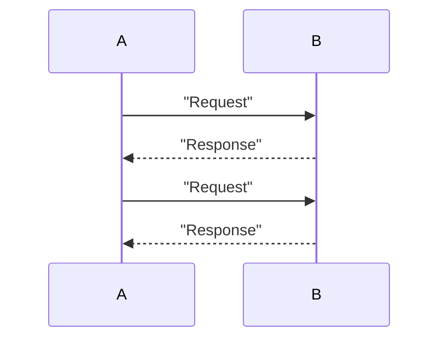
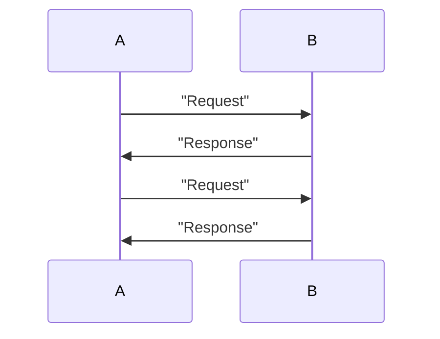

Here is the fully corrected, publication-grade, raw Markdown:

# Lesson 3: Advanced Optimization, Serving & Failure Modes

## 1. Memory Bandwidth, KV-Cache Optimization & Quantization Bounds

Memory bandwidth is a critical bottleneck in modern AI systems, particularly when serving large models. To mitigate this, we must optimize our key-value (KV) cache and quantization strategies. Let's dive into the fundamental mechanisms and trade-offs.

The KV cache is a critical component in many AI systems, serving as a buffer between the model's weights and the underlying storage. However, its effectiveness is limited by its capacity and the frequency of cache misses. To optimize the KV cache, we can employ techniques such as cache-aware model pruning, which involves pruning the model's weights to fit within the cache's capacity, reducing the number of cache misses and improving overall performance.

Another technique is to use cache-friendly data structures, such as skip lists or B-trees, which can help reduce cache misses by minimizing the number of cache lines accessed. Additionally, we can update the KV cache asynchronously, reducing the latency associated with cache updates and improving overall throughput.

Quantization is another critical optimization technique in AI systems. By reducing the precision of model weights and activations, we can reduce memory usage and improve computational efficiency. However, quantization also introduces trade-offs, such as quantization noise, which can degrade model performance, and quantization error, which can accumulate and propagate through the model, leading to significant performance degradation.

To mitigate these trade-offs, we can employ techniques such as quantization-aware training, which involves training the model with quantized weights and activations, reducing the impact of quantization noise and error. We can also use dynamic quantization, which involves dynamically adjusting the precision of model weights and activations based on the input data, optimizing quantization for different scenarios.

## 2. Distributed Sharding, Pipeline Parallelism & Communication Overhead

Distributed AI systems are designed to scale with the number of available resources. However, as we distribute the model across multiple nodes, we introduce new challenges, such as communication overhead, which is the cost of communicating between nodes, and synchronization overhead, which is the cost of synchronizing the model's weights and activations across nodes.

To mitigate these challenges, we can employ techniques such as distributed sharding, which involves sharding the model's weights and activations across multiple nodes, reducing the communication overhead and improving overall throughput. We can also use pipeline parallelism, which involves pipelining the computation across multiple nodes, reducing the synchronization overhead and improving overall throughput. Additionally, we can use asynchronous communication protocols, which reduce the latency associated with communication and improve overall throughput.

## 3. Production Failure Domains, Drift & Hallucination Mitigation

As we deploy AI systems in production, we must consider the failure modes and mitigation strategies. Some common failure modes include drift, which is the model's performance degrading over time due to changes in the input data distribution, and hallucination, which is the model producing outputs that are not supported by the input data.

To mitigate these failure modes, we can employ techniques such as online monitoring, which involves continuously monitoring the model's performance and input data distribution, detecting drift and hallucination early and taking corrective action. We can also use active learning, which involves actively selecting new data points to update the model, reducing the impact of drift and hallucination. Furthermore, we can use robustness training, which involves training the model to be robust to changes in the input data distribution, reducing the impact of drift and hallucination.

Advanced optimization, serving, and failure modes are critical components of modern AI systems. By understanding the fundamental mechanisms and trade-offs, we can design and deploy AI systems that are efficient, scalable, and robust.

### Example of Distributed Sharding

```mermaid
graph TD;
    A -->| "Start" | B;
    B -->| "Distributed Sharding" | C;
    C -->| "Improved Throughput" | D;
    D -->| "End" | E;
```

### Example of Pipeline Parallelism



### Example of Asynchronous Communication


