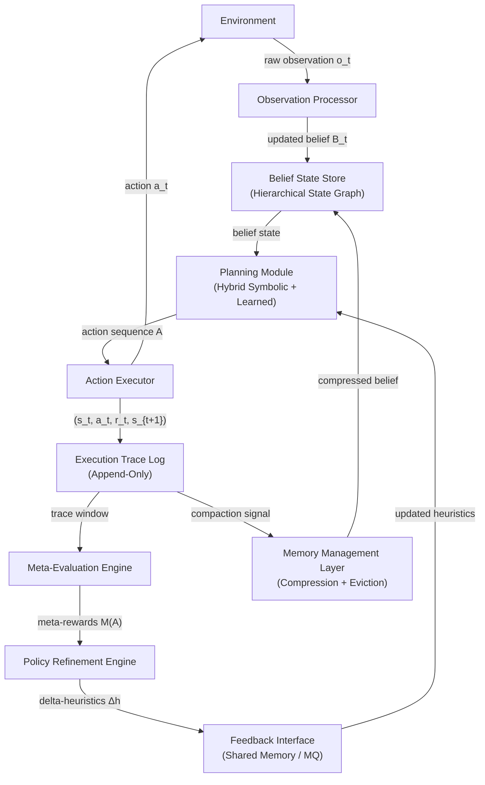
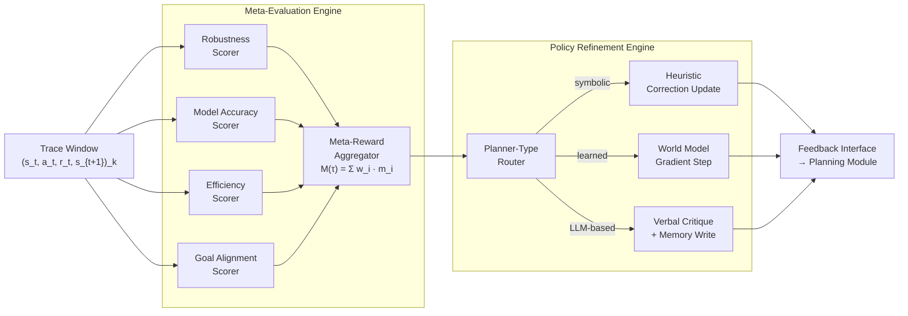
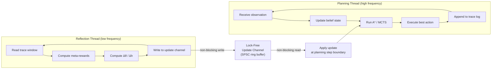
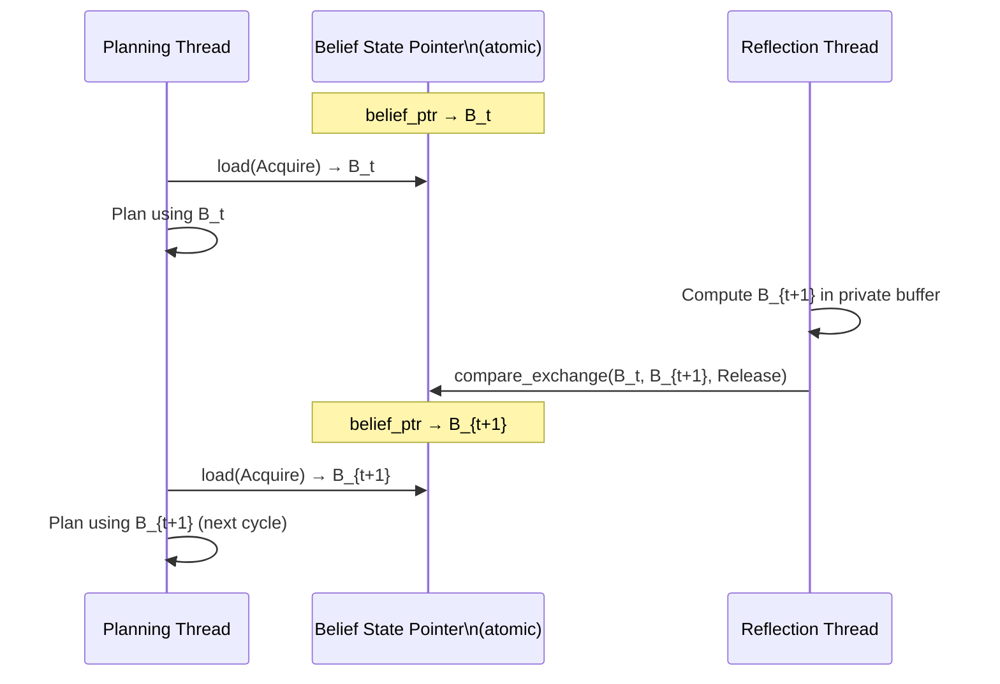
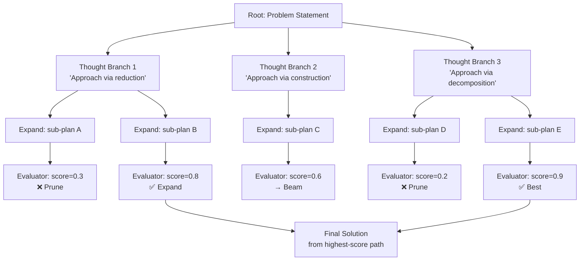

# Lesson 3: Integration of Planning and Reflection

## 1. First-Principles Intuition & Invariants

Autonomous AI agents capable of sustained, goal-directed behavior in non-stationary environments require two mutually reinforcing cognitive capacities: **planning**, the generation of action sequences projected forward in time, and **reflection**, the retrospective evaluation of those sequences against observed outcomes. Neither capacity alone is sufficient. A pure planner operating on a fixed policy will degrade as its world model drifts from reality. A pure reflector with no forward projection cannot act. Their integration creates a closed cognitive loop that is architecturally necessary, not merely beneficial.

### 1.1 State-Space Formalism

Formally, an agent operates within a Markov Decision Process (MDP) defined by the tuple $(S, A, T, R, \gamma)$:

- $S$: a (possibly continuous) state space
- $A$: an action space
- $T: S \times A \rightarrow \Delta(S)$: a stochastic transition function, where $\Delta(S)$ is the probability simplex over $S$
- $R: S \times A \rightarrow \mathbb{R}$: a reward function
- $\gamma \in [0, 1)$: a discount factor

The agent's planning objective is to find a policy $\pi^*: S \rightarrow A$ that maximizes the expected discounted return:

$$
\pi^* = \arg\max_\pi \mathbb{E}_\pi \left[ \sum_{t=0}^{\infty} \gamma^t R(s_t, a_t) \right]
$$

In practice, $T$ and $R$ are not known exactly. The agent maintains a learned world model $\hat{T}$ and $\hat{R}$, and the gap between these approximations and their true counterparts is the primary source of planning failure. Reflection is precisely the mechanism that closes this gap.

### 1.2 The Reflective Invariant

The critical invariant is this: **reflection must be grounded in the agent's own execution trace**. The agent maintains an execution trace $\tau = \{(s_0, a_0, r_0), (s_1, a_1, r_1), \ldots, (s_t, a_t, r_t)\}$. This trace constitutes the empirical data against which world-model accuracy is measured. Without it, reflection is speculation.

Reflection then operates as model-correction: given the trace $\tau$, the agent computes a correction signal $\Delta\theta$ to its model parameters $\theta$ (which parameterize $\hat{T}$ and $\hat{R}$):

$$
\Delta\theta = \nabla_\theta \mathcal{L}(\tau, \hat{T}_\theta, \hat{R}_\theta)
$$

where $\mathcal{L}$ is a loss measuring the discrepancy between model predictions and observed transitions. This update feeds directly into the next planning cycle, biasing future search toward regions of state space where the model is now more accurate.

This is a **meta-learning loop**: the outer loop (reflection) adjusts the parameters of the inner loop (planning). It is not merely concatenation of two modules; it is recursive coupling. Reflection modifies the planning module's priors, and planning generates new execution data for reflection.

### 1.3 Bayesian Belief Updating

The agent's internal representation of environmental uncertainty is captured in a belief state $B_t$, a probability distribution over latent world states. As the agent executes and observes, this belief evolves via Bayes' rule:

$$
B_{t+1}(s') = \frac{P(o_{t+1} \mid s') \sum_s T(s, a_t, s') B_t(s)}{P(o_{t+1} \mid B_t, a_t)}
$$

where $o_{t+1}$ is the observation at time $t+1$. This is the standard belief update in a Partially Observable MDP (POMDP). The reflection module acts as a higher-order filter on this process: rather than updating beliefs about world states, it updates beliefs about world-model structure — the model's parameters $\theta$ themselves. This is model-based meta-Bayesian inference, and it is what distinguishes a truly reflective agent from one that merely filters observations.

The preservation invariant across iterations is that the agent's belief state must remain a valid probability distribution (non-negative, sums to one). Reflection operations that violate this — for example, by injecting contradictory evidence without proper normalization — will cause the planning module to generate incoherent action sequences. Implementations must enforce normalization explicitly.

### 1.4 LLM-Based Agents: The Practical Instantiation

Modern large language model (LLM)-based agents (e.g., systems built on ReAct, Reflexion, or Tree-of-Thoughts frameworks) instantiate these abstractions in a specific architectural pattern. Here, the "world model" is the LLM's parametric knowledge, the "belief state" is approximated by the context window, and "reflection" is a structured prompting step that asks the model to critique its own prior output.

The ReAct framework (Yao et al., 2022, *ReAct: Synergizing Reasoning and Acting in Language Models*) interleaves **Thought**, **Action**, and **Observation** steps in a single inference trace. Reflexion (Shinn et al., 2023, *Reflexion: Language Agents with Verbal Reinforcement Learning*) adds an explicit **self-reflection** step after task completion, storing verbal feedback in an episodic memory buffer that is prepended to future context. These are concrete software implementations of the planning-reflection loop described above.

It is worth noting what these systems do *not* do: they do not update model weights during inference. Reflection in LLM agents is not gradient descent; it is in-context conditioning. The "parameter update" is the modification of the prompt context, not the neural network's weights. This distinction matters for understanding the limits of such systems — they cannot generalize reflective insights beyond the context window without an explicit external memory store.

---

## 2. Core Architecture & Mechanics

The integrated planning-reflection system is a layered, feedback-driven architecture. The following diagram captures the full data flow at the component level.



### 2.1 Execution Trace Log

The trace log is an append-only, durable data structure recording every transition tuple $(s_t, a_t, r_t, s_{t+1})$ along with metadata: wall-clock timestamp, plan ID, planning depth at which $a_t$ was selected, and the confidence score assigned by the planning module. Append-only semantics are non-negotiable: retroactive mutation of the trace would corrupt the reflection module's model-correction signals, introducing a form of hindsight bias into the agent's self-assessment.

In production systems, the trace log is typically implemented as a Write-Ahead Log (WAL) on disk, mirroring patterns from database systems like PostgreSQL. This provides durability and crash recovery. For in-memory operation (low-latency robotics, game agents), a lock-free ring buffer is appropriate, with periodic snapshotting to stable storage.

The following is a production-grade Python implementation of a typed trace log with thread-safe appends, structured for downstream analysis:

```python
from __future__ import annotations

import threading
import time
from dataclasses import dataclass, field
from typing import Any, Generic, Iterator, TypeVar
import json
from pathlib import Path

StateT = TypeVar("StateT")
ActionT = TypeVar("ActionT")


@dataclass(frozen=True)
class TraceEntry(Generic[StateT, ActionT]):
    """Immutable record of a single agent transition."""
    state: StateT
    action: ActionT
    reward: float
    next_state: StateT
    plan_id: str
    plan_depth: int
    action_confidence: float
    timestamp_ns: int = field(default_factory=lambda: time.time_ns())

    def to_dict(self) -> dict[str, Any]:
        return {
            "state": self.state,
            "action": self.action,
            "reward": self.reward,
            "next_state": self.next_state,
            "plan_id": self.plan_id,
            "plan_depth": self.plan_depth,
            "action_confidence": self.action_confidence,
            "timestamp_ns": self.timestamp_ns,
        }


class ExecutionTraceLog(Generic[StateT, ActionT]):
    """
    Thread-safe, append-only execution trace log.

    Writes are O(1) amortized. Reads return immutable snapshots.
    Supports windowed iteration for the reflection module.
    """

    def __init__(
        self,
        max_entries: int = 100_000,
        wal_path: Path | None = None,
    ) -> None:
        self._entries: list[TraceEntry[StateT, ActionT]] = []
        self._lock = threading.Lock()
        self._max_entries = max_entries
        self._wal_path = wal_path
        self._wal_file = (
            open(wal_path, "a", buffering=1) if wal_path else None  # line-buffered
        )

    def append(self, entry: TraceEntry[StateT, ActionT]) -> None:
        with self._lock:
            self._entries.append(entry)
            if self._wal_file:
                self._wal_file.write(json.dumps(entry.to_dict()) + "\n")
            # Soft eviction: discard the oldest quarter when capacity is exceeded.
            if len(self._entries) > self._max_entries:
                evict_count = self._max_entries // 4
                self._entries = self._entries[evict_count:]

    def tail(self, n: int) -> list[TraceEntry[StateT, ActionT]]:
        """Return the most recent n entries as an immutable snapshot."""
        with self._lock:
            return list(self._entries[-n:])

    def window(
        self, start: int, end: int
    ) -> Iterator[TraceEntry[StateT, ActionT]]:
        """Iterate over a half-open index window [start, end)."""
        with self._lock:
            snapshot = self._entries[start:end]
        yield from snapshot

    def __len__(self) -> int:
        with self._lock:
            return len(self._entries)

    def close(self) -> None:
        if self._wal_file:
            self._wal_file.flush()
            self._wal_file.close()
```

### 2.2 Planning Module: Hybrid Symbolic + Learned Search

The planning module combines two search regimes:

1. **Symbolic planning** (e.g., PDDL-based planners, A\* on explicit state graphs) for tasks where a compact, correct world model exists. Symbolic planners guarantee completeness and optimality given an accurate model, but they are brittle to model inaccuracy.

2. **Learned model-based planning** (e.g., Dreamer, MuZero, or world-model-conditioned MCTS) for tasks where the state space is too large or continuous for explicit enumeration. These planners are robust to model inaccuracy but require training data.

The hybrid approach uses symbolic planning as a "fast path" for well-understood subtasks, and learned planning for novel situations. The reflection module maintains a **model-accuracy registry** — a per-subtask record of how often the symbolic model's predictions were correct — and uses this to route planning requests to the appropriate engine.

The heuristic function $h(s)$ in the A\* component is updated by the reflection module as follows. After each plan is executed, the reflection module computes the **heuristic error**:

$$
\epsilon_h(s) = |h(s) - g^*(s)|
$$

where $g^*(s)$ is the actual cost incurred from state $s$. A weighted history of these errors, decayed exponentially by recency, is used to adjust $h$ for similar states in future planning cycles. This is an online variant of the **learning real-time A\* (LRTA\*)** algorithm (Korf, 1990).

```python
import heapq
from typing import Callable, Hashable, TypeVar

NodeT = TypeVar("NodeT", bound=Hashable)


def astar_with_learned_heuristic(
    start: NodeT,
    goal: NodeT,
    neighbors: Callable[[NodeT], list[tuple[NodeT, float]]],
    base_heuristic: Callable[[NodeT], float],
    heuristic_corrections: dict[NodeT, float],  # Injected by reflection module
) -> list[NodeT] | None:
    """
    A* search with a reflection-adjusted heuristic.

    heuristic_corrections maps a state to a learned additive correction term,
    computed from the exponentially-weighted mean absolute heuristic error
    observed during past plan executions through that state.
    """

    def h(node: NodeT) -> float:
        return base_heuristic(node) + heuristic_corrections.get(node, 0.0)

    open_set: list[tuple[float, int, NodeT]] = []
    counter = 0  # Tie-break counter for heap stability
    heapq.heappush(open_set, (h(start), counter, start))

    came_from: dict[NodeT, NodeT] = {}
    g_score: dict[NodeT, float] = {start: 0.0}

    while open_set:
        _, _, current = heapq.heappop(open_set)

        if current == goal:
            path: list[NodeT] = []
            while current in came_from:
                path.append(current)
                current = came_from[current]
            path.append(start)
            return path[::-1]

        for neighbor, edge_cost in neighbors(current):
            tentative_g = g_score[current] + edge_cost
            if tentative_g < g_score.get(neighbor, float("inf")):
                came_from[neighbor] = current
                g_score[neighbor] = tentative_g
                f = tentative_g + h(neighbor)
                counter += 1
                heapq.heappush(open_set, (f, counter, neighbor))

    return None  # No path found
```

### 2.3 Monte Carlo Tree Search with Reflection Bias

For lookahead planning under uncertainty, MCTS is the standard approach. The reflection module integrates with MCTS through the **prior probability distribution** $P(s, a)$ used in the UCB1 selection formula:

$$
\text{UCB}(s, a) = Q(s, a) + c \cdot P(s, a) \cdot \frac{\sqrt{N(s)}}{1 + N(s, a)}
$$

where $Q(s, a)$ is the estimated action value, $N(s)$ is the visit count of the parent node, $N(s, a)$ is the visit count of the action edge, and $c$ is an exploration constant. The reflection module updates $P(s, a)$ based on past execution traces — actions that historically led to high returns in similar states receive higher prior probability, biasing the tree search toward empirically successful strategies.

This is precisely how AlphaZero's self-play loop operates: the neural network providing $P(s, a)$ and $V(s)$ is retrained periodically on game traces, and the updated network is then used in subsequent MCTS. The reflection module plays the role of the training loop.

### 2.4 Reflection Module: Meta-Evaluation and Policy Refinement

The reflection module has two sequential stages.

**Stage 1 — Meta-Evaluation Engine**: Given a trace window $\tau_{[t-k, t]}$, this engine computes a meta-reward $M(\tau)$ that assesses plan quality along dimensions beyond raw task reward:

| Dimension | Computation | Purpose |
|---|---|---|
| *Plan robustness* | Variance of $r_t$ across similar plan prefixes | Penalize plans sensitive to small state perturbations |
| *Model accuracy* | Mean squared error between $\hat{T}$ predictions and actual transitions | Drive world-model updates |
| *Efficiency* | Steps taken vs. optimal plan length (if known) | Penalize unnecessary actions |
| *Goal alignment* | Cosine similarity between trajectory endpoint and goal embedding | Catch plans that satisfy subgoals but miss the top-level goal |

**Stage 2 — Policy Refinement Engine**: The meta-rewards from Stage 1 are used to compute parameter updates $\Delta\theta$. The specific algorithm depends on the planning backend:

- For symbolic planners: update heuristic correction tables (as shown above).
- For learned planners: execute a gradient update step on the world model using the trace as a replay buffer.
- For LLM-based agents: generate a verbal self-critique and store it in episodic memory (the Reflexion approach).

The following diagram details the internal data flow of the reflection module:



### 2.5 Memory Management Layer

The trace log and belief state collectively grow without bound in a long-running agent. The memory management layer enforces two policies:

**Trace Compression**: Older trace entries are summarized into aggregate statistics. For a window of $k$ entries, the compression reduces them to: mean reward, reward variance, mean model prediction error, and a compact state-action frequency histogram. This compressed summary is sufficient for reflection but occupies $O(1)$ space instead of $O(k)$.

**Belief Compression**: The hierarchical state graph is pruned by collapsing low-visit-count nodes into their parent nodes. This is analogous to tree merging in the UCT/MCTS literature and prevents unbounded graph growth.

The following Go implementation demonstrates a concurrent, generational memory manager suitable for a production agent runtime:

```go
package memory

import (
	"sync"
	"sync/atomic"
	"time"
)

// TraceSummary is the compressed representation of a trace window.
type TraceSummary struct {
	PlanID        string
	MeanReward    float64
	RewardVariance float64
	MeanModelMSE  float64
	EntryCount    int
	StartTime     time.Time
	EndTime       time.Time
}

// TraceEntry is a single transition record.
type TraceEntry struct {
	PlanID     string
	Reward     float64
	ModelMSE   float64
	Timestamp  time.Time
}

// GenerationalStore manages two generations of trace data:
// "hot" (recent, full fidelity) and "cold" (compressed summaries).
type GenerationalStore struct {
	mu sync.RWMutex

	hot         []TraceEntry
	cold        []TraceSummary
	hotCapacity int

	// Atomic counter for fast length checks without acquiring a lock.
	hotLen atomic.Int64
}

func NewGenerationalStore(hotCapacity int) *GenerationalStore {
	return &GenerationalStore{
		hot:         make([]TraceEntry, 0, hotCapacity),
		hotCapacity: hotCapacity,
	}
}

// Append adds a new entry to the hot generation.
// If the hot generation is full, it is compressed and moved to cold.
func (g *GenerationalStore) Append(e TraceEntry) {
	g.mu.Lock()
	defer g.mu.Unlock()

	g.hot = append(g.hot, e)
	g.hotLen.Add(1)

	if len(g.hot) >= g.hotCapacity {
		summary := g.compressHotLocked()
		g.cold = append(g.cold, summary)
		g.hot = g.hot[:0] // Reset slice, reuse backing array.
		g.hotLen.Store(0)
	}
}

// compressHotLocked computes a TraceSummary from the current hot entries.
// Must be called with g.mu held.
func (g *GenerationalStore) compressHotLocked() TraceSummary {
	if len(g.hot) == 0 {
		return TraceSummary{}
	}

	var sumR, sumMSE float64
	for _, e := range g.hot {
		sumR += e.Reward
		sumMSE += e.ModelMSE
	}
	n := float64(len(g.hot))
	meanR := sumR / n

	var sumSqDiff float64
	for _, e := range g.hot {
		d := e.Reward - meanR
		sumSqDiff += d * d
	}

	return TraceSummary{
		PlanID:         g.hot[0].PlanID,
		MeanReward:     meanR,
		RewardVariance: sumSqDiff / n,
		MeanModelMSE:   sumMSE / n,
		EntryCount:     len(g.hot),
		StartTime:      g.hot[0].Timestamp,
		EndTime:        g.hot[len(g.hot)-1].Timestamp,
	}
}

// HotSnapshot returns a copy of the hot generation for the reflection module.
func (g *GenerationalStore) HotSnapshot() []TraceEntry {
	g.mu.RLock()
	defer g.mu.RUnlock()
	snapshot := make([]TraceEntry, len(g.hot))
	copy(snapshot, g.hot)
	return snapshot
}

// ColdSummaries returns all compressed summaries.
func (g *GenerationalStore) ColdSummaries() []TraceSummary {
	g.mu.RLock()
	defer g.mu.RUnlock()
	result := make([]TraceSummary, len(g.cold))
	copy(result, g.cold)
	return result
}
```

---

## 3. The Reflexion Architecture: A Concrete Case Study

The **Reflexion** framework (Shinn et al., 2023) provides the most carefully studied instantiation of the planning-reflection loop in LLM-based agents. It is worth examining its mechanics in detail because it makes the abstract architecture above concrete and exposes real engineering tradeoffs.

### 3.1 Reflexion's Three-Component Architecture

```mermaid
sequenceDiagram
    participant ENV as Environment
    participant ACT as Actor (LLM)
    participant EVAL as Evaluator
    participant REFL as Self-Reflector (LLM)
    participant MEM as Episodic Memory

    loop Trial i
        ACT ->> ENV: Execute trajectory τ_i
        ENV -->> ACT: Final state, task outcome
        ACT ->> EVAL: Submit trajectory τ_i
        EVAL -->> ACT: Scalar/binary reward r_i
        ACT ->> REFL: τ_i + r_i + mem_{i-1}
        REFL -->> MEM: Verbal reflection v_i\n("I failed because X; next time do Y")
        MEM -->> ACT: Prepend mem_i = [v_1,...,v_i] to context for trial i+1
    end
```

The key insight in Reflexion is that the "gradient signal" is a natural language string stored in an external memory buffer. The LLM's weights are never updated. This is both Reflexion's strength (no costly fine-tuning required) and its hard limit (insights cannot generalize beyond what fits in the context window).

### 3.2 Implementing Reflexion's Memory Buffer

```python
from __future__ import annotations

from dataclasses import dataclass
from typing import Callable


@dataclass
class ReflexionMemory:
    """
    Episodic memory buffer for the Reflexion architecture.

    Verbal reflections are stored oldest-first and concatenated
    into the context prefix for the next trial. When the buffer
    would exceed max_tokens, the oldest entries are evicted.
    """
    max_tokens: int = 2048
    token_counter: Callable[[str], int] = len  # Replace with tiktoken in production

    def __post_init__(self) -> None:
        self._entries: list[str] = []
        self._token_counts: list[int] = []

    def add(self, reflection: str) -> None:
        tokens = self.token_counter(reflection)
        # Evict oldest entries until there is space.
        while (
            self._token_counts
            and sum(self._token_counts) + tokens > self.max_tokens
        ):
            self._entries.pop(0)
            self._token_counts.pop(0)
        self._entries.append(reflection)
        self._token_counts.append(tokens)

    def as_context_prefix(self) -> str:
        if not self._entries:
            return ""
        entries = "\n\n".join(
            f"[Reflection {i+1}]: {e}" for i, e in enumerate(self._entries)
        )
        return f"You have attempted this task before. Here are your reflections:\n{entries}\n\n"

    def __len__(self) -> int:
        return len(self._entries)


def reflexion_trial(
    task_prompt: str,
    memory: ReflexionMemory,
    actor_llm: Callable[[str], str],
    evaluator: Callable[[str], tuple[float, str]],
    reflector_llm: Callable[[str], str],
) -> tuple[bool, str]:
    """
    Execute one Reflexion trial.

    Returns (success, reflection_text).
    The caller is responsible for adding reflection_text to memory
    and running subsequent trials.
    """
    # Construct prompt with memory prefix.
    prompt = memory.as_context_prefix() + task_prompt

    # Actor generates a trajectory (action sequence or answer).
    trajectory = actor_llm(prompt)

    # Evaluator scores the trajectory.
    reward, outcome_description = evaluator(trajectory)
    success = reward >= 1.0  # Binary threshold; adjust per task.

    if success:
        return True, ""

    # Reflector generates verbal self-critique.
    reflection_prompt = (
        f"Task: {task_prompt}\n"
        f"Your attempt:\n{trajectory}\n"
        f"Outcome: {outcome_description} (reward={reward:.3f})\n"
        "Identify the precise reason for failure and state what you will do differently next time. "
        "Be specific and concise."
    )
    reflection = reflector_llm(reflection_prompt)

    return False, reflection
```

---

## 4. High-Performance Optimization & Failure Modes

### 4.1 Asynchronous Planning and Reflection

The planning loop runs at interaction frequency (milliseconds to seconds per step). The reflection loop runs at a lower frequency — typically once per episode or once per $k$ steps — because model updates must be stable before they are applied to the live planner. Running them synchronously would stall the planning loop during expensive reflection computations.

The correct architecture separates them into independent threads communicating through a lock-free channel:



The update channel is a Single-Producer Single-Consumer (SPSC) lock-free ring buffer. The reflection thread writes updates; the planning thread reads them at the beginning of each planning cycle. Because writes are non-blocking, a slow reflection step does not stall the planner — the planner simply continues with the previous heuristics until the update is available.

A minimal Rust implementation of a SPSC ring buffer suitable for this channel:

```rust
use std::sync::atomic::{AtomicUsize, Ordering};
use std::cell::UnsafeCell;

/// A fixed-capacity, lock-free Single-Producer Single-Consumer ring buffer.
/// Suitable for passing heuristic update structs from the reflection thread
/// to the planning thread without locks.
pub struct SpscRingBuffer<T, const N: usize> {
    buffer: [UnsafeCell<Option<T>>; N],
    head: AtomicUsize, // Written by producer
    tail: AtomicUsize, // Written by consumer
}

// Safety: T must be Send. The SPSC discipline ensures only one thread
// writes head and only one thread writes tail at any time.
unsafe impl<T: Send, const N: usize> Sync for SpscRingBuffer<T, N> {}

impl<T, const N: usize> SpscRingBuffer<T, N> {
    pub fn new() -> Self {
        // SAFETY: Option<T> is always valid when initialized to None.
        Self {
            buffer: std::array::from_fn(|_| UnsafeCell::new(None)),
            head: AtomicUsize::new(0),
            tail: AtomicUsize::new(0),
        }
    }

    /// Producer: attempt a non-blocking write.
    /// Returns Err(item) if the buffer is full.
    pub fn push(&self, item: T) -> Result<(), T> {
        let head = self.head.load(Ordering::Relaxed);
        let next_head = (head + 1) % N;
        if next_head == self.tail.load(Ordering::Acquire) {
            return Err(item); // Buffer full.
        }
        // SAFETY: Only the producer writes at `head`, and we have confirmed
        // the slot is not occupied by an unread item.
        unsafe {
            *self.buffer[head].get() = Some(item);
        }
        self.head.store(next_head, Ordering::Release);
        Ok(())
    }

    /// Consumer: attempt a non-blocking read.
    /// Returns None if the buffer is empty.
    pub fn pop(&self) -> Option<T> {
        let tail = self.tail.load(Ordering::Relaxed);
        if tail == self.head.load(Ordering::Acquire) {
            return None; // Buffer empty.
        }
        // SAFETY: Only the consumer reads at `tail`, and we have confirmed
        // a valid item exists there.
        let item = unsafe { (*self.buffer[tail].get()).take() };
        self.tail.store((tail + 1) % N, Ordering::Release);
        item
    }
}
```

### 4.2 Incremental Belief Updating

Recomputing the full belief state from scratch after each observation is $O(|S|^2)$ in the worst case for a dense state graph. The delta-based update mechanism restricts computation to states whose posterior probability has changed by more than a threshold $\epsilon$:

$$
\Delta B_t = \{s \in S : |B_t(s) - B_{t-1}(s)| > \epsilon\}
$$

Only the nodes in $\Delta B_t$ and their direct neighbors in the state graph are recomputed. For typical agent trajectories where only a small region of state space is visited per step, $|\Delta B_t| \ll |S|$, reducing belief update complexity to near $O(1)$ per step in practice.

This sparse update requires that the belief state be represented in a data structure that supports efficient lookup and partial iteration — a hash map keyed on state identifiers, not a dense array. The tradeoff is that hash maps have worse cache locality than arrays; benchmarking against the specific agent's state access patterns is required to determine the optimal representation.

### 4.3 Failure Mode Taxonomy

The following taxonomy of failure modes, their root causes, and mitigations applies across both classical and LLM-based agent architectures:

**Feedback Loop Instability (Oscillation)**

Root cause: The reflection module applies updates that overfit to recent trace data, causing the planner to swing between two incompatible strategies. Each strategy generates evidence that triggers a switch back to the other.

Detection: Monitor the KL divergence between consecutive policy distributions $\pi_t$ and $\pi_{t-1}$. Sustained KL divergence above a threshold indicates oscillation.

Mitigation: Apply a **Polyak averaging** constraint on policy updates:

$$
\pi_{\text{new}} \leftarrow (1 - \alpha) \cdot \pi_{\text{old}} + \alpha \cdot \pi_{\text{reflective update}}
$$

with $\alpha \in [0.05, 0.2]$ as a conservative step size. This is directly analogous to the target network update rule in Deep Q-Networks (DQN).

**Reflection Hallucination (LLM-Specific)**

Root cause: The LLM reflector generates a self-critique that is plausible-sounding but factually incorrect about why the previous attempt failed. The incorrect critique is stored in episodic memory and poisons subsequent attempts.

Detection: Cross-validate the LLM's stated reason for failure against the ground-truth execution trace. If the LLM claims "I failed because X" but X does not appear in the trace, discard or flag the reflection.

Mitigation: Implement a **trace-grounded reflection prompt** that forces the LLM to cite specific trace entries when making claims about failure causes:

```python
def grounded_reflection_prompt(
    task: str,
    trajectory: list[dict],
    outcome: str,
) -> str:
    trace_str = "\n".join(
        f"  Step {i}: action={step['action']!r}, obs={step['observation']!r}, reward={step['reward']}"
        for i, step in enumerate(trajectory)
    )
    return (
        f"Task: {task}\n\n"
        f"Execution trace:\n{trace_str}\n\n"
        f"Final outcome: {outcome}\n\n"
        "Analyze the trace above. Cite the specific step numbers where the error occurred. "
        "State the precise failure cause referencing the trace. "
        "Do not make claims that cannot be verified from the trace."
    )
```

**Memory Poisoning via Stale Reflections**

Root cause: Reflections generated in a previous environment configuration are retained and applied in a changed environment, causing the agent to systematically repeat strategies that were appropriate before but are now harmful.

Detection: Tag each reflection with the environment version or a hash of the agent's world model at the time of generation. At inference time, filter reflections whose model-hash diverges significantly from the current model.

Mitigation: Implement **reflection TTL (time-to-live)** based on world-model drift, not wall-clock time. When the agent's world model diverges by more than a threshold (measured by the KL divergence between old and current model predictions), invalidate reflections generated under the old model.

**Trace Log Memory Exhaustion**

Root cause: Long-running agents in episodic tasks accumulate unbounded trace data.

Mitigation: The generational store described in Section 2.5 addresses this. Additionally, implement **importance sampling** during eviction: rather than evicting the oldest entries unconditionally, retain entries from rare states (high negative log-probability under the agent's current state visitation distribution) even when they are old. Rare-state transitions carry disproportionate information about the world model's blind spots.

**Concurrency Race on Belief State Update**

Root cause: The planning thread reads the belief state while the reflection thread writes an update to it, causing the planner to act on a partially-updated, inconsistent belief.

Mitigation: Use epoch-based reclamation (EBR) or Read-Copy-Update (RCU) semantics for belief state publication. The reflection thread prepares a new belief state object in private, then atomically swaps a pointer to make it visible to the planning thread. The planning thread never sees a partially-written state.



---

## 5. The Planning-Reflection Loop in Practice: Tree of Thoughts

The **Tree of Thoughts** (ToT) framework (Yao et al., 2023, *Tree of Thoughts: Deliberate Problem Solving with Large Language Models*) extends the linear ReAct chain into a tree-structured search, where reflection is applied not post-hoc but *during* the search to prune unpromising branches. This is the most sophisticated instantiation of integrated planning and reflection in current LLM agent literature.



The evaluator in ToT is itself an LLM call that scores each partial thought for promise. This is reflection operating at plan-generation time rather than post-execution — the agent reflects on hypothetical trajectories before committing to any action. The tradeoff is significantly higher token cost: ToT can require 10–100× more LLM calls than a linear chain for the same task. For tasks where correctness is paramount (formal verification, complex multi-step reasoning), this cost is justified.

---

## 6. Summary: Architectural Invariants

The following invariants hold across all instantiations of the planning-reflection loop, from classical POMDP solvers to LLM-based agents:

1. **Trace grounding**: Reflection that is not grounded in the agent's own execution trace produces hallucinated self-critique. The trace is the ground truth.

2. **Separation of time scales**: Planning operates at step frequency; reflection operates at episode or batch frequency. Coupling them synchronously creates latency bottlenecks.

3. **Bounded update magnitude**: Unconstrained reflection updates cause policy oscillation. Polyak averaging or trust-region constraints are necessary.

4. **Memory lifecycle management**: Trace logs and belief states grow without bound. Generational compaction with importance-based eviction is the standard solution.

5. **Atomic belief publication**: The planning thread must never observe a partially-updated belief state. RCU or atomic pointer swap is the correct synchronization primitive.

6. **Model-scoped reflection validity**: Reflections generated under one world model may be harmful under another. TTL based on model drift, not wall-clock time, is the correct invalidation policy.

These invariants are not guidelines — they are correctness conditions. Violating any one of them produces agents that exhibit degraded, erratic, or systematically incorrect behavior in ways that are difficult to diagnose without explicit instrumentation of the planning-reflection boundary.
