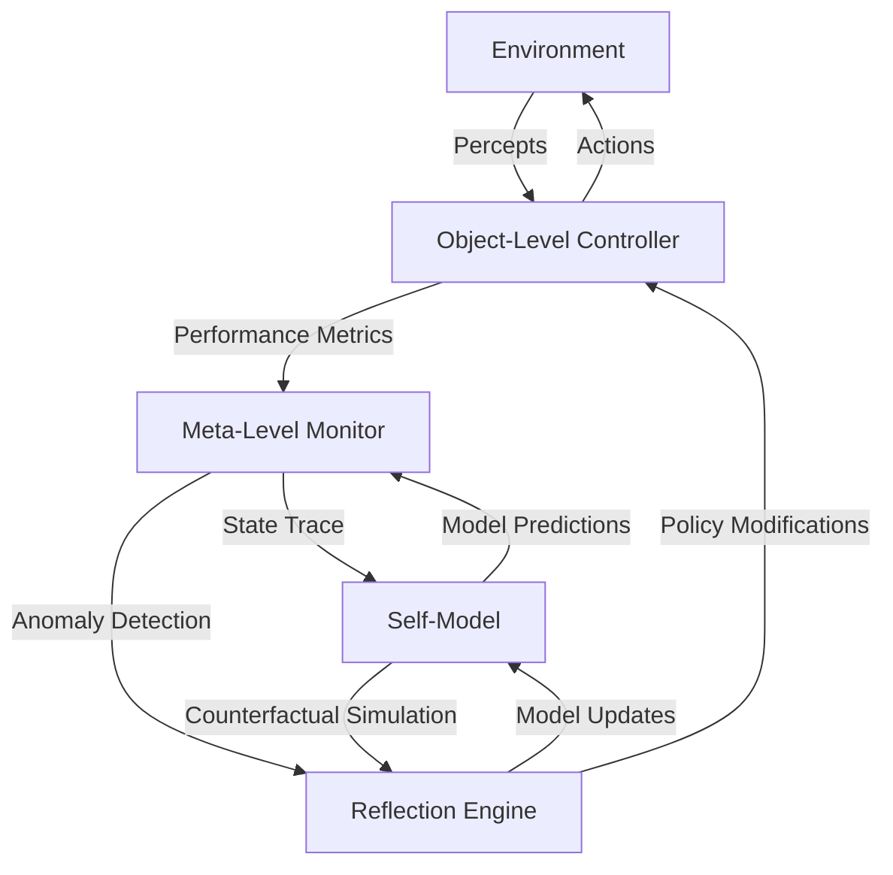
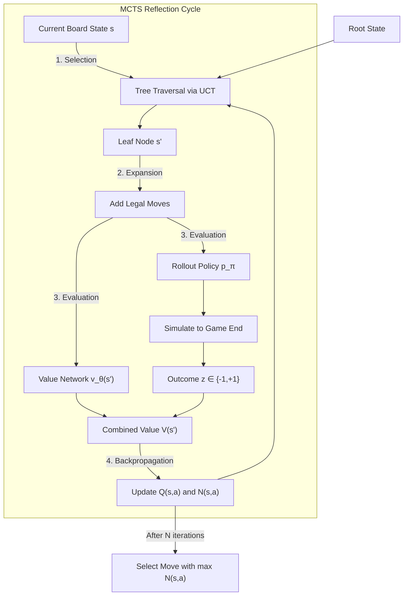
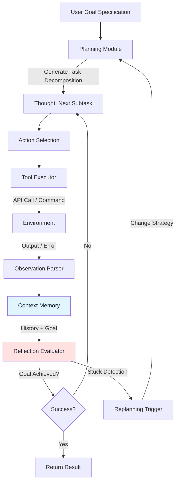
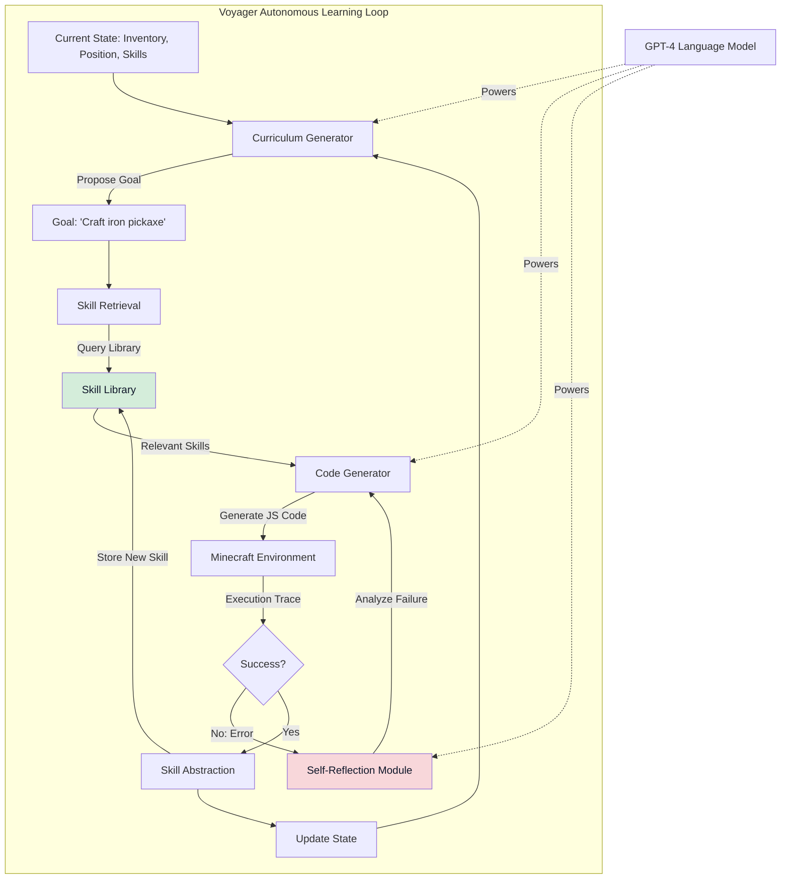

# Lesson 4: Case Studies in Autonomous Reflection

## 1. First-Principles Intuition & Invariants

Autonomous reflection represents a fundamental capability in modern AI systems: the capacity to monitor internal state, evaluate performance against objectives, and modify behavior through structured introspection. Unlike reactive systems that respond solely to environmental stimuli, reflective agents maintain explicit models of their own decision-making processes and use these models to guide strategic adaptation.

### Theoretical Foundations

The theoretical basis for autonomous reflection emerges from meta-reasoning in artificial intelligence and control theory. A reflective agent operates across two computational levels: the *object level*, where primary task execution occurs, and the *meta-level*, where reasoning about object-level processes takes place. This architectural separation enables the system to treat its own reasoning as data subject to analysis and optimization.

The formal framework for reflection builds on the concept of *computational self-models*—internal representations that capture the agent's state space, transition dynamics, goal structures, and resource constraints. These models enable counterfactual reasoning: the agent can simulate alternative action sequences, evaluate hypothetical outcomes, and select strategies that maximize expected utility across future time horizons.

Define a reflective agent's self-model as a 5-tuple:

\[ \mathcal{M} = \langle \mathcal{S}, \mathcal{A}, \mathcal{T}, \mathcal{G}, \mathcal{C} \rangle \]

where:

* $\mathcal{S}$ represents the state space—the set of all possible internal configurations of the agent
* $\mathcal{A}$ denotes the action space—discrete or continuous operations the agent can execute
* $\mathcal{T}: \mathcal{S} \times \mathcal{A} \rightarrow \Delta(\mathcal{S})$ defines state transition dynamics (potentially stochastic)
* $\mathcal{G}: \mathcal{S} \rightarrow \mathbb{R}$ maps states to goal satisfaction scores
* $\mathcal{C} \subseteq \mathcal{S} \times \mathcal{A}$ encodes constraints (resource limits, safety boundaries, operational invariants)

The reflective process involves iterative refinement of this model through experience. The agent must solve a nested optimization problem: at the object level, it maximizes task performance; at the meta-level, it minimizes model error and identifies structural improvements to its decision-making architecture.

### Core Invariants

Several invariants characterize effective reflective systems:

**Consistency under introspection**: The self-model must accurately represent the agent's actual behavior. Formally, if the model predicts state transition $s' = f(s, a)$ and the agent executes action $a$ in state $s$, the resulting state $s'_{actual}$ should satisfy $\| s' - s'_{actual} \| < \epsilon$ for small $\epsilon$.

**Convergence of meta-level reasoning**: Reflection should terminate in finite time. Unbounded meta-reasoning—reasoning about reasoning about reasoning—leads to computational paralysis. Practical systems implement a fixed reflection depth or time budget.

**Monotonic improvement**: Each reflection cycle should yield non-decreasing performance. While individual actions may decrease immediate reward (exploration), the expected long-term value should increase.

**Resource-awareness**: Reflection itself consumes computational resources. The meta-level controller must balance the cost of introspection against the value of improved decisions, solving a variant of the explore-exploit tradeoff.



This architecture establishes a control loop where the meta-level continuously evaluates object-level performance, identifies discrepancies between predicted and observed behavior, and updates the self-model to improve future predictions.

## 2. Core Architecture & Mechanics: AlphaGo and Monte Carlo Tree Search

AlphaGo exemplifies autonomous reflection through its integration of deep learning with Monte Carlo Tree Search (MCTS), a planning algorithm that balances exploration and exploitation through self-play and outcome simulation.

### Architectural Components

AlphaGo's architecture consists of two deep neural networks (policy and value) plus a fast linear rollout policy operating within a reflective MCTS framework:

**Policy network** $p_\sigma$: A deep convolutional neural network that maps board position $s$ to a probability distribution over legal moves $\pi(a|s)$. The policy network underwent supervised learning on expert human games, then reinforcement learning through self-play, achieving approximately 57% prediction accuracy on professional game moves.

**Value network** $v_\theta$: A structurally similar CNN that evaluates position $s$ by estimating the probability of winning from that position: $v_\theta(s) \approx \mathbb{P}(\text{win} | s)$. The value network solves the credit assignment problem—determining which early-game moves contributed to eventual victory—by learning a compressed representation of long-term game dynamics.

**Rollout policy** $p_\pi$: A fast, lightweight policy used during MCTS simulations. While less accurate than $p_\sigma$, the rollout policy enables rapid game completion (1000× faster), trading accuracy for computational efficiency.

### Reflective MCTS Mechanism

The MCTS algorithm implements autonomous reflection by building and refining a search tree that represents the agent's understanding of strategic value. Each tree node corresponds to a board position; edges represent moves. The algorithm iteratively performs four operations:

**Selection**: Starting from the root (current position), traverse the tree by selecting moves that maximize the Upper Confidence Bound for Trees (UCT):

\[ \text{UCT}(s, a) = Q(s, a) + c_{puct} \cdot p_\sigma(a|s) \cdot \frac{\sqrt{\sum_b N(s, b)}}{1 + N(s, a)} \]

where $Q(s, a)$ is the mean action value (estimated through simulations), $N(s, a)$ counts visits to state-action pair $(s, a)$, and $c_{puct}$ controls exploration strength. This formula balances exploitation (high $Q$ values) with exploration (low visit counts) while incorporating prior knowledge from the policy network.

**Expansion**: Upon reaching a leaf node, expand the tree by adding child nodes for all legal moves.

**Evaluation**: Assess the new position using two methods: (1) immediate evaluation via value network $v_\theta(s)$, and (2) Monte Carlo rollout—playing the game to completion using the rollout policy and observing the final outcome. The final evaluation combines both: $V(s) = (1 - \lambda) \cdot v_\theta(s) + \lambda \cdot z_\text{rollout}$, where $z_\text{rollout} \in \{-1, +1\}$ represents win/loss.

**Backpropagation**: Propagate the evaluation upward through the tree, updating visit counts and mean values for all state-action pairs along the traversal path.

This process repeats for thousands of iterations (AlphaGo used approximately 1,600 MCTS simulations per move). The search tree itself functions as a self-model: it represents the agent's current understanding of which moves lead to favorable outcomes. Each simulation refines this model, with the value estimates $Q(s, a)$ converging toward true strategic value as simulation count increases.



### The Reflective Loop

AlphaGo's reflection occurs at multiple timescales:

**Within-move reflection**: During MCTS, the agent refines its evaluation of candidate moves through simulation, effectively reasoning about the consequences of its own potential actions.

**Between-game reflection**: After each self-play game, the system generates training data—board positions paired with actual outcomes—used to update the policy and value networks via stochastic gradient descent. This process improves the networks' ability to guide future MCTS searches.

**Architectural reflection**: During training, hyperparameters governing exploration ($c_{puct}$), evaluation mixing ($\lambda$), and network architectures were tuned through extensive experimentation, representing a higher-order form of reflection conducted by the research team.

The critical insight is that the search tree represents an explicit, queryable model of the agent's strategic understanding. Unlike end-to-end deep learning approaches where learned representations remain opaque, MCTS produces an interpretable structure showing which moves the agent considers promising and why (via UCT scores decomposed into value and uncertainty components).

### Code Example: Simplified MCTS Node

```python
import numpy as np
from typing import Dict, Optional, Tuple
from dataclasses import dataclass, field

@dataclass
class MCTSNode:
    """Represents a node in the Monte Carlo Tree Search.
    
    Attributes:
        state: Board position or game state
        parent: Parent node in the tree
        children: Dictionary mapping actions to child nodes
        visit_count: Number of times this node has been visited
        total_value: Cumulative value from all simulations through this node
        prior_prob: Prior probability from policy network
        is_expanded: Whether this node's children have been generated
    """
    state: np.ndarray
    parent: Optional['MCTSNode'] = None
    children: Dict[int, 'MCTSNode'] = field(default_factory=dict)
    visit_count: int = 0
    total_value: float = 0.0
    prior_prob: float = 1.0
    is_expanded: bool = False
    
    def value(self) -> float:
        """Mean action value Q(s,a)."""
        return self.total_value / self.visit_count if self.visit_count > 0 else 0.0
    
    def uct_score(self, c_puct: float = 1.0) -> float:
        """Upper Confidence Bound for Trees score.
        
        Args:
            c_puct: Exploration constant controlling exploration/exploitation tradeoff
            
        Returns:
            UCT score balancing value estimate and uncertainty
        """
        exploration = c_puct * self.prior_prob * np.sqrt(self.parent.visit_count) / (1 + self.visit_count)
        return self.value() + exploration
    
    def select_child(self, c_puct: float = 1.0) -> Tuple[int, 'MCTSNode']:
        """Select child with highest UCT score.
        
        Returns:
            (action, child_node) tuple
        """
        return max(self.children.items(), key=lambda item: item[1].uct_score(c_puct))
    
    def expand(self, action_probs: Dict[int, float], legal_actions: list) -> None:
        """Expand node by adding children for all legal actions.
        
        Args:
            action_probs: Policy network output π(a|s)
            legal_actions: List of legal actions from current state
        """
        for action in legal_actions:
            if action not in self.children:
                child_state = self._apply_action(action)  # Game-specific transition
                self.children[action] = MCTSNode(
                    state=child_state,
                    parent=self,
                    prior_prob=action_probs.get(action, 0.0)
                )
        self.is_expanded = True
    
    def backpropagate(self, value: float) -> None:
        """Propagate value estimate up the tree.
        
        Args:
            value: Outcome value from simulation (typically in [-1, 1])
        """
        node = self
        while node is not None:
            node.visit_count += 1
            node.total_value += value
            node = node.parent
            value = -value  # Negate value for opponent's perspective
    
    def _apply_action(self, action: int) -> np.ndarray:
        """Apply action to current state (game-specific implementation)."""
        # Implementation depends on specific game mechanics
        raise NotImplementedError("Game-specific state transition required")


class MCTSAgent:
    """MCTS-based agent with neural network guidance."""
    
    def __init__(self, policy_network, value_network, c_puct: float = 1.0, num_simulations: int = 800):
        self.policy_net = policy_network
        self.value_net = value_network
        self.c_puct = c_puct
        self.num_simulations = num_simulations
    
    def search(self, root_state: np.ndarray) -> Dict[int, int]:
        """Execute MCTS from root state.
        
        Args:
            root_state: Current game state
            
        Returns:
            Dictionary mapping actions to visit counts
        """
        root = MCTSNode(state=root_state)
        
        for _ in range(self.num_simulations):
            node = root
            
            # Selection: traverse tree to leaf
            while node.is_expanded and node.children:
                _, node = node.select_child(self.c_puct)
            
            # Expansion: add children if not terminal
            if not self._is_terminal(node.state):
                action_probs = self.policy_net.predict(node.state)
                legal_actions = self._get_legal_actions(node.state)
                node.expand(action_probs, legal_actions)
            
            # Evaluation: assess leaf value
            if self._is_terminal(node.state):
                value = self._get_terminal_value(node.state)
            else:
                value = self.value_net.predict(node.state)
            
            # Backpropagation: update tree statistics
            node.backpropagate(value)
        
        # Return visit counts for all actions from root
        return {action: child.visit_count for action, child in root.children.items()}
    
    def _is_terminal(self, state: np.ndarray) -> bool:
        """Check if state is terminal (game-specific)."""
        raise NotImplementedError
    
    def _get_legal_actions(self, state: np.ndarray) -> list:
        """Get legal actions from state (game-specific)."""
        raise NotImplementedError
    
    def _get_terminal_value(self, state: np.ndarray) -> float:
        """Get outcome value for terminal state (game-specific)."""
        raise NotImplementedError
```

This implementation captures the core reflective mechanism: the tree structure represents the agent's evolving model of strategic value, and each simulation refines this model by exploring promising branches and propagating outcome information.

## 3. Case Study: AutoGPT and ReAct-Style Agents

Beyond game-playing, autonomous reflection appears in general-purpose task automation through agents like AutoGPT, which employ the ReAct (Reasoning + Acting) pattern to iteratively plan, execute, and reflect on progress toward complex goals.

### Architecture

ReAct agents operate through a loop of thought, action, and observation:

1. **Thought**: Generate reasoning trace describing current situation, progress toward goal, and next action strategy
2. **Action**: Execute a tool or API call in the environment
3. **Observation**: Receive feedback from the environment (tool output, error messages, state changes)
4. **Reflection**: Evaluate whether the goal has been achieved; if not, return to step 1

The self-model in this architecture is the running conversation history—a sequential record of thoughts, actions, and observations that the language model uses to maintain context and guide future decisions. This differs from AlphaGo's explicit tree structure but serves a similar function: capturing the agent's understanding of what has been tried and what remains to be done.



### Reflection Mechanisms

ReAct agents implement several reflection strategies:

**Error recovery**: When an action fails (e.g., API returns error, file not found), the agent observes the error message and generates a corrective action. This immediate feedback loop enables rapid adaptation to environmental constraints.

**Progress tracking**: The agent periodically evaluates whether recent actions have moved closer to the goal. If multiple consecutive actions fail to make progress, the agent may recognize it is stuck and attempt a different strategy.

**Constraint learning**: Through repeated failures of a particular action type, the agent implicitly learns environmental constraints. For example, if file writes to `/system/` consistently fail with permission errors, the agent may infer restricted access and avoid similar attempts.

**Meta-cognitive monitoring**: Some implementations include explicit "self-assessment" steps where the agent critiques its own reasoning, identifies logical errors, or recognizes when it lacks information needed to proceed.

### Implementation Example

```python
import json
from typing import List, Dict, Callable, Optional
from dataclasses import dataclass
from enum import Enum

class ActionType(Enum):
    """Available action types for the agent."""
    SEARCH = "search"
    READ_FILE = "read_file"
    WRITE_FILE = "write_file"
    EXECUTE_CODE = "execute_code"
    TERMINAL_CMD = "terminal_cmd"
    FINISH = "finish"

@dataclass
class Action:
    """Represents an agent action."""
    action_type: ActionType
    parameters: Dict
    reasoning: str

@dataclass
class Observation:
    """Environment feedback after action execution."""
    success: bool
    output: str
    error: Optional[str] = None

@dataclass
class ReflectionResult:
    """Result of agent reflection on current state."""
    goal_achieved: bool
    progress_score: float  # 0.0 to 1.0
    is_stuck: bool
    suggested_strategy: Optional[str] = None


class ReActAgent:
    """Autonomous agent using ReAct (Reasoning + Acting) pattern."""
    
    def __init__(self, llm_client, tools: Dict[str, Callable], max_iterations: int = 20):
        """Initialize ReAct agent.
        
        Args:
            llm_client: Language model client for generating thoughts/actions
            tools: Dictionary mapping action names to callable functions
            max_iterations: Maximum planning loop iterations before forced termination
        """
        self.llm = llm_client
        self.tools = tools
        self.max_iterations = max_iterations
        self.memory: List[Dict] = []
        self.iteration = 0
        
    def run(self, goal: str) -> str:
        """Execute agent loop to achieve goal.
        
        Args:
            goal: High-level objective in natural language
            
        Returns:
            Final result or error message
        """
        self.memory = [{"role": "system", "content": self._build_system_prompt()}]
        self.memory.append({"role": "user", "content": f"Goal: {goal}"})
        
        stuck_count = 0
        previous_progress = 0.0
        
        while self.iteration < self.max_iterations:
            self.iteration += 1
            
            # Generate thought and action
            thought, action = self._generate_action()
            self.memory.append({
                "role": "assistant",
                "content": f"Thought: {thought}\nAction: {action.action_type.value}\nParameters: {json.dumps(action.parameters)}"
            })
            
            # Execute action in environment
            observation = self._execute_action(action)
            self.memory.append({
                "role": "user",
                "content": f"Observation: {observation.output}" + (f"\nError: {observation.error}" if observation.error else "")
            })
            
            # Reflect on progress
            reflection = self._reflect(goal, observation)
            
            if reflection.goal_achieved:
                return observation.output
            
            # Detect if stuck (no progress for multiple iterations)
            if reflection.progress_score <= previous_progress:
                stuck_count += 1
            else:
                stuck_count = 0
            
            if stuck_count >= 3:
                # Force replanning when stuck
                replanning_prompt = self._generate_replanning_prompt(goal, reflection.suggested_strategy)
                self.memory.append({"role": "user", "content": replanning_prompt})
                stuck_count = 0
            
            previous_progress = reflection.progress_score
        
        return f"Failed to achieve goal within {self.max_iterations} iterations"
    
    def _generate_action(self) -> tuple[str, Action]:
        """Generate next thought and action using LLM.
        
        Returns:
            (thought_text, action) tuple
        """
        prompt = self._build_action_prompt()
        response = self.llm.generate(self.memory + [{"role": "user", "content": prompt}])
        
        # Parse LLM response into structured action
        # Expected format:
        # Thought: [reasoning about what to do next]
        # Action: [action_type]
        # Parameters: {json_dict}
        
        thought = self._extract_section(response, "Thought")
        action_type_str = self._extract_section(response, "Action")
        parameters = json.loads(self._extract_section(response, "Parameters"))
        
        action = Action(
            action_type=ActionType(action_type_str),
            parameters=parameters,
            reasoning=thought
        )
        
        return thought, action
    
    def _execute_action(self, action: Action) -> Observation:
        """Execute action in environment and return observation.
        
        Args:
            action: Action to execute
            
        Returns:
            Observation containing results or errors
        """
        try:
            if action.action_type == ActionType.FINISH:
                return Observation(success=True, output=action.parameters.get("result", "Task completed"))
            
            tool = self.tools.get(action.action_type.value)
            if tool is None:
                return Observation(success=False, output="", error=f"Unknown action type: {action.action_type}")
            
            result = tool(**action.parameters)
            return Observation(success=True, output=str(result))
        
        except Exception as e:
            return Observation(success=False, output="", error=str(e))
    
    def _reflect(self, goal: str, latest_observation: Observation) -> ReflectionResult:
        """Evaluate progress toward goal and detect if stuck.
        
        Args:
            goal: Original goal specification
            latest_observation: Most recent environment feedback
            
        Returns:
            Reflection result with progress assessment
        """
        reflection_prompt = f"""
        Original Goal: {goal}
        
        Latest Action Result: {latest_observation.output}
        {"Error Occurred: " + latest_observation.error if latest_observation.error else ""}
        
        Evaluate:
        1. Has the goal been fully achieved? (true/false)
        2. Progress toward goal (0.0-1.0 score)
        3. Are we stuck in a loop or unable to make progress? (true/false)
        4. If stuck, suggest alternative strategy
        
        Respond in JSON format:
        {{"goal_achieved": bool, "progress_score": float, "is_stuck": bool, "suggested_strategy": str}}
        """
        
        response = self.llm.generate([{"role": "user", "content": reflection_prompt}])
        result_dict = json.loads(response)
        
        return ReflectionResult(
            goal_achieved=result_dict["goal_achieved"],
            progress_score=result_dict["progress_score"],
            is_stuck=result_dict["is_stuck"],
            suggested_strategy=result_dict.get("suggested_strategy")
        )
    
    def _build_system_prompt(self) -> str:
        """Construct system prompt defining agent behavior."""
        tools_desc = "\n".join([f"- {name}: {tool.__doc__}" for name, tool in self.tools.items()])
        return f"""You are an autonomous agent that achieves goals through reasoning and action.

Available tools:
{tools_desc}

Process:
1. Think: Reason about current situation and what to do next
2. Act: Choose a tool and specify parameters
3. Observe: Receive results from environment
4. Reflect: Evaluate progress and adjust strategy

Always respond in this format:
Thought: [your reasoning]
Action: [tool_name]
Parameters: {{"key": "value"}}
"""
    
    def _build_action_prompt(self) -> str:
        """Generate prompt for next action selection."""
        return "Based on the conversation history, what should you do next to achieve the goal?"
    
    def _generate_replanning_prompt(self, goal: str, suggested_strategy: Optional[str]) -> str:
        """Generate prompt to force new strategy when stuck."""
        strategy_hint = f"\nConsider this alternative approach: {suggested_strategy}" if suggested_strategy else ""
        return f"""You appear stuck. Step back and reconsider the goal: {goal}
        
What assumptions might be incorrect? What alternative approaches exist?{strategy_hint}

Generate a fundamentally different strategy."""
    
    def _extract_section(self, text: str, section_name: str) -> str:
        """Extract named section from LLM response."""
        lines = text.split('\n')
        for i, line in enumerate(lines):
            if line.startswith(section_name + ":"):
                return line.split(":", 1)[1].strip()
        return ""
```

### Failure Modes and Mitigations

ReAct agents face several characteristic failure modes:

**Infinite loops**: The agent may repeatedly attempt the same failed action without recognizing failure. Mitigation requires explicit stuck detection (monitoring progress scores) and forced replanning.

**Context window overflow**: Long task sequences exhaust the language model's context window, causing the agent to "forget" earlier context. Mitigation involves memory compression (summarizing old interactions) or retrieval augmentation (storing full history in external database, retrieving relevant segments).

**Compounding errors**: Early incorrect actions (e.g., writing wrong data to file) create corrupted state that confounds subsequent actions. Mitigation requires checkpointing and rollback capabilities, or validation steps after critical operations.

**Tool misuse**: The agent may invoke tools with invalid parameters or in incorrect contexts. Mitigation involves strict input validation on tool interfaces and providing detailed error messages that guide correction.

**Objective drift**: During long task sequences, the agent may lose track of the original goal and pursue tangential objectives. Mitigation requires periodic re-grounding (restating the original goal) and explicit goal-satisfaction checks.

## 4. Case Study: Voyager (Minecraft Lifelong Learning)

Voyager, developed by NVIDIA Research, exemplifies autonomous reflection in open-ended learning environments. Deployed in Minecraft, Voyager discovers and masters increasingly complex skills without human intervention, building a curriculum through self-directed exploration.

### Architecture

Voyager consists of three interconnected components:

**Automatic curriculum**: The agent proposes exploration goals based on current state and skill level. Rather than following a fixed objective, Voyager generates goals like "mine 5 iron ore" or "craft a stone pickaxe" by analyzing which materials are accessible and which skills are just beyond current capability (operating in the zone of proximal development).

**Skill library**: A persistent, queryable code repository storing previously discovered action sequences. When the agent successfully completes a task, the code is abstracted into a reusable function, indexed by natural language description, and added to the library. Future tasks can retrieve and compose these primitive skills.

**Iterative refinement**: When attempting a goal, Voyager generates JavaScript code to control the Minecraft bot. If execution fails, the agent receives error messages and environment feedback, then regenerates corrected code. This edit-compile-test loop continues until success or a retry limit is reached.



### Reflection Mechanisms

Voyager's reflection operates at multiple levels:

**Within-task reflection**: During skill execution, if the code fails (bot gets stuck, crashes, or error is raised), the self-reflection module receives the error trace, analyzes the failure mode, and suggests corrections. For example, if code attempts to craft an item without required materials, reflection identifies the missing precondition and adds a mining step.

**Skill-level reflection**: After successfully completing a task, the agent abstracts the solution into a reusable skill. This involves identifying the essential logic, parameterizing hardcoded values (e.g., replacing "mine 5 iron ore" with "mine N iron ore"), and generating a natural language description for future retrieval.

**Curriculum-level reflection**: The automatic curriculum tracks which goals succeed or fail, adjusting difficulty over time. If multiple similar goals fail, the curriculum proposes simpler precursor tasks. If goals succeed too easily, it increases challenge. This meta-learning loop ensures the agent operates at the boundary of its capabilities, maximizing learning efficiency.

### Code Example: Skill Library

```python
import json
import numpy as np
from typing import List, Dict, Optional
from dataclasses import dataclass, asdict
import faiss  # Vector similarity search library

@dataclass
class Skill:
    """Represents a learned skill in the library."""
    name: str
    description: str
    code: str
    prerequisites: List[str]
    success_count: int = 0
    total_attempts: int = 0
    embedding: Optional[np.ndarray] = None
    
    def success_rate(self) -> float:
        """Calculate historical success rate."""
        return self.success_count / self.total_attempts if self.total_attempts > 0 else 0.0
    
    def to_dict(self) -> Dict:
        """Serialize skill to dictionary."""
        data = asdict(self)
        if self.embedding is not None:
            data['embedding'] = self.embedding.tolist()
        return data
    
    @classmethod
    def from_dict(cls, data: Dict) -> 'Skill':
        """Deserialize skill from dictionary."""
        if 'embedding' in data and data['embedding'] is not None:
            data['embedding'] = np.array(data['embedding'], dtype=np.float32)
        return cls(**data)


class SkillLibrary:
    """Persistent library of learned skills with semantic retrieval."""
    
    def __init__(self, embedding_model, dimension: int = 1536):
        """Initialize skill library.
        
        Args:
            embedding_model: Model to encode skill descriptions into vectors
            dimension: Dimensionality of embedding vectors
        """
        self.skills: Dict[str, Skill] = {}
        self.embedding_model = embedding_model
        self.dimension = dimension
        
        # FAISS index for fast semantic similarity search
        self.index = faiss.IndexFlatIP(dimension)  # Inner product (cosine similarity)
        self.id_to_name: List[str] = []
    
    def add_skill(self, skill: Skill) -> None:
        """Add new skill to library.
        
        Args:
            skill: Skill to add
        """
        # Generate embedding for semantic search
        if skill.embedding is None:
            skill.embedding = self._embed_text(skill.description)
        
        # Normalize for cosine similarity
        embedding_norm = skill.embedding / np.linalg.norm(skill.embedding)
        
        # Add to index
        self.index.add(embedding_norm.reshape(1, -1))
        self.id_to_name.append(skill.name)
        
        # Store skill
        self.skills[skill.name] = skill
    
    def retrieve(self, query: str, k: int = 5, min_success_rate: float = 0.3) -> List[Skill]:
        """Retrieve most relevant skills for query.
        
        Args:
            query: Natural language description of desired capability
            k: Number of skills to retrieve
            min_success_rate: Minimum historical success rate filter
            
        Returns:
            List of relevant skills, ranked by similarity
        """
        # Embed query
        query_embedding = self._embed_text(query)
        query_embedding_norm = query_embedding / np.linalg.norm(query_embedding)
        
        # Search index
        similarities, indices = self.index.search(query_embedding_norm.reshape(1, -1), k * 2)
        
        # Filter by success rate and return top-k
        results = []
        for sim, idx in zip(similarities[0], indices[0]):
            if idx >= 0:  # Valid index
                skill_name = self.id_to_name[idx]
                skill = self.skills[skill_name]
                if skill.success_rate() >= min_success_rate:
                    results.append((skill, float(sim)))
                    if len(results) >= k:
                        break
        
        return [skill for skill, _ in results]
    
    def update_skill_stats(self, skill_name: str, success: bool) -> None:
        """Update skill usage statistics.
        
        Args:
            skill_name: Name of skill that was attempted
            success: Whether execution succeeded
        """
        if skill_name in self.skills:
            skill = self.skills[skill_name]
            skill.total_attempts += 1
            if success:
                skill.success_count += 1
    
    def get_skill_chain(self, skill_name: str) -> List[Skill]:
        """Get skill and all its prerequisites in execution order.
        
        Args:
            skill_name: Name of target skill
            
        Returns:
            List of skills in dependency order (prerequisites first)
        """
        if skill_name not in self.skills:
            return []
        
        skill = self.skills[skill_name]
        chain = []
        
        # Recursively collect prerequisites
        for prereq_name in skill.prerequisites:
            chain.extend(self.get_skill_chain(prereq_name))
        
        chain.append(skill)
        return chain
    
    def save(self, filepath: str) -> None:
        """Persist library to disk.
        
        Args:
            filepath: Path to save JSON file
        """
        data = {
            'skills': {name: skill.to_dict() for name, skill in self.skills.items()},
            'id_to_name': self.id_to_name
        }
        with open(filepath, 'w') as f:
            json.dump(data, f, indent=2)
        
        # Save FAISS index
        faiss.write_index(self.index, filepath + '.faiss')
    
    def load(self, filepath: str) -> None:
        """Load library from disk.
        
        Args:
            filepath: Path to JSON file
        """
        with open(filepath, 'r') as f:
            data = json.load(f)
        
        self.skills = {name: Skill.from_dict(skill_dict) for name, skill_dict in data['skills'].items()}
        self.id_to_name = data['id_to_name']
        
        # Load FAISS index
        self.index = faiss.read_index(filepath + '.faiss')
    
    def _embed_text(self, text: str) -> np.ndarray:
        """Generate embedding vector for text.
        
        Args:
            text: Input text
            
        Returns:
            Embedding vector
        """
        return self.embedding_model.encode(text)


class VoyagerCurriculum:
    """Automatic curriculum generator for open-ended learning."""
    
    def __init__(self, llm_client, skill_library: SkillLibrary):
        """Initialize curriculum generator.
        
        Args:
            llm_client: Language model for goal generation
            skill_library: Reference to agent's skill library
        """
        self.llm = llm_client
        self.skill_library = skill_library
        self.completed_goals: List[str] = []
        self.failed_goals: Dict[str, int] = {}  # Goal -> failure count
    
    def propose_goal(self, current_state: Dict) -> str:
        """Generate next learning goal based on current capabilities.
        
        Args:
            current_state: Dictionary containing inventory, position, biome, etc.
            
        Returns:
            Natural language goal description
        """
        # Build context about current capabilities
        available_skills = [skill.name for skill in self.skill_library.skills.values() 
                           if skill.success_rate() > 0.5]
        
        prompt = f"""You are an autonomous Minecraft agent. Based on your current state and capabilities, propose the next learning goal.

Current State:
- Inventory: {current_state.get('inventory', {})}
- Position: {current_state.get('position')}
- Nearby blocks: {current_state.get('nearby_blocks', [])}
- Health: {current_state.get('health')}

Available Skills: {', '.join(available_skills[:20])}

Recently Completed: {', '.join(self.completed_goals[-5:])}

Propose a goal that is:
1. Achievable with current resources (or obtainable resources)
2. Slightly more complex than recent accomplishments (zone of proximal development)
3. Teaches a new skill or combines existing skills in novel ways
4. Not recently failed

Goal (one concise sentence):"""
        
        goal = self.llm.generate([{"role": "user", "content": prompt}]).strip()
        return goal
    
    def record_outcome(self, goal: str, success: bool) -> None:
        """Record goal attempt outcome for curriculum adjustment.
        
        Args:
            goal: Goal that was attempted
            success: Whether goal was achieved
        """
        if success:
            self.completed_goals.append(goal)
            # Remove from failed goals if present
            if goal in self.failed_goals:
                del self.failed_goals[goal]
        else:
            self.failed_goals[goal] = self.failed_goals.get(goal, 0) + 1
    
    def should_retry_goal(self, goal: str, max_failures: int = 3) -> bool:
        """Determine if failed goal should be reattempted.
        
        Args:
            goal: Goal that failed
            max_failures: Maximum failures before abandoning
            
        Returns:
            True if goal should be retried
        """
        return self.failed_goals.get(goal, 0) < max_failures
```

### Learning Dynamics

The interaction between curriculum, skill library, and refinement creates a positive feedback loop:

1. The curriculum proposes a goal slightly beyond current capability
2. The agent retrieves relevant skills and composes them into a solution attempt
3. If execution fails, iterative refinement corrects errors through code modification
4. Upon success, the solution is abstracted and stored as a new skill
5. The expanded skill library enables the curriculum to propose more complex goals

This architecture implements autonomous reflection at the architectural level: the entire system continuously evaluates its own capabilities (through the skill library's success rates), identifies learning opportunities (through curriculum generation), and refines its problem-solving strategies (through iterative refinement).

Empirically, Voyager demonstrates continual improvement over hundreds of hours of play, discovering complex behavior chains like "mine wood → craft planks → craft sticks → craft wooden pickaxe → mine cobblestone → craft stone pickaxe → mine iron → craft furnace → smelt iron → craft iron pickaxe" without any task-specific reward shaping or human demonstration.

## 5. High-Performance Optimization & Failure Modes

Autonomous reflection systems face distinct performance and reliability challenges arising from their self-referential nature.

### Computational Overhead

Reflection introduces overhead through meta-level computation. In MCTS, simulations consume orders of magnitude more compute than a single forward pass through the policy network. In ReAct agents, each reflection step requires an additional LLM call. In Voyager, skill retrieval involves embedding generation and vector search.

**Optimization strategies**:

**Adaptive reflection depth**: Modulate reflection intensity based on uncertainty. Allocate more compute to high-stakes or high-uncertainty decisions. For example, later engines such as KataGo spend fewer playouts on obvious moves and concentrate search on complex positions (AlphaGo Zero used a fixed 1,600 simulations per move).

**Batched reflection**: When multiple agents or parallel threads require reflection, batch LLM inference requests to amortize latency and exploit GPU parallelism. A batch of 32 agents querying an LLM simultaneously achieves nearly 32× throughput compared to sequential processing.

**Caching and memoization**: Store reflection results keyed by state signatures. If the same or similar state recurs, retrieve the cached reflection rather than recomputing. This is particularly effective in environments with repeated subproblems (e.g., common Minecraft recipes).

**Hierarchical reflection**: Implement fast approximate reflection at high frequency, expensive deep reflection at low frequency. For instance, a ReAct agent might perform lightweight progress checks every step but comprehensive strategy evaluation every 5 steps.

### Concurrency and Distributed Reflection

Scaling reflection systems to multi-agent or distributed settings introduces synchronization challenges.

**Shared skill libraries**: When multiple Voyager agents learn in parallel, concurrent writes to the skill library risk inconsistency. Solutions include:

- **Optimistic concurrency**: Each agent maintains a local library, periodically merging with a central repository using conflict resolution (keep skill with higher success rate)
- **Distributed hash tables**: Partition skill space across nodes; route queries to appropriate node via consistent hashing
- **Event sourcing**: Append-only log of skill additions; each agent replays log to reconstruct current library state

**Consensus protocols**: For critical decisions requiring collective reflection (e.g., multi-agent system deciding whether to shut down), implement consensus algorithms like Raft or Paxos to ensure agreement despite node failures.

**Race conditions in MCTS**: Parallelizing MCTS simulations risks multiple threads simultaneously expanding the same leaf node. Mitigation uses virtual loss: when a thread begins simulating from a node, temporarily decrease that node's value to discourage other threads from selecting it.

```rust
use std::sync::{Arc, Mutex};
use std::thread;

/// Thread-safe MCTS node with virtual loss for parallel simulation
struct MCTSNode {
    state: GameState,
    children: Vec<Arc<Mutex<MCTSNode>>>,
    visit_count: i32,
    total_value: f32,
    virtual_loss: i32,  // Temporary penalty to prevent race conditions
}

impl MCTSNode {
    fn select_child_with_vl(&self, c_puct: f32) -> Option<usize> {
        // Select child using UCT adjusted for virtual loss
        self.children.iter().enumerate()
            .map(|(idx, child)| {
                let child = child.lock().unwrap();
                let adjusted_visits = child.visit_count + child.virtual_loss;
                let q_value = if adjusted_visits > 0 {
                    child.total_value / (adjusted_visits as f32)
                } else {
                    0.0
                };
                let exploration = c_puct * (self.visit_count as f32).sqrt() 
                                 / (1.0 + adjusted_visits as f32);
                (idx, q_value + exploration)
            })
            .max_by(|(_, score_a), (_, score_b)| score_a.partial_cmp(score_b).unwrap())
            .map(|(idx, _)| idx)
    }
    
    fn apply_virtual_loss(&mut self) {
        self.virtual_loss += 1;
    }
    
    fn revert_virtual_loss(&mut self) {
        self.virtual_loss -= 1;
    }
}

fn parallel_mcts_simulation(
    root: Arc<Mutex<MCTSNode>>,
    num_threads: usize,
    simulations_per_thread: usize
) {
    let handles: Vec<_> = (0..num_threads).map(|_| {
        let root_clone = Arc::clone(&root);
        thread::spawn(move || {
            for _ in 0..simulations_per_thread {
                let mut path = Vec::new();
                
                // Selection with virtual loss
                {
                    let mut current = Arc::clone(&root_clone);
                    loop {
                        let mut node = current.lock().unwrap();
                        node.apply_virtual_loss();
                        path.push(Arc::clone(&current));
                        
                        if node.children.is_empty() {
                            break;
                        }
                        
                        if let Some(idx) = node.select_child_with_vl(1.4) {
                            drop(node);  // Release lock before recursing
                            current = Arc::clone(&path.last().unwrap().lock().unwrap().children[idx]);
                        } else {
                            break;
                        }
                    }
                }
                
                // Expansion, evaluation (omitted for brevity)
                let value = simulate_rollout(&path.last().unwrap().lock().unwrap().state);
                
                // Backpropagation and virtual loss removal
                for node_arc in path.iter().rev() {
                    let mut node = node_arc.lock().unwrap();
                    node.visit_count += 1;
                    node.total_value += value;
                    node.revert_virtual_loss();
                }
            }
        })
    }).collect();
    
    for handle in handles {
        handle.join().unwrap();
    }
}

// Placeholder functions
struct GameState;
fn simulate_rollout(_state: &GameState) -> f32 { 0.5 }
```

### Failure Modes and Mitigations

**Model misalignment**: The self-model diverges from actual system behavior. For example, Voyager's skill library might store code that worked once but fails under different world conditions (different Minecraft seed, version update).

*Mitigation*: Implement validation checks—periodically re-execute stored skills in test environments and update success rates. Remove or deprecate skills with sustained low success rates.

**Reflection loops**: The meta-level controller enters infinite regress, continuously reflecting on its own reflections without making progress.

*Mitigation*: Enforce reflection depth limits and time budgets. Use monotonic improvement checks—if reflection hasn't improved the object-level solution after N iterations, force execution.

**Overfitting to self-play**: Systems like AlphaGo Zero, trained exclusively through self-play may develop brittle strategies that exploit quirks of the opponent model rather than discovering robust principles.

*Mitigation*: Inject diversity through stochastic exploration, opponent randomization, or periodic training against external agents (humans or other algorithms).

**Context window collapse**: Long-running ReAct agents exhaust LLM context windows, losing track of earlier reasoning.

*Mitigation*: Implement hierarchical memory—summarize old interactions into compressed representations, store full detail in external vector database, retrieve relevant context on-demand. Use techniques like MemGPT or memory-augmented neural networks.

**Goal misspecification**: Autonomous curriculum generators may propose goals misaligned with system-level objectives or safety constraints.

*Mitigation*: Implement hard constraints on goal space (e.g., Voyager cannot propose goals involving harming entities), use reward modeling to assess goal safety before execution, and provide override mechanisms.

**Computational resource exhaustion**: Unconstrained reflection can monopolize resources, starving the object-level task execution.

*Mitigation*: Allocate fixed compute budgets (e.g., AlphaGo's 1600 simulations per move), implement priority scheduling (object-level tasks get guaranteed minimum resources), and use asynchronous reflection (meta-level runs in background without blocking execution).

### Evaluation Metrics

Assessing reflection quality requires metrics beyond task performance:

**Calibration**: Does the self-model's confidence align with actual outcomes? Measure via Brier score or log loss comparing predicted success probabilities to observed binary outcomes.

**Convergence rate**: How quickly does the self-model approach accuracy? Track model error over time: $\epsilon(t) = \mathbb{E}[\| \hat{f}(s, a) - f_{\text{true}}(s, a) \|]$ where $\hat{f}$ is the learned model and $f_{\text{true}}$ is ground truth.

**Transfer efficiency**: How effectively do learned skills generalize? Measure zero-shot success rates when applying learned skills to novel situations outside the training distribution.

**Reflection overhead**: Quantify compute cost of reflection relative to task execution. For production systems, reflection should consume no more than 10-20% of total compute budget.

**Failure recovery rate**: What fraction of initial failures are corrected through reflection? A high recovery rate indicates effective error diagnosis and correction.

```python
import numpy as np
from typing import List, Tuple

class ReflectionMetrics:
    """Metrics for evaluating autonomous reflection quality."""
    
    def __init__(self):
        self.predictions: List[float] = []
        self.outcomes: List[bool] = []
        self.model_errors: List[float] = []
        self.reflection_times: List[float] = []
        self.execution_times: List[float] = []
    
    def record_prediction(self, predicted_success_prob: float, actual_success: bool):
        """Record a prediction for calibration analysis."""
        self.predictions.append(predicted_success_prob)
        self.outcomes.append(1.0 if actual_success else 0.0)
    
    def record_timing(self, reflection_time: float, execution_time: float):
        """Record timing data for overhead analysis."""
        self.reflection_times.append(reflection_time)
        self.execution_times.append(execution_time)
    
    def brier_score(self) -> float:
        """Calculate Brier score (lower is better, 0 = perfect calibration).
        
        Returns:
            Mean squared error between predicted probabilities and outcomes
        """
        if not self.predictions:
            return float('inf')
        
        predictions = np.array(self.predictions)
        outcomes = np.array(self.outcomes)
        return float(np.mean((predictions - outcomes) ** 2))
    
    def reflection_overhead(self) -> float:
        """Calculate fraction of total time spent on reflection.
        
        Returns:
            Ratio of reflection time to total time
        """
        if not self.reflection_times:
            return 0.0
        
        total_reflection = sum(self.reflection_times)
        total_execution = sum(self.execution_times)
        total_time = total_reflection + total_execution
        
        return total_reflection / total_time if total_time > 0 else 0.0
    
    def calibration_curve(self, n_bins: int = 10) -> Tuple[np.ndarray, np.ndarray]:
        """Generate calibration curve data.
        
        Args:
            n_bins: Number of probability bins
            
        Returns:
            (predicted_probs, actual_frequencies) tuple for plotting
        """
        predictions = np.array(self.predictions)
        outcomes = np.array(self.outcomes)
        
        bin_edges = np.linspace(0, 1, n_bins + 1)
        bin_centers = (bin_edges[:-1] + bin_edges[1:]) / 2
        actual_freqs = np.zeros(n_bins)
        
        for i in range(n_bins):
            mask = (predictions >= bin_edges[i]) & (predictions < bin_edges[i + 1])
            if mask.sum() > 0:
                actual_freqs[i] = outcomes[mask].mean()
            else:
                actual_freqs[i] = np.nan
        
        return bin_centers, actual_freqs
```

## 6. Summary and Design Principles

Autonomous reflection in AI systems enables self-improvement through explicit modeling and reasoning about internal state, behavior, and performance. Key design principles emerge from the case studies:

**Explicit self-models**: Reflection requires concrete, queryable representations of the agent's knowledge and capabilities—whether a search tree (AlphaGo), conversation history (ReAct), or skill library (Voyager). These models must be maintained in sync with actual system behavior through continuous validation.

**Bounded meta-reasoning**: Reflection must operate under strict computational constraints to avoid infinite regress and resource exhaustion. Fixed simulation counts, reflection depth limits, and time budgets prevent runaway meta-cognition.

**Iterative refinement loops**: Effective reflection systems implement tight feedback cycles—generate hypothesis, execute test, observe outcome, refine model—operating at timescales from milliseconds (MCTS simulations) to hours (Voyager skill learning).

**Multi-scale reflection**: Reflection occurs at multiple temporal and conceptual levels simultaneously. MCTS reflects within single moves; AlphaGo reflects between games during training; Voyager reflects across its entire skill library. Hierarchical reflection structures mirror the hierarchical nature of complex tasks.

**Failure as signal**: Autonomous systems must treat failures as information rather than terminal states. Error messages, unexpected outcomes, and violated expectations drive model updates and strategy refinement.

**Persistent memory**: Long-horizon reflection requires external memory structures to overcome context limitations. Skill libraries, experience replay buffers, and vector databases extend the agent's ability to learn from past experience.

The theoretical foundation across all cases rests on the agent maintaining a probabilistic model of environment dynamics and using this model to simulate and evaluate potential action sequences. Whether through explicit planning (MCTS), code generation and testing (ReAct/Voyager), or neural network function approximation (value networks), the core mechanism is counterfactual reasoning guided by learned models of consequence.

Future developments in autonomous reflection will likely address current limitations: more efficient meta-reasoning algorithms, better handling of non-stationary environments, robust safety guarantees for self-modifying systems, and architectures that gracefully handle the fundamental tradeoff between reflection depth and computational cost.
