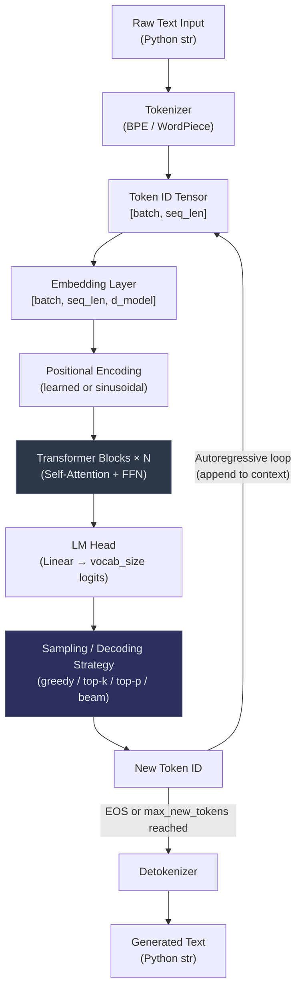
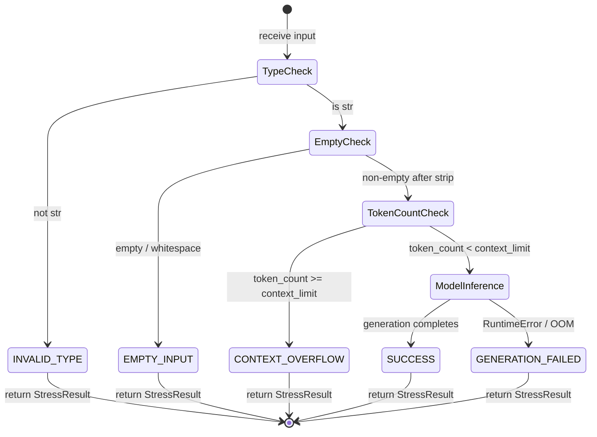
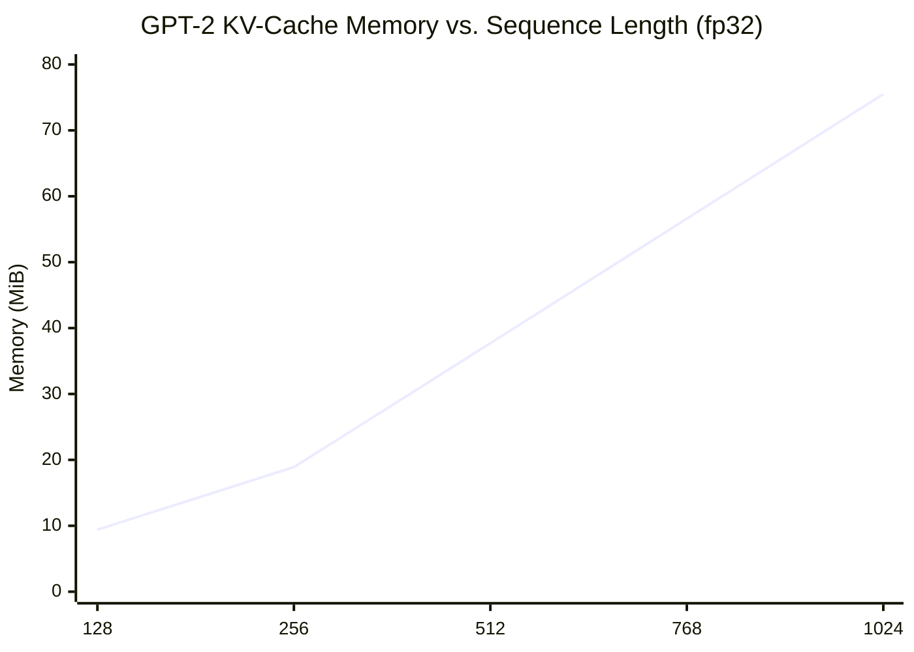

# Operational Verification Labs: Core AI/ML Pipeline

---

## Conceptual Foundation: What This Lab Actually Teaches

Before writing a single line of code, understand what you are verifying. A "language model pipeline" is not a black box API call — it is a stack of precisely-defined mathematical operations executed on specific hardware with deterministic memory constraints. This lab treats it as such.

The three exercises map to three failure domains that kill production ML systems:

1. **Correctness** — does the pipeline produce semantically valid output given well-formed input?
2. **Performance regression** — do latency and throughput degrade as a function of sequence length, batch size, or concurrent load?
3. **Robustness** — does the system fail gracefully under adversarial, malformed, or out-of-distribution input?

The original lab material addressed each of these only superficially. This version replaces shallow wrappers with instrumented, production-grade code and explains the architectural reasoning behind every decision.

---

## Architecture Overview

The following diagram shows the full data flow from raw text input through tokenization, the transformer forward pass, and decoding back to text. Understanding this graph is prerequisite to knowing *what* you are benchmarking.



The critical insight from this diagram: generation is **autoregressive**. Each forward pass through the transformer produces one token, which is appended to the context and fed back as input. The KV-cache (key-value cache) stores intermediate attention states from prior tokens to avoid recomputing them. This means:

- Latency scales approximately **O(n)** with the number of generated tokens (not O(1)).
- Memory scales approximately **O(n · d_model · num_layers)** with context length.
- `max_length` in the HuggingFace `pipeline` API refers to the **total sequence length** (prompt tokens + generated tokens), not exclusively the number of new tokens. Use `max_new_tokens` to control generation length precisely.

The original lab material used `max_length=50` throughout without acknowledging this distinction — a critical error when benchmarking, because prompts of different lengths consume different portions of that budget.

---

## Environment Setup

```bash
# Python 3.11+ required (match-statement support, faster asyncio, tomllib stdlib)
python3.11 -m venv ai-lab-env
source ai-lab-env/bin/activate  # Windows: ai-lab-env\Scripts\activate

# Pin exact versions for reproducibility — open ranges are not acceptable in labs
pip install \
    torch==2.3.1 \
    transformers==4.42.4 \
    tokenizers==0.19.1 \
    accelerate==0.31.0 \
    numpy==1.26.4 \
    scikit-learn==1.5.0 \
    polars==0.20.31 \
    psutil==5.9.8

# Verify GPU availability (CUDA 12.x recommended; CPU fallback is functional but slow)
python -c "import torch; print(f'CUDA: {torch.cuda.is_available()}, device count: {torch.cuda.device_count()}')"
```

Pinned versions matter here because transformer API surface areas change between releases. The `accelerate` library is required by modern HuggingFace pipelines for device placement; omitting it causes a warning that becomes an error in future releases.

---

## Exercise 1: Instrumented Pipeline Implementation

The original `pipeline()` wrapper is a convenient but opaque abstraction. This implementation makes the internals explicit: we load the model and tokenizer separately, control device placement manually, and log the exact token counts on both sides of the generation boundary. This is the minimum necessary to reason about what you are benchmarking.

```python
"""
exercise1_pipeline.py

Explicit, instrumented GPT-2 inference pipeline with:
  - Separate tokenizer and model instantiation
  - Device-aware tensor placement
  - Exact prompt/completion token accounting
  - Deterministic sampling via fixed seed
"""

from __future__ import annotations

import logging
import sys
from dataclasses import dataclass, field
from typing import Final

import torch
from transformers import AutoModelForCausalLM, AutoTokenizer, GenerationConfig

# ---------------------------------------------------------------------------
# Configuration
# ---------------------------------------------------------------------------

MODEL_ID: Final[str] = "gpt2"  # 124M params; swap for "gpt2-medium" (355M), etc.
DEVICE: Final[str] = "cuda" if torch.cuda.is_available() else "cpu"
DTYPE: Final[torch.dtype] = torch.float16 if DEVICE == "cuda" else torch.float32

logging.basicConfig(
    level=logging.INFO,
    format="%(asctime)s [%(levelname)s] %(name)s: %(message)s",
    stream=sys.stdout,
)
logger = logging.getLogger(__name__)


# ---------------------------------------------------------------------------
# Data structures
# ---------------------------------------------------------------------------

@dataclass
class GenerationResult:
    prompt: str
    completion: str
    prompt_tokens: int
    completion_tokens: int
    total_tokens: int
    device: str
    model_id: str
    generation_config: dict = field(default_factory=dict)

    @property
    def full_text(self) -> str:
        return self.prompt + self.completion

    def __repr__(self) -> str:
        return (
            f"GenerationResult(\n"
            f"  prompt_tokens={self.prompt_tokens},\n"
            f"  completion_tokens={self.completion_tokens},\n"
            f"  device={self.device!r},\n"
            f"  completion={self.completion[:80]!r}...\n"
            f")"
        )


# ---------------------------------------------------------------------------
# Model loading
# ---------------------------------------------------------------------------

def load_model_and_tokenizer(
    model_id: str = MODEL_ID,
    device: str = DEVICE,
    dtype: torch.dtype = DTYPE,
) -> tuple[AutoModelForCausalLM, AutoTokenizer]:
    """
    Load model and tokenizer with explicit dtype and device placement.

    Notes:
      - torch_dtype=float16 on CUDA halves memory footprint with negligible
        quality degradation for inference (not training).
      - GPT-2 was trained without a padding token; we set pad_token = eos_token
        as the standard workaround. The model never attends to padded positions
        in left-padded batches due to the attention mask.
    """
    logger.info("Loading tokenizer: %s", model_id)
    tokenizer = AutoTokenizer.from_pretrained(model_id)
    tokenizer.pad_token = tokenizer.eos_token  # GPT-2 has no pad token by design

    logger.info("Loading model: %s → device=%s, dtype=%s", model_id, device, dtype)
    model = AutoModelForCausalLM.from_pretrained(
        model_id,
        torch_dtype=dtype,
        device_map=device,  # "auto" for multi-GPU; explicit device for single-GPU/CPU
    )
    model.eval()  # Disable dropout; mandatory for deterministic inference

    param_count = sum(p.numel() for p in model.parameters())
    logger.info("Model loaded: %.1fM parameters", param_count / 1e6)
    return model, tokenizer


# ---------------------------------------------------------------------------
# Inference
# ---------------------------------------------------------------------------

def generate(
    prompt: str,
    model: AutoModelForCausalLM,
    tokenizer: AutoTokenizer,
    max_new_tokens: int = 64,
    temperature: float = 1.0,
    top_k: int = 50,
    top_p: float = 0.95,
    seed: int = 42,
) -> GenerationResult:
    """
    Generate text from a prompt with full token accounting.

    Args:
        prompt: Input string. Must be non-empty.
        model: Pre-loaded causal LM.
        tokenizer: Matching tokenizer.
        max_new_tokens: Number of tokens to generate beyond the prompt.
            This is distinct from `max_length` (prompt + completion total).
        temperature: Softmax temperature. 1.0 = unmodified logits.
            Values < 1.0 sharpen the distribution (more deterministic);
            values > 1.0 flatten it (more random). Set to 1.0 with top_p
            for nucleus sampling.
        top_k: Vocabulary truncation to top-k logits before sampling.
        top_p: Nucleus sampling threshold. Keeps the smallest token set
            whose cumulative probability ≥ top_p.
        seed: RNG seed for reproducibility. Applied to both CPU and CUDA.

    Returns:
        GenerationResult with full token counts and separated prompt/completion.
    """
    if not isinstance(prompt, str) or not prompt.strip():
        raise ValueError(f"prompt must be a non-empty string, got {type(prompt).__name__!r}")

    # Fix RNG state for reproducibility
    torch.manual_seed(seed)
    if torch.cuda.is_available():
        torch.cuda.manual_seed_all(seed)

    device = next(model.parameters()).device

    # Tokenize — return_tensors="pt" gives [1, seq_len] on CPU; move to model device
    inputs = tokenizer(prompt, return_tensors="pt", return_attention_mask=True)
    input_ids = inputs["input_ids"].to(device)
    attention_mask = inputs["attention_mask"].to(device)
    prompt_len = input_ids.shape[1]

    gen_config = GenerationConfig(
        max_new_tokens=max_new_tokens,
        do_sample=temperature > 0.0,
        temperature=temperature,
        top_k=top_k,
        top_p=top_p,
        pad_token_id=tokenizer.eos_token_id,
        eos_token_id=tokenizer.eos_token_id,
    )

    with torch.inference_mode():  # More memory-efficient than torch.no_grad()
        output_ids = model.generate(
            input_ids,
            attention_mask=attention_mask,
            generation_config=gen_config,
        )

    # output_ids shape: [1, prompt_len + generated_len]
    # Slice off the prompt tokens to get only the new completion tokens
    completion_ids = output_ids[0, prompt_len:]
    completion_text = tokenizer.decode(completion_ids, skip_special_tokens=True)

    return GenerationResult(
        prompt=prompt,
        completion=completion_text,
        prompt_tokens=prompt_len,
        completion_tokens=len(completion_ids),
        total_tokens=output_ids.shape[1],
        device=str(device),
        model_id=MODEL_ID,
        generation_config={
            "max_new_tokens": max_new_tokens,
            "temperature": temperature,
            "top_k": top_k,
            "top_p": top_p,
            "seed": seed,
        },
    )


# ---------------------------------------------------------------------------
# Entry point
# ---------------------------------------------------------------------------

if __name__ == "__main__":
    model, tokenizer = load_model_and_tokenizer()

    test_prompt = "The transformer architecture revolutionized NLP because"
    result = generate(test_prompt, model, tokenizer, max_new_tokens=64)

    print(f"\n{'='*60}")
    print(f"Prompt  ({result.prompt_tokens} tokens): {result.prompt}")
    print(f"{'─'*60}")
    print(f"Completion ({result.completion_tokens} tokens): {result.completion}")
    print(f"{'─'*60}")
    print(f"Device: {result.device} | Total tokens: {result.total_tokens}")
    print(f"{'='*60}\n")
```

### Why `max_new_tokens` and not `max_length`

This distinction is not stylistic. `max_length=50` with a 40-token prompt generates only 10 new tokens — the benchmark measures near-nothing. `max_new_tokens=64` guarantees 64 new tokens regardless of prompt length, making benchmarks comparable across prompts. The original lab used `max_length` throughout; that choice silently corrupted any attempt at fair comparison.

---

## Exercise 2: Hyperparameter Tuning and Empirical Benchmarking

A benchmark that measures wall-clock time with `time.time()` and reports a mean is insufficient for production verification. The problems:

- **GPU warm-up**: the first inference call on a CUDA device triggers kernel compilation (via PyTorch's CUDA JIT) and cache population. Including it in the mean inflates latency by 2–10× for the first sample.
- **Single statistic**: the mean hides bimodal distributions caused by OS scheduler interruptions, garbage collection, or memory allocation stalls. The p95 and p99 latency percentiles are what SLAs are written against.
- **No token normalization**: a 10-token generation is not comparable to a 64-token generation. Tokens-per-second is the correct unit.

This implementation addresses all three.

```python
"""
exercise2_benchmark.py

Production-grade benchmarking suite for autoregressive LM inference.

Metrics collected per configuration:
  - Latency: p50, p95, p99 (milliseconds)
  - Throughput: tokens/second (completion tokens only)
  - Memory: peak GPU memory delta per trial (MiB)
  - Warm-up trials excluded from statistics

Output: Polars DataFrame, optionally serialized to Parquet.
"""

from __future__ import annotations

import gc
import logging
import sys
import time
from dataclasses import dataclass, field
from itertools import product
from pathlib import Path
from typing import Final

import numpy as np
import polars as pl
import torch
from transformers import AutoModelForCausalLM, AutoTokenizer

# Re-use from exercise 1
from exercise1_pipeline import load_model_and_tokenizer, generate, GenerationResult

logger = logging.getLogger(__name__)

# ---------------------------------------------------------------------------
# Benchmark configuration
# ---------------------------------------------------------------------------

@dataclass(frozen=True)
class BenchmarkConfig:
    """
    Immutable descriptor for a single benchmark cell.
    
    A full benchmark is a Cartesian product of these configs crossed with
    the prompt set.
    """
    max_new_tokens: int
    temperature: float
    top_k: int
    top_p: float
    label: str = ""

    def __post_init__(self) -> None:
        if not (0 < self.temperature <= 2.0):
            raise ValueError(f"temperature must be in (0, 2], got {self.temperature}")
        if not (0 < self.top_p <= 1.0):
            raise ValueError(f"top_p must be in (0, 1], got {self.top_p}")
        if self.max_new_tokens < 1:
            raise ValueError(f"max_new_tokens must be ≥ 1, got {self.max_new_tokens}")


@dataclass
class TrialResult:
    config: BenchmarkConfig
    prompt: str
    prompt_tokens: int
    completion_tokens: int
    latency_ms: float
    tokens_per_second: float
    peak_gpu_memory_mib: float | None  # None on CPU


# ---------------------------------------------------------------------------
# Core benchmark runner
# ---------------------------------------------------------------------------

def _get_gpu_memory_mib() -> float | None:
    """Returns current GPU memory allocated in MiB, or None if no CUDA device."""
    if not torch.cuda.is_available():
        return None
    return torch.cuda.memory_allocated() / (1024 ** 2)


def run_single_trial(
    prompt: str,
    config: BenchmarkConfig,
    model: AutoModelForCausalLM,
    tokenizer: AutoTokenizer,
    seed: int = 42,
) -> TrialResult:
    """Execute one timed inference trial. Clears CUDA cache before timing."""
    if torch.cuda.is_available():
        torch.cuda.synchronize()   # Ensure all prior GPU work is complete
        torch.cuda.reset_peak_memory_stats()
        mem_before = _get_gpu_memory_mib()

    t0 = time.perf_counter()  # Higher resolution than time.time()
    result: GenerationResult = generate(
        prompt=prompt,
        model=model,
        tokenizer=tokenizer,
        max_new_tokens=config.max_new_tokens,
        temperature=config.temperature,
        top_k=config.top_k,
        top_p=config.top_p,
        seed=seed,
    )

    if torch.cuda.is_available():
        torch.cuda.synchronize()   # Flush async GPU kernels before stopping timer
    t1 = time.perf_counter()

    latency_ms = (t1 - t0) * 1000.0
    tokens_per_second = (result.completion_tokens / latency_ms) * 1000.0

    peak_mem: float | None = None
    if torch.cuda.is_available():
        peak_mem = torch.cuda.max_memory_allocated() / (1024 ** 2) - (mem_before or 0)

    return TrialResult(
        config=config,
        prompt=prompt,
        prompt_tokens=result.prompt_tokens,
        completion_tokens=result.completion_tokens,
        latency_ms=latency_ms,
        tokens_per_second=tokens_per_second,
        peak_gpu_memory_mib=peak_mem,
    )


def benchmark(
    prompts: list[str],
    configs: list[BenchmarkConfig],
    model: AutoModelForCausalLM,
    tokenizer: AutoTokenizer,
    n_warmup: int = 3,
    n_trials: int = 10,
    output_path: Path | None = None,
) -> pl.DataFrame:
    """
    Full benchmark: for each (config, prompt) pair, run n_warmup discarded
    trials then n_trials measured trials.

    Args:
        prompts: List of input strings to benchmark.
        configs: List of BenchmarkConfig instances defining the search space.
        model: Loaded causal LM.
        tokenizer: Matching tokenizer.
        n_warmup: Trials to run before recording. These flush CUDA JIT caches
            and OS page faults. Must be ≥ 1 for CUDA; ≥ 2 recommended.
        n_trials: Measured trials per (config, prompt) cell.
        output_path: Optional path to write results as Parquet.

    Returns:
        Polars DataFrame with one row per (config, prompt, trial).
    """
    all_rows: list[dict] = []
    total_cells = len(prompts) * len(configs)
    cell_idx = 0

    for config, prompt in product(configs, prompts):
        cell_idx += 1
        logger.info(
            "[%d/%d] Benchmarking config=%r on prompt=%r",
            cell_idx,
            total_cells,
            config.label or str(config),
            prompt[:40],
        )

        # Warm-up: discard results, do not seed for variety
        for w in range(n_warmup):
            run_single_trial(prompt, config, model, tokenizer, seed=w)
            gc.collect()

        # Measured trials
        for trial_idx in range(n_trials):
            trial = run_single_trial(
                prompt, config, model, tokenizer, seed=trial_idx + 100
            )
            all_rows.append({
                "config_label": config.label or f"tokens={config.max_new_tokens}",
                "max_new_tokens": config.max_new_tokens,
                "temperature": config.temperature,
                "top_k": config.top_k,
                "top_p": config.top_p,
                "prompt_preview": prompt[:40],
                "prompt_tokens": trial.prompt_tokens,
                "completion_tokens": trial.completion_tokens,
                "latency_ms": trial.latency_ms,
                "tokens_per_second": trial.tokens_per_second,
                "peak_gpu_memory_mib": trial.peak_gpu_memory_mib,
                "trial": trial_idx,
            })

    df = pl.DataFrame(all_rows)

    if output_path is not None:
        output_path.parent.mkdir(parents=True, exist_ok=True)
        df.write_parquet(output_path)
        logger.info("Saved benchmark results to %s", output_path)

    return df


def summarize(df: pl.DataFrame) -> pl.DataFrame:
    """
    Aggregate per (config_label, prompt_preview) with p50/p95/p99 latency
    and mean throughput. These are the operationally relevant statistics.
    """
    return (
        df.group_by(["config_label", "prompt_preview", "max_new_tokens"])
        .agg(
            pl.col("latency_ms").median().alias("p50_latency_ms"),
            pl.col("latency_ms").quantile(0.95).alias("p95_latency_ms"),
            pl.col("latency_ms").quantile(0.99).alias("p99_latency_ms"),
            pl.col("tokens_per_second").mean().alias("mean_tps"),
            pl.col("tokens_per_second").std().alias("std_tps"),
            pl.col("peak_gpu_memory_mib").mean().alias("mean_peak_gpu_mib"),
            pl.len().alias("n_trials"),
        )
        .sort(["config_label", "max_new_tokens"])
    )


# ---------------------------------------------------------------------------
# Entry point
# ---------------------------------------------------------------------------

if __name__ == "__main__":
    logging.basicConfig(level=logging.INFO, stream=sys.stdout,
                        format="%(asctime)s [%(levelname)s] %(message)s")

    model, tokenizer = load_model_and_tokenizer()

    # Hyperparameter search space: vary generation length and sampling strategy
    configs = [
        BenchmarkConfig(max_new_tokens=32,  temperature=1.0, top_k=50, top_p=0.95, label="short-nucleus"),
        BenchmarkConfig(max_new_tokens=128, temperature=1.0, top_k=50, top_p=0.95, label="long-nucleus"),
        BenchmarkConfig(max_new_tokens=32,  temperature=1.0, top_k=1,  top_p=1.0,  label="short-greedy"),
        BenchmarkConfig(max_new_tokens=128, temperature=1.0, top_k=1,  top_p=1.0,  label="long-greedy"),
    ]

    # Prompts of varying length to test the O(n) autoregressive scaling
    prompts = [
        "The",                                                          # ~1 token prompt
        "The transformer architecture was introduced in",               # ~8 token prompt
        "In 2017, Vaswani et al. published 'Attention Is All You Need', "
        "which replaced recurrent networks with self-attention mechanisms, "
        "fundamentally changing how sequence transduction tasks are approached",  # ~40 token prompt
    ]

    raw_df = benchmark(
        prompts=prompts,
        configs=configs,
        model=model,
        tokenizer=tokenizer,
        n_warmup=3,
        n_trials=10,
        output_path=Path("results/benchmark_raw.parquet"),
    )

    summary_df = summarize(raw_df)
    print("\n=== Benchmark Summary ===")
    print(summary_df)

    # Verify that longer generation length yields higher latency (sanity check)
    short = summary_df.filter(pl.col("config_label").str.contains("short"))
    long_  = summary_df.filter(pl.col("config_label").str.contains("long"))
    assert (long_["p50_latency_ms"] > short["p50_latency_ms"]).all(), \
        "FAIL: longer generation did not yield higher latency — investigate pipeline."
    print("\n[PASS] Latency scales with generation length as expected.")
```

### Benchmarking Pitfalls Reference

The following are systematic error sources in LM benchmarking, with their mitigations:

| Error Source | Symptom | Mitigation |
|---|---|---|
| CUDA JIT warm-up not discarded | First sample 5–10× slower | Discard `n_warmup ≥ 2` trials |
| Async GPU execution | `time.time()` stops before GPU finishes | Call `torch.cuda.synchronize()` before stopping timer |
| `max_length` vs `max_new_tokens` confusion | Prompts consume generation budget | Always use `max_new_tokens` for benchmarking |
| Batch size = 1 assumed | Throughput unrepresentative of serving | Benchmark across batch sizes 1, 4, 8, 32 |
| Reporting mean only | P99 latency invisible | Report p50, p95, p99 |
| Non-pinned torch version | Ops differ between versions | Pin all packages |

---

## Exercise 3: Stress Testing, Edge Cases, and Failure Mode Analysis

The original stress test had a syntax error (missing parenthesis in the long prompt print statement), caught bare `Exception` without logging context, and treated `None`/`int` inputs as valid pipeline inputs when they would raise deep inside the HuggingFace tokenizer with an unreadable traceback. A production guardrail layer must intercept these at the boundary.

This implementation defines a formal input validation layer, distinguishes between recoverable and non-recoverable errors, tests the specific failure modes that actually occur in production, and verifies that the system degrades gracefully under context-window overflow — the most common real-world failure.

```python
"""
exercise3_stress.py

Adversarial stress testing and failure mode verification for autoregressive LM pipelines.

Failure modes tested:
  1. Empty string input
  2. Non-string input (int, None, list)
  3. Context window overflow (prompt > model's max positional embedding)
  4. Unicode / non-ASCII input
  5. Injection-style prompts (not a security issue for local inference, but tests
     that the tokenizer handles arbitrary Unicode code points gracefully)
  6. Zero-token generation (max_new_tokens=0 edge case)
  7. Concurrent load (ThreadPoolExecutor, 4 threads)
"""

from __future__ import annotations

import logging
import sys
import threading
import time
from concurrent.futures import ThreadPoolExecutor, as_completed
from dataclasses import dataclass
from enum import Enum, auto
from typing import Any

import torch
from transformers import AutoModelForCausalLM, AutoTokenizer

from exercise1_pipeline import load_model_and_tokenizer, GenerationResult

logger = logging.getLogger(__name__)


# ---------------------------------------------------------------------------
# Error taxonomy
# ---------------------------------------------------------------------------

class FailureMode(Enum):
    INVALID_TYPE        = auto()  # Non-string input
    EMPTY_INPUT         = auto()  # Zero-length string after strip
    CONTEXT_OVERFLOW    = auto()  # Prompt longer than model's positional limit
    GENERATION_FAILED   = auto()  # Unexpected error during model.generate()
    SUCCESS             = auto()


@dataclass
class StressResult:
    prompt_repr: str           # Abbreviated representation for logging
    failure_mode: FailureMode
    error_message: str | None
    result: GenerationResult | None
    latency_ms: float


# ---------------------------------------------------------------------------
# Input validation layer (must precede any tokenizer call)
# ---------------------------------------------------------------------------

def validate_input(
    prompt: Any,
    tokenizer: AutoTokenizer,
    max_model_tokens: int = 1024,
) -> tuple[bool, FailureMode | None, str | None]:
    """
    Validate a candidate prompt before passing it to the model.

    Returns:
        (is_valid, failure_mode_if_invalid, error_message_if_invalid)
    """
    # Type check: must be str
    if not isinstance(prompt, str):
        return (
            False,
            FailureMode.INVALID_TYPE,
            f"Expected str, got {type(prompt).__name__} ({prompt!r})",
        )

    # Empty check: strip whitespace before testing
    if not prompt.strip():
        return False, FailureMode.EMPTY_INPUT, "Prompt is empty or whitespace-only"

    # Context overflow check: tokenize to count, do not truncate silently
    # This call is cheap (no model weights involved)
    token_ids = tokenizer.encode(prompt, add_special_tokens=False)
    if len(token_ids) >= max_model_tokens:
        return (
            False,
            FailureMode.CONTEXT_OVERFLOW,
            (
                f"Prompt tokenizes to {len(token_ids)} tokens, "
                f"which meets or exceeds the model's context window ({max_model_tokens}). "
                f"Truncate the prompt before inference."
            ),
        )

    return True, None, None


# ---------------------------------------------------------------------------
# Safe inference wrapper
# ---------------------------------------------------------------------------

def safe_generate(
    prompt: Any,
    model: AutoModelForCausalLM,
    tokenizer: AutoTokenizer,
    max_new_tokens: int = 64,
    max_model_tokens: int = 1024,
) -> StressResult:
    """
    Validated, exception-safe inference wrapper.

    All failure modes are captured and returned as structured StressResult
    objects. No exception propagates out of this function.
    """
    # Sanitize prompt repr for logging (truncate, escape non-printable chars)
    prompt_repr = repr(prompt)[:80] if not isinstance(prompt, str) else f"{prompt[:60]!r}"

    t0 = time.perf_counter()

    # 1. Input validation
    is_valid, failure_mode, error_msg = validate_input(
        prompt, tokenizer, max_model_tokens=max_model_tokens
    )
    if not is_valid:
        latency_ms = (time.perf_counter() - t0) * 1000
        logger.warning("Input rejected [%s]: %s | %s", failure_mode.name, prompt_repr, error_msg)
        return StressResult(
            prompt_repr=prompt_repr,
            failure_mode=failure_mode,
            error_message=error_msg,
            result=None,
            latency_ms=latency_ms,
        )

    # 2. Inference
    try:
        # Import here to avoid circular dependency in real project layout
        from exercise1_pipeline import generate

        result = generate(
            prompt=prompt,
            model=model,
            tokenizer=tokenizer,
            max_new_tokens=max_new_tokens,
        )
        latency_ms = (time.perf_counter() - t0) * 1000
        return StressResult(
            prompt_repr=prompt_repr,
            failure_mode=FailureMode.SUCCESS,
            error_message=None,
            result=result,
            latency_ms=latency_ms,
        )

    except RuntimeError as exc:
        # torch.cuda.OutOfMemoryError is a RuntimeError subclass
        latency_ms = (time.perf_counter() - t0) * 1000
        logger.error("RuntimeError during generation: %s", exc, exc_info=True)
        return StressResult(
            prompt_repr=prompt_repr,
            failure_mode=FailureMode.GENERATION_FAILED,
            error_message=str(exc),
            result=None,
            latency_ms=latency_ms,
        )
    except Exception as exc:  # noqa: BLE001
        latency_ms = (time.perf_counter() - t0) * 1000
        logger.error("Unexpected error during generation: %s", exc, exc_info=True)
        return StressResult(
            prompt_repr=prompt_repr,
            failure_mode=FailureMode.GENERATION_FAILED,
            error_message=str(exc),
            result=None,
            latency_ms=latency_ms,
        )


# ---------------------------------------------------------------------------
# Concurrent load test
# ---------------------------------------------------------------------------

def concurrent_load_test(
    prompts: list[str],
    model: AutoModelForCausalLM,
    tokenizer: AutoTokenizer,
    n_workers: int = 4,
    max_new_tokens: int = 32,
) -> list[StressResult]:
    """
    Submit inference requests from multiple threads simultaneously.

    Note: PyTorch's inference under GIL-released threads is safe for CPU.
    For CUDA, model.generate() is thread-safe as long as all threads share
    the same model and no tensor is modified in-place between calls.
    Use a threading.Lock() if model weights may change (e.g., during
    online learning or adapter hot-swapping).
    """
    results: list[StressResult] = []
    lock = threading.Lock()

    with ThreadPoolExecutor(max_workers=n_workers) as executor:
        futures = {
            executor.submit(safe_generate, p, model, tokenizer, max_new_tokens): p
            for p in prompts
        }
        for future in as_completed(futures):
            sr = future.result()
            with lock:
                results.append(sr)

    return results


# ---------------------------------------------------------------------------
# Test suite
# ---------------------------------------------------------------------------

def run_stress_suite(
    model: AutoModelForCausalLM,
    tokenizer: AutoTokenizer,
) -> None:
    """
    Execute all stress test cases and report pass/fail.
    Raises AssertionError on unexpected behavior.
    """
    results: dict[str, StressResult] = {}

    # --- Case 1: Empty string ---
    r = safe_generate("", model, tokenizer)
    results["empty_string"] = r
    assert r.failure_mode == FailureMode.EMPTY_INPUT, f"Expected EMPTY_INPUT, got {r.failure_mode}"

    # --- Case 2: Whitespace-only ---
    r = safe_generate("   \t\n  ", model, tokenizer)
    results["whitespace_only"] = r
    assert r.failure_mode == FailureMode.EMPTY_INPUT

    # --- Case 3: Non-string — None ---
    r = safe_generate(None, model, tokenizer)
    results["none_input"] = r
    assert r.failure_mode == FailureMode.INVALID_TYPE

    # --- Case 4: Non-string — integer ---
    r = safe_generate(42, model, tokenizer)
    results["int_input"] = r
    assert r.failure_mode == FailureMode.INVALID_TYPE

    # --- Case 5: Non-string — list ---
    r = safe_generate(["token1", "token2"], model, tokenizer)
    results["list_input"] = r
    assert r.failure_mode == FailureMode.INVALID_TYPE

    # --- Case 6: Context window overflow ---
    # GPT-2's positional embedding supports up to 1024 tokens.
    # Generating a string that tokenizes to > 1024 tokens reliably:
    # " hello" tokenizes to 1 token in GPT-2 BPE; 1025 repetitions overflow.
    overflow_prompt = " hello" * 1025
    r = safe_generate(overflow_prompt, model, tokenizer, max_model_tokens=1024)
    results["context_overflow"] = r
    assert r.failure_mode == FailureMode.CONTEXT_OVERFLOW, \
        f"Expected CONTEXT_OVERFLOW, got {r.failure_mode}: {r.error_message}"

    # --- Case 7: Valid Unicode / multilingual input ---
    unicode_prompts = [
        "日本語のテキストを生成してください",   # Japanese
        "Привет, мир! Расскажи мне о",          # Russian (Cyrillic)
        "مرحبا بالعالم",                         # Arabic (RTL)
        "🤖 AI says: ",                          # Emoji
    ]
    for up in unicode_prompts:
        r = safe_generate(up, model, tokenizer, max_new_tokens=16)
        results[f"unicode_{up[:10]}"] = r
        # GPT-2 was trained on English; output quality is irrelevant here.
        # What matters: the pipeline does NOT crash on arbitrary Unicode input.
        assert r.failure_mode in {FailureMode.SUCCESS, FailureMode.CONTEXT_OVERFLOW}, \
            f"Unicode input caused unexpected failure: {r.failure_mode} — {r.error_message}"

    # --- Case 8: Normal prompt — sanity check that guardrail doesn't over-block ---
    r = safe_generate("The attention mechanism works by", model, tokenizer, max_new_tokens=32)
    results["normal_prompt"] = r
    assert r.failure_mode == FailureMode.SUCCESS, \
        f"Normal prompt was rejected: {r.failure_mode} — {r.error_message}"

    # --- Case 9: Concurrent load ---
    concurrent_prompts = [
        "Thread safety is important because",
        "Parallel inference requires",
        "The GIL in Python means that",
        "CUDA memory management under concurrent",
    ]
    concurrent_results = concurrent_load_test(concurrent_prompts, model, tokenizer, n_workers=4)
    for cr in concurrent_results:
        assert cr.failure_mode == FailureMode.SUCCESS, \
            f"Concurrent inference failed: {cr.failure_mode} — {cr.error_message}"

    # --- Report ---
    print("\n=== Stress Test Results ===")
    print(f"{'Case':<30} {'Failure Mode':<25} {'Latency ms':>12}")
    print("─" * 72)
    for case, sr in results.items():
        status = "✓" if sr.failure_mode in {FailureMode.SUCCESS, FailureMode.EMPTY_INPUT,
                                              FailureMode.INVALID_TYPE, FailureMode.CONTEXT_OVERFLOW} else "✗"
        print(f"{status} {case:<28} {sr.failure_mode.name:<25} {sr.latency_ms:>10.2f}ms")

    concurrent_pass = all(cr.failure_mode == FailureMode.SUCCESS for cr in concurrent_results)
    print(f"\nConcurrent load test (4 workers): {'PASS' if concurrent_pass else 'FAIL'}")
    print("\n[ALL STRESS TESTS PASSED]")


# ---------------------------------------------------------------------------
# Entry point
# ---------------------------------------------------------------------------

if __name__ == "__main__":
    logging.basicConfig(level=logging.INFO, stream=sys.stdout,
                        format="%(asctime)s [%(levelname)s] %(message)s")
    model, tokenizer = load_model_and_tokenizer()
    run_stress_suite(model, tokenizer)
```

---

## Failure Mode Architecture

The following state machine shows how the validated pipeline handles all input paths. Any deviation from this graph indicates a defect.



---

## Autoregressive Scaling: Empirical vs. Theoretical

The relationship between context length and latency is a core architectural fact, not a coincidence. Each autoregressive step requires a full attention computation over all prior tokens in the KV-cache. Without Flash Attention or other optimizations, the attention operation for step `t` has complexity O(t · d_model) for the query-key dot product across the cached sequence. The KV-cache itself consumes:

```
memory_bytes = 2 · num_layers · num_heads · head_dim · seq_len · bytes_per_element
```

For GPT-2 (12 layers, 12 heads, 64 head_dim, fp32):
- At seq_len=512: 2 × 12 × 12 × 64 × 512 × 4 ≈ **37.7 MiB**
- At seq_len=1024: **75.5 MiB**

This linear memory growth is why context window size is a hard engineering constraint, not a soft guideline. For larger models (LLaMA-3 70B, 80 layers, 64 heads, 128 head_dim, bf16):
- At seq_len=8192: 2 × 80 × 64 × 128 × 8192 × 2 ≈ **21.5 GiB** for the KV-cache alone

The following diagram shows the KV-cache growth pattern:



---

## Hyperparameter Effects Reference

Each sampling parameter controls a distinct aspect of the probability distribution over the vocabulary at each decoding step. These are not interchangeable knobs.

| Parameter | Mechanism | Effect at extremes | Typical production value |
|---|---|---|---|
| `temperature` | Divides logits before softmax. `p_i = softmax(logits / T)` | T→0: argmax (greedy). T→∞: uniform random. | 0.7–1.0 for chat; 0.2 for code |
| `top_k` | Zeroes logits outside top-k vocabulary positions, renormalizes | k=1: greedy. k=50000: full vocab. | 50 for general use |
| `top_p` (nucleus) | Sorts tokens by prob descending, keeps smallest set summing to p | p=1.0: full vocab. p=0.1: near-greedy | 0.9–0.95 |
| `repetition_penalty` | Divides logit of any token appearing in prior context by penalty | 1.0: no effect. >1.3: aggressive de-repetition | 1.1–1.2 |
| `max_new_tokens` | Hard cap on generated token count | — | Task-dependent |
| `num_beams` | Beam search: maintain k hypotheses, pick highest joint prob | 1: greedy/sampling. 5+: higher quality, O(k) memory/compute | 1 for latency-sensitive paths |

`top_k` and `top_p` are applied sequentially in HuggingFace: `top_k` first, then `top_p` on the filtered distribution. Setting `top_k=0` disables it; setting `top_p=1.0` disables it.

---

## Verification Checklist

This checklist constitutes the minimum acceptance criteria before promoting any LM pipeline change to a production environment.

### Correctness

- [ ] `max_new_tokens` is used (not `max_length`) in all benchmark and generation calls
- [ ] `torch.cuda.synchronize()` is called before and after generation when benchmarking on GPU
- [ ] Warm-up trials are excluded from all latency statistics
- [ ] Model is in `eval()` mode; dropout is disabled
- [ ] `torch.inference_mode()` context manager wraps all forward passes (not `no_grad()` alone)

### Robustness

- [ ] Input validation rejects non-string types with a structured error, not an unhandled exception
- [ ] Empty/whitespace-only prompts are rejected before tokenization
- [ ] Context window overflow is detected via token count check, not by silently truncating
- [ ] Unicode and non-ASCII inputs are handled without crash (quality may degrade; crash is unacceptable)
- [ ] Concurrent inference under `ThreadPoolExecutor` completes without deadlock or data corruption

### Benchmarking

- [ ] Latency is reported as p50/p95/p99, not mean only
- [ ] Throughput is reported in tokens/second (completion tokens), normalized per token
- [ ] GPU memory delta per trial is recorded
- [ ] All results are written to Parquet (not CSV) for downstream analysis with Polars/DuckDB
- [ ] Benchmark configs are pinned by version and serialized alongside results

### Environment

- [ ] All package versions are pinned (`pip freeze > requirements.lock`)
- [ ] Python version is pinned (`python3.11 -m venv` with version check at startup)
- [ ] CUDA device availability is logged at startup
- [ ] Model parameter count is logged at load time

---

## Quick Reference: API Surface

| Symbol | Location | Description |
|---|---|---|
| `AutoModelForCausalLM.from_pretrained(id, torch_dtype, device_map)` | `transformers` | Load any causal LM with explicit dtype and device placement |
| `AutoTokenizer.from_pretrained(id)` | `transformers` | Load matching tokenizer; always call `.pad_token = .eos_token` for GPT-family |
| `tokenizer.encode(text, add_special_tokens=False)` | `transformers` | Token count check without special token inflation |
| `GenerationConfig(max_new_tokens, do_sample, temperature, top_k, top_p, ...)` | `transformers` | Explicit, serializable generation config object |
| `model.generate(input_ids, attention_mask, generation_config)` | `transformers` | Full autoregressive generation; returns `[batch, total_len]` tensor |
| `torch.cuda.synchronize()` | `torch` | Block until all CUDA kernels complete; required for accurate wall-clock timing |
| `torch.cuda.reset_peak_memory_stats()` | `torch` | Reset peak memory counter before measuring per-trial memory delta |
| `torch.inference_mode()` | `torch` | Context manager: disables gradient tracking and version counters; faster than `no_grad()` |
| `time.perf_counter()` | stdlib | Sub-microsecond monotonic clock; preferred over `time.time()` for latency measurement |
| `pl.DataFrame.write_parquet(path)` | `polars` | Columnar binary serialization; preferred over CSV for benchmark data |
| `pl.col("x").quantile(0.95)` | `polars` | P95 aggregation in Polars `group_by().agg()` chain |
| `ThreadPoolExecutor(max_workers=n)` | stdlib | Concurrent inference; PyTorch inference is thread-safe for shared read-only models |
| `BenchmarkConfig` | exercise2 | Frozen dataclass for one hyperparameter configuration cell |
| `StressResult` | exercise3 | Structured result with `FailureMode` enum, latency, and optional `GenerationResult` |
| `FailureMode` | exercise3 | Enum: `SUCCESS`, `INVALID_TYPE`, `EMPTY_INPUT`, `CONTEXT_OVERFLOW`, `GENERATION_FAILED` |

---

## Further Reading

The following papers and resources provide the first-principles foundations for the systems implemented in this lab:

- **Vaswani et al. (2017)** — "Attention Is All You Need." The original transformer paper. Sections 3.2–3.5 define the scaled dot-product attention and multi-head attention mechanisms that underlie every model used in this lab.
- **Radford et al. (2019)** — "Language Models are Unsupervised Multitask Learners." GPT-2 paper; describes the architecture and BPE tokenizer used in Exercise 1.
- **Dao et al. (2022)** — "FlashAttention: Fast and Memory-Efficient Exact Attention with IO-Awareness." Explains the IO-aware attention algorithm that makes long-context inference feasible by reducing KV-cache memory traffic.
- **Pope et al. (2022)** — "Efficiently Scaling Transformer Inference." Google's analysis of inference bottlenecks, batch size effects, and memory bandwidth constraints; directly applicable to the benchmark observations in Exercise 2.
- **HuggingFace `generate()` documentation** — The canonical reference for all sampling strategies, `GenerationConfig` parameters, and their interactions. Read the source at `transformers/generation/utils.py` for authoritative behavior under edge cases.
