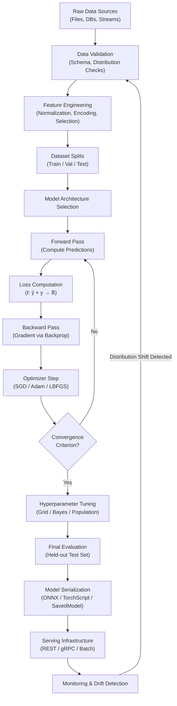
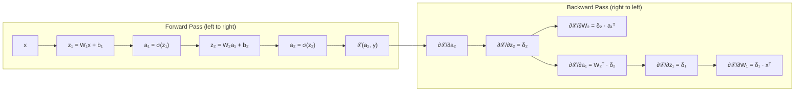
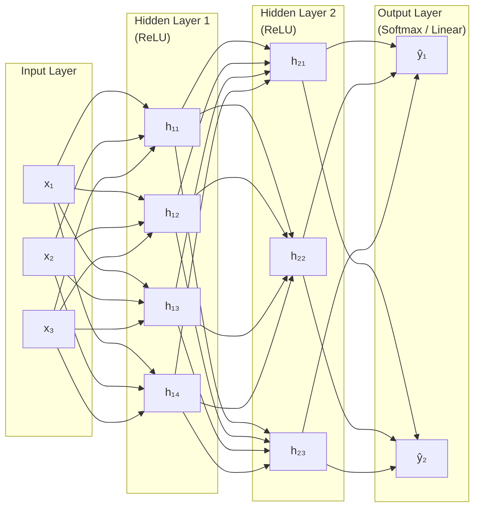
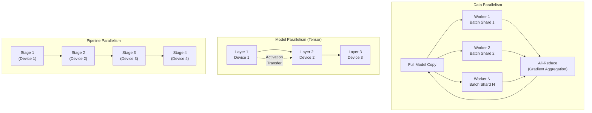
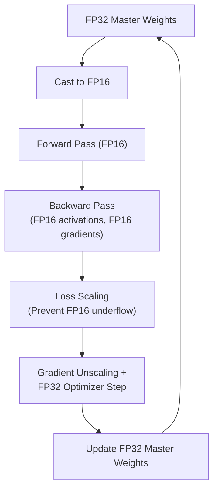
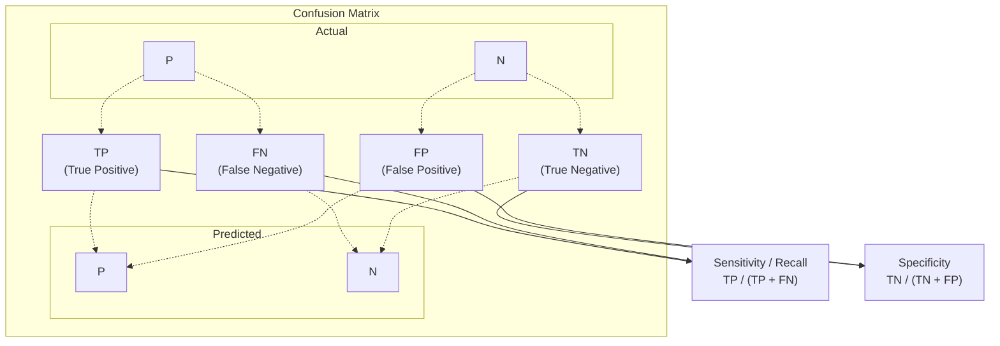
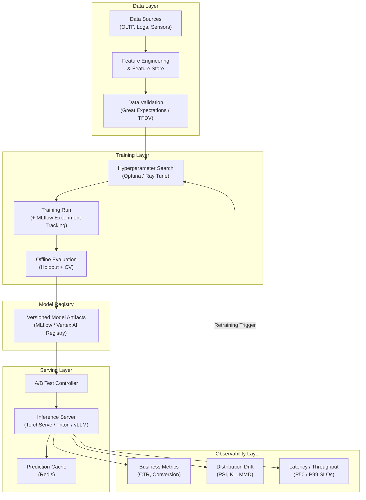

# Lesson 1: Machine Learning Foundations

## 1. First-Principles Intuition & Invariants

Machine learning is not magic — it is function approximation under uncertainty, constrained by statistical theory. The central thesis is deceptively simple: given a dataset $\mathcal{D} = \{(\mathbf{x}_i, y_i)\}_{i=1}^{n}$ drawn i.i.d. from some unknown joint distribution $P(\mathbf{X}, Y)$, find a function $f_\theta: \mathcal{X} \to \mathcal{Y}$ that minimizes expected loss on unseen data drawn from that same distribution.

$$\mathcal{L}(f_\theta) = \mathbb{E}_{(\mathbf{x}, y) \sim P} [\ell(f_\theta(\mathbf{x}), y)]$$

Because $P$ is unknown, we minimize the *empirical risk* — the sample average over the training set:

$$\hat{\mathcal{L}}(f_\theta) = \frac{1}{n} \sum_{i=1}^{n} \ell(f_\theta(\mathbf{x}_i), y_i)$$

This substitution is justified by the Law of Large Numbers, but it introduces the most fundamental tension in ML: **generalization**. The gap $\mathcal{L}(f_\theta) - \hat{\mathcal{L}}(f_\theta)$ is bounded by results from statistical learning theory — specifically, the Vapnik-Chervonenkis (VC) dimension framework and its modern successor, the Rademacher complexity framework.

### The Bias-Variance-Noise Decomposition

For squared-error loss in regression, the expected test error on a point $\mathbf{x}$ decomposes exactly as:

$$\mathbb{E}[(y - f_\theta(\mathbf{x}))^2] = \underbrace{\text{Bias}^2[f_\theta(\mathbf{x})]}_{\text{systematic error}} + \underbrace{\text{Var}[f_\theta(\mathbf{x})]}_{\text{sensitivity to training set}} + \underbrace{\sigma^2}_{\text{irreducible noise}}$$

This is not an approximation — it is an algebraic identity derived by expanding the expectation and using the definition of variance. Each term has a direct architectural implication:

- **Bias** is reduced by increasing model capacity (deeper networks, higher-degree polynomials, smaller regularization).
- **Variance** is reduced by increasing training data, adding regularization, ensembling, or decreasing model complexity.
- **Noise** $\sigma^2$ is irreducible; it represents genuine stochasticity in the data-generating process (sensor noise, labeling disagreement, inherent randomness).

The classical wisdom is that bias and variance trade off against each other — the *bias-variance tradeoff*. Modern overparameterized neural networks (where parameter count vastly exceeds sample count) empirically violate the naive U-shaped test error curve, entering a *double descent* regime first described rigorously by Belkin et al. (2019). After an initial increase near the interpolation threshold, test error decreases again as the model becomes large enough to find smooth, well-generalizing interpolating solutions. This phenomenon is now understood to be mediated by implicit regularization from SGD and architectural inductive biases.

### The Three Foundational Invariants

Three invariants underpin every ML system. Violating any one of them silently breaks the system in ways that are difficult to diagnose post-deployment.

**Invariant 1 — The i.i.d. assumption:** Training examples are assumed to be independent and identically distributed draws from $P(\mathbf{X}, Y)$. In practice, time-series data, geographically correlated samples, and hierarchically structured data all violate independence. The fix is not to pretend the assumption holds, but to design the validation strategy accordingly: temporal cross-validation for time-series, group-based splits for correlated samples.

**Invariant 2 — Covariate stationarity:** The distribution $P(\mathbf{X})$ at training time must match $P(\mathbf{X})$ at inference time. When it does not — a condition called *covariate shift* — the model's learned boundaries are correct with respect to training distribution but misapplied at test time. This is distinct from *label shift*, where $P(Y)$ changes but $P(\mathbf{X}|Y)$ remains stable (e.g., disease prevalence changes seasonally, but symptoms given disease do not).

**Invariant 3 — Lebesgue measurability of the target function:** The function we seek must, at minimum, be measurable for a learning algorithm to find it. Universal approximation theorems for neural networks guarantee that sufficiently wide networks can represent any continuous function on a compact domain — but they say nothing about whether SGD will *find* that function in polynomial time. Learnability is a separate question from representability, addressed by PAC (Probably Approximately Correct) learning theory.

### PAC Learning and Sample Complexity

A concept class $\mathcal{H}$ is PAC-learnable if there exists an algorithm $A$ such that for any $\epsilon > 0$, $\delta > 0$, and any distribution $P$, after seeing at most $m$ examples where:

$$m \geq \frac{1}{\epsilon} \left( \ln |\mathcal{H}| + \ln \frac{1}{\delta} \right)$$

$A$ outputs $f_\theta$ with $\mathcal{L}(f_\theta) \leq \epsilon$ with probability at least $1 - \delta$. For infinite hypothesis classes, the VC dimension $d_{VC}$ replaces $\ln |\mathcal{H}|$, giving the fundamental theorem of statistical learning: $m = O\!\left(\frac{d_{VC} + \ln(1/\delta)}{\epsilon}\right)$.

This is not academic formalism. It tells you *why* a linear classifier on 100-dimensional data needs far fewer samples than a 10-layer neural network: the VC dimension of a linear classifier in $d$ dimensions is $d + 1$, while deep networks have VC dimension that grows roughly as $O(W \log W)$ where $W$ is the parameter count.

---

## 2. Core Architecture & Mechanics

The end-to-end ML pipeline is a composition of deterministic and stochastic transformations. Understanding the data flow and the contracts between stages is essential for diagnosing failures.



### 2.1 Data Preprocessing: The Zero-Garbage Principle

Preprocessing is where most production ML failures originate. The principle is simple: **garbage in, garbage out** — but the failure modes are subtle.

**Normalization and Scaling.** Features with vastly different magnitudes cause gradient-based optimizers to converge slowly or oscillate. For a feature $x_j$, standardization maps it to zero mean and unit variance:

$$\tilde{x}_j = \frac{x_j - \mu_j}{\sigma_j}$$

The critical implementation detail: $\mu_j$ and $\sigma_j$ must be computed **exclusively on the training set** and then applied to validation and test sets. Computing statistics on the full dataset before splitting is *data leakage* — the model implicitly sees information from the validation set during training, producing optimistic metrics that do not reflect real-world performance.

**Categorical Encoding.** Nominal variables (no ordinal relationship) must not be encoded as integers, because this introduces a false ordinal structure that gradient-based models will exploit. One-hot encoding produces a binary vector of length $|\mathcal{V}|$ where $|\mathcal{V}|$ is the vocabulary size. For high-cardinality features (e.g., ZIP codes, user IDs), one-hot encoding is intractable; the standard alternatives are:

- *Target encoding*: replace category $c$ with $\mathbb{E}[Y | X = c]$ estimated from training data, with shrinkage regularization toward the global mean.
- *Embedding layers*: learn a dense vector representation $\mathbf{e}_c \in \mathbb{R}^d$ jointly with the model (standard in deep learning).
- *Feature hashing*: map $c \to \{0, \ldots, B-1\}$ via a hash function, trading collision risk for bounded memory.

**Handling Missing Data.** The mechanism of missingness determines the correct strategy:

- *MCAR (Missing Completely At Random)*: deletion or mean imputation is unbiased.
- *MAR (Missing At Random)*: missingness depends on observed variables; multiple imputation (e.g., MICE — Multivariate Imputation by Chained Equations) is unbiased.
- *MNAR (Missing Not At Random)*: missingness depends on the unobserved value itself (e.g., high-income individuals decline to report income). No imputation strategy is unbiased; the missingness indicator itself must be modeled.

The following production-grade Python implementation demonstrates a preprocessing pipeline with strict train/test isolation:

```python
"""
Production preprocessing pipeline with strict train/test isolation.
Demonstrates normalization, categorical encoding, and missing value handling.
"""

from __future__ import annotations

import numpy as np
import pandas as pd
from dataclasses import dataclass, field
from typing import Dict, List, Optional, Tuple
from scipy import stats


@dataclass
class FeatureStats:
    """Immutable statistics computed exclusively from training data."""
    numeric_mean: Dict[str, float] = field(default_factory=dict)
    numeric_std: Dict[str, float] = field(default_factory=dict)
    category_vocab: Dict[str, List[str]] = field(default_factory=dict)
    target_encoding: Dict[str, Dict[str, float]] = field(default_factory=dict)
    # Flag: has fit() been called?
    _fitted: bool = False


class DataPreprocessor:
    """
    Stateful preprocessor that fits statistics on training data and
    applies identical transforms to val/test data.

    Prevents data leakage by enforcing fit-then-transform semantics.
    """

    def __init__(
        self,
        numeric_cols: List[str],
        categorical_cols: List[str],
        target_col: str,
        target_encoding_smoothing: float = 10.0,
        clip_outliers_z: Optional[float] = 4.0,
    ) -> None:
        self.numeric_cols = numeric_cols
        self.categorical_cols = categorical_cols
        self.target_col = target_col
        self.smoothing = target_encoding_smoothing
        self.clip_z = clip_outliers_z
        self._stats = FeatureStats()

    def fit(self, df_train: pd.DataFrame) -> "DataPreprocessor":
        """Compute all statistics from df_train exclusively."""
        # --- Numeric statistics ---
        for col in self.numeric_cols:
            series = df_train[col].dropna()
            self._stats.numeric_mean[col] = float(series.mean())
            # Use ddof=1 (sample std) to avoid biased estimates on small datasets
            std = float(series.std(ddof=1))
            # Guard against zero-variance features (constant columns)
            self._stats.numeric_std[col] = std if std > 1e-8 else 1.0

        # --- Categorical vocabulary ---
        for col in self.categorical_cols:
            self._stats.category_vocab[col] = (
                df_train[col].dropna().unique().tolist()
            )

        # --- Target encoding with smoothing (James-Stein style) ---
        # TE(c) = λ(c) * mean(y | category=c) + (1 - λ(c)) * global_mean(y)
        # λ(c) = count(c) / (count(c) + smoothing)
        # Smoothing prevents extreme estimates for rare categories.
        global_mean = float(df_train[self.target_col].mean())
        for col in self.categorical_cols:
            stats_map: Dict[str, float] = {}
            agg = df_train.groupby(col)[self.target_col].agg(["mean", "count"])
            for category, row in agg.iterrows():
                lam = row["count"] / (row["count"] + self.smoothing)
                stats_map[str(category)] = lam * row["mean"] + (1 - lam) * global_mean
            # Unknown categories at inference time map to global_mean
            stats_map["__UNKNOWN__"] = global_mean
            self._stats.target_encoding[col] = stats_map

        self._stats._fitted = True
        return self

    def transform(self, df: pd.DataFrame) -> np.ndarray:
        """
        Apply learned transforms. Never recomputes statistics.
        Safe to call on train, val, or test splits.
        """
        if not self._stats._fitted:
            raise RuntimeError("Call fit() on training data before transform().")

        df = df.copy()
        processed_parts: List[np.ndarray] = []

        # --- Numeric: impute → clip → standardize ---
        for col in self.numeric_cols:
            series = df[col].copy()
            # Mean imputation for MCAR/MAR; add missingness indicator separately
            series = series.fillna(self._stats.numeric_mean[col])
            # Clip at ±clip_z standard deviations from training mean
            if self.clip_z is not None:
                lo = (
                    self._stats.numeric_mean[col]
                    - self.clip_z * self._stats.numeric_std[col]
                )
                hi = (
                    self._stats.numeric_mean[col]
                    + self.clip_z * self._stats.numeric_std[col]
                )
                series = series.clip(lower=lo, upper=hi)
            standardized = (
                (series - self._stats.numeric_mean[col])
                / self._stats.numeric_std[col]
            )
            processed_parts.append(standardized.values.reshape(-1, 1))

        # --- Categorical: target encoding ---
        for col in self.categorical_cols:
            enc_map = self._stats.target_encoding[col]
            encoded = df[col].map(
                lambda c: enc_map.get(str(c), enc_map["__UNKNOWN__"])
            )
            processed_parts.append(encoded.values.reshape(-1, 1))

        return np.hstack(processed_parts).astype(np.float32)

    def fit_transform(self, df_train: pd.DataFrame) -> np.ndarray:
        """Convenience: fit on training data and return transformed training features."""
        return self.fit(df_train).transform(df_train)
```

### 2.2 Model Training: Gradient Descent and Its Variants

The objective of training is to find parameters $\theta^*$ such that:

$$\theta^* = \arg\min_\theta \hat{\mathcal{L}}(\theta) + \lambda R(\theta)$$

where $R(\theta)$ is a regularization term and $\lambda \geq 0$ controls the regularization strength. The regularization term encodes a *prior* over the parameter space: $L_2$ regularization (weight decay) corresponds to a Gaussian prior $\theta \sim \mathcal{N}(0, \sigma^2 I)$; $L_1$ regularization (Lasso) corresponds to a Laplace prior and induces sparsity.

**Gradient Descent — The Core Mechanic.** At each step $t$:

$$\theta_{t+1} = \theta_t - \alpha \nabla_\theta \hat{\mathcal{L}}(\theta_t)$$

The learning rate $\alpha$ is not a free parameter to be guessed. It is constrained by the *Lipschitz constant* $L$ of the gradient: for guaranteed convergence, $\alpha \leq 1/L$. In practice, $L$ is unknown, so adaptive methods and learning rate schedules are used.

**SGD vs. Mini-Batch vs. Full-Batch.** Full-batch gradient descent computes the exact gradient over all $n$ training examples per step — numerically accurate but computationally prohibitive for $n > 10^5$. Stochastic gradient descent uses a single example per step, introducing noise that acts as a regularizer and allows escape from sharp minima, but results in high-variance updates. Mini-batch gradient descent (the universal production default) processes $B$ examples per step, balancing noise and computational efficiency:

$$\theta_{t+1} = \theta_t - \alpha \cdot \frac{1}{B} \sum_{i \in \mathcal{B}_t} \nabla_\theta \ell(f_\theta(\mathbf{x}_i), y_i)$$

The optimal batch size $B$ is hardware-dependent (multiples of 32 or 64 for GPU alignment), but research by Keskar et al. (2017) shows large-batch training converges to *sharp* minima with worse generalization compared to small-batch training, which converges to *flat* minima. This is not fully understood theoretically but is empirically robust.

**Adam: Adaptive Moment Estimation.** Adam (Kingma & Ba, 2015) is the de facto standard optimizer for deep learning. It maintains per-parameter exponential moving averages of the gradient ($m_t$) and the squared gradient ($v_t$):

$$m_t = \beta_1 m_{t-1} + (1 - \beta_1) g_t$$
$$v_t = \beta_2 v_{t-1} + (1 - \beta_2) g_t^2$$

Bias-corrected estimates (critical at initialization when $m_0 = v_0 = 0$):

$$\hat{m}_t = \frac{m_t}{1 - \beta_1^t}, \quad \hat{v}_t = \frac{v_t}{1 - \beta_2^t}$$

Parameter update:

$$\theta_{t+1} = \theta_t - \alpha \frac{\hat{m}_t}{\sqrt{\hat{v}_t} + \epsilon}$$

Default hyperparameters ($\beta_1 = 0.9$, $\beta_2 = 0.999$, $\epsilon = 10^{-8}$) work well across a broad range of problems. The key intuition: Adam normalizes each gradient by its historical root-mean-square, effectively giving each parameter an adaptive learning rate proportional to the inverse of its gradient magnitude.

**A known failure mode:** Adam can converge to suboptimal solutions on some convex problems due to non-convergence of the adaptive rates, as proven by Reddi et al. (2018). AMSGrad was proposed as a fix (using $\max(\hat{v}_{1:t})$ instead of $\hat{v}_t$), but in practice Adam remains dominant and AMSGrad shows marginal improvements.

The following is a minimal but correct implementation of Adam in pure NumPy for pedagogical clarity:

```python
"""
Adam optimizer — minimal correct implementation.
Reference: Kingma, D. P., & Ba, J. (2015). Adam: A Method for Stochastic Optimization.
"""

from __future__ import annotations

import numpy as np
from typing import Dict, List, Tuple


class AdamOptimizer:
    """
    Stateful Adam optimizer.
    Maintains first and second moment estimates per parameter array.
    """

    def __init__(
        self,
        params: List[np.ndarray],
        lr: float = 1e-3,
        beta1: float = 0.9,
        beta2: float = 0.999,
        eps: float = 1e-8,
        weight_decay: float = 0.0,
    ) -> None:
        self.params = params
        self.lr = lr
        self.beta1 = beta1
        self.beta2 = beta2
        self.eps = eps
        self.weight_decay = weight_decay
        self.t = 0  # Global step counter

        # Initialize moment vectors to zero (same shape as each parameter)
        self.m: List[np.ndarray] = [np.zeros_like(p) for p in params]
        self.v: List[np.ndarray] = [np.zeros_like(p) for p in params]

    def step(self, grads: List[np.ndarray]) -> None:
        """
        Apply one Adam update step.

        Args:
            grads: List of gradients, one per parameter in self.params.
                   Must match self.params in length and shape.
        """
        assert len(grads) == len(self.params), (
            f"Expected {len(self.params)} gradients, got {len(grads)}"
        )

        self.t += 1

        for i, (p, g) in enumerate(zip(self.params, grads)):
            # Optional L2 weight decay — added to gradient before moment update
            # This is "decoupled" weight decay only if using AdamW; here it's coupled.
            if self.weight_decay > 0.0:
                g = g + self.weight_decay * p

            # Moment updates (in-place to avoid extra allocation)
            self.m[i] = self.beta1 * self.m[i] + (1.0 - self.beta1) * g
            self.v[i] = self.beta2 * self.v[i] + (1.0 - self.beta2) * (g * g)

            # Bias correction: compensates for initialization at zero
            m_hat = self.m[i] / (1.0 - self.beta1 ** self.t)
            v_hat = self.v[i] / (1.0 - self.beta2 ** self.t)

            # Parameter update
            p -= self.lr * m_hat / (np.sqrt(v_hat) + self.eps)
```

### 2.3 Backpropagation: Reverse-Mode Automatic Differentiation

Backpropagation is *not* a learning algorithm — it is an efficient algorithm for computing gradients via the chain rule. It is a specific application of *reverse-mode automatic differentiation* (reverse-mode AD or adjoint differentiation), which requires a single backward pass whose cost is a small constant multiple of the forward pass, independent of the number of parameters, scaling linearly with the number of outputs. This is why it is efficient for ML: the loss is a scalar (one output), and we need gradients with respect to millions of parameters (many inputs).

For a computational graph representing $\mathcal{L} = f_L \circ f_{L-1} \circ \cdots \circ f_1(\mathbf{x})$, the gradient of $\mathcal{L}$ with respect to parameters $\theta_l$ at layer $l$ is:

$$\frac{\partial \mathcal{L}}{\partial \theta_l} = \frac{\partial \mathcal{L}}{\partial \mathbf{z}_L} \cdot \frac{\partial \mathbf{z}_L}{\partial \mathbf{z}_{L-1}} \cdots \frac{\partial \mathbf{z}_{l+1}}{\partial \mathbf{z}_l} \cdot \frac{\partial \mathbf{z}_l}{\partial \theta_l}$$

The key implementation insight: intermediate activations $\mathbf{z}_l$ must be **cached during the forward pass** to compute Jacobians during the backward pass. This is why training a deep network consumes substantially more memory than inference — inference requires only the current layer's activations, while training requires all layer activations simultaneously.



### 2.4 Linear and Logistic Regression: The Closed-Form Baselines

**Linear Regression.** The model predicts:

$$\hat{y} = \mathbf{w}^\top \mathbf{x} + b$$

Training minimizes MSE, which admits a closed-form *Normal Equation* solution:

$$\mathbf{w}^* = (\mathbf{X}^\top \mathbf{X})^{-1} \mathbf{X}^\top \mathbf{y}$$

This is derived by setting $\nabla_\mathbf{w} \|\mathbf{X}\mathbf{w} - \mathbf{y}\|_2^2 = 0$. The $O(n d^2 + d^3)$ time complexity makes it impractical when $d > 10^4$ — gradient descent is preferred. When $\mathbf{X}^\top \mathbf{X}$ is ill-conditioned (nearly singular, as occurs with multicollinear features), the solution becomes numerically unstable. Ridge regression adds $\lambda \mathbf{I}$ to ensure invertibility:

$$\mathbf{w}^*_\text{ridge} = (\mathbf{X}^\top \mathbf{X} + \lambda \mathbf{I})^{-1} \mathbf{X}^\top \mathbf{y}$$

This is both a numerical stability fix and a regularization technique — the two motivations are algebraically identical.

**Logistic Regression.** Despite its name, logistic regression is a *classifier*. It models $P(Y=1 | \mathbf{x})$ using the logistic (sigmoid) function:

$$\hat{p} = \sigma(\mathbf{w}^\top \mathbf{x} + b) = \frac{1}{1 + e^{-(\mathbf{w}^\top \mathbf{x} + b)}}$$

The loss function is binary cross-entropy (negative log-likelihood of the Bernoulli distribution):

$$\mathcal{L} = -\frac{1}{n} \sum_{i=1}^{n} \left[ y_i \log \hat{p}_i + (1 - y_i) \log(1 - \hat{p}_i) \right]$$

This loss is *convex* in $\mathbf{w}$, guaranteeing that gradient descent finds the global minimum (when it exists — the minimum may not exist if the classes are linearly separable, in which case $\|\mathbf{w}\| \to \infty$). The gradient is:

$$\nabla_\mathbf{w} \mathcal{L} = \frac{1}{n} \mathbf{X}^\top (\hat{\mathbf{p}} - \mathbf{y})$$

This elegant form — the gradient equals the dot product of the feature matrix with the residuals — holds because the logistic sigmoid is the natural link function for the Bernoulli distribution in the exponential family. This is not a coincidence; it is a consequence of exponential family theory.

### 2.5 Neural Networks: Universal Approximation and Architecture

A feedforward neural network with one hidden layer of width $m$ computes:

$$f(\mathbf{x}) = \mathbf{W}_2 \sigma(\mathbf{W}_1 \mathbf{x} + \mathbf{b}_1) + \mathbf{b}_2$$

where $\sigma$ is a nonlinear activation function applied elementwise. The **Universal Approximation Theorem** (Cybenko, 1989; Hornik, 1991) states that for any continuous function $g: [0,1]^d \to \mathbb{R}$ and any $\epsilon > 0$, there exists a width-$m$ single-hidden-layer network with sigmoid activations that approximates $g$ within $\epsilon$ in the $L^\infty$ norm. This was later extended to ReLU activations.

**Critical caveats the theorem does not address:**
1. It guarantees existence, not constructiveness — it says a network *of sufficient width* exists but does not say how to find it.
2. The required width $m$ may be exponential in the input dimension $d$.
3. It says nothing about whether gradient descent will find the approximating parameters.
4. It addresses representation capacity, not generalization.

In practice, depth (number of layers) is more parameter-efficient than width. A deep network with $L$ layers can represent functions that require exponentially many neurons to represent with a shallow network, by composing simple functions hierarchically. This is the fundamental intuition behind deep learning's empirical success.



**Activation Functions.** The choice of nonlinearity has significant implications for trainability:

| Activation | Formula | Gradient | Practical Notes |
|---|---|---|---|
| Sigmoid | $\frac{1}{1+e^{-x}}$ | $\sigma(x)(1-\sigma(x))$ | Saturates; causes vanishing gradients in deep nets |
| Tanh | $\frac{e^x - e^{-x}}{e^x + e^{-x}}$ | $1 - \tanh^2(x)$ | Zero-centered; still saturates |
| ReLU | $\max(0, x)$ | $\mathbf{1}[x > 0]$ | Non-saturating; "dying ReLU" problem for large negative inputs |
| Leaky ReLU | $\max(\alpha x, x)$, $\alpha \ll 1$ | $\mathbf{1}[x>0] + \alpha \mathbf{1}[x\leq0]$ | Fixes dying ReLU; $\alpha=0.01$ common |
| GELU | $x \Phi(x)$ | $\Phi(x) + x\phi(x)$ | Used in Transformers; smooth approximation to ReLU |
| SiLU/Swish | $x \cdot \sigma(x)$ | $\sigma(x) + x\sigma(x)(1-\sigma(x))$ | Self-gated; used in LLMs |

ReLU's gradient is a step function: exactly 0 for $x < 0$ and 1 for $x > 0$. This non-saturation for positive inputs is why deep networks with ReLU activations train successfully, while deep sigmoid networks historically failed due to the vanishing gradient problem (gradients exponentially shrink toward the input layers as $\sigma'(x) \leq 0.25$).

---

## 3. High-Performance Optimization & Failure Modes

### 3.1 Parallelism Strategies for Large-Scale Training

Modern ML workloads exceed the memory capacity and compute throughput of a single accelerator. Three orthogonal parallelism strategies address different bottlenecks:



**Data Parallelism (DP).** Each worker holds a full copy of the model and processes a different batch shard. Gradients are synchronized via All-Reduce at the end of each step. With $K$ workers and synchronous SGD, this is mathematically equivalent to training with batch size $K \cdot B$. The critical implementation: PyTorch DDP (Distributed Data Parallel) overlaps gradient communication with the backward pass by bucketing parameters and initiating All-Reduce as soon as a bucket's gradients are ready, rather than waiting for the full backward pass to complete. This overlap hides communication latency behind compute.

**Tensor Model Parallelism.** Individual weight matrices are split across devices. For a linear layer $\mathbf{Y} = \mathbf{X}\mathbf{W}$, the weight matrix $\mathbf{W} \in \mathbb{R}^{d \times h}$ is split column-wise: $\mathbf{W} = [\mathbf{W}_1 | \mathbf{W}_2]$ across two devices. Each device computes $\mathbf{X}\mathbf{W}_k$ independently (no communication needed for the forward pass through a column-partitioned weight), but an All-Gather is required at the output. Used in Megatron-LM for training models with layers too large to fit on a single GPU.

**Pipeline Parallelism.** The model is partitioned layer-by-layer across devices (stages). Microbatching fills the pipeline: while stage $k$ processes microbatch $j$, stage $k-1$ processes microbatch $j+1$, minimizing idle "bubble" time. The pipeline bubble fraction is $(p-1) / (m + p - 1)$ where $p$ is pipeline stages and $m$ is microbatches per batch — increasing $m$ asymptotically eliminates the bubble.

### 3.2 Mixed-Precision Training

Modern GPU architectures (NVIDIA Volta and later) provide dedicated Tensor Core hardware for FP16 matrix multiplication, delivering up to $8\times$ throughput improvement over FP32. Mixed-precision training (Micikevicius et al., 2018) stores activations and gradients in FP16 during forward and backward passes while maintaining a master copy of parameters in FP32 for the optimizer step:



The critical implementation detail is **loss scaling**: FP16 has a minimum representable value of $\approx 6 \times 10^{-8}$, while typical gradient magnitudes can be $10^{-10}$ or smaller. Without scaling, these gradients underflow to exactly zero and no learning occurs. The loss is multiplied by a scale factor $S$ (typically 2048–65536) before the backward pass; gradients are divided by $S$ before the optimizer step. Dynamic loss scaling starts with a large $S$ and reduces it on overflow (detected by checking for `inf` or `nan` in gradients), increasing it periodically when no overflow occurs.

### 3.3 Regularization Techniques

Regularization is the set of techniques that reduce the gap between training error and test error — that is, they reduce variance at the cost of some bias.

**Dropout** (Srivastava et al., 2014): During training, each neuron's activation is independently set to zero with probability $p$ (typically 0.1–0.5). This can be interpreted as training an exponential ensemble of $2^n$ sub-networks (one for each subset of active neurons) and averaging their predictions at test time. At inference, dropout is disabled and activations are scaled by $(1-p)$ to maintain the expected activation magnitude — or equivalently, activations are scaled by $\frac{1}{1-p}$ during training (inverted dropout, the standard implementation).

**Batch Normalization** (Ioffe & Szegedy, 2015): Normalizes layer inputs to zero mean and unit variance across the batch dimension, then applies learnable scale ($\gamma$) and shift ($\beta$):

$$\hat{x}_i = \frac{x_i - \mu_\mathcal{B}}{\sqrt{\sigma_\mathcal{B}^2 + \epsilon}}, \quad y_i = \gamma \hat{x}_i + \beta$$

BatchNorm reduces *internal covariate shift* — the phenomenon where the distribution of each layer's input changes during training as the previous layers' parameters change, forcing later layers to continuously readjust. The regularization effect (which allows training with higher learning rates and reduces sensitivity to initialization) is a side effect, not the primary mechanism. At inference, $\mu_\mathcal{B}$ and $\sigma_\mathcal{B}^2$ are replaced by exponential moving averages accumulated during training.

**Layer Normalization** (Ba et al., 2016): Normalizes across the feature dimension rather than the batch dimension, making it independent of batch size. Essential for Transformers (which use variable-length sequences) and for single-sample inference scenarios where batch statistics are undefined.

**$L_2$ Weight Decay vs. AdamW.** Applying $L_2$ regularization through the loss function is *not* equivalent to weight decay when using Adam. Standard Adam modifies the effective learning rate adaptively, which changes the effective regularization strength per parameter. AdamW (Loshchilov & Hutter, 2019) decouples weight decay from the gradient update:

$$\theta_{t+1} = \theta_t - \alpha \left( \frac{\hat{m}_t}{\sqrt{\hat{v}_t} + \epsilon} + \lambda \theta_t \right)$$

This is the correct formulation for weight decay with Adam and is now the default in most modern training pipelines.

### 3.4 Model Evaluation: Beyond Accuracy

Accuracy is a misleading metric for imbalanced datasets. A classifier predicting "no disease" on a dataset with 1% disease prevalence achieves 99% accuracy while having zero clinical utility.

**Confusion Matrix and Derived Metrics.**

For binary classification with positive class $P$ and negative class $N$:



- **Precision** $= \text{TP} / (\text{TP} + \text{FP})$: Of predicted positives, what fraction is actually positive?
- **Recall** (Sensitivity) $= \text{TP} / (\text{TP} + \text{FN})$: Of actual positives, what fraction was detected?
- **F1-Score** $= 2 \cdot \frac{\text{Precision} \cdot \text{Recall}}{\text{Precision} + \text{Recall}}$: Harmonic mean; penalizes extreme imbalance between precision and recall.
- **F$\beta$-Score**: $F_\beta = (1 + \beta^2) \cdot \frac{\text{Precision} \cdot \text{Recall}}{\beta^2 \cdot \text{Precision} + \text{Recall}}$. Use $\beta > 1$ to weight recall more (medical screening); $\beta < 1$ to weight precision more (spam filtering).

**ROC-AUC and PR-AUC.** The ROC curve plots True Positive Rate (Recall) vs. False Positive Rate $(=\text{FP}/(\text{FP}+\text{TN}))$ across all classification thresholds. The AUC (Area Under Curve) has a probabilistic interpretation: it equals the probability that the model ranks a randomly chosen positive example higher than a randomly chosen negative example.

For highly imbalanced datasets, the Precision-Recall (PR) curve is more informative than ROC. ROC can appear optimistic because the large number of true negatives keeps FPR low even when FP is substantial. PR-AUC (or Average Precision) reflects performance on the minority class directly.

**Calibration.** A model's predicted probability $\hat{p}$ should equal the empirical frequency of the positive class among examples where the model predicts $\hat{p}$. Formally, $P(Y=1 | \hat{p} = p) = p$ for all $p$. Calibration is assessed with reliability diagrams and measured by the Expected Calibration Error (ECE). Neural networks are systematically *overconfident* (Guo et al., 2017); temperature scaling — dividing logits by a learned scalar $T > 1$ before the softmax — is a simple post-hoc calibration fix.

The following implementation demonstrates threshold-free evaluation metrics:

```python
"""
Threshold-free evaluation: ROC-AUC, PR-AUC, ECE.
Production-grade with numerically stable implementations.
"""

from __future__ import annotations

import numpy as np
from typing import Tuple


def roc_auc(y_true: np.ndarray, y_score: np.ndarray) -> float:
    """
    Compute AUROC using the trapezoidal rule.
    Equivalent to sklearn.metrics.roc_auc_score but dependency-free.

    Args:
        y_true:  Binary labels {0, 1}, shape (n,)
        y_score: Predicted probabilities or scores, shape (n,)

    Returns:
        AUROC in [0, 1]. 0.5 is random; 1.0 is perfect.
    """
    # Sort by descending score
    desc_idx = np.argsort(-y_score)
    y_true_sorted = y_true[desc_idx]

    n_pos = y_true.sum()
    n_neg = len(y_true) - n_pos

    if n_pos == 0 or n_neg == 0:
        raise ValueError("AUROC undefined when only one class is present.")

    tpr = np.cumsum(y_true_sorted) / n_pos      # True Positive Rate at each threshold
    fpr = np.cumsum(1 - y_true_sorted) / n_neg  # False Positive Rate at each threshold

    # Prepend (0, 0) for the origin of the ROC curve
    tpr = np.concatenate([[0.0], tpr])
    fpr = np.concatenate([[0.0], fpr])

    # Trapezoidal integration: AUC = ∫ TPR d(FPR)
    return float(np.trapz(tpr, fpr))


def average_precision(y_true: np.ndarray, y_score: np.ndarray) -> float:
    """
    Compute Average Precision (area under PR curve) via step interpolation.
    Matches sklearn's convention: AP = Σ (R_n - R_{n-1}) * P_n
    """
    desc_idx = np.argsort(-y_score)
    y_true_sorted = y_true[desc_idx]

    n_pos = y_true.sum()
    if n_pos == 0:
        return 0.0

    cum_tp = np.cumsum(y_true_sorted)
    n_retrieved = np.arange(1, len(y_true) + 1, dtype=float)

    precision = cum_tp / n_retrieved
    recall = cum_tp / n_pos

    # Prepend recall=0 for boundary condition
    recall_padded = np.concatenate([[0.0], recall])
    precision_padded = np.concatenate([[1.0], precision])

    # Step interpolation: AP = sum of area of rectangles
    delta_recall = np.diff(recall_padded)
    return float(np.sum(delta_recall * precision_padded[1:]))


def expected_calibration_error(
    y_true: np.ndarray,
    y_prob: np.ndarray,
    n_bins: int = 15,
) -> float:
    """
    Expected Calibration Error: measures alignment between predicted
    probabilities and empirical frequencies.

    ECE = Σ_b (|B_b| / n) |acc(B_b) - conf(B_b)|

    where B_b is the set of samples in bin b,
    acc(B_b) is the fraction of positives in bin b,
    conf(B_b) is the mean predicted probability in bin b.
    """
    bin_edges = np.linspace(0.0, 1.0, n_bins + 1)
    n = len(y_true)
    ece = 0.0

    for lo, hi in zip(bin_edges[:-1], bin_edges[1:]):
        # Include upper bound in last bin to capture prob=1.0
        in_bin = (y_prob >= lo) & (y_prob < hi if hi < 1.0 else y_prob <= hi)
        n_bin = in_bin.sum()

        if n_bin == 0:
            continue

        accuracy = y_true[in_bin].mean()   # Empirical frequency
        confidence = y_prob[in_bin].mean() # Mean predicted probability

        ece += (n_bin / n) * abs(accuracy - confidence)

    return float(ece)
```

### 3.5 Failure Modes: A Systematic Taxonomy

Understanding how ML systems fail is as important as knowing how to build them. The following taxonomy covers the most consequential failure modes in production.

```mermaid
flowchart TD
    FM["ML Failure Modes"]

    FM --> T["Training Failures"]
    FM --> G["Generalization Failures"]
    FM --> D["Deployment Failures"]
    FM --> S["Security Failures"]

    T --> T1["Vanishing / Exploding Gradients"]
    T --> T2["Loss Divergence\n(LR too high, bad init)"]
    T --> T3["Dead ReLU neurons\n(∇ stuck at 0)"]
    T --> T4["Label noise /\nAnnotation errors"]

    G --> G1["Overfitting\n(high var, low bias)"]
    G --> G2["Underfitting\n(high bias, low var)"]
    G --> G3["Distribution Shift\n(covariate / label / concept)"]
    G --> G4["Shortcut Learning\n(spurious correlations)"]

    D --> D1["Data Drift\n(input stats change over time)"]
    D --> D2["Training-Serving Skew\n(feature computation differs)"]
    D --> D3["Model Staleness\n(world changes, model does not)"]
    D --> D4["Cascading Failures\n(model feeds downstream model)"]

    S --> S1["Adversarial Examples\n(FGSM, PGD, C&W)"]
    S --> S2["Model Inversion\n(reconstruct training data)"]
    S --> S3["Membership Inference\n(is x in training set?)"]
    S --> S4["Data Poisoning\n(corrupt training distribution)"]
```



**Vanishing and Exploding Gradients.** In a network of $L$ layers with weight matrices $\mathbf{W}_l$, the gradient at layer $l$ contains the product $\prod_{k=l}^{L} \mathbf{W}_k$. If the spectral radius of each $\mathbf{W}_k$ is less than 1, gradients vanish exponentially with $L$; if greater than 1, they explode. Solutions:

- *Careful initialization*: Xavier/Glorot initialization sets $\text{Var}(W) = 2/(n_\text{in} + n_\text{out})$, which preserves gradient variance through linear layers. He initialization sets $\text{Var}(W) = 2/n_\text{in}$, correcting for the ReLU half-zeroing effect.
- *Residual connections*: By adding a skip connection $\mathbf{y} = F(\mathbf{x}) + \mathbf{x}$, the gradient flows directly through the identity path, guaranteeing non-vanishing gradients regardless of $F$'s gradient. This is the fundamental reason ResNets can be trained with 100+ layers.
- *Gradient clipping*: Clips the global gradient norm $\|\nabla\|_2$ to a maximum value (typically 1.0) before the optimizer step, preventing exploding gradients.

**Shortcut Learning.** Models learn the simplest statistical pattern that minimizes training loss, which is not necessarily the causally meaningful one. A chest X-ray classifier may learn to predict pneumonia based on the presence of a metal marker (placed by radiologists for certain protocols) rather than pulmonary infiltrates. Shortcut learning is diagnosed by systematic out-of-distribution evaluation, causal intervention studies, and saliency map analysis. It cannot be fixed purely algorithmically without domain knowledge about which features are spurious.

**Training-Serving Skew.** The most pervasive and underestimated failure mode in production ML. It occurs when the feature computation during training differs from feature computation during inference — different SQL queries, different preprocessing library versions, different timezone handling, different null-value treatment. The model performs correctly on historical data but degrades immediately in production. The fix is a *feature store* that enforces a single code path for feature computation, used by both the training pipeline and the serving system.

**Adversarial Examples.** For image classifiers, the Fast Gradient Sign Method (FGSM, Goodfellow et al., 2015) constructs a perturbation:

$$\mathbf{x}_\text{adv} = \mathbf{x} + \epsilon \cdot \text{sign}(\nabla_\mathbf{x} \mathcal{L}(\mathbf{x}, y))$$

The perturbation is imperceptible to humans ($\|\mathbf{x}_\text{adv} - \mathbf{x}\|_\infty = \epsilon \approx 0.01$) but causes the model to misclassify with high confidence. Adversarial robustness is fundamentally at odds with standard accuracy — the two objectives pull in opposite directions in parameter space. Certified defenses (Randomized Smoothing, interval bound propagation) provide provable robustness guarantees at the cost of reduced clean accuracy. No purely empirical defense has withstood adaptive attack evaluation.

### 3.6 Cross-Validation and the Model Selection Problem

A model's test-set performance is only unbiased if the test set has never informed any modeling decision. The moment hyperparameters are tuned based on test-set performance, the test set becomes a de facto validation set and test-set estimates are optimistic.

**$k$-Fold Cross-Validation** partitions the training set into $k$ folds, trains on $k-1$ folds, evaluates on the held-out fold, and averages performance across folds. The standard error of the CV estimate is $\hat{\sigma} / \sqrt{k}$ where $\hat{\sigma}$ is the standard deviation of fold-level scores. The bias-variance tradeoff for $k$: large $k$ (leave-one-out) produces low-bias but high-variance estimates; small $k$ (5 or 10) is empirically found to minimize mean squared error of the CV estimator.

**The Multiple Comparisons Problem.** When selecting among $M$ model variants based on cross-validation score, the family-wise probability of at least one false positive across $M$ independent tests is $1 - (1-\alpha)^M$. For $M=20$ models and $\alpha=0.05$, this exceeds 64%. The correct procedure is to use the validation set for a single comparison between the top candidate and a chosen baseline, reserving the test set for final reporting.

```python
"""
Stratified k-fold cross-validation with early stopping.
Demonstrates proper separation of model selection and final evaluation.
"""

from __future__ import annotations

import numpy as np
from dataclasses import dataclass
from typing import Callable, Iterator, List, Optional, Tuple


def stratified_kfold_indices(
    y: np.ndarray, k: int, seed: int = 42
) -> Iterator[Tuple[np.ndarray, np.ndarray]]:
    """
    Generate (train_idx, val_idx) pairs for stratified k-fold CV.
    Stratification ensures each fold preserves the overall class distribution,
    critical for imbalanced datasets.

    Args:
        y:    Integer class labels, shape (n,)
        k:    Number of folds
        seed: RNG seed for reproducibility

    Yields:
        (train_indices, val_indices) for each fold.
    """
    rng = np.random.default_rng(seed)
    n = len(y)
    classes = np.unique(y)

    # Map each sample to its assigned fold via per-class shuffled assignment
    fold_assignments = np.empty(n, dtype=int)
    for cls in classes:
        cls_idx = np.where(y == cls)[0]
        rng.shuffle(cls_idx)
        # Assign folds cyclically within each class
        fold_assignments[cls_idx] = np.arange(len(cls_idx)) % k

    for fold in range(k):
        val_mask = fold_assignments == fold
        yield np.where(~val_mask)[0], np.where(val_mask)[0]


@dataclass
class CVResult:
    fold_scores: List[float]

    @property
    def mean(self) -> float:
        return float(np.mean(self.fold_scores))

    @property
    def std(self) -> float:
        return float(np.std(self.fold_scores, ddof=1))

    @property
    def stderr(self) -> float:
        return self.std / np.sqrt(len(self.fold_scores))

    def __repr__(self) -> str:
        return (
            f"CVResult(mean={self.mean:.4f} ± {self.stderr:.4f}, "
            f"folds={self.fold_scores})"
        )


def cross_validate(
    X: np.ndarray,
    y: np.ndarray,
    train_fn: Callable[[np.ndarray, np.ndarray], object],
    score_fn: Callable[[object, np.ndarray, np.ndarray], float],
    k: int = 5,
    seed: int = 42,
) -> CVResult:
    """
    Run stratified k-fold cross-validation.

    Args:
        X:        Feature matrix, shape (n, d)
        y:        Labels, shape (n,)
        train_fn: Function (X_train, y_train) -> fitted_model
        score_fn: Function (model, X_val, y_val) -> scalar score
        k:        Number of folds
        seed:     Reproducibility seed

    Returns:
        CVResult with per-fold scores and aggregate statistics.
    """
    fold_scores: List[float] = []

    for fold_idx, (train_idx, val_idx) in enumerate(
        stratified_kfold_indices(y, k=k, seed=seed)
    ):
        X_tr, y_tr = X[train_idx], y[train_idx]
        X_val, y_val = X[val_idx], y[val_idx]

        model = train_fn(X_tr, y_tr)
        score = score_fn(model, X_val, y_val)
        fold_scores.append(score)

    return CVResult(fold_scores=fold_scores)
```

---

## 4. The ML Workflow: End-to-End Systems View

A production ML system is not a model — it is a *pipeline*, and the model is typically the smallest component. Hidden technical debt accumulates in every coupling between components.



**The Feature Store.** The single most important piece of infrastructure for eliminating training-serving skew. A feature store separates feature computation from model training and serving. Features are computed once (via batch or streaming pipelines) and stored in a low-latency key-value store (Feast uses Redis for online serving, Hive/BigQuery for offline training retrieval). Both the training pipeline and the inference server retrieve features from the same store using identical keys and logic.

**Drift Detection.** Covariate drift is monitored by tracking the distribution of input features over time. The Population Stability Index (PSI) is a standard industry metric:

$$\text{PSI} = \sum_{b=1}^{B} (p_b - q_b) \ln\frac{p_b}{q_b}$$

where $p_b$ and $q_b$ are the fraction of observations in bin $b$ for the reference (training) and current (serving) distributions. PSI $< 0.1$ indicates no significant shift; PSI $> 0.2$ triggers model retraining. PSI is equivalent to the symmetric KL divergence: $\text{PSI} = \text{KL}(P \| Q) + \text{KL}(Q \| P)$.

For concept drift — where $P(Y|\mathbf{X})$ changes without change in $P(\mathbf{X})$ — monitoring requires labels, which are often delayed or expensive. Proxy metrics (click-through rate, downstream conversion, human-labeled samples) must substitute when direct labels are unavailable.

---

## 5. Practical Implementation: A Complete Training Loop

The following is a production-grade training loop in PyTorch demonstrating correct implementation of mixed precision, gradient clipping, learning rate scheduling, early stopping, and experiment logging:

```python
"""
Production training loop with:
  - Mixed precision (torch.cuda.amp)
  - Gradient clipping
  - Cosine LR schedule with warmup
  - Early stopping with patience
  - Metric logging scaffold

Requires: torch >= 2.0
"""

from __future__ import annotations

import math
import time
from dataclasses import dataclass, field
from typing import Dict, Iterator, List, Optional, Tuple

import torch
import torch.nn as nn
from torch.utils.data import DataLoader


@dataclass
class TrainingConfig:
    max_epochs: int = 100
    learning_rate: float = 3e-4
    weight_decay: float = 1e-2          # AdamW decoupled weight decay
    grad_clip_norm: float = 1.0         # Max gradient L2 norm
    warmup_epochs: int = 5              # Linear warmup before cosine decay
    early_stopping_patience: int = 10   # Stop if val loss does not improve
    mixed_precision: bool = True        # Use FP16 on CUDA if available
    log_every_n_steps: int = 50


@dataclass
class TrainingState:
    epoch: int = 0
    global_step: int = 0
    best_val_loss: float = float("inf")
    epochs_without_improvement: int = 0
    train_loss_history: List[float] = field(default_factory=list)
    val_loss_history: List[float] = field(default_factory=list)


def cosine_lr_with_warmup(
    step: int,
    warmup_steps: int,
    total_steps: int,
    min_lr_ratio: float = 0.1,
) -> float:
    """
    Compute LR scale factor for cosine schedule with linear warmup.
    Returns a multiplier in [min_lr_ratio, 1.0].

    Linear warmup: lr = base_lr * (step / warmup_steps)
    Cosine decay:  lr = base_lr * (min_ratio + 0.5 * (1 - min_ratio) * (1 + cos(π * progress)))
    """
    if step < warmup_steps:
        return step / max(warmup_steps, 1)

    progress = (step - warmup_steps) / max(total_steps - warmup_steps, 1)
    # Clamp to [0, 1] to handle edge cases after total_steps
    progress = min(progress, 1.0)
    return min_lr_ratio + 0.5 * (1.0 - min_lr_ratio) * (1.0 + math.cos(math.pi * progress))


def train(
    model: nn.Module,
    train_loader: DataLoader,
    val_loader: DataLoader,
    cfg: TrainingConfig,
    device: torch.device,
) -> TrainingState:
    """
    Full training loop with best-practice production patterns.

    Returns:
        TrainingState with training history.
    """
    state = TrainingState()

    optimizer = torch.optim.AdamW(
        model.parameters(),
        lr=cfg.learning_rate,
        weight_decay=cfg.weight_decay,
        betas=(0.9, 0.999),
        eps=1e-8,
    )

    total_steps = cfg.max_epochs * len(train_loader)
    warmup_steps = cfg.warmup_epochs * len(train_loader)

    scheduler = torch.optim.lr_scheduler.LambdaLR(
        optimizer,
        lr_lambda=lambda step: cosine_lr_with_warmup(
            step, warmup_steps, total_steps
        ),
    )

    # GradScaler handles dynamic loss scaling for FP16
    # On CPU or when mixed_precision=False, Scaler is a no-op
    use_amp = cfg.mixed_precision and device.type == "cuda"
    scaler = torch.cuda.amp.GradScaler(enabled=use_amp)

    criterion = nn.CrossEntropyLoss()

    for epoch in range(cfg.max_epochs):
        state.epoch = epoch

        # --- Training phase ---
        model.train()
        epoch_train_loss = 0.0
        t0 = time.perf_counter()

        for batch_idx, (X_batch, y_batch) in enumerate(train_loader):
            X_batch = X_batch.to(device, non_blocking=True)
            y_batch = y_batch.to(device, non_blocking=True)

            optimizer.zero_grad(set_to_none=True)  # More efficient than zero_grad()

            # Forward pass under autocast: eligible ops run in FP16
            with torch.autocast(device_type=device.type, enabled=use_amp):
                logits = model(X_batch)
                loss = criterion(logits, y_batch)

            # Backward pass: scaler multiplies loss to prevent FP16 underflow
            scaler.scale(loss).backward()

            # Unscale gradients before clipping so clip threshold is in true units
            scaler.unscale_(optimizer)
            grad_norm = torch.nn.utils.clip_grad_norm_(
                model.parameters(), max_norm=cfg.grad_clip_norm
            )

            # scaler.step() skips the optimizer step if gradients contain inf/nan
            scaler.step(optimizer)
            scaler.update()
            scheduler.step()

            epoch_train_loss += loss.item()
            state.global_step += 1

            if state.global_step % cfg.log_every_n_steps == 0:
                current_lr = scheduler.get_last_lr()[0]
                elapsed = time.perf_counter() - t0
                print(
                    f"[Epoch {epoch:03d} | Step {state.global_step:06d}] "
                    f"loss={loss.item():.4f} | "
                    f"grad_norm={grad_norm:.3f} | "
                    f"lr={current_lr:.2e} | "
                    f"elapsed={elapsed:.1f}s"
                )

        avg_train_loss = epoch_train_loss / len(train_loader)
        state.train_loss_history.append(avg_train_loss)

        # --- Validation phase ---
        model.eval()
        val_loss = 0.0
        with torch.no_grad():
            for X_val, y_val in val_loader:
                X_val = X_val.to(device, non_blocking=True)
                y_val = y_val.to(device, non_blocking=True)
                with torch.autocast(device_type=device.type, enabled=use_amp):
                    logits = model(X_val)
                    val_loss += criterion(logits, y_val).item()

        avg_val_loss = val_loss / len(val_loader)
        state.val_loss_history.append(avg_val_loss)

        print(
            f"[Epoch {epoch:03d}] "
            f"train_loss={avg_train_loss:.4f} | "
            f"val_loss={avg_val_loss:.4f}"
        )

        # --- Early stopping ---
        if avg_val_loss < state.best_val_loss:
            state.best_val_loss = avg_val_loss
            state.epochs_without_improvement = 0
            # In production: save checkpoint here
            # torch.save(model.state_dict(), checkpoint_path)
        else:
            state.epochs_without_improvement += 1
            if state.epochs_without_improvement >= cfg.early_stopping_patience:
                print(
                    f"Early stopping at epoch {epoch}: "
                    f"no improvement for {cfg.early_stopping_patience} epochs."
                )
                break

    return state
```

---

## Summary

Machine learning is function approximation under uncertainty, grounded in statistical learning theory. The fundamental tension — empirical risk minimization vs. generalization — is bounded by complexity measures (VC dimension, Rademacher complexity) and resolved in practice through regularization, careful model selection, and held-out evaluation.

The gap between a correctly trained model and a correctly deployed model is where most production failures occur. Training-serving skew, distribution drift, shortcut learning, and miscalibration are the dominant failure modes — not algorithmic bugs. Building reliable ML systems requires treating data pipelines, feature stores, monitoring infrastructure, and evaluation methodology with the same rigor applied to model architecture.

Modern deep learning's empirical success is explained by the interaction of three factors: overparameterized models that interpolate training data while generalizing well (double descent), inductive biases from architecture design (CNNs for spatial locality, Transformers for sequence modeling), and implicit regularization from SGD's preference for flat minima. Understanding these mechanisms — not just their practical outcomes — is what distinguishes an engineer who applies ML from one who can reason about its failures and boundaries.
