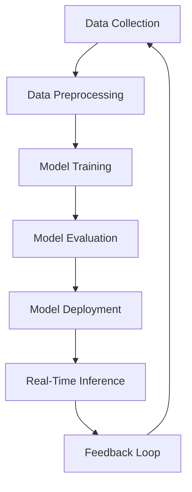

# Lesson 1: Machine Learning Foundations

## 1. First-Principles Intuition & Invariants

Machine learning (ML) is a cornerstone of modern computing, enabling systems to learn from data and improve their performance over time without being explicitly programmed. At its core, ML is a blend of statistics, computer science, and domain expertise, aimed at solving complex problems by identifying patterns and making predictions. The theoretical grounding of ML is deeply rooted in the mathematical principles of probability, linear algebra, and optimization, which provide the invariants and constraints within which ML models operate.

The problem space of ML is vast and varied, encompassing tasks such as image recognition, natural language processing, recommendation systems, and autonomous decision-making. Each of these tasks can be framed as a problem of learning a function that maps inputs to outputs. For instance, in image recognition, the input is a digital image, and the output is a label indicating the object in the image. The challenge lies in defining the function that accurately maps inputs to outputs, given a finite set of training examples.

The invariants of ML include the assumptions that the training data is representative of the real-world data the model will encounter, and that the underlying patterns in the data are consistent over time. These invariants are critical because they ensure that the model generalizes well to unseen data. Violations of these invariants can lead to overfitting, where the model performs well on the training data but poorly on new data, or underfitting, where the model is too simple to capture the underlying patterns in the data.

To understand the mechanics of ML, it is essential to delve into the mathematical foundations. At the heart of ML is the concept of a loss function, which quantifies the difference between the predicted outputs and the actual outputs. The goal of training a model is to minimize this loss function, which is achieved through optimization algorithms such as gradient descent. Gradient descent iteratively updates the model parameters in the direction that reduces the loss, guided by the gradient of the loss function with respect to the parameters.

Another critical invariant in ML is the choice of model architecture, which determines the capacity of the model to learn complex patterns. Common model architectures include linear models, decision trees, neural networks, and support vector machines. Each architecture has its strengths and weaknesses, and the choice of architecture depends on the specific problem and the characteristics of the data.

## 2. Core Architecture & Mechanics

The architecture of a machine learning system can be dissected into several key components: data preprocessing, model training, model evaluation, and model deployment. Each component plays a crucial role in the ML pipeline, and understanding their interactions is essential for building effective ML systems.

### Data Preprocessing

Data preprocessing is the first step in the ML pipeline and involves cleaning, transforming, and normalizing the raw data. This step is critical because the quality of the data directly affects the performance of the model. Common preprocessing techniques include handling missing values, encoding categorical variables, scaling numerical features, and feature selection. Feature selection is particularly important because it reduces the dimensionality of the data, which can improve the model's performance and reduce the risk of overfitting.

### Model Training

Model training involves selecting a model architecture, defining a loss function, and optimizing the model parameters using an optimization algorithm. The choice of model architecture and loss function depends on the specific problem and the characteristics of the data. For instance, in classification problems, common loss functions include cross-entropy loss, while in regression problems, mean squared error is often used.

The optimization algorithm is responsible for updating the model parameters to minimize the loss function. Gradient descent is the most commonly used optimization algorithm, but there are many variants, such as stochastic gradient descent (SGD), mini-batch gradient descent, and Adam. Each variant has its trade-offs in terms of convergence speed and stability.

### Model Evaluation

Model evaluation involves assessing the performance of the trained model on a separate validation dataset. The validation dataset is used to tune the model's hyperparameters and to prevent overfitting. Common evaluation metrics include accuracy, precision, recall, F1-score, and mean squared error. The choice of evaluation metric depends on the specific problem and the business objectives.

### Model Deployment

Model deployment involves integrating the trained model into a production system, where it can be used to make predictions on new data. Deployment can be challenging because it requires ensuring that the model is scalable, reliable, and secure. Common deployment strategies include batch processing, real-time inference, and online learning.

To illustrate the mechanics of ML, consider a simple linear regression model. Linear regression is a linear model that predicts a continuous output variable based on one or more input variables. The model is defined by the equation:

\[ y = \beta_0 + \beta_1 x_1 + \beta_2 x_2 + \ldots + \beta_n x_n + \epsilon \]

where \( y \) is the output variable, \( x_1, x_2, \ldots, x_n \) are the input variables, \( \beta_0, \beta_1, \ldots, \beta_n \) are the model parameters, and \( \epsilon \) is the error term.

The goal of training a linear regression model is to find the values of the parameters that minimize the mean squared error (MSE) loss function:

\[ \text{MSE} = \frac{1}{m} \sum_{i=1}^{m} (y_i - \hat{y}_i)^2 \]

where \( m \) is the number of training examples, \( y_i \) is the actual output, and \( \hat{y}_i \) is the predicted output.

The optimization algorithm used to minimize the MSE loss function is gradient descent. The gradient of the MSE loss function with respect to the parameters is given by:

\[ \frac{\partial \text{MSE}}{\partial \beta_j} = -\frac{2}{m} \sum_{i=1}^{m} (y_i - \hat{y}_i) x_{ij} \]

where \( x_{ij} \) is the \( j \)-th input variable for the \( i \)-th training example.

The gradient descent algorithm iteratively updates the parameters using the following update rule:

\[ \beta_j = \beta_j - \alpha \frac{\partial \text{MSE}}{\partial \beta_j} \]

where \( \alpha \) is the learning rate, which controls the step size of the updates.

The following Mermaid diagram illustrates the architecture of a simple linear regression model:

## 3. High-Performance Optimization & Failure Modes

High-performance optimization is critical for building scalable and efficient ML systems. The performance of an ML system depends on several factors, including the choice of model architecture, the optimization algorithm, the data preprocessing techniques, and the deployment strategy.

### Concurrency

Concurrency is essential for handling large datasets and complex models. Parallel processing can significantly speed up the training and inference processes by distributing the workload across multiple processors or machines. Common parallel processing techniques include data parallelism, model parallelism, and pipeline parallelism. Data parallelism involves splitting the dataset into smaller batches and processing each batch in parallel. Model parallelism involves splitting the model into smaller sub-models and processing each sub-model in parallel. Pipeline parallelism involves splitting the training process into smaller stages and processing each stage in parallel.

### Resource Scaling

Resource scaling is critical for handling large-scale ML workloads. Cloud computing provides the flexibility to scale resources up or down based on demand. Common cloud platforms include Amazon Web Services (AWS), Microsoft Azure, and Google Cloud Platform (GCP). These platforms offer a wide range of services, such as virtual machines, storage, and networking, that can be used to build scalable ML systems.

### Boundary Edge Cases

Boundary edge cases are critical for ensuring the robustness and reliability of ML systems. Edge cases are inputs that are outside the typical range of the training data, and they can cause the model to produce incorrect predictions. Common edge cases include outliers, missing values, and noisy data. Handling edge cases requires careful preprocessing and model tuning. For instance, outliers can be detected and removed using statistical techniques, and missing values can be imputed using interpolation or regression.

### Failure Modes

Failure modes are critical for understanding the limitations and vulnerabilities of ML systems. Common failure modes include overfitting, underfitting, and adversarial attacks. Overfitting occurs when the model is too complex and fits the training data too closely, resulting in poor generalization to new data. Underfitting occurs when the model is too simple and fails to capture the underlying patterns in the data. Adversarial attacks occur when an attacker intentionally perturbs the input data to deceive the model. Handling failure modes requires careful model selection, evaluation, and deployment. For instance, regularization techniques can be used to prevent overfitting, and adversarial training can be used to improve the robustness of the model.

In conclusion, machine learning is a powerful and versatile tool that can solve a wide range of complex problems. The theoretical grounding of ML is rooted in the mathematical principles of probability, linear algebra, and optimization, which provide the invariants and constraints within which ML models operate. The architecture of an ML system involves several key components, including data preprocessing, model training, model evaluation, and model deployment. High-performance optimization and failure modes are critical for building scalable and reliable ML systems. By understanding the first-principles intuition, core architecture, and high-performance optimization of ML, senior software engineers, systems programmers, and domain architects can build effective and efficient ML systems that solve real-world problems.
