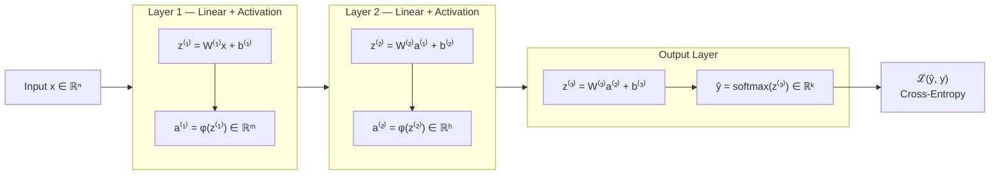
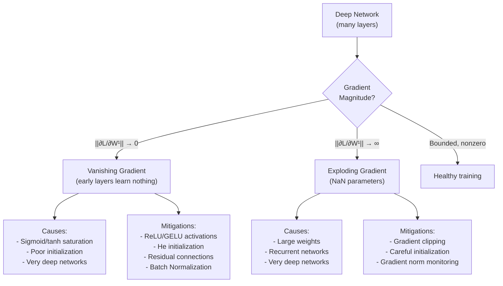
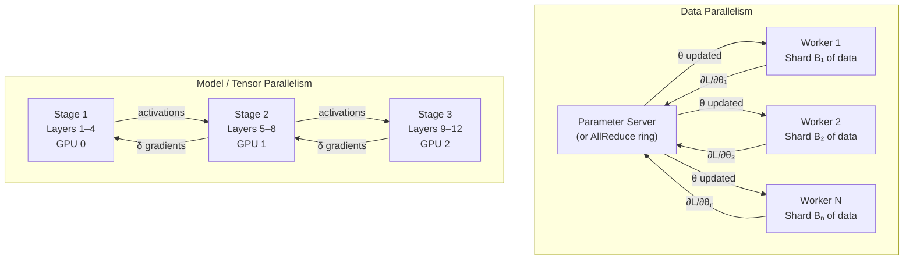
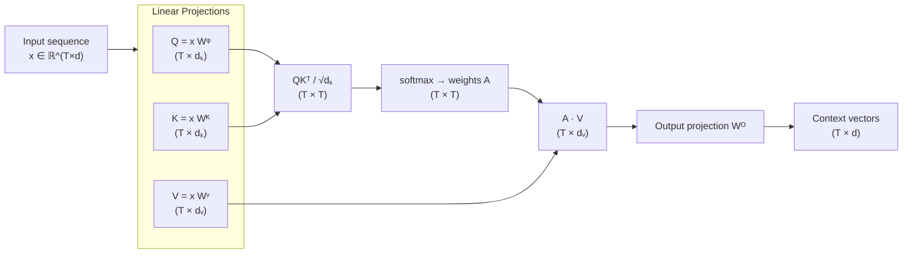

# Lesson 2: Neural Networks — Architecture, Mathematics, and Systems

## 1. First-Principles Intuition & Invariants

### The Universal Approximation Problem

A neural network is a parameterized, differentiable function $f_\theta : \mathbb{R}^n \rightarrow \mathbb{R}^k$ whose parameters $\theta$ are optimized to minimize a scalar objective. The central theoretical justification is the **Universal Approximation Theorem** (Cybenko, 1989; Hornik, 1991): a feedforward network with a single hidden layer of sufficient width and a non-polynomial activation function can approximate any continuous function on a compact subset of $\mathbb{R}^n$ to arbitrary precision. The theorem is existential — it guarantees such a network *exists* but says nothing about how to find it or how wide it must be. Depth, as shown by later work (Montufar et al., 2014), provides an exponential representational advantage over width by composing regions of linear response.

The biological analogy is a productive starting metaphor but should not be over-indexed. Biological neurons operate asynchronously, communicate via spike timing, employ Hebbian and neuromodulatory plasticity, and are organized in architectures refined over hundreds of millions of years. Artificial neurons perform a synchronous, real-valued dot product followed by a scalar nonlinearity. The functional similarity is real but shallow; the computational mechanisms are fundamentally different.

### The Learning Problem as Optimization

Supervised learning casts training as minimizing the **empirical risk**:

$$\mathcal{L}(\theta) = \frac{1}{N} \sum_{i=1}^{N} \ell\bigl(f_\theta(\mathbf{x}_i),\, y_i\bigr) + \lambda \cdot \Omega(\theta)$$

where $\ell$ is a task-specific loss (cross-entropy for classification, MSE for regression), $\Omega(\theta)$ is a regularizer, and $\lambda$ controls the regularization strength. The true objective is the **expected risk** over the data-generating distribution $p_{\text{data}}$:

$$\mathcal{R}(\theta) = \mathbb{E}_{(\mathbf{x}, y) \sim p_{\text{data}}}\bigl[\ell(f_\theta(\mathbf{x}), y)\bigr]$$

Training minimizes empirical risk; generalization is the gap $\mathcal{R}(\theta) - \mathcal{L}(\theta)$. Statistical learning theory bounds this gap via VC dimension or Rademacher complexity, though modern overparameterized networks violate classical assumptions — they interpolate training data yet generalize well, a phenomenon explained by the **implicit regularization** of gradient descent and the **double descent** risk curve (Belkin et al., 2019).

### Key Invariants

Three invariants govern all neural network architectures regardless of domain:

1. **Differentiability chain**: Every computation in the forward pass must be differentiable (or sub-differentiable) with respect to $\theta$ for gradient-based optimization to function. This is enforced by the automatic differentiation (autograd) systems in frameworks like PyTorch and JAX.

2. **Representation bottleneck**: Information cannot be recovered downstream if it is discarded by an activation. A layer with $m$ neurons is a lossy projection of its input; the architecture must preserve sufficient information for the task at each stage.

3. **Symmetry and permutation invariance of weights**: Any permutation of neurons within a hidden layer, applied consistently to both incoming and outgoing weights, produces an identical function. This means the loss surface has at minimum $\prod_l m_l!$ equivalent global minima — a property called **weight-space symmetry**. It has implications for convergence analysis and ensemble methods.

---

## 2. Core Architecture & Mechanics

### Neuron-Level Computation

A single neuron computes:

$$a = \phi\!\left(\sum_{j=1}^{d} w_j x_j + b\right) = \phi(\mathbf{w}^\top \mathbf{x} + b)$$

where $\phi$ is the activation function, $\mathbf{w} \in \mathbb{R}^d$ is the weight vector, and $b \in \mathbb{R}$ is the bias. The bias is geometrically a translation of the decision boundary; without it, all hyperplanes are constrained to pass through the origin.

The vector form across a full layer with $m$ neurons is:

$$\mathbf{z}^{(l)} = \mathbf{W}^{(l)} \mathbf{a}^{(l-1)} + \mathbf{b}^{(l)}, \qquad \mathbf{a}^{(l)} = \phi\!\left(\mathbf{z}^{(l)}\right)$$

where $\mathbf{W}^{(l)} \in \mathbb{R}^{m_l \times m_{l-1}}$ and element-wise application of $\phi$ is implied.

### Activation Functions: Properties and Trade-offs

| Function | Formula | Range | Key Property | Failure Mode |
|---|---|---|---|---|
| Sigmoid | $\frac{1}{1+e^{-z}}$ | $(0, 1)$ | Probabilistic output | Vanishing gradient for $\|z\| \gg 0$ |
| Tanh | $\frac{e^z - e^{-z}}{e^z + e^{-z}}$ | $(-1, 1)$ | Zero-centered | Vanishing gradient |
| ReLU | $\max(0, z)$ | $[0, \infty)$ | Sparse activation, no saturation for $z > 0$ | Dying ReLU (dead neurons) |
| Leaky ReLU | $\max(\alpha z, z),\ \alpha \ll 1$ | $(-\infty, \infty)$ | Prevents dying neurons | $\alpha$ is a hyperparameter |
| GELU | $z \cdot \Phi(z)$ | $(-\infty, \infty)$ | Smooth, stochastic interpretation | Computationally heavier |
| Swish | $z \cdot \sigma(z)$ | $(-\infty, \infty)$ | Self-gated, non-monotonic | Similar cost to GELU |

**ReLU** is the default for deep networks. Its gradient is exactly 1 for $z > 0$, eliminating the exponential gradient decay that plague sigmoid and tanh. The **dying ReLU** problem occurs when a neuron's pre-activation permanently falls below zero (e.g., from a large negative bias update), causing it to output zero and receive zero gradient forever. Leaky ReLU and parametric PReLU address this by allowing a small slope $\alpha$ for $z < 0$.

**GELU** (Gaussian Error Linear Unit), defined as $\text{GELU}(z) = z \cdot \Phi(z)$ where $\Phi$ is the CDF of the standard normal, is used in BERT, GPT, and most modern Transformers. It can be approximated as $0.5z(1 + \tanh[\sqrt{2/\pi}(z + 0.044715z^3)])$ for fast computation.

### Feedforward Network: Full Data Flow



### Backpropagation: The Chain Rule as a Computational Protocol

Backpropagation is not an algorithm unto itself — it is **reverse-mode automatic differentiation** applied to the specific computational graph of a neural network. For a loss $\mathcal{L}$ and an $L$-layer network, we need $\partial \mathcal{L} / \partial \mathbf{W}^{(l)}$ and $\partial \mathcal{L} / \partial \mathbf{b}^{(l)}$ for all $l$.

Define the **error signal** at layer $l$ as:

$$\boldsymbol{\delta}^{(l)} = \frac{\partial \mathcal{L}}{\partial \mathbf{z}^{(l)}}$$

The backward pass computes these recursively from the output layer inward:

**Output layer** (using cross-entropy loss with softmax, which simplifies to):

$$\boldsymbol{\delta}^{(L)} = \hat{\mathbf{y}} - \mathbf{y}$$

**Hidden layers** (applying the chain rule through the weight matrix):

$$\boldsymbol{\delta}^{(l)} = \left(\mathbf{W}^{(l+1)\top} \boldsymbol{\delta}^{(l+1)}\right) \odot \phi'\!\left(\mathbf{z}^{(l)}\right)$$

**Gradient accumulation**:

$$\frac{\partial \mathcal{L}}{\partial \mathbf{W}^{(l)}} = \boldsymbol{\delta}^{(l)} \mathbf{a}^{(l-1)\top}, \qquad \frac{\partial \mathcal{L}}{\partial \mathbf{b}^{(l)}} = \boldsymbol{\delta}^{(l)}$$

The critical implementation detail is **forward pass storage**: to compute $\phi'(\mathbf{z}^{(l)})$ during the backward pass, the pre-activations $\mathbf{z}^{(l)}$ from the forward pass must be retained in memory. For deep networks with large batch sizes, this memory cost — $O(L \times B \times m)$ where $B$ is batch size — dominates the memory budget. **Gradient checkpointing** (trading compute for memory by recomputing activations during backprop) is the standard mitigation.

### Weight Initialization

Initialization is a first-class design decision. Setting all weights to zero makes all neurons in a layer compute identical gradients — **symmetry breaking** requires randomness. However, the *scale* of initialization controls gradient flow at initialization:

- **Too large**: Activations saturate (sigmoid/tanh) or explode; gradients are uninformative.
- **Too small**: Activations collapse toward zero; gradients vanish.

**Xavier/Glorot initialization** (Glorot & Bengio, 2010) maintains variance across layers for symmetric activations (tanh):

$$W \sim \mathcal{U}\!\left[-\frac{\sqrt{6}}{\sqrt{m_{l-1} + m_l}},\; \frac{\sqrt{6}}{\sqrt{m_{l-1} + m_l}}\right]$$

**He initialization** (He et al., 2015) corrects for ReLU's half-rectification, which halves the variance:

$$W \sim \mathcal{N}\!\left(0,\; \frac{2}{m_{l-1}}\right)$$

Using Xavier initialization with ReLU layers is a silent failure — it does not cause a training crash but will produce slower convergence and degraded final accuracy.

---

## 3. Implementation: Production-Grade Forward & Backward Pass

The following Python implementation uses only NumPy, making every operation explicit. This is not a framework replacement — it is an auditable reference implementation for understanding what frameworks do internally.

```python
"""
Production-grade NumPy neural network.
Implements a fully connected feedforward network with:
  - Modular layer abstraction
  - He initialization
  - ReLU hidden activations + Softmax output
  - Mini-batch cross-entropy loss
  - SGD with momentum
"""

import numpy as np
from typing import List, Tuple, Optional


# ─── Activation functions ────────────────────────────────────────────────────

def relu(z: np.ndarray) -> np.ndarray:
    return np.maximum(0.0, z)

def relu_grad(z: np.ndarray) -> np.ndarray:
    """Sub-gradient: 0 at z=0 by convention."""
    return (z > 0).astype(z.dtype)

def softmax(z: np.ndarray) -> np.ndarray:
    """Numerically stable softmax. z shape: (batch, classes)."""
    z_shifted = z - z.max(axis=1, keepdims=True)   # prevent overflow
    exp_z = np.exp(z_shifted)
    return exp_z / exp_z.sum(axis=1, keepdims=True)


# ─── Loss ─────────────────────────────────────────────────────────────────────

def cross_entropy_loss(y_hat: np.ndarray, y_onehot: np.ndarray) -> float:
    """
    y_hat:    (B, K) predicted probabilities
    y_onehot: (B, K) one-hot ground truth
    Returns scalar mean loss.
    """
    eps = 1e-12  # prevent log(0)
    return -np.mean(np.sum(y_onehot * np.log(y_hat + eps), axis=1))


# ─── Layer ────────────────────────────────────────────────────────────────────

class DenseLayer:
    """
    Fully connected layer with optional activation.
    Stores forward-pass cache for backpropagation.
    """

    def __init__(
        self,
        in_features: int,
        out_features: int,
        activation: str = "relu",
        seed: Optional[int] = None,
    ) -> None:
        rng = np.random.default_rng(seed)
        self.activation = activation

        # He initialization for ReLU; Glorot for linear/softmax output
        if activation == "relu":
            std = np.sqrt(2.0 / in_features)
        else:
            std = np.sqrt(1.0 / in_features)

        self.W: np.ndarray = rng.normal(0.0, std, (in_features, out_features))
        self.b: np.ndarray = np.zeros(out_features)

        # Momentum buffers (zero-initialized)
        self.vW: np.ndarray = np.zeros_like(self.W)
        self.vb: np.ndarray = np.zeros_like(self.b)

        # Forward-pass cache
        self._cache: dict = {}

    def forward(self, x: np.ndarray) -> np.ndarray:
        """
        x shape: (B, in_features)
        Returns activation shape: (B, out_features)
        """
        z = x @ self.W + self.b          # (B, out_features)
        self._cache["x"] = x
        self._cache["z"] = z

        if self.activation == "relu":
            a = relu(z)
        elif self.activation == "softmax":
            a = softmax(z)
        elif self.activation == "linear":
            a = z
        else:
            raise ValueError(f"Unknown activation: {self.activation}")

        return a

    def backward(self, delta: np.ndarray) -> Tuple[np.ndarray, np.ndarray, np.ndarray]:
        """
        delta: upstream gradient ∂L/∂a, shape (B, out_features)

        Returns:
          dW:    gradient w.r.t. W, shape (in_features, out_features)
          db:    gradient w.r.t. b, shape (out_features,)
          dx:    gradient w.r.t. input x, shape (B, in_features)

        Note: for the output softmax layer combined with cross-entropy,
        the caller pre-computes delta = ŷ - y_onehot (the combined gradient),
        bypassing the need for the softmax Jacobian.
        """
        x = self._cache["x"]
        z = self._cache["z"]

        if self.activation == "relu":
            # Element-wise multiply by local gradient of activation
            delta = delta * relu_grad(z)   # (B, out_features)
        # For softmax + cross-entropy the combined delta is passed in directly.
        # For linear, delta passes through unchanged.

        B = x.shape[0]
        dW = x.T @ delta / B              # (in_features, out_features)
        db = delta.mean(axis=0)           # (out_features,)
        dx = delta @ self.W.T             # (B, in_features)

        # Store gradients for the optimizer
        self._dW = dW
        self._db = db

        return dW, db, dx

    def step(self, lr: float, momentum: float = 0.9) -> None:
        """SGD with momentum update."""
        self.vW = momentum * self.vW - lr * self._dW
        self.vb = momentum * self.vb - lr * self._db
        self.W += self.vW
        self.b += self.vb


# ─── Network ──────────────────────────────────────────────────────────────────

class FeedforwardNet:
    """
    Configurable feedforward network.

    Example — 3-layer classifier:
        net = FeedforwardNet(
            layer_dims=[784, 256, 128, 10],
            activations=["relu", "relu", "softmax"],
        )
    """

    def __init__(
        self,
        layer_dims: List[int],
        activations: List[str],
        seed: int = 42,
    ) -> None:
        assert len(activations) == len(layer_dims) - 1, (
            "Need one activation per inter-layer transition."
        )
        self.layers: List[DenseLayer] = [
            DenseLayer(layer_dims[i], layer_dims[i + 1], activations[i], seed=seed + i)
            for i in range(len(activations))
        ]

    def forward(self, x: np.ndarray) -> np.ndarray:
        for layer in self.layers:
            x = layer.forward(x)
        return x  # final activations = ŷ

    def backward(self, y_hat: np.ndarray, y_onehot: np.ndarray) -> None:
        """
        Compute all gradients via reverse-mode autodiff.
        The combined softmax + cross-entropy gradient is ŷ - y.
        """
        delta = y_hat - y_onehot          # (B, K) — combined output gradient
        for layer in reversed(self.layers):
            dW, db, delta = layer.backward(delta)

    def step(self, lr: float, momentum: float = 0.9) -> None:
        for layer in self.layers:
            layer.step(lr, momentum)

    def train_epoch(
        self,
        X: np.ndarray,
        Y: np.ndarray,
        batch_size: int = 64,
        lr: float = 1e-3,
        momentum: float = 0.9,
    ) -> float:
        """
        Single epoch of mini-batch SGD with momentum.
        X: (N, D), Y: (N, K) one-hot
        Returns mean loss over the epoch.
        """
        N = X.shape[0]
        indices = np.random.permutation(N)
        total_loss = 0.0
        n_batches = 0

        for start in range(0, N, batch_size):
            idx = indices[start : start + batch_size]
            xb, yb = X[idx], Y[idx]

            y_hat = self.forward(xb)
            total_loss += cross_entropy_loss(y_hat, yb)
            self.backward(y_hat, yb)
            self.step(lr, momentum)
            n_batches += 1

        return total_loss / n_batches


# ─── Demonstration ─────────────────────────────────────────────────────────────

if __name__ == "__main__":
    rng = np.random.default_rng(0)

    # Synthetic 4-class classification: 1000 samples, 20 features
    N, D, K = 1000, 20, 4
    X = rng.normal(size=(N, D)).astype(np.float32)
    Y_labels = rng.integers(0, K, size=N)
    Y_onehot = np.eye(K)[Y_labels]

    net = FeedforwardNet(
        layer_dims=[D, 128, 64, K],
        activations=["relu", "relu", "softmax"],
    )

    for epoch in range(20):
        loss = net.train_epoch(X, Y_onehot, batch_size=64, lr=1e-2, momentum=0.9)
        if (epoch + 1) % 5 == 0:
            y_hat = net.forward(X)
            acc = (y_hat.argmax(axis=1) == Y_labels).mean()
            print(f"Epoch {epoch+1:3d} | loss={loss:.4f} | train_acc={acc:.3f}")
```

---

## 4. High-Performance Optimization & Failure Modes

### The Loss Landscape

A common misconception is that the goal of training is to find a *global minimum* of $\mathcal{L}(\theta)$. The loss surface of a deep network is a non-convex hypersurface in a space with millions to billions of dimensions. It contains exponentially many saddle points, local minima, and flat regions. However, work by Choromanska et al. (2015) and empirical evidence suggest that most local minima in deep networks are of similar quality, and that saddle points — not local minima — are the dominant obstacle in practice.

The practical implication: **finding a sharp minimum is undesirable**. Flatter minima generalize better (Hochreiter & Schmidhuber, 1997; Keskar et al., 2017) because a flat basin is more robust to perturbations in $\theta$ that result from distribution shift. This insight motivates sharpness-aware minimization (SAM) and batch size scheduling.

### Optimization Algorithms: Mechanics

**Vanilla SGD** with batch $\mathcal{B}$:

$$\theta_{t+1} = \theta_t - \eta \cdot \frac{1}{|\mathcal{B}|} \sum_{i \in \mathcal{B}} \nabla_\theta \ell_i(\theta_t)$$

**SGD with Nesterov Momentum**: evaluates the gradient at a *look-ahead* position, reducing oscillation in ravines:

$$\mathbf{v}_{t+1} = \mu \mathbf{v}_t - \eta \nabla_\theta \mathcal{L}(\theta_t + \mu \mathbf{v}_t)$$
$$\theta_{t+1} = \theta_t + \mathbf{v}_{t+1}$$

**Adam** (Kingma & Ba, 2015) maintains per-parameter adaptive learning rates via first and second moment estimates:

$$m_t = \beta_1 m_{t-1} + (1 - \beta_1) g_t \quad \text{(first moment)}$$
$$v_t = \beta_2 v_{t-1} + (1 - \beta_2) g_t^2 \quad \text{(second moment)}$$
$$\hat{m}_t = \frac{m_t}{1 - \beta_1^t}, \quad \hat{v}_t = \frac{v_t}{1 - \beta_2^t} \quad \text{(bias correction)}$$
$$\theta_{t+1} = \theta_t - \frac{\eta}{\sqrt{\hat{v}_t} + \epsilon} \hat{m}_t$$

Default hyperparameters ($\beta_1 = 0.9$, $\beta_2 = 0.999$, $\epsilon = 10^{-8}$) work well across a wide range of tasks. A well-documented failure mode of Adam is **weight decay conflation**: the standard L2 regularization term $\lambda \|\theta\|^2$ added to the loss does not behave as true weight decay under adaptive methods because the per-parameter scale factor modifies the effective penalty. **AdamW** (Loshchilov & Hutter, 2019) decouples weight decay, applying it directly to the parameter update, and is now the default in most large-scale training.

### Gradient Pathologies



**Gradient clipping** caps the global gradient norm before the parameter update:

$$\text{if} \quad \|\mathbf{g}\|_2 > \tau, \quad \mathbf{g} \leftarrow \frac{\tau}{\|\mathbf{g}\|_2} \mathbf{g}$$

This is essential for recurrent networks and transformers. The threshold $\tau$ is typically set to 1.0 or 5.0.

### Regularization: Mechanisms and Trade-offs

**L2 regularization** (weight decay) adds $\frac{\lambda}{2}\|\theta\|_2^2$ to the loss, pulling all weights toward zero proportionally to their magnitude. Geometrically, it constrains parameters to an $\ell_2$ ball, biasing toward diffuse weight distributions.

**L1 regularization** adds $\lambda\|\theta\|_1$, which produces *sparse* solutions — many weights go to exactly zero. The sub-gradient at zero is defined as 0 by convention. L1 is rarely used in deep learning due to training instability, but is effective for feature selection in shallow linear models.

**Dropout** (Srivastava et al., 2014) stochastically zeros each neuron's output with probability $p$ during training, then scales outputs by $\frac{1}{1-p}$ at test time (inverted dropout). The standard interpretation is an ensemble of $2^m$ sub-networks sharing weights. The correct implementation is:

```python
def dropout(x: np.ndarray, p: float, training: bool) -> np.ndarray:
    """
    Inverted dropout. p is the drop probability (fraction of neurons zeroed).
    At test time, returns x unmodified — the scaling is applied during training.
    """
    if not training:
        return x
    # Bernoulli mask: each element kept with probability (1 - p)
    mask = (np.random.rand(*x.shape) > p).astype(x.dtype)
    return x * mask / (1.0 - p)   # scale to maintain expected activation magnitude
```

**Batch Normalization** (Ioffe & Szegedy, 2015) normalizes pre-activations within a mini-batch, then applies learnable scale $\gamma$ and shift $\beta$:

$$\hat{z}_i = \frac{z_i - \mu_\mathcal{B}}{\sqrt{\sigma_\mathcal{B}^2 + \epsilon}}, \qquad y_i = \gamma \hat{z}_i + \beta$$

During inference, $\mu_\mathcal{B}$ and $\sigma_\mathcal{B}^2$ are replaced by running statistics accumulated during training (exponential moving average). BatchNorm reduces internal covariate shift — the change in the distribution of each layer's input as parameters of previous layers are updated — which allows higher learning rates and reduces sensitivity to initialization. It also acts as a mild regularizer (each sample is normalized relative to its batch, adding noise), making dropout less necessary when BatchNorm is present.

**Layer Normalization** (Ba et al., 2016) normalizes across the feature dimension rather than the batch dimension, making it independent of batch size. It is preferred for sequence models (RNNs, Transformers) where batch statistics are unreliable.

### Overfitting, Underfitting, and the Bias-Variance Decomposition

The expected test error decomposes as:

$$\mathbb{E}[(y - f_\theta(\mathbf{x}))^2] = \underbrace{\text{Bias}^2[f_\theta]}_{\text{underfitting}} + \underbrace{\text{Var}[f_\theta]}_{\text{overfitting}} + \underbrace{\sigma^2_\epsilon}_{\text{irreducible noise}}$$

- **High bias** (underfitting): the model family $\{f_\theta\}$ cannot represent the true function. Increase capacity (wider/deeper), use a more expressive architecture, or reduce regularization.
- **High variance** (overfitting): the model is too sensitive to the training sample. Increase training data, increase regularization, reduce model capacity, or use early stopping.

The **double descent** phenomenon observes that as model capacity increases past the interpolation threshold (where the network can perfectly fit training data), test error *decreases again*. This violates the classical U-shaped bias-variance curve and is the primary reason heavily overparameterized models like GPT-4 generalize despite near-zero training loss.

### Distributed Training Architecture



**Data parallelism** replicates the full model on each device and splits the data batch. Gradients are averaged across devices via **AllReduce** (NCCL ring-AllReduce has $O(2(N-1)/N \cdot |\theta|)$ communication cost, asymptotically bandwidth-optimal). The **parameter server** pattern is an older alternative that bottlenecks at the server.

**Model parallelism** (pipeline parallelism) shards the model itself across devices, necessary when the model exceeds single-device memory. **Micro-batching** (GPipe, PipeDream) fills the pipeline by splitting a mini-batch into micro-batches, reducing GPU idle time (the "pipeline bubble").

**ZeRO** (Rajbhandari et al., 2020) in DeepSpeed partitions optimizer states, gradients, and parameters across data-parallel ranks, reducing per-device memory from $O(|\theta|)$ to $O(|\theta|/N)$ while maintaining data-parallel communication patterns. This is the dominant strategy for LLM training.

---

## 5. Modern Architectural Variants

### Residual Connections

Introduced in ResNet (He et al., 2016), the residual block computes:

$$\mathbf{a}^{(l+2)} = \phi\!\left(\mathbf{z}^{(l+2)}\right) + \mathbf{a}^{(l)}$$

The skip connection creates a direct gradient path from $\mathbf{a}^{(l+2)}$ back to $\mathbf{a}^{(l)}$, with gradient:

$$\frac{\partial \mathcal{L}}{\partial \mathbf{a}^{(l)}} = \frac{\partial \mathcal{L}}{\partial \mathbf{a}^{(l+2)}} \cdot \left(\frac{\partial \mathbf{a}^{(l+2)}}{\partial \mathbf{a}^{(l)}} + \mathbf{I}\right)$$

The identity term $\mathbf{I}$ ensures that the gradient contains an additive contribution of 1 regardless of the intermediate layer weights. This prevents vanishing gradients in very deep networks and enables training of networks with 100+ layers.

### Attention Mechanism

The attention mechanism, foundational to the Transformer architecture (Vaswani et al., 2017), computes a weighted sum of **values** where the weights are determined by the compatibility of a **query** with a set of **keys**:

$$\text{Attention}(\mathbf{Q}, \mathbf{K}, \mathbf{V}) = \text{softmax}\!\left(\frac{\mathbf{Q}\mathbf{K}^\top}{\sqrt{d_k}}\right)\mathbf{V}$$

The $\sqrt{d_k}$ scaling prevents the dot products from growing large in magnitude as $d_k$ increases, which would push the softmax into saturation regions with near-zero gradients. Multi-head attention runs $h$ attention functions in parallel on projected subspaces, then concatenates:

$$\text{MHA}(\mathbf{Q},\mathbf{K},\mathbf{V}) = \text{Concat}(\text{head}_1, \ldots, \text{head}_h)\,\mathbf{W}^O$$

where $\text{head}_i = \text{Attention}(\mathbf{Q}\mathbf{W}_i^Q, \mathbf{K}\mathbf{W}_i^K, \mathbf{V}\mathbf{W}_i^V)$.



---

## 6. Failure Mode Reference

| Failure Mode | Observable Symptom | Root Cause | Diagnostic Action | Mitigation |
|---|---|---|---|---|
| Vanishing gradient | Near-zero weight updates in early layers; loss plateaus immediately | Saturating activations, poor init, depth | Log gradient norms per layer each epoch | ReLU/GELU, He init, residual connections, BatchNorm |
| Exploding gradient | NaN loss or parameters; wildly oscillating loss | Large weights, high LR, recurrence | Monitor `torch.nn.utils.clip_grad_norm_` return value | Gradient clipping ($\tau = 1.0$), reduce LR |
| Dying ReLU | Fraction of zero activations grows monotonically; neurons become permanently inactive | Negative bias accumulation, high LR with ReLU | Monitor mean activation magnitude per layer | Leaky ReLU, careful LR scheduling, weight init |
| Overfitting | Train loss $\ll$ val loss; val loss increases after initial decrease | Insufficient data or regularization | Learning curves | Dropout, weight decay, data augmentation, early stopping |
| Underfitting | Both losses high and not converging | Insufficient capacity or too-short training | Loss magnitude; gradient norms | Increase width/depth, train longer, reduce regularization |
| Label leakage | Unrealistically high validation accuracy | Validation data included in preprocessing (e.g., StandardScaler fit on full dataset) | Audit preprocessing pipeline ordering | Fit all preprocessing on training split only |
| Batch size pathology | Good train loss, poor generalization; gradient noise too low | Very large batch → sharp minima | SAM sharpness metric | Linear LR warmup, LR scaling with batch size, smaller batches |
| Data pipeline bottleneck | GPU utilization < 50%; training stalls intermittently | CPU data loading slower than GPU compute | `nvidia-smi` + `dstat` concurrent profiling | `num_workers`, `pin_memory`, `prefetch_factor`, async I/O |

---

## 7. Computational Complexity and Memory Analysis

For a network with $L$ layers, layer widths $m_l$, and batch size $B$:

| Quantity | Complexity |
|---|---|
| Parameters | $\sum_{l=1}^{L} (m_{l-1} \cdot m_l + m_l)$ |
| FLOPs per forward pass | $\sum_{l=1}^{L} 2 B m_{l-1} m_l$ (factor 2 for multiply-add) |
| Activation memory (training) | $O\!\left(B \sum_{l=1}^{L} m_l\right)$ |
| Gradient memory | Equal to parameter count (1 gradient per parameter) |
| Optimizer state (Adam) | $2\times$ parameter count (first + second moment) |

For a 100-layer network with uniform width 1024 and batch size 256:
- Parameters: $\approx 10^8$ (100M), requiring ~400 MB in float32
- Activations: $256 \times 100 \times 1024 \times 4\ \text{bytes} \approx 100\ \text{MB}$
- Adam optimizer state: ~800 MB
- Total training memory footprint: ~1.3 GB, before framework overhead

This analysis demonstrates why large model training is dominated by optimizer state memory rather than activation memory, motivating techniques such as mixed-precision training (storing activations in float16, optimizer state in float32) and ZeRO optimizer partitioning.

---

## 8. Lab: Diagnosing a Broken Training Loop

The following exercise presents intentionally broken training code. The student's task is to identify and fix all bugs before running.

```python
"""
Lab Exercise: This code contains 5 deliberate bugs related to concepts
covered in this lesson. Identify and correct all of them.

Bug categories: initialization, normalization, loss computation,
                gradient flow, train/eval mode.
"""

import numpy as np

rng = np.random.default_rng(99)
N, D, K = 500, 16, 3

X_all = rng.normal(size=(N, D))
Y_all = rng.integers(0, K, size=N)

# Bug 1: Preprocessing leak — StandardScaler equivalent fit on full dataset
mean = X_all.mean(axis=0)
std  = X_all.std(axis=0)
X_norm = (X_all - mean) / (std + 1e-8)

# Split AFTER normalization (bug already committed above)
split = int(0.8 * N)
X_train, X_val = X_norm[:split], X_norm[split:]
Y_train, Y_val = Y_all[:split],  Y_all[split:]

Y_train_oh = np.eye(K)[Y_train]
Y_val_oh   = np.eye(K)[Y_val]

# Bug 2: Zero initialization — breaks symmetry requirement
W1 = np.zeros((D, 64))
b1 = np.zeros(64)
W2 = np.zeros((64, K))
b2 = np.zeros(K)

lr = 0.01

for epoch in range(30):
    # Forward pass
    z1 = X_train @ W1 + b1
    a1 = np.maximum(0, z1)                  # ReLU

    z2 = a1 @ W2 + b2
    exp_z = np.exp(z2)
    # Bug 3: softmax without numerical stabilization (overflow for large z2)
    y_hat = exp_z / exp_z.sum(axis=1, keepdims=True)

    # Bug 4: loss computed WITHOUT averaging over batch dimension
    eps = 1e-12
    loss = -np.sum(Y_train_oh * np.log(y_hat + eps))

    # Backward pass — combined softmax+CE gradient
    delta2 = y_hat - Y_train_oh              # (N, K)
    dW2 = a1.T @ delta2 / split
    db2 = delta2.mean(axis=0)

    delta1 = delta2 @ W2.T                   # (N, 64)
    # Bug 5: ReLU gradient missing — delta1 not masked by (z1 > 0)
    dW1 = X_train.T @ delta1 / split
    db1 = delta1.mean(axis=0)

    W2 -= lr * dW2;  b2 -= lr * db2
    W1 -= lr * dW1;  b1 -= lr * db1

    if (epoch + 1) % 10 == 0:
        print(f"Epoch {epoch+1}: loss={loss:.4f}")

# --- CORRECTED VERSION (reference) ---
# Bug 1: Fit mean/std only on X_train[:split], then apply to both splits.
# Bug 2: Use He initialization — W1 = rng.normal(0, sqrt(2/D), (D, 64)), etc.
# Bug 3: Subtract max before exp: exp_z = np.exp(z2 - z2.max(axis=1, keepdims=True))
# Bug 4: Divide loss by batch size N: loss = -np.sum(...) / split
# Bug 5: Apply ReLU mask: delta1 = delta1 * (z1 > 0)
```

---

## Summary

Neural networks are differentiable, parameterized function approximators trained by minimizing empirical risk via gradient-based optimization. Their representational power comes from the composition of non-linear transformations; their trainability depends critically on activation choice, initialization scheme, and gradient flow preservation through architectural design. The forward pass is a sequence of matrix multiplications and element-wise nonlinearities; the backward pass is reverse-mode automatic differentiation, computing parameter gradients via the chain rule while re-using cached intermediate values. Optimization algorithms from SGD to AdamW exploit first- and second-order gradient statistics to accelerate convergence. Regularization methods — weight decay, dropout, batch normalization, and early stopping — control the bias-variance trade-off. At scale, distributed training via data parallelism, model parallelism, and optimizer-state sharding (ZeRO) is required. Modern architectures extend this foundation with residual connections for depth scalability and attention mechanisms for structured sequence modeling.
