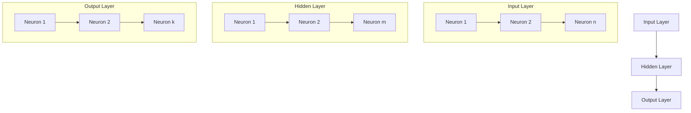

# Lesson 2: Neural Networks

## 1. First-Principles Intuition & Invariants

Neural networks represent a profound intersection of mathematics, computer science, and cognitive science, offering a powerful framework for modeling complex patterns and relationships within data. At their core, neural networks are inspired by the biological neural networks found in the human brain, where interconnected neurons process and transmit information through electrical signals. However, the artificial neural networks we implement in computing are abstractions that leverage mathematical functions to approximate these biological processes.

The fundamental problem space addressed by neural networks is the ability to learn from data. This learning process is grounded in the concept of a loss function, which quantifies the difference between the predicted output of the network and the actual target values. The goal of training a neural network is to minimize this loss function, thereby improving the accuracy of the model's predictions. This minimization is achieved through an iterative process known as backpropagation, which adjusts the weights of the network in a manner that reduces the loss.

Mathematically, a neural network can be viewed as a composition of functions, each representing a layer in the network. Each layer applies a linear transformation to its input, followed by a non-linear activation function. The linear transformation is parameterized by a weight matrix and a bias vector, which are adjusted during training to minimize the loss function. The choice of activation function is crucial, as it introduces non-linearity into the model, allowing it to learn complex patterns. Common activation functions include the sigmoid, hyperbolic tangent (tanh), and rectified linear unit (ReLU).

The invariants of neural networks lie in their ability to generalize from training data to unseen data. This generalization capability is a result of the network's capacity to capture the underlying structure of the data, rather than memorizing the training examples. Overfitting, where the network performs well on training data but poorly on new data, is a common challenge in neural network training. Regularization techniques, such as L1 and L2 regularization, dropout, and early stopping, are employed to mitigate overfitting and improve generalization.

## 2. Core Architecture & Mechanics

The architecture of a neural network is defined by its layers, which can be categorized into input, hidden, and output layers. The input layer receives the raw data, which is then processed through one or more hidden layers before being outputted through the output layer. Each layer consists of a set of neurons, which are interconnected through weighted edges. The weights of these edges are adjusted during training to minimize the loss function.

To illustrate the internal data structures and algorithms of a neural network, consider a simple feedforward neural network with one hidden layer. The network consists of an input layer with \( n \) neurons, a hidden layer with \( m \) neurons, and an output layer with \( k \) neurons. The input layer receives a vector \( \mathbf{x} \) of size \( n \), which is transformed by the hidden layer and then by the output layer to produce a vector \( \mathbf{y} \) of size \( k \).

The forward pass of the network can be described as follows:

1. **Input Layer to Hidden Layer:**
   \[
   \mathbf{z}^{(1)} = \mathbf{W}^{(1)} \mathbf{x} + \mathbf{b}^{(1)}
   \]
   \[
   \mathbf{a}^{(1)} = \sigma(\mathbf{z}^{(1)})
   \]
   Here, \( \mathbf{W}^{(1)} \) is the weight matrix of size \( m \times n \), \( \mathbf{b}^{(1)} \) is the bias vector of size \( m \), and \( \sigma \) is the activation function.

2. **Hidden Layer to Output Layer:**
   \[
   \mathbf{z}^{(2)} = \mathbf{W}^{(2)} \mathbf{a}^{(1)} + \mathbf{b}^{(2)}
   \]
   \[
   \mathbf{y} = \sigma(\mathbf{z}^{(2)})
   \]
   Here, \( \mathbf{W}^{(2)} \) is the weight matrix of size \( k \times m \), \( \mathbf{b}^{(2)} \) is the bias vector of size \( k \), and \( \sigma \) is the activation function.

The backpropagation algorithm is used to adjust the weights and biases of the network during training. The algorithm computes the gradient of the loss function with respect to each weight and bias, and then updates the weights and biases in the direction that reduces the loss. The update rule for the weights and biases can be described as follows:

1. **Compute the gradient of the loss with respect to the output:**
   \[
   \delta^{(2)} = \frac{\partial \mathcal{L}}{\partial \mathbf{z}^{(2)}} \odot \sigma'(\mathbf{z}^{(2)})
   \]
   Here, \( \mathcal{L} \) is the loss function, and \( \sigma' \) is the derivative of the activation function.

2. **Backpropagate the error to the hidden layer:**
   \[
   \delta^{(1)} = (\mathbf{W}^{(2)T} \delta^{(2)}) \odot \sigma'(\mathbf{z}^{(1)})
   \]

3. **Update the weights and biases:**
   \[
   \mathbf{W}^{(2)} = \mathbf{W}^{(2)} - \eta \mathbf{a}^{(1)} (\delta^{(2)})^T
   \]
   \[
   \mathbf{b}^{(2)} = \mathbf{b}^{(2)} - \eta \delta^{(2)}
   \]
   \[
   \mathbf{W}^{(1)} = \mathbf{W}^{(1)} - \eta \mathbf{x} (\delta^{(1)})^T
   \]
   \[
   \mathbf{b}^{(1)} = \mathbf{b}^{(1)} - \eta \delta^{(1)}
   \]
   Here, \( \eta \) is the learning rate, which controls the step size of the updates.

To visualize the architecture of a simple feedforward neural network, we can use a Mermaid diagram:

## 3. High-Performance Optimization & Failure Modes

The performance of a neural network is influenced by various factors, including the choice of architecture, the size of the training dataset, the learning rate, and the optimization algorithm. High-performance optimization involves techniques that improve the efficiency and effectiveness of the training process.

One critical aspect of optimization is the choice of activation function. Activation functions introduce non-linearity into the model, allowing it to learn complex patterns. However, different activation functions have different properties that can affect the training process. For example, the sigmoid and tanh activation functions can suffer from vanishing gradient problems, where the gradients become very small, slowing down the training process. In contrast, the ReLU activation function addresses this issue by allowing gradients to flow more easily, leading to faster convergence.

Another important aspect of optimization is the choice of optimization algorithm. Stochastic gradient descent (SGD) is a popular optimization algorithm that updates the weights and biases using a single training example at a time. However, SGD can be noisy and may converge slowly. Variants of SGD, such as momentum, RMSprop, and Adam, incorporate additional mechanisms to improve convergence and stability.

Concurrency and resource scaling are also critical for high-performance training. Modern neural networks can have millions or even billions of parameters, requiring significant computational resources. Distributed training techniques, such as data parallelism and model parallelism, can be used to distribute the training process across multiple GPUs or machines, improving training speed and efficiency.

Failure modes in neural networks can arise from various sources, including overfitting, underfitting, and poor generalization. Overfitting occurs when the network performs well on training data but poorly on new data, indicating that the network has memorized the training examples rather than learning the underlying structure of the data. Underfitting occurs when the network is too simple to capture the underlying structure of the data, leading to poor performance on both training and new data. Poor generalization can arise from a variety of factors, including insufficient training data, inappropriate model complexity, and suboptimal hyperparameters.

To mitigate these failure modes, various techniques can be employed. Regularization techniques, such as L1 and L2 regularization, dropout, and early stopping, can help prevent overfitting by adding constraints to the model. Data augmentation can be used to increase the size and diversity of the training dataset, improving generalization. Hyperparameter tuning, such as grid search and random search, can be used to find the optimal hyperparameters for the model.

In conclusion, neural networks provide a powerful framework for modeling complex patterns and relationships within data. By understanding the first-principles intuition and invariants of neural networks, as well as their core architecture and mechanics, we can build and train high-performance models that generalize well to new data. Through careful optimization and mitigation of failure modes, we can leverage the full potential of neural networks in a wide range of applications.
