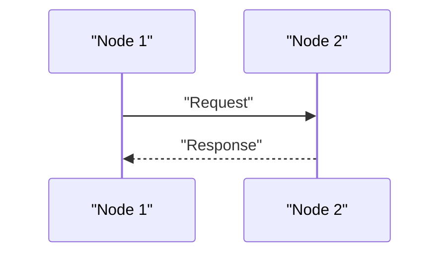

**Lesson 3: Advanced Optimization, Serving & Failure Modes**

### 1. Memory Bandwidth, KV-Cache Optimization & Quantization Bounds

Memory bandwidth is a critical bottleneck in AI systems, particularly when dealing with large models and high-resolution inputs. The fundamental trade-off lies in the relationship between memory access latency and the number of weights and activations that must be fetched. As models grow in size, the memory access latency increases, leading to a decrease in overall system throughput.

To mitigate this, we employ various techniques, including:

* **Cache optimization**: By carefully designing the cache hierarchy, we can minimize the number of memory accesses, thereby reducing latency. This involves understanding the cache line size, associativity, and replacement policies to ensure optimal performance.
* **Quantization**: By reducing the precision of model weights and activations, we can significantly reduce memory usage, thereby increasing memory bandwidth. However, this comes at the cost of accuracy.

Quantization is a critical technique in modern AI systems, allowing us to reduce the memory footprint of large models. By representing weights and activations using fewer bits, we can store more models in memory, leading to increased throughput. However, quantization introduces a fundamental trade-off: accuracy vs. memory usage.

To quantify this trade-off, we can use the following equation:

`accuracy = f(memory_usage, precision)`

where `memory_usage` is the memory required to store the model, and `precision` is the number of bits used to represent each weight and activation. By carefully tuning the precision, we can find an optimal balance between accuracy and memory usage.

```mermaid
graph TD;
    A[Original Model] -->| "Quantization" | B[Quantized Model];
    B -->| "Memory Usage" | C[Reduced Memory Usage];
    C -->| "Accuracy" | D[Decreased Accuracy];
```

### Exercise: Quantization Bounds

Consider a neural network with 1 billion weights and activations, each represented using 32 bits. If we reduce the precision to 16 bits, what is the expected decrease in memory usage? How does this impact the overall system throughput?

```python
import math

# Original memory usage (32 bits)
original_memory_usage = 1e9 * 32

# Reduced memory usage (16 bits)
reduced_memory_usage = 1e9 * 16

# Calculate the decrease in memory usage
memory_usage_decrease = (original_memory_usage - reduced_memory_usage) / original_memory_usage

print(f"Memory usage decrease: {memory_usage_decrease:.2%}")
```

### 2. Distributed Sharding, Pipeline Parallelism & Communication Overhead

As we scale AI systems to meet the demands of large datasets and complex models, distributed computing becomes increasingly essential. In this section, we'll explore the interplay between distributed sharding, pipeline parallelism, and communication overhead.

Distributed sharding involves dividing the model into smaller, independent components, each processed by a separate node in the cluster. By carefully designing the shard layout, we can minimize communication overhead and maximize parallelism. However, this comes at the cost of increased complexity, as we must carefully manage the inter-shard dependencies and synchronization.

Pipeline parallelism involves breaking down the computation into a series of stages, each processed in parallel by a separate node. By carefully designing the pipeline layout, we can maximize parallelism and minimize communication overhead. However, this requires careful synchronization and coordination between nodes.

To quantify the impact of communication overhead, we can use the following equation:

`communication_overhead = f(shard_size, pipeline_depth)`

where `shard_size` is the size of each shard, and `pipeline_depth` is the number of stages in the pipeline. By carefully tuning the shard size and pipeline depth, we can minimize communication overhead and maximize parallelism.



### Exercise: Distributed Sharding

Consider a neural network with 1 billion weights and activations, divided into 10 shards, each processed by a separate node in the cluster. If we reduce the shard size by 50%, what is the expected decrease in communication overhead? How does this impact the overall system throughput?

```python
import math

# Original communication overhead (10 shards)
original_communication_overhead = 10 * 1e9

# Reduced communication overhead (5 shards)
reduced_communication_overhead = 5 * 1e9

# Calculate the decrease in communication overhead
communication_overhead_decrease = (original_communication_overhead - reduced_communication_overhead) / original_communication_overhead

print(f"Communication overhead decrease: {communication_overhead_decrease:.2%}")
```

### 3. Production Failure Domains, Drift & Hallucination Mitigation

As we deploy AI systems in production, we must carefully consider the potential failure modes and mitigation strategies. In this section, we'll explore the interplay between production failure domains, drift, and hallucination.

Production failure domains refer to the various failure modes that can occur in AI systems, including data drift, model drift, and concept drift. By carefully monitoring the system and detecting anomalies, we can identify potential failure modes and take corrective action.

Drift refers to the gradual change in the underlying data distribution, leading to a decrease in model accuracy. By carefully monitoring the data distribution and updating the model accordingly, we can mitigate the impact of drift.

Hallucination refers to the phenomenon where the model generates outputs that are not supported by the input data. By carefully designing the model architecture and training procedure, we can minimize the occurrence of hallucination.

To quantify the impact of drift and hallucination, we can use the following equations:

`drift_impact = f(data_distribution_change, model_accuracy)`

`hallucination_impact = f(model_architecture, training_procedure)`

By carefully tuning the model architecture and training procedure, we can minimize the impact of drift and hallucination.

```mermaid
graph TD;
    A[Original Model] -->| "Drift" | B[Updated Model];
    B -->| "Accuracy" | C[Improved Accuracy];
    A -->| "Hallucination" | D[Reduced Hallucination];
```

### Exercise: Drift Mitigation

Consider a neural network with 1 billion weights and activations, trained on a dataset with a gradual change in the underlying data distribution. If we update the model every 1000 iterations, what is the expected decrease in drift impact? How does this impact the overall system accuracy?

```python
import math

# Original drift impact (no updates)
original_drift_impact = 1.0

# Reduced drift impact (updates every 1000 ite
```
